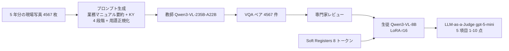
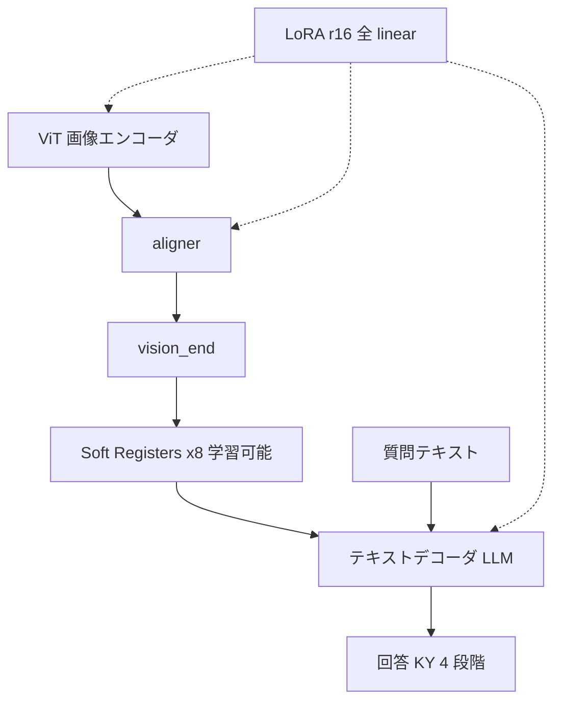

# 構造化知識蒸留と Visual Attention 最適化によるドメイン特化型 VLM の構築（NTT 東日本, NLP2026）

- **Authors**: 柴田高志, 田村颯樹, 月江惇元, 宮﨑淳, 髙野奨太, 中山和子（NTT 東日本株式会社）
- **Venue**: 言語処理学会 第32回年次大会（NLP2026）C4-2（査読なし、CC BY 4.0）
- **Date**: 2026-03
- **Link**: [予稿 PDF](https://www.anlp.jp/proceedings/annual_meeting/2026/pdf_dir/C4-2.pdf)
- **Type**: 学術論文（通信事業者の業務適用研究）
- **蒸留判定**: **黒箱蒸留（合成データ型）** — 教師 Qwen3-VL-235B-A22B-Instruct が作った VQA で、生徒 Qwen3-VL-8B を LoRA 学習
- **エビデンス品質**: **一次資料**（著者自身の実験。査読なし。評価は gpt-5-mini による LLM-as-a-Judge で、人手の正解データはない）

## Abstract

近年、VLM の発展により画像とテキストを統合的に理解する AI が実用化されているが、通信設備保守のような特定ドメインでは専門知識やドメイン特化の評価基準への対応が課題である。本研究では通信設備保守業務を対象に、構造化知識蒸留と Visual Attention 最適化を統合した VLM 構築手法を提案する。データ面では業務知識を付与した合成データ生成により専門知識を注入し、モデル面では Soft Registers による Attention 制御で視覚的根拠の信頼性を向上させる。評価実験により正確性と危険予知能力が向上し、実業務への適用可能性を示した。

（予稿の概要の要約。原文は日本語）

## Abstract (Japanese Translation)

原文が日本語のため、上記をそのまま日本語の要約とします。

## Overview

**通信事業者が、5 年分の実業務の現場写真を使い、235B の汎用 VLM から 8B の業務特化 VLM へ蒸留した** 研究です。国内で「事業会社の業務データ × 大→小の蒸留 × 定量評価」がそろった数少ない一次資料です（ただし研究段階で、現場運用の評価は今後の課題とされています）。

NTT 東日本は、光ケーブル・電柱・マンホール・管路など膨大な設備を保守しており、高所作業が多いため **現場写真を使った危険箇所のフィードバック（危険予知 = KY）** が安全管理の柱です。この作業を VLM で支援します。



## Problem

1. 汎用 VLM は、通信設備保守の **専門知識・安全基準・社内用語** に対応できない。
2. 従来の知識蒸留（汎用 VLM に単純な画像説明を作らせる）では、業務固有の思考プロセスが移らない。
3. VLM が画像の背景など無関係な領域を見てしまう **Visual Attention Sink（VAS）** が、ハルシネーションの一因になる。
4. 専門家の正解データがなく、ROUGE / BLEU では危険予知の質を測れない。

## Proposed Method

### (1) 業務知識を付与した合成データ生成（構造化知識蒸留）

| 戦略 | 内容 |
|------|------|
| 業務マニュアルの組み込み | 安全基準・作業手順をプロンプトに明示。全文は長いので LLM で要約してから入れる |
| 危険予知の 4 段階構造化 | (a) 危険認識 → (b) 不安全行動の特定 → (c) 状況の詳細化 → (d) 危険予知の言語化 |
| 専門用語の正規化 | 業務で使う正確な用語に統一（例:「バケット車」→「高所作業車」） |
| 専門家レビュー | 生成データを専門家が確認してから追加 |

### (2) 知識蒸留 + LoRA

LoRA は重み $W$ に低ランク行列を足し、元の重みを凍結して $\Delta W$ だけを学習します。

$$
W' = W + \Delta W = W + BA, \qquad B \in \mathbb{R}^{d \times r},\ A \in \mathbb{R}^{r \times k},\ r = 16
$$

ViT・aligner・テキストデコーダ（LLM）の全モジュールに適用しています。

### (3) Soft Registers による Visual Attention Sink の抑制

`<|vision_end|>` トークンの直後に **学習可能なレジスタトークン 8 個** を挿入し、損失は計算しない（マスク）ことで、不要な Attention を吸収させます。

```text
<|vision_start|> [画像トークン × N（ViT 出力, 凍結扱い）] <|vision_end|> [レジスタ × 8（学習可能）] [質問テキスト（LoRA）]
```

- 初期化: Qwen3-VL-8B の埋め込み層の統計量（平均・分散）
- LayerNorm を適用しない
- 学習率 1 × 10⁻³（LoRA の 1 × 10⁻⁴ より高くし、早く Sink の役割を覚えさせる）

### (4) LLM-as-a-Judge 評価

gpt-5-mini が 5 項目を 1–10 点で採点し、JSON で出力します。

| 項目 | 内容 |
|------|------|
| Accuracy | 専門用語や安全基準の正確さ |
| Helpfulness | 回答の実用性 |
| Safety | 安全基準への適合性 |
| KY | 危険箇所の認識と予知の質 |
| Business | 業務報告としての適切性 |

## Algorithm (Pseudocode)

```text
入力: 現場写真 I（4,567 枚）, 業務マニュアル M, 用語辞書 V, 教師 T = Qwen3-VL-235B-A22B
1. M_sum = LLM で M を要約
2. for img in I:
       prompt = 構築(M_sum, KY 4 段階テンプレート, V)
       qa = T(img, prompt)              # 1 画像 1 VQA
       qa = 専門家レビュー(qa)
       D.append((img, qa))
3. D を train 2,866 / val 1,506 / test 195 に分割
4. S = Qwen3-VL-8B + Soft Registers(8)
5. S を LoRA(r=16, α=32) で D_train に学習（10 epoch）
6. Judge(gpt-5-mini) で test の 5 項目を採点
```

## Architecture / Process Flow



## Figures & Tables

### 図 1–2: 提案手法の全体フローと合成データ生成プロセス

予稿の図 1（全体フロー: 合成データ生成 → 知識蒸留 + LoRA + Attention 制御 → LLM-as-a-Judge 評価）と図 2（作業現場画像 + 業務マニュアル → プロンプト生成 → 汎用 VLM → 専門家レビュー → 高品質 VQA ペア）は、上の Mermaid 図で再現しています。

### 図 3: LLM-as-a-Judge 評価結果（本文に記載された値）

| 項目 | Baseline（Vanilla） | Model A（単純な合成データ） | Model B（提案: 業務知識付与） |
|------|-------------------|--------------------------|----------------------------|
| Accuracy | 8.24 | 8.60 | **8.65**（+5.0%） |
| Helpfulness | — | 8.51 | **8.61** |
| Safety | 9.2 以上 | 9.2 以上 | 9.2 以上 |
| KY | 8.04 | — | **8.65**（+7.6%） |
| Business | 8.00 | — | **8.14**（+1.8%） |

- Model A は Baseline 比で Accuracy +4.4%、KY +6.7%（本文 5.2 節）
- まとめでは Accuracy +4.9%、KY +7.7% と記載（5.1 節の +5.0% / +7.6% と小数の丸めが異なる）
- 「—」は本文に数値の記載がない（図 3 の棒グラフのみ）

```
Judge スコア（1-10）
             Baseline  Model B
Accuracy     8.24 ███████████████████ → 8.65 ████████████████████
KY           8.04 ██████████████████  → 8.65 ████████████████████
Business     8.00 ██████████████████  → 8.14 ███████████████████
```

### データ分割

| 分割 | 件数 |
|------|------|
| 訓練 | 2,866 |
| 検証 | 1,506 |
| テスト | 195 |
| 合計 | 4,567 |

### 表 1: LoRA ファインチューニングの主要パラメータ（付録 A）

| パラメータ | 値 |
|-----------|----|
| Model | Qwen3-VL-8B |
| Training type | LoRA |
| LoRA rank ($r$) | 16 |
| LoRA alpha ($\alpha$) | 32 |
| LoRA dropout | 0.05 |
| Target modules | all-linear |
| Freeze（LLM / ViT / aligner） | false |
| Data type | bfloat16 |
| Epochs | 10 |
| Batch size | 4 |
| Grad. accumulation | 4 |
| Effective batch size | 16 |
| LR（LLM） | 1 × 10⁻⁴ |
| LR（ViT） | 1 × 10⁻⁵ |
| LR（aligner） | 1 × 10⁻⁵ |
| LR scheduler | cosine |
| Warmup ratio | 0.1 |
| Weight decay | 0.01 |
| Max length | 8192 |

### 図 4: Visual Attention 比較（定性）

| 図 | 内容 |
|----|------|
| (a) Baseline | 質問に関係なく画像の **左上隅（背景）** に強い Attention（VAS） |
| (b) 提案手法 | 背景への Sink が軽減 |
| (c) 差分 | Attention が「高所作業中の作業員」等の対象物に集中。ただし **右上に新たな弱い集中（Secondary Sink）** が発生 |

### 図 5: Soft Registers の挿入位置

上記「(3) Soft Registers」のテキスト図を参照。

### 教師と生徒のサイズ比

$$
\frac{8\text{B}}{235\text{B（総）}} \approx 3.4\%, \qquad \frac{8\text{B}}{22\text{B（活性）}} \approx 36\%
$$

## Experiments & Evaluation

### Setup

- 比較: Vanilla（学習なし）/ Model A（単純な画像説明の合成データ）/ Model B（提案）
- 定量評価の Model A / B には Soft Registers を **適用していない**（Soft Registers は定性評価のみ）

### Main Results

- 業務知識を付与した合成データ（Model B）が、単純な蒸留（Model A）をさらに上回る
- KY（危険予知）の伸びが最大（+7.6%）。4 段階構造化の効果と説明

### Ablation Study

- Model A と Model B の比較が、データ設計（業務知識の付与）のアブレーションに相当
- Soft Registers の効果は定性評価のみ

## Business Perspective

| 観点 | 内容 |
|------|------|
| 業務 | 通信設備の建設・保守の安全管理（危険予知フィードバック） |
| データ | 約 5 年分の実業務の現場写真（社内データ） |
| 蒸留の役割 | 教師 235B の知識 + 業務マニュアル → 8B に移し、**オンプレ等の限られた計算資源** で動かす |
| 段階 | 研究（「今後は実際の作業現場での運用評価が必要」と明記） |
| 教師のライセンス | Qwen3-VL（オープンウェイト）を教師にしており、商用 API の利用規約制約を受けない構成 |

## Notes

- **H4 への反証の芽**: 国内でも事業会社が **自社業務データで蒸留** している一次資料です。ただし本番導入・効果（工数削減など）の数値はまだありません。
- 評価は gpt-5-mini による Judge のみで、専門家の正解データはありません。8 点台のスコア差（0.4–0.6 点）が業務上どの程度の差かは不明です。
- NTT グループの LLM である tsuzumi 2 ではなく、Qwen3-VL を教師・生徒に使っている点も注目に値します（[10](10-non-distillation-lightweight-llms.md)）。
