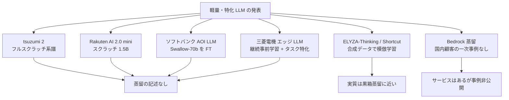
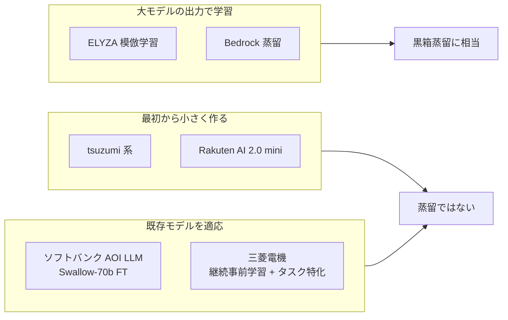
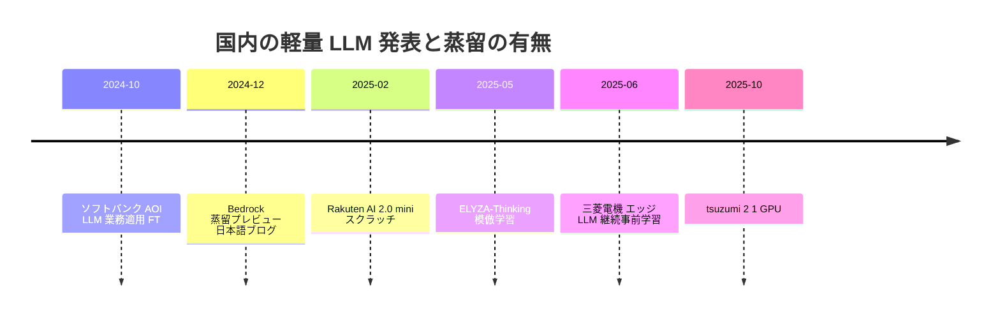

# 「軽量 LLM」は蒸留か — tsuzumi 2・Rakuten AI 2.0 mini・ソフトバンク AOI LLM・三菱電機エッジ LLM・ELYZA・Bedrock 蒸留の検証

- **Company/Organization**: NTT / 楽天グループ / ソフトバンク × アドバンスト・メディア / 三菱電機 / ELYZA / AWS ジャパン
- **Industry**: 通信 / EC・通信 / コンタクトセンター / 製造 / AI スタートアップ / クラウド
- **Date**: 2024-10 〜 2025-10
- **Links**:
  - [NTT tsuzumi 2 ニュースリリース](https://group.ntt/jp/newsrelease/2025/10/20/251020a.html)（2025-10-20）
  - [楽天 Rakuten AI 2.0 / 2.0 mini プレスリリース](https://global.rakuten.com/corp/news/press/2025/0212_02.html)（2025-02-12）
  - [IT Leaders: ソフトバンク コールセンター要約](https://it.impress.co.jp/articles/-/27250)（2024-12）
  - [三菱電機 エッジ言語モデル ニュースリリース](https://www.mitsubishielectric.co.jp/ja/pr/2025/0618-a/index.html)（2025-06-18）
  - [ELYZA Tech Blog（Zenn）ELYZA-Thinking-1.0](https://zenn.dev/elyza/articles/bc68f53fc0a83b)（2025-05-01）
  - [AWS ブログ（日本語）Bedrock Model Distillation プレビュー](https://aws.amazon.com/jp/blogs/news/build-faster-more-cost-efficient-highly-accurate-models-with-amazon-bedrock-model-distillation-preview)（2024-12-11）
- **Type**: Business Case（複数事例の横断検証）
- **蒸留判定**: いずれも **蒸留の記述なし**（ELYZA は実質的に黒箱蒸留に近いが自社では「模倣学習」と呼ぶ）
- **エビデンス品質**: すべて **一次資料（プレスリリース・公式ブログ）** または報道。ただし性能値は各社の **ベンダー申告**

## Overview

国内の「軽量 LLM」「小型 LLM」「業務特化 LLM」の発表は多いものの、一次資料を読むと **蒸留を使っていないもの** が大半です。このレポートは、クラスタ定義で「蒸留かどうか要確認」とされた 6 件を一次資料で確認し、**蒸留ではない理由** を記録します。これは H3（SLM 事例の多くは蒸留ではなく fine-tuning）の国内版の検証です。



## Problem & Context

国内では「データを外に出せない」「GPU が足りない」という理由から、**オンプレ・1 GPU で動く国産 LLM** への需要が高まっています（NTT のリリースは、従来 LLM の課題として電力消費・運用コスト・機密情報のセキュリティリスクを挙げています）。この需要に対して各社が出した答えは、**蒸留よりも「最初から小さく作る」「既存モデルを fine-tuning する」** ものでした。

## Solution（各社の作り方）

### 1. NTT tsuzumi 2（2025-10-20）

| 項目 | 内容 |
|------|------|
| 作り方 | リリースは tsuzumi 2 自体の学習方法を書いていない。初代 tsuzumi は「フルスクラッチでゼロから開発した純国産モデル」 |
| パラメータ | リリースでは非公開（報道では 30B とされる。二次情報） |
| 軽量性 | 「1 GPU で動作可能な軽量モデル」 |
| 性能 | 同規模で「世界トップクラス」の日本語性能、数倍大きいフラッグシップ級に匹敵（図のみ・数値なし）。NTT 社内の金融システム問い合わせ（RAG）で他社先進モデルと同等以上 |
| 導入 | **東京通信大学** がオンプレの大学 LLM 基盤として採用を決定（授業 Q&A、教材・試験作成、履修・キャリア相談）。NTT ドコモビジネスと富士フイルムビジネスイノベーションは **共同ソリューションの検討を開始** した段階 |
| 蒸留 | **記述なし** |

### 2. Rakuten AI 2.0 mini / Rakuten AI 2.0（2025-02-12）

| 項目 | 2.0 mini | 2.0 |
|------|----------|-----|
| 構造 | 1.5B dense | MoE（7B × 8 エキスパート、上位 2 つを使用。総約 47B・活性 13B） |
| 作り方 | **英日データでスクラッチ学習** | Rakuten AI 7B（2024-03）を基に、エキスパートとルーターを同時学習。SimPO で選好最適化 |
| 日本語 MT-Bench（Instruct） | 4.91 | 7.08 |
| 想定用途 | エッジデバイスでの低コスト運用 | 要約・QA・対話システム |
| ライセンス | Apache 2.0 | Apache 2.0 |
| 蒸留 | **記述なし（スクラッチと明記）** | 記述なし |

2.0 の比較表（リリース記載、Japanese MT-Bench、GPT-4o 判定）:

| モデル | スコア |
|--------|--------|
| **Rakuten AI 2.0 instruct** | **7.08** |
| Tanuki-8x8B-dpo-v1.0 | 6.96 |
| calm3-22b-chat | 6.93 |
| karakuri-lm-8x7b-instruct-v0.1 | 5.92 |
| llm-jp-3-13b-instruct | 5.68 |
| ELYZA-japanese-Llama-2-13b-instruct | 4.09 |

> mini は「同規模で最高性能」と申告されていますが、同じ表で llm-jp-3-3.7b-instruct が 4.98 と mini の 4.91 を上回っています（3.7B と大きいため除外したと推測されます）。

### 3. ソフトバンク × アドバンスト・メディア「AOI LLM」（2024-10 業務適用、2024-12-17 発表）

| 項目 | 内容 |
|------|------|
| 用途 | コンタクトセンターの **通話内容の要約** |
| 製品 | AOI LLM for AmiVoice Communication Suite（要約・Q&A 抽出・VoC 抽出・RAG） |
| 土台 | Meta Llama 系の日本語強化版 **Swallow-70b**（東京科学大学） |
| 作り方 | ソフトバンクの学習データで **fine-tuning** |
| 効果 | 新人オペレーターの要約時間を **約 30% 削減できる見込み**（見込み値） |
| 蒸留 | **記述なし** |

### 4. 三菱電機 エッジデバイスで動作する製造業向け言語モデル（2025-06-18）

| 項目 | 内容 |
|------|------|
| 土台 | 「公開されている日本語継続事前学習済みのベースモデル」（名称はリリースに記載なし） |
| 作り方 | FA 事業などの社内データで **製造業ドメインの事前学習** + 独自の **データ拡張** による **タスク特化学習** |
| 用途 | 産業機器・ロボット・コールセンター（顧客情報を扱うオンプレ）など計算資源が限られる環境 |
| 支援 | **AWS ジャパン生成AI実用化推進プログラム**（GPU・Trainium、分散学習の環境構築、クレジット、Generative AI Innovation Center の助言） |
| ブランド | Maisart |
| 蒸留 | **記述なし**（報道では量子化等のモデル圧縮に言及。二次情報） |

> 同社の研究者は 2026 年 3 月の NLP2026 で、推論過程の **蒸留における教師サイズ** を検証しており（[07](07-mitsubishi-teacher-size-japanese.md)）、製品化に向けて蒸留を検討している段階と読めます。

### 5. ELYZA-Thinking-1.0 / ELYZA-Shortcut-1.0（2025-05-01）

| 項目 | 内容 |
|------|------|
| データ生成 | 手書きの推論例 10 件を few-shot に、**MCTS 風の推論パス探索**。探索に DeepSeek-R1、ロールアウトと評価に Qwen2.5-72B-Instruct を使用（脚注）。LLM-as-a-Judge で採点し、最良パスを保存 |
| データ量 | 約 **15 万件** の（質問・推論・回答） |
| 学習 | 日本語継続事前学習済みの Qwen2.5-32B-Instruct を約 2 エポック SFT（**模倣学習**） |
| マージ | ELYZA モデル 0.7 + DeepSeek-R1-Distill-Qwen-32B 0.3 の重み付き平均（英語数学の強化） |
| Shortcut | 推論過程を除いた（質問・回答）で通常の指示チューニング。32B と 7B |
| 評価 | MATH-500、MATH-500 日本語訳、JHumanEval、JMMLU、Japanese MT-Bench、ELYZA Tasks 100（数値は画像のため取得不可）。Reasoning は日英数学で o1-mini を上回り、Shortcut 32B は GPT-4o 相当と記載 |
| 評価の数値（2026-10-22 追記） | 画像を取得して読み取り。**ELYZA-Thinking-32B**: MATH-500 0.8515 / 邦訳版 0.7690 / JHumanEval 0.7256 / JMMLU_small 0.7826 / Japanese MT-Bench 9.55 / ELYZA-tasks-100 4.20（o1-mini: 0.7855 / 0.7045 / 0.8841 / 0.7688 / 9.575 / 4.395）。**ELYZA-Shortcut-32B**: 0.7735 / 0.6645 / 0.7546 / 0.7893 / 9.5875 / 4.37（gpt-4o-2024-11-20: 0.6575 / 0.5490 / 0.8186 / 0.8487 / 9.5875 / 4.565）。**Shortcut-7B**: 0.4920 / 0.3385 / 0.6524 / 0.6638 / 9.0375 / 3.83。土台の Qwen2.5-32B-Instruct は 0.7835 / 0.6705 / 0.7637 / 0.7607 / 9.3625 / 4.045。全 24 行は [12](12-elyza-rinna-r1-japanese-reasoning-models.md) |
| 蒸留 | ELYZA 自身は **「蒸留」と呼ばず「模倣学習」**。ただし大きなモデル（DeepSeek-R1 / Qwen2.5-72B）が作った推論過程で SFT する構造は、**黒箱蒸留とほぼ同じ** |

### 6. Amazon Bedrock Model Distillation（AWS ジャパンの日本語ブログ、2024-12-11）

| 項目 | 内容 |
|------|------|
| 主張 | 特定ユースケースで最大 **5 倍高速**、最大 **75% 低コスト**、RAG で精度低下 **2% 未満**（ベンダー値） |
| 制約 | 教師と生徒は **同じモデルファミリー**（例: Llama 3.1 405B → 70B / 8B） |
| データ合成 | プロンプト拡張、ゴールデンサンプル、本番の呼び出しログの再利用 |
| 料金 | 合成データ生成（教師）、生徒の fine-tuning、保存、Provisioned Throughput の推論 |
| 顧客名 | **なし** |
| 国内事例 | 日本語の技術ブログ（クラスメソッド 2024-12-12）は登壇告知のみで実践結果なし |

### 7. SB Intuitions「Sarashina mini」（2026-10-22 追記）

| 項目 | 内容 |
|------|------|
| 出典 | [ソフトバンク 統合報告書 2025「国産生成AI開発責任者インタビュー」](https://www.softbank.jp/corp/ir/documents/integrated_reports/fy2025/tamba/)（丹波廣寅 SB Intuitions 代表取締役社長 兼 CEO）/ [Sarashina API 提供開始プレスリリース](https://www.softbank.jp/corp/news/press/sbkk/2025/20251105_01)（2025-11-05） |
| 方針 | 「まず非常に高性能で大規模な『先生』役の AI を開発」し、「この『先生』役の AI が持つ知識の中から、より軽量で高速に動作する省電力な『生徒』役の AI を開発」する |
| 蒸留の記述 | 統合報告書: 「『Sarashina mini』は、先に開発した大規模な基盤モデルが持つ高水準の性能を可能な限り維持しつつ、『蒸留』※などの技術を用いて、多様なニーズに応えられるよう最適化したものです」。脚注: 「※蒸留：大規模で高性能な AI モデルで学習データを生成し、より小規模で軽量なモデルを高性能化・最適化する技術」（= **黒箱蒸留の定義**） |
| プレスリリース | 「4,600 億パラメーター規模の国産 LLM『Sarashina』で培った知見を基に開発された軽量モデル」。**蒸留の語はなし**。パラメータ数・ベンチマーク・価格の記載なし。法人向け API（Chat Completion / Embeddings）を 2025-11-28 開始。想定用途はコールセンターの自動応答・営業支援 |
| 蒸留判定 | **蒸留（黒箱、方針表明）**。統合報告書の記述は方針・定義にとどまり、教師・生徒のサイズ、データ量、評価値は未公開。商用提供されている点で国内では珍しい「蒸留を明言した商用 SLM」だが、**定量成果は未公表** |
| エビデンス | 一次資料（IR 文書・プレスリリース）だが、技術的裏付けなし |

> 「蒸留」の記述が IR 文書にだけあり技術資料にない、という形は、国内ベンダーが蒸留を **投資家向けの説明語** として使い始めた例として記録しておきます。

## Results & Impact

| 事例 | 蒸留か | 定量成果 | 成果の性質 |
|------|--------|---------|-----------|
| tsuzumi 2 | いいえ | 数値なし（図のみ） | ベンダー申告 |
| Rakuten AI 2.0 mini | いいえ（スクラッチ） | MT-Bench 4.91 | ベンダー申告 |
| ソフトバンク AOI LLM | いいえ（FT） | 要約時間 約 30% 削減 **見込み** | 報道（見込み値） |
| 三菱電機 エッジ LLM | いいえ（継続事前学習 + タスク特化） | リリースに数値なし（報道では正解率 35.8% → 77.2% と伝えられるが二次情報） | — |
| ELYZA-Thinking / Shortcut | 実質的に黒箱蒸留 | 図のみ → （2026-10-22 追記）画像から読み取り: Thinking-32B MATH-500 0.8515、Japanese MT-Bench 9.55、ELYZA-tasks-100 4.20 | ベンダー申告 |
| Bedrock 蒸留 | はい（サービス） | 5 倍 / 75% / 2% 未満 | ベンダー集計、顧客名なし |
| SB Intuitions Sarashina mini（2026-10-22 追記） | はい（黒箱、IR 文書で方針表明） | 数値なし | ベンダー申告（IR） |

```
蒸留の記述の有無（6 件）
蒸留と明記        |█ 1（Bedrock、ただし国内顧客なし）
実質は蒸留        |█ 1（ELYZA）
蒸留の記述なし    |████ 4（tsuzumi 2 / 楽天 / ソフトバンク / 三菱電機）
```

## Figures & Tables

### 作り方の分類



### 国内「軽量 LLM」の時系列



## Lessons Learned

1. **「軽量」≠「蒸留」**: 国内の軽量 LLM の多くは、スクラッチ学習または fine-tuning で作られている。報道の「軽量化」を蒸留事例として数えると過大評価になる（**H3 を国内でも支持**）。
2. **呼び方の違い**: ELYZA のように、構造上は黒箱蒸留でも「模倣学習」「合成データ SFT」と呼ぶ例がある。事例を集めるときは **用語ではなく手順（大モデルの出力を生徒の学習信号に使うか）** で判定する必要がある。
3. **クラウド経由の国内事例は空白**: Bedrock 蒸留の日本語ブログは機能紹介で、顧客名・成果はない。三菱電機は AWS の支援プログラムを使ったが、蒸留ではない（**H2 を国内でも支持**）。

## Notes

- NTT のグループ会社である NTT 東日本は、NLP2026 で **Qwen3-VL を教師・生徒にした蒸留** を発表しており（[09](09-ntt-east-facility-maintenance-vlm.md)）、自社の tsuzumi ではなく海外のオープンモデルを蒸留の土台にしています。
- NEC cotomi（Light / Fast）や日立の業務特化 LLM 構築サービスも報道では「軽量」「業務特化」とされますが、検索結果の範囲では蒸留の記述は見当たりませんでした（本文未取得のため本レポートの対象外）。
- **（2026-10-22 追記）追加検索でも「蒸留の記述なし」が続いた国内事例**: 2026-10-22 に金融（三菱UFJ・SMBC・みずほ・野村・日本生命）、通信（NTT ドコモ・KDDI・ソフトバンク）、SIer（NTT データ・日立・NEC）、コールセンター、製造・小売（トヨタ・デンソー・パナソニック・セブン・イオン）、検索・推薦（メルカリ・LINE ヤフー・ZOZO・リクルート・楽天）、クラウド（Bedrock・Azure OpenAI・Google Cloud の国内顧客事例、AWS Summit Japan 2025）を対象に日本語で検索しましたが、**蒸留を明記した事業会社の本番事例は 1 件も見つかりませんでした**。tsuzumi 2 は 2025-10 以降「オンプレ・プライベートクラウドで広く採用」と報じられ（東京通信大学ほか）、KDDI は ELYZA を連結子会社化（2024-03）していますが、いずれも蒸留とは無関係です。検索記録は [gather の収集状況表](../../../gather/20261021/japan_cases/resources-japan-cases.md) を参照。
