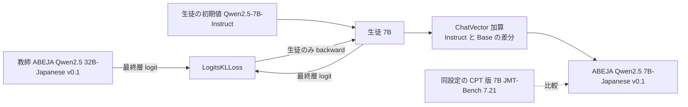
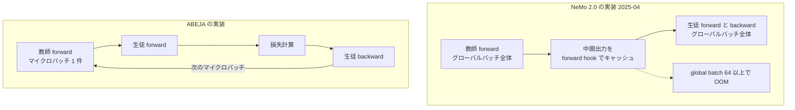
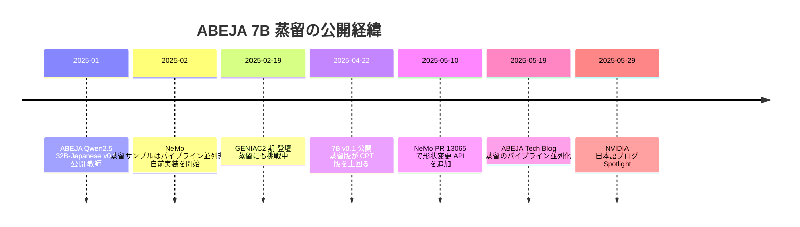

# ABEJA × NVIDIA「蒸留のパイプライン並列化」— 32B → 7B 白箱蒸留の実装詳細と 7B の評価（2026-10-22 追補）

- **Source**: 株式会社 ABEJA（藤本敬介 Labs / 真鍋知樹）、NVIDIA（藤田敦典 Senior AI Solutions Architect）
- **Date**: ABEJA Tech Blog 7B 公開記事 2025-04-22 / ABEJA Tech Blog 蒸留パイプライン記事 2025-05-19 / NVIDIA 技術ブログ（日本語）2025-05-29
- **Links**: [ABEJA Qwen2.5 7B-Japanese v0.1 の公開（ABEJA Tech Blog）](https://tech-blog.abeja.asia/entry/geniac2-qwen25-7b-v0.1) / [小型LLM「ABEJA Qwen2.5-7B Model」学習のための蒸留のパイプライン並列化（ABEJA Tech Blog）](https://tech-blog.abeja.asia/entry/geniac2-distillation-pipeline-parallel) / [Spotlight: NVIDIA NeMo を使用した小型 LLM「ABEJA Qwen2.5-7B Model」学習のための蒸留のパイプライン並列化（NVIDIA）](https://developer.nvidia.com/ja-jp/blog/spotlight-pipeline-parallelism-of-the-distillation-for-abeja-qwen-2-5-7b-using-nvidia-nemo/)
- **Type**: Technical Article（開発元の技術ブログ 2 本 + NVIDIA との共著記事）
- **蒸留判定**: **白箱蒸留**（教師の最終層 logit に対する KL。NeMo + nvidia-modelopt の `LogitsKLLoss`。中間層マッチングは不使用）
- **エビデンス品質**: 3 本とも **一次資料**（開発元・協業先の技術ブログ）。ただし Japanese-MT-Bench の比較値のうち ABEJA 以外は Nejumi Leaderboard 3 からの転記で、OOM 実験は 2×V100・小型モデルでの代替実験

> 2026-10-21 の初回調査では「ABEJA の蒸留ブログは URL を特定できず」「蒸留方式は非公開」としていました。2026-10-22 に NVIDIA 日本語ブログの一覧ページから URL を特定し、3 本を本文確認しました。この結果、[04](04-abeja-geniac-qwen25-7b-distillation.md) の蒸留判定を「方式非公開」から **白箱蒸留** に訂正しています。

## Overview

ABEJA は GENIAC 第 2 期（経済産業省・NEDO）で、自社の **ABEJA Qwen2.5 32B-Japanese v0.1**（2025-01 公開）を教師に、**Qwen2.5-7B-Instruct** を生徒として白箱蒸留し、ABEJA Qwen2.5 7B-Japanese v0.1 を作りました。同じデータ・設定で **継続事前学習（CPT）版の 7B** も作って比較し、**蒸留版がわずかに上回った** ため蒸留版を公開しています。

蒸留の実装では、NeMo（2025-02 時点）の蒸留サンプルが **パイプライン並列に未対応** だったため、Megatron-Core のスケジューラを自前で書き換えました。この実装は NVIDIA の日本語技術ブログで Spotlight として紹介されています。



## Key Technical Content

### 1. 蒸留の設計（7B 公開記事 + パイプライン記事）

| 項目 | 内容 | 出典 |
|------|------|------|
| 教師 | ABEJA Qwen2.5 32B-Japanese v0.1 | 7B 公開記事 |
| 生徒 | Qwen2.5-7B-Instruct を初期値とする 7B | 7B 公開記事 |
| 蒸留の種類 | 「大きなモデルの合成データで学習」ではなく、**教師の出力分布を生徒が直接学習する白箱蒸留** | 7B 公開記事 |
| 損失 | `LogitsKLLoss`（`output_layer` 同士の KL、Tensor Parallel 有効）。`loss_balancer=None`。温度・top-k は記載なし | パイプライン記事 |
| 中間層マッチング | **不使用**（教師と生徒の基盤モデルが異なるため） | パイプライン記事 |
| 生徒の作り方 | 教師の剪定ではなく **別個の小型モデル**。剪定するとモデルマージ / ChatVector が使えなくなるため | パイプライン記事 |
| 指示追従 | ChatVector（Qwen2.5-7B-Instruct − Qwen2.5-7B の差分）を後から加算。事後学習は執筆時点で進行中 | 7B 公開記事 |
| フレームワーク | NVIDIA NeMo + NeMo-Aligner、nvidia-modelopt（`mtd.convert`、`kd_loss` モード） | 両記事 |
| 計算基盤 | Azure CycleCloud + Slurm + Singularity、**H100×8 × 8 ノード = 64 GPU** | 7B 公開記事 |
| データ量・トークン数・学習時間 | **記載なし** | — |

損失の形は次のとおりです（記事には式はなく、`LogitsKLLoss` の説明から再構成）。

$$
\mathcal{L}_{\mathrm{KD}} = \sum_{t} \mathrm{KL}\big(p_{\mathrm{32B}}(\cdot \mid x_{<t}) \,\|\, q_{\mathrm{7B}}(\cdot \mid x_{<t})\big)
$$

### 2. パイプライン並列の問題と解決（パイプライン記事 / NVIDIA 記事）

| 段階 | 状況 | 問題 |
|------|------|------|
| NeMo 蒸留サンプル `megatron_gpt_distillation.py`（2025-02 時点） | パイプライン並列 **非対応** | 大型モデルに拡張できない |
| Megatron-Core のステージ間通信 | テンソル 1 本（B × S × H）しか送れない | 教師と生徒の出力を同時に送れない |
| NeMo 2.0 の実装（2025-04 下旬） | 教師と生徒を **別々にグローバルバッチ全体** で並列実行 | 教師の中間出力をグローバルバッチ分キャッシュ（global_batch × seq_len × hidden_dim）→ 大きなバッチで **OOM** |
| ABEJA の実装 | `megatron/core/pipeline_parallel/schedules.py` を書き換え、**マイクロバッチごとに** 教師 forward → 生徒 forward → 損失 → 生徒 backward | キャッシュ不要。メモリは micro_batch × seq_len × hidden_dim に比例 |
| NeMo 本家の対応（2025-05-10、PR #13065） | `adjust_tensor_shapes_fn` で転送テンソル形状を外部から変更可能に | 教師・生徒のテンソルを同時に送れるようになった（ABEJA は未検証と明記） |



### 3. アルゴリズム（擬似コード）

```text
入力: 教師 T（凍結）, 生徒 S, マイクロバッチ列 {mb_1 ... mb_n}
for mb in マイクロバッチ列:
    h_T = T.forward(mb)            # 教師は backward なし。出力をそのまま次ステージへ送る
    h_S = S.forward(mb)
    loss = KL(softmax(h_T) || softmax(h_S))   # 最終層 logit のみ
    S.backward(loss)               # 生徒のみ更新
    # 送受信の順序が 1 つでもずれるとハングするため、教師と生徒の send/recv を厳密に揃える
```

## Figures & Tables

### 表 1: グローバルバッチサイズ別の OOM 比較（2×V100、教師 Qwen2.5-1.5B-Instruct、生徒 Qwen2.5-0.5B-Instruct、seq 1024、micro-batch 1）

| 実装 | 8 | 16 | 32 | 48 | 64 | 128 | 256 | 512 | 1024 |
|------|---|----|----|----|----|-----|-----|-----|------|
| NeMo（2025-04 下旬時点） | ◯ | ◯ | ◯ | ◯ | ✕ | ✕ | ✕ | ✕ | ✕ |
| **ABEJA 実装** | ◯ | ◯ | ◯ | ◯ | ◯ | ◯ | ◯ | ◯ | ◯ |

> ◯ = 動作、✕ = OOM。`nvidia-smi` ではメモリ使用量の差が見えなかった（キャッシュの push/pop が頻繁なため）ので、判定は「落ちるか落ちないか」だけです。スループットや学習速度の数値はありません。

### 表 2: Japanese-MT-Bench（7B 公開記事。judge は GPT-4o-0513、ABEJA は 3 回平均、他は Nejumi Leaderboard 3 から転記）

| モデル | スコア |
|--------|--------|
| microsoft-phi-4 | 8.13 |
| google-gemma-3-12b-it | 7.91 |
| Qwen2.5-14B-Instruct | 7.71 |
| **ABEJA-Qwen2.5-7B-Japanese-v0.1（蒸留版）** | **7.26** |
| ABEJA-Qwen2.5-7B-Japanese（CPT 版、非公開） | 7.21 |
| anthropic.claude-3-haiku | 7.13 |
| CohereForAI-aya-expanse-8b | 6.91 |
| Qwen2.5-7B-Instruct | 6.86 |
| gpt-3.5-turbo | 6.82 |
| microsoft-Phi-3-medium-128k-instruct | 6.38 |
| Meta-Llama-3-8B-Instruct | 6.21 |

```
Japanese-MT-Bench 7B 級
Qwen2.5-14B-Instruct        |███████████████████████████████████████ 7.71
ABEJA 7B 蒸留版             |████████████████████████████████████ 7.26
ABEJA 7B CPT 版             |████████████████████████████████████ 7.21
Qwen2.5-7B-Instruct         |██████████████████████████████████ 6.86
gpt-3.5-turbo               |██████████████████████████████████ 6.82
```

- **蒸留 vs CPT の差は +0.05**（7.26 vs 7.21）。同一データ・設定で比較した点は貴重ですが、差は 3 回平均の分散の範囲内の可能性があり、記事も「わずかに高い」と表現しています。
- 元の Qwen2.5-7B-Instruct（6.86）からは **+0.40**。14B（7.71）には届きません。
- 登壇資料（2025-02、[04](04-abeja-geniac-qwen25-7b-distillation.md)）の 7B の値 6.919 は、この記事の 7.26 より低く、評価時期・設定が異なります（登壇資料の 7B が蒸留版か CPT 版かは不明）。
- Jaster 系（形式に敏感なベンチマーク）は評価していません。既知の問題として中国語の混入があります。

### 図: 記事内の画像（キャプションなし）

- パイプライン並列のスケジュール図: `https://cdn-ak.f.st-hatena.com/images/fotolife/p/peisuke726/20250513/20250513020801.png`
- NeMo の教師→生徒 逐次パイプライン: `https://cdn-ak.f.st-hatena.com/images/fotolife/p/peisuke726/20250513/20250513114450.png`
- ABEJA のマイクロバッチ単位パイプライン: `https://cdn-ak.f.st-hatena.com/images/fotolife/p/peisuke726/20250513/20250513114541.png`
- NVIDIA 記事 図 4（NeMo 2025-04 下旬の実装）: `https://developer-blogs.nvidia.com/ja-jp/wp-content/uploads/sites/6/2025/05/img-03-1-1024x502.png`
- NVIDIA 記事 図 5（ABEJA の実装）: `https://developer-blogs.nvidia.com/ja-jp/wp-content/uploads/sites/6/2025/05/img-04-1-1024x268.png`

### 時系列



## Business Perspective

| 観点 | 内容 | エビデンス |
|------|------|-----------|
| 誰のための蒸留か | 自社 32B → 自社 7B（公開モデル。ABEJA Platform への搭載は NEDO 資料で「イメージ」） | 一次資料 |
| 蒸留の効果 | 同一設定の CPT より +0.05（JMT-Bench）。元の 7B-Instruct より +0.40 | 一次資料 |
| 初期投資 | 64 H100 を使用。トークン数・学習時間は非公開。パイプライン並列の自前実装という **エンジニアリングコスト** が発生 | 一次資料 |
| 外部 API の教師 | 使用せず（教師は自社モデル、基盤は Apache-2.0 の Qwen2.5） | 一次資料 |

## Practical Takeaways

1. **白箱蒸留は「フレームワークの成熟度」がボトルネック**: 2025 年前半の時点で、NeMo の蒸留はパイプライン並列に未対応で、32B 教師を扱うには自前実装が必要でした。2025-05 以降は本家が追随しており、同じ構成はより容易になっています。
2. **CPT との差は小さい**: 同一データで比べると蒸留版は +0.05 と僅差。蒸留の価値は「同じデータで少し良い」程度で、データ品質のほうが支配的と読めます。
3. **剪定しない理由が ChatVector**: 生徒を剪定で作ると差分マージが使えなくなるため、別モデルを生徒にしています。PFN（[02](02-pfn-plamo2-pruning-distillation.md)）が剪定 + 蒸留を選んだのと対照的で、**事後処理（マージ）の計画が蒸留の設計を決める** 例です。

## Notes

- NVIDIA 記事は ABEJA 記事を再構成したもので、OOM 実験・結論は同一です。NVIDIA 側は「大きなグローバルバッチほど学習が安定する」と補足しています。
- 7B 公開記事は Jaster を評価対象から外しており、JMMLU 等の知識系ベンチマークは別途確認が必要です（PFN の PLaMo 2 Technical Report 表 1 には 32B 版のみ掲載）。
