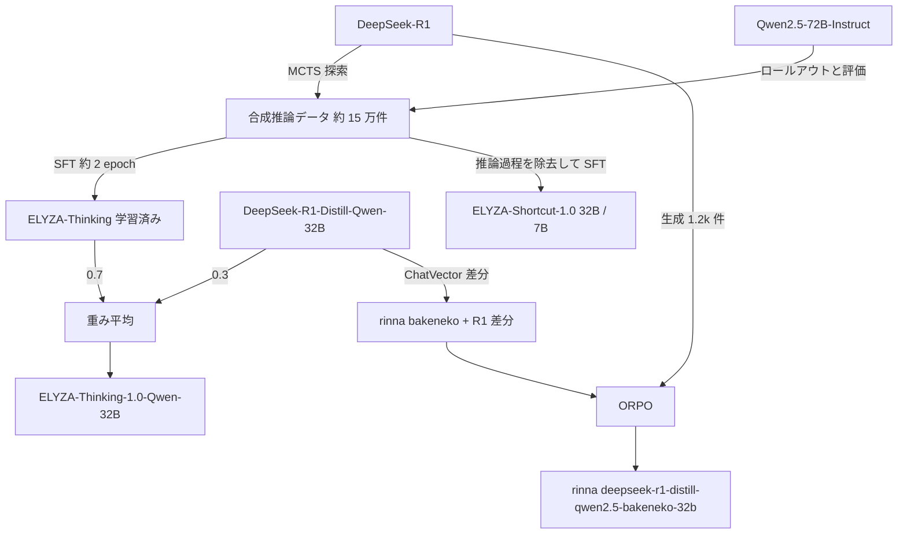

# ELYZA-Thinking / Shortcut と rinna bakeneko — DeepSeek-R1 系から派生した国内推論モデルの定量評価（2026-10-22 追補）

- **Source**: 株式会社 ELYZA（KDDI 連結子会社）/ rinna 株式会社（Xinqi Chen, Toshiaki Wakatsuki, Kei Sawada）
- **Date**: rinna 2025-02-13 公開 / ELYZA 2025-05-01 公開
- **Links**: [ELYZA-Thinking-1.0: MCTS を用いた推論パス探索と模倣学習（Zenn）](https://zenn.dev/elyza/articles/bc68f53fc0a83b) / [elyza/ELYZA-Thinking-1.0-Qwen-32B モデルカード](https://huggingface.co/elyza/ELYZA-Thinking-1.0-Qwen-32B) / [rinna/deepseek-r1-distill-qwen2.5-bakeneko-32b モデルカード](https://huggingface.co/rinna/deepseek-r1-distill-qwen2.5-bakeneko-32b)
- **Type**: Technical Article（公開モデルの技術ブログ・モデルカード）
- **蒸留判定**:
  - ELYZA-Thinking-1.0: **黒箱蒸留相当**（DeepSeek-R1 と Qwen2.5-72B-Instruct で探索・生成した約 15 万件の推論データで Qwen2.5-32B-Instruct を SFT。ELYZA は「模倣学習」と呼ぶ）+ **蒸留モデルとのマージ**（DeepSeek-R1-Distill-Qwen-32B を 0.3）
  - ELYZA-Shortcut-1.0: 同データから推論過程を除いた（質問・回答）で SFT。**黒箱蒸留相当**
  - rinna deepseek-r1-distill-qwen2.5-bakeneko-32b: **蒸留モデルへの追加学習**（R1-Distill-Qwen-32B の ChatVector を加算 + DeepSeek-R1 生成の 1.2k 件で ORPO）
- **エビデンス品質**: ELYZA のベンチマーク表は **一次資料（ブログ掲載の画像表を 2026-10-22 に読み取り）**。rinna の表は **一次資料（モデルカード）**。いずれも開発元自身の評価

> 初回調査（[10](10-non-distillation-lightweight-llms.md)）では ELYZA の数値を「画像のため取得不可」としていました。2026-10-22 に Zenn 記事の画像（`https://static.zenn.studio/user-upload/19be84461d58-20250501.png` ほか）を取得して読み取り、本レポートに全行を転記しました。HF モデルカードにはベンチマーク表はありません。

## Overview

DeepSeek-R1（2025-01）の公開後、国内では R1 系の蒸留モデル（DeepSeek-R1-Distill-Qwen）を土台にした日本語推論モデルが相次ぎました。[05](05-cyberagent-lightblue-r1-distill-japanese.md) の CyberAgent / Lightblue に加え、**rinna**（2025-02）と **ELYZA**（2025-05）も公開しています。この 2 社は「蒸留」という語の使い方が対照的です。

| 観点 | ELYZA | rinna |
|------|-------|-------|
| 自社の呼び方 | 「模倣学習（imitation learning）」 | 「distillation and ORPO」 |
| 教師信号の出所 | DeepSeek-R1（探索）+ Qwen2.5-72B-Instruct（ロールアウト・評価） | DeepSeek-R1 の生成 1.2k 件 |
| 土台 | 日本語 CPT 済み Qwen2.5-32B-Instruct（ELYZA） | rinna/qwen2.5-bakeneko-32b（Qwen2.5-32B の日本語 CPT） |
| R1-Distill の使い方 | 学習後に **重み平均でマージ**（0.7 : 0.3） | **ChatVector**（R1-Distill-Qwen-32B − Qwen2.5-32B）を加算 |
| データ量 | 約 15 万件、約 2 エポック | 1.2k 件（ORPO） |
| 公開サイズ | 32B（Thinking / Shortcut）、7B（Shortcut） | 32B |
| ライセンス | Apache-2.0 | Apache-2.0 |



## Key Technical Content

### ELYZA-Thinking-1.0 のデータ生成（MCTS ベース）

1. 人手で作った推論例 10 件から 1〜3 件をランダムに few-shot として与える
2. MCTS 風に推論パスを探索（探索: DeepSeek-R1、ロールアウトと評価: Qwen2.5-72B-Instruct）
3. LLM-as-a-Judge で採点し、最良パスを保存
4. 約 150,000 件の（質問・推論・回答）を得て、Qwen2.5-32B-Instruct（日本語 CPT 済み）を約 2 エポック SFT
5. ELYZA モデル 0.7 + DeepSeek-R1-Distill-Qwen-32B 0.3 の重み付き平均（英語数学の強化）
6. Shortcut 版は推論過程を除いた（質問・回答）で通常の指示チューニング

ブログは「Best of N と MCTS の推論時間対精度」の図も掲載しています（画像のみ。使用モデルはすべて Qwen2.5-72B-Instruct）。

### rinna の手順（モデルカード）

$$
\theta_{\text{merged}} = \theta_{\text{bakeneko-32b}} + 1.0 \times \big(\theta_{\text{R1-Distill-Qwen-32B}} - \theta_{\text{Qwen2.5-32B}}\big)
$$

その後、DeepSeek-R1 が生成した 1.2k 件の厳選サンプルで ORPO（Odds Ratio Preference Optimization）を行います。モデルカードは SFT の段階を別途記述していません。

## Figures & Tables

### 表 1: ELYZA ブログ「評価結果一覧」（画像から転記。JMMLU は各カテゴリ 10 件 × 56 = 560 件のサブセット、MATH-500 邦訳版は ELYZA 作成）

| モデル | Reasoning | パラメータ | MATH-500 | MATH-500 邦訳版 | JHumanEval | JMMLU_small | Japanese MT-Bench | ELYZA-tasks-100 |
|--------|-----------|-----------|----------|----------------|------------|-------------|-------------------|-----------------|
| **ELYZA-Thinking-1.0-Qwen-32B** | True | 32B | 0.8515 | 0.7690 | 0.7256 | 0.7826 | 9.5500 | 4.200 |
| **ELYZA-Shortcut-1.0-Qwen-32B** | False | 32B | 0.7735 | 0.6645 | 0.7546 | 0.7893 | **9.5875** | 4.370 |
| **ELYZA-Shortcut-1.0-Qwen-7B** | False | 7B | 0.4920 | 0.3385 | 0.6524 | 0.6638 | 9.0375 | 3.830 |
| QwQ-32B | True | 32B | 0.6795 | 0.7635 | 0.7470 | 0.8103 | 9.1646 | 4.285 |
| Qwen2.5-72B-Instruct | False | 72B | 0.7990 | 0.6770 | 0.7835 | 0.7996 | 9.1750 | 4.205 |
| Qwen2.5-32B-Instruct | False | 32B | 0.7835 | 0.6705 | 0.7637 | 0.7607 | 9.3625 | 4.045 |
| Qwen2.5-7B-Instruct | False | 7B | 0.6095 | 0.5880 | 0.6966 | 0.6411 | 8.2375 | 3.595 |
| DeepSeek-R1-Distill-Llama-70B | True | 70B | 0.7710 | 0.7815 | 0.7652 | 0.7679 | 8.2875 | 3.705 |
| DeepSeek-R1-Distill-Qwen-32B | True | 32B | 0.8100 | 0.7380 | 0.7896 | 0.7478 | 9.3000 | 3.950 |
| DeepSeek-R1-Distill-Qwen-7B | True | 7B | 0.7705 | 0.3350 | 0.6753 | 0.4563 | 4.5714 | 1.785 |
| Llama-3.1-ELYZA-JP-70B | False | 70B | 0.6365 | 0.5110 | 0.6905 | 0.7518 | 9.0875 | 4.170 |
| ABEJA Qwen2.5-32B-Japanese-v0.1 | False | 32B | 0.7835 | 0.6565 | 0.7835 | 0.7790 | 9.2250 | 4.105 |
| CyberAgent DeepSeek-R1-Distill-Qwen-32B-Japanese | True | 32B | 0.8245 | 0.6910 | 0.6951 | 0.6759 | 9.2000 | 4.050 |
| rinna deepseek-r1-distill-qwen2.5-bakeneko-32b | True | 32B | 0.8180 | 0.5120 | 0.7424 | 0.7179 | 9.5625 | 4.125 |
| Meta-Llama-3.1-70B-Instruct | False | 70B | 0.6650 | 0.5285 | 0.7058 | 0.7134 | 8.7125 | 3.760 |
| Llama-3.3-Swallow-70B-Instruct-v0.4 | False | 70B | 0.3925 | 0.3775 | 0.6372 | 0.7183 | 8.8500 | 4.205 |
| o3-mini-2025-01-31 | True | – | **0.919** | **0.902** | 0.8902 | 0.8371 | 9.5125 | 4.440 |
| o1-2024-12-17 | True | – | 0.855 | 0.865 | **0.8979** | **0.9022** | 9.5125 | **4.585** |
| o1-mini-2024-09-12 | True | – | 0.7855 | 0.7045 | 0.8841 | 0.7688 | 9.5750 | 4.395 |
| gpt-4o-2024-11-20 | False | – | 0.6575 | 0.5490 | 0.8186 | 0.8487 | **9.5875** | 4.565 |
| gpt-4o-mini-2024-07-18 | False | – | 0.7410 | 0.6350 | 0.7942 | 0.7621 | 9.4625 | 4.230 |
| gpt-4-turbo-2024-04-09 | False | – | 0.7115 | 0.6125 | 0.7988 | 0.8054 | 9.3500 | 4.350 |
| gpt-4-0613 | False | – | 0.5205 | 0.4955 | 0.7622 | 0.6969 | 9.2125 | 4.150 |
| gpt-3.5-turbo-0125 | False | – | 0.3550 | 0.2735 | 0.6189 | 0.3799 | 8.2785 | 3.740 |

太字は列内の最高値（画像の表記に従う）。

### 表 2: ELYZA-Thinking vs o1-mini（ブログ冒頭の抜粋表）

| モデル | MATH-500 | MATH-500 邦訳版 | JHumanEval | JMMLU_small | Japanese MT-Bench | ELYZA-tasks-100 |
|--------|----------|----------------|------------|-------------|-------------------|-----------------|
| ELYZA-Thinking-1.0-Qwen-32B | **0.852** | **0.769** | 0.726 | **0.783** | 9.55 | 4.20 |
| o1-mini-2024-09-12 | 0.786 | 0.705 | **0.884** | 0.769 | **9.58** | **4.40** |

### 表 3: ELYZA-Shortcut-32B vs GPT-4o / GPT-4

| モデル | MATH-500 | MATH-500 邦訳版 | JHumanEval | JMMLU_small | Japanese MT-Bench | ELYZA-tasks-100 |
|--------|----------|----------------|------------|-------------|-------------------|-----------------|
| ELYZA-Shortcut-1.0-Qwen-32B | **0.774** | **0.665** | 0.755 | 0.789 | **9.59** | 4.37 |
| gpt-4o-2024-11-20 | 0.658 | 0.549 | **0.819** | **0.849** | **9.59** | **4.57** |
| gpt-4-0613 | 0.521 | 0.496 | 0.762 | 0.697 | 9.21 | 4.15 |

### 表 4: rinna モデルカードの評価（Japanese LM Evaluation Harness / Japanese MT-Bench）

| モデル | LM Harness (JA) | MT-Bench 1st turn | MT-Bench multi-turn |
|--------|-----------------|-------------------|---------------------|
| Qwen2.5-32B | 79.46 | – | – |
| rinna/qwen2.5-bakeneko-32b | 79.18 | – | – |
| Qwen2.5-32B-Instruct | 78.29 | 8.13 | 7.54 |
| rinna/qwen2.5-bakeneko-32b-instruct | 79.62 | 8.17 | 7.66 |
| rinna/qwen2.5-bakeneko-32b-instruct-v2 | 77.92 | 8.86 | 8.53 |
| DeepSeek-R1-Distill-Qwen-32B | 73.51 | 7.39 | 6.88 |
| **rinna/deepseek-r1-distill-qwen2.5-bakeneko-32b** | **77.43** | **8.58** | **8.19** |
| QwQ-32B | 76.12 | 8.58 | 8.25 |
| rinna/qwq-bakeneko-32b | 78.31 | 8.81 | 8.52 |

### 蒸留の「土台」に対する改善幅（ASCII）

```
土台の DeepSeek-R1-Distill-Qwen-32B からの変化
                          MATH-500 邦訳  JMMLU_small  JA MT-Bench  ELYZA-tasks
ELYZA-Thinking-32B        0.738→0.769   0.748→0.783  9.30→9.55    3.95→4.20
CyberAgent 32B-Japanese   0.738→0.691   0.748→0.676  9.30→9.20    3.95→4.05
rinna bakeneko-32b        0.738→0.512   0.748→0.718  9.30→9.56    3.95→4.13
（いずれも ELYZA 表 1 の値。ELYZA のみ土台が R1-Distill ではなく Qwen2.5-32B-Instruct + マージ）
```

- **日本語化は数学性能を落とし得る**: CyberAgent と rinna の日本語版は、土台の R1-Distill-Qwen-32B より MATH-500 邦訳版と JMMLU_small が低下しています（ELYZA の評価）。
- **7B では日本語対話と数学が両立しない**: ELYZA-Shortcut-7B（土台 Qwen2.5-7B-Instruct）は Japanese MT-Bench 8.24 → 9.04、ELYZA-tasks 3.595 → 3.83 と改善する一方、MATH-500 は 0.6095 → 0.4920 に低下（ブログも「数学はやや低下」と記載）。日本語数学（邦訳版 0.3385）は R1-Distill-Qwen-7B（0.3350）と同水準で、小型モデルでは推論能力の移植が難しいことを示しています。
- **R1-Distill-Qwen-7B の日本語 MT-Bench 4.5714 / ELYZA-tasks 1.785** は、[05](05-cyberagent-lightblue-r1-distill-japanese.md) で Lightblue が指摘した「日本語で考えない・答えない」問題を数値で裏付けています。

## Business Perspective

| 観点 | ELYZA | rinna |
|------|-------|-------|
| 事業段階 | 公開モデル。ELYZA は KDDI 連結子会社（2024-04）で、法人向けは別途 | 公開モデル |
| 顧客事例・金額 | 記載なし | 記載なし |
| 教師の出所 | オープンウェイト（DeepSeek-R1、Qwen2.5-72B） | オープンウェイト（DeepSeek-R1） |
| 商用 API の使用 | 評価の Judge のみ | 記載なし |

## Practical Takeaways

1. **「蒸留」という語の有無で事例を数えると漏れる**: ELYZA は蒸留と呼ばず、rinna は ChatVector + ORPO を「distillation」と呼びます。手順で判定する必要があります（[10](10-non-distillation-lightweight-llms.md) の教訓と同じ）。
2. **32B 級の黒箱蒸留で o1-mini 級の数学性能**: ELYZA-Thinking は MATH-500（英・日）で o1-mini を上回りますが、JHumanEval とタスク遂行（ELYZA-tasks-100）では劣ります。蒸留で伸びる能力は教師データの分布に依存します。
3. **数値はすべて開発元評価**: 第三者ベンチマークへの掲載は確認していません。

## Notes

- ELYZA の表には ABEJA 32B（[04](04-abeja-geniac-qwen25-7b-distillation.md)）、CyberAgent 32B-Japanese（[05](05-cyberagent-lightblue-r1-distill-japanese.md)）、Llama-3.3-Swallow-70B も含まれ、**国内公開モデルを同一条件で横並びにした数少ない表** です。
- KDDI による ELYZA の連結子会社化は 2024-03-18 発表（報道）。KDDI 側の蒸留事例は検索では見つかりませんでした。
