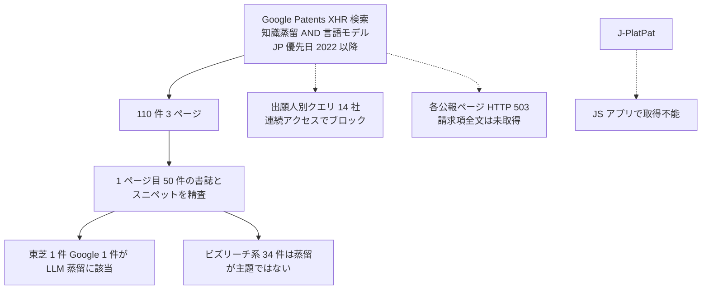

# 国内の LLM 蒸留特許の走査 — Google Patents（JP、優先日 2022 年以降）の「知識蒸留 × 言語モデル」（2026-10-22 追補）

- **Source**: Google Patents 検索 API（`patents.google.com/xhr/query`）の結果 JSON（2026-10-22 取得）
- **検索条件**: `q=("知識蒸留" OR "蒸留") ("言語モデル")`、`country=JP`、`after=priority:20220101`、1 ページ目 50 件を精査（総ヒット 110 件、3 ページ）
- **Type**: Patent（特許ランドスケープのメモ）
- **蒸留判定**: 対象は「言語モデルの蒸留」を **請求項または明細書で言及する** 公報。LLM 製品の蒸留事例ではない
- **エビデンス品質**: **一次資料（特許公報の書誌・請求項スニペット）**。ただし Google Patents の各公報ページは HTTP 503（レート制限）で本文を取得できず、請求項は検索結果のスニペットのみ。**J-PlatPat は JavaScript アプリケーションのため本環境からは取得不能**

> 初回調査では「J-PlatPat は未走査」「国内企業の LLM 蒸留特許は確認できず」としていました。本レポートは Google Patents の検索 API で代替走査した結果です。出願人別の絞り込み（NTT・富士通・NEC・日立・東芝・ソニー・PFN・LINE ヤフー・楽天・KDDI・サイバーエージェント・三菱電機・パナソニック・NTT データ）は、連続クエリで Google からブロックされ（"Sorry..." ページ）、**実行できませんでした**。

## Overview

「知識蒸留 / 蒸留」と「言語モデル」を含む JP 公報（優先日 2022 年以降）は 110 件ありましたが、1 ページ目 50 件の出願人を見ると、**大半は LLM の蒸留を発明の主題にしていません**。

| 出願人 | 件数（50 件中） | 性質 |
|--------|----------------|------|
| 株式会社ビズリーチ | 26 | 求人・求職マッチング等の情報処理システム。明細書の AI 一般論の一部として蒸留・言語モデルを列挙しているとみられる（請求項スニペットは LLM の利用を記載、蒸留は主題ではない） |
| 株式会社アシュアード | 8 | 同上（ビズリーチ系） |
| LG Management Development Institute | 5 | 韓国出願。ViT の知識蒸留事前学習、対話タスク実行など |
| グーグル エルエルシー | 2 | **JP7746629B2: LLM を親モデルとした生徒モデルの知識蒸留を請求項 1 に含む**（登録 2025-09-30） |
| 株式会社東芝 | 1 | **JP2024099474A: 言語モデル訓練装置。教師モデル / 学生モデルのトークン系列と特徴量を使う蒸留**（優先日 2023-01-12、公開 2024-07-25） |
| 三菱電機株式会社 | 1 | ハードウェア設計自動化（LLM でエージェント方策を調整。蒸留は主題ではない） |
| その他（Bosch、Tetra Laval、個人出願 ほか） | 7 | 周辺 |

```
出願人別（1 ページ目 50 件）
ビズリーチ         |██████████████████████████ 26
アシュアード       |████████ 8
LG                 |█████ 5
Google             |██ 2
東芝               |█ 1
三菱電機           |█ 1
その他             |███████ 7
```

## 注目公報

### JP2024099474A 言語モデル訓練装置、方法及びプログラム（株式会社東芝）

| 項目 | 内容 |
|------|------|
| 優先日 / 公開日 | 2023-01-12 / 2024-07-25 |
| 状態 | 公開（登録情報は検索結果に含まれず） |
| 請求項スニペット | 「前記訓練部は、前記第１のトークン系列を前記教師モデルに適用して第１の特徴量と第１の推論結果とを算出し、前記第２のトークン系列を前記学生モデルに適用して第２の特徴量と第２の推論結果とを算出し、前記位置情報、前記第１の特徴量、前記第１の推論結果、前記第２の特徴量及び前記第２の推論結果に基づいて前記学生モデルのパラメータを更新する」 |
| 補足 | 「閾値に比して高い頻度で出現する **新規単語** に限定して前記対象センテンスから抽出する」「前記第２の確率は、１００％未満である」との従属項があり、**語彙（新規単語）の追加を伴う言語モデルの蒸留** と読める。教師・学生のトークン系列が異なる（第 1 / 第 2）点が特徴 |
| 判定 | **言語モデルの白箱蒸留（特徴量 + 推論結果）に関する国内企業の特許出願**。今回の走査で唯一の国内大手による該当公報。本文未取得のため LLM 規模かは不明 |

### JP7746629B2 大規模言語モデルを使用したコンテンツ作成及び編集のための会話型インタフェース（グーグル エルエルシー）

| 項目 | 内容 |
|------|------|
| 優先日 / 出願日 / 登録日 | 2022-10-18 / 2023-10-18 / 2025-09-30 |
| ファミリ | WO（非活性）、EP・US・CN・JP・KR（活性） |
| 請求項 1 スニペット | 「知識蒸留を使用して第１の機械学習モデルをトレーニングすることであって、前記第１の機械学習モデルが生徒モデルであり、コンテンツを生成するためにチューニングされた大規模言語モデルが親モデルである、ことと、前記第１の機械学習モデルの出力データに関連付けられた品質スコアを閾値品質スコアと比較することによって、トレーニング済み第１の機械学習モデルのパフォーマンスを評価すること」 |
| 判定 | **LLM を教師にした生徒モデルの蒸留 + 品質スコアによる評価** が独立請求項に入った状態で **日本で登録** されている。国内企業ではないが、国内で LLM 蒸留パイプラインを製品化する際の権利関係に直結する（C8 クラスタの対象） |

### 前回確認済み: US12283092B2（NEC、JP7405148B2 ファミリ）

教師の未学習データから疑似データを生成して蒸留する手法。**画像分類が対象**で LLM ではない（[gather](../../../gather/20261021/japan_cases/resources-japan-cases.md) 参照）。

## 走査の方法と限界



| 限界 | 影響 |
|------|------|
| 2〜3 ページ目（60 件）は未精査 | 国内企業の該当公報がさらにある可能性 |
| 出願人別クエリがブロック | NTT・富士通・NEC・日立・PFN・LINE ヤフー・楽天・KDDI・サイバーエージェントの出願有無を **否定も肯定もできない** |
| 請求項はスニペットのみ | 東芝公報の対象が LLM か（BERT 級か）を確定できない |
| 検索語が日本語のみ | 英語で出願され日本語翻訳のない公報（PCT 段階）は漏れる |

## Business Perspective

| 観点 | 内容 |
|------|------|
| 国内企業の権利化 | 走査範囲では **東芝 1 件のみ**。富士通「特化型AI蒸留」（[03](03-fujitsu-takane-specialized-distillation.md)）や PFN の剪定 + 蒸留（[02](02-pfn-plamo2-pruning-distillation.md)）に対応する公報は確認できず（未公開期間の可能性あり: 出願から 18 か月） |
| 海外企業の国内登録 | Google の LLM 蒸留クレームが 2025-09 に JP 登録。国内で蒸留サービスを提供する事業者は請求項の範囲（品質スコア閾値による評価ステップ等）を確認する必要がある |
| 「蒸留」を列挙するだけの公報 | ビズリーチ系 34 件のように、AI 一般論として蒸留を明細書に書く公報が多数あり、キーワード検索のヒット数は **実態を 10 倍以上過大** に示す |

## Notes

- 富士通の「特化型AI蒸留」は 2025-09 発表のため、出願していれば公開は 2027 年以降になり得ます。
- 本クラスタの範囲は国内事例の把握であり、権利範囲の精査（クレームチャート）は C8 クラスタで扱います。
- 検索結果 JSON の保存先（セッション内の作業領域）: `gp1.json`。再現には同じクエリ文字列を `patents.google.com/xhr/query?url=` に渡します。
