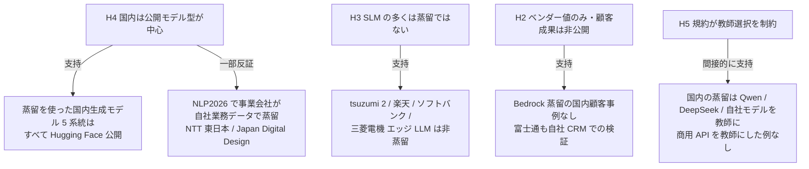
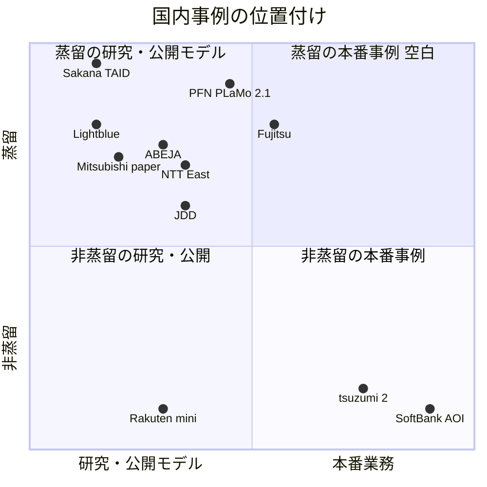
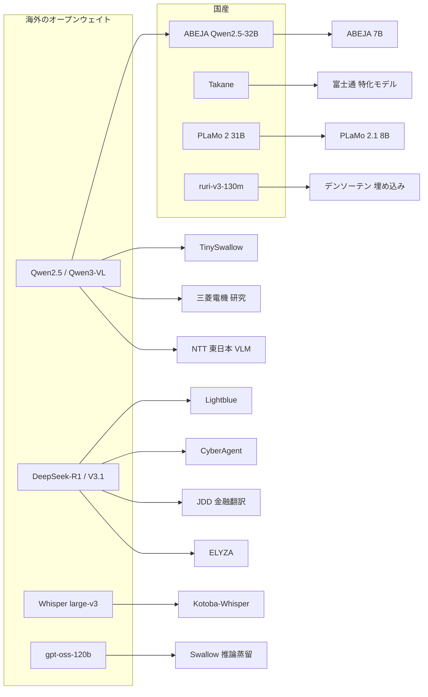
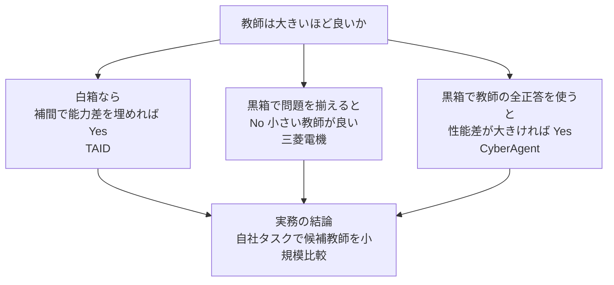
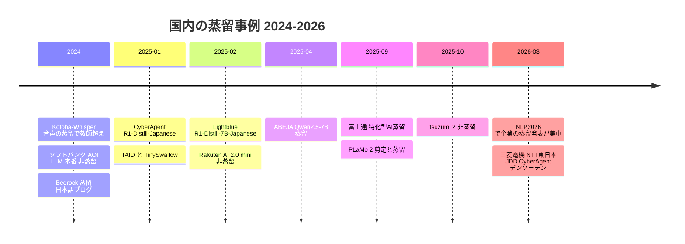
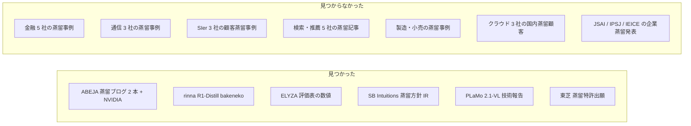

# LLM 蒸留の国内事例（C7 japan_cases） — 詳細レポート

## Parameters

- **Resources analyzed**: 13 レポート（一次資料 30 本以上を WebFetch で取得。2026-10-22 に 11–13 を追補、01–10 を訂正・追記）
- **Resource types**: 学術論文 4 / 技術情報 5 / ビジネス事例 3（うち 1 本は 7 事例の横断検証）/ 特許走査 1
- **Generated on**: 2026-10-21
- **Input source**: [gather 出力 resources-japan-cases.md](../../../gather/20261021/japan_cases/resources-japan-cases.md)
- **蒸留判定の基準**: 白箱蒸留（教師 logit を使う）/ 黒箱蒸留（教師の生成文で SFT）/ データ蒸留（同サイズ）/ 蒸留モデルへの追加学習 / 非蒸留
- **エビデンス品質の凡例**: 一次資料 = 開発元の論文・モデルカード・リリース / ベンダー申告 = 開発元の主張で第三者検証なし / 二次報道 = メディア記事

> **取得できなかった資料**: 富士通のプレスリリース原文（HTTP 429。報道 3 本で代替）、ABEJA の技術ブログ「蒸留のパイプライン並列化」（URL を特定できず）、ELYZA ブログのベンチマーク表（画像のため数値取得不可）。
>
> **（2026-10-22 追記）** 上記 3 件のうち **ABEJA の技術ブログは URL を特定して本文確認済み**（[11](11-abeja-nemo-distillation-pipeline-parallel.md)）、**ELYZA の表は画像を取得して全行を転記済み**（[12](12-elyza-rinna-r1-japanese-reasoning-models.md)）。富士通の原文は 6 経路で再試行したがすべて失敗（Vercel の JavaScript 検証・アーカイブ 404。[03](03-fujitsu-takane-specialized-distillation.md) に記録）。J-PlatPat は本環境から取得不能のため Google Patents の検索 API で代替走査した（[13](13-japan-llm-distillation-patent-scan.md)）。

## 結論（先に要点）

1. **国内で蒸留が一次資料で確認できた生成モデル**は TinySwallow（Sakana AI）、ABEJA Qwen2.5-7B、PLaMo 2.1 8B（PFN）、Lightblue R1-Distill-7B-Japanese、Kotoba-Whisper の 5 系統で、すべて公開モデルです。**（2026-10-22 追記）** ABEJA 7B は白箱蒸留（logit KL）と確定し、同条件の継続事前学習より Japanese-MT-Bench +0.05（7.26 vs 7.21）でした。これに rinna（R1-Distill の ChatVector + ORPO）と ELYZA（黒箱蒸留相当の「模倣学習」、MATH-500 0.8515 / Japanese MT-Bench 9.55）を加えても、**公開モデル型という構図は変わりません**。商用 SLM で蒸留を明言したのは SB Intuitions「Sarashina mini」（IR 文書のみ、数値なし）だけです。
2. **事業会社の業務データを使った蒸留の定量結果** は、富士通（自社 CRM、ベンダー申告）、NTT 東日本（現場写真 4,567 枚、研究）、Japan Digital Design（金融市場レポート、研究・同サイズのデータ蒸留）の 3 件だけです。**本番運用の効果（工数・コスト削減額）を公表した国内事例は見つかりませんでした**。
3. 国内の「軽量 LLM」の多くは **蒸留ではありません**（スクラッチ学習・fine-tuning・継続事前学習）。
4. 2026 年には **教師選びの方法論**（三菱電機・CyberAgent）が国内企業から出ており、「大きい教師ほど良い」とは限らないことが日本語でも確認されています。
5. （2026-10-22 追記）国内事業者の一覧（蒸留を売る事業者 / 蒸留モデルを売る事業者 / SIer・防御・市場予測の空白）は [distillation_platforms/15-distillation-business-landscape-japan-vs-overseas.md](../distillation_platforms/15-distillation-business-landscape-japan-vs-overseas.md) を参照してください。

## Report List

### Academic Papers

| # | Title | Year | Venue | Summary | Report |
|---|-------|------|-------|---------|--------|
| 1 | TAID: Temporally Adaptive Interpolated Distillation（+ TinySwallow-1.5B） | 2025 | ICLR 2025 Spotlight | 生徒→教師へ時間的に補間する中間教師で能力差を緩和。32B → 1.5B の日本語 SLM | [Details](01-sakana-taid-tinyswallow.md) |
| 2 | PLaMo 2 Technical Report | 2025 | arXiv | 31B → 8B を剪定 + top-128 logit KL で蒸留。スクラッチ 8B の約 1/5 の計算量 | [Details](02-pfn-plamo2-pruning-distillation.md) |
| 3 | 大きなモデルは小さなモデルの良い教師となり得るか?（三菱電機） | 2026 | NLP2026 C8-7 | 7B 教師の生徒が 72B 教師の生徒を平均 +3.16pt 上回る | [Details](07-mitsubishi-teacher-size-japanese.md) |
| 4 | 金融市場翻訳に特化した LLM に対する LLM-as-a-Judge ベース蒸留学習（Japan Digital Design） | 2026 | NLP2026 C9-7 | 70B → 70B のデータ蒸留。Judge Overall +0.178、分散約 1/18、BLEU は低下 | [Details](08-jdd-financial-translation-distillation.md) |
| 5 | 構造化知識蒸留と Visual Attention 最適化によるドメイン特化型 VLM の構築（NTT 東日本） | 2026 | NLP2026 C4-2 | Qwen3-VL-235B → 8B、通信設備保守の KY 8.04 → 8.65 | [Details](09-ntt-east-facility-maintenance-vlm.md) |

### Technical Articles

| # | Title | Source | Date | Report |
|---|-------|--------|------|--------|
| 1 | ABEJA Qwen2.5-7B（モデルカード / NEDO 成果概要 / GENIAC2 期登壇資料） | ABEJA | 2025-02〜04 | [Details](04-abeja-geniac-qwen25-7b-distillation.md) |
| 2 | DeepSeek-R1-Distill の日本語版（CyberAgent 14B/32B、Lightblue 7B） | CyberAgent / Lightblue | 2025-01〜02 | [Details](05-cyberagent-lightblue-r1-distill-japanese.md) |
| 3 | Kotoba-Whisper v1.0 / v2.0 | Kotoba Technologies | 2024 | [Details](06-kotoba-whisper-speech-distillation.md) |
| 4 | ABEJA × NVIDIA「蒸留のパイプライン並列化」と 7B の評価（2026-10-22 追補） | ABEJA / NVIDIA | 2025-04〜05 | [Details](11-abeja-nemo-distillation-pipeline-parallel.md) |
| 5 | ELYZA-Thinking / Shortcut と rinna bakeneko — R1 系派生モデルの定量評価（2026-10-22 追補） | ELYZA / rinna | 2025-02〜05 | [Details](12-elyza-rinna-r1-japanese-reasoning-models.md) |

### Patents

| # | Title | Source | Date | Report |
|---|-------|--------|------|--------|
| 1 | 国内の LLM 蒸留特許の走査 — Google Patents「知識蒸留 × 言語モデル」JP 110 件（2026-10-22 追補） | 東芝 JP2024099474A / Google JP7746629B2 ほか | 2024–2026 公開 | [Details](13-japan-llm-distillation-patent-scan.md) |

### Business Cases

| # | Title | Company | Date | Report |
|---|-------|---------|------|--------|
| 1 | 生成AI再構成技術（特化型AI蒸留） | 富士通 | 2025-09-08 | [Details](03-fujitsu-takane-specialized-distillation.md) |
| 2 | 「軽量 LLM」は蒸留か — 6 事例の横断検証（2026-10-22 に SB Intuitions Sarashina mini を追記し 7 事例） | NTT / 楽天 / ソフトバンク / 三菱電機 / ELYZA / AWS / SB Intuitions | 2024-10〜2025-11 | [Details](10-non-distillation-lightweight-llms.md) |

### レポート化しなかった NLP2026 発表（本文は取得済み）

| 発表 | 組織 | 要旨（本文確認） | 蒸留判定 |
|------|------|-----------------|---------|
| [B9-18 実用的観点から見た CoT 蒸留における教師–生徒能力差の影響](https://www.anlp.jp/proceedings/annual_meeting/2026/pdf_dir/B9-18.pdf) | 東大 + サイバーエージェント | 先行研究の設定では **蒸留後のモデルが蒸留前を下回る** ことを指摘。教師間フィルタの撤廃・生徒サイズの制約で再評価し、能力差の影響は一貫しないと報告。指針は「蒸留後の改善を確認」「候補教師の性能差が大きければ高性能教師を優先」 | 黒箱（CoT 蒸留） |
| [P1-4 Matryoshka 表現学習を考慮した埋め込みモデル蒸留](https://www.anlp.jp/proceedings/annual_meeting/2026/pdf_dir/P1-4.pdf) | デンソーテン | 車載器・スマホの RAG 向けに **ruri-v3-130m → ruri-v3-70m（100M 以下）** を蒸留。次元削減後も教師の正例順位が保たれるサンプルだけを使うフィルタを提案。JMTEB 検索の平均 nDCG@10 は対照学習のみ 66.38 → 最大 67.73 | 白箱（類似度分布の KL） |
| [C8-11 蒸留による日英推論型大規模言語モデル構築戦略の探索](https://www.anlp.jp/proceedings/annual_meeting/2026/pdf_dir/C8-11.pdf) | 東京科学大学 Swallow / 産総研 / ホットリンク / NII | gpt-oss-120b 等の推論型教師で〈指示・推論・応答〉を合成し SFT。**英語データだけで日本語入力にも深い推論が発現**。推論過程なしの日本語対話データを混ぜると日本語での推論が抑制される「アンチパターン」を報告 | 黒箱（推論蒸留） |

## 国内組織 × 蒸留方式 × 事業段階

| 組織 | 業種 | 教師 → 生徒 | 蒸留方式 | 事業段階 | 定量成果 | エビデンス |
|------|------|------------|---------|---------|---------|-----------|
| Sakana AI + 東京科学大学 | AI 研究 | Qwen2.5-32B-Instruct → Qwen2.5-1.5B | **白箱**（TAID） | 公開モデル（「商用を意図しない実験的プロトタイプ」） | MT-Bench 4.05（Phi-3-mini → TinyLlama、KL 2.71） | 一次資料 |
| Preferred Networks | 国産 LLM | PLaMo 2 31B → 8B | **白箱**（剪定 + top-128 KL） | 自社製品ラインナップ | 計算量 1/5、JMMLU 0.572 → 0.635 | 一次資料 |
| ABEJA | AI プラットフォーム | ABEJA Qwen2.5-32B → 7B | **白箱**（最終層 logit KL、2026-10-22 訂正）+ ChatVector | 公開モデル → ABEJA Platform 搭載予定 | Japanese-MT-Bench 7.26（同条件 CPT 7.21、元 7B 6.86）、「GPT-3.5 Turbo 超え」 | 一次資料 + ベンダー申告 |
| 富士通 | IT サービス | Takane → 1/100 規模（NAS で探索） | 蒸留（方式非公開） | **社内データで実証**、2025 年度下期トライアル | 11 倍速・精度 +43%・コスト −70% | ベンダー申告（報道経由） |
| Lightblue | AI スタートアップ | R1-Distill-Llama-70B → R1-Distill-Qwen-7B | **黒箱**（系列 SFT） | 公開モデル | gsm8k-ja 62% → 70%、日本語思考 48% → 94% | 一次資料 |
| サイバーエージェント | 広告・メディア | （DeepSeek による蒸留済み 14B/32B） | 蒸留モデルへの追加学習 | 公開モデル | なし | 一次資料 |
| Kotoba Technologies | 音声 AI | Whisper large-v3 → 756M | 蒸留（Distil-Whisper 方式） | 公開モデル（OSS） | 6.3 倍速、CER 14.9 → 11.6（ドメイン内） | 一次資料 |
| 三菱電機 | 製造 | Qwen2.5-7B〜72B → 0.5B〜1.8B | **黒箱**（CoT SFT） | 研究（製品のエッジ LLM は非蒸留） | 7B 教師が 72B 教師を +3.16pt | 一次資料 |
| NTT 東日本 | 通信 | Qwen3-VL-235B → Qwen3-VL-8B | **黒箱**（合成 VQA + LoRA） | 研究（実業務データ） | KY 8.04 → 8.65 | 一次資料 |
| Japan Digital Design | 金融 | 70B（DeepSeek-V3.1 が選別・編集）→ 同じ 70B | **データ蒸留（同サイズ）** | 研究（実務レポート） | Judge Overall +0.178、分散 1/18 | 一次資料 |
| デンソーテン | 自動車部品 | ruri-v3-130m → ruri-v3-70m | 白箱（埋め込み蒸留） | 研究（車載 RAG） | nDCG@10 66.38 → 67.73 | 一次資料 |
| ELYZA | AI スタートアップ | DeepSeek-R1 / Qwen2.5-72B の探索結果 → 32B / 7B | 実質黒箱（自社呼称は模倣学習） | 公開モデル | 図のみ →（2026-10-22 追記）Thinking-32B: MATH-500 0.8515、JMMLU_small 0.7826、Japanese MT-Bench 9.55、ELYZA-tasks-100 4.20 | 一次資料 |
| rinna（2026-10-22 追記） | AI スタートアップ | （DeepSeek による蒸留済み R1-Distill-Qwen-32B の ChatVector）→ bakeneko-32b | 蒸留モデルへの追加学習（ChatVector + R1 生成 1.2k 件で ORPO） | 公開モデル | Japanese MT-Bench 1st 7.39 → 8.58、multi 6.88 → 8.19 | 一次資料 |
| SB Intuitions / ソフトバンク（2026-10-22 追記） | 通信・国産 LLM | Sarashina 460B → Sarashina mini（サイズ非公開） | 蒸留（黒箱、IR 文書で方針表明） | **商用 API（2025-11-28〜）**、社内トライアル | 数値なし | 一次資料（IR・プレスリリース）、技術資料なし |
| 東芝（2026-10-22 追記） | 製造・IT | 教師モデル → 学生モデル（言語モデル訓練装置） | 白箱（特徴量 + 推論結果）、特許出願 | 特許公開（JP2024099474A、優先日 2023-01） | — | 一次資料（公報スニペット） |
| NTT（tsuzumi 2） | 通信 | — | **非蒸留** | 商用（東京通信大学が採用決定） | 数値なし | 一次資料 |
| 楽天（AI 2.0 mini） | EC | — | **非蒸留**（スクラッチ） | 公開モデル | MT-Bench 4.91 | 一次資料 |
| ソフトバンク | 通信 | — | **非蒸留**（Swallow-70b の FT） | **本番業務**（2024-10〜） | 要約時間 −30% 見込み | 二次報道 |

> 右上（蒸留 × 本番業務）は空いています。富士通は社内データでの実証とトライアル提供の段階で、中央寄りに置きました。

## Cross-Resource Insights

### 教師モデルの系譜

- **教師はほぼすべてオープンウェイトか自社モデル**: OpenAI / Anthropic / Google の商用 API を **教師** にした国内の蒸留事例は、今回の資料には一つもありませんでした（GPT-4o / GPT-4.1 / gpt-5-mini は翻訳・評価の Judge としてのみ使用）。利用規約の蒸留禁止（H5）を各社が避けていると読めます。
- **Qwen が国内蒸留の事実上の標準教師**: TinySwallow、ABEJA、三菱電機、NTT 東日本がいずれも Qwen 系を教師または生徒に使っています。
- **GENIAC が資金の共通項**: TAID / TinySwallow、ABEJA、PLaMo 2 は NEDO 事業（JPNP20017 等）の成果です。

### 「大きい教師ほど良い」かをめぐる 4 研究

| 研究 | 方式 | 結論 |
|------|------|------|
| TAID（Sakana AI） | 白箱 | 通常の KL は大きい教師で劣化。TAID なら教師が大きいほど改善 |
| 三菱電機 C8-7 | 黒箱（CoT） | 7B 教師 > 72B 教師（日本語算術、教師間フィルタあり） |
| CyberAgent B9-18 | 黒箱（CoT） | 教師間フィルタを外すと、性能差が大きい場合は高性能教師が有利 |
| Swallow C8-11 | 黒箱（推論） | 教師の種類（R1 / gpt-oss）が性能と推論の安定性に影響 |

### 時系列

## Comparison Table

| 項目 | TAID / TinySwallow | PLaMo 2.1 8B | 富士通 特化型 | ABEJA 7B | Lightblue 7B | Kotoba-Whisper | NTT 東日本 VLM | JDD 金融翻訳 |
|------|-------------------|-------------|--------------|---------|-------------|----------------|---------------|-------------|
| 方式 | 白箱（補間 KL） | 白箱（top-128 KL）+ 剪定 | NAS + 蒸留 | 白箱（logit KL）+ ChatVector（2026-10-22 訂正） | 黒箱 SFT | 疑似ラベル + KD | 黒箱（合成 VQA）+ LoRA | データ蒸留 |
| サイズ比 | 1.5B / 32B ≈ 1/20 | 8B / 31B ≈ 1/4 | ≈ 1/100 | 7B / 32B ≈ 1/4.6 | 7B / 70B = 1/10 | 756M / 1550M ≈ 1/2 | 8B / 235B ≈ 1/29 | 1/1 |
| 業務データ | なし | なし | **自社 CRM** | なし | なし | なし | **現場写真 5 年分** | **金融レポート** |
| 教師超え | — | 表により矛盾 | **申告あり** | — | — | **ドメイン内で超え** | — | — |
| 主な数値 | MT-Bench 4.05 | JMMLU 0.635 | 11 倍速 / +43% | MT-Bench 7.26（2025-04 記事。登壇資料は 6.919） | gsm8k-ja 70% | CER 11.6 | KY 8.65 | Overall +0.178 |
| 事業段階 | 公開 | 製品 | 社内実証 | 公開 | 公開 | 公開 | 研究 | 研究 |
| エビデンス | 一次 | 一次 | ベンダー申告 | 一次 + 申告 | 一次 | 一次 | 一次 | 一次 |

### ビジネス価値式への当てはめ

$$
\text{価値} \approx \underbrace{(C_{\text{teacher}} - C_{\text{student}}) \cdot Q}_{\text{推論コスト削減}} - \underbrace{(C_{\text{data}} + C_{\text{train}})}_{\text{初期投資}} - \underbrace{\Delta\text{Acc} \cdot V_{\text{err}}}_{\text{精度低下の損失}}
$$

| 事例 | 第 1 項 | 第 2 項 | 第 3 項 | 価値の主因 |
|------|--------|--------|--------|-----------|
| 富士通 | GPU・運用コスト −70% | 非公開 | 精度向上と申告（負） | 推論コスト + 精度 |
| PFN | 8B として配布 | 学習計算量 1/5 | JMMLU 向上 | **学習コスト削減** |
| Lightblue | 7B でローカル動作 | 10 分未満 | 改善 | 初期投資ほぼゼロ |
| Kotoba-Whisper | 6.3 倍速 | 非公開 | ドメイン内で改善 | 推論速度 |
| JDD | **0**（同サイズ） | 50 候補生成 + Judge | 分散 1/18 | **品質の安定化** |
| NTT 東日本 | 235B → 8B でオンプレ可 | 4,567 件 + 専門家レビュー | KY +7.6% | 現場への配置可能性 |

> どの事例も **$Q$（本番の推論回数）と金額換算** を公表しておらず、価値を数値で閉じられる国内事例はありません。

## 仮説の検証

| 仮説 | 判定 | 根拠（本クラスタ） |
|------|------|------------------|
| H1 定量成果の本番事例は検索・推薦に集中 | **判定不能（国内では検索・推薦の蒸留事例を確認できず）** | メルカリ・LINE ヤフー・ZOZO 等の蒸留記事は見つからなかった。国内の定量成果は CRM・通信保守・金融翻訳・音声認識。（2026-10-22 追記）メルカリ・LINE ヤフー・ZOZO・リクルート・楽天を個別に日本語で再検索しても蒸留記事は出ず、LINE ヤフーは量子化のインターン報告のみ。**国内の検索・推薦での LLM → BERT 蒸留は公開情報が存在しないか、検索インデックスに載っていない** |
| H2 ベンダー値のみで顧客別成果は非公開 | **支持** | Bedrock の日本語ブログに顧客名なし。富士通の数値も自社 CRM。（2026-10-22 追記）Bedrock 蒸留は 2025-05 に GA したが国内顧客事例は依然なし。Azure OpenAI・Google Cloud の国内蒸留事例もなし。SB Intuitions の「蒸留」も数値なし |
| H3 SLM 事例の多くは蒸留ではない | **支持** | tsuzumi 2・Rakuten AI 2.0 mini・ソフトバンク・三菱電機エッジ LLM は非蒸留。JDD の「蒸留」も小型化なし。（2026-10-22 追記）金融・通信・SIer・製造・小売・コールセンターの追加検索でも「蒸留を明記した事業会社の本番事例」は 0 件 |
| H4 国内は公開モデル型中心、社内導入は少ない | **支持（ただし 2026 年に変化の兆し）** | 蒸留モデル 5 系統はすべて公開。NLP2026 で NTT 東日本・JDD・デンソーテンが自社データで研究。（2026-10-22 追記）rinna・ELYZA を加えても公開モデル型。蒸留で作った PLaMo 2.1-8B がエッジ VLM 製品（PLaMo 2.1-VL）の土台になった点は「ベンダー内部工程」型の進展 |
| H5 規約が教師選択を制約 | **間接的に支持** | 国内事例の教師はすべてオープンウェイトか自社モデル。商用 API は Judge・翻訳にのみ使用。（2026-10-22 追記）追加 7 事例（ABEJA 詳細・rinna・ELYZA・SB Intuitions・PLaMo 2.1-VL・東芝・デンソーテン）も同じ。一方で Google の「LLM を親モデルとした生徒の知識蒸留」クレームが 2025-09 に JP 登録されており（JP7746629B2）、規約に加えて **特許** も国内の蒸留実装の制約になり得る |
| H6 Agent / tool calling 用途の蒸留が増加 | **国内では未確認** | 国内事例は推論（CoT）蒸留が中心で、tool calling の蒸留は見つからなかった |

## Further Investigation Candidates

| 候補 | 理由 | 確認先 |
|------|------|--------|
| 富士通 Takane 特化型モデルのトライアル顧客 | 2025 年度下期トライアルの導入企業・成果 | 富士通プレスリリース（2026 年以降） |
| ABEJA「蒸留のパイプライン並列化」技術ブログ | 7B 蒸留の方式（白箱か黒箱か）を確定できる → **（2026-10-22 完了）白箱と確定（[11](11-abeja-nemo-distillation-pipeline-parallel.md)）** | ABEJA Tech Blog の過去アーカイブ |
| SB Intuitions「Sarashina mini」の技術資料（2026-10-22 追加） | IR 文書で「蒸留」を明言した唯一の商用 SLM。教師・生徒サイズ、方式、評価値が未公開 | SB Intuitions 技術ブログ・論文、Sarashina3 の公開資料 |
| PLaMo 2.1-2B の作り方（2026-10-22 追加） | 2B が 8B からの剪定 + 蒸留か不明（VL レポートに記載なし） | PFN 技術ブログ・PLaMo 2.1 モデルカード |
| Google Patents の 2〜3 ページ目と出願人別走査（2026-10-22 追加） | 110 件中 60 件未精査。出願人別クエリはブロックされた | 時間をおいて再実行、または J-PlatPat を手動で検索 |
| 東芝 JP2024099474A の請求項全文（2026-10-22 追加） | 対象が LLM 規模か（語彙拡張を伴う蒸留）を確定 | Google Patents / J-PlatPat の公報 PDF |
| Japan Digital Design の本番適用 | 金融翻訳モデルの社内運用状況 | JDD 公式ブログ・MUFG 発表 |
| NTT 東日本 KY 支援の現場評価 | 予稿で「今後の課題」とされた運用評価 | NTT 東日本の発表 |
| 日本語の検索・推薦での LLM → BERT 蒸留 | H1 の国内検証（メルカリ・LINE ヤフー・ZOZO・リクルート） | 各社 Tech Blog のサイト内検索 |
| J-PlatPat の LLM 蒸留特許 | 国内企業の権利化動向（NEC の既存特許は画像分類向け） → **（2026-10-22 一部完了）** Google Patents で代替走査。東芝 1 件・Google の JP 登録 1 件を確認（[13](13-japan-llm-distillation-patent-scan.md)） | J-PlatPat（G06N 3/08, G06F 40） |
| 日経クロステック「蒸留で生成」 | AWS ジャパンの「コスト面から蒸留需要が高まる」という発言の裏付け | 日経クロステック（会員記事） |
| NLP2024–2025 の大学発表（日本語 GPT 蒸留、LoRA 中間層蒸留ほか） | 目次のみ確認 | anlp.jp 予稿 PDF |

## 2026-10-22 追補の記録

初回（2026-10-21）はセッション共有の WebSearch 上限で日本語検索が途中で止まっていました。2026-10-22 に WebSearch 36 回・WebFetch 約 25 回を追加し、次を行いました。

### 訂正

| レポート | 内容 |
|---------|------|
| [02 PLaMo 2](02-pfn-plamo2-pruning-distillation.md) | 表 1 / 表 6 の値を原文と再照合。転記ミスはなく **原文側の不整合** と確認。PLaMo 2.1-VL（2026-04）を追記 |
| [03 富士通](03-fujitsu-takane-specialized-distillation.md) | 原文の再取得を 6 経路で試行し失敗した経緯を記録（数値は報道 3 本で一致） |
| [04 ABEJA](04-abeja-geniac-qwen25-7b-distillation.md) | 蒸留判定を「方式非公開」→ **白箱蒸留（logit KL）** に訂正。「蒸留ブログは見つからず」を訂正 |
| [10 非蒸留の軽量 LLM](10-non-distillation-lightweight-llms.md) | ELYZA の数値を画像から読み取って追記。SB Intuitions「Sarashina mini」を 7 件目として追加 |
| [01](01-sakana-taid-tinyswallow.md) / [06](06-kotoba-whisper-speech-distillation.md) / [07](07-mitsubishi-teacher-size-japanese.md) / [08](08-jdd-financial-translation-distillation.md) / [09](09-ntt-east-facility-maintenance-vlm.md) | 主要数値を原文で再照合（TAID MT-Bench 4.05 / KL 2.71、Kotoba CER 11.6 vs 14.9・6.3 倍、三菱電機 +3.16 pt、JDD Overall +0.178・分散比 exp(−2.89) ≈ 0.056、NTT 東日本 4,567 枚・KY 8.04 → 8.65）。**誤りなし**。各レポートの蒸留判定とエビデンス品質タグも揃っていることを確認 |

### 追加

| レポート | 新規性 |
|---------|--------|
| [11 ABEJA × NVIDIA](11-abeja-nemo-distillation-pipeline-parallel.md) | 白箱蒸留の実装詳細（NeMo のパイプライン並列非対応を自前実装で回避）、蒸留 vs CPT の同条件比較 7.26 vs 7.21 |
| [12 ELYZA / rinna](12-elyza-rinna-r1-japanese-reasoning-models.md) | ELYZA 評価表 24 行の全転記（国内公開モデルの横並び）、rinna の ChatVector + ORPO |
| [13 特許走査](13-japan-llm-distillation-patent-scan.md) | Google Patents JP 110 件。東芝の言語モデル蒸留出願、Google の LLM 蒸留クレームの JP 登録 |

### 検索しても見つからなかったもの（空白の確定）

事業会社名 × 「蒸留」の日本語検索（金融・通信・SIer・製造・小売・コールセンター・検索・推薦）は、いずれも **一般解説記事か無関係なページ** しか返しませんでした。国内で蒸留の定量成果を出しているのは、引き続き **AI ベンダー・研究発表・GENIAC 成果** に限られます。検索記録は [gather の収集状況表](../../../gather/20261021/japan_cases/resources-japan-cases.md) にまとめました。
