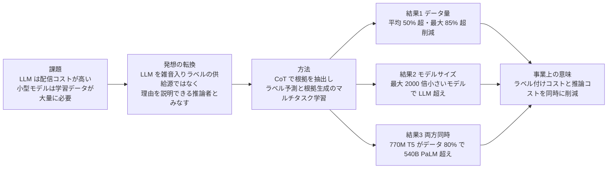
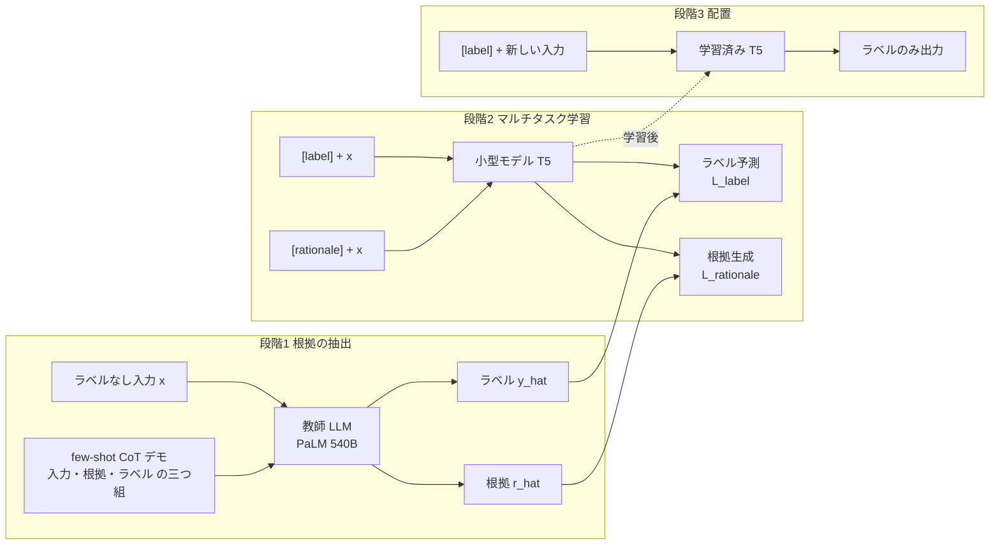

# Distilling Step-by-Step! Outperforming Larger Language Models with Less Training Data and Smaller Model Sizes

- **Link**: https://arxiv.org/abs/2305.02301 （HTML 版: https://arxiv.org/html/2305.02301v2 ／ 解説ブログ: [Google Research Blog, 2023-09-21](https://research.google/blog/distilling-step-by-step-outperforming-larger-language-models-with-less-training-data-and-smaller-model-sizes/)）
- **Authors**: Cheng-Yu Hsieh, Chun-Liang Li, Chih-Kuan Yeh, Hootan Nakhost, Yasuhisa Fujii, Alexander Ratner, Ranjay Krishna, Chen-Yu Lee, Tomas Pfister（University of Washington / Google Cloud AI Research / Google Research）
- **Year**: 2023（arXiv v1 2023-05-03、v2 2023-07-05）
- **Venue**: Findings of ACL 2023
- **Type**: Academic Paper
- **コード**: https://github.com/google-research/distilling-step-by-step
- **証拠の質**: **一次資料**（査読付き論文 + 著者所属組織の公式ブログ）。ただし評価は公開ベンチマーク 4 種での研究実験であり、**本番運用の事例ではない**
- **取得方法**: arXiv HTML v2 の全文と Google Research Blog を直接取得して作成（図は arXiv HTML の画像 URL を埋め込み）

> **本 C1 クラスタでの位置付け**: 商用 LLM（PaLM 540B）を **黒箱教師** として、ラベルに加えて **根拠（rationale）** を出力させ、小型モデル（T5）に学ばせる「根拠付き蒸留」の代表論文です。教師の logits は使わず **出力テキストのみ** を使うため、商用 API を教師にする場合にも原理的に適用できます（ただし規約上の可否は別問題。C8 参照）。Google はブログで「Vertex AI でプライベートプレビュー提供中」と明記しており、**手法が直接クラウド製品になった** 例でもあります。

## Abstract

Deploying large language models (LLMs) is challenging because they are memory inefficient and compute-intensive for practical applications. In reaction, researchers train smaller task-specific models by either finetuning with human labels or distilling using LLM-generated labels. However, finetuning and distillation require large amounts of training data to achieve comparable performance to LLMs. We introduce Distilling step-by-step, a new mechanism that (a) trains smaller models that outperform LLMs, and (b) achieves so by leveraging less training data needed by finetuning or distillation. Our method extracts LLM rationales as additional supervision for training small models within a multi-task framework. We present three findings across 4 NLP benchmarks: First, compared to both finetuning and distillation, our mechanism achieves better performance with much fewer labeled/unlabeled training examples. Second, compared to few-shot prompted LLMs, we achieve better performance using substantially smaller model sizes. Third, we reduce both the model size and the amount of data required to outperform LLMs; our finetuned 770M T5 model outperforms the few-shot prompted 540B PaLM model using only 80% of available data on a benchmark, whereas standard finetuning the same T5 model struggles to match even by using 100% of the dataset.

## Abstract (Japanese Translation)

大規模言語モデル（LLM）は、メモリ効率が悪く計算負荷も高いため、実用アプリケーションへの配置が難しい。そこで研究者は、人手ラベルで fine-tuning するか、LLM が生成したラベルで蒸留して、タスク特化の小型モデルを学習してきた。しかし fine-tuning も蒸留も、LLM と同等の性能に達するには大量の学習データを必要とする。本論文は Distilling step-by-step を提案する。これは (a) LLM を上回る小型モデルを学習し、(b) それを fine-tuning や蒸留より少ない学習データで実現する仕組みである。本手法は LLM の根拠（rationale）を追加の教師信号として抽出し、マルチタスクの枠組みで小型モデルを学習する。4 つの NLP ベンチマークで 3 つの知見を示す。第 1 に、fine-tuning・蒸留のいずれと比べても、はるかに少ないラベル付き / ラベルなし学習例でより高い性能を達成する。第 2 に、few-shot プロンプトの LLM と比べ、大幅に小さいモデルでより高い性能を達成する。第 3 に、LLM を上回るのに必要なモデルサイズとデータ量を同時に削減する。fine-tuning した 770M の T5 は、あるベンチマークで利用可能データの 80% だけを使って few-shot の 540B PaLM を上回った。一方、同じ T5 を通常の fine-tuning で学習すると、データを 100% 使っても PaLM に届かなかった。

## Overview

論文の要点を、ビジネス導入の観点で整理すると次のとおりです。



- **何が新しいか**: 従来の「タスク蒸留」は教師の **ラベルだけ** を真似ます。本手法は教師に **ラベル + 根拠** を出させ、生徒には「ラベル予測」と「根拠生成」を **別タスクとして** 学ばせます。推論時は根拠を生成せずラベルだけを出せるので、**推論コストは増えません**。
- **蒸留か fine-tuning か**: 本論文は (a) 人手ラベルがある場合（fine-tuning の改良）と、(b) ラベルなしデータに教師がラベルを付ける場合（蒸留の改良）の **両方** で評価しています。どちらの場合も **根拠は教師 LLM が生成** するので、知識の出所は教師です。厳密には、(a) は「人手ラベル + LLM 根拠」のハイブリッド、(b) が純粋な黒箱蒸留です。
- **量子化・剪定との違い**: 本手法は **モデル構造を変えずに、別の小さなモデル（T5）を学習** します。教師（PaLM）の重みを圧縮する手法ではありません。

## Problem

- **配信コストの問題**: 175B の LLM を 1 つ配信するだけで最低 350GB の GPU メモリが必要で、当時の最先端 LLM は 500B パラメータを超える。多くのプロダクトチーム、特に低遅延が必要な用途には手が届かない。
- **fine-tuning のデータ問題**: LLM 並みの性能を出すには、高価な **人手ラベル** が大量に必要。
- **蒸留のデータ問題**: 教師 LLM にラベルを付けさせる蒸留でも、**大量のラベルなしデータ** が必要で、集めるのが難しい場合がある。
- **既存の根拠活用の問題**: 根拠を生徒の **入力** に加える方式（Eq. 2、PINTO など）は、推論時にも LLM に根拠を生成させる必要があり、配信コストの問題を解決しない。
- **単一タスク化の問題**: 根拠とラベルを 1 本の系列として出力させる方式（Eq. 5、Ho et al. / Magister et al.）は、ラベル予測の性能をかえって下げることがある。

## Proposed Method

**Distilling step-by-step**

**核となる考え方**: LLM を「雑音入りラベルの供給源」ではなく「理由を説明できる推論者」とみなし、その根拠（例: 「面積 = 縦 × 横」）を、小型モデルが少ないデータから学ぶための **追加の情報** として使う。

**手順（2 段階）**:

1. **根拠の抽出（Section 3.1）**: ラベルなしデータ $x_i \in D$ に対し、few-shot CoT プロンプト $p$ を作る。各デモは三つ組 $(x^p, r^p, y^p)$（入力・人手で書いた根拠・ラベル）。$x_i$ を $p$ に連結して LLM に入力し、根拠 $\hat{r}_i$ とラベル $\hat{y}_i$ を生成させる。
2. **根拠を使った小型モデルの学習（Section 3.2）**: 入力に **タスク接頭辞** `[label]` / `[rationale]` を付け、同じ小型モデル $f$ に「ラベル予測」と「根拠生成」の 2 タスクを学ばせる。
3. **推論**: `[label]` 接頭辞だけを付けてラベルを出力させる。根拠の生成は不要で、LLM も不要。

**既存手法との違い**:

| 観点 | 標準 fine-tuning | 標準タスク蒸留 | 根拠を入力に加える（Eq. 2 / PINTO） | 根拠 + ラベルの単一タスク（Eq. 5） | **Distilling step-by-step（Eq. 3）** |
|------|----------------|---------------|-----------------------------------|----------------------------------|-------------------------------------|
| 教師信号 | 人手ラベル | LLM ラベル | ラベル + 根拠（入力側） | ラベル + 根拠（1 系列の出力） | ラベル + 根拠（別タスクの出力） |
| 推論時に LLM が必要 | 不要 | 不要 | **必要** | 不要 | 不要 |
| 推論時に根拠を生成 | しない | しない | LLM が生成 | **する（遅い）** | しない |
| ラベル性能 | 基準 | 基準 | — | 時に基準を下回る | 一貫して基準を上回る |

**Key Formulas**:

標準 fine-tuning とタスク蒸留の損失（Eq. 1）。$\hat{y}_i$ は fine-tuning なら人手ラベル $y_i$、蒸留なら LLM の予測ラベルです。

$$
\mathcal{L}_{\mathrm{label}}=\frac{1}{N}\sum_{i=1}^{N}\ell(f(x_{i}),\hat{y}_{i})
$$

- $N$: 学習例の数、$f$: 小型モデル、$x_i$: 入力、$\ell$: 予測 token と目標 token の交差エントロピー

根拠を **入力** に加える方式（Eq. 2、本論文は不採用）:

$$
\mathcal{L}=\frac{1}{N}\sum_{i=1}^{N}\ell(f(x_{i},\hat{r}_{i}),\hat{y}_{i})
$$

- 推論時にも $\hat{r}_i$ が必要になり、LLM を配置し続けなければならない。

提案手法の **マルチタスク損失**（Eq. 3, 4）:

$$
\mathcal{L}=\mathcal{L}_{\mathrm{label}}+\lambda\mathcal{L}_{\mathrm{rationale}}
$$

$$
\mathcal{L}_{\mathrm{rationale}}=\frac{1}{N}\sum_{i=1}^{N}\ell(f(x_{i}),\hat{r}_{i})
$$

- $\lambda$: 根拠生成損失の重み、$\hat{r}_i$: LLM が生成した根拠
- 根拠は **出力側の教師信号** なので、推論時には不要。

比較対象の **単一タスク損失**（Eq. 5）:

$$
\mathcal{L}_{\mathrm{single}}=\frac{1}{N}\sum_{i=1}^{N}\ell(f(x_{i}),[\hat{r}_{i},\hat{y}_{i}])
$$

**Features**:

- 教師の **出力テキストのみ** を使う黒箱方式（logits・重みは不要）
- 推論時のオーバーヘッドなし（根拠は学習時だけ使う）
- 学習時のオーバーヘッドは「わずか」（論文の Limitations で言及）
- 必要な人手作業は、タスクごとに約 10 件の CoT デモを書くことだけ

## Algorithm (Pseudocode)

```
Algorithm: Distilling step-by-step
Input : 教師 LLM T（黒箱で可）, 入力データ D = {x_i}（ラベル有無は問わない）,
        CoT デモ p（約 10 件の (x^p, r^p, y^p)）, 小型モデル f, 重み λ
Output: タスク特化の小型モデル f*

1. for each x_i in D:                          // 根拠の抽出（学習前に 1 回だけ）
2.     (r_hat_i, y_hat_i) ← T(p ⊕ x_i)          // few-shot CoT で根拠とラベルを生成
3.     if 人手ラベル y_i がある: y_hat_i ← y_i   // fine-tuning 設定ではラベルを人手に差し替え
4. for each 学習ステップ:
5.     バッチ B を D から取得
6.     L_label     ← CE( f("[label] "     ⊕ x), y_hat )   // ラベル予測タスク
7.     L_rationale ← CE( f("[rationale] " ⊕ x), r_hat )   // 根拠生成タスク
8.     L ← L_label + λ · L_rationale
9.     f を L で更新
10. 推論時: y = f("[label] " ⊕ x)              // 根拠は生成しない。LLM も不要
```

## Architecture / Process Flow



## Figures & Tables

### Figure 1: 提案パラダイムの概念図


LLM は zero/few-shot 性能が高いが配信が難しい。従来の小型モデル学習は大量の学習データが必要。本手法は LLM から根拠を抽出して小型モデルに教えることで、**配置するモデルのサイズ** と **学習に必要なデータ量** の両方を減らす。

### Figure 2: 手法の全体像


CoT プロンプトで LLM から根拠を抽出し（Section 3.1）、タスク接頭辞を付けたマルチタスク学習で小型モデルを学習する（Section 3.2）。

### Figure 3: 根拠抽出の few-shot CoT プロンプト例


デモには根拠（緑）とラベル（青）の両方を含める。ブログで紹介された常識 QA の例は次のとおり。

| 要素 | 内容 |
|------|------|
| 入力 | Sammy wanted to go to where the people are. Where might he go? Answer Choices: (a) populated areas, (b) race track, (c) desert, (d) apartment, (e) roadblock |
| 根拠 | The answer must be a place with a lot of people. Of the above choices, only populated areas have a lot of people. |
| ラベル | (a) populated areas |

算数の例（本文）: 「Jesse の部屋は縦 11 フィート・横 15 フィート。カーペットを 16 平方フィート持っている。床全体を覆うにはあと何平方フィート必要か」→ 根拠「面積 = 縦 × 横。部屋は 11 × 15 平方フィート」→ 答え「(11 × 15) − 16」。

### Figure 4: 人手ラベルありの設定でのデータ量 vs 性能（220M T5）


### Figure 5: ラベルなしの設定でのデータ量 vs 性能（220M T5）


図 4・5 は折れ線グラフで、個々の点の数値は本文に記載がありません。本文で明記された数値を表にします。

| データセット | 人手ラベルあり: 標準 fine-tuning（データ 100%）を上回るのに必要なデータ量 | 削減率 | ラベルなし: 標準タスク蒸留（100%）を上回るのに必要なデータ量 |
|-------------|----------------------------------------------------------------|-------|--------------------------------------------------------|
| e-SNLI | 12.5% | 87.5% | 12.5% |
| ANLI | 25% | 75% | 本文で数値なし（図 5 の説明では ANLI で 12.5% と記載） |
| CQA | 75% | 25% | 本文で数値なし |
| SVAMP | 80% | 20% | 本文で数値なし |

> 注: 図 5 のキャプションは「ANLI で全ラベルなしデータの 12.5% だけで標準タスク蒸留を上回る」、本文は「e-SNLI で 12.5%」と記載しています。両方の記述を併記します。

### Figure 6: 人手ラベルありの設定でのモデルサイズ vs 性能


### Figure 7: ラベルなしの設定でのモデルサイズ vs 性能


本文で明記された「540B PaLM の Few-shot CoT を上回る最小の T5」は次のとおりです。

| 設定 | データセット | LLM を上回った最小 T5 | PaLM 540B 比のサイズ |
|------|-------------|---------------------|---------------------|
| 人手ラベルあり（図 6） | e-SNLI | 220M（T5-Base） | 2000 倍超 小さい |
| 人手ラベルあり（図 6） | ANLI | 770M（T5-Large） | 700 倍超 小さい |
| 人手ラベルあり（図 6） | SVAMP | 770M（T5-Large） | 700 倍超 小さい |
| 人手ラベルあり（図 6） | CQA | 11B（T5-XXL） | 45 倍超 小さい |
| ラベルなし（図 7） | e-SNLI | 本文で 2000 倍小さいモデルと記載 | 2000 倍 |
| ラベルなし（図 7） | ANLI・CQA | 11B（キャプションでは 45 倍小さい） | 45 倍 |
| ラベルなし（図 7） | SVAMP | 単独では未達。ASDiv 2,305 件で拡張すると 11B で並ぶ | PaLM の 3% 未満 |

- ラベルなし設定では、**4 データセット中 3 つで教師 LLM を上回った**。
- ANLI では、提案手法が標準 fine-tuning・標準蒸留を **平均 8%・13%（タスク精度）** 上回った（全モデルサイズの平均）。

### Figure 8 / 9: 最小モデル × 最少データで LLM を上回る条件


| 設定 | データセット | 提案手法が LLM を上回った条件 | 標準手法 |
|------|-------------|---------------------------|---------|
| 人手ラベル（図 8） | e-SNLI | 220M T5、**データ 0.1%** | より多くのデータが必要 |
| 人手ラベル（図 8） | ANLI | 770M T5、**データ 80%** | 100% 使っても届かず、より大きいモデルが必要 |
| ラベルなし（図 9） | ANLI | 45 倍小さいモデル、ラベルなしデータの 50% | — |
| ラベルなし（図 9） | SVAMP | x 軸 = 追加した ASDiv の割合（0 = 拡張なし、100 = ASDiv 全件） | — |

### Table 1: 根拠を抽出する LLM のサイズの影響（220M T5、データ 100%）

| 手法 | LLM | e-SNLI | ANLI | CQA | SVAMP |
|------|-----|--------|------|-----|-------|
| Standard finetuning | N/A | 88.38 | 43.58 | 62.19 | 62.63 |
| Distilling step-by-step | 20B（GPT-NeoX） | 89.12 | 48.15 | 63.25 | 63.00 |
| Distilling step-by-step | 540B（PaLM） | **89.51** | **49.58** | **63.29** | **65.50** |

→ 20B の教師でも改善するが、540B の方が改善幅が大きい（根拠の質が高いため、と著者は推測）。

### Table 2: マルチタスク学習 vs 単一タスク学習（220M T5、データ 100%）

| 手法 | e-SNLI | ANLI | CQA | SVAMP |
|------|--------|------|-----|-------|
| Standard finetuning | 88.38 | 43.58 | 62.19 | 62.63 |
| Single-task training（根拠 + ラベルを 1 系列で出力） | 88.88 | 43.50 | 61.37 | 63.00 |
| Multi-task training（提案） | **89.51** | **49.58** | **63.29** | **65.50** |

→ 単一タスク化は ANLI・CQA で **標準 fine-tuning より悪化**。根拠を「別タスク」として扱うことが効く。

### Table 1・2 から計算した改善幅（ポイント）

| データセット | 540B 教師の提案手法 − 標準 fine-tuning | 20B 教師の提案手法 − 標準 fine-tuning | 単一タスク − 標準 fine-tuning |
|-------------|------------------------------------|-----------------------------------|----------------------------|
| e-SNLI | +1.13 | +0.74 | +0.50 |
| ANLI | **+6.00** | +4.57 | −0.08 |
| CQA | +1.10 | +1.06 | −0.82 |
| SVAMP | +2.87 | +0.37 | +0.37 |

```
ANLI での精度（220M T5, データ 100%）
標準 fine-tuning        |████████████████████████████████████████████ 43.58
単一タスク              |████████████████████████████████████████████ 43.50
提案（20B 教師）        |████████████████████████████████████████████████ 48.15
提案（540B 教師）       |██████████████████████████████████████████████████ 49.58
```

### Table 3: データセット統計

| データセット | タスク | Train | Validation | Test |
|-------------|-------|-------|-----------|------|
| e-SNLI | 自然言語推論 | 549,367 | 9,842 | 9,824 |
| ANLI（R1 split） | 自然言語推論 | 16,946 | 1,000 | 1,000 |
| CQA | 常識 QA | 8,766 | 975 | 1,221 |
| SVAMP | 算数文章題 | 720 | 80 | 200 |

- 検証用データが無い場合は学習データの 10% を検証用に分割。CQA は元の検証セットをテストに使用。
- SVAMP の拡張に使った ASDiv は 2,305 件。

### 実装上のハイパーパラメータ（Appendix A.1）

| モデル | 学習率 | バッチサイズ | 最大入力長 | 最大ステップ |
|-------|-------|------------|-----------|------------|
| T5-Base（220M） | $5\times10^{-5}$ | 64 | 1024 | 10,000 |
| T5-Large（770M） | $5\times10^{-5}$ | 64 | 1024 | 10,000 |
| T5-XXL（11B） | $5\times10^{-5}$ | 32 | 1024 | 4,000 |

- 計算環境: クラウド A100 × 16 GPU。結果は 4 回の乱数試行の平均（図に標準誤差）。

### 手法比較（関連研究からの整理）

| 研究 | 根拠の使い方 | 推論時に LLM が必要 | 本論文との差 |
|------|-----------|-----------------|------------|
| PINTO（Wang et al., 2022a） | LLM が推論時に根拠を生成し、小型モデルの入力に使う | 必要 | 配信課題を解決しない |
| Fine-tune-CoT（Ho et al., 2022） | 根拠 + ラベルを 1 系列の出力として学習 | 不要 | 単一タスク。データ量・モデルサイズの細かな比較なし |
| Magister et al., 2022 | 同上 | 不要 | 同上 |
| 人手根拠の学習（Rajani, Camburu 等） | 人手で書いた根拠 | 不要 | 人手根拠は高価 |
| **本論文** | LLM 根拠を別タスクの出力として学習 | 不要 | データ量・モデルサイズ・ラベルなし設定を体系的に評価 |

## Experiments & Evaluation

### Setup

- **教師 LLM**: PaLM 540B（few-shot CoT）。アブレーションで GPT-NeoX 20B。
- **生徒**: T5-Base 220M / T5-Large 770M / T5-XXL 11B（公開済みの事前学習重みから初期化）
- **データ**: e-SNLI・ANLI（自然言語推論）、CQA（常識 QA）、SVAMP（算数文章題）
- **比較手法**: 標準 fine-tuning（人手ラベル）、標準タスク蒸留（LLM ラベル）、Few-shot CoT（PaLM 540B）、PINTO tuning（PaLM 出力の上に 220M T5 を学習）

### Main Results

- **データ量**: 標準手法と同じ性能に必要なデータを、平均 50% 超・最大 85% 超 削減（Introduction の記述）。
- **モデルサイズ**: 最大 2000 倍小さいモデルで LLM を上回る。
- **両方同時**: 770M T5 がデータ 80% で 540B PaLM を上回る（ANLI）。同じ T5 を標準 fine-tuning すると 100% でも届かない。
- **ラベルなしのみ**: 11B T5 で 540B PaLM を上回る（PaLM の 3% 未満のサイズ）。

### Ablation Study

- **教師サイズ**: 20B 教師でも効果はあるが 540B より小さい（Table 1）。
- **学習形式**: マルチタスクが単一タスクより一貫して良い（Table 2）。

### Limitations（論文記載のまま構造化）

1. タスクごとに約 10 件の few-shot CoT デモを人手で用意する必要がある（zero-shot CoT で緩和できる可能性）。
2. 根拠を使う学習には、わずかな学習時の計算オーバーヘッドがある（推論時はなし）。
3. より複雑な推論・計画タスクでは LLM 自体の推論能力が限られるという証拠があり、根拠の質が結果にどう影響するかは今後の課題。
4. 倫理面: 生徒は教師 LLM のバイアスを引き継ぐ。

## ビジネス上の示唆

ドメイン共通の価値式に当てはめると、本論文が数値で示しているのは主に **初期投資のデータ項** と **推論コスト項** です。

$$
\text{蒸留のビジネス価値} \approx \underbrace{(C_{\text{teacher}} - C_{\text{student}}) \cdot Q}_{\text{推論コスト削減（モデル 45〜2000 倍小）}} - \underbrace{(C_{\text{data}} + C_{\text{train}})}_{\text{データ 50〜85\% 減 + 教師呼出し費}} - \underbrace{\Delta\text{Acc} \cdot V_{\text{err}}}_{\text{多くの場合 } \Delta\text{Acc} < 0}
$$

| 価値式の項 | 本論文が示したこと | 証拠の質 | 残る不確実性 |
|-----------|----------------|---------|------------|
| $C_{\text{student}}$ | 220M〜11B の T5 で 540B PaLM を上回る | 一次資料（研究ベンチマーク） | 実際の配信コスト（$/token、遅延）は未測定 |
| $C_{\text{data}}$ | 人手ラベル・ラベルなしデータを 50%〜85% 超 削減 | 一次資料 | ラベル単価は業務ごとに大きく違う |
| 教師の呼出し費 | 根拠付きで生成させるため、ラベルのみより出力 token が増える | 論文に数値なし | API 教師なら出力 token 課金が増える |
| $\Delta\text{Acc}$ | 4 タスク中ほぼ全てで生徒が教師を上回る（負の損失） | 一次資料 | 狭い分類・QA タスク。生成タスクは未評価 |

**実務への適用条件**:

1. **狭いタスク・大量リクエスト** のとき有利（分類・抽出・短答 QA）。本論文の 4 タスクはいずれも短い出力のタスク。
2. 教師は **出力テキストだけ** で良いので、Bedrock / Vertex / OpenAI 等の API 教師でも技術的には実施できる。**規約上の可否（競合モデル開発の禁止条項）は別途確認が必要**（H5、C8）。
3. 推論時に根拠を出さないため、**説明可能性は得られない**。根拠も出力させたい業務では `[rationale]` 接頭辞で生成できるが、その分推論コストが増える。

**仮説との関係**:

| 仮説 | 本論文からの示唆 |
|------|----------------|
| H2（ベンダー値と顧客成果の乖離） | Google は本手法を Vertex AI のプライベートプレビューとして提供したとブログで明記。製品化の根拠となる一次資料は研究ベンチマークのみで、**顧客別の成果は本資料に無い**（H2 を補強） |
| H3（SLM 事例の多くは単なる fine-tuning） | 本論文自体が「fine-tuning」と「蒸留」を明確に区別し、両者の中間（人手ラベル + LLM 根拠）も評価している。事例を読む際の **判別基準** として使える |
| H5（規約制約） | 黒箱方式なので API 教師で実行可能。ゆえに規約が事業上の制約になる |
| H6（推論・Agent 蒸留） | 推論蒸留の **前身**。ただし対象は短答タスクで、長い推論トレースや tool calling は扱わない |

## Notes

- **後続研究との関係**: 同時期の Fine-tune-CoT（Ho et al., arXiv 2212.10071）、Specializing Smaller LMs（Fu et al., arXiv 2301.12726）、Symbolic CoT Distillation（Li et al., arXiv 2306.14050）、Teaching Small Language Models to Reason（Magister et al., arXiv 2212.08410）が同じ「根拠付き蒸留」の系譜。2025 年の DeepSeek-R1-Distill や s1 は、この考え方を **長い推論トレース** へ拡張したものと位置付けられる。
- **製品化**: ブログ（2023-09-21）に「Distilling step-by-step is available for private preview on Vertex AI」と記載（**ベンダー申告**）。2026 年 10 月時点の Vertex AI の蒸留ドキュメント URL（`cloud.google.com/vertex-ai/generative-ai/docs/models/distill-text-models`）は 404 で、現行の提供形態は本 run では確認できなかった（C2 で確認推奨）。
- **公開コード**: https://github.com/google-research/distilling-step-by-step
- **さらに調べる候補**:
  - Symbolic Chain-of-Thought Distillation（arXiv 2306.14050）
  - Teaching Small Language Models to Reason（arXiv 2212.08410）
  - PINTO（Wang et al., 2022a、推論時に LLM 根拠を使う方式）
  - Vertex AI の蒸留機能の現行仕様と価格（C2）
