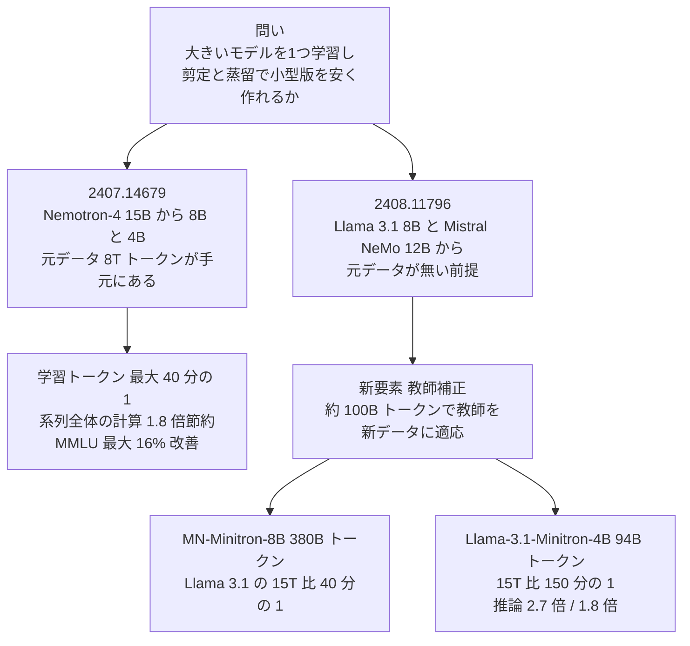
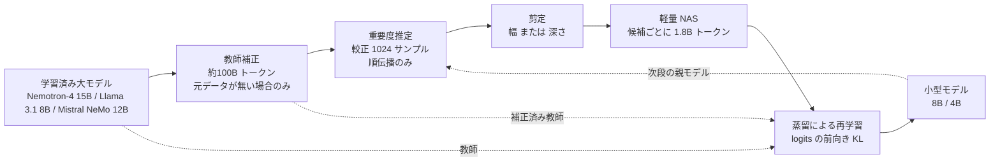

# Compact Language Models via Pruning and Knowledge Distillation（Minitron）+ LLM Pruning and Distillation in Practice: The Minitron Approach

- **Link**:
  - 主論文: https://arxiv.org/abs/2407.14679 （HTML v2: https://arxiv.org/html/2407.14679v2）
  - 続編: https://arxiv.org/abs/2408.11796 （HTML v4: https://arxiv.org/html/2408.11796v4）
  - 技術ブログ: [How to Prune and Distill Llama-3.1 8B to an NVIDIA Llama-3.1-Minitron 4B Model（NVIDIA, 2024-08-14）](https://developer.nvidia.com/blog/how-to-prune-and-distill-llama-3-1-8b-to-an-nvidia-llama-3-1-minitron-4b-model/)
- **Authors**:
  - 2407.14679: Saurav Muralidharan, Sharath Turuvekere Sreenivas, Raviraj Joshi, Marcin Chochowski, Mostofa Patwary, Mohammad Shoeybi, Bryan Catanzaro, Jan Kautz, Pavlo Molchanov（NVIDIA）
  - 2408.11796: Sharath Turuvekere Sreenivas, Saurav Muralidharan ほか NVIDIA の 25 名
- **Year**: 2024（2407.14679 は 2024-07-19 投稿・v2 2024-11-04、2408.11796 は 2024-08-21 投稿・v4 2024-12-09）
- **Venue**: 2407.14679 は NeurIPS 2024、2408.11796 は arXiv（技術報告）
- **Type**: Academic Paper（+ 技術ブログ）
- **公開物**: Minitron 8B / 4B、Mistral-NeMo-Minitron-8B-Base、Llama-3.1-Minitron-4B-Width-Base / Depth-Base（Hugging Face）、コード https://github.com/NVlabs/Minitron
- **証拠の質**: 論文 2 本は **一次資料**（主論文は査読付き）。ただし評価・コスト計算はすべて **NVIDIA 自身による計測** で、第三者検証ではない。ブログは同じ著者による解説（一次資料だが販促的側面あり）
- **取得方法**: 3 資料とも全文を直接取得して作成

> **本 C1 クラスタでの位置付け**: **白箱蒸留** の代表例です。教師（剪定前のモデル）の **logits** を使うため、**重みを持っている側** にしか実行できません。商用 API を教師にする黒箱蒸留とは対照的に、「自社で大きなモデルを 1 つ持ち、そこから小型版を安く量産する」という **モデル提供者・大企業向け** の手法です。剪定（構造を削る）と蒸留（性能を回復させる）を組み合わせている点で、**単なる剪定や量子化とは異なります**（量子化は FP8 推論として別途併用しているだけ）。

## Abstract

**2407.14679（主論文）**

Large language models (LLMs) targeting different deployment scales and sizes are currently produced by training each variant from scratch; this is extremely compute-intensive. In this paper, we investigate if pruning an existing LLM and then re-training it with a fraction (<3%) of the original training data can be a suitable alternative to repeated, full retraining. To this end, we develop a set of practical and effective compression best practices for LLMs that combine depth, width, attention and MLP pruning with knowledge distillation-based retraining; we arrive at these best practices through a detailed empirical exploration of pruning strategies for each axis, methods to combine axes, distillation strategies, and search techniques for arriving at optimal compressed architectures. We use this guide to compress the Nemotron-4 family of LLMs by a factor of 2-4×, and compare their performance to similarly-sized models on a variety of language modeling tasks. Deriving 8B and 4B models from an already pretrained 15B model using our approach requires up to 40× fewer training tokens per model compared to training from scratch; this results in compute cost savings of 1.8× for training the full model family (15B, 8B, and 4B). Minitron models exhibit up to a 16% improvement in MMLU scores compared to training from scratch, perform comparably to other community models such as Mistral 7B, Gemma 7B and Llama-3 8B, and outperform state-of-the-art compression techniques from the literature.

**2408.11796（続編）**

Structured pruning with knowledge distillation is a potent combination for obtaining small language models (SLMs) with significantly fewer training tokens and compute resources compared to training from scratch. In this work, we investigate how this strategy can be effectively applied in instances where access to the the original pretraining dataset is restricted. We introduce a new teacher correction phase before distillation which lets the teacher model adjust to our specific data distribution using a lightweight fine-tuning phase. We apply this strategy to compress the Mistral NeMo 12B and Llama 3.1 8B models to 8B and 4B parameters, respectively, using pruning and distillation. We explore two distinct pruning strategies: (1) depth pruning and (2) joint hidden/attention/MLP (width) pruning, and evaluate the results on common benchmarks from the LM Evaluation Harness. The models are then aligned with NeMo Aligner and further tested for instruction following, role-play, math, coding and function calling capabilities. This approach produces the state-of-the-art Mistral-NeMo-Minitron-8B (MN-Minitron-8B for brevity) model from Mistral NeMo 12B, and a compelling 4B model from Llama 3.1 8B. We open-source our base model weights on Hugging Face with a permissive license.

## Abstract (Japanese Translation)

**2407.14679**: 展開規模の異なる複数サイズの LLM は、現在それぞれをゼロから学習して作られており、膨大な計算を要する。本論文は、既存の LLM を剪定し、元の学習データのごく一部（3% 未満）で再学習することが、繰り返しのフル学習の代わりになるかを調べる。そのために、深さ・幅・注意・MLP の剪定と、知識蒸留による再学習を組み合わせた、実用的な圧縮のベストプラクティス集を作った。これは各軸の剪定戦略、軸の組合せ方、蒸留戦略、最適な圧縮構造を探す探索手法を詳細に実験して得たものである。この指針で Nemotron-4 系列を 2〜4 倍に圧縮し、同程度のサイズのモデルと比較した。学習済みの 15B から 8B と 4B を作るのに必要な学習 token は、ゼロから学習する場合に比べ 1 モデルあたり最大 40 分の 1 で、モデル系列全体（15B・8B・4B）の学習計算コストは 1.8 倍節約される。Minitron はゼロから学習した場合に比べ MMLU が最大 16% 改善し、Mistral 7B・Gemma 7B・Llama-3 8B と同程度の性能で、既存の圧縮手法を上回る。

**2408.11796**: 構造化剪定と知識蒸留の組合せは、ゼロから学習するより大幅に少ない token と計算資源で小型言語モデルを得る強力な方法である。本研究は、元の事前学習データにアクセスできない場合にこの戦略をどう適用するかを調べる。蒸留の前に、軽い fine-tuning で教師モデルを自分たちのデータ分布に合わせる「教師補正（teacher correction）」段階を新たに導入する。この戦略で Mistral NeMo 12B を 8B に、Llama 3.1 8B を 4B に剪定 + 蒸留で圧縮する。深さ剪定と、隠れ次元・注意・MLP をまとめて削る幅剪定の 2 方式を比べ、LM Evaluation Harness の標準ベンチマークで評価した。さらに NeMo Aligner で整合させ、指示追従・ロールプレイ・数学・コード・function calling を評価した。その結果、最先端の Mistral-NeMo-Minitron-8B と、有力な Llama 3.1 由来の 4B モデルを得た。ベースモデルの重みは寛容なライセンスで Hugging Face に公開する。

## Overview



- **コスト構造の転換**: 従来は 15B・8B・4B をそれぞれ数兆 token で学習していました。Minitron では最大モデルだけを学習し、残りは **約 94B token** の再学習で作ります（Nemotron-3 8B の 3.8T、Llama-3 8B の 15T 超と比べて桁違いに少ない）。
- **蒸留の役割**: 剪定直後のモデルは精度が大きく落ちます。その回復を、正解ラベルでの通常学習ではなく **教師 logits との KL** で行うと、同じ計算量で MMLU が大きく改善します（Table 11: 24.57 → 37.81）。
- **続編の実務的貢献**: Llama 3.1 や Mistral NeMo は **事前学習データが非公開** です。そのまま別データで蒸留すると教師の指導が最適でなくなるため、先に教師を約 100B token で軽く fine-tuning する「教師補正」を入れます。これにより **他社の公開重みモデルを教師に使える** ようになりました。

## Problem

- **モデル系列の学習コスト**: Llama-2（7B / 13B / 70B）や Pythia（80M〜12B の 8 種）のように、サイズごとにゼロから学習するのは時間・データ・計算資源の面で非常に高価。
- **剪定後の回復コスト**: 構造化剪定には精度回復のための再学習が付き物だが、LLM では大量の整備済みデータが必要で非常に高価。データ効率の良い再学習（蒸留など）を体系的に調べた研究が無かった。
- **手法選択の不明確さ**: 構造化剪定の文献は多いが、どの手法をいつ・どう組み合わせるべきかが利用者には分からない。
- **勾配計算の重さ**: 既存の幅剪定は学習可能なマスクと勾配計算を使うことが多く、LLM 規模ではメモリ・計算が重い。
- **元データが無い問題（続編）**: 最先端の公開モデルは非公開データで学習されており、元データで蒸留するという前提が成り立たない。

## Proposed Method

**Minitron: 重要度推定 → 剪定 → 軽量 NAS → 蒸留による再学習**

**手順**:

1. **重要度推定**: 1,024 サンプルの較正データで **順伝播だけ** を行い、各軸（深さ・ニューロン・注意ヘッド・埋め込みチャネル）の重要度を活性化から計算する（勾配不要）。
2. **剪定（trimming）**: 重要度の順に並べ、重み行列を直接切り詰める。注意ヘッドを削るときは、削ったヘッドの残差情報を残すヘッドに足し込む。
3. **軽量 NAS**: パラメータ予算（目標 ±5%）を満たす構成を列挙し（8B で 15 候補、4B で 18 候補）、各候補を約 1.8B token で軽く再学習して順位を安定させ、最良の候補を選ぶ。
4. **蒸留による再学習**: 剪定前のモデルを教師、剪定後を生徒として、logits の KL（必要に応じて中間状態の損失も）で再学習する。
5. **反復**: 15B → 8B → 4B のように、前段の出力を次段の入力にする。
6. **教師補正（続編）**: 元データが無い場合、まず教師を蒸留用データで約 100B token だけ fine-tuning してから 1〜4 を行う（蒸留と並行して補正しても同等）。

**Key Formulas**:

MLP 層（$\delta$: 活性化関数、$\boldsymbol{W}_1, \boldsymbol{W}_2 \in \mathbb{R}^{d_{hidden}\times d_{model}}$）:

$$
\operatorname{MLP}(\mathbf{X})=\delta\left(\mathbf{X}\cdot\boldsymbol{W}^{T}_{1}\right)\cdot\boldsymbol{W}_{2}
$$

多頭注意（$L$: ヘッド数、$d_{head}$: ヘッド次元）:

$$
\operatorname{MHA}(\mathbf{X})=\operatorname{Concat}(\text{head}_{1},\ldots,\text{head}_{L})\cdot\boldsymbol{W}^{O},\quad
\text{head}_{i}=\operatorname{Attn}(\mathbf{X}\boldsymbol{W}^{Q,i},\mathbf{X}\boldsymbol{W}^{K,i},\mathbf{X}\boldsymbol{W}^{V,i})
$$

LayerNorm（$\mu, \sigma^2$: 埋め込み次元方向の平均と分散、$\gamma, \beta$: 学習パラメータ）:

$$
LN(\mathbf{X})=\frac{\mathbf{X}-\mu}{\sqrt{\sigma^{2}+\epsilon}}\odot\gamma+\beta
$$

活性化ベースの重要度（$\sum_{\mathbf{B,S}}$ はバッチ・系列方向の集約。最良は batch = L2、seq = mean）:

$$
F_{\text{head}}^{(i)}=\sum_{\mathbf{B,S}}\left\|\operatorname{Attn}(\mathbf{X}\boldsymbol{W}^{Q,i},\mathbf{X}\boldsymbol{W}^{K,i},\mathbf{X}\boldsymbol{W}^{V,i})\right\|_{2},\quad
F_{\text{neuron}}^{(i)}=\sum_{\mathbf{B,S}}\mathbf{X}\left(\boldsymbol{W}_{1}^{i}\right)^{T},\quad
F_{\text{emb}}^{(i)}=\sum_{\mathbf{B,S}}LN(\mathbf{X})_{i}
$$

集約関数の候補（系列 $\mathbf{S}$ のスコアに対して）:

$$
\text{mean(abs)}=\frac{1}{n}\sum_{i=1}^{n}|\mathbf{S}_{i}|,\quad
\text{L2}=\sqrt{\sum_{i=1}^{n}\mathbf{S}_{i}^{2}},\quad
\text{variance}=\frac{1}{n}\sum_{i=1}^{n}(\mathbf{S}_{i}-\bar{\mathbf{S}})^{2}
$$

深さの重要度 Block Importance（$\mathbf{X}_{i,t}$: 層 $i$ の入力の $t$ 行目）:

$$
\operatorname{BI}_{i}=1-\mathbb{E}_{X,t}\frac{\mathbf{X}^{T}_{i,t}\mathbf{X}_{i+1,t}}{\|\mathbf{X}_{i,t}\|_{2}\|\mathbf{X}_{i+1,t}\|_{2}}
$$

反復的重要度推定（$T$ 回、元の次元 $d_s$ から目標 $d_t$ へ。$i \in [0, T-1]$）: 第 $i$ 回は $d_{s}-i\cdot\frac{d_{s}-d_{t}}{T}$ 次元で重要度を計算し、$d_{s}-(i+1)\cdot\frac{d_{s}-d_{t}}{T}$ 次元へ剪定する。

ヘッド剪定時の残差の足し込み（$L$ 個を $K$ 個に減らす。$i\in[K-(L-K),K]$）:

$$
head_{i}+(head_{i}-head_{2K-i+1})
$$

温度付き出力分布（$\tau$: 温度、$|V|$: 語彙数。最良は $\tau = 1.0$）:

$$
p(x_{i},\tau)=\frac{\exp\left(\frac{x_{i}}{\tau}\right)}{\sum_{j=1}^{|V|}\exp\left(\frac{x_{j}}{\tau}\right)}
$$

logit 蒸留損失（$l$: 系列長、$p_t^k, p_s^k$: $k$ 番目の token での教師・生徒の分布。Loss は前向き KL が最良）:

$$
L_{\text{logits}}=\frac{1}{l}\sum_{k=1}^{l}\text{Loss}\left(p_{t}^{k}(x,\tau),p_{s}^{k}(x,\tau)\right)
$$

中間状態の蒸留損失（$H$: 選んだ中間状態の集合。次元の違いは共有の線形変換で生徒側を拡大して吸収。常に LayerNorm 後の状態を使う）:

$$
L_{is}=\frac{1}{l}\sum_{k\in H}\sum_{i=1}^{l}Loss_{k}(h_{t}^{ki},h_{s}^{ki}),\quad L_{is}=L_{emb}+L_{att}+L_{i}+L_{o}
$$

総損失（$\alpha$ は動的に $L_{logits}/L_{is}$ とすると定数より良い）:

$$
L=L_{\text{CLM}}+L_{logits}+\alpha\times L_{is}
$$

モデル系列の学習 FLOPs（バッチ 1152 での 1 ステップあたり FLOPs: 15B = 4.4e17、8B = 2.5e17、4B = 1.2e17）:

$$
\text{FLOPs}_{\text{scratch}}=(4.4\text{e}17+2.5\text{e}17+1.2\text{e}17)\times\text{steps},\quad
\text{FLOPs}_{\text{Minitron}}=\left(4.4\text{e}17+\frac{2.5\text{e}17}{40}+\frac{1.2\text{e}17}{40}\right)\times\text{steps}
$$

$$
\frac{\text{FLOPs}_{\text{scratch}}}{\text{FLOPs}_{\text{Minitron}}}=\frac{8.1\text{e}17}{4.4925\text{e}17}\approx 1.80
$$

（右辺の 4.4925e17 と比 1.80 は、論文の式から本レポートが計算した値。論文は「1.8×」と記載）

**Features**:

- 重要度推定は **順伝播のみ・1,024 サンプル** で済む（勾配計算不要）
- 再学習は元データの 3% 未満（主論文）
- 幅剪定は深さ剪定より、軽い再学習の後で良くなる（剪定直後は逆）
- 最良の損失は **logits の前向き KL のみ**（CLM 損失を足さない方が良い）

## Algorithm (Pseudocode)

```
Algorithm: Minitron（剪定 + 蒸留によるモデル系列の作成）
Input : 学習済みの大モデル M_L（重みにアクセス可能）, 蒸留用データ D,
        目標サイズの列 [s_1 > s_2 > ...], 較正データ C（1,024 サンプル）
Output: 小型モデルの系列 [M_1, M_2, ...]

0. if D が M_L の元の事前学習データでない:              // 続編の教師補正
       M_L ← FineTune(M_L, D, 約100B tokens, 低学習率)   // 蒸留と並行でも可
1. teacher ← M_L ; parent ← M_L
2. for each 目標サイズ s in [s_1, s_2, ...]:
3.     scores ← ActivationImportance(parent, C)         // 順伝播のみ, batch=L2, seq=mean
4.     cands  ← 予算 s±5% を満たす構成を列挙               // 8B: 15 候補, 4B: 18 候補
5.     for each c in cands:
6.         S_c ← Trim(parent, scores, c)                 // 重み行列を直接切り詰め
7.         S_c ← Distill(teacher, S_c, D, 約1.8B tokens)  // 軽い再学習で順位を安定化
8.     S* ← 検証損失が最小の S_c
9.     S* ← Distill(teacher, S*, D, 約94B tokens)        // 本番の再学習, L = KL(logits)
10.    出力に S* を追加 ; parent ← S*                      // 次段は前段の出力を剪定
11. return 出力
```

## Architecture / Process Flow



## Figures & Tables

### Figure 1（2407.14679）: Minitron の結果概要

主論文の Figure 1 は HTML 版で画像を取得できなかった（キャプションのみ取得）。キャプション: 「圧縮により、追加モデルの学習コストが大幅に下がり（40 倍）、より良い結果を出す」。

### Figure 2（2407.14679）: 反復的な剪定と蒸留の概要


学習済み LLM のニューロン重要度を評価・順位付けし、重要度の低いものを切り詰め、元の LLM から剪定モデルへ知識を蒸留する。次の圧縮では蒸留済みモデルが元モデルの代わりになる。

### Figure 3（2407.14679）: 軽量 NAS の概要


層数・注意ヘッド数・MLP 次元・埋め込み次元を探索し、予算を満たす候補を軽く再学習（RT）して選ぶ。

### Figure 4（2407.14679）: 蒸留の概要


$N$ 層の生徒を $M$ 層の教師から蒸留する。埋め込み出力の損失、logit 損失、生徒ブロック $S$ と教師ブロック $T$ を対応付けた Transformer 固有の損失を組み合わせて最小化する。

### Figure 1 / 2（2408.11796）: 教師補正を含む全体像と蒸留


### Figure 10（2408.11796）/ ブログ Figure 7・8: TensorRT-LLM でのスループット


H100 80GB 1 枚、8B はバッチ 32、4B はバッチ 64（重みが小さいので大きいバッチが可能）。図の個々の値は本文に記載がないため、本文の平均値を表にします。

| モデル | Llama 3.1 8B 比の平均スループット（論文） | 同（ブログ） |
|-------|-----------------------------------|------------|
| Llama-3.1-Minitron-4B-Depth | **2.7×** | 約 2.7× |
| Llama-3.1-Minitron-4B-Width | **1.8×**（Insights 節では 1.7×） | 約 1.8× |
| FP8 vs BF16 | 1.4× | 約 1.3× |

> 論文内とブログの間で、幅剪定版の高速化（1.8× / 1.7×）と FP8 の効果（1.4× / 約 1.3×）に小さな不一致があります。**FP8 は量子化であり蒸留の効果ではない** 点に注意してください。

### ブログの図（Llama 3.1 8B の層の重要度）


- 先頭と末尾の層が最も重要。重要度順に 16 層を飛び飛びに削ると Winogrande は 0.5（ランダム）、**16〜31 層を連続して削ると 0.595**。

### Table 1（2407.14679）: 剪定戦略ごとの軽い再学習（約 1.8B token）前後の損失

| DEP | MLP | ATT | EMB | 蒸留損失（KL）剪定直後 → 再学習後 | LM 検証損失 |
|-----|-----|-----|-----|-------------------------------|-----------|
| ✓ | ✓ | ✓ | ✓ | 5.35 → 0.38 | 2.062 |
| × | ✓ | ✓ | ✓ | 6.33 → 0.37 | **2.049** |
| × | ✓ | ✓ | × | 5.07 → 0.42 | 2.101 |
| ✓ | × | × | × | 8.35 → 0.49 | 2.155 |
| ゼロから学習（ランダム初期化） | | | | 12.27 → 2.34 | 3.953 |

（15B を Nemotron-3 8B のサイズへ剪定。幅剪定は再学習後に深さ剪定を上回る）

### Table 2（2407.14679）: Minitron 8B と同規模モデルの比較

| 項目 | Llama-3 | Llama-2 | Mistral | Gemma | Nemotron-4 | Nemotron-3 | **Minitron** |
|------|---------|---------|---------|-------|-----------|-----------|-------------|
| パラメータ | 8B | 6.7B | 7.3B | 8.5B | 15.6B | 8.5B | 8.3B |
| 非埋め込みパラメータ | 5.9B | 6.4B | 7B | 7.7B | 12.5B | 6.4B | 6.2B |
| **学習 token** | >15T | 2T | 8T | 6T | 8T | 3.8T | **94B** |
| winogrande(5) | 77.6 | 74 | 78.5 | 78 | 83.6 | 75.9 | 79.0 |
| arc_challenge(25) | 57.8 | 53 | 60.3 | 61 | 58.8 | 52.8 | 52.6 |
| MMLU(5) | 65.3 | 46 | 64.1 | 64 | 66.6 | 54.7 | 63.8 |
| hellaswag(10) | 82.1 | 79 | 83.2 | 82 | 84.6 | 78.5 | 80.7 |
| gsm8k(5) | 50.3 | 14 | 37 | 50 | 48.5 | 24.0 | 51.3 |
| truthfulqa(0) | 43.9 | 39 | 42.6 | 45 | 40.7 | 36.5 | 42.6 |
| XLSum en(20)(3) | 30.9 | 31 | 4.80 | 17 | 32 | 30.9 | 31.2 |
| MBPP(0) | 42.4 | 20 | 38.8 | 39 | 38 | 27.04 | 35.2 |
| humaneval(n=20)(0) | 28.1 | 12 | 28.7 | 32 | 35.4 | 20.7 | 31.6 |

### Table 3（2407.14679）: Minitron 4B と同規模モデルの比較（* は各論文の報告値）

| 項目 | Phi-2 | Gemma | Gemma2* | Qwen2* | MiniCPM* | **Minitron** |
|------|-------|-------|---------|--------|----------|-------------|
| パラメータ | 2.7B | 2.5B | 2.6B | 1.5B | 2.7B | 4.2B |
| 非埋め込みパラメータ | 2.5B | 2B | 2B | 1.3B | 2.4B | 2.6B |
| **学習 token** | 1.4T | 3T | 2T | 7T | 1.1T | **94B** |
| winogrande(5) | 74 | 67 | 70.9 | 66.2 | - | 74.0 |
| arc_challenge(25) | 61 | 48 | 55.4 | 43.9 | - | 50.9 |
| MMLU(5) | 57.5 | 42 | 51.3 | 56.5 | 53.5 | 58.6 |
| hellaswag(10) | 75.2 | 72 | 73.0 | 66.6 | 68.3 | 75.0 |
| gsm8k(5) | 55 | 18 | 23.9 | 58.5 | 53.8 | 24.1 |
| truthfulqa(0) | 44 | 33 | - | 45.9 | - | 42.9 |
| XLSum en(20)(3) | 1 | 11 | - | - | - | 29.5 |
| MBPP(0) | 47 | 29 | 29.6 | 37.4 | - | 28.2 |
| humaneval(n=20)(0) | 50 | 24 | 17.7 | 31.1 | - | 23.3 |

### Table 4（2407.14679）: 既存の剪定手法との比較

| 規模 | 項目 | LLMPruner | SliceGPT | LaCo | ShortGPT | Sheared LLaMa | **Minitron** |
|------|------|-----------|----------|------|----------|---------------|-------------|
| 8B | パラメータ | 9.8B | 9.9B | 9.8B | 9.8B | - | 8.3B |
| 8B | 非埋め込み | 9.5B | 9.5B | 9.5B | 9.5B | - | 6.2B |
| 8B | MMLU(5) | 25.2 | 37.1 | 45.9 | 54.7 | - | **63.8** |
| 8B | hellaswag(10) | 67.8 | 55.7 | 64.4 | 66.6 | - | **80.7** |
| 4B | パラメータ | 4.8B | 4.9B | 4.9B | 4.9B | 2.7B | 4.2B |
| 4B | 非埋め込み | 4.5B | 4.6B | 4.6B | 4.6B | 2.5B | 2.6B |
| 4B | winogrande(5) | - | - | - | - | 64.2 | **74** |
| 4B | arc_challenge(25) | - | - | - | - | 41.2 | **50.9** |
| 4B | MMLU(5) | 23.33 | 28.92 | 26.45 | 43.96 | 26.4 | **58.6** |
| 4B | hellaswag(10) | 56.46 | 50.27 | 55.69 | 53.02 | 70.8 | **75** |
| 4B | gsm8k(5) | - | - | - | - | 23.96 | **24.1** |

### Table 5（2407.14679）: 構造の詳細（語彙数はすべて 256k）

| モデル | 層 | 隠れ次元 | 注意ヘッド | Query グループ | MLP 隠れ次元 | パラメータ |
|-------|----|---------|-----------|---------------|------------|----------|
| Nemotron-4 15B | 32 | 6144 | 48 | 8 | 24576 | 15.6B |
| Nemotron-3 8B | 32 | 4096 | 32 | 32 | 16384 | 8.5B |
| Minitron 8B | 32 | 4096 | 48 | 8 | 16384 | 8.27B |
| Minitron 4B | 32 | 3072 | 24 | 8 | 9216 | 4.19B |

### Table 6〜9（2407.14679）: Minitron 4B-instruct の評価

**Table 6: MT-Bench**

| モデル | 非埋め込みパラメータ | 学習 token | Total |
|-------|------------------|-----------|-------|
| **Minitron 4B-instruct** | 2.6B | 90B | **6.46** |
| Phi-2 | 2.5B | 1.4T | 4.29 |
| Qwen-1.5 Chat | 1.2B | N/A | 5.29 |
| Gemma-2B-IT | 2B | 6T | 5.19 |
| StableLM 2 Chat | 1.6B | 2T | 5.42 |
| TinyLlama v1.0 Chat | 1.1B | 3T | 3.46 |

**Table 7: IFEval**

| モデル | Prompt-level（strict） | Prompt-level（loose） | Instruction-level（loose） |
|-------|---------------------|--------------------|-----------------------|
| **Minitron 4B-instruct** | 68.76 | 73.01 | 81.29 |
| Gemma-2B-IT | - | 28.70 | 40.50 |
| Qwen2-1.5B-Instruct | 29 | - | - |

**Table 8: ChatRAG-Bench**

| モデル | 平均 |
|-------|------|
| **Minitron 4B-instruct** | 41.11 |
| Gemma-2B-IT | 33.31 |

**Table 9: BFCL v2（function calling）**

| モデル | 平均 |
|-------|------|
| **Minitron 4B-instruct** | **53.09** |
| Gemma-2B-IT | 41.63 |
| Llama-3-8B-instruct | 50.51 |

→ **4B の蒸留モデルが function calling で Llama-3-8B-instruct を上回る**（H6 に関連）。

### Table 10（2407.14679）: 深さ vs 幅（1.8B token 再学習後）

| モデル | パラメータ | LM 損失 |
|-------|----------|--------|
| Minitron 8B Depth（PPL） | 9.39B | 2.155 |
| Minitron 8B Depth（BI） | 9.39B | 2.177 |
| **Minitron 8B Width** | **7.74B** | **2.049** |
| Minitron 8B Depth + Width | 7.91B | 2.062 |

### Table 11（2407.14679）: 4B を作る方法の比較（* は同じ計算量）

| モデル | token | HellaSwag | MMLU |
|-------|-------|-----------|------|
| 4B-Random-Init | 150B* | 46.22 | 24.36 |
| 4B-Random-Init | 400B | 48.23 | 26.24 |
| 4B-Pruned（15B を剪定・通常学習） | 150B* | 50.85 | 24.57 |
| 4B-Pruned-Distill（15B を剪定・蒸留） | 100B* | 51.04 | 37.81 |
| **4B-Pruned-Distill（Minitron 8B を剪定・蒸留）** | 100B* | **52.04** | **42.45** |

- 蒸留は教師の順伝播が追加で要るので、**同じ計算量** で比べている（蒸留は 100B、他は 150B token）。
- 15B の剪定 + 蒸留はゼロから学習に比べ HellaSwag +4.8%、MMLU +13.5%。8B から剪定するとさらに +1%・+4.6%。

```
MMLU（4B を作る方法別, 同計算量）
ランダム初期化 150B          |████████████ 24.36
剪定 + 通常学習 150B          |████████████ 24.57
剪定 + 蒸留 100B（15B 親）    |███████████████████ 37.81
剪定 + 蒸留 100B（8B 親）     |█████████████████████ 42.45
```

### Table 12（2407.14679）: NAS の探索空間

| 目標 | 層 | ヘッド | MLP 拡張係数 | 埋め込み |
|------|----|-------|------------|---------|
| Minitron 8B | [29-32] | {32, 48} | {2.5, 3, 3.5, 4} | {4096, 4680, 5120, 5632, 6144} |
| Minitron 4B | [29-32] | {24, 32, 48} | {2.5, 3, 3.5, 4} | {2560, 3072, 3584, 4096, 4608} |

### Table 13（2407.14679 付録）: 集約関数ごとの剪定直後（zero-shot）の LM 損失

| Batch | Sequence | 8T LM 損失 | WikiText2 LM 損失 |
|-------|----------|-----------|------------------|
| L2 | L2 | 8.73 | 8.37 |
| **L2** | **mean** | **7.18** | 7.23 |
| L2 | var | 8.18 | 8.61 |
| mean | L2 | 8.41 | 7.84 |
| mean | mean | 7.21 | **6.89** |
| mean | var | 7.94 | 8.29 |
| var | L2 | 9.01 | 9.30 |
| var | mean | 8.34 | 8.72 |
| var | var | 10.55 | 11.14 |

### Table 14（付録）: 一括 vs 反復の重要度推定（埋め込み次元の剪定）

| 反復回数 | 剪定直後の検証損失 | 再学習後の検証損失 |
|---------|-----------------|-----------------|
| T=1 | 5.43 | 1.92 |
| T=2 | 5.55 | 1.92 |
| T=4 | 5.24 | 1.92 |

→ 再学習後はすべて同じ。反復は不要。

### Table 15（付録）: 損失関数の比較（Nemotron-3 8B）

| 損失 | LM 損失 | WikiText PPL |
|------|--------|-------------|
| $L_{CLM}$ + $L_{logits}$（MSE） | 2.144 | 9.007 |
| $L_{CLM}$ + $L_{logits}$（RKLD） | 2.140 | 9.008 |
| $L_{CLM}$ + $L_{logits}$（Cosine） | 2.134 | 8.965 |
| $L_{CLM}$ + $L_{logits}$（KLD） | 2.117 | 8.791 |
| **$L_{logits}$（KLD）のみ** | **2.107** | **8.720** |

### Table 16（付録）: Minitron 8B 深さ剪定版での損失関数

| 損失関数 | LM 損失 |
|---------|--------|
| $L_{logits}$（RKLD） | 2.665 |
| **$L_{logits}$（KLD）** | **2.155** |

→ **SFT 設定で有利とされる reverse KL は、剪定済みベースモデルの再学習では前向き KL より大幅に悪い**。損失の向きはタスク依存（C1 の MiniLLM / GKD との対比で重要）。

### Table 17（付録）: 中間状態損失の成分と層対応（教師:生徒）

| 損失成分 | LM 損失 |
|---------|--------|
| $L_{logits}$ | 2.155 |
| $L_{logits}$ + $L_{o}$（29:13） | 2.145 |
| $L_{logits}$ + $L_{o}$（15:15） + $L_{emb}$ | 2.240 |
| $L_{logits}$ + $L_{o}$（23:15） + $L_{emb}$ | 2.205 |
| $L_{logits}$ + $L_{o}$（29:15） + $L_{emb}$ | 2.203 |
| $L_{logits}$ + $L_{o}$（30:15） + $L_{emb}$ | 2.188 |
| $L_{logits}$ + $L_{o}$（31:15） + $L_{emb}$ | 2.180 |
| $L_{logits}$ + $L_{o}$（28:12） + $L_{emb}$ | **2.141** |
| $L_{logits}$ + $L_{o}$（29:13） + $L_{emb}$ | **2.141** |
| $L_{logits}$ + $L_{o}$（29:14） + $L_{emb}$ | 2.152 |
| $L_{logits}$ + $L_{o}$（30:14） + $L_{emb}$ | 2.150 |
| $L_{logits}$ + $L_{o}$（29:13） + $L_{emb}$ + $L_{i}$（29:13） | 2.141 |

（教師 Nemotron-4 15B は 0〜31 層、生徒 Minitron 8B 深さ剪定版は 0〜15 層）

付録 A.4 の観察（原文の列挙を保持）:

1. エンコーダブロックの出力活性化に基づく損失 $L_o$ は効果がある。
2. 最後の 1〜2 層は特化しているため、教師・生徒とも (last−2):(last−2) 層を対応付けると最良。
3. 単語埋め込みの損失 $L_{emb}$ は精度を上げる。
4. Query・Key・Value に基づく注意関係の損失 $L_{att}$ は改善しない。
5. MLP 入力に基づく損失 $L_i$ は差がない。
6. Flash Attention の抽象化のため注意スコアは試せなかった。
7. 複数層の対応付けは改善しないか悪化する。
8. コサイン類似度の損失が最良。

### Table 18（付録）: 中間状態損失の有無と token 数（Minitron 8B）

| 損失 | token | MMLU | HellaSwag | HumanEval |
|------|-------|------|-----------|-----------|
| $L_{logits}+L_{is}$ | 18.9B | 58.0 | 73.6 | 26.8 |
| $L_{logits}$ | 18.9B | 58.3 | 73.8 | 26.2 |
| $L_{logits}$ | 94B | **62.8** | **79.7** | **30.4** |

→ 深さを大きく削らない場合は logits だけで十分。token を 18.9B → 94B に増やすと MMLU +4.5 ポイント。

### Table 19（付録）: 8B の候補構成（NAS が列挙した 15 候補）

| ID | 層 | ヘッド | MLP | 埋め込み |
|----|----|-------|-----|---------|
| 1 | 32 | 32 | 12800 | 5120 |
| 2 | 32 | 32 | 13824 | 4608 |
| 3 | 32 | 48 | 11520 | 4608 |
| 4 | 32 | 48 | 16384 | 4096 |
| 5 | 31 | 32 | 12800 | 5120 |
| 6 | 31 | 32 | 16128 | 4608 |
| 7 | 31 | 48 | 13824 | 4608 |
| 8 | 31 | 48 | 16384 | 4096 |
| 9 | 30 | 32 | 12800 | 5120 |
| 10 | 30 | 32 | 16128 | 4608 |
| 11 | 30 | 48 | 13824 | 4608 |
| 12 | 30 | 48 | 16384 | 4096 |
| 13 | 29 | 32 | 12800 | 5120 |
| 14 | 29 | 32 | 16128 | 4608 |
| 15 | 29 | 48 | 13824 | 4608 |

（列名「MLP Exp. Factor」の欄に MLP 隠れ次元の値が入っているのは原文どおり）

### Table 20（付録）: 単一段階 vs 多段階の再学習（Minitron 8B 幅剪定版）

| 戦略 | token | MMLU | HellaSwag | PIQA | HumanEval |
|------|-------|------|-----------|------|-----------|
| Phase1 + Phase2 | 113B | 54.7 | 80.3 | 77.2 | 25.6 |
| **Phase2 のみ** | 94B | **61.9** | 80.1 | 76.7 | **30.5** |

→ 最終段階のチェックポイントを剪定し、その段階のデータだけで再学習するのが良い。

### Table 1（2408.11796）: ベースモデルの比較（* は各論文の報告値）

| 項目 | Gemma2 2B* | Minitron 4B | Llama-3.1-Minitron 4B-Depth | Llama-3.1-Minitron 4B-Width | Gemma 7B | Mistral 7B | Llama 3.1 8B | **MN-Minitron 8B** | Mistral NeMo 12B-Base | Mistral NeMo 12B-FT |
|------|-----------|------------|-------------|-------------|---------|-----------|-------------|------------------|---------------------|-------------------|
| 総パラメータ | 2.6B | 4.2B | 4.5B | 4.5B | 8.5B | 7.3B | 8B | 8.4B | 12.2B | 12.2B |
| 非埋め込み | 2B | 2.6B | 3.7B | 3.7B | 7.7B | 7B | 7B | 7.3B | 10.9B | 10.9B |
| **学習 token** | 2T | 94B | 94B | 94B | 6T | 8T | 15T | **380B** | - | +0.1T |
| Winogrande(5) | 70.9 | 74.0 | 72.1 | 73.5 | 78 | 78.5 | 77.3 | 80.4 | 82.2 | 82.7 |
| Arc_challenge(25) | 55.4 | 50.9 | 52.6 | 55.6 | 61 | 60.3 | 57.9 | 64.4 | 65.1 | 62.3 |
| MMLU(5) | 51.3 | 58.6 | 58.7 | 60.5 | 64 | 64.1 | 65.3 | 69.5 | 69.0 | 70.1 |
| Hellaswag(10) | 73.0 | 75.0 | 73.2 | 76.1 | 82 | 83.2 | 81.8 | 83.0 | 85.2 | 85.3 |
| GSM8k(5) | 23.9 | 24.1 | 16.8 | 41.2 | 50 | 37.0 | 48.6 | 58.5 | 56.4 | 55.7 |
| Truthfulqa(0) | - | 42.9 | 38.2 | 42.9 | 45 | 42.6 | 45.0 | 47.6 | 49.8 | 48.3 |
| XLSum en(20%)(3) | - | 29.5 | 27.2 | 28.7 | 17 | 4.8 | 30.0 | 32.0 | 33.4 | 31.9 |
| MBPP(0) | 29.0 | 28.2 | 30.7 | 32.4 | 39 | 38.8 | 42.3 | 43.8 | 42.6 | 47.9 |
| HumanEval(n=20)(0) | 20.1 | 23.3 | - | - | 32.0 | 28.7 | 24.8 | 36.2 | 23.8 | 23.8 |

（12B-FT は教師補正後の Mistral NeMo 12B。補正で GSM8k 56.4→55.7 など、タスクにより上下）

### Table 2（2408.11796）: 指示調整後モデルの比較（* は各論文の報告値）

| ベンチマーク | Phi-2 2.7B | Gemma2 2B | Qwen2 1.5B | Minitron 4B | Llama-3.1-Minitron 4B-Depth | 4B-Width | Llama 3.1 8B | **MN-Minitron 8B** |
|-------------|-----------|-----------|-----------|------------|------------|---------|-------------|------------------|
| MT-Bench（GPT4-Turbo） | 5.14 | 7.44 | 5.49 | 6.46 | 6.19 | 6.88 | 7.78 | 7.86 |
| MMLU(5) | 56.8 | 56.9 | 55.6 | 59.3 | 61.21 | 59.89 | 69.4* | 70.4 |
| GSM8K(0) | 19.9 | 52.2 | 27.2 | 65.1 | 71.11 | 79.76 | 83.8 | 87.1 |
| GPQA(0) | 28.8 | 25.9 | 28.1 | 29.5 | 32.59 | 30.36 | 30.4* | 31.5 |
| HumanEval(0) | 47.6* | 45.1 | 47.0* | 39.6 | 42.7 | 47.0 | 72.6 | 71.3 |
| MBPP(0) | 55.0* | 50.4 | 51.9* | 57.4 | 60.3 | 65.1 | 72.8* | 72.5 |
| IFEval | 44.0 | 64.5 | 39.8 | 75.3 | 66.77 | 79.54 | 80.4* | 84.4 |
| **BFCLv2（Live）** | 38.7 | 40.2 | 39.9 | 53.1 | 55.89 | 55.0 | 44.3 | **67.6** |

→ function calling（BFCLv2 Live）で、MN-Minitron 8B（67.6）は Llama 3.1 8B（44.3）を大きく上回り、4B 版（55.0〜55.89）も Llama 3.1 8B を上回る。

### Table 3・4（2408.11796）: 圧縮後の構造と蒸留ハイパーパラメータ

| 項目 | Llama-3.1-Minitron 4B-Width | 4B-Depth | MN-Minitron 8B |
|------|---------------------------|---------|---------------|
| 総パラメータ | 4.5B | 4.5B | 8.4B |
| 非埋め込み | 3.7B | 3.5B | 7.3B |
| 隠れ次元 | 3072 | 4096 | 4096 |
| 語彙 | 128256 | 128256 | 131072 |
| MLP 隠れ次元 | 9216 | 14336 | 11520 |
| 層数 | 32 | 16 | 40 |
| 注意グループ | 8 | 8 | 8 |
| Query ヘッド | 32 | 32 | 32 |
| ヘッド次元 | 128 | 128 | 128 |

| 項目 | Llama-3.1-Minitron | MN-Minitron |
|------|-------------------|-------------|
| 最大学習率 | 1e-4 | 1e-4 |
| 最小学習率 | 1e-5 | 4.5e-7 |
| warm-up | 40 steps | 60 steps |
| 学習率減衰 | Cosine | Cosine |
| グローバルバッチ | 1152 | 768 |
| コンテキスト長 | 8192 | 8192 |
| **総 token** | **94B** | **380B** |

剪定レシピ（原文の列挙を保持）:

- **Llama-3.1-Minitron-4B-Width**: 元 Llama 3.1 8B / 隠れ次元 4096→3072 / MLP 14336→9216 / 注意ヘッド・層数は変更なし
- **Llama-3.1-Minitron-4B-Depth**: 元 Llama 3.1 8B / 層数 32→16（16〜31 層を連続削除）/ 他は変更なし
- **MN-Minitron-8B**: 元 Mistral NeMo 12B / 隠れ次元 5120→4096 / MLP 14336→11520 / 注意ヘッド・層数は変更なし

### ブログ Table 1・2: Llama-3.1-Minitron 4B（列は左から Llama-3.1 8B、Minitron 4B、Llama-3.1-Minitron 4B Depth、同 Width、Phi-2 2.7B、Gemma2 2.6B†、Qwen2-1.5B†。†は公開元の報告値）

| ベンチマーク | Llama-3.1 8B | Minitron 4B | L-M 4B Depth | L-M 4B Width | Phi-2 | Gemma2 | Qwen2 |
|-------------|-------------|------------|-------------|-------------|-------|--------|-------|
| winogrande(5) | 0.7727 | 0.7403 | 0.7214 | 0.7348 | 0.7400 | 0.709 | 0.662 |
| arc_challenge(25) | 0.5794 | 0.5085 | 0.5256 | 0.5555 | 0.6100 | 0.554 | 0.439 |
| MMLU(5) | 0.6528 | 0.5860 | 0.5871 | 0.6053 | 0.5749 | 0.513 | 0.565 |
| hellaswag(10) | 0.8180 | 0.7496 | 0.7321 | 0.7606 | 0.7524 | 0.73 | 0.666 |
| gsm8k(5) | 0.4860 | 0.2411 | 0.1676 | 0.4124 | 0.5500 | 0.239 | 0.585 |
| truthfulqa(0) | 0.4506 | 0.4288 | 0.3817 | 0.4289 | 0.4400 | – | 0.459 |
| XLSum en(20%)(3) | 0.3005 | 0.2954 | 0.2722 | 0.2867 | 0.0100 | – | – |
| MBPP(0) | 0.4227 | 0.2817 | 0.3067 | 0.324 | 0.4700 | 0.29 | 0.374 |

（ブログ Table 2 の整合済みモデル比較。列は左から Minitron 4B、L-M 4B Depth、L-M 4B Width、Gemma 2B、Phi-2 2.7B、Gemma2 2.6B、Qwen2-1.5B。ChatRAG† は部分集合での評価）

| ベンチマーク | Minitron 4B | L-M 4B Depth | L-M 4B Width | Gemma 2B | Phi-2 | Gemma2 | Qwen2 |
|-------------|------------|-------------|-------------|---------|-------|--------|-------|
| IFEval | 0.4484 | 0.4257 | 0.5239 | 0.4050 | 0.4400 | 0.6451 | 0.3981 |
| MT-Bench | 5.61 | 5.64 | 6.34 | 5.19 | 4.29 | 7.73 | 5.22 |
| ChatRAG† | 0.4111 | 0.4013 | 0.4399 | 0.3331 | 0.3760 | 0.3745 | 0.2908 |
| BFCL | 0.6423 | 0.6680 | 0.6493 | 0.4700 | 0.2305 | 0.3562 | 0.3275 |

> ブログ Table 2 は、論文 2408.11796 の Table 2（別の整合レシピ）と数値が異なります。ブログは 2024-08 時点、論文 v4 は 2024-12 時点の結果です。

### コスト指標のまとめ

| 指標 | 値 | 出典 | 証拠の質 |
|------|----|------|---------|
| 追加モデル 1 つあたりの学習 token | ゼロから学習の **最大 40 分の 1**（約 94B） | 2407.14679 | 一次資料（自社計測） |
| モデル系列（15B・8B・4B）の学習計算 | **1.8 倍節約** | 2407.14679 の FLOPs 式 | 一次資料（試算） |
| 再学習に使うデータ | 元データの **3% 未満** | 2407.14679 | 一次資料 |
| MMLU 改善 | ゼロから学習比 **最大 16%** | 2407.14679 | 一次資料 |
| MN-Minitron-8B | 380B token（Llama 3.1 8B の 15T 比 **40 分の 1**） | 2408.11796 | 一次資料 |
| Llama-3.1-Minitron-4B | 94B token（15T 比 **150 分の 1**） | 2408.11796 | 一次資料 |
| 教師補正 | 約 100B token、LM 検証損失を **6% 超** 低減 | 2408.11796 | 一次資料 |
| 推論スループット | 深さ版 **2.7×**、幅版 **1.8×**（Llama 3.1 8B 比、H100、TensorRT-LLM） | 2408.11796・ブログ | 一次資料（自社ハード・自社ソフト） |
| 計算環境 | 主論文: DGX A100 16 ノード（A100 80GB × 8）。続編: DGX H100 32 ノード | 各論文 | 一次資料 |

> **注意**: 「1.8 倍節約」は **モデル系列全体** の値で、最大モデル（15B）の学習費を含みます。すでに大モデルを持っている組織が **追加で 1 サイズ作るだけ** なら、節約はトークン比の 40 倍側に近づきます。逆に、教師補正（約 100B token）と教師の順伝播コストも必要です。

### 手法比較（関連研究から整理）

| 手法 | 剪定の軸 | 重要度の計算 | 回復学習 | 本論文との差 |
|------|---------|-----------|---------|------------|
| ShortGPT / LaCo / Shortened LLaMa | 深さのみ | BI・PPL | 少量の fine-tuning | 幅を扱わない。MMLU で大差 |
| LLM-Pruner / SliceGPT / Sheared LLaMa | 幅（+深さ） | 学習可能マスク・勾配 | 通常学習 | 勾配が重い。データが多く必要 |
| Dery et al. | 幅 | 順伝播のみ | — | 蒸留での回復を扱わない |
| **Minitron** | 幅 + 深さ | 順伝播のみ（1,024 サンプル） | **logits KL 蒸留** | 幅と深さを同時に扱い、蒸留で回復 |

## Experiments & Evaluation

### Setup

- **主論文**: Nemotron-4 15B（15.6B）を 8B と 4B へ。Megatron-LM で実装。データは Nemotron-4 の 8T token 事前学習データと継続学習（CT）データ。軽量再学習は 1.8B token（400 steps）。学習率は cosine で $2^{-4}$ から $4.5^{-7}$（原文表記）。
- **続編**: Llama 3.1 8B と Mistral NeMo 12B（元データ非公開）を、Nemotron-4 の CT データで剪定・蒸留。NeMo-Aligner で数学・コード SFT → 指示 SFT → RPO 2 回。
- **評価**: MMLU、HumanEval、MBPP、GSM8K、ARC-C、HellaSwag、TruthfulQA、WinoGrande、XL-Sum。指示調整後は MT-Bench、IFEval、ChatRAG-Bench、BFCL、GPQA。

### Main Results

- Minitron 8B は Nemotron-3 8B（3.8T token）と Llama-2 7B を上回り、Mistral 7B・Gemma 7B・Llama-3 8B と同程度（94B token）。
- Minitron 4B は Gemma2 を上回り、Phi-2 と同程度。既存の剪定手法には MMLU で大差（4B で 58.6 vs 最大 43.96）。
- MN-Minitron-8B は同規模モデルの多くのベンチマークで最良。GSM8k（55.7→58.5）と HumanEval（23.8→36.2）では教師を上回る（データの影響と著者は推測）。

### Ablation Study（ベストプラクティス 10 項目。原文の列挙を保持）

1. モデル系列を作るなら、最大モデルを学習し、剪定 + 蒸留を繰り返して小型版を作る。
2. 幅の重要度は (batch = L2, seq = mean)、深さは PPL / BI を使う。
3. 重要度推定は一括（single-shot）で良い。反復しても利点なし。
4. 15B 以下では、深さより幅を剪定する。
5. 再学習は通常学習ではなく、KLD による蒸留損失 **のみ** で行う。
6. 深さを大きく削る場合は logit + 中間状態 + 埋め込みの蒸留を使う。
7. 深さをあまり削らない場合は logit のみの蒸留を使う。
8. 目標サイズに最も近いモデルを剪定する（15B→4B を一度にやるより 15B→8B→4B が MMLU で 12% 良い）。
9. 探索した候補は軽い再学習で順位を安定させてから選ぶ（約 300 steps で安定）。
10. 最大モデルを多段階で学習した場合は、最終段階のモデルを剪定・再学習する。

続編の Insights（原文の列挙を保持）:

- 一般: (1) 新しいデータで蒸留するには教師補正が重要（LM 検証損失 6% 超 低減）。補正は剪定の最適性に影響せず、蒸留と並行で行える。(2) 剪定 + 蒸留で、桁違いに少ない token（380B vs 15T）で最先端の精度。(3) 幅剪定では注意ヘッドを残し、MLP 中間次元と埋め込みを削ると良い。
- Mistral NeMo 12B → MN-Minitron-8B: 蒸留損失だけで再学習したのに、GSM8k と HumanEval で教師を上回った。
- Llama 3.1 8B → 4B: (1) 幅剪定の MMLU 60.5% vs 深さ剪定 58.7%。(2) 深さ剪定のベース版は推論能力が大きく落ちる（GSM8K 16.8% vs 幅 41.24%）が、指示調整で差は縮む。(3) 深さ剪定は 2.7×、幅剪定は 1.7× の高速化。(4) 深さ剪定では、重要度順に飛び飛びに削るより連続した層を削る方が良い。

## ビジネス上の示唆

$$
\text{蒸留のビジネス価値} \approx \underbrace{(C_{\text{teacher}} - C_{\text{student}}) \cdot Q}_{\text{推論 1.8〜2.7 倍のスループット}} - \underbrace{(C_{\text{data}} + C_{\text{train}})}_{\text{学習 token 40〜150 分の 1}} - \underbrace{\Delta\text{Acc} \cdot V_{\text{err}}}_{\text{教師比で数ポイント低下、一部タスクは向上}}
$$

| 価値式の項 | Minitron が示したこと | 証拠の質 |
|-----------|-------------------|---------|
| $C_{\text{train}}$ | 追加モデルの学習 token 最大 40 分の 1、系列全体で 1.8 倍の計算節約 | 一次資料（NVIDIA 自身の試算） |
| $C_{\text{data}}$ | 元データの 3% 未満。元データが無くても、約 100B token の公開データ + 教師補正で可 | 一次資料 |
| $C_{\text{student}}$ | 8B→4B で推論スループット 1.8〜2.7 倍（H100、TensorRT-LLM） | 一次資料（自社ハード・ソフトでの計測） |
| $\Delta\text{Acc}$ | 4B 幅版の MMLU は 60.5（教師 Llama 3.1 8B は 65.3）。function calling では教師を上回る | 一次資料 |

**誰に向く手法か**:

1. **重みを持つ組織**（モデル提供者、オープンモデルを自社用に改変する企業）。教師の logits が必要なので、**商用 API 教師では使えない**（H5 の制約を回避できる反面、教師の選択肢がオープン重みに限られる）。
2. **数百億 token 規模の学習を回せる組織**: 「40 分の 1」でも 94B〜380B token、DGX H100 32 ノード規模。一般企業の業務特化蒸留（数千〜数万件）とは桁が違う。
3. **複数サイズを揃えたい組織**: エッジ・サーバの両方に配置するなど（C6 と接続）。

**仮説との関係**:

| 仮説 | 本資料からの示唆 |
|------|----------------|
| H3（SLM 事例の多くは単なる fine-tuning） | Minitron は剪定 + logits 蒸留という **真の白箱蒸留**。一方ブログは「合成データでの fine-tuning（SDG finetuning）」も「蒸留」と呼び、両者を区別している。事例を読む際の判別材料になる |
| H5（規約制約） | 白箱方式は API 教師を使わないため規約問題を回避できる。ただし教師（Llama 3.1）のライセンス条件は別途確認が必要 |
| H6（Agent・tool calling 蒸留） | 4B / 8B の蒸留モデルが BFCL で教師を上回る（Minitron 4B-instruct 53.09 vs Llama-3-8B-instruct 50.51、MN-Minitron 8B 67.6 vs Llama 3.1 8B 44.3）。ただし整合（SFT・RPO）の寄与も大きく、蒸留だけの効果ではない |

## Notes

- **（2026-10-22 追記）原典との再照合**: 2408.11796 の HTML v4 を再取得し、深さ版 2.7×・幅版 1.8×（6 節では 1.7×）・FP8 の 1.4×（BF16 比）・H100 80GB 1 枚・MN-Minitron-8B 380B token・Llama-3.1-Minitron-4B 94B token（15T 比 150 分の 1）・教師補正 約 100B token で LM 検証損失 6% 超 低減、がいずれも本レポートの記載どおりであることを確認した。**スループットの倍率はすべて FP8 で測った値** なので、「剪定 + 蒸留による 2.7× / 1.8×」と「量子化による 1.4×」は掛け算の関係ではなく、前者が既に FP8 前提である点に注意（BF16 同士の比較はブログ Figure 7 にあり、倍率はほぼ同じ）。
- **量子化との関係**: 推論評価では FP8（量子化）も併用し、BF16 比 1.4×（ブログでは約 1.3×）の追加高速化を報告している。**剪定 + 蒸留の効果（1.8〜2.7×）と量子化の効果は別物** として扱うべき。
- **ブログの区別**: NVIDIA ブログは蒸留を 2 種に分けている。(1) **SDG finetuning**: 教師が作った合成データで生徒を fine-tuning（生徒は教師の最終 token だけを真似る。Azure・AWS の Llama 3.1 405B 蒸留チュートリアルの例）。(2) **Classical knowledge distillation**: 生徒が教師の logits や中間状態を真似る（Minitron はこちら）。両者は排他的ではなく補完的、とされる。これは C2（クラウドの蒸留サービス）を読むときの重要な区別で、**Bedrock / Azure の蒸留機能は (1) の SDG 型** に当たる。
- **その後の展開**: 同じ手法群は Puzzle（arXiv 2411.19146）、Llama-Nemotron（arXiv 2505.00949）へ発展し、NeMo Framework と Model Optimizer（旧 TensorRT Model Optimizer）に実装されている（gather の技術情報 #17〜#19）。
- **さらに調べる候補**:
  - Puzzle: Distillation-Based NAS for Inference-Optimized LLMs（arXiv 2411.19146）
  - Llama-Nemotron: Efficient Reasoning Models（arXiv 2505.00949）
  - Pruning and Distilling LLMs Using NVIDIA TensorRT Model Optimizer（NVIDIA ブログ、ブログの関連記事欄で確認。URL は本 run で未取得）
  - Mistral-NeMo-Minitron 8B の公式発表（gather 事例 #15）
