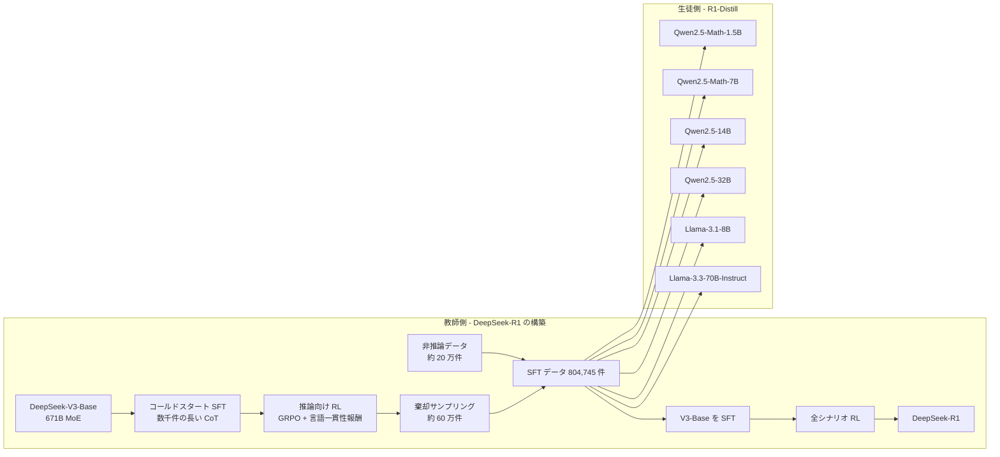
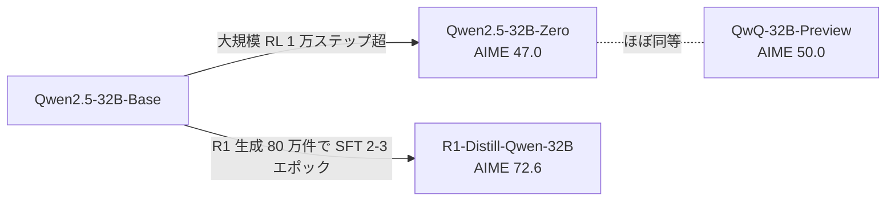
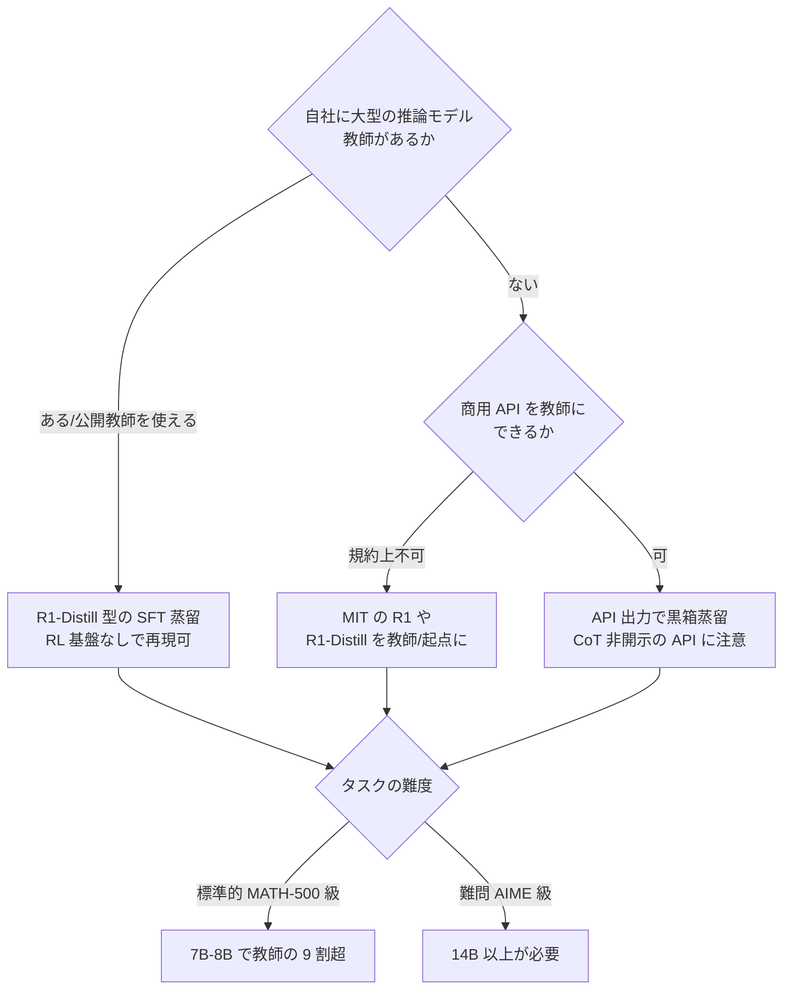

# DeepSeek-R1: Incentivizing Reasoning Capability in LLMs via Reinforcement Learning（蒸留節を中心に）

- **Link**: https://arxiv.org/abs/2501.12948 （HTML: [v1](https://arxiv.org/html/2501.12948v1) / [v2](https://arxiv.org/html/2501.12948v2)）
- **Authors**: DeepSeek-AI（R1-Distill シリーズの開発責任者は Zhibin Gou と v2 の貢献者欄に記載）
- **Year**: 2025（v1: 2025-01-22。v2 で付録を大幅に拡充）
- **Venue**: arXiv（v1 / v2。v2 は付録を大幅に追加した改訂版）
- **Type**: Academic Paper
- **関連モデルカード**: [deepseek-ai/DeepSeek-R1-Distill-Qwen-32B](https://huggingface.co/deepseek-ai/DeepSeek-R1-Distill-Qwen-32B)
- **取得状況**: arXiv abs ページ、HTML v1（全文）、HTML v2（付録 B.3.3 / B.4.3 / B.4.4 / F を含む全文）、Hugging Face モデルカードをすべて取得済み
- **証拠の質**: 本レポートの数値はすべて **一次資料**（DeepSeek 自身の論文・モデルカード）。ただし評価は DeepSeek の自己計測で、**第三者の再現ではない**点に注意

## Abstract

We introduce our first-generation reasoning models, DeepSeek-R1-Zero and DeepSeek-R1. DeepSeek-R1-Zero, a model trained via large-scale reinforcement learning (RL) without supervised fine-tuning (SFT) as a preliminary step, demonstrates remarkable reasoning capabilities. Through RL, DeepSeek-R1-Zero naturally emerges with numerous powerful and intriguing reasoning behaviors. However, it encounters challenges such as poor readability, and language mixing. To address these issues and further enhance reasoning performance, we introduce DeepSeek-R1, which incorporates multi-stage training and cold-start data before RL. DeepSeek-R1 achieves performance comparable to OpenAI-o1-1217 on reasoning tasks. To support the research community, we open-source DeepSeek-R1-Zero, DeepSeek-R1, and six dense models (1.5B, 7B, 8B, 14B, 32B, 70B) distilled from DeepSeek-R1 based on Qwen and Llama.

## Abstract (Japanese Translation)

本論文では、第一世代の推論モデル DeepSeek-R1-Zero と DeepSeek-R1 を紹介する。DeepSeek-R1-Zero は、事前の教師ありファインチューニング（SFT）を行わずに大規模強化学習（RL）だけで学習したモデルで、優れた推論能力を示す。RL の過程で、強力で興味深い推論行動が自然に現れる。一方で、読みにくさや言語の混在といった課題がある。これらを解決し推論性能をさらに高めるため、RL の前に多段階学習とコールドスタート用データを組み込んだ DeepSeek-R1 を提案する。DeepSeek-R1 は推論タスクで OpenAI-o1-1217 に匹敵する性能を達成した。研究コミュニティを支援するため、DeepSeek-R1-Zero、DeepSeek-R1、および DeepSeek-R1 から Qwen と Llama をベースに蒸留した 6 つの dense モデル（1.5B、7B、8B、14B、32B、70B）を公開する。

## Overview

本論文の主題は「RL で推論能力を引き出す」ことですが、ビジネス上もっとも影響が大きかったのは **第 2.4 節 / 付録 F の蒸留** です。要点は次の 4 つです。

1. **蒸留の中身は「教師の出力による SFT」だけ**: R1 が生成した約 80 万件（正確には 804,745 件）のサンプルで、Qwen2.5 / Llama 3 系の 6 モデルを 2〜3 エポック SFT しただけです。logits は使わず、蒸留後の RL も行っていません。つまり **黒箱型の系列レベル蒸留（sequence-level KD）** です。
2. **小型モデルでは「RL より蒸留」**: 同じ Qwen2.5-32B-Base に 1 万ステップ超の大規模 RL をかけたモデル（R1-Zero-Qwen-32B / v2 では Qwen2.5-32B-Zero）は AIME 2024 で 47.0%、蒸留モデル（R1-Distill-Qwen-32B）は 72.6% でした。
3. **小さくても強い**: 1.5B の蒸留モデルが数学ベンチマークで GPT-4o-0513 と Claude-3.5-Sonnet-1022 を上回り（AIME 28.9%、MATH-500 83.9%）、14B が QwQ-32B-Preview を全指標で上回りました。
4. **コストの目安**: 教師 R1 自体の学習費は H800 換算で合計 14.7 万 GPU 時間・約 29.4 万ドル（レンタル 2 ドル/時と仮定）です。このうち SFT データ（＝蒸留データの元）の作成は 5K GPU 時間・約 1 万ドルでした。生徒側の蒸留学習の GPU 時間は **論文に記載がありません**。

> **蒸留と fine-tuning の区別**: R1-Distill は「教師モデルが生成したデータで生徒を SFT する」ため、手続き上は fine-tuning と同じです。それでも本論文が蒸留と呼ぶのは、**教師 → 生徒の能力移転を目的に、教師が全学習データを生成している** からです。人手データでの通常の SFT や、小型モデル自身の RL（R1-Zero-Qwen-32B）とは区別されます。量子化（重みのビット数を減らす）とも別物です。

## Problem

- **小型モデルの推論能力の不足**: 長い CoT による推論は大型モデルでしか安定して現れない。
- **小型モデルに RL をかけるコスト**: 大規模 RL は計算資源を大量に消費し、しかも小型モデルでは大型モデルほどの改善が得られない（v2 付録 G.1 では、7B dense / 16B MoE では RL が AIME で意味のある改善を生まなかったと報告）。
- **R1 本体の配置コスト**: R1 は 671B（活性 37B）の MoE で、自社環境で動かすのは重い。
- **エネルギーとアクセスの不平等**: v2 付録 F は、LLM の計算・電力コストが AI へのアクセスの障壁になっている点を蒸留の動機として挙げている。

## Proposed Method

**DeepSeek-R1 → 小型 dense モデルへの推論蒸留（R1-Distill）**

- **中心となる考え**: 大型モデルが RL で見つけた推論パターンを、生成データ経由で小型モデルに写す。小型モデル自身に RL で同じパターンを「発見」させるより安く、強い。
- **手順**:
  1. R1 の学習途中（推論向け RL が収束した checkpoint）から、推論系プロンプトに対して **棄却サンプリング**（複数回答を生成し、正解のみ残す）で約 60 万件を集める。
  2. 正誤の判定は、規則ベース（数式は sympy で比較）に加え、一部は DeepSeek-V3 を判定器（生成型報酬モデル）として使う。
  3. 言語混在・長すぎる段落・コードブロックを含む CoT を除外する。
  4. 非推論データ（文章作成・事実 QA・自己認識・翻訳・ソフトウェア工学）約 20 万件を DeepSeek-V3 のパイプラインから加える。
  5. 合計約 80 万件で、各ベースモデルを 2〜3 エポック SFT する（RL は行わない）。
- **既存手法との違い**:
  - 白箱蒸留（MiniLLM / GKD）のように教師の logits を使わない。**教師の出力テキストだけ** で完結する。
  - Distilling Step-by-Step や Fine-tune-CoT と同系統の「根拠付き蒸留」だが、根拠が数千 token の長い CoT で、規模は 80 万件と大きい。

**Key Formulas**:

蒸留そのものに専用の損失はなく、標準的な次 token 予測の交差エントロピーです（論文に式の記載はなく、本レポートでの整理）。

$$
\mathcal{L}_{\text{distill}}(\theta) = - \sum_{(q, o) \in \mathcal{D}_{\text{R1}}} \sum_{t=1}^{|o|} \log \pi_\theta\left(o_t \mid q, o_{<t}\right)
$$

- $\mathcal{D}_{\text{R1}}$: R1（の checkpoint）が生成し、棄却サンプリングで絞り込んだ約 80 万件の（問題 $q$、回答 $o$）。$o$ は `<think>` 内の推論過程と要約を含む
- $\pi_\theta$: 生徒モデル（Qwen2.5 / Llama 3 系）

比較対象の RL（教師モデル R1 の学習と、小型モデルへの RL 比較実験で使用）は GRPO です（式 1〜3）。

$$
\mathcal{J}_{GRPO}(\theta)=\mathbb{E}_{q\sim P(Q),\{o_{i}\}_{i=1}^{G}\sim\pi_{\theta_{old}}(O|q)} \frac{1}{G}\sum_{i=1}^{G}\left(\min\left(\frac{\pi_{\theta}(o_{i}|q)}{\pi_{\theta_{old}}(o_{i}|q)}A_{i},\text{clip}\left(\frac{\pi_{\theta}(o_{i}|q)}{\pi_{\theta_{old}}(o_{i}|q)},1-\varepsilon,1+\varepsilon\right)A_{i}\right)-\beta\mathbb{D}_{KL}\left(\pi_{\theta}||\pi_{ref}\right)\right)
$$

$$
\mathbb{D}_{KL}\left(\pi_{\theta}||\pi_{ref}\right)=\frac{\pi_{ref}(o_{i}|q)}{\pi_{\theta}(o_{i}|q)}-\log\frac{\pi_{ref}(o_{i}|q)}{\pi_{\theta}(o_{i}|q)}-1
$$

$$
A_{i}=\frac{r_{i}-\mathrm{mean}(\{r_{1},r_{2},\cdots,r_{G}\})}{\mathrm{std}(\{r_{1},r_{2},\cdots,r_{G}\})}
$$

- $G$: 1 問あたりのサンプル数、$r_i$: 規則ベースの報酬（正解 + 書式）、$\varepsilon, \beta$: ハイパーパラメータ、$\pi_{ref}$: 参照方策

評価指標（pass@1）:

$$
\text{pass@1}=\frac{1}{k}\sum_{i=1}^{k}p_{i}
$$

- $k$: 1 問あたりの生成数（4〜64）、$p_i$: $i$ 番目の回答の正誤。温度 0.6、top-p 0.95

**本ドメインの価値式との対応**:

$$
\text{蒸留のビジネス価値} \approx (C_{\text{teacher}} - C_{\text{student}}) \cdot Q - (C_{\text{data}} + C_{\text{train}}) - \Delta\text{Acc} \cdot V_{\text{err}}
$$

| 項 | 本論文が報告していること |
|----|-----------------------|
| $C_{\text{teacher}} - C_{\text{student}}$ | 直接の数値は無い。671B MoE（活性 37B）→ 1.5B〜70B dense への置換で、配置の自由度が上がる |
| $C_{\text{data}}$ | 教師側の SFT データ作成 5K H800 GPU 時間（約 1 万ドル）。**教師の学習費 約 29.4 万ドルは別** |
| $C_{\text{train}}$ | 生徒の学習時間は **未記載**。ハイパーパラメータのみ公開 |
| $\Delta\text{Acc}$ | 32B 生徒は AIME 2024 で 72.6%（教師 R1 は 79.8%）。差は 7.2 ポイント |

**Features**:

- 教師の重みにアクセスしない **黒箱型** なので、教師が API でも原理的には同じ手順が使える（ただし利用規約の問題が生じる。C8 参照）
- 生徒側には RL 基盤が不要で、**SFT ができる組織なら誰でも再現可能**
- 蒸留後に RL を追加するとさらに伸びると著者は述べるが、結果は非公開

## Algorithm (Pseudocode)

```
Algorithm: R1-Distill（DeepSeek-R1 からの推論蒸留）
Input:  推論プロンプト集合 P_r、非推論プロンプト集合 P_n、
        教師 checkpoint T（推論 RL 収束後）、DeepSeek-V3（判定器・CoT 生成器）、
        生徒ベース S0 ∈ {Qwen2.5-Math-1.5B, Qwen2.5-Math-7B, Qwen2.5-14B,
                         Qwen2.5-32B, Llama-3.1-8B, Llama-3.3-70B-Instruct}
Output: 蒸留済み生徒 S

1. D_r ← ∅
2. for q in P_r:
3.     {o_1..o_k} ← T.sample(q)                   // 1 問あたり複数回答
4.     for o in {o_1..o_k}:
5.         if Verify(q, o) and Readable(o):       // 規則ベース or V3 による判定
6.             D_r ← D_r ∪ {(q, o)}               // 正解かつ読みやすいものだけ残す
7. // |D_r| ≈ 60 万件
8. D_n ← V3 パイプラインの SFT データの一部 + V3 生成の CoT 付き回答
9. // |D_n| ≈ 20 万件（"hello" のような単純な問いには CoT を付けない）
10. D ← D_r ∪ D_n                                // 合計 804,745 件
11. S ← S0
12. for epoch in 1..(2 or 3):
13.     for batch in D (batch size 64, 最大長 32,768):
14.         S ← S − η_t ∇ CE(S; batch)            // cosine decay で初期学習率の 1/10 まで
15. return S                                      // RL は行わない
```

## Architecture / Process Flow



> 注意: 蒸留データ（80 万件）は **完成した R1 の出力ではなく**、R1 の学習途中（推論 RL 後）の checkpoint と DeepSeek-V3 から作られています（2.3.3 節 / 2.4 節）。「R1 の出力で学習した」という一般的な説明はやや不正確です。

## Figures & Tables

### Figure 1: DeepSeek-R1 のベンチマーク性能

論文冒頭の棒グラフ（HTML 版では画像として取得できず、キャプション「Benchmark performance of DeepSeek-R1」のみ確認）。数値は Table 4 と同じなので Table 4 を参照してください。

### Figure 2: R1-Zero の学習中の AIME 精度


各問 16 回答の平均。pass@1 は RL の進行とともに **15.6% → 71.0%** に上昇し、多数決（cons@64）では 86.7% に達します。

### Figure 3: R1-Zero の平均応答長の推移


RL が進むにつれ応答（思考）が長くなり、数百〜数千 token に達します。**蒸留モデルもこの長い推論を引き継ぐため、推論時の出力 token 数が増える**（推論コスト面の注意点）。

### Table 1: R1-Zero の学習テンプレート

| 要素 | 内容 |
|------|------|
| 指示 | ユーザーとアシスタントの会話。アシスタントはまず頭の中で推論し、その後に答える |
| 書式 | 推論は `<think> </think>`、答えは `<answer> </answer>` で囲む |
| 末尾 | `User: prompt. Assistant:`（prompt に問題文を代入） |

### Table 2: R1-Zero と OpenAI o1 の比較

| Model | AIME 2024 pass@1 | AIME 2024 cons@64 | MATH-500 pass@1 | GPQA Diamond pass@1 | LiveCodeBench pass@1 | CodeForces rating |
|-------|-----|-----|-----|-----|-----|-----|
| OpenAI-o1-mini | 63.6 | 80.0 | 90.0 | 60.0 | 53.8 | 1820 |
| OpenAI-o1-0912 | 74.4 | 83.3 | 94.8 | 77.3 | 63.4 | 1843 |
| DeepSeek-R1-Zero | 71.0 | 86.7 | 95.9 | 73.3 | 50.0 | 1444 |

### Table 3: R1-Zero 中間版の「aha moment」の例

| 段階 | 出力の要旨 |
|------|----------|
| 問題 | $a>1$ のとき $\sqrt{a-\sqrt{a+x}}=x$ の実数解の和を求めよ |
| 初期の解法 | 両辺を二乗して $x^4-2ax^2-x+(a^2-a)=0$ へ |
| 転換 | "Wait, wait. Wait. That's an aha moment I can flag here." |
| 再検討 | 最初の式に戻り、段階的に解き直す |

### Table 4: DeepSeek-R1 と代表的モデルの比較（教師の性能）

| 分野 | Benchmark (Metric) | Claude-3.5-Sonnet-1022 | GPT-4o-0513 | DeepSeek-V3 | OpenAI o1-mini | OpenAI o1-1217 | DeepSeek-R1 |
|------|-------------------|-----|-----|-----|-----|-----|-----|
| - | Architecture | - | - | MoE | - | - | MoE |
| - | # Activated Params | - | - | 37B | - | - | 37B |
| - | # Total Params | - | - | 671B | - | - | 671B |
| English | MMLU (Pass@1) | 88.3 | 87.2 | 88.5 | 85.2 | 91.8 | 90.8 |
| English | MMLU-Redux (EM) | 88.9 | 88.0 | 89.1 | 86.7 | - | 92.9 |
| English | MMLU-Pro (EM) | 78.0 | 72.6 | 75.9 | 80.3 | - | 84.0 |
| English | DROP (3-shot F1) | 88.3 | 83.7 | 91.6 | 83.9 | 90.2 | 92.2 |
| English | IF-Eval (Prompt Strict) | 86.5 | 84.3 | 86.1 | 84.8 | - | 83.3 |
| English | GPQA Diamond (Pass@1) | 65.0 | 49.9 | 59.1 | 60.0 | 75.7 | 71.5 |
| English | SimpleQA (Correct) | 28.4 | 38.2 | 24.9 | 7.0 | 47.0 | 30.1 |
| English | FRAMES (Acc.) | 72.5 | 80.5 | 73.3 | 76.9 | - | 82.5 |
| English | AlpacaEval2.0 (LC-winrate) | 52.0 | 51.1 | 70.0 | 57.8 | - | 87.6 |
| English | ArenaHard (GPT-4-1106) | 85.2 | 80.4 | 85.5 | 92.0 | - | 92.3 |
| Code | LiveCodeBench (Pass@1-COT) | 38.9 | 32.9 | 36.2 | 53.8 | 63.4 | 65.9 |
| Code | Codeforces (Percentile) | 20.3 | 23.6 | 58.7 | 93.4 | 96.6 | 96.3 |
| Code | Codeforces (Rating) | 717 | 759 | 1134 | 1820 | 2061 | 2029 |
| Code | SWE Verified (Resolved) | 50.8 | 38.8 | 42.0 | 41.6 | 48.9 | 49.2 |
| Code | Aider-Polyglot (Acc.) | 45.3 | 16.0 | 49.6 | 32.9 | 61.7 | 53.3 |
| Math | AIME 2024 (Pass@1) | 16.0 | 9.3 | 39.2 | 63.6 | 79.2 | 79.8 |
| Math | MATH-500 (Pass@1) | 78.3 | 74.6 | 90.2 | 90.0 | 96.4 | 97.3 |
| Math | CNMO 2024 (Pass@1) | 13.1 | 10.8 | 43.2 | 67.6 | - | 78.8 |
| Chinese | CLUEWSC (EM) | 85.4 | 87.9 | 90.9 | 89.9 | - | 92.8 |
| Chinese | C-Eval (EM) | 76.7 | 76.0 | 86.5 | 68.9 | - | 91.8 |
| Chinese | C-SimpleQA (Correct) | 55.4 | 58.7 | 68.0 | 40.3 | - | 63.7 |

### Table 5（v1）/ Table 15（v2）: 蒸留モデルの性能 ★本レポートの中心

| Model | AIME 2024 pass@1 | AIME 2024 cons@64 | MATH-500 pass@1 | GPQA Diamond pass@1 | LiveCodeBench pass@1 | CodeForces rating |
|-------|-----|-----|-----|-----|-----|-----|
| GPT-4o-0513 | 9.3 | 13.4 | 74.6 | 49.9 | 32.9 | 759 |
| Claude-3.5-Sonnet-1022 | 16.0 | 26.7 | 78.3 | 65.0 | 38.9 | 717 |
| OpenAI-o1-mini（v1 のみ） | 63.6 | 80.0 | 90.0 | 60.0 | 53.8 | 1820 |
| QwQ-32B-Preview（v1 のみ） | 50.0 | 60.0 | 90.6 | 54.5 | 41.9 | 1316 |
| DeepSeek-R1-Distill-Qwen-1.5B | 28.9 | 52.7 | 83.9 | 33.8 | 16.9 | 954 |
| DeepSeek-R1-Distill-Qwen-7B | 55.5 | 83.3 | 92.8 | 49.1 | 37.6 | 1189 |
| DeepSeek-R1-Distill-Qwen-14B | 69.7 | 80.0 | 93.9 | 59.1 | 53.1 | 1481 |
| DeepSeek-R1-Distill-Qwen-32B | 72.6 | 83.3 | 94.3 | 62.1 | 57.2 | 1691 |
| DeepSeek-R1-Distill-Llama-8B | 50.4 | 80.0 | 89.1 | 49.0 | 39.6 | 1205 |
| DeepSeek-R1-Distill-Llama-70B | 70.0 | 86.7 | 94.5 | 65.2 | 57.5 | 1633 |

AIME 2024 pass@1 を ASCII で比較すると次のとおりです。

```
教師 DeepSeek-R1 (671B MoE) |████████████████████████████████████████ 79.8
R1-Distill-Qwen-32B         |████████████████████████████████████ 72.6
R1-Distill-Llama-70B        |███████████████████████████████████ 70.0
R1-Distill-Qwen-14B         |███████████████████████████████████ 69.7
OpenAI-o1-mini              |████████████████████████████████ 63.6
R1-Distill-Qwen-7B          |████████████████████████████ 55.5
R1-Distill-Llama-8B         |█████████████████████████ 50.4
QwQ-32B-Preview             |█████████████████████████ 50.0
R1-Zero-Qwen-32B (RL のみ)   |████████████████████████ 47.0
R1-Distill-Qwen-1.5B        |██████████████ 28.9
Claude-3.5-Sonnet-1022      |████████ 16.0
GPT-4o-0513                 |█████ 9.3
```

教師に対する性能保持率（AIME 2024 pass@1 / R1 の 79.8）を計算すると、次のようになります（本レポートによる計算）。

| 生徒 | パラメータ | AIME 2024 | 教師比 | MATH-500 | 教師比（97.3） |
|------|----------|-----------|--------|----------|---------------|
| Qwen-1.5B | 1.5B | 28.9 | 36% | 83.9 | 86% |
| Qwen-7B | 7B | 55.5 | 70% | 92.8 | 95% |
| Llama-8B | 8B | 50.4 | 63% | 89.1 | 92% |
| Qwen-14B | 14B | 69.7 | 87% | 93.9 | 97% |
| Qwen-32B | 32B | 72.6 | 91% | 94.3 | 97% |
| Llama-70B | 70B | 70.0 | 88% | 94.5 | 97% |

> 読み取り: **MATH-500 のような「標準的な難しさ」の問題では 7B でも教師の 95% を保持** しますが、AIME のような難問では 14B 以上でないと 9 割に届きません。業務タスクの難易度に応じて生徒サイズを選ぶ根拠になります。

### Table 6（v1）/ Table 16（v2）: 蒸留 vs 強化学習（同じ 32B ベース） ★

| Model | AIME 2024 pass@1 | AIME 2024 cons@64 | MATH-500 pass@1 | GPQA Diamond pass@1 | LiveCodeBench pass@1 |
|-------|-----|-----|-----|-----|-----|
| QwQ-32B-Preview | 50.0 | 60.0 | 90.6 | 54.5 | 41.9 |
| DeepSeek-R1-Zero-Qwen-32B（v2: Qwen2.5-32B-Zero）= RL のみ | 47.0 | 60.0 | 91.6 | 55.0 | 40.2 |
| DeepSeek-R1-Distill-Qwen-32B = 蒸留のみ | 72.6 | 83.3 | 94.3 | 62.1 | 57.2 |
| **差（蒸留 − RL）** | **+25.6** | **+23.3** | **+2.7** | **+7.1** | **+17.0** |

RL 側の設定（v2 付録 B.4.1）: 学習率 2e-6、KL 係数 0.001、ロールアウト温度 1、1 問 16 出力・最大長 32,768、1 ステップ 32 問（バッチ 512）、400 ステップごとに参照モデルを更新、1 ロールアウトで 8,192 出力を 16 ミニバッチに分割、**1 万ステップ超**。



### Table 17（v2）: 推論データに触れていないベースでの RL

| Model | AIME 2024 | AIME 2025 |
|-------|-----------|-----------|
| GPT-4o-0513 | 9.3% | - |
| Qwen2-Math-7B-Instruct | 7.9% | 4.6% |
| Qwen2-Math-7B-Zero（約 1 万ステップの方策勾配） | 22.3% | 18.1% |

> o1 公開前（2024 年 8 月）のベースモデルでも RL で推論能力が伸びることを示す補足実験です。ただし 7B の RL は 22.3% で、同規模の蒸留（Qwen-7B: 55.5%）には遠く及びません。

### Table 5（v2）: 蒸留に使われた SFT データの内訳 ★

| Domain | Num Samples | Avg Rounds | Avg Tokens |
|--------|-------------|------------|------------|
| Math | 395,285 | 1.0 | 6,094.2 |
| Code | 211,129 | 1.1 | 7,435.7 |
| STEM | 10,124 | 1.0 | 4,928.8 |
| Logic | 10,395 | 1.0 | 2,739.0 |
| General | 177,812 | 1.1 | 1,419.8 |
| **Total** | **804,745** | **1.0** | **5,355.3** |

```
Math    |████████████████████████████████████████ 395,285
Code    |█████████████████████ 211,129
General |██████████████████ 177,812
Logic   |█ 10,395
STEM    |█ 10,124
```

総 token 数の概算（本レポートの計算）: $804{,}745 \times 5{,}355.3 \approx 4.31 \times 10^9$ token（約 43 億 token）。**蒸留データの大半（約 75%）は数学とコード** で、ほぼ単一ターンです。著者自身が「多ターン会話能力が制限される可能性」を認めています。

### Table 6（v2）: 蒸留モデルのベースと初期学習率

| Distilled Model | Base Model | Initial Learning Rate |
|-----------------|-----------|----------------------|
| DeepSeek-R1-Distill-Qwen-1.5B | Qwen2.5-Math-1.5B | $1\times 10^{-4}$ |
| DeepSeek-R1-Distill-Qwen-7B | Qwen2.5-Math-7B | $8\times 10^{-5}$ |
| DeepSeek-R1-Distill-Qwen-14B | Qwen2.5-14B | $7\times 10^{-5}$ |
| DeepSeek-R1-Distill-Qwen-32B | Qwen2.5-32B | $6\times 10^{-5}$ |
| DeepSeek-R1-Distill-Llama-8B | Llama-3.1-8B | $5\times 10^{-5}$ |
| DeepSeek-R1-Distill-Llama-70B | Llama-3.3-70B-Instruct | $2\times 10^{-5}$ |

共通設定: 2〜3 エポック、cosine decay（初期値の 1/10 まで）、最大長 32,768 token、バッチサイズ 64。

### Table 7（v2）: 教師 R1 の学習コスト ★

H800 のレンタル価格を 1 GPU 時間 2 ドルと仮定した値です。

| Training Costs | DeepSeek-R1-Zero | SFT data creation | DeepSeek-R1 | Total |
|----------------|------------------|-------------------|-------------|-------|
| in H800 GPU Hours | 101K | 5K | 41K | 147K |
| in USD | $202K | $10K | $82K | $294K |

補足（付録 B.4.4）: R1-Zero は 64×8 枚の H800 で約 198 時間、R1 は同じ構成で約 80 時間（約 4 日）。事前に 30B の小型モデルで A100 を使って予備実験を実施。**DeepSeek-V3-Base 自体の事前学習費は含まない**。

```
R1-Zero の RL         |████████████████████████████████████████ 101K GPU 時間
R1 の多段階学習        |████████████████ 41K
SFT（蒸留）データ作成  |██ 5K
生徒の蒸留学習         |（論文に記載なし）
```

### モデルカードの利用条件（Hugging Face）

| 項目 | 内容 |
|------|------|
| ライセンス | コードと重みは MIT License。**商用利用・改変・派生物の作成（他の LLM を学習させる蒸留を含む）を明示的に許可** |
| Qwen 系 4 モデル | 元は Apache 2.0 の Qwen-2.5 系を、R1 で作った 80 万件で fine-tune したもの |
| Llama-8B | 元は Llama 3.1 license |
| Llama-70B | 元は Llama 3.3 license |
| 推奨設定 | 温度 0.5〜0.7（0.6 推奨）、システムプロンプトを使わない、数学では「step by step で考え \boxed{} に答えを入れよ」と指示 |
| 既知の癖 | `<think>\n\n</think>` と思考を飛ばすことがあり性能が落ちる。応答を `<think>\n` から始めさせることを推奨 |
| 配信例 | vLLM: `--tensor-parallel-size 2 --max-model-len 32768`、SGLang: `--tp 2`（32B を 2 GPU で配信） |
| 利用状況（取得時） | 直近 1 か月 DL 360,250、累計 約 2,795 万。派生: Adapter 225 / Finetune 90 / Merge 35 / 量子化版 148 |

### 手法比較（本レポートで作成）

| 観点 | R1-Distill（本論文） | 小型モデルへの直接 RL（R1-Zero-Qwen-32B） | 白箱蒸留（MiniLLM / GKD） | on-policy 蒸留（Qwen3 / Thinking Machines） |
|------|---------------------|----------------------------------------|-------------------------|------------------------------------------|
| 教師へのアクセス | 出力テキストのみ | 不要（報酬関数のみ） | logits | 生徒の出力に対する教師の logprob |
| 生徒の学習 | SFT 2〜3 エポック | GRPO 1 万ステップ超 | KL 最小化 | 逆 KL を報酬にした RL 型更新 |
| 32B での AIME 2024 | 72.6 | 47.0 | （同条件の報告なし） | （Qwen3-8B で 74.4、別条件） |
| 必要な基盤 | SFT のみ | RL 基盤 + 検証器 | 教師と生徒の同時推論 | RL 基盤 + 教師の推論 |
| 商用 API 教師 | 原理的に可（規約次第） | 該当なし | 不可 | logprob を返す API なら一部可 |
| 弱点 | 学習とテストの分布ずれ（exposure bias） | 小型では伸びない | 教師の重みが必要 | 実装が複雑 |

## Experiments & Evaluation

### Setup

- **蒸留モデルの評価ベンチマーク**: AIME 2024、MATH-500、GPQA Diamond、Codeforces、LiveCodeBench（2024-08〜2025-01）
- **比較対象**: GPT-4o-0513、Claude-3.5-Sonnet-1022、OpenAI-o1-mini、QwQ-32B-Preview
- **生成設定**: 最大 32,768 token、温度 0.6、top-p 0.95、1 問 4〜64 回答で pass@1、AIME は cons@64 も報告
- **注意**: 貪欲デコードでは繰り返しが増え、checkpoint 間のばらつきも大きいため使わない

### Main Results

- **R1-Distill-Qwen-7B** は AIME 2024 で 55.5% と QwQ-32B-Preview（50.0%）を上回り、非推論モデルの GPT-4o-0513 を全指標で上回る。
- **R1-Distill-Qwen-14B** は QwQ-32B-Preview を全指標で上回る。
- **R1-Distill-Qwen-32B / Llama-70B** は多くのベンチマークで o1-mini を大きく上回る（例: AIME 72.6 / 70.0 vs 63.6）。
- **R1-Distill-Qwen-1.5B** は数学で GPT-4o と Claude-3.5-Sonnet を上回る（AIME 28.9%、MATH-500 83.9%）。ただし GPQA（33.8）、LiveCodeBench（16.9）、Codeforces（954）では両者を下回る。**1.5B の強さは数学に偏っている**。
- 生徒のパラメータが増えるほど性能は段階的に上がる（v2 付録 F）。

### Ablation Study

- **蒸留 vs RL**（Table 6 / 16）: 同じ 32B ベースで、蒸留は RL より AIME で +25.6 ポイント。著者の結論は (1) 強いモデルを小さく蒸留する方が良い、小型モデルへの大規模 RL は膨大な計算を要し、それでも蒸留に届かないことがある、(2) ただし知能の限界を押し広げるには、より強いベースモデルと大規模 RL が必要、の 2 点。
- **言語一貫性報酬**（v2 付録 B.6、R1-Distill-Qwen-7B で検証）: 報酬なしでは学習が進むほど言語一貫性が悪化。報酬ありでは安定し、数学は同等、コードはわずかに低下。
- **蒸留後の RL**: 「大きな追加改善がある」と記載されているが、数値は非公開。

## ビジネス上の示唆



1. **H6（推論蒸留で Agent・tool calling 用途が増える）の起点だが、本論文自体は Agent 用途ではない**: 蒸留データの 75% は数学とコードの単一ターンで、著者は「function calling・多ターン・JSON 出力で R1 は V3 に劣る」と明記しています。**Agent 用の蒸留には別途データ設計が必要** です。
2. **H5（API 教師の規約制約）との関係**: R1 と R1-Distill は MIT で「他の LLM を学習させる蒸留」まで明示的に許可しています。商用 API（OpenAI 等）の規約が蒸留を禁じる中、**規約上安全に使える高性能な推論教師** が登場した点が、国内の CyberAgent・Lightblue・ABEJA 等の派生モデル（C7）につながりました。ただし Llama 由来の 2 モデルは Llama ライセンスを引き継ぎます。
3. **コストの見積もり**: 教師を自作する場合の費用（約 29.4 万ドル + V3 の事前学習）は大半の企業には不要で、**公開された教師や 80 万件規模のデータを再利用する方が現実的** です。生徒の学習費は論文に無いため、Sky-T1（学習費 450 ドル未満、本 run の別レポート）等で補う必要があります。
4. **推論コストの落とし穴**: 蒸留モデルは R1 の長い思考（平均約 5,355 token の学習データ）を引き継ぎます。**パラメータは小さくても出力 token が多い** ため、価値式の $C_{\text{student}}$ は「パラメータ比」ほど小さくならない可能性があります。
5. **評価の注意**: 数値はすべて DeepSeek 自身の計測（一次資料だが自己申告）で、AIME 2024 は 30 問と小さく分散が大きい点に留意が必要です。

## Notes

- **（2026-10-22 追記）原典との再照合**: arXiv HTML v1 を再取得し、Table 6（QwQ-32B-Preview 50.0 / R1-Zero-Qwen-32B 47.0 / R1-Distill-Qwen-32B 72.6 の AIME 2024 pass@1 ほか全列）、Table 5 の蒸留モデル 6 種の AIME 2024（28.9 / 55.5 / 69.7 / 72.6 / 50.4 / 70.0）、蒸留データ「約 80 万件（推論 約 60 万 + 非推論 約 20 万）」が本レポートの記載と一致することを確認した。
- **Unsuccessful attempts**（4.2 節 / G.2）: PRM（過程報酬モデル）は細かいステップの定義・判定が難しく報酬ハッキングを招く、MCTS は token 生成の探索空間が大きすぎ価値モデルの学習が難しい、としてどちらも不採用。
- **ベースモデルの重要性**（v2 G.1）: 7B dense と 16B MoE では純粋な RL が AIME で有意な改善を生まず、32B dense・230B MoE・671B MoE で初めて効果が出た。これも「小型モデルは RL より蒸留」という結論を補強する。
- **関連する追加調査候補**:
  - Small Models Struggle to Learn from Strong Reasoners（arXiv 2502.12143）: 3B 以下では長い CoT の蒸留が効きにくい
  - OpenThoughts（arXiv 2506.04178）: R1 型蒸留データの作り方を 1,000 回超の実験で検証
  - s1 / LIMO（arXiv 2501.19393 / 2502.03387）: 1,000 件程度の精選データで十分という反論
  - Qwen3 Technical Report（arXiv 2505.09388）: off-policy 蒸留の後に on-policy 蒸留を重ね、RL の 1/10 の GPU 時間で上回る
  - Distillation Scaling Laws（arXiv 2502.08606）: v2 付録 F が蒸留の有効性の根拠として引用
