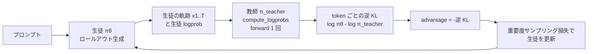
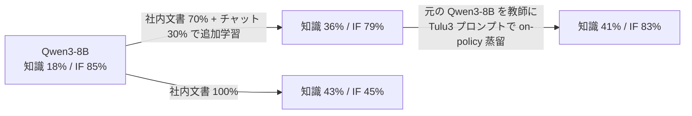
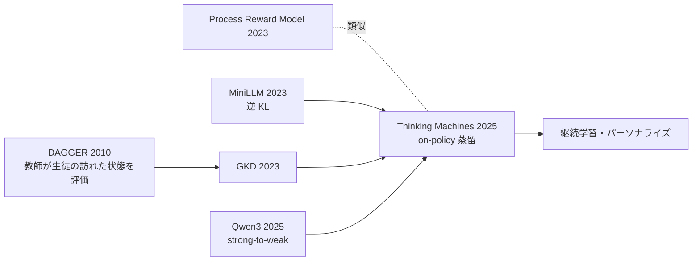

# On-Policy Distillation（Thinking Machines Lab）

- **Source**: Kevin Lu in collaboration with others at Thinking Machines Lab（ブログ「Connectionism」）
- **Date**: 2025-10-27（DOI: 10.64434/tml.20251026。2026 年 6 月に再現用モデルの更新注記あり）
- **Link**: https://thinkingmachines.ai/blog/on-policy-distillation/
- **Type**: Technical Article
- **取得状況**: ブログ本文を全文取得（HTML を直接取得してテキスト化）。比較のため Qwen3 Technical Report（arXiv 2505.09388）の HTML 版から 4.5 節と Table 21 も取得
- **証拠の質**: **ベンダー申告（技術ブログ）+ 一部一次資料**。数値の多くは Thinking Machines 自身の実験で、同社の学習 API「Tinker」の宣伝も兼ねる。RL との GPU 時間比較（17,920 vs 1,800）は **Qwen3 Technical Report（一次資料）の転載**

## Overview

on-policy 蒸留とは、**生徒モデル自身が生成した軌跡に対して、教師モデルが token ごとに採点する** 事後学習の方法です。RL の「自分の出力で学ぶ（on-policy）」利点と、蒸留の「token ごとに密な信号がある（dense）」利点を組み合わせます。本記事は次の 4 点を示しています。

1. **推論（数学）**: Qwen3-8B-Base を AIME'24 で 60% → 70% に上げるのに、SFT（off-policy 蒸留）の延長と比べ **計算量で 9〜30 倍効率的**。
2. **RL との比較**: Qwen3 の報告を再掲し、RL（17,920 GPU 時間、AIME'24 67.6%）に対し on-policy 蒸留は 1,800 GPU 時間で 74.4%。**約 1/10 のコストで上回る**。
3. **パーソナライズ（社内アシスタント）**: 社内文書で追加学習すると指示追従（IF-eval）が 85% → 45〜79% に落ちる。元のモデルを教師に on-policy 蒸留すると **知識を保ったまま IF-eval を 83% まで回復**。
4. **同条件での RL vs 蒸留**: RL で作った方策を蒸留し直すと、**勾配ステップで 7〜10 倍、総計算量で 50〜100 倍** 少なくて済む。

> **蒸留と RL・fine-tuning の区別**: 本記事の「off-policy 蒸留」は教師の出力で SFT すること（R1-Distill と同じ）。「on-policy 蒸留」は学習ループは RL と同じだが、**報酬が「教師との逆 KL」**（正解かどうかではない）です。量子化とは無関係です。

## Key Technical Content

### Architecture / Design

事後学習の 3 方式の位置付けです。

| Method | Sampling | Reward signal |
|--------|----------|---------------|
| Supervised finetuning | off-policy | dense |
| Reinforcement learning | on-policy | sparse |
| On-policy distillation | on-policy | dense |



チェスの比喩（本文）:

| 方式 | 比喩 |
|------|------|
| on-policy RL | コーチなしで対局。勝敗は自分の手に紐づくが、1 局に 1 回しか分からず、どの手が効いたか分からない |
| off-policy 蒸留 | 名人の対局を見る。手は強いが、初心者がまず遭遇しない局面ばかり |
| on-policy 蒸留 | 自分の一手ごとに「悪手」〜「好手」を採点してくれる教師がいる |

### Implementation Steps

1. **教師クライアントを用意**: Tinker の sampling client で教師（例: Qwen3-32B）を立てる。教師に勾配は流さない。
2. **軌跡をサンプリング**: 生徒から RL と同じ手順でロールアウトを生成。生徒の logprob $\log \pi_\theta(x)$ はこの時点で計算済み。
3. **報酬を計算**: 教師に `compute_logprobs` を投げ、生徒がサンプルした token に対する教師の logprob を得て逆 KL を計算する（top-k の logit 蒸留は本記事では使わない）。
4. **RL として学習**: token ごとの advantage を「−逆 KL」とし、RL の重要度サンプリング損失で更新する。

> 実装は「KL 正則化付き RL 実装の **正則化モデルを教師に差し替えるだけ** の 1 行変更」で済むと著者は述べています。

```python
# Initialize teacher client (main):
teacher_client = service_client.create_sampling_client(
    base_model=teacher_config.base_model,
    model_path=teacher_config.load_checkpoint_path,
)
# Sample trajectories (main):
trajectories = do_group_rollout(student_client, env_group_builder)
sampled_logprobs = trajectories.loss_fn_inputs["logprobs"]
# Compute reward (compute_teacher_reverse_kl):
teacher_logprobs = teacher_client.compute_logprobs(trajectories)
reverse_kl = sampled_logprobs - teacher_logprobs
trajectories["advantages"] = -reverse_kl
# Train with RL (train_step):
training_client.forward_backward(trajectories, loss_fn="importance_sampling")
```

### Key Formulas / Metrics

**損失（token ごとの逆 KL）**:

$$
\text{KL}\Bigl(\pi_\theta \,\|\, \pi_\text{teacher}\Bigr) = \mathbb{E}_{x \sim \pi_\theta} \Bigl[ \log \pi_\theta(x_{t+1} \mid x_{1..t}) - \log \pi_\text{teacher}(x_{t+1} \mid x_{1..t}) \Bigr]
$$

- $\pi_\theta$: 生徒、$\pi_\text{teacher}$: 教師、$x_{1..t}$: 生徒が生成した直前までの系列
- 割引率は 0（次の 1 token だけを最適化）。割引率 > 0 は理論的には正しいが改善しなかった
- 生徒が教師と同じ振る舞いなら逆 KL は 0

逆 KL を選ぶ理由（本文の列挙）:

- RL が（報酬モデルが誘導する）系列レベルの逆 KL を最適化しているのと相性が良い
- **ハックできない**: 逆 KL が低いことは、常に教師から見て望ましい振る舞いの確率が高いことを意味する（報酬モデルと違い、抜け道が無い）
- **mode seeking**: 複数の劣った選択肢に分布を広げず、教師の 1 つの振る舞いを学ぶ
- exposure bias（学習時と推論時の分布ずれ）を減らす

**計算効率（CE）の定義**（脚注）:

$$
\text{CE}_{\text{データ既存}} = \frac{\text{Student FLOPs} + \text{Teacher FLOPs}}{\text{Student FLOPs}}
\qquad
\text{CE}_{\text{データ新規}} = \frac{\text{Student FLOPs} + \text{Teacher FLOPs}}{\text{Student FLOPs} + \text{Teacher FLOPs}}
$$

- 前者は SFT データが既にある（OpenThoughts-3 のように公開済み、または多数の学習で償却）場合で、off-policy 側の教師 FLOPs を数えない → **9 倍**
- 後者は SFT データを新しく教師に作らせる場合で、off-policy 側にも教師のサンプリング費用を含める → **約 30 倍**
- 脚注の式は簡略表記で、分子が「SFT-2M 側の費用」、分母が「on-policy 蒸留側の費用（生徒 + 教師）」を指すと読めます。下の計算表の値で検算すると一致します（本レポートによる検算）:
  - データ既存: $1.5 \times 10^{21} / (8.2 \times 10^{19} + 8.4 \times 10^{19}) \approx 9.0$
  - データ新規: $(1.5 \times 10^{21} + 3.4 \times 10^{21}) / (8.2 \times 10^{19} + 8.4 \times 10^{19}) \approx 29.5$

**情報量の比較**（Discussion）:

$$
\text{RL: } O(1) \text{ bits / episode} \qquad \text{蒸留: } O(N) \text{ bits / episode} \quad (N = \text{token 数})
$$

| Metric | Value | Context |
|--------|-------|---------|
| SFT-400K 後の AIME'24 | 60% | Qwen3-8B-Base、OpenThoughts-3（QwQ-32B 生成）400k プロンプトで full fine-tuning |
| SFT で 70% に必要な推定量 | 約 2M プロンプト | log-linear の外挿（楽観的推定） |
| on-policy 蒸留で 70% 到達 | 約 150 ステップ（約 77K プロンプト、1 プロンプト 4 サンプル） | 教師は実際には Qwen3-8B（わずかに強いため）。FLOPs 比較は 32B で計算 |
| 計算効率（データ既存） | 9 倍（GPU 時間では約 18 倍） | 教師の logprob 計算は GPU で並列化しやすいため |
| 計算効率（データ新規） | 約 30 倍 | 教師のサンプリング費用も含める |
| LoRA rank 32 の差 | SFT 後 13% 差 → on-policy 蒸留後 6% 差 | full fine-tuning との差 |
| RL 方策の再学習 | 勾配ステップ 7〜10 倍少、計算量 50〜100 倍少 | LoRA rank 128、DeepMath |
| 単一プロンプト学習 | 20 ステップ × 256 ロールアウト = 5,120 系列 | 1 問だけで教師の AIME'24 にほぼ到達 |

## Figures & Tables

### 図: カバー・概念図


### 図: 教師による token 単位の採点例（SimpleBench）


- 生徒: Qwen3-4B-Instruct-2507、教師: Qwen3-235B-A22B-Instruct-2507
- 正解は「B. 0」（フライパンの上の氷は溶ける）。生徒は物理的文脈を無視して純粋な算数として解いた
- 教師は **生徒を誤った方向に導いた句の最初の token（forking token）** に強いペナルティを与える。誤った最終答そのものは、直前までの流れから予測可能なのでペナルティが小さい

### 表: 3 方式の比較（再掲）

| Method | Sampling | Reward signal |
|--------|----------|---------------|
| Supervised finetuning | off-policy | dense |
| Reinforcement learning | on-policy | sparse |
| On-policy distillation | on-policy | dense |

### 図: off-policy 蒸留（SFT）の AIME'24 推移


最初の 50〜100K プロンプト以降は予測可能な log-linear 曲線に従う。大規模・大バッチの SFT では LoRA が full fine-tuning に劣る（"LoRA Without Regret" の予測どおり）。

### 表: Qwen3 Technical Report Table 21 の転載（記事内）

| Method | AIME'24 | GPQA-Diamond | GPU Hours |
|--------|---------|--------------|-----------|
| Off-policy distillation | 55.0% | 55.6% | Unreported |
| + Reinforcement learning | 67.6% | 61.3% | 17,920 |
| + On-policy distillation | 74.4% | 63.3% | 1,800 |

### 表: Qwen3 Technical Report Table 21（原典、一次資料）

括弧内は pass@64。いずれも同じ off-policy 蒸留済み 8B checkpoint から開始し、数学・コードの問いに限定した比較です。

| Method | AIME'24 | AIME'25 | MATH500 | LiveCodeBench v5 | MMLU-Redux | GPQA-Diamond | GPU Hours |
|--------|---------|---------|---------|------------------|------------|--------------|-----------|
| Off-policy Distillation | 55.0 (90.0) | 42.8 (83.3) | 92.4 | 42.0 | 86.4 | 55.6 | - |
| + Reinforcement Learning | 67.6 (90.0) | 55.5 (83.3) | 94.8 | 52.9 | 86.9 | 61.3 | 17,920 |
| + On-policy Distillation | 74.4 (93.3) | 65.5 (86.7) | 97.0 | 60.3 | 88.3 | 63.3 | 1,800 |

```
GPU 時間（Qwen3-8B、同じ初期化から）
RL               |████████████████████████████████████████ 17,920
on-policy 蒸留    |████ 1,800
```

> RL は pass@64 を改善しない（90.0 → 90.0、83.3 → 83.3）のに対し、on-policy 蒸留は pass@64 も上げる（93.3 / 86.7）。Qwen3 報告は「探索能力も改善する」と解釈しています。

### 図: on-policy 蒸留の AIME'24 推移（full / LoRA）


### 表: 計算量の比較（AIME'24 を 60% → 70% に）

| Method | AIME'24 | Teacher FLOPs | Student FLOPs | CE vs SFT-2M |
|--------|---------|---------------|---------------|--------------|
| Initialization: SFT-400K | 60% | 8.5 × 10^20 | 3.8 × 10^20 | – |
| SFT-2M (extrapolated) | ~70% (extrapolated) | 3.4 × 10^21 | 1.5 × 10^21 | 1× |
| Reinforcement learning | 68% | - | - | ≈1× |
| On-policy distillation | 70% | 8.4 × 10^19 | 8.2 × 10^19 | 9-30× |

```
追加の生徒 FLOPs（60% → 約 70%）
SFT-2M（外挿）     |████████████████████████████████████████ 1.5e21
on-policy 蒸留      |██ 8.2e19
```

### 図・表: パーソナライズ（社内アシスタント）


| Model | Internal QA Eval (Knowledge) | IF-eval (Chat) |
|-------|------------------------------|----------------|
| Qwen3-8B | 18% | 85% |
| + midtrain (100%) | 43% | 45% |
| + midtrain (70%) | 36% | 79% |
| + midtrain (70%) + distill | 41% | 83% |



実験の構成（本文の列挙）:

- 要件 1: 社内文書の知識（社内 QA 評価で測定。事前学習モデルは社内文書を見たことがないので、規模によらず推測しかできない）
- 要件 2: アシスタントとしての振る舞い（IF-eval で測定）
- 背景データ: Qwen3 の事前学習分布は使えないため、Tulu3 プロンプトを Qwen3-8B 自身で再サンプリングしたチャットデータを混ぜる（Qwen3-32B で作るより Qwen3-8B 自身の方が良かった）
- 観察: チャットデータを 30% 以上混ぜれば大きな劣化は防げるが、**どの比率でも元の IF-eval は維持できない**（チャット 100% でも）
- 回復: 蒸留フェーズは社内文書と無関係で、指示追従の回復だけが目的

### 図: 同じ初期化からの RL vs 蒸留


手順（本文の番号付き列挙）:

1. Qwen3-8B-Base から開始（追加の SFT なし）
2. DeepMath で RL（LoRA rank 128）。得られたモデルを教師にする
3. RL 済みモデルから元のベースへ on-policy 蒸留

結果: 蒸留は 10 勾配ステップ未満で AIME を回復（RL は 70 ステップ）。累積の計算削減は 50〜100 倍。理由として (a) RL は評価時と同じ長いコンテキストで学習する必要があるが、蒸留は短いコンテキストでも学べる、(b) SFT 初期化が強ければ小さいバッチで済む、の 2 点を挙げる。

### 図: 単一プロンプトでの多エポック学習


- プロンプト: $\lim_{x \to \infty} \sqrt{x} \left( \sqrt[3]{x+1} - \sqrt[3]{x-1} \right)$
- 20 ステップ連続、各 256 ロールアウト、計 5,120 系列
- RL では同じプロンプトを繰り返すと最終答の暗記になりやすいが、逆 KL は教師の分布全体を近似するため過学習しにくい
- 標準設定: 64 プロンプト / バッチ、4 サンプル / プロンプト

### 図: 自己サンプルでの SFT による劣化（継続学習）


Tulu3 プロンプトを Qwen3-32B で温度 1.0 でサンプルした「KL = 0」のデータでも、0 より大きい実用的な学習率で SFT すると IF-eval が低下する。有限バッチのずれが蓄積し、自己データの SFT が徐々に off-policy 化するためと説明。on-policy 蒸留は教師が固定なので劣化しない。

### 関連手法との比較（本レポートで作成）

| 観点 | GKD（Agarwal et al. 2023, arXiv 2306.13649） | MiniLLM（Gu et al. 2023, arXiv 2306.08543） | Qwen3 strong-to-weak（arXiv 2505.09388） | 本記事（Thinking Machines） |
|------|------|------|------|------|
| サンプリング | 生徒の出力（on-policy）と固定データを混合 | 生徒の出力 | 1 段目 off-policy（教師の think / no_think 両出力）→ 2 段目 on-policy | SFT で mid-train 後に on-policy |
| 損失 | 一般化 JSD など複数の発散を比較 | 逆 KL（方策勾配で最適化） | 生徒と教師の logits を揃えて KL 最小化 | token ごとの逆 KL（サンプル token のみ） |
| 教師の情報 | 全語彙の分布 | 全語彙の分布 | logits | サンプル token の logprob だけ（top-k なし） |
| 報告された効率 | （規模の比較は本記事で未引用） | 120M〜13B で有効 | RL の約 1/10 の GPU 時間 | SFT 外挿比 9〜30 倍、RL 方策再学習で 50〜100 倍 |
| 用途 | 要約・翻訳・算数 | 指示追従 | 0.6B〜14B、30B-A3B の量産 | 数学推論、社内アシスタント、継続学習 |



## Practical Takeaways

1. **教師の logprob が取れるなら、RL より先に on-policy 蒸留を試す**: 同じ初期化から RL の約 1/10 の GPU 時間（Qwen3 の一次資料）で上回る。報酬関数や検証器を作る必要もない。
2. **ただし教師の logprob が必要**: 生徒がサンプルした token に対する教師の logprob を計算するため、**教師の重みを持つか、logprob を返す API が必要**。出力テキストしか返さない商用 API では使えない（黒箱の on-policy 化は GAD / SODA 等の別手法、本 run の gather リスト参照）。
3. **SFT（off-policy 蒸留）で土台を作ってから使う**: 生徒が教師の出しそうな token をそもそも出せない状態（社内知識ゼロ等）では効かない。著者も「SFT で新しい token の支持を加え、逆 KL はその範囲で mode seeking する」と整理している。
4. **社内知識の追加学習で壊れた振る舞いを「元の自分」で直せる**: 追加学習前のモデルを教師にすれば、追加の報酬モデルや独自データなしで指示追従を回復できる（IF-eval 79% → 83%、知識 36% → 41%）。**社内特化 LLM を定期的に更新する運用** に直結する。
5. **データが少なくても使える**: 1 問の多エポック学習でも教師に近づくため、プロンプト収集が難しい業務領域で有利。
6. **LoRA との相性が良い**: rank 32 の LoRA と full fine-tuning の差が SFT 後 13% → 蒸留後 6% に縮む。小さな GPU 予算の企業向き。

### 本ドメインの価値式・仮説との対応

$$
\text{蒸留のビジネス価値} \approx (C_{\text{teacher}} - C_{\text{student}}) \cdot Q - (C_{\text{data}} + C_{\text{train}}) - \Delta\text{Acc} \cdot V_{\text{err}}
$$

| 項 | 本記事が示すこと |
|----|----------------|
| $C_{\text{train}}$ | RL 比 約 1/10（GPU 時間）、SFT 外挿比 9〜30 分の 1（FLOPs）。**本記事の主張の中心** |
| $C_{\text{data}}$ | 教師にデータを作らせない場合はさらに有利（30 倍側）。プロンプトの再利用が効く |
| $\Delta\text{Acc}$ | 8B 生徒が RL より高い精度（74.4 vs 67.6）。社内アシスタントでは知識と指示追従の両立 |
| $C_{\text{teacher}} - C_{\text{student}}$ | 直接の推論コストの数値は無い（生徒 8B、教師 32B〜235B） |

- **H6（推論・Agent 蒸留の増加）**: 本記事は tool use やコスト予算管理を「パーソナライズの対象」として挙げるが、**Agent / tool calling の実験はしていない**。H6 には間接的な支持にとどまる。
- **H5（API 教師の規約制約）**: on-policy 蒸留は教師の logprob を要するため、**オープンウェイト教師（Qwen3 等）の利用が前提** になりやすい。規約で縛られた商用 API からオープン教師へのシフトを後押しする技術的要因。
- **H2（ベンダー数値）**: 9〜30 倍、50〜100 倍は Thinking Machines の自社計測で、条件（外挿・FLOPs 換算）に強く依存する。**第三者が再現した値ではない**。1/10 は Qwen3 の一次資料で、こちらは同一初期化からの比較として比較的信頼できる。

## Notes

- **（2026-10-22 追記）原典との再照合**: Qwen3 Technical Report（arXiv 2505.09388 HTML）の Table 21 と本記事本文を再取得し、次の帰属が正しいことを確認した。
  - **Qwen3（一次資料）**: AIME'24 55.0 → RL 67.6（17,920 GPU 時間）→ on-policy 蒸留 74.4（1,800 GPU 時間）。同じ off-policy 蒸留済み 8B checkpoint から開始した比較。
  - **Thinking Machines（自社実験・ベンダー申告）**: 「SFT データが既にある場合 9 倍、教師の生成費用も含めると約 30 倍」（60% → 70% の AIME'24 到達に必要な計算量を SFT-2M 外挿と比較）、脚注で「GPU 時間では約 18 倍」。「7〜10 倍少ない勾配ステップ、計算効率 50〜100 倍」は **RL で作った方策を元のベースに再蒸留する自己蒸留実験** の値で、RL と蒸留の一般的な比較ではない。
  - 二次報道（例: 「30 倍のコスト削減」）は 9〜30 倍の上限側だけを取り出している。
- **数値の出典の区別**: 「RL の 1/10 の GPU 時間」は Qwen3 Technical Report（一次資料）。「9〜30 倍」「18 倍」「50〜100 倍」は本記事の自社実験（ベンダー申告）。二次報道では両者が混同され、「50〜100 倍安い」と単純化されがちなので注意。
- **FLOPs 換算の偏り**: 著者自身が「FLOPs 換算は GPU で並列化しやすい方式（logprob 計算）の実コストを過大評価する」と注記している。GPU 時間に直すと 9 倍 → 約 18 倍。
- **実際の教師**: 推論実験の on-policy 段では、Qwen3-32B ではなく少し性能が高い Qwen3-8B（事後学習済み）を教師に使った。FLOPs は 32B で計算している。
- **再現性**: 2026 年 6 月の追記で、Qwen3-32B / Qwen3-8B-Base は Tinker から退役し、cookbook は Qwen3.5-9B-Base（生徒）/ Qwen3.5-9B（教師）に更新された。
- **今後の論点（著者）**: 系列レベルの環境報酬と token 単位の蒸留報酬の組合せ、top-k logit 蒸留による更なる効率化。
- **関連する追加調査候補**:
  - Qwen3 Technical Report 4.5 節（arXiv 2505.09388）
  - A Survey of On-Policy Distillation for Large Language Models（arXiv 2604.00626）
  - Entropy-Aware On-Policy Distillation（arXiv 2603.07079）: 逆 KL による多様性低下への対策
  - Black-Box On-Policy Distillation（GAD, arXiv 2511.10643）: 教師 logprob なしでの on-policy 化
  - "LoRA Without Regret"（Thinking Machines の前回記事、本記事が引用）
