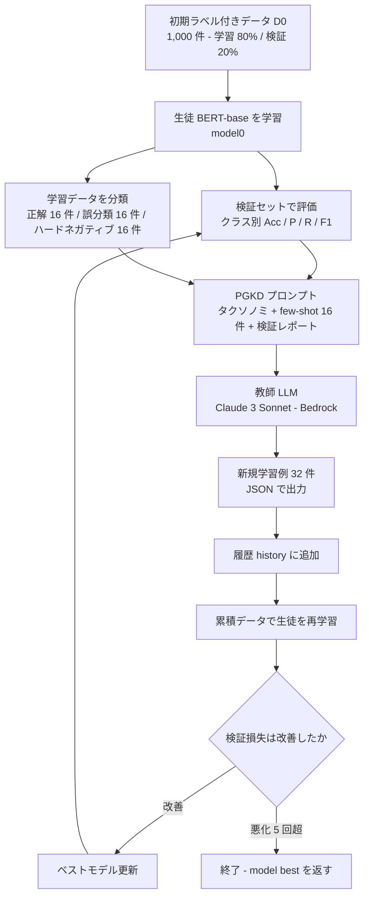
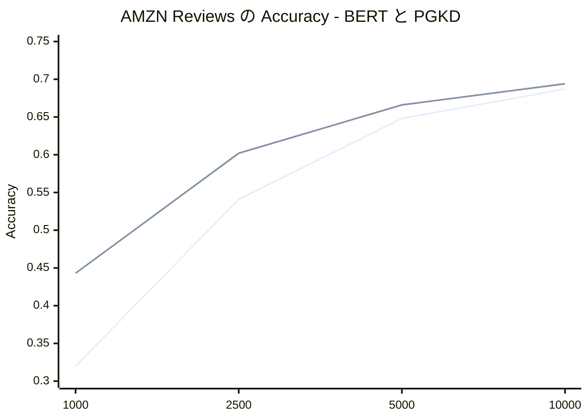

# Performance-Guided LLM Knowledge Distillation for Efficient Text Classification at Scale（PGKD）

- **Link**: https://arxiv.org/abs/2411.05045 （HTML 版: https://arxiv.org/html/2411.05045v1 ）
- **Authors**: Flavio Di Palo, Prateek Singhi（同等貢献）, Bilal Fadlallah（いずれも Amazon）
- **Year**: 2024（arXiv 投稿 2024-11-07）
- **Venue**: EMNLP 2024（arXiv の comment 欄に「Published in EMNLP 2024」と記載。Industry Track かどうかは arXiv 上では未記載）
- **Type**: Academic Paper（企業研究所の論文）
- **ライセンス**: CC BY-NC-ND 4.0
- **証拠の質**: **一次資料**（著者自身の実験・自己計測）。第三者による追試は今回確認できていない
- **取得状況**: arXiv API（メタデータ）と arXiv HTML 版（全文）を取得済み。図 1〜3 は画像のため、本文のキャプションと数値から再構成した

> **C1 での位置付け**: 商用 LLM（Claude 3 Sonnet）を **黒箱教師** にし、BERT-base（約 1.1 億パラメータ）を **生徒** にする「LLM → 小型分類器」の蒸留です。教師の logits は使わず、**教師に学習データを生成させる**（合成データ蒸留）方式なので、厳密には「出力ベースの黒箱蒸留」です。生徒側は通常の fine-tuning（交差エントロピー）で学習します。つまり「蒸留」の中身は **教師が作るデータ** にあり、損失関数は普通の SFT です。この点が「単なる fine-tuning」との境界になります（後述「Notes」）。

## Abstract

Large Language Models (LLMs) face significant challenges at inference time due to their high computational demands. To address this, we present Performance-Guided Knowledge Distillation (PGKD), a cost-effective and high-throughput solution for production text classification applications. PGKD utilizes teacher-student Knowledge Distillation to distill the knowledge of LLMs into smaller, task-specific models. PGKD establishes an active learning routine between the student model and the LLM; the LLM continuously generates new training data leveraging hard-negative mining, student model validation performance, and early-stopping protocols to inform the data generation. By employing a cyclical, performance-aware approach tailored for highly multi-class, sparsely annotated datasets prevalent in industrial text classification, PGKD effectively addresses training challenges and outperforms traditional BERT-base models and other knowledge distillation methods on several multi-class classification datasets. Additionally, cost and latency benchmarking reveals that models fine-tuned with PGKD are up to 130X faster and 25X less expensive than LLMs for inference on the same classification task. While PGKD is showcased for text classification tasks, its versatile framework can be extended to any LLM distillation task, including language generation, making it a powerful tool for optimizing performance across a wide range of AI applications.

## Abstract (Japanese Translation)

大規模言語モデル（LLM）は計算量が大きいため、推論時に大きな課題を抱えています。そこで本研究では、本番環境のテキスト分類向けに、低コストかつ高スループットな手法 Performance-Guided Knowledge Distillation（PGKD）を提案します。PGKD は教師-生徒型の知識蒸留を使い、LLM の知識を小型のタスク特化モデルへ移します。PGKD は生徒モデルと LLM の間に能動学習のループを作ります。LLM は、ハードネガティブの抽出、生徒モデルの検証性能、早期終了の仕組みを手がかりに、新しい学習データを生成し続けます。産業界のテキスト分類で多い「クラス数が多く、ラベル付きデータが少ない」データセットに合わせ、性能を見ながら繰り返す方式をとることで、PGKD は学習上の課題に対処し、従来の BERT-base モデルや他の知識蒸留手法を、複数の多クラス分類データセットで上回りました。さらに、コストと遅延の計測では、PGKD で fine-tuning したモデルは、同じ分類タスクで LLM より **推論が最大 130 倍速く、25 倍安い** ことが示されました。PGKD はテキスト分類で示していますが、枠組みは言語生成を含む任意の LLM 蒸留タスクに拡張できます。

## Overview

本論文は、Amazon の研究者が「LLM をそのまま本番の分類器として使うのは遅くて高い」という実務上の問題に対して、**LLM を学習時だけの教師として使い、推論は BERT-base で行う** という設計を示したものです。要点は次の 4 つです。

1. **能動学習型の黒箱蒸留**: 生徒（BERT）の検証結果を LLM のプロンプトに入れ、LLM が「生徒が苦手なクラス・苦手な文型」の学習例を追加生成します。これを最大 10 回繰り返します。
2. **産業向けの設定**: 1-shot / 5-shot の二値分類ではなく、**4〜335 クラス・ラベル付き 1,000 件** という、実務で現実的な設定で評価しています。
3. **クラス数が多いほど効く**: 4 クラスの AG-news では精度 +1.1 ポイントにとどまりますが、335 クラスの AMZN Reviews では精度 0.320 → 0.443（+12.3 ポイント）です。
4. **推論コストの実測**: 64 件のバッチで、Claude 3 Sonnet（Bedrock 経由）は 60.64 秒・0.3867 ドル、PGKD 済み BERT は GPU で 0.46 秒・0.0107 ドル、CPU で 21.45 秒・0.0046 ドルでした。

ビジネス上は、ドメインの価値式

$$
\text{蒸留のビジネス価値} \approx (C_{\text{teacher}} - C_{\text{student}}) \cdot Q - (C_{\text{data}} + C_{\text{train}}) - \Delta\text{Acc} \cdot V_{\text{err}}
$$

のうち、**第 1 項（推論単価の差）を実測した数少ない一次資料** です。一方で、第 2 項（教師 LLM へのデータ生成コール・学習費用）は数値が示されておらず、限界として「蒸留プロセス自体の計算コストが高くなりうる」と著者自身が書いています。

## Problem

- **LLM の推論コストと遅延**: LLM は SLA（応答時間の約束）が厳しい本番環境に向かず、数十億件規模の処理ではコストが膨らむ。
- **能力の過剰**: 意図分類などの多クラス分類は、生成能力を必要とせず、BERT のような小型の事前学習モデル（PLM）で解ける。
- **出力の扱いにくさ**: LLM は自由文を返すため、出力の解析や幻覚への対処が必要。PLM の分類ヘッドなら確率ベクトル（確信度）が直接得られる。
- **既存の黒箱 KD の限界**（著者の整理）:
  - (1) EvoKD は二値分類のベンチマークでしか結果を示していない。
  - (2) ZeroGen は教師の潜在知識だけに頼り、生徒の状態を見ない。EvoKD も教師に誤分類例を少し見せるだけで、全クラスの成績の概観は見せない。
  - (3) SunGen は高エントロピーのデータ生成に注力し、EvoKD も「生徒が自信を持って間違えた例（ハードネガティブ）」を重視しない。
  - (4) 反復の終了条件がなく、エポック数をデータセットごとに調整するハイパーパラメータとして扱っている。
- **評価設定の非現実性**: 既存研究は 1-shot / 5-shot が中心だが、産業界では数百〜数千件のラベル付けは経済的に可能で、クラス数も多い。

## Proposed Method

**Performance-Guided Knowledge Distillation（PGKD）**

### Core idea

生徒の「学習状況」を教師 LLM に毎回見せ、**教師がその弱点を埋める学習データを生成する** という能動学習のループです。教師は生徒の重みや logits を一切見ず、生徒も教師の確率分布を学びません。教師から生徒に渡るのは **テキストのラベル付き例だけ** です（黒箱・データ生成型）。

### 3 つの構成要素

1. **Gradual Evaluation Checks（段階的な評価チェック）**
   - 各ステップで生徒を検証セットで評価し、クラスごとの Accuracy / Precision / Recall / F1 の **レポート** を教師プロンプトに入れる。
   - 例: あるクラスの精度が低ければ、教師はそのクラスの例を多く作る → **生徒の成績に基づくクラス不均衡の自動補正** になる。
   - **検証サンプルそのものは LLM に渡さない**（指標だけを渡す）。検証セットへの過学習を避けるため。
2. **Hard Negative Mining（ハードネガティブ抽出）**
   - ハードネガティブ = 学習セット内で **誤分類され、かつ生徒の確信度が高い** サンプル。生徒の決定境界に最も近い、情報量の多い例。
   - 確信度は生徒の分類ヘッドの値から計算する。
   - 前回の学習で得たハードネガティブを教師プロンプトに入れ、教師に「生徒が間違えやすい文型」を推測させる。
3. **Early Stopping（早期終了）**
   - 検証損失を監視し、改善しない回数が patience を超えたら停止。
   - 検証損失が最小のモデルを最終モデルとして返す。

### Main algorithm steps

1. ラベル付き 1,000 件（学習 80% / 検証 20%）で BERT-base を学習し、$model^0$ を得る。
2. 学習データについて、正解例 $D^i_{correct}$・誤分類例 $D^i_{incorrect}$・ハードネガティブ $D^i_{hard\_negatives}$ を抽出する。
3. 上記 3 種の例と、検証レポート $val\_results$、PGKD プロンプトを LLM に渡し、新しい学習データ $D^{i+1}$ を生成させる。
4. $D^{i+1}$ を履歴 $history$ に追加し、**履歴全体** で生徒を再学習する。
5. 検証セットで評価し、損失が改善しなければ patience カウンタを増やす。上限を超えたら終了。改善すればベストモデルを更新する。
6. 2〜5 を `num_kd_steps` 回まで繰り返し、$model^{best}$ を返す。

### Key Formulas

論文中に明示的な損失関数の式はありません。生徒は「分類ヘッド付き BERT を **categorical cross-entropy** で fine-tuning」と記載されています。標準形で書くと次のとおりです。

$$
\mathcal{L}_{\text{CE}}(\theta) = -\frac{1}{|H|}\sum_{(x,y)\in H}\ \sum_{c=1}^{C} \mathbb{1}[y=c]\,\log p_\theta(c \mid x), \qquad H = D^0 \cup D^1 \cup \dots \cup D^{i+1}
$$

- $\theta$: BERT-base（生徒）のパラメータ
- $C$: クラス数（4〜335）
- $H$: 元のラベル付きデータ $D^0$ と、LLM が各ステップで生成したデータ $D^{i}$ の和集合（アルゴリズム中の $history$）
- $p_\theta(c\mid x)$: 分類ヘッドの softmax 出力

ハードネガティブの定義（論文の文章を式にしたもの）:

$$
D^i_{hard\_negatives} = \operatorname{top\text{-}k}_{(x,y)\in D^i,\ \hat{y}(x)\neq y}\ \max_c p_{\theta_i}(c\mid x), \qquad k=16
$$

（$\hat{y}(x)=\arg\max_c p_{\theta_i}(c\mid x)$。「誤分類のうち確信度が高い上位 16 件」。$k=16$ は実験設定の値）

早期終了の条件:

$$
\text{stop if } \#\{\text{連続して } \mathcal{L}_{val}^{new} > \mathcal{L}_{val}^{best}\} > \text{patience\_limit}\ (=5)
$$

> **蒸留としての注意**: 生徒は教師の確率分布（soft label）を学んでいません。Hinton 流の KD 損失 $\mathrm{KL}(p_T \Vert p_S)$ は使われず、**教師が作ったハードラベル付きテキスト** で普通に SFT しています。論文は自らを「黒箱 KD（教師の予測だけを使う）」と位置付けています。

### Features

- 教師は API 越しの商用 LLM（Claude 3 Sonnet、Amazon Bedrock 経由）でよい → **白箱アクセス不要**
- 生徒は CPU でも動く BERT-base → **推論インフラが安い**
- 検証の「指標」だけを教師に渡し、検証サンプルは漏らさない
- 終了条件が明確（早期終了）で、データセットごとのエポック調整が不要
- クラス数が多いほど効果が大きい

## Algorithm (Pseudocode)

論文の Algorithm 1 を、変数名を保ったまま整理したものです。

```
Algorithm: Performance-Guided Knowledge Distillation (PGKD)
Input : D^0（初期ラベル付きデータ, 1,000 件の 80%）, D^val（検証, 20%）,
        num_kd_steps（=10）, patience_limit（=5）, PGKD_prompt
Output: model^best

1.  model^0 ← train model on D^0                       // BERT-base + 分類ヘッドを通常学習
2.  i ← 0; step ← 0
3.  best_validation_loss ← ∞; val_results ← ""; patience_counter ← 0
4.  history ← {D^0}
5.  while i < num_kd_steps do
6.      D_incorrect^i, D_correct^i ← Find_Correctly_Classified_And_Misclassified_Examples(model^i, D^i)
7.      D_hard_negatives^i ← Find_Hard_Negative_Examples(model^i, D^i)   // 誤分類かつ高確信度
8.      D^{i+1} ← LLM(D_incorrect^i, D_correct^i, D_hard_negatives^i,
                      val_results, PGKD_prompt)        // 教師 LLM が新規 32 件を生成
9.      add D^{i+1} to history
10.     model^{i+1} ← train model on history           // 累積データで再学習
11.     new_loss, val_results ← evaluate(model^i, D^val)   // ※論文の表記のまま（model^i）
12.     if new_loss > best_validation_loss then
13.         patience_counter += 1
14.         if patience_counter > patience_limit then break
15.     else
16.         best_validation_loss ← new_loss
17.         model^best ← model^i
18.     end if
19.     i ← i + 1
20. end while
21. return model^best
```

> 11 行目と 17 行目は論文では `model^i` と書かれており、直前に学習した `model^{i+1}` ではありません。表記上の揺れと思われますが、原文に従いました。

## Architecture / Process Flow



本番のデプロイ構成（論文の前提を図にしたもの）:

```
 学習時のみ                                   推論時（本番）
┌────────────────────────┐                ┌──────────────────────────────┐
│ Claude 3 Sonnet        │  合成データ     │  BERT-base + PGKD             │
│ （Amazon Bedrock API）  │ ─────────────▶ │  CPU: m5.4xlarge（16 vCPU）   │
│ 黒箱教師・出力のみ       │                │  GPU: g5.4xlarge              │
└────────────────────────┘                │  確率ベクトル付きで分類        │
                                          └──────────────────────────────┘
```

## Figures & Tables

### Figure 1: PGKD のプロセス（画像）


キャプション（訳）: 生徒モデルはまずラベル付きサンプルで学習し、その後 KD プロセスが始まる。LLM は、生徒の正解例・誤分類例・ハードネガティブ・検証指標レポートに基づいて、生徒用の新しい学習例を生成する。（Mermaid による再構成は上の「Architecture / Process Flow」を参照）

### Figure 2: プロンプトに入る情報（画像）


キャプション（訳）: PGKD は、検証指標とハードネガティブを LLM のプロンプトに入れる。教師モデルは新しいサンプルを生成し、学習セットを拡張する。

### Table 1: データセット

| データセット | 内容 | 学習サンプル数 | テストサンプル数 | クラス数 |
|------------|------|--------------|----------------|--------|
| AG-News | 2,000 以上のニュースソースの記事を 4 分類（World, Sports, Business, Sci/Tech） | 120,000 | 7,600 | 4 |
| Yahoo Answers | Yahoo Answers の回答を 10 カテゴリに分類 | 1,400,000 | 60,000 | 10 |
| Huffington Post | 2012〜2022 年の見出しを 41 カテゴリに分類（politics, wellness 等） | 160,000 | 40,000 | 41 |
| AMZN Reviews | レビュー題名・本文から Amazon 商品カテゴリ（level 3）を推定 | 40,000 | 10,000 | 335 |

> 実験で実際に使うラベル付きデータは、各データセットから抽出した **1,000 件だけ** です（学習 800 / 検証 200）。5 通りの抽出で平均をとっています。

### Table 2: 主結果（平均 ± 標準偏差、5 回の抽出）

| データセット | 手法 | Accuracy | Macro Avg. F1 | Weighted Avg. F1 |
|------------|------|---------|---------------|------------------|
| AG-news（4 クラス） | BERT-base | 0.884 ± 0.012 | 0.884 ± 0.013 | 0.884 ± 0.011 |
| | BERT-base + PGKD | **0.895 ± 0.014** | **0.894 ± 0.018** | **0.894 ± 0.015** |
| | Claude-3（Zero-Shot） | 0.826 ± 0.020 | 0.821 ± 0.016 | 0.822 ± 0.012 |
| | SOTA - Full shot（Yang et al., 2019） | 0.955 | - | - |
| Yahoo Answers（10 クラス） | BERT-base | 0.649 ± 0.013 | 0.657 ± 0.017 | 0.657 ± 0.015 |
| | BERT-base + PGKD | **0.685 ± 0.015** | **0.688 ± 0.019** | **0.688 ± 0.011** |
| | Claude-3（Zero-Shot） | 0.680 ± 0.016 | 0.676 ± 0.018 | 0.676 ± 0.017 |
| | SOTA - Full Shot（Sun et al., 2019） | 0.776 | - | - |
| Huffington Post（41 クラス） | BERT-base | 0.474 ± 0.011 | 0.214 ± 0.014 | 0.411 ± 0.013 |
| | BERT-base + PGKD | **0.519 ± 0.012** | 0.330 ± 0.018 | **0.495 ± 0.020** |
| | Claude-3（Zero-Shot） | 0.442 ± 0.015 | **0.332 ± 0.019** | 0.435 ± 0.016 |
| | SOTA - 5-way, 5-shot（Chen et al., 2022） | 0.653 | - | - |
| AMZN Reviews（335 クラス） | BERT-base | 0.320 ± 0.014 | 0.074 ± 0.019 | 0.244 ± 0.011 |
| | BERT-base + PGKD | **0.443 ± 0.017** | 0.159 ± 0.012 | 0.382 ± 0.014 |
| | Claude-3（Zero-Shot） | 0.416 ± 0.012 | **0.364 ± 0.016** | **0.414 ± 0.013** |
| | SOTA - 5-shot（Zhang et al., 2022） | 0.495 | - | - |

PGKD による改善幅（Accuracy、ポイント差。本レポートで計算）:

```
AG-news   (4)   |█ +1.1
Yahoo     (10)  |████ +3.6
HuffPost  (41)  |█████ +4.5
AMZN      (335) |████████████ +12.3
```

**読み取り**:

- 精度（Accuracy）では、PGKD 済み BERT は 4 データセットすべてで Claude 3 の zero-shot を上回る。
- ただし **335 クラスの AMZN Reviews では、Macro F1（0.159 vs 0.364）と Weighted F1（0.382 vs 0.414）で教師の Claude 3 zero-shot に負けている**。Huffington Post の Macro F1 もわずかに下回る（0.330 vs 0.332）。少数クラスの扱いでは、教師 LLM の zero-shot の方がまだ強い。
- どのデータセットでも、全データで学習した SOTA には届かない。

### Figure 3: 学習サンプル数と PGKD の効果（AMZN Reviews、画像）


数値は Appendix B の Table 6 にあります（下記）。

### Table 3: 既存 KD 手法との比較（Weighted Avg. F1。1-shot 手法の値は Liu et al., 2024 から転載）

| 手法 | IMDB（2 クラス） | Inshorts（7 クラス） |
|------|----------------|-------------------|
| Full Shot | 0.949 | 0.970 |
| BERT-base（n=1000） | 0.872 | 0.933 |
| **BERT-base + PGKD（n=1000）** | **0.908** | **0.943** |
| No Augment（1-shot） | 0.583 | 0.640 |
| EDA（1-shot） | 0.618 | 0.677 |
| ZeroGen（1-shot） | 0.508 | 0.833 |
| SunGen（1-shot） | 0.576 | 0.810 |
| Gradual（1-shot） | 0.685 | 0.760 |
| AugGPT（1-shot） | 0.690 | 0.790 |
| EvoKD（1-shot） | 0.798 | 0.851 |
| EvoKD + Init（1-shot） | 0.835 | 0.868 |

> 注意: PGKD は 1,000 件、比較対象は 1-shot という **条件の異なる比較** です。著者も「BERT-base（1,000 件）だけで既に全 1-shot 手法を上回る」と述べており、この表は「実務的なデータ量では 1-shot 前提の手法比較は意味が薄い」という主張の材料です。

### Table 4: アブレーション（Accuracy、5 回の抽出の平均、1,000 件で学習）

| 構成 | AG-news | Yahoo A. | Huffington | AMZN |
|------|---------|----------|-----------|------|
| PGKD（全部入り） | **0.895** | **0.685** | **0.519** | **0.443** |
| w/o Validation（検証レポートなし） | 0.893 | 0.669 | 0.501 | 0.419 |
| w/o Hard Negatives（ハードネガティブなし） | 0.887 | 0.675 | 0.510 | 0.433 |

差分（本レポートで計算）:

| 構成 | AG-news | Yahoo A. | Huffington | AMZN |
|------|---------|----------|-----------|------|
| w/o Validation | -0.002 | -0.016 | -0.018 | **-0.024** |
| w/o Hard Negatives | -0.008 | -0.010 | -0.009 | -0.010 |

→ 「検証レポートを教師に見せる」ことの寄与は、クラス数が多いほど大きい。

### Table 5: 推論の遅延とコスト（64 件のバッチあたり）

| 手法 | 遅延（秒） | コスト（ドル） | 実行環境（本文より） |
|------|----------|--------------|------------------|
| BERT-base + PGKD（CPU） | 21.45 | 0.0046 | AWS m5.4xlarge（16 vCPU） |
| BERT-base + PGKD（GPU） | 0.46 | 0.0107 | g5.4xlarge |
| Claude-3 zero-shot | 60.64 | 0.3867 | Amazon Bedrock、入力は平均約 1k token |
| LLaMA 3 8B zero-shot | 58.05 | 0.0609 | Amazon Bedrock |

**倍率の再計算（本レポートで Table 5 から計算）**:

| 比較 | 遅延の倍率（LLM / 生徒） | コストの倍率（LLM / 生徒） |
|------|------------------------|--------------------------|
| Claude 3 vs PGKD（CPU） | 2.8 倍 | **84.1 倍** |
| LLaMA 3 8B vs PGKD（CPU） | 2.7 倍 | 13.2 倍 |
| Claude 3 vs PGKD（GPU） | **131.8 倍** | 36.1 倍 |
| LLaMA 3 8B vs PGKD（GPU） | 126.2 倍 | 5.7 倍 |

> **数値の整合性についての注意（重要）**: 本文は「CPU で約 3 倍遅く 25 倍高い、GPU で約 130 倍遅く 6 倍高い」と書いています。遅延の「3 倍」「130 倍」と GPU の「6 倍」（LLaMA 3 8B 比）は表と合いますが、**CPU の「25 倍高い」は、表のどの組合せとも一致しません**（Claude 比 84 倍、LLaMA 比 13 倍）。Abstract の「最大 130 倍速く、25 倍安い」は、**異なるハードウェアと異なる比較相手の最良値を組み合わせた表現** であり、同じ構成で同時に成り立つ数字ではありません。引用する際は「GPU なら Claude 比で約 130 倍速い」「CPU なら Claude 比で約 84 倍、LLaMA 3 8B 比で約 13 倍安い」と分けて書くのが正確です。

100 万件を分類する場合の推論費用（Table 5 の 64 件あたりの値を比例換算。本レポートでの試算）:

| 構成 | 1 件あたり | 100 万件あたり |
|------|----------|--------------|
| Claude 3 zero-shot | 約 0.00604 ドル | 約 6,042 ドル |
| LLaMA 3 8B zero-shot | 約 0.00095 ドル | 約 952 ドル |
| PGKD BERT（GPU） | 約 0.00017 ドル | 約 167 ドル |
| PGKD BERT（CPU） | 約 0.000072 ドル | 約 72 ドル |

```
100 万件あたりの推論費用（ドル、対数ではなく線形）
Claude 3 zero-shot |████████████████████████████████████████ 6,042
LLaMA 3 8B         |██████ 952
PGKD BERT（GPU）   |█ 167
PGKD BERT（CPU）   |▏ 72
```

### Table 6: 学習サンプル数ごとの性能（Appendix B）

| データセット | サンプル数 | BERT Acc. | BERT Macro F1 | BERT Weighted F1 | +PGKD Acc. | +PGKD Macro F1 | +PGKD Weighted F1 |
|------------|----------|-----------|---------------|------------------|-----------|----------------|-------------------|
| AG-news（4） | 1000 | 0.884 | 0.884 | 0.884 | 0.895 | 0.894 | 0.894 |
| | 2500 | 0.899 | 0.899 | 0.899 | 0.910 | 0.909 | 0.909 |
| | 5000 | 0.903 | 0.903 | 0.903 | 0.911 | 0.911 | 0.911 |
| | 10000 | 0.914 | 0.914 | 0.914 | 0.917 | 0.917 | 0.917 |
| Yahoo Answers（10） | 1000 | 0.649 | 0.657 | 0.657 | 0.685 | 0.688 | 0.688 |
| | 2500 | 0.700 | 0.693 | 0.693 | 0.708 | 0.705 | 0.704 |
| | 5000 | 0.702 | 0.697 | 0.697 | 0.719 | 0.707 | 0.709 |
| | 10000 | 0.721 | 0.716 | 0.716 | 0.725 | 0.718 | 0.721 |
| Huffington Post（41） | 1000 | 0.474 | 0.214 | 0.411 | 0.519 | 0.330 | 0.495 |
| | 2500 | 0.537 | 0.343 | 0.519 | 0.553 | 0.394 | 0.541 |
| | 5000 | 0.551 | 0.378 | 0.547 | 0.564 | 0.425 | 0.564 |
| | 10000 | 0.601 | 0.387 | 0.561 | 0.605 | 0.476 | 0.604 |
| AMZN Reviews（335） | 1000 | 0.320 | 0.074 | 0.244 | 0.443 | 0.159 | 0.382 |
| | 2500 | 0.541 | 0.243 | 0.491 | 0.602 | 0.340 | 0.567 |
| | 5000 | 0.648 | 0.404 | 0.622 | 0.666 | 0.436 | 0.649 |
| | 10000 | 0.687 | 0.451 | 0.662 | 0.694 | 0.476 | 0.679 |

AMZN Reviews での Accuracy の改善幅（ポイント、本レポートで計算）:

```
1,000 件  |████████████ +12.3
2,500 件  |██████ +6.1
5,000 件  |██ +1.8
10,000 件 |█ +0.7
```

→ **ラベル付きデータが少ないほど蒸留の価値が大きい**。10,000 件あれば改善は 1 ポイント未満に縮む（AG-news では 1.1 → 0.3 ポイント）。ただし、どの条件でも性能は下がっていない。



（上の線: PGKD、下の線: BERT-base）

### 実験設定（ハイパーパラメータ）

| 項目 | 値 |
|------|----|
| 生徒 | BERT-base + 分類ヘッド（Hugging Face、categorical cross-entropy） |
| 教師 | Claude-3 Sonnet（Amazon Bedrock 経由） |
| 初期ラベル付きデータ | 1,000 件（学習 80% / 検証 20%）× 5 通り |
| 最大系列長 | 512 |
| バッチサイズ | 64 |
| BERT 学習エポック | 30（早期終了 patience 5） |
| 1 回の生成件数（PGKD batch size） | 32 件 |
| プロンプト内 few-shot 例 | 16 件 |
| 正解例 / 誤分類例 / ハードネガティブの件数 | 各 16 件 |
| PGKD の最大反復回数 | 10 |
| PGKD の patience | 5 |

→ 1 回の実験で教師が生成する追加データは **最大 32 × 10 = 320 件** です（本レポートでの計算）。教師への問い合わせは最大 10 回で、データ生成コストは推論コストに比べて小さいと推定できますが、論文は金額を示していません。

### 手法比較（関連研究の議論から作成）

| 観点 | PGKD | EvoKD | ZeroGen | SunGen | AugGPT |
|------|------|-------|---------|--------|--------|
| 教師へのアクセス | 黒箱（出力のみ） | 黒箱 | 黒箱 | 黒箱 | 黒箱（ChatGPT） |
| 生徒の状態を教師に見せる | ○ 全クラスの検証指標 + 例 | △ 少数の誤分類例 | ✗ | ✗ | ✗ |
| ハードネガティブの利用 | ○ | ✗ | ✗ | ✗ | ✗ |
| 終了条件 | ○ 早期終了 | ✗（エポック数を調整） | ✗ | ✗ | ✗ |
| 想定設定 | 多クラス・1,000 件 | 二値・few-shot | zero-shot | zero-shot | 言い換え拡張 |
| 主な強み | 多クラスで大きな改善 | 能動学習の先駆 | データ不要 | 高エントロピー生成 | 実装が簡単 |
| 主な弱み | 教師の質とプロンプトに依存 | 二値分類のみ | 生徒を見ない | 生徒を見ない | 生徒を見ない |

### Appendix A: プロンプト（構造を保って再掲）

PGKD プロンプト（教師用）の構成要素:

1. 役割: 「あなたは Student LM のための Teacher モデルで、次のタクソノミで話題分類を行う」
2. `{Dataset Class Taxonomy}`（クラス一覧）
3. `{Few-Shot Labeled Samples from Training Dataset}`（few-shot 例）
4. 指示: 「現在のモデル性能を踏まえ、`{PGKD Batch Size}` 件の学習サンプルを生成せよ。出力は解析可能な JSON の辞書リストのみ。目的はモデル精度の最大化」
5. `{Classification Report on the Validation Set}`（検証レポート）
6. `{Correctly Classified Samples with correct label and Student-predicted label}`
7. `{Misclassified Samples with correct label and Student-predicted label}`
8. `{Hard Negative Samples with correct label and Student-predicted label}`（「モデルが高い確信度で誤分類している例」として提示）

Zero-shot 分類プロンプト（比較用）の構成要素:

1. 役割: 「テキストを話題カテゴリに分類する AI アシスタント」
2. `{Dataset Class Taxonomy}` から 1 つだけ選ぶ
3. JSON（`class_label`, `class_names`）で回答し、本文を繰り返さない
4. `{Paste text for zero-shot classification}`

## Experiments & Evaluation

### Setup

- **データ**: AG-News / Yahoo Answers / Huffington Post / AMZN Reviews（4〜335 クラス）。比較実験に IMDB / Inshorts。
- **評価指標**: Accuracy、Macro Average F1、Weighted Average F1（5 回の抽出の平均と標準偏差）。
- **ベースライン**: BERT-base（同じ 1,000 件で通常学習）、Claude-3 Sonnet zero-shot、文献上の SOTA、文献上の 1-shot KD 手法群。
- **コスト計測**: 64 件のバッチの遅延とコスト。LLM は Amazon Bedrock 経由、BERT は m5.4xlarge（CPU）と g5.4xlarge（GPU）。

### Main Results

- PGKD は 4 データセットすべてで BERT-base を上回る（Accuracy +1.1〜+12.3 ポイント）。
- Accuracy では全データセットで Claude-3 zero-shot を上回る。F1 系では、335 クラスで教師に負ける。
- **クラス数と改善幅に相関** がある（4 クラスで小、335 クラスで大）。
- データが増えると改善幅は縮むが、性能が下がることはない。

### Ablation Study

- 検証レポートを外すと、全データセットで精度が下がる（AMZN で -2.4 ポイント）。
- ハードネガティブを外すと、より小さいが一貫した低下（-0.8〜-1.0 ポイント）。

## 限界（著者の記載を構造化）

1. **LLM の性能への依存**: 教師が領域固有のデータに弱い、または良いサンプルを作れないと効果が限られる。
2. **蒸留プロセスの計算コスト**: 推論は安くなるが、反復的なサンプル生成で **蒸留自体のコストが高くなりうる**。巨大データや頻繁な再学習ではスケールしにくい。
3. **評価タスクの範囲**: 多クラステキスト分類のみ。他言語・他領域・NER や QA への拡張は今後の課題。
4. **プロンプト設計への感度**: 教師プロンプトの質で結果が変わる。

倫理面のリスク: 教師に偏りや幻覚があれば、偏った・架空のデータ点が生成され、生徒に引き継がれ増幅されうる。

## ビジネス上の含意（C1 / ドメイン仮説との対応）

| 観点 | 本論文から言えること | 証拠の質 |
|------|------------------|---------|
| 価値式の第 1 項（推論単価差） | Claude 3 比で、CPU 推論なら約 84 倍安く、GPU 推論なら約 132 倍速い | 一次資料（自己計測） |
| 価値式の第 2 項（データ・学習費） | 教師の生成は最大 320 件 / 実験と少ないが、金額は未報告。著者は「蒸留自体が高コストになりうる」と注記 | 一次資料（定性） |
| 価値式の第 3 項（精度損失） | Accuracy は教師 zero-shot 以上、ただし 335 クラスの Macro F1 は教師の半分以下（0.159 vs 0.364） | 一次資料 |
| 必要データ量 | ラベル付き 1,000 件から開始。データが少ないほど効果が大きい | 一次資料 |
| 教師の種類の制約（H5） | 商用 API（Claude 3 Sonnet）を教師に使える黒箱方式。ただし本論文は **Amazon 社内研究で、Bedrock 経由の利用** であり、Anthropic の規約上の扱い（競合モデル開発の禁止との関係）には触れていない | 一次資料（記載なし） |
| H1（定量事例は検索・推薦に集中） | 本論文は分類タスクの定量事例であり、H1 への **反例の候補**。ただし公開データでの実験で、Amazon 社内の本番数値ではない | 一次資料 |
| H3（SLM 事例の多くは蒸留ではなく fine-tuning） | 本手法も生徒側は普通の fine-tuning。「教師がデータを作る」点だけが蒸留であり、**「蒸留」と「LLM でラベル付けした fine-tuning」の境界は曖昧** であることを示す例 | 一次資料 |

## Notes

- **（2026-10-22 追記）「130 倍 / 25 倍」の原典確認**: arXiv HTML v1 の Table 5 と 5.3 節を再取得した。原文は "LLMs inference for the proposed classification task is approximately 3X slower and 25X more expensive than BERT-base + PGKD on a CPU instance and approximately 130X slower and 6X more expensive on a GPU instance" で、Abstract の "up to 130X faster and 25X less expensive" は **CPU 構成のコスト倍率と GPU 構成の遅延倍率を組み合わせた表現**。Table 5 の値（CPU 0.0046 ドル / GPU 0.0107 ドル / Claude 0.3867 ドル / LLaMA 3 8B 0.0609 ドル）からは、CPU のコスト倍率は Claude 比 84 倍・LLaMA 比 13 倍で、**25 倍はどの組合せとも一致しない**（GPU の「6 倍」は LLaMA 比 5.7 倍に対応）。また本文は LLaMA 3 8B の遅延を 58.06 秒・コストを 0.06 ドルと書いており、表（58.05 秒・0.0609 ドル）と丸めが異なる。index の「約 6,042 → 72 ドル（約 84 分の 1）」は Table 5 の Claude 3 と PGKD（CPU）の比例換算で、原典の「25 倍」とは別物であることを明記しておく。
- **蒸留か fine-tuning か**: 論文は KD と呼びますが、損失は通常の交差エントロピーで、教師の確率分布は使っていません。Xu et al.（2402.13116）の分類では「Data Augmentation / Expansion 型の知識抽出 + SFT による移転」に当たります。社内の事例を整理する際は、「LLM を教師としたデータ生成 + 小型モデルの fine-tuning」と明記するのが正確です。
- **本番導入の有無**: 論文は「本番のテキスト分類向け」と述べ、利点として顧客サポートやメッセージング基盤を挙げますが、**Amazon 社内のどのサービスに導入したか、本番での数値は書かれていません**。実験はすべて公開データセットです。
- **コストの比較相手**: 比較は「LLM の zero-shot 分類」です。LLM の few-shot や、LLM で全件ラベル付けした BERT（通常の擬似ラベル学習）との比較はありません。後者が実務上の最も自然な代替案なので、PGKD の追加価値を判断するにはこの比較が欠けています。
- **関連研究（さらに調べる候補）**:
  - EvoKD: Evolving knowledge distillation with large language models and active learning（arXiv 2403.06414）
  - ZeroGen（Ye et al., 2022）、SunGen（Gao et al., 2022）、AugGPT
  - MiniLLM（Gu et al., 2024; arXiv 2306.08543）— 白箱 KD との対比
  - LLKD（arXiv 2411.08028）— 教師の確信度と生徒の不確実性でサンプルを選ぶ、類似の発想
