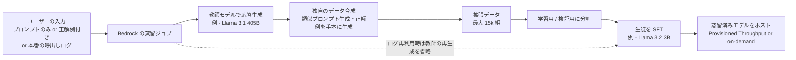
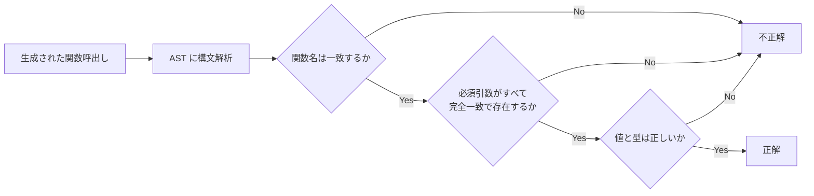
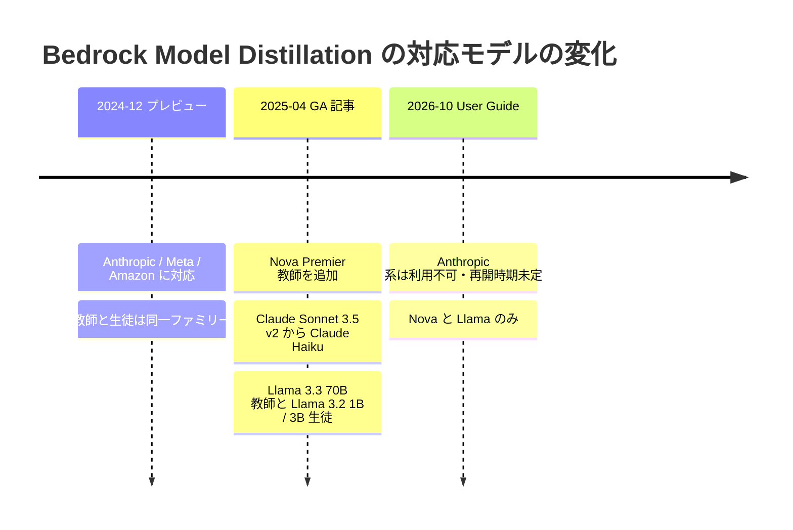

# Amazon Bedrock Model Distillation — function calling（Agent）蒸留と「最大 500% 高速・75% 安価」の根拠

- **Company/Organization**: Amazon Web Services（Amazon Bedrock）
- **Industry**: クラウド / 生成 AI プラットフォーム（マネージド蒸留サービス）
- **Date**: プレビュー発表 2024-12-03 / GA 2025-05-01（プレビュー記事末尾の追記による）/ function calling 記事 2025-04-30
- **Link**:
  - 主資料: [Amazon Bedrock Model Distillation: Boost function calling accuracy while reducing cost and latency](https://aws.amazon.com/blogs/machine-learning/amazon-bedrock-model-distillation-boost-function-calling-accuracy-while-reducing-cost-and-latency/)（AWS Machine Learning Blog）
  - 補助: [Build faster, more cost-efficient, highly accurate models with Amazon Bedrock Model Distillation (preview)](https://aws.amazon.com/blogs/aws/build-faster-more-cost-efficient-highly-accurate-models-with-amazon-bedrock-model-distillation-preview/)（AWS News Blog）
  - 補助: [Customize a model with distillation in Amazon Bedrock](https://docs.aws.amazon.com/bedrock/latest/userguide/model-distillation.html) と、その下位ページ [Prerequisites](https://docs.aws.amazon.com/bedrock/latest/userguide/prequisites-model-distillation.html) / [Prepare your training datasets](https://docs.aws.amazon.com/bedrock/latest/userguide/distillation-prepare-datasets.html)（User Guide、2026-10-21 取得）
  - 補助: [Amazon Bedrock Model Distillation 製品ページ](https://aws.amazon.com/bedrock/model-distillation/)
- **Type**: Business Case（ベンダーの機能紹介 + ベンダー自身の評価実験）
- **証拠の質**: **ベンダー申告**。精度・遅延・価格の数値はすべて AWS が自社ブログで公表したもの。遅延・速度の数値の出所は第三者サイト（Artificial Analysis、2025-04-04 時点）と明記。**顧客ごとの成果数値は、取得した 4 資料のどこにもない**
- **取得状況**: 4 資料とも本文を取得済み。グラフは画像を取得して読み取った（読み取り値は「約」と表記）

## Overview

Amazon Bedrock Model Distillation は、ユーザーが **プロンプトだけ** を用意すれば、Bedrock が (1) 教師モデルで応答を生成し、(2) 独自のデータ合成でデータを増やし、(3) 生徒モデルを fine-tuning し、(4) 蒸留済みモデルをホストする、という一連の作業を自動化するマネージド機能です。2024 年 12 月にプレビュー、2025 年 5 月に GA になりました。

GA にあわせた function calling の記事では、Agent の **ツール呼出し（function calling）を Llama 3.1 405B から Llama 3.2 3B へ蒸留** した実験を示しています。BFCL v2（エンターテインメント領域、学習・テスト各約 200 件）で、生徒の AST スコアは

- simple カテゴリ: 0.478 → 0.783（素の蒸留）→ **0.826**（データ拡張付き蒸留）
- multiple カテゴリ: 0.586 → 0.742（素の蒸留）→ **0.828**（データ拡張付き蒸留）

に上がり、multiple では **教師（グラフ上で約 0.77）を上回った** と読み取れます。価格は 3B が 0.15 ドル / 100 万 token、405B が 2.4 ドル / 100 万 token（16 倍差）です。

C1 の観点では、これは **黒箱の「教師出力 + SFT」型蒸留** の商用実装であり、教師の logits や重みは使いません。しかも AWS は「素の蒸留（vanilla distillation）= 入力に教師の応答を付けて生徒を SFT すること」と自ら定義したうえで、それに **独自の合成データ** を足すことを差別化要素にしています。

## Problem & Context

- **Agent のツール呼出しは大きなモデルが得意だが高価で遅い**: どの関数を呼ぶか・引数をどう組み立てるかは大きなモデルほど正確だが、コストと遅延が大きい。
- **小さいモデルはそのままでは精度が足りない**: 生徒候補の Llama 3.2 3B は、BFCL simple で 0.478 と教師に大きく劣る。
- **fine-tuning には高品質なラベル付きデータが必要**: プレビュー記事は「fine-tuning には高品質なラベル付きデータセットを作るスキルが別途必要」と指摘し、蒸留なら **プロンプトだけ** でよいことを利点に挙げる。
- **規模の経済**: 「数十億回のユーザー対話」規模で価格性能比を改善したいという顧客ニーズ（プレビュー記事）。

## Solution

### 何を作ったか



### 主な技術的判断

1. **黒箱方式（教師の出力のみ）**: 教師に問い合わせて応答テキストを得て、それで生徒を fine-tuning する。User Guide も「教師の応答を使って生徒を fine-tuning する」と説明している。
2. **同一ファミリー内の教師・生徒**: プレビュー時点で「教師と生徒は同じファミリーでなければならない」（例: Llama 3.1 405B 教師 → 70B / 8B 生徒）。GA 後の対応表も同一ファミリーの組合せのみ。
3. **独自のデータ合成（proprietary data synthesis）**: 用途に応じて、(a) 似たプロンプトを生成してデータ量を増やす、(b) ユーザーが与えた少数の正解例を手本に、教師に同様の高品質応答を書かせる。中身は非公開。
4. **本番ログの再利用**: 呼出しログ（invocation logs）を S3 に保存しておけば、(a) プロンプトだけを使って教師に再生成させる、または (b) プロンプトと応答の組をそのまま学習に使う（教師の再生成を省けるので安い）、を選べる。後者は「ログを出したモデル = 指定した教師モデル」でなければ使われない。`requestMetadata` で用途別にログを絞り込める。
5. **透明性の追加（GA 時）**: 合成した学習データのサンプルを最大 50 件（Anthropic モデルは最大 25 件）出力。受理・却下したプロンプトとその理由のレポートも出す。社内のコンプライアンス対応に使えるとしている。
6. **細かいジョブ状態表示（GA 時）**: Validation → Data processing → Training の段階別に状態を表示。

### 統合方法（function calling 用のデータ形式）

- ツール仕様（関数の JSON 定義）は、学習データの **system または user メッセージ内にテキストとして** 埋め込む必要がある。
- 推論時も、蒸留時と同じプロンプト形式を保つことを推奨。
- JSONL の各レコードは `schemaVersion: "bedrock-conversation-2024"`、`system`、`messages`（user 必須、assistant 任意）を持つ。
- Anthropic と Meta Llama は **1 往復（single-turn）のみ**、Amazon Nova は複数往復に対応。

レコードの構造（記事の例を要約）:

```
{
  "schemaVersion": "bedrock-conversation-2024",
  "system":   [ { "text": "関数一覧（JSON）と、関数呼出しの作り方の指示" } ],
  "messages": [
    { "role": "user",      "content": [ { "text": "What's the weather tomorrow?" } ] },
    { "role": "assistant", "content": [ { "text": "[lookup_weather(location=\"san francisco\", date=\"tomorrow\")]" } ] }   ← 任意
  ]
}
```

ログで絞り込むための metadata の例: `"requestMetadata": {"project": "WeatherAgent", "intent": "LocationQuery", "priority": "High"}`、ジョブ側で `"requestMetadataFilters": {"equals": {"project": "WeatherAgent"}}`。

## Results & Impact

### 1. function calling 蒸留の精度（BFCL v2、エンターテインメント領域）

| 指標（Hard AST スコア） | 教師 Llama 3.1 405B | 生徒 Llama 3.2 3B（蒸留前） | 素の蒸留 405B→3B | データ拡張付き蒸留 405B→3B |
|------|------|------|------|------|
| simple | 約 0.87（グラフ読み取り） | 0.478 | 0.783 | **0.826** |
| multiple | 約 0.77（グラフ読み取り） | 0.586 | 0.742 | **0.828** |

| 改善 | simple | multiple | 平均 |
|------|--------|----------|------|
| 蒸留前 → 素の蒸留（相対） | +63.8% | +26.6% | +45.2%（記事の値） |
| 素の蒸留 → データ拡張付き（相対） | +5.5%（本レポートで計算） | +11.6%（本レポートで計算） | 記事は「平均 5.8%」 |
| 蒸留前 → データ拡張付き（相対、本レポートで計算） | +72.8% | +41.3% | +57.1% |

> **数値の整合性についての注意**: 記事は「データ拡張でさらに平均 5.8% の相対改善（各カテゴリの相対改善の平均）」と書いていますが、記事中の数値から計算すると simple +5.5%、multiple +11.6% で、平均は約 8.5% になります。5.8% はどちらとも一致しません。また、教師のスコアは本文に数値がなく、グラフの読み取りです。

- **証拠の質**: ベンダー申告（AWS 自身の実験）。テストは約 200 件と小さく、エンターテインメント領域だけの結果です。
- **教師超え**: multiple で生徒（0.828）が教師（約 0.77）を上回るのは、蒸留が「教師の模倣」を超え、**合成データによるタスク特化の効果** を含むことを示唆します。一方、simple では教師（約 0.87）に届いていません。

### 2. 遅延・速度・価格（記事のグラフ。遅延・速度の出所は Artificial Analysis、2025-04-04）

| モデル | 遅延（秒、グラフ読み取り） | 出力速度（token/秒、グラフ読み取り） | 価格（ドル / 100 万 token、入出力） |
|------|------|------|------|
| Llama 3.1 8B | 約 0.4 | 約 92 | 0.22 |
| Llama 3.2 3B | 約 0.5 | 約 72 | **0.15** |
| Llama 3.1 70B | 約 0.6 | 約 32 | 0.72 |
| Llama 3.1 405B | 約 1.8 | 約 30 | 2.4 |

| 比較（3B vs 405B） | 値 | 出所 |
|------|------|------|
| 遅延の削減 | **72%** | 記事の値 |
| 出力速度の向上 | **140%** | 記事の値 |
| 100 万 token あたり価格 | **16 分の 1**（0.15 vs 2.4、本レポートで計算） | 記事のグラフ |

```
100 万 token あたりの価格（ドル）
Llama 3.1 405B |████████████████████████████████████████ 2.40
Llama 3.1 70B  |████████████ 0.72
Llama 3.1 8B   |████ 0.22
Llama 3.2 3B   |██▌ 0.15
```

> ここでの価格は **基盤モデル（未蒸留）の on-demand 価格** です。蒸留済みモデルの推論は、プレビュー時点では **Provisioned Throughput（時間・モデルユニット単位の課金）** が必須でした。製品ページは現在「特定のカスタムモデルは on-demand 推論でも呼べる」と書いています。つまり、記事の価格比較は「蒸留後の実際の請求額」とは一致しない可能性があります。

### 3. サービス全体の主張値（「500% / 75% / 2%」）

| 主張 | 原文の表現 | 出典 | 証拠の質 |
|------|----------|------|---------|
| 速度 | 「**up to five times faster**」 | プレビュー記事（2024-12-03） | ベンダー申告 |
| 速度 | 「**up to 500% faster**」 | 製品ページ | ベンダー申告 |
| コスト | 「up to 75 percent less expensive / up to 75% less expensive」 | プレビュー記事・製品ページ | ベンダー申告 |
| 精度 | 「less than two percent accuracy loss for use cases such as RAG」 | プレビュー記事・製品ページ | ベンダー申告 |

> **表現のずれ**: プレビュー記事は「最大 5 倍速い」、製品ページは「最大 500% 速い」と書いています。厳密には「500% 速い」は「6 倍の速さ」とも読めますが、同じ主張を言い換えたものと見るのが自然です。いずれの資料にも、**どのモデルの組合せ・どのデータセット・どのハードウェアでこの数字を測ったかの記載はありません**。「RAG のような用途で」と用途が示されるだけです。

### 4. 顧客別の成果（H2 の検証）

| 確認した資料 | 顧客名の記載 | 顧客別の定量成果 |
|------------|------------|----------------|
| function calling 記事（2025-04） | なし | なし |
| プレビュー記事（2024-12） | なし | なし |
| User Guide（2026-10 取得） | なし | なし |
| 製品ページ（2026-10 取得） | なし（今回の取得範囲では確認できず） | なし |

→ **H2（ベンダー数値は集計値で、顧客別成果は非公開）を支持**。今回取得した資料には顧客別の成果が一つもありません（clustering 時の事前スキャンで挙がった Moody's / PwC / Robin AI 等の名前は、今回の 4 資料では確認できませんでした）。

### 5. 例として示されたジョブ所要時間（GA 記事のスクリーンショット）

| 段階 | 開始 | 終了 | 所要（本レポートで計算） |
|------|------|------|------------------|
| Validation | 2025-04-17 16:22 | 16:23 | 約 1 分 |
| Data processing（教師応答生成・合成） | 16:23 | 17:23 | 約 1 時間 |
| Training（生徒の SFT） | 17:23 | 2025-04-18 00:45 | 約 7 時間 22 分 |

（どのデータ量・どのモデルのジョブかは記載なし。あくまで状態表示機能の例）

## Figures & Tables

### 記事中の図（画像）


図 1（訳）: 蒸留ジョブの段階別状態表示（Validation / Data processing / Training）。値は上の表 5 に転記。


図 2（訳）: AST（抽象構文木）による function calling の評価手順。Gorilla 論文からの引用図。


図 3（訳）: BFCL v2 エンターテインメント領域での蒸留性能。値は「Results & Impact」の表 1 に転記。


図 4（訳）: Llama 各サイズの遅延と出力速度（Artificial Analysis、2025-04-04）。値は表 2 に転記。


図 5（訳）: Llama 各サイズの 100 万 token あたり価格。値は表 2 に転記。

プレビュー記事の仕組み図:


図 6（訳）: 教師の応答生成 → 独自のデータ合成 → 生徒の fine-tuning、という流れ（上の Mermaid 図で再構成）。

### AST 評価の手順（記事の箇条書きを再掲）

1. **Function matching**: 予測した関数名が、正解候補のいずれかと一致するか
2. **Required parameter matching**: AST から引数を取り出し、各必須引数が正解候補に完全一致で存在するか
3. **Parameter type and value matching**: 予測した引数の値と型が正しいか



### BFCL v2 のカテゴリ定義（記事の Appendix）

| カテゴリ | 与えられる関数定義 | 期待する出力 | 評価する能力 |
|---------|----------------|------------|------------|
| simple | 1 個 | 関数呼出し 1 回 | 素直な問い合わせを唯一の関数に対応付け、必須引数を埋める |
| multiple | 2〜4 個（典型） | 最適な関数を選び 1 回呼ぶ | 意図の理解、似た関数の区別 |

### 対応している教師・生徒の組合せ（User Guide、2026-10-21 取得時点）

| 提供元 | 教師 | 推論プロファイル | 生徒 | リージョン |
|-------|------|----------------|------|----------|
| Amazon | Nova Pro | Both | Nova Lite / Nova Micro | US East（N. Virginia） |
| Amazon | Nova Premier | Inference profile only | Nova Lite / Nova Micro / Nova Pro | US East（N. Virginia） |
| Meta | Llama 3.1 405B | On demand | Llama 3.1 8B / Llama 3.1 70B / Llama 3.2 1B / Llama 3.3 70B | US West（Oregon） |
| Meta | Llama 3.1 70B | Both | Llama 3.1 8B / Llama 3.2 1B / Llama 3.2 3B | US West（Oregon） |
| Meta | Llama 3.3 70B | Inference profile only | Llama 3.1 8B / Llama 3.2 1B / Llama 3.2 3B | US West（Oregon） |

> **重要（2026-10 時点の User Guide）**: 「**Anthropic モデルの蒸留は、現在 Amazon Bedrock では利用できない。再開の時期は未定**」と明記されています。GA 記事（2025-04）では「Claude Sonnet 3.5 v2 を教師、Claude Haiku を生徒」とする組合せが追加されたと書かれており、製品ページにも「Claude 3.5 Sonnet v2（teacher）」の記載が残っています。つまり **Anthropic 系の蒸留は GA 後のどこかで停止された** ことになります。停止理由は記載がありません。

時系列での対応モデルの変化:



### データ要件と料金体系

| 項目 | 内容 | 出典 |
|------|------|------|
| 入力 | .jsonl のプロンプト集（正解応答は任意） | User Guide |
| 最大件数 | プロンプト、またはプロンプト-応答の組で **最大 15K 件** | User Guide |
| 推奨最小件数 | プロンプトのみの場合も、ログ利用の場合も **少なくとも 100 組** | User Guide |
| データ合成で増える量 | 学習データは最大 15k 組まで増えうる | User Guide |
| 対応モダリティ | テキスト → テキストのみ | User Guide |
| 会話の往復 | Anthropic / Llama は 1 往復のみ、Nova は複数往復可 | User Guide |
| 学習時の課金 | (1) 教師による合成データ生成の費用（教師の on-demand 料金）+ (2) 生徒の fine-tuning 費用 | プレビュー記事・User Guide |
| 保管 | 蒸留済みモデルの月額保管料 | プレビュー記事 |
| 推論 | プレビュー時は Provisioned Throughput（時間 × モデルユニット）。製品ページは一部カスタムモデルで on-demand 推論可と記載 | プレビュー記事・製品ページ |
| データの扱い | 蒸留済みモデルにアクセスできるのは顧客のみ。顧客データを公開用の教師・生徒の学習には使わない | User Guide |

価値式との対応（本レポートでの整理）:

$$
\underbrace{(C_{\text{teacher}} - C_{\text{student}})\cdot Q}_{\text{記事: 3B は 405B の 1/16 の単価}}
\;-\;
\underbrace{\big(C^{\text{teacher}}_{\text{on-demand}} \cdot N_{\text{synth}} + C_{\text{FT}} + C_{\text{store}}\cdot T\big)}_{\text{教師の合成費用・学習費・月額保管料}}
\;-\;
\underbrace{\Delta\text{Acc}\cdot V_{\text{err}}}_{\text{simple で教師比 約 -0.04、multiple で教師超え}}
$$

- $N_{\text{synth}}$: 教師が生成する応答数（最大 15k）
- $C_{\text{store}}\cdot T$: 月額保管料 × 保管期間
- Provisioned Throughput を使う場合、推論費は $Q$ に比例せず **時間に比例** するため、$Q$ が小さいと蒸留モデルの方が高くつく可能性がある

### 素の蒸留と、データ拡張付き蒸留の違い

| 観点 | 素の蒸留（vanilla distillation） | Bedrock のデータ拡張付き蒸留 | 通常の fine-tuning |
|------|-------------------------------|---------------------------|------------------|
| ユーザーが用意するもの | プロンプト | プロンプト（任意で少数の正解例） | プロンプト + 正解応答 |
| 学習データの応答を書くのは | 教師 LLM | 教師 LLM + 独自合成 | 人間など |
| データ量 | 入力プロンプト数と同じ | 類似プロンプト生成で増える（最大 15k） | 用意した分だけ |
| 生徒の学習方法 | SFT | SFT | SFT |
| 教師の logits の利用 | なし | なし | なし |
| BFCL simple（3B） | 0.783 | 0.826 | 記載なし |

→ 「蒸留」と「fine-tuning」の違いは **学習方法ではなく、応答を誰が作るか** にあります。Bedrock の蒸留も白箱 KD ではなく、**教師生成データによる SFT（黒箱・系列レベルの蒸留）** です。

## Lessons Learned

1. **Agent・tool calling は蒸留の有望な用途**: 3B 生徒が素の蒸留で simple +63.8%、multiple +26.6%（相対）改善し、データ拡張後は multiple で教師を上回った。ツール仕様が決まった狭いタスクほど小型モデルで足りる、という H6 の前提と整合する。
2. **データ合成が差別化の中心**: 素の蒸留から、さらに simple +5.5%、multiple +11.6% の改善。ただし手法は非公開で、再現も検証もできない。
3. **本番ログが最も安いデータ源**: 本番で教師モデルを使っていれば、呼出しログをそのまま蒸留データにでき、教師の再生成費用を省ける。ログを出したモデルと教師が一致することが条件。
4. **教師の選択は提供状況に縛られる**: 対応は同一ファミリー内に限られ、2026-10 時点では Anthropic 系が使えない。**「どの教師を使えるか」はベンダーの提供判断に依存する事業リスク** である（H5 と関連）。
5. **評価の規模は小さい**: 学習・テストとも約 200 件、1 領域のみ。自社データでの再評価が前提になる。
6. **AWS 自身の推奨**: 「特定の生徒モデルが既に十分な性能なら、蒸留せずそのまま使え」「まず教師候補を自社用途で評価し、教師の精度が許容できるプロンプトを作ってから蒸留せよ」。

## 仮説との対応

| 仮説 | 本資料からの判定 | 根拠 |
|------|---------------|------|
| H2（ベンダー数値は集計値、顧客別成果は非公開） | **支持** | 「500% / 5 倍・75%・2% 未満」は条件不明の最大値。4 資料に顧客別の成果はない |
| H5（商用 API 教師は規約等で制約） | **部分的に支持（新しい形の制約）** | 規約ではなく **提供側の判断** で Anthropic 系の蒸留が停止。教師は同一ファミリー内に限定 |
| H6（推論蒸留以降、Agent・tool calling 用途の蒸留が増加） | **支持（ただしベンダー申告）** | GA の目玉機能として function calling 蒸留を打ち出し、製品ページにも「Agent の function calling 精度向上」の項目がある |
| H3（「蒸留」の多くは実質 fine-tuning） | **整合** | Bedrock の蒸留も学習自体は SFT。違いは教師がデータを作る点だけ |

## Notes

- **（2026-10-22 追記）原典との再照合**: AWS ブログ本文を再取得し、BFCL AST の simple 0.478 → 0.783 → 0.826、multiple 0.586 → 0.742 → 0.828、相対改善 63.8% / 26.6% / 平均 45.2%、データ拡張の「平均 5.8%」、遅延 72% 削減・出力速度 140% 向上が本文のとおりであることを確認した。**100 万 token あたりの価格（0.15 / 2.4 ドル）は本文に数値がなく図からの読み取り** である点は従来どおり。「5.8%」が本文中の数値（計算上 約 8.5%）と合わない指摘も変更なし。
- **証拠の質のまとめ**: 精度の数値は AWS の自社実験（ベンダー申告）。遅延・速度は第三者サイト Artificial Analysis の値を AWS が引用（二次的な引用）。価格は AWS の公表価格。いずれも第三者による蒸留モデルの再評価ではない。
- **比較の盲点**: 「405B 教師 vs 蒸留 3B」の比較であり、「8B / 70B を素で使う」「3B を人手データで fine-tuning」との比較はない。8B は記事のグラフ上で 3B より速く、価格差も小さい（0.22 vs 0.15 ドル）ため、実務では「蒸留 3B」と「素の 8B」を比べる必要がある。
- **数値の不整合**: (1) データ拡張の改善「平均 5.8%」は記事内の数値と合わない（計算上は約 8.5%）。(2) 「5 倍速い」と「500% 速い」の表現の揺れ。引用時は原文の数値と条件を併記すること。
- **関連リソース（さらに調べる候補）**:
  - BFCL（Berkeley Function-Calling Leaderboard）と Gorilla 論文 — 評価基盤
  - Amazon Nova の蒸留（User Guide の「Distilling Amazon Nova models」）— 複数往復対応の違い
  - Azure OpenAI の stored completions & distillation — 本番ログを蒸留データにする同種の仕組み（C2）
  - Agent Distillation（arXiv 2505.17612）、ToolACE（arXiv 2409.00920）— tool calling 蒸留の学術側の対応物
  - 本 run の 05（Amazon PGKD）— 同じ Amazon の、Bedrock 経由の Claude 3 Sonnet を教師にした分類器蒸留
