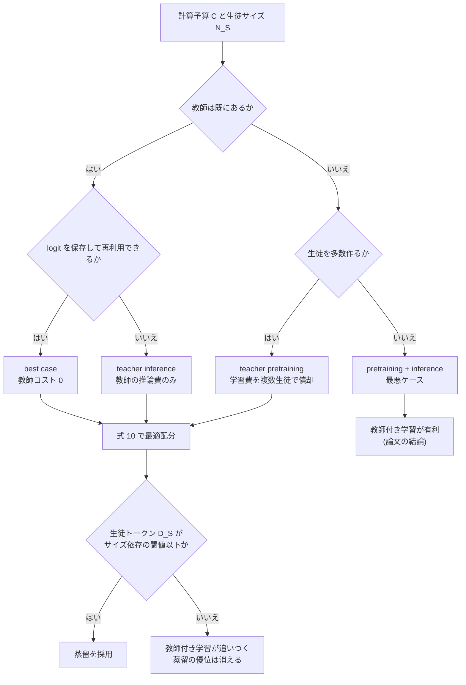

# Distillation Scaling Laws

- **Link**: https://arxiv.org/abs/2502.08606 （HTML 版: https://arxiv.org/html/2502.08606v2 ／ Apple 紹介ページ: https://machinelearning.apple.com/research/distillation-scaling-laws ）
- **Authors**: Dan Busbridge, Amitis Shidani, Floris Weers, Jason Ramapuram, Etai Littwin, Russ Webb（Apple。Shidani は University of Oxford、Apple でのインターン中の成果）
- **Year**: 2025（arXiv 初版 2025-02-12、v2 2025-07-25）
- **Venue**: ICML 2025（arXiv コメント「Version accepted to ICML 2025. 69 pages, 54 figures, 13 tables」）
- **Type**: Academic Paper
- **証拠の質**: **一次資料**（査読付き国際会議論文。ただし実験は Apple 社内の計算資源で行われ、第三者による再現は確認していない）
- **取得状況**: arXiv abs・HTML v2 全文・Apple 紹介ページを取得済み。本文の図の多くは HTML 内で画像ではなくベクタ形式のため、取得できた PNG 図のみ URL で埋め込み、それ以外は表・ASCII で再構成した

## Abstract

We propose a distillation scaling law that estimates distilled model performance based on a compute budget and its allocation between the student and teacher. Our findings mitigate the risks associated with large-scale distillation by enabling compute-optimal allocation for both the teacher and student to maximize student performance. We provide compute-optimal distillation recipes for two key scenarios: when a teacher already exists, and when a teacher needs training. In settings involving many students or an existing teacher, distillation outperforms supervised learning up to a compute level that scales predictably with student size. Conversely, if only one student is to be distilled and a teacher also requires training, supervised learning is generally preferable. Additionally, our large-scale study of distillation increases our understanding of the process and helps inform experimental design.

## Abstract (Japanese Translation)

本論文は、計算予算と、その予算を生徒と教師にどう配分するかに基づいて、蒸留後のモデル性能を予測する「蒸留スケーリング則」を提案する。この知見により、教師と生徒の双方に計算量を最適配分して生徒の性能を最大化でき、大規模蒸留に伴うリスクを抑えられる。教師が既に存在する場合と、教師を新たに学習する必要がある場合の 2 つの主要シナリオについて、計算最適な蒸留レシピを示す。多数の生徒を作る場合、または教師が既にある場合には、生徒サイズに応じて予測可能に増える計算量の水準までは、蒸留が教師付き学習（通常の事前学習）を上回る。逆に、生徒を 1 体だけ作り、しかも教師も学習しなければならない場合は、一般に教師付き学習の方が望ましい。加えて、大規模な蒸留実験は蒸留過程の理解を深め、実験設計の指針となる。

## Overview

この論文は「**蒸留はいつ得なのか**」という問いに、計算量（FLOPs）とトークン数という **経営判断に直結する単位** で答えた初の大規模統制実験です。143M〜12.6B パラメータの Transformer を、数十億〜5,120 億トークンで学習させ、教師付き学習 73 runs、蒸留 697 runs を用いて **生徒の交差エントロピーを予測する式** を当てはめました。予測誤差は外挿時も含めて約 1% 以下です。

ビジネス上の結論は 3 つに要約できます。

1. **教師を「新しく作ってから 1 体だけ蒸留する」なら、蒸留は損**。同じ総計算量を生徒の通常学習に使った方が良い。
2. **教師が既にある（自社の大モデル・サーバ用モデル）か、1 つの教師から多数の生徒（モデルファミリー）を作るなら、蒸留は得**。ただしその優位は、生徒に投じる計算量・トークン数が「生徒サイズ依存の閾値」を超えると消える。
3. **教師は強ければ良いわけではない（capacity gap）**。生徒の学習能力に対して教師が強すぎると、生徒の性能はむしろ悪化する。教師の選択は「サイズ」ではなく「教師の交差エントロピー $L_T$」で決まる。

> **対象範囲の注意**: 本論文の「蒸留」は Hinton 型の **logit（確率分布）蒸留 = 白箱蒸留** を事前学習に用いる場合です。商用 API の出力テキストで SFT する **系列レベル蒸留（黒箱蒸留、R1-Distill 等）は対象外** と著者自身が Limitations で明記しています。したがって Bedrock / OpenAI の蒸留機能のような黒箱 SFT にそのまま当てはめることはできません。

## Problem

- **推論コストの肥大**: 計算最適（Chinchilla 型）なモデルは計算量とともに大きくなり、推論が遅く高価になる。1 日数十億トークン規模の推論では、推論コストが事前学習コストを大きく上回る。
- **過学習（overtraining）の高コスト**: 小さく高性能なモデルを得る代替策として、計算最適より遥かに多いトークン（数兆）で小モデルを学習する overtraining があるが、高価で時間がかかる。
- **蒸留の効果に関する矛盾した報告**: Gemma / Gemini、Minitron、AFM では蒸留事前学習が教師付きより良いと報告される一方、Liu et al. (2024) は逆の結果を報告している。
- **計算資源の配分指針が無い**: 教師サイズ・教師学習トークン・生徒の蒸留トークンにどう計算量を割り振れば最良の生徒が得られるかが不明だった。
- **capacity gap の説明不足**: 「強い教師ほど生徒が悪くなる」現象は知られていたが、統制された実証と定量モデルが無かった。

## Proposed Method

**蒸留スケーリング則（Distillation Scaling Law）**

### 前提となる教師付きスケーリング則

$$
\underbrace{L(N,D)}_{\text{交差エントロピー}}=\underbrace{E}_{\text{既約誤差}}+\underbrace{\left(\frac{A}{N^{\alpha}}+\frac{B}{D^{\beta}}\right)^{\gamma}}_{\text{データを模倣する能力}} \tag{1}
$$

- $N$: 非埋め込みパラメータ数、$D$: 学習トークン数、$\{E,A,B,\alpha,\beta,\gamma\}$: 正の係数
- Hoffmann et al. は $\gamma=1$、Kaplan et al. は $\beta=1$ と固定するが、本論文は係数を固定しない方が当てはまり・外挿が良かった（μP 使用の影響と推測）

計算最適モデルは次で定義されます。

$$
N^{*},D^{*}=\arg\min_{N,D}L(N,D)\quad\text{s.t.}\quad\mathrm{FLOPs}(N,D)=C \tag{2}
$$

### 損失関数

次 token 予測（NTP）損失:

$$
\mathcal{L}_{\text{NTP}}(x^{(i)},\boldsymbol{z}^{(i)})=-\sum_{a=1}^{V}\boldsymbol{e}(x^{(i)})_{a}\log\sigma_{a}(\boldsymbol{z}^{(i)}) \tag{4}
$$

学習安定化のための Z-loss:

$$
\mathcal{L}_{Z}(\boldsymbol{z}^{(i)})=\left\|\log\sum_{a=1}^{V}\exp(z_{a}^{(i)})\right\|_{2}^{2} \tag{5}
$$

知識蒸留損失（教師と生徒の KL ダイバージェンス最小化と等価）:

$$
\mathcal{L}_{\text{KD}}(\boldsymbol{z}_{T}^{(i)},\boldsymbol{z}_{S}^{(i)})=-\tau^{2}\sum_{a=1}^{V}\sigma_{a}\!\left(\frac{\boldsymbol{z}_{T}^{(i)}}{\tau}\right)\log\sigma_{a}\!\left(\frac{\boldsymbol{z}_{S}^{(i)}}{\tau}\right) \tag{6}
$$

生徒の総損失:

$$
\mathcal{L}_{S}=(1-\lambda)\,\mathcal{L}_{\text{NTP}}(x^{(i)},\boldsymbol{z}_{S}^{(i)})+\lambda\,\mathcal{L}_{\text{KD}}(\boldsymbol{z}_{T}^{(i)},\boldsymbol{z}_{S}^{(i)})+\lambda_{Z}\,\mathcal{L}_{Z}(\boldsymbol{z}_{S}^{(i)}) \tag{7}
$$

- $\sigma$: softmax、$\boldsymbol{z}$: logits、$V$: 語彙サイズ、$\tau$: 蒸留温度、$\lambda$: 蒸留と教師付きの混合係数
- 実験は **純粋蒸留 $\lambda=1$・温度 $\tau=1$** で行う（付録 G で最適に近いことを確認）

### 蒸留スケーリング則（本論文の中心式）

$$
\underbrace{L_{S}(N_{S},D_{S},L_{T})}_{\text{生徒の交差エントロピー}}=\underbrace{L_{T}}_{\text{教師の交差エントロピー}}+\underbrace{\frac{1}{L_{T}^{c_{0}}}\left(1+\left(\frac{L_{T}}{\widetilde{L}_{S}d_{1}}\right)^{1/f_{1}}\right)^{-c_{1}f_{1}}\left(\frac{A'}{N_{S}^{\alpha'}}+\frac{B'}{D_{S}^{\beta'}}\right)^{\gamma'}}_{\text{生徒が教師を模倣する能力}} \tag{8}
$$

- $N_S$: 生徒パラメータ数、$D_S$: 蒸留トークン数、$L_T=L(N_T,D_T)$: 教師の交差エントロピー
- $\widetilde{L}_{S}=L(N_S,D_S)$: 同じ生徒を **教師付きで** 学習した場合の交差エントロピー（式 1 から算出）
- $\{c_0,c_1,d_1,f_1,\alpha',\beta',\gamma'\}$: フィットする正の係数
- 第 2 項の括弧は **broken power law**（2 つのべき乗則の間を遷移する形）。$L_T/\widetilde{L}_S=d_1$ が「教師と生徒の相対的な学習能力」の切り替わり点で、ここが capacity gap の境目

この式が満たすべき性質として、著者は次の 3 つを置きました。

1. 無限に大きい生徒は任意の教師を模倣できる: $\lim_{N_S,D_S\to\infty}L_S\to L_T$
2. ランダムな教師からはランダムな生徒しか生まれない: $\lim_{L_T\to\infty}L_S\to L_T$
3. capacity gap が存在する: 教師を強くしすぎると、いずれ生徒性能は下がる

### 計算量の勘定（ビジネスの費用モデルに直結）

$$
\mathrm{FLOPs}\approx\underbrace{3F(N_{S})D_{S}}_{\text{生徒の学習}}+F(N_{T})\Big(\underbrace{\delta_{T}^{\mathrm{Lgt}}D_{S}}_{\text{教師の logit 推論}}+\underbrace{\delta_{T}^{\mathrm{Pre}}\,3D_{T}}_{\text{教師の事前学習}}\Big) \tag{9}
$$

- $F(N)$: $N$ パラメータのモデルが 1 token の順伝播で行う FLOPs。一般的な $F(N)\approx 2N$ は小モデル・長文脈で誤差が大きいため、本論文は $F(N)\approx 2N(1+c_1N^{-1/3}+c_2N^{-2/3})$ を導出
- $\delta_T^{\mathrm{Lgt}},\delta_T^{\mathrm{Pre}}\in\{0,1\}$: 教師の推論費・学習費を勘定に入れるかどうか（下の 4 シナリオ）

計算最適蒸留の定義:

$$
D_{S}^{*},N_{T}^{*},D_{T}^{*}=\arg\min_{D_{S},N_{T},D_{T}}L_{S}(N_{S},D_{S},N_{T},D_{T})\quad\text{s.t.}\quad\mathrm{FLOPs}=C \tag{10}
$$

（SciPy の SLSQP で数値的に解く）

蒸留でのトークン勘定（付録 D.5）:

$$
D_{\mathrm{Dist.}}=D_{S}+\delta_{T}^{\mathrm{Pre}}D_{T} \tag{34}
$$

### Features

- 教師のサイズ $N_T$ と学習量 $D_T$ は、**教師の交差エントロピー $L_T$ を通じてのみ** 生徒に影響する（教師選択の基準を 1 変数に集約できる）
- capacity gap を「サイズの差」ではなく「学習能力（仮説空間と最適化能力）の差」として定式化
- 教師付きスケーリング則と同じ枠組みなので、既存のスケーリング計画に組み込める
- 生徒が教師を上回る weak-to-strong generalization も観測

## Algorithm (Pseudocode)

```
Algorithm: 蒸留するか・どう配分するかの意思決定（論文の手順を実務向けに再構成）
Input : 目標の生徒サイズ N_S, 総計算予算 C, 教師の有無, 作る生徒の数 k
Output: 「蒸留 or 教師付き学習」と (N_T, D_T, D_S) の配分

1. 教師付きスケーリング則 L(N,D)（式1）を自社データで当てはめる   // 小規模 run を IsoFLOP で
2. 蒸留スケーリング則（式8）の係数を当てはめる                     // 固定M教師×IsoFLOP生徒 等の3プロトコル
3. シナリオを決める（表2）:
     教師あり・logit 保存済み → best case        (δLgt=0, δPre=0)
     教師あり・推論は都度     → teacher inference (δLgt=1, δPre=0)
     教師を新規学習・logit を k 体で再利用 → teacher pretraining (δLgt=0, δPre=1)
     教師を新規学習・生徒は1体 → pretraining+inference (δLgt=1, δPre=1)  // 最悪ケース
4. 式9の FLOPs=C の制約下で式10を数値最小化（SLSQP）して L_S* を得る
5. 同じ C で教師付き学習した場合の L(N_S, D) と比較
6. if L_S* < 教師付き L: 蒸留を採用し (N_T*, D_T*, D_S*) を使う
   else: 教師付き学習（または蒸留→教師付きへの切替）を採用
7. 教師を選ぶときは N_T ではなく L_T を見る。L_T/L̃_S が d1≈1.315 を大きく下回る（教師が強すぎる）領域は避ける
```

## Architecture / Process Flow



## Figures & Tables

### Figure 1: 蒸留スケーリング則の外挿


- 式 8 を、高い交差エントロピー（$L_S>2.3$）の生徒に当てはめ、未見の教師（実線 = 内挿）と、より強い教師・低交差エントロピーの生徒（破線 = 外挿）を予測
- 対角の破線は生徒 = 教師の交差エントロピー。教師の $L_T$ が下がるほど生徒も良くなるが、capacity gap で頭打ち。生徒が教師を上回る点も存在
- Apple 紹介ページは「予測誤差は最大で約 1%」と記載

### Table 1: 記法

| 記号 | 意味 |
|------|------|
| $N$ / $N_S$ / $N_T$ | モデル / 生徒 / 教師の非埋め込みパラメータ数 |
| $D$ / $D_T$ | モデル / 教師の事前学習トークン数 |
| $D_S$ | 生徒の蒸留トークン数 |
| $M\equiv D/N$ | トークン / パラメータ比。Chinchilla の計算最適値は $M^*\approx 20$ |
| $L\approx L(N,D)$ | 教師付きスケーリング則（式 1）で推定したモデルの検証交差エントロピー |
| $L_T\approx L(N_T,D_T)$ | 教師の検証交差エントロピー |
| $L_S\approx L_S(N_S,D_S,L_T)$ | 蒸留スケーリング則（式 8）で推定した生徒の検証交差エントロピー |
| $\widetilde{L}_S\approx L(N_S,D_S)$ | 同じ生徒を教師付きで学習した場合の交差エントロピー |

### Table 2: 4 つの実務シナリオと計算量の勘定

| シナリオ | $\delta_T^{\mathrm{Lgt}}$ | $\delta_T^{\mathrm{Pre}}$ | 説明 | ビジネス上の典型 |
|---------|---|---|------|----------------|
| Best case（教師を完全償却） | 0 | 0 | 教師の追加 FLOPs が無く、生徒を最小化する $L_T^*$ を自由に選べる | 既存教師の logit を保存済み |
| Teacher inference | 1 | 0 | 教師は既にある（またはサーバ用モデルとして使う予定）ので学習費は数えないが、蒸留用の推論費は払う | 自社のフラッグシップ LLM を教師にする |
| Teacher pretraining | 0 | 1 | 教師を学習する必要があるが、logit を保存して十分多くの生徒で再利用する | モデルファミリー（1B/3B/8B）を一括で作る |
| Teacher pretraining + inference | 1 | 1 | 教師を学習し、生徒 1 体のために推論費も払う最悪ケース | 1 つの業務用小モデルのためだけに教師を作る |

### Table 3: 計算最適な配分の傾向

| 生徒サイズ | 計算量（FLOPs） | 配分 |
|-----------|---------------|------|
| 小（$\lesssim$ 3B） | 小（$\lesssim 10^{21}$） | ほぼ教師の事前学習に投じる |
| 小（$\lesssim$ 3B） | 大（$\gtrsim 10^{25}$） | 生徒の学習と教師の推論に均等。教師の事前学習はずっと少なく |
| 大（$\gtrsim$ 10B） | 小（$\lesssim 10^{21}$） | ほぼ通常の生徒学習 |
| 大（$\gtrsim$ 10B） | 大（$\gtrsim 10^{25}$） | 生徒学習・教師推論・教師事前学習に均等 |

### Table 6: スケーリング則の係数（90% 信頼区間、4,096 回ブートストラップ）

| 係数 | 教師付き | 蒸留 |
|------|---------|------|
| $A^{(\prime)}$ | 3355 (3346, 3360) | 2243 (2227, 2255) |
| $B^{(\prime)}$ | 18186 (18157, 18236) | 24181 (24084, 24266) |
| $E$ | 1.220 (1.190, 1.247) | — |
| $\alpha^{(\prime)}$ | 0.408 (0.405, 0.411) | 0.321 (0.319, 0.324) |
| $\beta^{(\prime)}$ | 0.431 (0.428, 0.433) | 0.637 (0.634, 0.640) |
| $\gamma^{(\prime)}$ | 0.452 (0.442, 0.461) | 0.764 (0.732, 0.788) |
| $c_0$ | — | 2.549 (2.425, 2.615) |
| $c_1$ | — | 522.6 (522.6, 522.6) |
| $f_1$ | — | 0.090 (0.088, 0.093) |
| $d_1$ | — | 1.315 (1.302, 1.327) |
| $a^{(\prime)}$ | 0.513 (0.513, 0.513) | 0.664 (0.662, 0.665) |
| $b^{(\prime)}$ | 0.486 (0.486, 0.486) | 0.335 (0.334, 0.337) |
| Runs | 73 | 697 |

- 教師付きの $a,b$ は Hoffmann et al. と整合。既約誤差 $E$ が Hoffmann より低いのは μP の影響と著者は推測
- 蒸留では $\beta'=0.637$ と、データ（トークン）に対する効きが教師付き（0.431）より急。**少ないトークンでも性能が上がりやすいが、トークンを増やすほど教師付きに追いつかれる** という結論と整合

### Table 7: Forward KL vs Reverse KL（教師 1.82B → 生徒 546M）

| 手法 | 交差エントロピー | 計算コスト |
|------|----------------|-----------|
| Forward KL | **2.42** | $\mathcal{O}(V)$ |
| Reverse KL | 2.70 | $\mathcal{O}(2V)$ |

- Forward KL が平均 0.28 nats 良く、計算も軽い。著者は **標準の forward KL を推奨**（MiniLLM 等の reverse KL 推奨とは逆の結果。ただし本論文は事前学習蒸留、MiniLLM は指示追従の生成蒸留で条件が異なる）

### 実験プロトコル（Figure 2〜4 の条件）

| プロトコル | 教師 | 生徒 | 目的 |
|-----------|------|------|------|
| 固定 M 教師 / IsoFLOP 生徒（Fig. 2, 38a） | $M_T\approx 20$ の 6 教師: 546M, 975M, 1.82B, 2.72B, 4.82B, 7.75B | 計算予算 $C_S\in\{3\times10^{19},10^{20},3\times10^{20},10^{21}\}$（一部 $3\times10^{21}$） | $\alpha',\beta',\gamma',A',B'$ の同定 |
| IsoFLOP 教師 / 固定 M 生徒（Fig. 3, 38b） | 計算予算 $C_T\in\{3\times10^{19},10^{20},3\times10^{20},10^{21}\}$ | $M_S\approx 20$ の生徒 546M, 975M, 1.82B, 7.75B（本文では 198M〜1.82B とも記載） | $c_0,c_1,f_1,d_1$ の同定 |
| 固定 M 教師 / 固定 M 生徒（Fig. 4, 37） | $M_T\approx 20$ の 10 教師 | 5 サイズ × $M_S\in\{20,40,80,160,320\}$ | capacity gap の可視化 |

共通設定: 143M〜12.6B の Transformer、MHA、Pre-Norm（RMSNorm）、系列長 4,096、RoPE、英語 C4、教師と生徒は別の分割で学習、μP（simple）、純粋蒸留 $\lambda=1$、$\tau=1$。

### Figure 6: 最良ケースの蒸留 vs 教師付き学習（データ予算別）


- 生徒サイズ $N_S\in\{546\text{M},\ldots,7.75\text{B}\}$、トークン予算 $D_S\in[1\text{B},10\text{T}]$ で、蒸留の交差エントロピー $L_S$ と同資源の教師付き $\widetilde{L}_S$ の差を等高線で表示（青 = 蒸留が勝ち）
- **トークン予算が控えめなら蒸留が有利、十分大きいと教師付きが勝つ**

追加の等高線図（付録 D.2、PNG のみ参照）:


### Figure 7: 教師と蒸留トークン予算が与えられた場合

- 蒸留トークン予算 $D_S\in\{250\text{B},1\text{T},4\text{T},16\text{T}\}$ で、教師と生徒の組合せごとの $L_S$ を等高線で表示
- 最適な教師交差エントロピー $L_T^*(N_S,D_S)$ は生徒サイズに対して **べき乗則で低下**。$L_S$ が $L_T^*$ に一致する点で変曲し、その後は急に下がる
- Zhang et al. (2023a) の「最適教師サイズは生徒サイズにほぼ線形」という観察を一般化（教師が計算最適な場合の特殊例）

### Figure 8・9: 計算最適な蒸留（生徒 300M / 1B / 3B / 10B）

数値データは本文に表として無いため、本文の記述を整理します。

| 観察 | 内容 |
|------|------|
| 十分な計算量では教師付き学習が最良蒸留に追いつく | どの生徒サイズでも、ある総計算量で教師付きが best case 蒸留と一致 |
| 交差点は生徒が大きいほど高計算量側 | 大きい生徒ほど蒸留の恩恵が長く続く。小さいモデルほど教師付き事前学習の恩恵を受けやすい |
| 教師学習を勘定に入れると常に教師付きが勝つ | 目的が「ある目標サイズの最良モデル 1 体」で教師が無いなら、教師付きを使うべき |
| モデルファミリーやサーバ用教師なら蒸留が有利 | 教師の用途が単一蒸留以外にもある場合 |
| 最適な教師サイズ | 生徒より少し大きいところまで増え、その後は横ばい（大きい教師の推論が高いため、教師を overtrain する方が効率的） |
| トークン配分 | 生徒トークン・教師トークンともべき乗則で増え、生徒トークンの方が速く増える |

### Figure 33・34: 蒸留の計算量・データ効率（教師付き比）

| 条件 | 蒸留 / 教師付きの計算量比 | トークン比 |
|------|----------------------|-----------|
| pretraining + inference、生徒 500M、目標交差エントロピー 2.4 | **約 3/4** | 約 2/3 |
| pretraining + inference、生徒 10B、目標交差エントロピー 2.2 | **約 1/2** | 約 1/2 |
| best case / teacher inference、生徒の到達限界付近 | 1 超（蒸留の方が高コスト） | 1 超 |
| teacher pretraining / pretraining + inference（総じて） | 1 超（教師付きが効率的） | 1 超 |

> 付録 D.5 の 500M・10B の数値は、本文 5.3 の「教師学習を含めると教師付きが常に有利」と一見矛盾します。D.5 の比較は「**ある目標交差エントロピーに到達するのに必要な計算量**」であり、5.3 は「**同じ計算量で到達できる最良の交差エントロピー**」の比較です。つまり **最高性能を狙うなら教師付き、そこそこの性能を安く得たいなら（大きな生徒ほど）蒸留** と読めます。この解釈は本レポートによるもので、論文の図そのものは画像を取得できていません。

### 付録 G: 実務的なハイパーパラメータの感度

| 項目 | 結果 |
|------|------|
| 混合係数 $\lambda$（Fig. 51） | $\lambda>0.5$ ならほぼ平坦。教師が特に弱いときだけ小さい $\lambda$ が有利。純粋蒸留 $\lambda=1$ が頑健な既定値 |
| 温度 $\tau$（Fig. 52、$\tau\in[0.5,10]$） | $\tau=1$ が全規模で最良。$\tau>3$ は特に小さい生徒で性能低下 |
| 学習率 $\eta$（Fig. 53） | μP 下で $\eta=0.01$ が規模を通じて頑健（μP が蒸留でも機能することを確認） |
| Top-$k$ / Top-$p$ 切り詰め（Fig. 54） | $k=128$ で全分布（$k=32768$）比 +0.11 nats、$p=0.9$ で +0.13 nats 悪化。**$k=128$ と $\lambda=0.7$ の併用で差は 0.01 nats 以内** |
| Forward vs Reverse KL（Table 7） | Forward KL が 0.28 nats 良く、計算も軽い |

Top-$k$ / Top-$p$ の集合定義:

$$
\mathcal{S}_{k}(\hat{p})=\mathrm{Top}(\hat{p},k),\qquad \mathcal{S}_{p}(\hat{p})=\Big\{a:\sum_{b\in\mathrm{sort}\downarrow(\hat{p},a)}\hat{p}\le p\Big\} \tag{56}
$$

Forward / Reverse KL の目的関数:

$$
\mathcal{L}_{\text{forward}}=H(\hat{p}_T,\hat{q}_S)-H(\hat{p}_T),\qquad \mathcal{L}_{\text{reverse}}=H(\hat{q}_S,\hat{p}_T)-H(\hat{q}_S)
$$

> **ビジネス上の意味**: 教師の logit を全語彙分保存するのは高価ですが、**Top-128 だけ保存し、正解 token の損失を 3 割混ぜれば性能はほぼ落ちない**。これは「教師の logit を一度だけ計算して保存し、多数の生徒で再利用する」best case / teacher pretraining シナリオを現実的にする実装上の知見です。

### Figure 35: 下流タスク評価


- ARC Easy / Challenge、HellaSwag、PIQA、SciQ、WinoGrande、LAMBADA（zero-shot）、TriviaQA、WebQS（one-shot）、GSM8K（8-shot CoT）、MMLU（5-shot）
- 交差エントロピーと下流性能の関係は、教師付きモデルと蒸留生徒でほぼ同じ。**検証交差エントロピーは下流性能の良い代理指標**
- ただし C4 学習のため GSM8K・MMLU はほぼランダム水準で、推論能力の評価には向かない（著者が明記）

### capacity gap（Figure 4, 37）

```
生徒の交差エントロピー L_S（低いほど良い。概念図）
 高 │\
    │ \                                   ／
    │  \                               ／
    │   \                          ／   ← 教師が強すぎる領域
    │    \___               ____／        （KL が増え生徒が模倣できない）
 低 │        \_____最適_____/
    └───────────────────────────────────────▶ 教師サイズ N_T（または教師の強さ）
```

- 教師と生徒の KL は、教師の能力が上がるほど増加する。教師が強くなるほど生徒には模倣が難しくなり、最終的に教師の改善を活かせなくなる
- 付録 C でカーネル回帰と合成 MLP による **初の統制された capacity gap の実証** を提示
- 付録 E.4: 弱い教師（$N_T\le 2.72$B）では、生徒が教師より大きく計算量が十分なら **生徒が教師を上回る**。一方、強い生徒（1.82B）が教師付きベースラインを超えるには強い教師信号（$10^{21}$ FLOPs の教師）が必要。198M の生徒は観測したすべての蒸留が教師付きを上回った

### 先行研究との比較

| 観点 | 本論文 | Hoffmann et al. 2022（Chinchilla） | Zhang et al. 2023a（Capacity Gap 法則） | Beyer et al. 2022（Patient Teacher） |
|------|-------|-----------------------------------|----------------------------------------|-------------------------------------|
| 対象 | LM の蒸留事前学習 | LM の教師付き事前学習 | LM 蒸留 | 画像分類の蒸留 |
| 予測量 | 生徒の交差エントロピー（$N_S,D_S,L_T$ の関数） | 交差エントロピー（$N,D$） | 最適教師サイズ | — |
| 教師コストの勘定 | 4 シナリオで明示 | 該当なし | 無し | 無し |
| 主な結論 | 教師が既存 / 多生徒なら蒸留が得、閾値超で教師付きに追いつかれる | 計算最適は $M\approx20$ | 最適教師は生徒サイズに線形 | 長く学習すれば蒸留が勝つ |
| 本論文との関係 | — | 枠組みを拡張 | 特殊例として包含 | 教師付きベースラインの違いで矛盾しないと説明（付録 D.1） |

## Experiments & Evaluation

### Setup

- **モデル**: Gunter et al. (2024)（AFM）系の Transformer、143M〜12.6B、MHA・RMSNorm・RoPE・系列長 4,096、decoupled weight decay、μP（simple）
- **データ**: 英語 C4。教師と生徒は別の分割。最大規模を除き Chinchilla 最適モデルはデータを繰り返さない
- **蒸留設定**: 純粋蒸留 $\lambda=1$、$\tau=1$、forward KL
- **規模**: 教師付き 73 runs + 蒸留 697 runs、学習トークンは数十億〜5,120 億
- **評価**: 検証交差エントロピー（データに対する）、補助的に lm-evaluation-harness の下流タスク

### Main Results

1. 式 8 は観測値を **相対予測誤差 約 1% 以下** で当てはめ、弱いモデルから強いモデルへの外挿でも同水準（Fig. 5b）
2. 教師の影響は $L_T$ に集約される（Fig. 3b）
3. 十分なデータ・計算量があれば、蒸留は教師付きより低い交差エントロピーを作れない
4. 蒸留が教師付きより効率的になるのは、(i) 生徒の総計算量・トークンが生徒サイズ依存の閾値以下、かつ (ii) 教師が既存、または教師に単一蒸留以外の用途がある場合のみ
5. 無限データ極限では蒸留と教師付きが一致することも確認（付録 E.6）

### Ablation Study

付録 G の感度分析（上表）を参照。$\lambda$・$\tau$・学習率・切り詰め・KL の向きのいずれも、論文の既定値（$\lambda=1$, $\tau=1$, forward KL）が頑健という結果です。

### Limitations（著者の記載）

- 言語モデリング設定のみで、他領域への一般化は保証できない
- 英語 C4 のため、大トークン run ではデータを繰り返している（教師付きでは 4 回まで影響小とされるが、蒸留での影響は未確認）
- C4 では推論能力などの下流評価が難しい
- **Hinton 型の確率分布蒸留のみを扱う**。系列レベル KD（教師のサンプル系列で SFT。LLaMA 系や DeepSeek-R1 の小型蒸留モデルで使われた「合成データ / hard distillation」）や、中間層整合などの変種は検証していない

## ビジネス上の含意

### 蒸留のビジネス価値式との対応

ドメインの価値式は次のとおりです。

$$
\text{蒸留のビジネス価値} \approx (C_{\text{teacher}} - C_{\text{student}}) \cdot Q - (C_{\text{data}} + C_{\text{train}}) - \Delta\text{Acc} \cdot V_{\text{err}}
$$

本論文は **第 2 項（初期投資 $C_{\text{train}}$）と第 3 項（精度差 $\Delta$Acc）** を、事前学習の計算量で定量化したものと位置付けられます。式 9 の 3 項はそのまま $C_{\text{train}}$ の内訳になります。

| 価値式の項 | 本論文での対応 | 示唆 |
|-----------|---------------|------|
| $C_{\text{train}}$（生徒学習） | $3F(N_S)D_S$ | 生徒トークンを増やすほど教師付きに追いつかれる |
| $C_{\text{data}}$（教師推論で作るデータ） | $F(N_T)\delta^{\mathrm{Lgt}}D_S$ | 大きい教師は推論が高く、最適教師は「生徒より少し大きい」程度で頭打ち |
| 教師の学習費 | $F(N_T)\delta^{\mathrm{Pre}}3D_T$ | 1 体の生徒のために教師を作るのは割に合わない |
| $\Delta$Acc | $L_S-\widetilde{L}_S$ | 少トークン領域では蒸留が勝ち（$\Delta<0$）、多トークン領域では負ける |
| $(C_{\text{teacher}}-C_{\text{student}})\cdot Q$ | 論文の動機（推論コストは事前学習コストを大きく上回る） | 本論文自体は推論量 $Q$ を扱わない |

### 意思決定ルール（本レポートによる整理）

| # | 状況 | 推奨 | 根拠 |
|---|------|------|------|
| 1 | 自社に大きな教師（サーバ用 LLM）が既にあり、小型版を作りたい | **蒸留** | teacher inference / best case で蒸留が有利（5.1, 5.3） |
| 2 | 1B / 3B / 8B のようなモデルファミリーを作る | **教師を 1 つ作って logit を保存し、複数生徒へ蒸留** | teacher pretraining シナリオ。Top-128 + $\lambda=0.7$ で保存コストを圧縮できる（付録 G.4） |
| 3 | 業務用の小モデルを 1 体だけ作りたく、教師が無い | **教師を作らず、生徒を直接学習**（または既存の公開モデルを教師にする） | pretraining + inference では教師付きが常に有利 |
| 4 | 生徒に数兆トークン級の学習予算を割ける | 蒸留だけに頼らない（蒸留 → 教師付きへの切替を検討） | 閾値を超えると教師付きが追いつく。著者も「蒸留を初期段階に使い、閾値で教師付きに移る」戦略を将来課題として示唆 |
| 5 | 教師候補が複数ある | **最も強い教師ではなく、$L_T$ が生徒に見合う教師** を選ぶ | capacity gap。$L_T/\widetilde{L}_S$ の比で判断 |
| 6 | 大きい生徒（10B 級）か小さい生徒（1B 未満）か | 大きい生徒ほど蒸留の効率向上が大きい | 付録 D.5（10B で計算量 約 1/2、500M で 約 3/4） |

### 仮説との関係

| 仮説 | 本論文からの示唆 |
|------|-----------------|
| H1（定量成果は検索・推薦に集中） | 本論文は手法の経済性を示す一次資料であり、本番事例ではない。H1 には中立 |
| H2（ベンダー数値は集計値） | クラウドの蒸留機能は「教師が既に存在する」teacher inference 型なので、本論文の枠組みでは蒸留が得になりやすい条件。ただしベンダーの「75% 安価」は推論費の話で、本論文の学習計算量とは別物 |
| H3（SLM 事例の多くは fine-tuning） | 本論文は「蒸留」を logit 蒸留に限定しており、系列 SFT は対象外と明記。**用語の区別が重要** という H3 の問題意識を裏付ける |
| H5（API 教師の規約制約） | 白箱蒸留は重みにアクセスできる教師が前提。商用 API 教師では本論文の手法（logit 蒸留）は使えない |
| H6（Agent / 推論蒸留の増加） | 本論文は推論・Agent を扱わず、C4 では推論評価ができないと明記。対象外 |

## Notes

- **（2026-10-22 追記）結論の再確認と国内実例**: Abstract の結論（「教師が既にある / 多数の生徒を作る場合は、生徒サイズに応じて予測可能に増える計算量の水準までは蒸留が教師付き学習を上回る。生徒 1 体のために教師も学習するなら教師付き学習が一般に望ましい」）は本レポートの 3 点要約と一致する。付録 G.4 の「Top-128 logits + $\lambda=0.7$」は、国内では PFN の PLaMo 2.1 8B（31B 教師の logits を上位 128 token に制限して剪定 + KL 蒸留、本 run の retrieval レポート 11）が実機で採用しており、teacher inference シナリオの実例になっている。
- **関連研究**: Gemma 2 / 3（logit 蒸留で小型モデルを学習）、Minitron（剪定 + 蒸留）、AFM（Apple 自身の基盤モデル）が「蒸留事前学習が教師付きを上回った」例として引用されている。本論文はその成功条件（教師が既にある・ファミリーを作る）を定式化したと読める
- **Apple 紹介ページの関連記事**: 「Unmasking On-Policy Distillation: Where It Helps, Where It Hurts, and Why」（2026-07-09 付）が関連研究として掲載されていた（本 run では未取得）
- **追加調査候補**:
  - 系列レベル蒸留（黒箱 SFT）のスケーリング則（著者が将来課題として明記）
  - Zhang et al. 2023a「Towards the Law of Capacity Gap in Distilling Language Models」（arXiv 2311.07052）
  - Sardana et al. 2024（推論込みのライフタイム計算最適）
  - Beyer et al. 2022（Patient Teacher）との条件差（付録 D.1）
