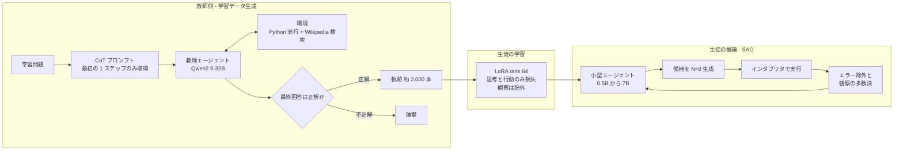
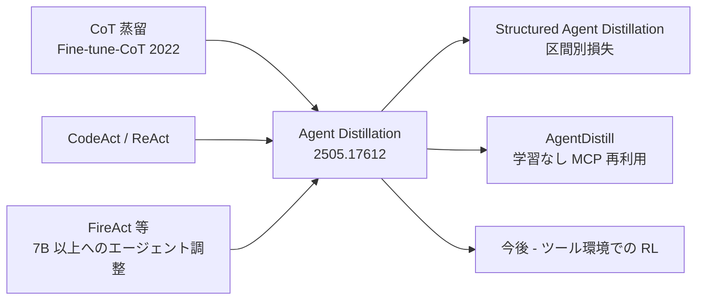

# Distilling LLM Agent into Small Models with Retrieval and Code Tools

- **Link**: https://arxiv.org/abs/2505.17612 （HTML 版: https://arxiv.org/html/2505.17612v2 ／ コード: https://github.com/Nardien/agent-distillation ）
- **Authors**: Minki Kang（KAIST。KRAFTON 在籍中の成果）, Jongwon Jeong（University of Wisconsin-Madison）, Seanie Lee（KAIST）, Jaewoong Cho（KRAFTON）, Sung Ju Hwang（KAIST / DeepAuto.ai）
- **Year**: 2025（arXiv 初版 2025-05-23、v2 2025-11-05）
- **Venue**: NeurIPS 2025 Spotlight（arXiv コメントによる）
- **Type**: Academic Paper
- **証拠の質**: **一次資料**（査読付き国際会議論文。ベンチマーク上の結果であり、本番運用の事例ではない）
- **取得状況**: arXiv API の要旨・HTML v2 全文（本文・付録の表をすべて含む）を取得済み。図は Figure 2 のみ PNG として取得でき、その他の図（棒グラフ等）は本文の記述から再構成した

## Abstract

Large language models (LLMs) excel at complex reasoning tasks but remain computationally expensive, limiting their practical deployment. To address this, recent works have focused on distilling reasoning capabilities into smaller language models (sLMs) using chain-of-thought (CoT) traces from teacher LLMs. However, this approach struggles in scenarios requiring rare factual knowledge or precise computation, where sLMs often hallucinate due to limited capability. In this work, we propose Agent Distillation, a framework for transferring not only reasoning capability but full task-solving behavior from LLM-based agents into sLMs with retrieval and code tools. We improve agent distillation along two complementary axes: (1) we introduce a prompting method called first-thought prefix to enhance the quality of teacher-generated trajectories; and (2) we propose a self-consistent action generation for improving test-time robustness of small agents. We evaluate our method on eight reasoning tasks across factual and mathematical domains, covering both in-domain and out-of-domain generalization. Our results show that sLMs as small as 0.5B, 1.5B, 3B parameters can achieve performance competitive with next-tier larger 1.5B, 3B, 7B models fine-tuned using CoT distillation, demonstrating the potential of agent distillation for building practical, tool-using small agents. Our code is available at https://github.com/Nardien/agent-distillation.

## Abstract (Japanese Translation)

大規模言語モデル（LLM）は複雑な推論に優れるが、計算コストが高く実運用が制約される。そこで近年は、教師 LLM の思考の連鎖（CoT）トレースを使って推論能力を小型言語モデル（sLM）へ蒸留する研究が進んでいる。しかしこの方法は、珍しい事実知識や正確な計算を要する場面で弱く、能力の限られた sLM はしばしば幻覚（hallucination）を起こす。本研究は、推論能力だけでなく、検索ツールとコードツールを使った **タスク解決の振る舞い全体** を LLM エージェントから sLM へ移す枠組み「Agent Distillation」を提案する。蒸留を 2 つの相補的な軸で改善する。(1) 教師が生成する軌跡の質を高めるプロンプト手法「first-thought prefix」、(2) 小型エージェントの推論時の頑健性を高める「self-consistent action generation」である。事実推論と数学推論の 8 タスク（ドメイン内・ドメイン外の両方）で評価した結果、0.5B・1.5B・3B という小さな sLM が、CoT 蒸留で学習した一段大きい 1.5B・3B・7B モデルに匹敵する性能を示した。これはツールを使う実用的な小型エージェントの構築に向けた可能性を示す。

## Overview

この論文は、**蒸留の対象を「推論テキスト」から「エージェントの行動軌跡（思考 → 行動 → 観察）」へ広げる** ことで、小型モデルの弱点（知識不足・計算ミス）を **ツールに肩代わりさせる** 方法を示しました。

- 教師は Qwen2.5-32B-Instruct、生徒は Qwen2.5-Instruct の 0.5B / 1.5B / 3B / 7B（追加で Llama-3.2-1B、Phi-4-mini 3.8B）
- 学習データは HotPotQA 1,000 問 + MATH 2,000 問から、教師の **正解した軌跡だけ** を残した約 2,000 本。**LoRA（rank 64）で 2 エポック、A100 80GB × 4 台** という小さな計算資源
- 結果: エージェント蒸留した生徒は、**2〜4 倍大きい CoT 蒸留モデルに匹敵** する。0.5B が 1.5B CoT 蒸留に、1.5B が 3B に、3B が 7B を上回り、7B は 32B 教師の CoT プロンプティングすら上回った

**蒸留の分類上の位置付け**: 教師の出力（軌跡テキスト）だけを使い、生徒を次 token 予測で SFT する **黒箱型の系列レベル蒸留** です。教師の logits は使いません。ただし教師はオープンモデル（Qwen2.5-32B）であり、商用 API の規約問題は生じない構成です。

## Problem

- **CoT 蒸留の限界**: 小さな生徒に CoT を真似させても、未見の事実や珍しい計算（例: 6 桁の算術）には汎化せず、幻覚・計算ミスが起きる
- **小型モデルはエージェントとして動かない**: プロンプトだけでは、7B 未満の多くのモデルが有効なエージェント出力を作れず、誤った・解析不能なコード行動を出す（Table 2 の Agent Prompting 行）
- **教師エージェントの軌跡の質の低下**: 指示調整済み LLM はエージェント用の指示を与えると、CoT 時より難しい数学問題で性能が下がる（分布のずれ）。この劣化が蒸留で生徒に伝播する
- **小型エージェントの不正なコード**: 生徒は書式の崩れたコードやライブラリの誤用で実行エラーを起こしやすい
- **大きい教師（30B 超）から非常に小さい生徒（0.5〜3B）へ複雑な行動を移せるか** が未検証だった

## Proposed Method

**Agent Distillation + First-Thought Prefix（FTP）+ Self-consistent Action Generation（SAG）**

### 基本の定式化

知識蒸留の一般形（$D$ は KL や JS などのダイバージェンス、$L_{\boldsymbol{y}}$ は目標系列長）:

$$
\min_{\theta}\ \mathbb{E}_{(\boldsymbol{x},\boldsymbol{y})\sim\mathcal{D}_{\text{train}}}\frac{1}{L_{\boldsymbol{y}}}\sum_{n=1}^{L_{\boldsymbol{y}}}D\big(p_{T}(\cdot\mid\boldsymbol{y}_{<n},\boldsymbol{x})\,\|\,p_{S}(\cdot\mid\boldsymbol{y}_{<n},\boldsymbol{x})\big) \tag{1}
$$

推論（CoT）蒸留。教師に CoT プロンプト $\boldsymbol{I}_{\text{CoT}}$（例: "Let's think step by step."）で根拠を生成させ、生徒に模倣させる:

$$
\min_{\theta}\ -\mathbb{E}_{\boldsymbol{x}\sim\mathcal{D}_{\text{train}},\ \boldsymbol{y}\sim p_{T}(\cdot\mid\boldsymbol{x},\boldsymbol{I}_{\text{CoT}})}\sum_{n=1}^{L_{\boldsymbol{y}}}\log p_{S}(\boldsymbol{y}_{n}\mid\boldsymbol{x},\boldsymbol{y}_{<n}) \tag{2}
$$

エージェント軌跡。思考 $\boldsymbol{r}$・行動 $\boldsymbol{a}$・観察 $\boldsymbol{o}$ の繰り返し:

$$
\tau=\big((\boldsymbol{r}_{1},\boldsymbol{a}_{1},\boldsymbol{o}_{1}),\ldots,(\boldsymbol{r}_{L_{\tau}},\boldsymbol{a}_{L_{\tau}},\boldsymbol{o}_{L_{\tau}})\big)\sim p_{T}(\cdot\mid\boldsymbol{x},\boldsymbol{I}_{\text{agent}}) \tag{3}
$$

観察 $\boldsymbol{o}$ は環境（コード実行・検索結果）から返るもので、モデルは生成しません。

エージェント蒸留の目的関数（**観察は損失から除外**）:

$$
\min_{\theta}\ -\mathbb{E}_{\boldsymbol{x}\sim\mathcal{D}_{\text{train}},\ \tau\sim\pi_{T}(\cdot\mid\boldsymbol{x},\boldsymbol{I}_{\text{agent}})}\sum_{t=1}^{L_{\tau}}\log p_{S}(\boldsymbol{r}_{t},\boldsymbol{a}_{t}\mid\boldsymbol{x},\tau_{<t}) \tag{4}
$$

### First-Thought Prefix（FTP、教師側の工夫）

1. 教師に CoT プロンプトで解かせ、**最初の推論ステップ $\boldsymbol{y}_1$ だけ** を取り出す
2. それをエージェントの最初の思考の接頭辞として与え、エージェント軌跡を生成させる
3. 生成した軌跡を生徒に蒸留する（**生徒は推論時に FTP を必要としない**）

$$
\boldsymbol{y}_{1}\sim p_{T}(\cdot\mid\boldsymbol{x},\boldsymbol{I}_{\text{CoT}}),\qquad
\tau=\big((\boldsymbol{r}_{1}',\boldsymbol{a}_{1},\boldsymbol{o}_{1}),\ldots,(\boldsymbol{r}_{L_{\tau}},\boldsymbol{a}_{L_{\tau}},\boldsymbol{o}_{L_{\tau}})\big)\sim p_{T}(\cdot\mid\boldsymbol{x},\boldsymbol{y}_{1},\boldsymbol{I}_{\text{agent}}) \tag{5}
$$

（$\boldsymbol{r}_1'$ は接頭辞 $\boldsymbol{y}_1$ に続けて完成させたエージェントの最初の思考。着想は jailbreak の prefix 攻撃）

### Self-consistent Action Generation（SAG、生徒の推論時の工夫）

1. 各ステップで、思考 + 行動の系列を **$N$ 個** nucleus sampling で生成（高めの温度）
2. 軽量なコードインタプリタで実行し、**解析エラー・実行エラーの候補を除外**
3. すべて失敗した場合は、失敗した 1 つを無作為に残してエラーメッセージを観察として返し、次のステップで自己修正させる
4. 残った候補の **実行結果（観察）で多数決** し、最も一致した結果を出した行動を採用

### Features

- 生徒は知識や計算を暗記する代わりに「**どう推論し、いつどのツールを使うか**」を学ぶ
- 学習時の追加コストは教師の軌跡生成のみ（FTP は教師側のプロンプト変更だけで、追加学習なし）
- SAG は推論時計算（test-time compute）を増やす代わりに、外部の検証器なしでコードの正しさを担保
- エージェント枠組みは CodeAct（smolagents 実装）。行動は Python コード、ツールは Wikipedia 検索（`web_search` という名前で提供）のみ

## Algorithm (Pseudocode)

```
Algorithm: Agent Distillation with FTP and SAG
Input : 教師 p_T（Qwen2.5-32B-Instruct）, 生徒 p_S（0.5B〜7B）,
        学習問題 D_train（HotPotQA 1,000 + MATH 2,000）, ツール（コード実行・Wikipedia 検索）
Output: ツールを使う小型エージェント p_S

# --- 学習データ生成（教師側） ---
1. for x in D_train:
2.     y1 ← p_T の CoT 出力の最初のステップ          // FTP
3.     τ ← p_T(· | x, y1, I_agent) を環境と対話させて生成  // 思考→コード→観察を最大5ステップ
4.     if τ の最終回答が正解: 学習集合に τ を追加       // 不正解の軌跡は捨てる（約2,000本残る）
# --- 生徒の学習 ---
5. p_S を LoRA(rank 64, 全線形層) で 2 エポック学習
       損失 = −Σ_t log p_S(r_t, a_t | x, τ_<t)          // 観察 o_t は損失に含めない
       batch 8, lr 2e-4
# --- 推論（生徒側） ---
6. for step = 1..5:
7.     候補 {(r_i, a_i)}_{i=1..8} を温度 0.4 でサンプリング   // SAG
8.     各 a_i をインタプリタで実行し、エラー候補を除外
9.     if 全候補が失敗: 1 つ残しエラー文を観察として返す
10.    else: 観察 o_i の多数決で行動を 1 つ選ぶ
11.    最終回答が出たら終了
```

## Architecture / Process Flow




## Figures & Tables

### Table 1: 評価タスク

| タスク種別 | ドメイン | データセット | 内容 | テスト件数 |
|-----------|---------|------------|------|-----------|
| 事実推論 | ドメイン内 | HotPotQA | 2-hop 質問応答 | 500 |
| 事実推論 | ドメイン外 | Bamboogle | 2-hop 質問応答 | 125 |
| 事実推論 | ドメイン外 | MuSiQue | 3-hop 質問応答 | 500 |
| 事実推論 | ドメイン外 | 2WikiMultiHopQA | 2-hop 質問応答 | 500 |
| 数学推論 | ドメイン内 | MATH | 大学レベルの数学 | 500 |
| 数学推論 | ドメイン外 | GSM-Hard | 大きな数の算術 | 500 |
| 数学推論 | ドメイン外 | AIME | オリンピック級 | 90 |
| 数学推論 | ドメイン外 | OlymMath | オリンピック級 | 200 |

評価指標: 数学は完全一致、事実推論は gpt-4o-mini による LLM-as-a-judge。

### Table 2: 主結果（全行）

列: HotPotQA と MATH500 がドメイン内、それ以外はドメイン外。Avg. は 8 タスク平均。

| 規模 | 方式 | 手法 | HotPotQA | MATH500 | MuSiQue | Bamboogle | 2WikiQA | GSM-Hard | AIME | OlymMATH | Avg. |
|------|------|------|---|---|---|---|---|---|---|---|---|
| 教師 32B | CoT | Prompting | 36.8 | 79.2 | 12.2 | 60.8 | 33.4 | 74.6 | 13.3 | 6.0 | 39.54 |
| 教師 32B | Agent | Prompting | 56.4 | 69.2 | 25.2 | 58.4 | 49.8 | 76.4 | 21.1 | 11.5 | 46.00 |
| 7B | CoT | Prompting | 29.2 | 71.8 | 5.8 | 43.2 | 29.2 | 66.6 | 12.2 | 7.5 | 33.19 |
| 7B | CoT | Distill | 31.0 | 72.6 | 9.0 | 44.8 | 26.8 | 67.6 | 10.0 | 6.5 | 33.54 |
| 7B | CoT | Distill + RAG | 42.8 | 68.0 | 6.6 | 40.0 | 27.6 | 60.6 | 6.7 | 5.0 | 32.16 |
| 7B | Agent | Prompting | 46.8 | 56.0 | 16.8 | 41.6 | 45.6 | 62.2 | 13.3 | 10.0 | 36.54 |
| 7B | Agent | Distill | 51.2 | 62.2 | 19.6 | 52.0 | 45.2 | 72.0 | 11.1 | 5.5 | 39.85 |
| 7B | Agent | + FTP | 55.0 | 66.6 | 17.6 | 56.0 | 44.6 | 70.8 | 14.4 | 13.0 | 42.26 |
| 7B | Agent | + SAG | 53.2 | 64.0 | 20.6 | 50.4 | 48.2 | 73.4 | 15.6 | 9.5 | 41.86 |
| 7B | Agent | + FTP + SAG | 54.4 | 67.8 | 19.4 | 55.2 | 45.2 | 72.4 | 15.6 | 11.5 | **42.68** |
| 3B | CoT | Prompting | 38.6 | 62.8 | 6.2 | 33.6 | 21.6 | 60.2 | 6.7 | 4.5 | 29.27 |
| 3B | CoT | Distill | 26.8 | 61.8 | 6.4 | 34.4 | 25.0 | 56.8 | 5.6 | 5.0 | 27.72 |
| 3B | CoT | Distill + RAG | 40.6 | 59.6 | 4.6 | 32.0 | 28.2 | 53.2 | 5.6 | 4.5 | 28.53 |
| 3B | Agent | Prompting | 38.6 | 30.5 | 8.8 | 29.6 | 28.8 | 25.8 | 4.4 | 3.0 | 21.20 |
| 3B | Agent | Distill (Ours) | 48.4 | 54.0 | 13.0 | 37.6 | 37.4 | 64.2 | 6.7 | 7.5 | 33.60 |
| 3B | Agent | + FTP | 47.6 | 54.4 | 13.0 | 43.2 | 41.4 | 63.0 | 7.8 | 5.5 | 34.49 |
| 3B | Agent | + SAG | 48.6 | 57.4 | 13.0 | 36.0 | 37.4 | 65.6 | 0.0 | 10.0 | 33.50 |
| 3B | Agent | + FTP + SAG | 49.4 | 60.2 | 15.8 | 38.4 | 41.0 | 65.4 | 15.6 | 7.0 | **36.60** |
| 1.5B | CoT | Prompting | 17.8 | 47.6 | 3.0 | 21.6 | 19.0 | 49.0 | 1.1 | 3.5 | 20.33 |
| 1.5B | CoT | Distill | 23.8 | 46.4 | 2.0 | 21.6 | 18.4 | 51.0 | 5.6 | 1.5 | 21.28 |
| 1.5B | CoT | Distill + RAG | 37.6 | 48.6 | 4.2 | 26.4 | 27.0 | 48.6 | 2.2 | 2.5 | 24.64 |
| 1.5B | Agent | Prompting | 8.6 | 22.2 | 1.6 | 10.4 | 10.6 | 9.0 | 1.1 | 0.0 | 7.94 |
| 1.5B | Agent | Distill (Ours) | 43.0 | 46.8 | 9.0 | 27.2 | 35.6 | 54.8 | 1.1 | 7.0 | 28.06 |
| 1.5B | Agent | + FTP | 43.6 | 46.4 | 8.0 | 30.4 | 32.6 | 60.6 | 7.8 | 3.5 | 29.11 |
| 1.5B | Agent | + SAG | 43.8 | 49.8 | 11.6 | 31.2 | 36.6 | 58.0 | 7.8 | 3.5 | 30.29 |
| 1.5B | Agent | + FTP + SAG | 45.6 | 50.6 | 9.2 | 33.6 | 33.6 | 60.6 | 6.7 | 4.5 | **30.55** |
| 0.5B | CoT | Prompting | 9.2 | 28.4 | 0.2 | 7.2 | 12.8 | 25.6 | 1.1 | 4.0 | 11.06 |
| 0.5B | CoT | Distill | 13.2 | 28.6 | 1.4 | 10.4 | 23.8 | 28.6 | 1.1 | 2.0 | 13.64 |
| 0.5B | CoT | Distill + RAG | 29.2 | 28.0 | 1.6 | 13.6 | 25.4 | 27.4 | 0.0 | 2.0 | 15.90 |
| 0.5B | Agent | Prompting | 2.4 | 3.0 | 0.0 | 0.8 | 2.8 | 5.4 | 0.0 | 0.0 | 1.80 |
| 0.5B | Agent | Distill (Ours) | 34.6 | 30.4 | 7.0 | 17.6 | 28.8 | 31.2 | 3.3 | 1.0 | 19.24 |
| 0.5B | Agent | + FTP | 32.4 | 28.8 | 3.4 | 24.0 | 30.8 | 36.4 | 1.1 | 3.0 | 19.99 |
| 0.5B | Agent | + SAG | 34.0 | 33.8 | 8.2 | 13.6 | 33.0 | 33.0 | 4.4 | 0.0 | 20.01 |
| 0.5B | Agent | + FTP + SAG | 33.4 | 34.4 | 5.6 | 24.0 | 31.2 | 40.8 | 3.3 | 2.5 | **21.90** |

### 「一段大きいモデルに匹敵」の内訳（Table 2 から本レポートで算出）

| エージェント蒸留（FTP + SAG） | 平均 | 比較対象 | 平均 | 差 |
|------------------------------|------|---------|------|----|
| 0.5B | 21.90 | 1.5B CoT Distill | 21.28 | +0.62 |
| 1.5B | 30.55 | 3B CoT Distill / Distill + RAG | 27.72 / 28.53 | +2.83 / +2.02 |
| 3B | 36.60 | 7B CoT Distill | 33.54 | +3.06 |
| 7B | 42.68 | 32B 教師 CoT Prompting | 39.54 | +3.14 |

```
8 タスク平均（Avg.）: CoT 蒸留 vs エージェント蒸留（FTP+SAG）
0.5B CoT  |█████████████▋                         13.64
0.5B Agent|█████████████████████▉                 21.90
1.5B CoT  |█████████████████████▎                 21.28
1.5B Agent|██████████████████████████████▌        30.55
3B   CoT  |███████████████████████████▋           27.72
3B   Agent|████████████████████████████████████▌  36.60
7B   CoT  |█████████████████████████████████▌     33.54
7B   Agent|██████████████████████████████████████████▋ 42.68
32B 教師 CoT 39.54 / Agent 46.00
```

### Table 3: コード特化モデルの効果（すべて SAG、$N=8$）

| 教師 | 生徒 | HotPotQA | MATH500 | MuSiQue | Bamboogle | 2WikiQA | GSM-Hard | AIME | OlymMATH | Avg. |
|------|------|---|---|---|---|---|---|---|---|---|
| 32B | 1.5B | 45.6 | 50.6 | 9.2 | 33.6 | 33.6 | 60.6 | 6.7 | 4.5 | 30.55 |
| 32B-Coder | 1.5B | 42.6 | 51.4 | 10.0 | 36.8 | 36.8 | 60.0 | 6.7 | 3.0 | 30.91 |
| 32B | 1.5B-Coder | 37.8 | 52.6 | 8.2 | 30.4 | 38.0 | 59.8 | 3.3 | 6.0 | 29.52 |
| 32B-Coder | 1.5B-Coder | 41.4 | 49.2 | 9.4 | 30.4 | 37.4 | 63.6 | 4.4 | 5.5 | 30.17 |

→ コード特化の **教師** の方がわずかに効く。生徒をコード特化にしても大差なし。差は全体に小さく、コード知識は生徒のボトルネックではない。

### Table 4: 他のモデル系列（教師 Qwen2.5-32B-Instruct）

| 生徒 | 方式 | 手法 | HotPotQA | MATH500 | MuSiQue | Bamboogle | 2WikiQA | GSM-Hard | AIME | OlymMATH | Avg. |
|------|------|------|---|---|---|---|---|---|---|---|---|
| Llama-3.2-1B-Instruct | CoT | Prompting | 13.2 | 28.8 | 1.2 | 14.4 | 8.0 | 19.0 | 1.1 | 2.5 | 11.53 |
| Llama-3.2-1B-Instruct | CoT | Distill | 18.2 | 25.6 | 2.6 | 25.6 | 19.0 | 13.8 | 1.1 | 2.0 | 13.23 |
| Llama-3.2-1B-Instruct | Agent | FT | 36.0 | 34.6 | 2.6 | 11.2 | 26.4 | 40.4 | 1.1 | 2.0 | 19.54 |
| Llama-3.2-1B-Instruct | Agent | + FTP | 37.6 | 32.8 | 3.6 | 24.0 | 30.8 | 45.0 | 1.1 | 1.5 | 22.93 |
| Llama-3.2-1B-Instruct | Agent | + FTP + SAG | 40.6 | 40.0 | 3.2 | 23.2 | 30.0 | 47.8 | 1.1 | 3.0 | 23.97 |
| Phi-4-mini-instruct (3.8B) | CoT | Prompting | 24.2 | 53.8 | 6.0 | 38.4 | 24.2 | 49.6 | 5.6 | 4.5 | 25.04 |
| Phi-4-mini-instruct (3.8B) | CoT | Distill | 24.4 | 63.2 | 5.8 | 33.6 | 24.8 | 54.8 | 6.7 | 7.0 | 27.41 |
| Phi-4-mini-instruct (3.8B) | Agent | Distill | 48.2 | 52.4 | 8.8 | 27.2 | 33.6 | 69.4 | 5.6 | 6.0 | 31.52 |
| Phi-4-mini-instruct (3.8B) | Agent | + FTP | 45.2 | 60.0 | 7.2 | 34.4 | 39.2 | 71.2 | 10.0 | 7.5 | 34.58 |
| Phi-4-mini-instruct (3.8B) | Agent | + FTP + SAG | 47.0 | 65.6 | 9.6 | 32.0 | 41.0 | 73.0 | 11.1 | 7.0 | 35.79 |

→ Qwen 以外の系列でも同じ傾向（エージェント蒸留 > CoT 蒸留、FTP・SAG が上積み）。

### Table 5: 学習データ上の教師の性能（付録 D.1）

| 方式 | モデル | HotpotQA | MATH（hard: level 4-5） | MATH（medium: level 2-3） |
|------|-------|---|---|---|
| CoT | Qwen2.5-32B-Instruct | 40.9 | 71.1 | 89.8 |
| Agent | Qwen2.5-32B-Instruct | 59.3 | 58.4 | 78.4 |
| Agent | Qwen2.5-32B-Instruct + FTP | 60.8 | 67.1 | 83.4 |

→ 教師をエージェント化すると事実推論は +18.4pt 上がるが、難しい数学は −12.7pt 下がる。**FTP で −4.0pt まで回復**。

### Table 6: SAG の温度（Qwen2.5-1.5B、FTP + SAG）

| 温度 | MATH500 | GSM-Hard | AIME | OlymMATH | 数学平均 |
|------|---|---|---|---|---|
| 0.2 | 48.0 | 60.2 | **7.8** | 3.5 | 29.87 |
| 0.4 | 50.6 | 60.6 | 6.7 | **4.5** | 30.59 |
| 0.6 | 50.8 | 61.8 | 4.4 | **4.5** | 30.39 |
| 0.8 | **52.4** | 61.8 | 4.4 | 3.5 | 30.54 |
| 1.0 | 51.0 | **63.8** | 6.7 | 3.5 | **31.24** |

→ 変動は約 2% 以内で温度に鈍感。本実験は 0.4 を採用。

### Table 7: AIME での推論 5 シードの平均と標準偏差（FTP + SAG）

| モデル | 平均 | 標準偏差 |
|--------|------|---------|
| 0.5B | 2.00 | 0.93 |
| 1.5B | 6.23 | 0.61 |
| 3B | 14.44 | 1.36 |

→ ばらつきは 1〜2 問分程度。

### Table 8: LoRA vs 全パラメータ fine-tuning（Qwen2.5-1.5B）

| 手法 | HotPotQA | MATH | MuSiQue | Bamboogle | 2WikiQA | GSM-Hard | AIME | OlymMATH | Avg. |
|------|---|---|---|---|---|---|---|---|---|
| Agent Distill（LoRA） | 43.6 | 46.4 | 8.0 | 30.4 | 32.6 | 60.6 | 7.78 | 3.5 | **29.11** |
| Agent Distill（Full FT, lr $1\times10^{-5}$） | 40.6 | 45.2 | 6.2 | 20.0 | 35.0 | 52.0 | 4.44 | 6.5 | 26.24 |

→ **LoRA の方が良い**（全パラメータ学習は過学習しやすい）。運用上も LoRA アダプタは小さく配布しやすい。

### 図の要旨（画像は未取得のため本文から再構成）

| 図 | 内容 | 主な読み取り |
|----|------|------------|
| Figure 1 | 0.5B〜7B の事実 4 タスク平均・数学 4 タスク平均 | エージェント蒸留はすべてのサイズで両領域を改善 |
| Figure 3 | (a) FTP、(b) SAG の模式図 | 上の Mermaid 図で再構成 |
| Figure 4 | 3B の MATH をカテゴリ・難易度別に比較 | 素朴な蒸留はほとんどの難易度で劣化。FTP で level 4・5（特に 5）が改善。precalculus は低下（解析的推論が必要でコード化しにくい） |
| Figure 5 | 3B での SAG と CoT の self-consistency 比較 | MATH では CoT + self-consistency が伸びるが、AIME では同予算で SAG のエージェントが上。事実推論では self-consistency の効果は小さい |
| Figure 6 | 3B の生成 token 数 | 総 token 数に大差なし。事実推論はエージェントが多め（複数回の検索）、数学はエージェントがやや少なめ（ループ等で計算をコードに委譲） |
| Figure 7 | SAG によるコードエラーの減少 | 解析エラー・実行エラーとも減少。特に 0.5B と AIME で顕著 |
| Figure 8 | 検索呼び出し回数 | 大きいモデルほど、難しいタスクほど検索が多い。**FTP は検索回数を減らし**、内部知識で答えて幻覚が増える場合がある |

### 先行手法との比較

| 観点 | 本論文（Agent Distillation） | CoT 蒸留（Fine-tune-CoT 等） | CoT 蒸留 + RAG | FireAct 等の従来エージェント調整 |
|------|---------------------------|---------------------------|---------------|------------------------------|
| 蒸留対象 | 思考・行動の軌跡（観察は除外） | 静的な推論テキスト | 推論テキスト + 事前検索文書 | エージェント軌跡 |
| 生徒サイズ | 0.5B〜7B（主眼は 3B 以下） | 任意 | 任意 | 主に 7B 以上 |
| 教師 | オープン 32B | 任意 | 任意 | GPT-4 等の商用モデル |
| 事実知識の扱い | 必要時に検索 | 暗記に依存 | 事前に取得（固定） | 検索 |
| 計算の扱い | コード実行に委譲 | 生徒自身が計算 | 生徒自身が計算 | ツール次第 |
| 推論時の工夫 | SAG（候補 8 本 + 実行検証 + 多数決） | 無し / self-consistency | 無し | 無し |
| 弱点 | 解析的数学・FTP による検索減 | 未見の事実・珍しい計算 | 数学では劣化することがある | 小型化が未検証 |

## Experiments & Evaluation

### Setup

- **教師**: Qwen2.5-32B-Instruct（コード特化比較では Qwen2.5-Coder-32B-Instruct）
- **生徒**: Qwen2.5-Instruct 0.5B / 1.5B / 3B / 7B（指示調整済み）、追加で Llama-3.2-1B-Instruct、Phi-4-mini-instruct（3.8B）、Qwen2.5-Coder-1.5B-Instruct
- **学習データ**: HotPotQA の hard 1,000 問、MATH の level 2-3 を 1,000 問・level 4-5 を 1,000 問。教師の軌跡を 1 問 1 本生成し、不正解を除外して約 2,000 本
- **学習**: LoRA rank 64（全線形層）、2 エポック、batch 8、学習率 $2\times10^{-4}$、A100 80GB × 4
- **推論**: greedy（SAG 以外）、最大 5 ステップ、SAG は $N=8$・温度 0.4
- **知識源**: 再現性のため Web 検索ではなく Wikipedia 2018 を使い、埋め込みは e5-base-v2
- **プロンプト**: CoT は付録 Prompt D.1、エージェントは smolagents のプロンプト（学習後の生徒は few-shot 例を除去）

### Main Results

1. **すべてのサイズでエージェント蒸留が改善**。プロンプトだけでは 7B 未満のモデルはエージェントとして機能しない（0.5B: 1.80、1.5B: 7.94）が、蒸留後は 19.24 / 28.06
2. **ドメイン外で特に強い**。例: 3B の 2WikiQA は CoT 蒸留 25.0 → エージェント蒸留 41.0（FTP + SAG）
3. **事実推論では RAG 付き CoT 蒸留も上回る**。固定の事前検索ではなく、必要に応じて検索するため
4. **数学では AIME・OlymMATH・GSM-Hard で改善**。一方 3B / 7B の MATH500 は CoT 蒸留に及ばない（Qwen2.5 が大学数学で強く CoT 調整されているため、と著者は推測）
5. **7B のエージェント蒸留（42.68）は 32B 教師の CoT プロンプティング（39.54）を上回る**

### Ablation Study

| 構成（3B） | Avg. | 差（Distill 比） |
|-----------|------|-----------------|
| Agent Distill | 33.60 | — |
| + FTP | 34.49 | +0.89 |
| + SAG | 33.50 | −0.10 |
| + FTP + SAG | 36.60 | +3.00 |

| 構成（0.5B） | Avg. | 差（Distill 比） |
|-------------|------|-----------------|
| Agent Distill | 19.24 | — |
| + FTP | 19.99 | +0.75 |
| + SAG | 20.01 | +0.77 |
| + FTP + SAG | 21.90 | +2.66 |

→ 2 つの工夫は組み合わせたときに最も効く。

### Limitations（著者の記載）

- FTP は平均では有効だが、事実を思考の中で自分で生成してツールを使わなくなると性能を下げることがある
- SAG の成功は test-time compute スケーリングの可能性を示し、過程報酬モデル（PRM）の導入余地がある
- エージェント蒸留は生徒の **中核的な推論能力そのものは改善しない**。ツール環境での強化学習で補う余地がある

## ビジネス上の含意

### 蒸留のビジネス価値式との対応

$$
\text{蒸留のビジネス価値} \approx (C_{\text{teacher}} - C_{\text{student}}) \cdot Q - (C_{\text{data}} + C_{\text{train}}) - \Delta\text{Acc} \cdot V_{\text{err}}
$$

| 価値式の項 | 本論文での対応 | 示唆 |
|-----------|---------------|------|
| $C_{\text{teacher}}-C_{\text{student}}$ | 32B → 0.5B〜7B（4.6〜64 倍小さい） | 推論コスト自体は論文で計測されていない（token 数は CoT とほぼ同等） |
| $C_{\text{data}}$ | 教師の軌跡 約 3,000 問分の生成のみ | 人手ラベル不要。正誤判定が自動でできるタスクでは安い |
| $C_{\text{train}}$ | LoRA、A100 × 4 | 中小企業でも回せる規模 |
| $\Delta\text{Acc}$ | 7B は教師エージェント（46.00）に −3.3pt、教師 CoT（39.54）には +3.1pt | 「教師をエージェントとして使う」場合との差は残る |
| 推論時の追加費用 | SAG は 1 ステップ 8 候補を生成・実行 | $C_{\text{student}}$ が最大で数倍になるため、価値式では生徒コストに上乗せして評価すべき |

### 実務への示唆

1. **小型モデルの弱点（知識・計算）は、蒸留で「ツールを使う癖」を移すことで補える**。社内検索や計算 API と組み合わせる業務エージェント（問い合わせ対応・数値照合）に向く
2. **正解判定ができるタスクなら、データは教師に作らせて自動で濾過できる**（不正解軌跡の除外）。人手のアノテーション費用がほぼ不要
3. **教師はオープンモデル（Qwen2.5-32B）で十分**。商用 API を教師にする必要が無く、利用規約の問題（H5）を回避できる構成
4. **LoRA の方が全パラメータ学習より良かった**。アダプタ単位で業務別に配布・切替できる
5. **注意点**: 評価は公開ベンチマークのみで、実運用のレイテンシ・コスト削減額は報告されていない。SAG は推論時に候補を 8 本作るため、レイテンシ要件の厳しい用途では効果とコストの比較が必要

### 仮説との関係

| 仮説 | 本論文からの示唆 |
|------|-----------------|
| H6（推論蒸留以降、Agent・tool calling 用途の蒸留が増えている） | **支持（学術面）**。2025 年に Agent 軌跡蒸留が NeurIPS Spotlight となり、関連研究（AgentDistill、Structured Agent Distillation）も同時期に出ている。ただし本番事例の裏付けは本論文には無い |
| H5（API 教師の規約制約） | オープンな教師で十分な成果が出ることを示し、規約回避の現実的な選択肢を示す |
| H3（「蒸留」と fine-tuning の混同） | 本手法は「教師が生成した軌跡で SFT」であり、技術的には SFT。**教師の出力をデータにする点で蒸留と呼ばれる**。fine-tuning と蒸留の境界が曖昧な典型例 |

### 関連研究（abs ページのみ取得）

| 論文 | 著者 | 方式 | 本論文との違い |
|------|------|------|--------------|
| [AgentDistill: Training-Free Agent Distillation with Generalizable MCP Boxes](https://arxiv.org/abs/2506.14728)（2025） | Jiahao Qiu ほか（Mengdi Wang ら） | **学習なし**。教師エージェントが自動生成した再利用可能な MCP（Model-Context-Protocol）モジュールを生徒に渡す | 重みを更新しない。生物医学・数学で、小型モデルの生徒が OctoTools（GPT-4o）に匹敵と報告 |
| [Structured Agent Distillation for Large Language Model](https://arxiv.org/abs/2505.13820)（2025） | Jun Liu ほか（Yanzhi Wang ら） | ReAct 型軌跡を [REASON] と [ACT] の区間に分け、区間ごとの損失で教師に合わせる | token 単位ではなく区間単位の整合。ALFWorld・HotPotQA-ReAct・WebShop で token レベル蒸留・模倣学習を上回ると報告 |



## Notes

- コードは https://github.com/Nardien/agent-distillation で公開（本 run では未取得）
- 本論文はコード実行と Wikipedia 検索のみを扱い、業務 API の function calling（JSON スキーマ準拠の呼び出し）は扱っていない。tool calling の商用蒸留は Bedrock の function calling 蒸留（別レポート）と合わせて読む必要がある
- 追加調査候補:
  - FireAct（エージェント軌跡による fine-tuning の先行研究）
  - Search-R1 等、ツール環境での強化学習（著者が将来課題として挙げる方向）
  - SAG と過程報酬モデル（PRM）の組合せ
