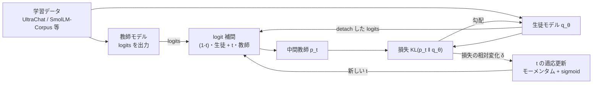
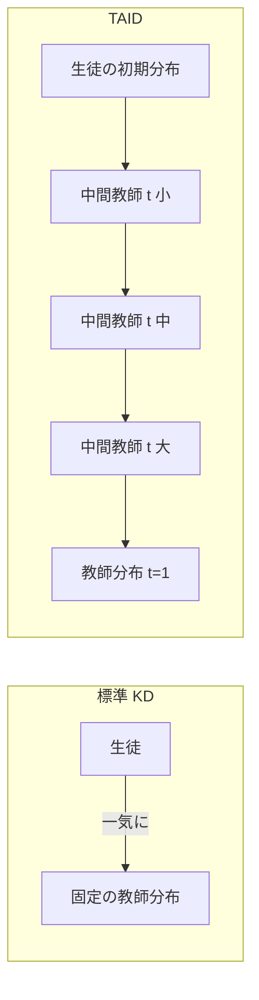

# TAID: Temporally Adaptive Interpolated Distillation for Efficient Knowledge Transfer in Language Models（＋ TinySwallow-1.5B）

- **Link**: https://arxiv.org/abs/2501.16937 （HTML: https://arxiv.org/html/2501.16937v4）
- **関連資料**: Sakana AI 日本語ブログ「新手法『TAID』を用いた小規模日本語言語モデル『TinySwallow-1.5B』の公開」 https://sakana.ai/taid-jp/ （2025-01-30） / Hugging Face モデルカード https://huggingface.co/SakanaAI/TinySwallow-1.5B-Instruct ・ https://huggingface.co/SakanaAI/TinySwallow-1.5B
- **Authors**: Makoto Shing（Sakana AI）, Kou Misaki（Sakana AI）, Han Bao（京都大学）, Sho Yokoi（国立国語研究所 / 東北大学 / 理研）, Takuya Akiba（Sakana AI）
- **Year**: 2025（arXiv v1 2025-01-28、v4 2025-02-27）
- **Venue**: ICLR 2025
- **Type**: Academic Paper（＋ 公開モデル型のビジネス事例）
- **証拠の質**: 手法・実験数値 = **一次資料**（査読付き論文）。TinySwallow の日本語ベンチマーク = **ベンダー申告**（Sakana AI ブログの表。第三者の再現は未確認）。iPhone 上の動作 = **ベンダー申告**（デモ動画）
- **蒸留の種別**: **白箱（logit）蒸留**。教師の確率分布（logits）を直接使うため、**商用 API を教師にする用途には使えない**（重みを持つオープンモデルが教師の前提）。単なる fine-tuning ではなく、教師の分布との KL を損失にする真の知識蒸留
- **取得状況**: arXiv abs（API 経由）・arXiv HTML v4・Sakana AI 日本語ブログ・HF モデルカード 2 件をすべて取得済み。HTML 版の一部数式（式 1）は変換時に途中で切れていたため、本文の説明（「logit レベルで補間」）から再構成した（下記に明記）

## Abstract

Causal language models have demonstrated remarkable capabilities, but their size poses significant challenges for deployment in resource-constrained environments. Knowledge distillation, a widely-used technique for transferring knowledge from a large teacher model to a small student model, presents a promising approach for model compression. A significant remaining issue lies in the major differences between teacher and student models, namely the substantial capacity gap, mode averaging, and mode collapse, which pose barriers during distillation. To address these issues, we introduce Temporally Adaptive Interpolated Distillation (TAID), a novel knowledge distillation approach that dynamically interpolates student and teacher distributions through an adaptive intermediate distribution, gradually shifting from the student's initial distribution towards the teacher's distribution. We provide a theoretical analysis demonstrating TAID's ability to prevent mode collapse and empirically show its effectiveness in addressing the capacity gap while balancing mode averaging and mode collapse. Our comprehensive experiments demonstrate TAID's superior performance across various model sizes and architectures in both instruction tuning and pre-training scenarios. Furthermore, we showcase TAID's practical impact by developing two state-of-the-art compact foundation models: TAID-LLM-1.5B for language tasks and TAID-VLM-2B for vision-language tasks. These results demonstrate TAID's effectiveness in creating high-performing and efficient models, advancing the development of more accessible AI technologies.

## Abstract (Japanese Translation)

因果言語モデルは目覚ましい能力を示していますが、その大きさが、計算資源の限られた環境への配置を難しくしています。大きな教師モデルから小さな生徒モデルへ知識を移す知識蒸留は、モデル圧縮の有望な方法です。残る大きな課題は教師と生徒の違い、すなわち **大きな能力差（capacity gap）**、**モード平均化（mode averaging）**、**モード崩壊（mode collapse）** で、これらが蒸留を妨げます。本論文は **TAID（Temporally Adaptive Interpolated Distillation）** を提案します。TAID は、生徒と教師の分布を適応的な中間分布で動的に補間し、生徒の初期分布から教師の分布へ徐々に移していく蒸留法です。TAID がモード崩壊を防ぐことを理論的に示し、能力差への対処とモード平均化・崩壊のバランスに有効であることを実験で示します。指示学習と事前学習の両方で、さまざまなモデルサイズ・構造に対して TAID が優れていることを確認しました。さらに実用性を示すため、言語用の **TAID-LLM-1.5B** と視覚言語用の **TAID-VLM-2B** という 2 つの小型基盤モデルを開発し、それぞれのサイズ帯で最高性能を達成しました。

## Overview

TAID は「**教師が大きすぎると生徒が伸びない**（curse of capacity gap）」という蒸留の古典的な問題に、**時間とともに難しくなる中間教師** で対処する白箱蒸留法です。中間教師は、生徒自身の logits と教師の logits を補間係数 $t$ で混ぜた分布で、$t$ を 0 付近から 1 へ、生徒の学習の進み具合に応じて適応的に上げていきます。

ビジネス観点で重要な点は 3 つあります。

1. **生徒の出力を生成しなくてよい（SGO 不要）**: GKD や DistiLLM のような on-policy 手法と違い、学習中に生徒にテキストを生成させないため、**学習時間が DistiLLM の約 1/2.9、GKD の約 1/14**（1 エポックあたり 0.7 時間 vs 2 時間 vs 9.8 時間、H100×8）で済みます（一次資料）。
2. **教師を大きくするほど素直に良くなる**: KL / RKL / Skew KL は教師を大きくすると生徒の性能が下がる場合があるのに対し、TAID は教師サイズに対して単調に改善しました（Table 6）。**「手元で最大の教師を使えばよい」** という単純な運用ができることを意味します。
3. **国内での実用化**: Sakana AI は TAID で **Qwen2.5-32B-Instruct（教師）→ Qwen2.5-1.5B-Instruct（生徒）** の蒸留を行い、日本語 SLM「**TinySwallow-1.5B**」を公開しました（東京科学大学 Swallow チームと共同、GENIAC 支援）。3B 未満の日本語モデルで最高の平均スコア 0.402 と報告され、**iPhone 14 上でオフライン動作** するデモも示されています（ベンダー申告）。

## Problem

- **能力差（Capacity gap）**: 教師と生徒の能力差が大きいと知識が移りにくく、教師を大きくするとかえって生徒が悪化する（"curse of capacity gap"）。LLM の大型化でこの問題は深刻化している。
- **モード平均化（Mode averaging）**: 順方向 KL（Hinton 型）では、生徒が教師分布のすべてのモードを無理に覆おうとして、平滑化しすぎた不正確な分布になる。
- **モード崩壊（Mode collapse）**: 逆方向 KL（RKL）はモード平均化を和らげるが、教師分布の支配的なモードだけに集中し、低頻度語（tail）を捨ててしまう。
- **on-policy 手法の計算コスト**: 生徒生成出力（SGO）を使う手法（GKD・DistiLLM）は学習と推論のずれを解消するが、大規模モデル・大規模データでは計算が重い。
- **画像分類由来の KD 手法の不適合**: CTKD・DKD などは、言語モデルの高エントロピー・ロングテールな分布にうまく適用できない。

## Proposed Method

**TAID（Temporally Adaptive Interpolated Distillation）**

### 中核のアイデア

- 固定された教師分布 $p$ を直接真似る代わりに、**時間依存の中間教師** $p_t$ を目標にする。
- $p_t$ は「生徒自身の（勾配を止めた）logits」と「教師の logits」を **logit レベルで補間** したもの。logit で混ぜるのは、予測間の相対的な確信度を保つため。
- 補間係数 $t \in [0,1]$ を学習の進行に応じて 0 側（生徒寄り）から 1（教師そのもの）へ上げる。
- $t$ が小さい間は自己蒸留に近く、生徒は自分の支配的なモードを固める。$t$ が大きくなるにつれ教師の細かな信号（tail の確率）を取り込む。

### 手順（番号付き）

1. **入力**: 学習率 $\eta$、$t$ の学習率 $\alpha$、モーメンタム係数 $\beta$、総反復数 $N$、開始値 $t_{\text{start}}$、終了値 $t_{\text{end}}$。
2. **初期化**: 生徒パラメータ $\theta$、$t_1 = t_{\text{start}}$、$m_0 = 0$、$J^{(t_0)}_{\text{TAID}} = \infty$。
3. **各反復 $n$ で線形下限を計算**: $t_{\text{linear}} = t_{\text{start}} + (t_{\text{end}} - t_{\text{start}})\cdot n/N$。
4. **バッチを取り出し、中間分布 $p_{t_n}$ を計算**（式 1）。
5. **TAID 損失を計算**（式 2）し、$\theta$ を勾配降下で更新。
6. **損失の相対変化** $\delta_n$ を計算。
7. **モーメンタムで平滑化** して $m_n$ を得る。
8. **$t$ を更新**: $\Delta t = \alpha\cdot\mathrm{sigmoid}(m_n)\cdot(1-t_n)$、$t_{n+1} = \min(t_{\text{end}}, \max(t_{\text{linear}}, t_n + \Delta t))$。

### 既存手法との違い

| 観点 | KL（Hinton） | RKL | Skew KL（DistiLLM） | GKD | **TAID** |
|------|-------------|-----|---------------------|-----|----------|
| 目標分布 | 教師 $p$ で固定 | 教師 $p$ で固定 | 教師と生徒の固定比率の混合 $r$ | 教師 $p$ で固定 | **時間とともに変わる中間分布 $p_t$** |
| 知識の流れ | 教師 → 生徒 | 教師 → 生徒 | 教師 → 混合分布 $r$（間接） | 教師 → 生徒 | **中間分布 → 生徒（直接）** |
| 補間係数 | なし | なし | $\lambda$ 固定 | $\lambda$ 固定（GJSD） | **$t$ を適応的に増加** |
| 生徒出力の生成（SGO） | 不要 | 不要 | 必要（適応的） | 必要 | **不要** |
| 弱点 | モード平均化 | モード崩壊 | 大きな教師で悪化 | 計算コスト大 | ハイパーパラメータ（$t_{\text{start}}$ 等） |

### Key Formulas

**言語モデルの KD 損失（順方向 KL）**:

$$
J_{\mathrm{KL}}(p,q_\theta) := \frac{1}{S}\sum_{s=1}^{S}\sum_{y_s\in\mathcal{Y}} p(y_s\mid y^{<s}) \log\frac{p(y_s\mid y^{<s})}{q_\theta(y_s\mid y^{<s})}
$$

- $p$: 教師分布、$q_\theta$: 生徒分布、$S$: 系列長、$\mathcal{Y}$: 語彙、$y^{<s}$: $s$ 番目より前の token 列。

**逆方向 KL**: $J_{\mathrm{RKL}}(p,q_\theta) := J_{\mathrm{KL}}(q_\theta, p)$

**式 1: TAID の中間分布**（HTML 版で式が途中で切れていたため、本文の「生徒の detached logits と教師 logits を logit レベルで補間する」という記述から再構成）:

$$
p_t(y_s\mid y^{<s}) := \mathrm{softmax}\Big((1-t)\cdot \mathrm{logit}_{q'_\theta}(y_s\mid y^{<s}) + t\cdot \mathrm{logit}_{p}(y_s\mid y^{<s})\Big)
$$

- $t\in[0,1]$: 時間依存の補間係数
- $\mathrm{logit}_{q'_\theta}$: 生徒 logits の detach 版（定数扱い、逆伝播しない）
- $\mathrm{logit}_{p}$: 教師 logits

**式 2: TAID の目的関数**:

$$
J^{(t)}_{\mathrm{TAID}}(p,q_\theta) := J_{\mathrm{KL}}(p_t, q_\theta) = \frac{1}{S}\sum_{s=1}^{S}\sum_{y_s\in\mathcal{Y}} p_t(y_s\mid y^{<s}) \log\frac{p_t(y_s\mid y^{<s})}{q_\theta(y_s\mid y^{<s})}
$$

**適応的な $t$ の更新則**:

$$
\delta_n := \frac{J^{(t_{n-1})}_{\mathrm{TAID}} - J^{(t_n)}_{\mathrm{TAID}}}{J^{(t_{n-1})}_{\mathrm{TAID}} + \epsilon}
$$

$$
m_n = \beta m_{n-1} + (1-\beta)\,\delta_n
$$

$$
t_n \leftarrow \min\Big(1.0,\ \max\big(t_{\text{linear}},\ t_{n-1} + \alpha\cdot \mathrm{sigmoid}(m_n)\cdot(1-t_{n-1})\big)\Big)
$$

- $\delta_n$: 損失の相対的な減り幅（生徒が速く学んでいるほど大きい）
- $\beta$: モーメンタム係数（既定 0.99）
- $\alpha$: $t$ のステップ幅（既定 5e-4）
- $t_{\text{linear}}$: 線形スケジュール（下限）
- $\epsilon$: ゼロ除算防止の小さな定数

**関連研究で比較される発散**:

$$
J_{\mathrm{TVD}}(p,q_\theta) := \tfrac{1}{2}\sum_{\mathbf{y}}\lvert p(\mathbf{y}) - q_\theta(\mathbf{y})\rvert
$$

$$
J_{\mathrm{GJSD}}(p,q_\theta) := \lambda J_{\mathrm{KD}}(p,r) + (1-\lambda) J_{\mathrm{RKD}}(p,r),\quad r(\mathbf{y}) = \lambda p(\mathbf{y}) + (1-\lambda) q_\theta(\mathbf{y})
$$

$$
J_{\mathrm{SKD}}(p,q_\theta) := J_{\mathrm{KL}}(p,r),\qquad J_{\mathrm{SRKD}}(p,q_\theta) := J_{\mathrm{KL}}(q_\theta, r)
$$

**理論解析（付録 B、Mobahi et al. 2020 の枠組み）**:

補間領域の回帰問題

$$
f^{*} := \arg\min_{f\in\mathcal{F}} R(f)\quad \text{s.t.}\quad \frac{1}{N}\sum_{i=1}^{N}(f(\mathbf{x}_i) - y_i)^2 \le \epsilon
$$

正則化 $R(f) = \int u(\mathbf{x},\mathbf{x}') f(\mathbf{x}) f(\mathbf{x}')\,d\mathbf{x}\,d\mathbf{x}'$ のもとで、解析解は

$$
f^{*}_{\lambda}(\mathbf{x}) = \mathbf{g}_{\mathbf{x}}^{\top}(\lambda \mathbf{I} + \mathbf{G})^{-1}\mathbf{y},\qquad \mathbf{f} = \mathbf{V}^{\top}\mathbf{D}(\lambda\mathbf{I}+\mathbf{D})^{-1}\mathbf{V}\mathbf{y}
$$

（$\mathbf{G}_{i,j} = \frac{1}{N} g(\mathbf{x}_i,\mathbf{x}_j)$、$g$ は演算子のグリーン関数、$\mathbf{G}=\mathbf{V}^{\top}\mathbf{D}\mathbf{V}$）。$\lVert\mathbf{y}\rVert^2 \le N\epsilon$ のとき自明解 $f=0$ に崩壊する。$\lambda$ は $\lambda = \frac{\alpha\sqrt{N\epsilon}}{\lVert\mathbf{y}\rVert - \sqrt{N\epsilon}}$（$\alpha\in[d_{\min}, d_{\max}]$）で評価される。各ステップで生徒は補間ラベル $(1-t)y_t + t\,y_{\text{teacher}}$ に当てはめられる。

**Theorem 4.1（非崩壊性・非形式版）**: 総ステップ $T$ で蒸留するとき、教師の信号が $\Omega(\sqrt{T\epsilon})$ 以上なら、生徒はどの時刻 $t$ でも崩壊しない。一方、自己蒸留は十分なステップ後に必ず崩壊する（Mobahi et al. 2020, Proposition 4）。

### Features

- 生徒出力のサンプリングが不要なため、**計算効率が高い**（on-policy 手法の約 1/3〜1/14 の学習時間）。
- **教師サイズに単調**: 大きな教師ほど生徒が良くなる（KL・RKL・Skew KL では成り立たない）。
- **モード平均化とモード崩壊の中間**: head（上位 10 token）では KL より教師の支配的語彙を捉え、tail では RKL より低頻度語を保持。
- **ハイパーパラメータに頑健**: 既定値 $\beta=0.99$、$\alpha=5\times10^{-4}$、$t_{\text{start}}=0.2$〜$0.4$ でほぼ調整不要と報告。
- 画像分類（ImageNet）にも適用可能。

## Algorithm (Pseudocode)

```
Algorithm: TAID training
Input : 学習率 η, t の学習率 α, モーメンタム β, 総反復 N, t_start, t_end,
        教師 p（logits を出せる白箱モデル）, 生徒 q_θ, データ D
Output: 蒸留済み生徒 q_θ

1. θ を初期化（通常は事前学習済み小型モデル）
2. t_1 ← t_start ; m_0 ← 0 ; J_prev ← ∞
3. for n = 1 .. N do
4.     t_lin ← t_start + (t_end − t_start) · n / N        // 線形スケジュール（下限）
5.     バッチ {(y^{<s}, y_s)} を D からサンプル
6.     z_s ← detach(logit_{q_θ}(·|y^{<s}))                // 生徒 logits（勾配を止める）
7.     z_t ← logit_p(·|y^{<s})                            // 教師 logits（事前計算も可）
8.     p_t ← softmax((1 − t_n)·z_s + t_n·z_t)             // 中間教師（式 1）
9.     J ← KL(p_t || q_θ)                                 // TAID 損失（式 2）
10.    θ ← θ − η ∇_θ J                                    // 生徒のみ更新
11.    δ ← (J_prev − J) / (J_prev + ε)                    // 学習の進み具合
12.    m ← β·m + (1 − β)·δ                                // 平滑化
13.    t_{n+1} ← min(t_end, max(t_lin, t_n + α·sigmoid(m)·(1 − t_n)))
14.    J_prev ← J
15. end for
```

実装上の工夫（TAID-LLM-1.5B）: 教師（Qwen2-72B-Instruct）の確率を **事前計算** し、ストレージを抑えるため **上位 50 個の確率のみ** を保存して使った。

## Architecture / Process Flow



```
t の推移のイメージ（Figure 2 左の定性的な形。数値は原図参照）

t
1.0 |                         .......------------
    |                ....'''''
    |          ..''''              ← α が大きいほど序盤で急上昇
    |      .''
0.4 |----'                         ← t_start = 0.4
    |  - - - - - - - - - - - - -   ← 線形スケジュール（下限）
0.0 +------------------------------------------- 学習ステップ
```

## Figures & Tables

### Figure 1: 標準 KD と TAID の比較




### Table 1: 指示学習での蒸留手法比較（MT-Bench、GPT-4 採点、高いほど良い）

| Method | Phi-3-mini (3.8B) → TinyLlama (1.1B) | Llama-2 (6.7B) → TinyLlama (1.1B) | StableLM Zephyr (2.8B) → Pythia (0.4B) |
|--------|------|------|------|
| SFT | 2.00 | 3.94 | 2.57 |
| KL (Hinton et al., 2015) | 2.71 | 3.99 | 2.74 |
| RKL (Wen et al., 2023; Gu et al., 2024) | 3.48 | 3.92 | 2.53 |
| TVD (Wen et al., 2023) | 3.27 | 3.64 | 2.57 |
| Adaptive KL (Wu et al., 2024) | 3.27 | 3.77 | 2.64 |
| GKD (Agarwal et al., 2024) | 2.24 | 3.82 | 2.59 |
| DistiLLM (Ko et al., 2024) | 3.23 | 3.97 | 2.97 |
| CTKD (Li et al., 2023b) | 1.78 | 2.84 | 1.39 |
| DKD (Zhao et al., 2022) | 2.70 | 4.14 | 2.90 |
| (Ours) TAID w/o adaptive update | 3.44 | 4.18 | 2.88 |
| **(Ours) TAID** | **4.05** | **4.27** | **3.05** |

- SFT（教師なしの通常学習）比で TAID は +2.05 / +0.33 / +0.48 ポイント。**蒸留が単なる fine-tuning より有効** であることの直接の証拠。
- 適応更新の有無による改善幅は 2.2%〜17.7%（論文記載）。

### Table 2: 継続事前学習での蒸留手法比較（Open LLM Leaderboard、教師 Phi-3-medium-4k-instruct → 生徒 TinyLlama、約 20B token）

| Method | ARC | HellaSwag | MMLU | TruthfulQA | Winogrande | GSM8K | Average |
|--------|-----|-----------|------|-----------|------------|-------|---------|
| SFT | 41.38 | 63.66 | 25.89 | 35.64 | 61.25 | 1.21 | 38.17 |
| KL (Hinton et al., 2015) | 44.97 | 65.43 | 25.11 | 37.95 | 63.22 | 2.80 | 39.91 |
| TVD (Wen et al., 2023) | 43.52 | 64.50 | 25.95 | 36.38 | 63.14 | 2.96 | 39.41 |
| Adaptive KL (Wu et al., 2024) | 43.77 | 63.09 | 26.04 | 36.42 | 63.22 | 2.12 | 39.11 |
| GJS (Agarwal et al., 2024) | 44.71 | 65.67 | 25.27 | 37.76 | 62.12 | 3.34 | 39.81 |
| Skew KL (Ko et al., 2024) | 44.62 | 65.25 | 25.79 | 37.45 | 62.51 | 3.41 | 39.84 |
| Skew RKL (Ko et al., 2024) | 44.11 | 64.80 | 26.07 | 36.76 | 62.83 | 3.03 | 39.60 |
| **(Ours) TAID** | **45.48** | 65.43 | 25.43 | 37.92 | **63.38** | 2.96 | **40.10** |

（論文原文の列名は "TrustfulQA" と表記）

### Table 3: 確率質量の分布（Head = 上位 10 token の確率和、Tail = 80〜100 パーセンタイルの token の確率和、Phi-3-mini → TinyLlama）

| Method | Head | Tail |
|--------|------|------|
| KL | 0.216 | 40.2 × 10⁻⁷ |
| RKL | 0.227 | 8.1 × 10⁻⁷ |
| TAID | 0.218 | 39.0 × 10⁻⁷ |

- 脚注: 典型的な確率は Head で $10^{-1}$〜$10^{-2}$、Tail で $10^{-10}$〜$10^{-11}$。
- 解釈: TAID は Head で KL より支配的語彙を捉え（モード平均化を回避）、Tail で RKL の約 4.8 倍の質量を保持（モード崩壊を回避）。

### Figure 2: TAID の挙動分析（3 パネル）

画像は arXiv HTML 版で個別ファイルとして取得できなかったため（HTML 内の `` は Figure 1 の overview.png のみ）、本文記述から内容を整理する。

| パネル | 内容 | 本文で述べられた結果 |
|-------|------|------------------|
| 左 | $\alpha$ ごとの $t$ の推移（$t_{\text{start}}=0.4$、6.1 節の設定） | $\alpha$ が大きいほど序盤の上昇が速い。$t$ は滑らかに単調増加 |
| 中 | TAID の目的関数値と標準 KL の比較 | TAID は学習全体で値が一定かつ分散が小さい。KL は高く変動が大きい |
| 右 | 教師サイズ別の生徒性能（Pythia 70M 生徒、教師 410M〜6.9B、SmolLM-Corpus 1B token、LAMBADA 正解率） | TAID は教師サイズに対して単調増加し、KL・RKL より常に上。KL・RKL は非単調（能力差の呪い） |

Sakana AI 日本語ブログにも同じ図（教師サイズ vs Test Accuracy）が掲載されている: 

図から読み取った値（LAMBADA 正解率 %、TAID は Table 6 の数値、その他は **グラフ目視の概算**）:

| 教師サイズ | 教師自身 | TAID | KL | RKL |
|-----------|---------|------|----|-----|
| 410M | 約 52 | 20.82 | 約 19.1 | 約 14.3 |
| 1B | 約 56 | 21.17 | 約 19.2 | 約 14.0 |
| 2.8B | 約 65 | 21.70 | 約 19.0 | 約 13.3 |
| 6.9B | 約 67 | 22.01 | 約 20.1 | 約 13.4 |

Sakana AI ブログの概念図（標準 KD は一段で教師へ、TAID は中間教師の階段を上る）: 

### Figure 3: 画像分類と言語モデリングの分布の違い

ResNet-56（CIFAR-100）と GPT-2（OpenWebText）のエントロピーと正解クラス確率の比較。言語モデリングはエントロピーが高く正解確率が低い。本文で示された数値:

| データ | エントロピー | 正解クラス確率 |
|-------|-------------|--------------|
| CIFAR-100 | 0.485 | 0.613 |
| ImageNet | 6.67 | 0.00130 |

### Table 4: TAID-LLM-1.5B（2B 未満の LLM、LightEval 平均）

| Model | LightEval (↑) |
|-------|---------------|
| Qwen2-1.5B | 46.19 |
| Phi-1.5B | 50.39 |
| StableLM-2-1.6B | 51.24 |
| SmolLM-1.7B | 51.31 |
| **TAID-LLM-1.5B** | **52.27** |

### Table 5: TAID-VLM-2B（4B 以下の VLM、Open-VLM-LB 平均）

| Model | Open-VLM-LB (↑) |
|-------|-----------------|
| PaliGemma | 46.56 |
| MiniCPM-V-2 | 47.93 |
| Phi-3-Vision | 53.60 |
| InternVL2-2B | 53.96 |
| **TAID-VLM-2B** | **56.43** |

### Table 6: TAID と Skew KL の教師サイズ別比較（生徒 70M）

| Method | 410M | 1B | 2.8B | 6.9B |
|--------|------|----|------|------|
| TAID | 20.82 | 21.17 | 21.70 | 22.01 |
| SKL | 18.65 | 18.50 | 18.28 | 18.20 |

```
教師サイズ別の生徒性能（Table 6）
          410M    1B     2.8B   6.9B
TAID   |████████████████████▊ 20.82 → 21.17 → 21.70 → 22.01  （単調増加）
SKL    |██████████████████▋   18.65 → 18.50 → 18.28 → 18.20  （単調減少）
```

### Table 7: CIFAR-100 の Top-1 精度（%）

| Method | ResNet56→ResNet20 | ResNet110→ResNet32 | ResNet32×4→ResNet8×4 | WRN-40-2→WRN-16-2 | WRN-40-2→WRN-40-1 | VGG13→VGG8 |
|--------|------|------|------|------|------|------|
| KL (Hinton et al., 2015) | 70.66 | 73.08 | 73.33 | 74.92 | 73.54 | 72.93 |
| CTKD (Li et al., 2023b) | 71.19 | 73.52 | 73.39 | 75.45 | 73.93 | 73.52 |
| DKD (Zhao et al., 2022) | 71.97 | 74.11 | 76.32 | 76.24 | 74.81 | 74.68 |
| MLKD (Jin et al., 2023) | 72.19 | **74.11** | **77.08** | **76.63** | **75.35** | **75.18** |
| (Ours) TAID | **72.25** | 73.51 | 74.85 | 75.81 | 74.51 | 74.38 |

### Table 8: ImageNet の Top-1 精度（%）

| Method | ResNet34→ResNet18 | ResNet50→MN-V1 |
|--------|------|------|
| KD (Hinton et al., 2015) | 71.03 | 70.50 |
| CTKD (Li et al., 2023b) | 71.38 | 71.16 |
| DKD (Zhao et al., 2022) | 71.70 | 72.05 |
| MLKD (Jin et al., 2023) | 71.90 | 73.01 |
| (Ours) TAID | 72.10 | 72.71 |

### Table 9: TAID-LLM-1.5B のタスク別内訳（LightEval、7 つの zero-shot タスク）

| Model | MMLU | TriviaQA | ARC | PIQA | Hellaswag | OBQA | Winogrande | Average |
|-------|------|----------|-----|------|-----------|------|-----------|---------|
| Qwen2-1.5B | 37.91 | 1.38 | 48.12 | 75.30 | 63.87 | 36.80 | 59.98 | 46.19 |
| Qwen2.5-1.5B | 41.15 | 0.68 | 58.41 | 76.01 | 66.40 | 40.00 | 59.35 | 48.86 |
| Phi-1.5B | 35.92 | 6.06 | 60.53 | 75.62 | 60.72 | 46.00 | 67.88 | 50.39 |
| StableLM-2-1.6B | 36.21 | 29.59 | 53.57 | 76.77 | 66.60 | 37.20 | 58.72 | 51.24 |
| SmolLM-1.7B | 39.97 | 22.56 | 59.95 | 76.06 | 62.91 | 42.80 | 54.91 | 51.31 |
| **TAID-LLM-1.5B** | 39.96 | 22.96 | 58.14 | 77.37 | 67.15 | 41.40 | 58.88 | **52.27** |

### Table 10: TAID-VLM-2B のタスク別内訳

| Model | MMBench_V11 | MMStar | MMMU_VAL | MathVista | OCRBench | AI2D | HallusionBench | MMVet | Average |
|-------|------|------|------|------|------|------|------|------|------|
| PaliGemma-3B-mix-448 | 65.6 | 48.3 | 34.9 | 28.7 | 61.4 | 68.3 | 32.2 | 33.1 | 46.6 |
| MiniCPM-V-2 | 65.8 | 39.1 | 38.2 | 39.8 | 60.5 | 62.9 | 36.1 | 41.0 | 47.9 |
| Phi-3-Vision | 65.2 | 47.7 | 46.1 | 44.6 | 63.7 | 78.4 | 39.0 | 44.1 | 53.6 |
| InternVL2-2B | 69.6 | 49.8 | 36.3 | 46.0 | 78.1 | 74.1 | 38.0 | 39.7 | 54.0 |
| **TAID-VLM-2B** | 70.7 | 49.5 | 35.1 | 51.6 | 78.6 | 74.0 | 56.8 | 35.1 | **56.4** |

### 学習コスト比較（付録 D.1、H100 × 8、1 エポックあたり）

| 手法 | 1 エポックあたり学習時間 | TAID 比 |
|------|----------------------|---------|
| **TAID** | 約 0.7 時間 | 1.0 倍 |
| DistiLLM | 約 2 時間 | 約 2.9 倍 |
| GKD | 約 9.8 時間 | 約 14 倍 |

```
1 エポックあたりの学習時間（H100×8）
TAID     |█▍ 0.7h
DistiLLM |████ 2.0h
GKD      |███████████████████▋ 9.8h
```

（本文 6.1 節は「DistiLLM の約 2 倍、GKD の約 10 倍高速」と丸めて記載）

### 実験設定の一覧（付録 D・E）

| 実験 | 教師 | 生徒 | データ | 主要ハイパーパラメータ | 計算資源 |
|------|------|------|-------|----------------------|---------|
| 指示学習（6.1） | Phi-3-mini-4k-instruct / Llama-2-7b-chat / StableLM Zephyr 3B | TinyLlama 1.1B / TinyLlama / Pythia-410M | UltraChat 200k（2048 token 超を除外し約 150k 学習・2k 検証） | 5 エポック、batch 64、AdamW lr 1e-4、cosine、$\beta$=0.99、$\alpha$=5e-4、$t_{\text{start}}$=0.4（Phi-3 ペア）/ 0.2（他）、$t_{\text{end}}$=1.0。ROUGE-L で checkpoint 選択 | H100 × 8 |
| 継続事前学習（6.2） | Phi-3-medium-4k-instruct | TinyLlama | SmolLM-Corpus 先頭 10%（約 20B token）、1 エポック | 実効 batch 640、AdamW lr 1e-4、cosine | H100 × 80 |
| 能力差（6.3.2） | Pythia 410M〜6.9B | Pythia 70M | SmolLM-Corpus の 1B token ランダム部分集合、1 エポック | — | — |
| TAID-LLM-1.5B（E.1） | Qwen2-72B-Instruct | Qwen2-1.5B-Instruct | SmolLM-Corpus 全体、2 エポック | lr 1e-5、$\beta$=0.99、$\alpha$=5e-5、$t_{\text{start}}$=0.4、$t_{\text{end}}$=1.0。教師確率を事前計算し上位 50 のみ保存 | 記載なし |
| TAID-VLM-2B（E.2） | InternVL2-8B | InternVL2-2B | Mantis-Instruct、3 エポック | lr 1e-6、$\beta$=0.99、$t_{\text{start}}$=0.4、$\alpha$=5e-4 | 記載なし |
| TinySwallow-1.5B（HF） | Qwen2.5-32B-Instruct | Qwen2.5-1.5B-Instruct | 日本語テキストで継続事前学習（データ名・token 数は非開示） | 非開示 | 非開示 |

### TinySwallow-1.5B: 日本語ベンチマーク（Sakana AI ブログの表、3B 未満の SLM、日本語 LLM 評価ベンチマークの日本語理解・生成タスク平均）

| Model | Size (B) | Average |
|-------|---------|---------|
| meta-llama/Llama-3.2-1B | 1.2 | 0.201 |
| llm-jp/llm-jp-3-1.8b | 1.8 | 0.251 |
| sbintuitions/sarashina2.1-1b | 1.4 | 0.296 |
| google/gemma-2-2b | 2.6 | 0.346 |
| Qwen/Qwen2.5-1.5B | 1.5 | 0.372 |
| google/gemma-2-2b-jpn-it | 2.6 | 0.375 |
| **TinySwallow-1.5B** | 1.5 | **0.402** |

```
日本語平均スコア（3B 未満）
Llama-3.2-1B        |████████ 0.201
llm-jp-3-1.8b       |██████████ 0.251
sarashina2.1-1b     |███████████▊ 0.296
gemma-2-2b          |█████████████▊ 0.346
Qwen2.5-1.5B        |██████████████▉ 0.372
gemma-2-2b-jpn-it   |███████████████ 0.375
TinySwallow-1.5B    |████████████████ 0.402
```

- 生徒の元モデル Qwen2.5-1.5B（0.372）からの改善は +0.030（約 +8%）。ただし TinySwallow は日本語継続事前学習と指示学習も含むため、**この差のすべてが TAID の寄与とは言えない**（ベンダー申告、要因分解なし）。

### TinySwallow のモデル情報（HF モデルカード）

| 項目 | 内容 |
|------|------|
| 教師 | Qwen2.5-32B-Instruct |
| 生徒 | Qwen2.5-1.5B-Instruct（base_model: Qwen/Qwen2.5-1.5B-Instruct） |
| 圧縮率 | 32B → 1.5B（ブログでは「約 1/20」） |
| パラメータ | 1,543,714,304（BF16、約 3.09 GB） |
| 学習 | TAID で日本語テキストの継続事前学習 →（Instruct 版のみ）指示学習 |
| 指示学習データ | Gemma-2-LMSYS-Chat-1M-Synth、swallow-magpie-ultra-v0.1、swallow-gemma-magpie-v0.1 |
| ライセンス | Apache 2.0（Qwen 由来）。Gemma 由来データの利用規約（Gemma Terms / Prohibited Use Policy）も遵守が必要 |
| 想定用途 | 「研究開発目的のみ」「実験的プロトタイプ」「商用やミッションクリティカル用途は想定しない」と記載。一方で「両ライセンスを守れば商用を含め利用可」とも記載があり、**記述が一致していない** |
| 動作環境 | iPhone 14（GGUF 変換 + LLMFarm）、ブラウザ（WebGPU 系の ChatUI）、Python ローカル版 |
| 開発 | Sakana AI ＋ 東京科学大学 Swallow チーム。GENIAC（経産省・NEDO、JPNP20017）の支援 |

## Experiments & Evaluation

### Setup

- **指示学習**: UltraChat 200k で 3 つの教師・生徒ペアを蒸留し、MT-Bench（GPT-4 採点）で評価。先行研究と違い、蒸留前の SFT や事前学習コーパスの交差エントロピーを足さず、**純粋に蒸留だけ** の効果を測定。
- **継続事前学習**: SmolLM-Corpus 約 20B token、Phi-3-medium → TinyLlama。SGO を使う手法は計算量の都合で目的関数部分のみに簡略化して比較。Open LLM Leaderboard の 6 タスクで評価。
- **比較手法**: KL、RKL、TVD、Adaptive KL、GKD、DistiLLM、CTKD、DKD、SFT。

### Main Results

- 指示学習の 3 ペアすべてで TAID が最高（4.05 / 4.27 / 3.05）。
- 継続事前学習でも平均 40.10 で最高（次点 KL 39.91）。差は 0.19 ポイントと小さい。
- 実用モデル: TAID-LLM-1.5B が 2B 未満で LightEval 最高 52.27、TAID-VLM-2B が 4B 以下で 56.43。

### Ablation Study

| 構成 | Phi-3-mini→TinyLlama | Llama-2→TinyLlama | StableLM→Pythia |
|------|------|------|------|
| TAID（適応更新あり） | 4.05 | 4.27 | 3.05 |
| TAID w/o adaptive update（線形） | 3.44 | 4.18 | 2.88 |
| 差 | +0.61（+17.7%） | +0.09（+2.2%） | +0.17（+5.9%） |

## ビジネス上の含意

### 価値式との対応

ドメイン index の価値式

$$
\text{蒸留のビジネス価値} \approx (C_{\text{teacher}} - C_{\text{student}})\cdot Q - (C_{\text{data}} + C_{\text{train}}) - \Delta\text{Acc}\cdot V_{\text{err}}
$$

に対して、TAID は次の項に効きます。

| 項 | TAID の効果 | 根拠 | 証拠の質 |
|----|-----------|------|---------|
| $C_{\text{train}}$ | on-policy 手法比で学習時間 約 1/3〜1/14 | 付録 D.1 | 一次資料 |
| $\Delta\text{Acc}$ | 同じ生徒でも他の蒸留法より精度が高い。教師を大きくしても悪化しない | Table 1・6 | 一次資料 |
| $C_{\text{student}}$ | 1.5B を端末内（iPhone 14）で実行でき、API 推論費がゼロになる | Sakana ブログのデモ | ベンダー申告 |
| $C_{\text{data}}$ | 定量情報なし（教師 logits の事前計算・上位 50 保存でストレージを節約） | 付録 E.1 | 一次資料（定性） |

### 仮説との関係

| 仮説 | 本資料からの示唆 |
|------|----------------|
| H4（国内は公開モデル型の事例が中心） | **支持**。TinySwallow は国内発の手法と公開モデルの組合せで、事業会社の社内導入成果は示されていない。ブログの応用例（社内文書アシスタント、オフライン業務支援、ゲーム NPC、小型 Agent）は **想定用途** であり導入実績ではない |
| H5（商用 API 教師は規約で制約） | **間接的に関連**。TAID は logits が必要な白箱蒸留のため、そもそも商用 API を教師にできない。教師にオープン重みの Qwen2.5-32B を選んだのは技術的にも規約的にも整合的。ただし指示学習データに Gemma 由来の合成データを使っているため、**Gemma の利用規約が派生モデルに及ぶ** 点はライセンス上の論点になる |
| H6（推論蒸留で Agent 用途が増加） | 本資料は推論・Agent 蒸留ではない。ブログが「小型の AI エージェントの開発」を用途に挙げるのみ |

### 実務者向けの使いどころ

1. **自社で重みを持つ大型モデル（またはオープン重みモデル）がある** 場合、TAID は「教師を大きくしても生徒が悪化しない」ため、教師選びの試行錯誤を減らせる。
2. **学習予算が限られる** 場合、GKD などの on-policy 手法より安く回せる。
3. **端末内・オフライン配置**（医療・金融・現場端末）で、1〜2B 級の日本語モデルを作る用途に向く。
4. 公式実装（https://github.com/SakanaAI/TAID）が公開されている。

### 注意点

- 継続事前学習（Table 2）での差は 0.19 ポイントと小さく、大規模事前学習での優位は限定的。
- TinySwallow の日本語スコア改善は、TAID・日本語継続事前学習・指示学習の合算効果で、手法単体の寄与は分離されていない。
- モデルカードの「研究目的のみ」と「Apache 2.0 で商用可」の記述が食い違っており、**商用利用前に法務確認が必要**。

## Notes

- **関連研究**: MiniLLM（reverse KL）、GKD（on-policy）、DistiLLM（skew KL、SGO）、Adaptive KL、CTKD（カリキュラム温度）、DKD（分離 KD）、Mirzadeh et al. 2020（teacher assistant＝中間教師の先駆け）、Zhang et al. 2023b（Lifting the curse of capacity gap）。
- **TAID と teacher assistant の違い**: 従来の「中間サイズの助手モデルを別途学習する」方式と違い、TAID は追加モデルを学習せず、logit の補間だけで中間教師を作る。
- **今後の課題（論文）**: 他の距離尺度への拡張、非線形補間、多教師蒸留（Wan et al. 2024）への適用、分類以外のタスク・モダリティ。on-policy 手法との組合せも将来課題として挙げられている。
- **助成**: NEDO JPNP20017（GENIAC）、JSPS 科研費 22H05106、JST FOREST JPMJFR2331、JST さきがけ JPMJPR24K6。
- **追加調査候補**: TinySwallow-1.5B の第三者評価、TAID を使った国内企業の社内モデル事例、TAID と on-policy 蒸留（Thinking Machines 型）の組合せ。
