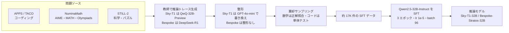
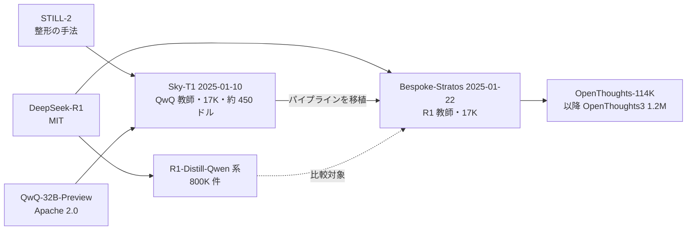

# Sky-T1 と Bespoke-Stratos — 推論蒸留を「数百ドル・1 万 7 千件」で再現した 2 つの実践報告

- **Source**:
  - NovaSky Team（UC Berkeley Sky Computing Lab）「Sky-T1: Train your own O1 preview model within $450」 https://novasky-ai.github.io/posts/sky-t1/ （公開 2025-01-10）
  - Bespoke Labs「Bespoke-Stratos: The unreasonable effectiveness of reasoning distillation」 https://www.bespokelabs.ai/blog/bespoke-stratos-the-unreasonable-effectiveness-of-reasoning-distillation （記事内の日付 2025-01-22）
  - 補足: Hugging Face モデルカード（https://huggingface.co/bespokelabs/Bespoke-Stratos-32B ほか）、OpenThoughts 論文 abstract（https://arxiv.org/abs/2506.04178）
- **Date**: 2025-01（両記事とも）
- **Type**: Technical Article（技術ブログ + OSS）
- **証拠の質**: 学習コスト・ハードウェア・データ量・ベンチマーク = **一次資料（開発者自身の公開報告）** だが **査読なし・自己計測**。費用 450 ドルは「Lambda Cloud の料金に基づく」計算値。Bespoke-Stratos-32B の学習時間（H100×8 で 27 時間）はモデルカードの記載。第三者による費用の再検証は見つかっていない
- **蒸留の種別**: **黒箱の推論（CoT）蒸留**。教師（QwQ-32B-Preview / DeepSeek-R1）の **出力テキスト（推論トレース）だけ** を使い、正解で絞り込んだうえで生徒を **SFT** する。logits は使わない。形式上は「教師生成データでの fine-tuning」だが、データの中身が教師の推論過程そのものなので、Xu et al. 2024 の分類では黒箱の知識蒸留（labeling + SFT）に当たる。**人手データで fine-tuning しただけの事例とは区別される**
- **取得状況**: Sky-T1 ブログ・Bespoke-Stratos ブログを WebFetch で取得済み。HF API でライセンス情報、Bespoke-Stratos-32B のモデルカード（学習設定）、OpenThoughts の abstract を取得済み。Bespoke のブログ本文には図が無かった

## Overview

2025 年 1 月、OpenAI o1 のような「長く考える」推論モデルを **大学研究室やスタートアップが数百ドルで作れる** ことを示した 2 つの報告です。

| | Sky-T1-32B-Preview | Bespoke-Stratos-32B |
|---|---|---|
| 公開 | 2025-01-10 | 2025-01-22 |
| 教師 | QwQ-32B-Preview | DeepSeek-R1 |
| 生徒（元モデル） | Qwen2.5-32B-Instruct | Qwen2.5-32B-Instruct |
| データ量 | 17K（ページ上の内訳合計は 16K） | 17K（Bespoke-Stratos-17k） |
| 学習 | H100 × 8、約 19 時間、3 エポック | H100 × 8、27 時間、3 エポック |
| 学習費 | **約 450 ドル（450 ドル未満）** | 記載なし |
| AIME2024 | 43.3 | 63.3 |
| MATH500 | 82.4 | 93.0 |

要点は次の 3 つです。

1. **学習費は数百ドル規模**: Sky-T1 は H100 × 8 を約 19 時間（約 152 GPU 時間）使い、約 450 ドル。教師への問い合わせ費用（データ生成費）は含まれていない点に注意。
2. **教師を強くするとデータ効率が大きく上がる**: 同じパイプライン・同じ 17K 件でも、教師を QwQ から DeepSeek-R1 に替えた Bespoke-Stratos-32B は AIME2024 が 43.3 → 63.3 に上がった。さらに、80 万件で学習した DeepSeek-R1-Distill-Qwen-32B に **47 分の 1 のデータ量** でほぼ並んだ（Bespoke 申告）。
3. **データの質の管理が成否を決める**: 不正解トレースの除去（rejection sampling）、トレースの整形、数学の正誤判定方法の改善（正解保持率 25% → 73%）が、性能に直接効いた。

## Key Technical Content

### Architecture / Design



Sky-T1 のパイプライン図（原図）: 

### Implementation Steps

**Sky-T1（NovaSky）**

1. **問題の収集**: コーディング 5K（APPS・TACO）、数学 10K（NuminaMath の AIME・MATH・Olympiads 部分集合）、科学・パズル 1K（STILL-2）。
2. **教師による推論トレース生成**: QwQ-32B-Preview に解かせる。
3. **整形（reformatting）**: QwQ の出力は形式がばらつくため、STILL-2 に倣い **GPT-4o-mini で構造化された形式に書き換え** て、答えを取り出しやすくする。APPS では整形なしだと QwQ の正答判定率が約 25%、整形ありで 90% 超になったと報告。
4. **棄却サンプリング（rejection sampling）**: 数学は正解との完全一致、コードはデータセットの単体テストの実行で正誤を判定し、不正解のトレースを捨てる。
5. **学習**: Llama-Factory で Qwen2.5-32B-Instruct を 3 エポック、学習率 1e-5、バッチサイズ 96 で SFT。DeepSpeed ZeRO-3 offload を使用。
6. **評価・公開**: データ・コード（SkyThought）・技術報告・W&B ログ・重みをすべて公開。

**Bespoke-Stratos（Bespoke Labs）での変更点**

1. **教師を DeepSeek-R1 に変更**（QwQ の代わり）。データ生成は DeepSeek-R1 で **約 1.5 時間**。
2. **整形を省略**: R1 のトレースは十分に整っていて一貫しているため、GPT-4o-mini での書き換えをしない。
3. **数学の正誤判定を改善**: Sky-T1 の正規表現・sympy による判定を **GPT-4o-mini による判定** に置き換え、正しい解の保持率が **25% → 73%** に向上。
4. **コードの検証**: Ray クラスタでテスト実行を並列化（Curator への組込みを進行中）。
5. **パイプラインの移植**: 自社ツール Bespoke Curator に Sky-T1 のパイプラインを移植。
6. **学習**: Sky-T1 の SkyThought コードで SFT。32B は H100 × 8 で 27 時間、7B も同データで学習。

### Key Formulas / Metrics

コストの分解（費用は Sky-T1 の公表値。GPU 単価・Bespoke の推計は本レポートでの **派生計算**）:

$$
C_{\text{train}} = N_{\text{GPU}} \times T \times c_{\text{GPU-h}}
$$

| 指標 | 値 | 文脈 | 出所 |
|------|----|------|------|
| Sky-T1 学習費 | 約 450 ドル | Lambda Cloud 料金で計算 | 一次資料 |
| Sky-T1 GPU 時間 | 8 × 約 19 h ≈ 152 GPU 時間 | H100 | 一次資料（積は派生計算） |
| 暗黙の GPU 単価 | 450 / 152 ≈ 約 2.96 ドル / H100 時間 | 上 2 行からの逆算 | 派生計算 |
| Bespoke-Stratos-32B GPU 時間 | 8 × 27 h = 216 GPU 時間 | モデルカード | 一次資料（積は派生計算） |
| Bespoke-Stratos-32B 学習費の目安 | 約 640 ドル（216 × 2.96） | Sky-T1 と同じ単価を仮定した **推計**。Bespoke は費用を公表していない | 派生計算 |
| R1 によるデータ生成時間 | 約 1.5 時間 | API 費用は非公開 | 一次資料 |
| データ量の比 | 17K vs 800K ≈ 47 分の 1 | DeepSeek-R1-Distill-Qwen-7B は 800K 件 | 一次資料（Bespoke 申告） |
| 数学の正解保持率 | 25% → 73% | 判定器を GPT-4o-mini に変更 | 一次資料 |
| APPS での判定可能率 | 約 25% → 90% 超 | GPT-4o-mini による整形 | 一次資料 |

## Figures & Tables

### Table A: Sky-T1-32B-Preview のベンチマーク（Sky-T1 ブログ）

| Benchmark | Sky-T1-32B-Preview | Qwen-2.5-32B-Instruct | QwQ | o1-preview |
|---|---|---|---|---|
| Math500 | 82.4 | 76.2 | 85.4 | 81.4 |
| AIME2024 | 43.3 | 16.7 | 50.0 | 40.0 |
| LiveCodeBench-Easy | 86.3 | 84.6 | 90.7 | 92.9 |
| LiveCodeBench-Medium | 56.8 | 40.8 | 56.3 | 54.9 |
| LiveCodeBench-Hard | 17.9 | 9.8 | 17.1 | 16.3 |
| GPQA-Diamond | 56.8 | 45.5 | 52.5 | 75.2 |

- 生徒は元モデル（Qwen-2.5-32B-Instruct）から AIME2024 で +26.6 ポイント。
- 教師（QwQ）には Math500・AIME2024・LCB-Easy で届かないが、LCB-Medium / Hard と GPQA-Diamond では教師を上回った。

### Table B: 公開範囲の比較（Sky-T1 ブログ）

| 項目 | Sky-T1 | STILL-2 | Journey | QwQ | o1 |
|------|--------|---------|---------|-----|----|
| Data | ✅ | ✅ | ❌ | ❌ | ❌ |
| Code | ✅ | ❌ | ❌ | ❌ | ❌ |
| Report | ✅ | ✅ | ✅ | ❌ | ❌ |
| Math domain | ✅ | ✅ | ✅ | ✅ | ✅ |
| Coding domain | ✅ | ❌ | ❌ | ✅ | ✅ |
| Model weights | ✅ | ✅ | ❌ | ✅ | ❌ |

### Table C: Sky-T1 のデータ構成

| 領域 | ソース | 件数 |
|------|-------|------|
| コーディング | APPS・TACO | 5K |
| 数学 | NuminaMath（AIME・MATH・Olympiads） | 10K |
| 科学・パズル | STILL-2 | 1K |
| **合計** | | **17K と記載（内訳の合計は 16K。差の説明はページに無い）** |

```
Sky-T1 データ構成（内訳ベース）
数学         |██████████████████████████████ 10K
コーディング |███████████████ 5K
科学・パズル |███ 1K
```

### Table D: Sky-T1 のデータ配合に関する知見（本文記述）

| 学習データ | AIME24 | コーディング |
|-----------|--------|-------------|
| 元モデル（学習なし） | 16.7% | — |
| 数学のみ | 43.3% | — |
| 数学 + APPS | 36.7%（低下） | — |
| 数学（難問 NuminaMath 追加） + APPS + TACO | 43.3%（回復） | 向上（数値の記載なし） |

- 著者らの仮説: **数学とコーディングでは必要な推論の型が違う** ため、配合と難易度の調整が必要。

### Table E: Sky-T1 の小型モデルでの知見

| モデル | 学習前 | 学習後 | 備考 |
|-------|-------|-------|------|
| Qwen2.5-14B-Coder-Instruct（LiveCodeBench） | 42.6% | 46.3% | APPS で学習。改善は小さい |
| 7B・14B 全般 | — | — | 改善は控えめ。32B 未満は繰り返し出力が増えやすい |

### Table F: Bespoke-Stratos-32B のベンチマーク（Bespoke ブログ / HF モデルカード）

| Benchmark | Bespoke-Stratos-32B | Sky-T1-32B | o1-preview | DeepSeek-R1 (reported) | DeepSeek-R1-Distill-Qwen-32B (ours / reported) |
|---|---|---|---|---|---|
| AIME2024 | 63.3 | 43.3 | 40.0 | 79.8 | 66.7 / 72.6 |
| MATH500 | 93.0 | 82.4 | 81.4 | 97.3 | 89.8 / 94.3 |
| GPQA-Diamond | 58.1 | 56.8 | 75.2 | 71.5 | 61.1 / 62.1 |
| LiveCodeBench v2 Easy | 96.7 | 86.3 | 92.9 | - | 91.2 / - |
| LiveCodeBench v2 Medium | 75.2 | 56.8 | 54.9 | - | 75.7 / - |
| LiveCodeBench v2 Hard | 26.2 | 17.9 | 16.3 | - | 38.2 / - |
| LiveCodeBench v2 All | 71.1 | 57.9 | 59.1 | - | 72.2 / - |

### Table G: Bespoke-Stratos-7B のベンチマーク

| Benchmark | Bespoke-Stratos-7B | Qwen2.5-7B-Instruct | DeepSeek-R1-Distill-Qwen-7B (ours / reported) |
|---|---|---|---|
| AIME2024 | 20.0 | 10.0 | 43.3 / 55.5 |
| MATH500 | 82.0 | 74.2 | 89.4 / 92.8 |
| GPQA-Diamond | 37.8 | 33.3 | 44.9 / 49.1 |
| LiveCodeBench v2 Easy | 71.4 | 65.9 | 81.3 / - |
| LiveCodeBench v2 Medium | 25.5 | 18.9 | 42.2 / - |
| LiveCodeBench v2 Hard | 1.6 | 3.3 | 2.4 / - |
| LiveCodeBench v2 All | 36.1 | 31.9 | 46.6 / - |

- 7B では 17K 件でも元モデルより改善したが、800K 件の R1-Distill-Qwen-7B との差は大きい（AIME2024 で 20.0 vs 43.3）。LCB v2 Hard は元モデルより低下（3.3 → 1.6）。

### Table H: AIME2024 の比較（32B 級）

```
AIME2024（%）
Qwen2.5-32B-Instruct（元モデル）   |████████▍ 16.7
o1-preview                         |████████████████████ 40.0
Sky-T1-32B（QwQ 教師・17K）        |█████████████████████▋ 43.3
Bespoke-Stratos-32B（R1 教師・17K）|███████████████████████████████▋ 63.3
R1-Distill-Qwen-32B（800K, 再測定）|█████████████████████████████████▍ 66.7
R1-Distill-Qwen-32B（800K, 公称）  |████████████████████████████████████▎ 72.6
DeepSeek-R1（教師, 公称）          |███████████████████████████████████████▉ 79.8
```

### Table I: 学習設定（Bespoke-Stratos-32B モデルカード）

| 項目 | 値 |
|------|----|
| 元モデル | Qwen/Qwen2.5-32B-Instruct |
| ハードウェア・時間 | H100 × 8、27 時間 |
| learning_rate | 1e-05 |
| train_batch_size / GPU | 1 |
| gradient_accumulation_steps | 12 |
| total_train_batch_size | 96 |
| optimizer | adamw_torch（betas=(0.9, 0.999), epsilon=1e-08） |
| lr_scheduler | cosine、warmup_ratio 0.1 |
| num_epochs | 3.0 |
| フレームワーク | Llama-Factory（タグ）、Transformers 4.46.1、PyTorch 2.5.1+cu124 |

### Table J: ライセンス（Hugging Face API で確認、2026-10-21 時点）

| 成果物 | ライセンス |
|-------|-----------|
| 教師 QwQ-32B-Preview | Apache 2.0 |
| 教師 DeepSeek-R1 | MIT |
| 生徒の元 Qwen2.5-32B-Instruct 系 | （生徒側の派生モデルは Apache 2.0 表記） |
| NovaSky-AI/Sky-T1-32B-Preview | Apache 2.0 |
| NovaSky-AI/Sky-T1_data_17k | Apache 2.0 |
| bespokelabs/Bespoke-Stratos-32B / 7B | Apache 2.0 |
| bespokelabs/Bespoke-Stratos-17k | Apache 2.0 |

- 注意: Sky-T1 は **整形と正誤判定に GPT-4o-mini（OpenAI API）** を、Bespoke-Stratos は **数学の正誤判定に GPT-4o-mini** を使っている。教師ではなく補助用途だが、OpenAI の利用規約上、出力を競合モデル開発に使う行為との関係は個別に確認が必要（C8 の論点）。

### 系譜（推論蒸留のデータレシピの発展）



OpenThoughts 論文（arXiv 2506.04178）の abstract によると、この流れは OpenThoughts2-1M（OpenThinker2-32B が R1-Distill-32B に並ぶ）→ 1,000 回超の統制実験による OpenThoughts3（1.2M 件、教師 QwQ-32B）へ発展し、OpenThoughts3-7B は R1-Distill-Qwen-7B に対して AIME 2025 で +15.3、LiveCodeBench（06/24–01/25）で +17.2、GPQA Diamond で +20.5 ポイント（それぞれ 53% / 51% / 54%）と報告されている（一次資料、論文 abstract）。

## ビジネス上の含意

### 価値式との対応

$$
\text{蒸留のビジネス価値} \approx (C_{\text{teacher}} - C_{\text{student}})\cdot Q - (C_{\text{data}} + C_{\text{train}}) - \Delta\text{Acc}\cdot V_{\text{err}}
$$

| 項 | 本資料の示すこと | 証拠の質 |
|----|----------------|---------|
| $C_{\text{train}}$ | 32B の推論蒸留 SFT は H100 × 8 で 19〜27 時間、**数百ドル規模**（Sky-T1 は約 450 ドル） | 一次資料（自己計測） |
| $C_{\text{data}}$ | 17K 件の生成は R1 で約 1.5 時間。**API 費用・問題収集・検証の人件費は非開示**。整形・判定に GPT-4o-mini の費用も別途かかる | 一次資料（金額なし） |
| $\Delta\text{Acc}$ | 教師の質で大きく変わる（同じ 17K でも AIME2024 は QwQ 教師 43.3 / R1 教師 63.3）。7B 以下は伸びにくい | 一次資料 |
| $C_{\text{teacher}} - C_{\text{student}}$ | 生徒（32B）は教師（R1 は 671B MoE）より推論が軽いが、本資料は推論コストを測っていない | — |

**読み方**: 「450 ドルで o1 級」という見出しは **学習（SFT）の GPU 費だけ** を指します。実務では、教師へのデータ生成費、問題データの準備、正誤判定基盤（テスト実行環境）、評価の人件費が別にかかります。それでも、学習 GPU 費が数百ドル規模に収まったことは、推論能力を自前で取得するための参入障壁を大きく下げた点でビジネス上の意味があります（事前学習や大規模 RL との金額比較は本資料には無い）。

### 仮説との関係

| 仮説 | 本資料からの示唆 |
|------|----------------|
| H5（商用 API 教師は規約で制約） | **部分的に支持**。両プロジェクトとも教師には **オープン重み・寛容ライセンスのモデル**（QwQ = Apache 2.0、DeepSeek-R1 = MIT）を選び、成果物も Apache 2.0 で公開した。教師が寛容なライセンス（R1 は MIT）で公開されていたことが、こうしたオープンな推論蒸留の前提条件になっている。一方で補助用途に GPT-4o-mini を使っており、商用 API の規約との関係は残る |
| H6（推論蒸留で Agent・tool calling 用途が増加） | 本資料は数学・コード・科学の推論のみで、Agent・tool calling は扱っていない。**推論蒸留の低コスト化** は Agent 蒸留の前提条件にはなる |
| H3（「90% コスト削減」等の SLM 事例の多くは蒸留ではない） | 本資料は **真の（黒箱）推論蒸留**。教師の推論トレースを使っており、人手データでの fine-tuning とは異なる |

### Practical Takeaways

1. **教師の選択が最大のレバー**: 同じデータ量・同じパイプラインでも、教師を QwQ → DeepSeek-R1 に替えるだけで AIME2024 が +20 ポイント。まず「最も強く、ライセンス上使える教師」を選ぶ。
2. **正誤判定の質がデータ量を決める**: 判定器の改善で正解保持率が 25% → 73% に。棄却サンプリングの判定器（単体テスト・LLM 判定）への投資は費用対効果が高い。
3. **生徒は 32B 級が安全圏**: 7B・14B は 17K 件では伸びが小さい、または繰り返し出力が増える（Sky-T1）。小型生徒を狙う場合は、より多いデータ（R1-Distill-7B は 800K）や、長短 CoT を混ぜる工夫（Small Models Struggle to Learn from Strong Reasoners）が必要。
4. **データ配合は領域ごとに調整**: 数学にコードを混ぜると数学が下がる場合がある。難易度の高い問題を足すと両立できる。
5. **費用の見積もりは「学習 GPU 費 + データ生成費 + 検証基盤 + 評価」で**: 公表値は学習 GPU 費のみ。
6. **再現性は高い**: データ・コード・重み・ログが Apache 2.0 で公開されており、社内での追試が容易。

## Notes

- **反響**: Sky-T1 は「450 ドルで o1-preview 級」として広く報道され、その 12 日後に Bespoke-Stratos、続いて OpenThoughts（ICLR 2026 oral）へと、オープンな推論蒸留データ作りの流れを生んだ。
- **未確認事項**: Sky-T1 の「17K」と内訳合計（16K）の差。Bespoke-Stratos のブログ記事のページメタデータは 2026-10-18 となっているが、記事内の日付・引用表記は 2025-01-22（ページ更新と推定）。
- **関連資料**: OpenThoughts（2506.04178）、s1（2501.19393）、LIMO（2502.03387）、Small Models Struggle to Learn from Strong Reasoners（2502.12143）、DeepSeek-R1（2501.12948）。
- **追加調査候補**: 推論蒸留データ生成の API 費用を公開した事例、企業が社内タスク向けに同様のパイプラインで推論モデルを作った本番事例（C5）。
