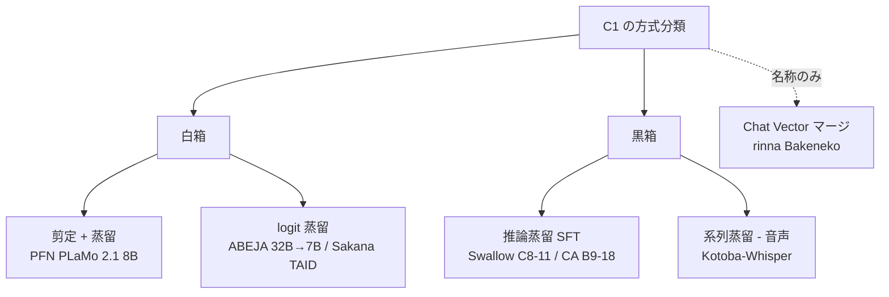

# 日本語の蒸留手法論文・技術資料 — PLaMo 2.1 / ABEJA / Swallow / サイバーエージェント / Kotoba / rinna（2026-10-22 追記）

- **Source**（複数資料を 1 レポートにまとめたもの）:
  - [PLaMo 2 Technical Report](https://arxiv.org/abs/2509.04897)（Preferred Networks、arXiv 2025-09-05、HTML v2）
  - [ABEJA Qwen2.5 32B-Japaneseより更に軽量なABEJA Qwen2.5 7B-Japanese v0.1の公開](https://tech-blog.abeja.asia/entry/geniac2-qwen25-7b-v0.1)（ABEJA Tech Blog、2025-04-22）/ [蒸留のパイプライン並列化](https://tech-blog.abeja.asia/entry/geniac2-distillation-pipeline-parallel)（同、2025-05-19）/ [モデルカード](https://huggingface.co/abeja/ABEJA-Qwen2.5-7b-Japanese-v0.1)
  - [蒸留による日英推論型大規模言語モデル構築戦略の探索](https://www.anlp.jp/proceedings/annual_meeting/2026/pdf_dir/C8-11.pdf)（水木ほか、東京科学大 Swallow チーム、NLP2026 C8-11）
  - [実用的観点から見た CoT 蒸留における教師–生徒能力差の影響](https://www.anlp.jp/proceedings/annual_meeting/2026/pdf_dir/B9-18.pdf)（梶塚・本多・高瀬、東大 / サイバーエージェント、NLP2026 B9-18）
  - [kotoba-tech/kotoba-whisper-v1.0](https://huggingface.co/kotoba-tech/kotoba-whisper-v1.0)（Kotoba Technologies × Asahi Ushio、2024）
  - [rinna/deepseek-r1-distill-qwen2.5-bakeneko-32b](https://huggingface.co/rinna/deepseek-r1-distill-qwen2.5-bakeneko-32b)（rinna、2025-02-13）
- **Date**: 2024〜2026
- **Type**: Technical Article（論文 + テックブログ + モデルカードの複合）
- **取得状況**: arXiv HTML、年次大会 PDF（全文）、ブログ本文、モデルカードをすべて直接取得。図は本文の数値・記述から再構成
- **証拠の質**: PLaMo 2 Tech Report = 一次資料（査読なし・自社計測）。NLP2026 の 2 件 = 一次資料（査読なしの年次大会発表）。ABEJA = 一次資料（実装報告）+ ベンダー申告（ベンチマーク）。Kotoba-Whisper / rinna = ベンダー申告（自己計測）。**いずれも第三者の再現は確認していない**
- **本レポートの位置付け**: gather の「日本語の手法論文・技術資料（2026-10-22 追記）」節のうち、C1 の論点（白箱 / 黒箱、コスト、教師選択）に直接かかわる 6 件を深掘りしたもの。TAID / TinySwallow は 09、R1-Distill の日本語派生は C7 で扱う

## Overview

当初の run では日本語資料が空白でしたが、補完の結果、国内にも **C1 の 3 系統（白箱の剪定 + 蒸留、白箱の logit 蒸留、黒箱の推論蒸留）すべてに一次資料がある** ことが分かりました。

| 系統 | 国内の一次資料 | 海外の対応物（本 run のレポート） |
|------|---------------|-------------------------------|
| 白箱: 剪定 + 蒸留 | PFN PLaMo 2.1 8B（31B → 8B、Minitron 系、500B token） | 02 Minitron |
| 白箱: logit 蒸留 | ABEJA 32B → 7B（NeMo、H100 × 64）、Sakana TAID（09） | 02・07・09 |
| 黒箱: 推論蒸留 | 東京科学大 Swallow（R1-0528 / gpt-oss-120b → Qwen3-8B-Base）、東大 / CA（CoT 蒸留の教師選び） | 03・10 |
| 系列蒸留（音声） | Kotoba-Whisper（large-v3 → デコーダ 2 層、6.3 倍高速） | （Distil-Whisper） |
| 「蒸留」と名乗るが蒸留でないもの | rinna Bakeneko（Chat Vector マージ + ORPO） | H3 の検証材料 |



## Key Technical Content

### 1. PFN PLaMo 2.1 8B — Minitron 系の剪定 + KL 蒸留（一次資料・自社計測）

- **手順**（Technical Report 2.3.2 節）: 学習済みの PLaMo 2 31B を Minitron（Sreenivas et al., 2024）に基づく構造化剪定で縮め、剪定前の 31B を教師に **標準的な KL 蒸留損失** で再学習。剪定した層・次元の内訳は未記載。
- **学習量**: Table 6 で PLaMo 2.1 8B は **500B token**（31B 側の学習計算は含まない）。Minitron の 94B〜380B より多い。
- **メモリ対策**: 語彙が約 10 万のため、**教師 logits を上位 128 token に制限**。性能への悪影響は小さいと報告（Distillation Scaling Laws 付録 G.4 の Top-128 と同じ発想。レポート 07 参照）。
- **性能**: JMMLU（5-shot、Table 1）は 8B 0.635 / 31B 0.672 / 旧 PLaMo-100B 0.575、pfgen-bench は 0.725 / 0.817 / 0.747。Abstract は「8B が旧 100B に匹敵」と主張。
- **注意**: Table 1 と Table 6 で 8B と 31B の JMMLU の値が入れ替わっており、報告内で不一致（本レポートは Table 1 の値を採用）。

```
JMMLU 5-shot（Table 1）
PLaMo 2 31B（教師）     |████████████████████████████████████ 0.672
PLaMo 2.1 8B（剪定+蒸留）|██████████████████████████████████ 0.635
PLaMo-100B（旧世代）     |███████████████████████████████ 0.575
```

### 2. ABEJA 32B → 7B — NeMo での白箱蒸留と実装課題（一次資料 + ベンダー申告）

| 項目 | 内容 |
|------|------|
| 教師 / 生徒 | ABEJA-Qwen2.5-32b-Japanese-v0.1 / Qwen2.5-7B-Instruct |
| 方式 | 「ホワイトボックスの知識蒸留」。NVIDIA NeMo + NeMo-Aligner。損失・温度・token 数は非開示 |
| 計算環境 | Azure CycleCloud、H100 × 8 を 8 ノード（64 GPU）。学習時間・費用は非開示 |
| 比較 | 同じ設定の継続事前学習（CPT）版より蒸留版が高く、蒸留版のみ公開 |
| Japanese MT-Bench | 蒸留版 **7.26** / CPT 版 7.21 / 元の Qwen2.5-7B-Instruct 6.86 / gpt-3.5-turbo 6.82（GPT-4o-0513 採点、3 回平均、他モデルは nejumi leaderboard3 の値） |
| 指示追従 | ChatVector（Qwen2.5-7B-Instruct − Qwen2.5-7B）で付与。post-training は未実施 |
| 既知の問題 | 稀に中国語が混入 |

実装報告（JT2）の要点: NeMo 公式のパイプライン並列蒸留は教師の中間出力をグローバルバッチ分キャッシュするため OOM になりやすい。ABEJA は Megatron-Core のスケジュールを書き換え、**マイクロバッチごとに教師 forward → 生徒 forward → 損失 → 生徒 backward** を回す方式にした。V100 × 2・教師 1.5B / 生徒 0.5B・系列長 1,024 の検証で、元実装は global batch 64 で OOM、改修版は 1,024 まで動作（スループットは未計測）。

### 3. 東京科学大 Swallow — 日英推論蒸留のレシピ探索（NLP2026 C8-11、一次資料）

- **設定**: 推論型教師（DeepSeek-R1-0528、gpt-oss-120b）に指示文を入れて〈指示・推論過程・応答〉を合成し、Qwen3-8B-Base に SFT。言語（日 / 英）・学習ドメイン（STEM / 対話）・教師・推論過程の有無・データ規模を変えた 10 条件で要因を分離。評価は swallow-evaluation-instruct（AIME、MATH-500、GPQA、LiveCodeBench、MT-Bench 等）。
- **結果**:
  1. **英語データの学習だけで日本語入力にも深い推論が発現** する。
  2. 教師の違い（R1 → gpt-oss）は推論の安定性に効く一方、性能は AIME・LCB の悪化と MT-Bench の改善が混在。
  3. 汎用対話でも推論過程付きデータが有効。逆に **推論過程なしの日本語対話データを混ぜると日本語での推論発現が抑制され得る**。
- **C1 への含意**: 03・10 が示した「教師の選択が最大のレバー」を日本語で再確認し、さらに「言語とドメインの混ぜ方」という日本企業固有の論点を加えた。gpt-oss-120b（Apache 2.0）は日本語で推論できないため英語トレース経由になる点も実務上の注意。

### 4. 東大 / サイバーエージェント — CoT 蒸留の能力差を実務目線で再検証（NLP2026 B9-18、一次資料）

- **問い**: 「教師が強すぎると蒸留が不調（capacity gap）」なら、生徒に見合う教師を探す評価コストがかかる。これは実運用でも成り立つか。
- **発見**: 既存研究の設定（教師間でのデータフィルタリング、生徒が教師より大きい設定の混入）では **蒸留後にむしろ性能が低下** していた。これを是正すると、能力差の影響はタスク・設定を通じて一貫せず、**候補教師間の性能差が大きい場合は高性能教師の利点が勝つ**。
- **実務指針**: (1) 蒸留後に性能が改善することをまず確認する、(2) 候補教師間の差が大きければ高性能教師を優先する。
- **C1 への含意**: レポート 07（Scaling Laws の capacity gap）・09（TAID）・gather #16（Capacity Gap 法則）が前提とする「教師は強ければ良いわけではない」に対し、**黒箱の CoT 蒸留では教師探索のコストを払う前に、まず蒸留が効いているかの検証を優先せよ** という反対側の実務知見。

### 5. Kotoba-Whisper — 音声の系列蒸留（ベンダー申告）

| 項目 | v1.0 | 教師 large-v3 |
|------|------|--------------|
| パラメータ | 756M（エンコーダ全層 + デコーダ 2 層） | 1,550M |
| 学習データ | ReazonSpeech large 約 1,253 時間（WER > 10 を除外）、8 エポック | — |
| 相対遅延 | **6.3 倍高速** | 1.0 |
| CER: CommonVoice 8 / JSUT / ReazonSpeech | 9.4 / 8.5 / **12.2** | 8.5 / 7.1 / 14.9 |

学習ドメイン（ReazonSpeech）では教師超え、ドメイン外では教師に劣る。LLM の推論蒸留でも同じ構図（03 の「数学に偏った 1.5B」）。

### 6. rinna Bakeneko — 「distill」を名乗るマージモデル（ベンダー申告）

rinna/qwen2.5-bakeneko-32b（日本語継続事前学習）に、**DeepSeek-R1-Distill-Qwen-32B − Qwen2.5-32B の差分（Chat Vector、重み 1.0）をマージ** し、R1 生成 約 1.2k 件で ORPO。蒸留データでの SFT は行っていない。JA MT-Bench は 8.58 / 8.19（R1-Distill-Qwen-32B は 7.39 / 6.88）。**蒸留モデルの能力をマージで移す「二次加工」** であり、H3（蒸留と fine-tuning / マージの混同）の国内例。

## Figures & Tables

### 6 件の比較（本レポートで作成）

| 観点 | PFN PLaMo 2.1 | ABEJA 7B | Swallow C8-11 | CA B9-18 | Kotoba-Whisper | rinna Bakeneko |
|------|---------------|----------|---------------|----------|----------------|----------------|
| 方式 | 白箱: 剪定 + KL | 白箱: logit | 黒箱: 推論 SFT | 黒箱: CoT SFT | 系列蒸留（音声） | マージ + ORPO |
| 教師 → 生徒 | 31B → 8B（自社） | 32B → 7B（自社の日本語化 Qwen） | R1-0528 / gpt-oss-120b → Qwen3-8B-Base | 複数サイズの教師 → 小型生徒 | Whisper large-v3 → 756M | （R1-Distill-Qwen-32B の差分） |
| 必要データ | 500B token | 非開示 | 合成トレース（規模は条件ごと） | 教師正答例の CoT | 1,253 時間 | 約 1.2k 件（ORPO） |
| 計算 | 非開示（31B は別） | H100 × 64 | 非開示 | 非開示 | 非開示 | 非開示 |
| 公開物 | モデル（商用） | モデル（Apache 2.0） | 論文のみ | 論文のみ | モデル（Apache 2.0） | モデル（Apache 2.0） |
| 証拠の質 | 一次（自社） | 一次 + ベンダー | 一次（査読なし） | 一次（査読なし） | ベンダー | ベンダー |

### 価値式との対応

$$
\text{蒸留のビジネス価値} \approx (C_{\text{teacher}} - C_{\text{student}})\cdot Q - (C_{\text{data}} + C_{\text{train}}) - \Delta\text{Acc}\cdot V_{\text{err}}
$$

| 資料 | 数値を出している項 | 内容 |
|------|-----------------|------|
| PLaMo 2.1 | $C_{\text{train}}$・$\Delta$Acc | 500B token（31B の学習は別）。JMMLU で教師比 −0.037 |
| ABEJA 7B | $\Delta$Acc | CPT 版比 +0.05、元モデル比 +0.40（JMT-Bench）。費用は非開示 |
| Swallow / CA | $\Delta$Acc | レシピ・教師選びによる差。費用は非開示 |
| Kotoba-Whisper | $C_{\text{student}}$・$\Delta$Acc | 6.3 倍高速、CER は教師比 +0.9〜+1.4（ドメイン外）/ −2.7（ドメイン内） |

> 国内資料も海外と同じく **推論コストの実額や本番 ROI は示していません**。学習費を明示したものは 1 件もなく、Sky-T1（10）のような「数百ドル」級の公開値は国内にはありません。

## Practical Takeaways

1. **国内でも白箱蒸留は「重みを持つ側」に限られる**: PFN・ABEJA・Sakana はいずれも自社で教師の重みを持つ（または Apache 2.0 のオープン重みを日本語化した）うえで蒸留しており、商用 API 教師の例はない。
2. **Minitron / NeMo の手順は日本語モデルにそのまま適用できる**: PLaMo 2.1 と ABEJA は海外手法の移植で、固有の工夫は「上位 128 logits の保存」と「パイプライン並列のスケジュール改修」という実装面。
3. **日本語の推論蒸留は英語トレースで足りる可能性がある**（C8-11）。一方で日本語対話データの混ぜ方を誤ると推論が出なくなるため、データ配合は検証が必要。
4. **黒箱 CoT 蒸留では「教師探索」より「効いているかの確認」を先に**（B9-18）。候補教師間の差が大きければ強い教師で良い。
5. **「distill」を名乗る公開モデルは中身を確認する**: rinna Bakeneko は Chat Vector マージで、蒸留データの SFT ではない。規約・ライセンスの評価（C8）も「どのモデルの差分を使ったか」で変わる。

## Notes

- **検索・検証の範囲**: 言語処理学会 年次大会は目次ページから題名に「蒸留」を含む発表を抽出（NLP2025 は目次の約 93%、NLP2026 は約 90% を確認）。PFN テックブログは一覧 1 ページ目のみ確認で、PLaMo 2.1 の蒸留解説記事の有無は未確認。LLM-jp の蒸留資料は検索で該当なし。Zenn「オンポリシー蒸留」は 0 件。
- **追加調査候補**:
  - PLaMo 2 Technical Report の Table 1 / Table 6 の不一致の確認（PFN への照会または後続版）
  - NLP2026 C9-7（Japan Digital Design の金融翻訳蒸留）と P1-4（デンソーテンのエッジ RAG 向け埋め込み蒸留）の詳細（C5・C4・C6 と接続）
  - NLP2025 Q4-7（中間層蒸留の否定的結果）と Minitron 付録 A.4 の整合性
  - J-PlatPat での国内特許調査（本 run では未実施）
