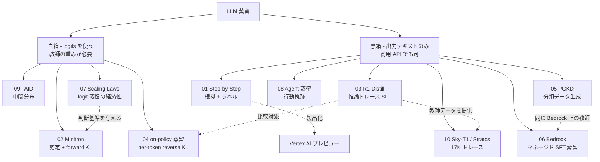
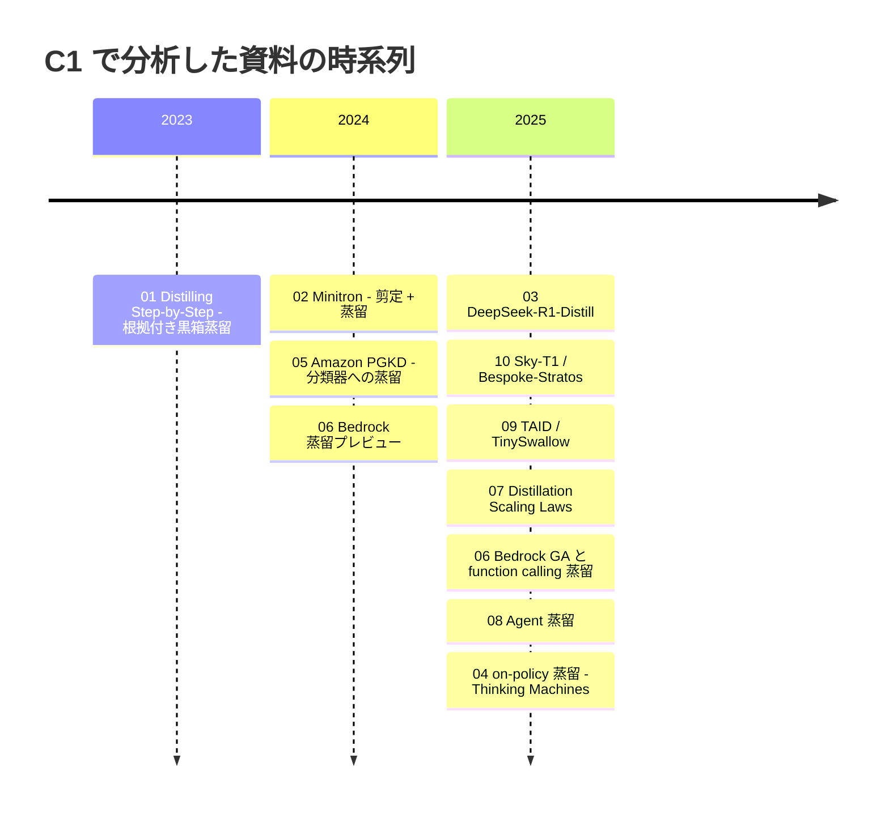
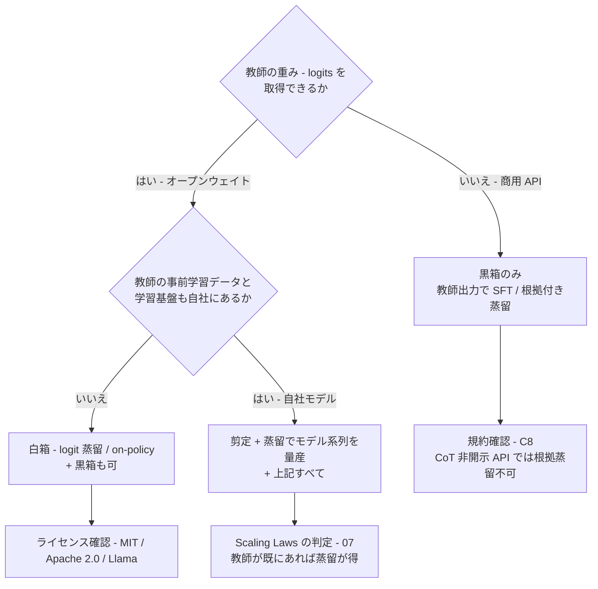

# C1 蒸留手法と技術基盤（kd_methods） — 詳細レポート

## Parameters

- **Resources analyzed**: 11（論文 7 / 技術記事 3 / ビジネス事例 1。複数資料を 1 レポートにまとめたものを含む。11 は 2026-10-22 追記）
- **Resource types**: Paper / Technical / Business
- **Generated on**: 2026-10-21
- **Input source**: gather 出力 [`resources-kd-methods.md`](../../../gather/20261021/kd_methods/resources-kd-methods.md) の「次フェーズへの申し送り」10 件
- **選定基準**: ビジネスでの導入判断に効く **定量的な根拠**（学習コスト・推論コスト・必要データ量・精度の保持率）を持つものを優先
- **取得方法**: 全レポートで原典（arXiv HTML 全文、公式ブログ、公式ドキュメント、Hugging Face のモデルカード）を直接取得して作成しました。セッション全体の WebSearch 上限に達していたため、補足の検索は行っていません。取得できなかった図などは、各レポート内に明記しています。
- **（2026-10-22 追記）レビューと補完**: 01〜10 の主要数値（R1 の蒸留 vs RL、Qwen3 Table 21、Minitron のスループット、PGKD の Table 5、Bedrock の BFCL スコア、Thinking Machines の倍率の帰属、Scaling Laws の結論）を原典で再照合し、各レポートの Notes に確認結果を追記しました。日本語資料の空白は、追加の検索枠（WebSearch 11 回）と原典の直接取得で補い、レポート 11 を追加しています。

## Report List

### Academic Papers

| # | Title | Year | Venue | Summary | 証拠の質 | Report |
|---|-------|------|-------|---------|---------|--------|
| 1 | Distilling Step-by-Step! Outperforming Larger Language Models with Less Training Data and Smaller Model Sizes | 2023 | Findings of ACL 2023 | 黒箱の根拠付き蒸留。770M の T5 がデータ 80% で 540B PaLM を上回り、必要データは平均 50% 超減 | 一次資料 | [Details](01-distilling-step-by-step.md) |
| 2 | Compact Language Models via Pruning and Knowledge Distillation / LLM Pruning and Distillation in Practice: The Minitron Approach | 2024 | NeurIPS 2024 / arXiv | 剪定 + logit 蒸留。学習 token はゼロから学習する場合の最大 40 分の 1、モデル系列の学習計算は 1.8 倍節約 | 一次資料（自社計測） | [Details](02-minitron-pruning-distillation.md) |
| 3 | DeepSeek-R1（蒸留節） | 2025 | arXiv | 約 80 万件の SFT 蒸留で、同じ 32B に RL をかけた場合より AIME が +25.6 pt | 一次資料（自社計測） | [Details](03-deepseek-r1-distillation.md) |
| 5 | Performance-Guided LLM Knowledge Distillation for Efficient Text Classification at Scale（Amazon PGKD） | 2024 | EMNLP 2024 | Claude 3 Sonnet の知識を BERT に蒸留。100 万件分類のコストが約 6,042 ドルから約 72 ドルに | 一次資料（自社計測、本番導入の記述なし） | [Details](05-amazon-pgkd.md) |
| 7 | Distillation Scaling Laws（Apple） | 2025 | ICML 2025 | 蒸留が得になるのは「教師が既にある」か「多数の生徒を作る」場合だけ | 一次資料 | [Details](07-distillation-scaling-laws.md) |
| 8 | Distilling LLM Agent into Small Models with Retrieval and Code Tools | 2025 | NeurIPS 2025 Spotlight | Agent の軌跡蒸留。生徒は 2〜4 倍大きい CoT 蒸留モデルに匹敵 | 一次資料 | [Details](08-agent-distillation.md) |
| 9 | TAID: Temporally Adaptive Interpolated Distillation（+ TinySwallow-1.5B） | 2025 | ICLR 2025 | 中間分布による白箱蒸留。学習は GKD の約 1/14 の時間。国内発の手法と公開モデル | 一次資料（論文）/ ベンダー申告（モデル） | [Details](09-taid-tinyswallow.md) |

### Technical Articles

| # | Title | Source | Date | 証拠の質 | Report |
|---|-------|--------|------|---------|--------|
| 4 | On-Policy Distillation（+ Qwen3 Technical Report の Table 21） | Thinking Machines Lab / Alibaba Qwen | 2025-10-27 | 一次資料（Qwen3）/ ベンダー申告（ブログの自社実験） | [Details](04-on-policy-distillation-thinking-machines.md) |
| 10 | Sky-T1（450 ドル）と Bespoke-Stratos | NovaSky（UC Berkeley） / Bespoke Labs | 2025-01 | 一次資料（自己計測）/ ベンダー申告 | [Details](10-sky-t1-bespoke-stratos.md) |
| 11 | 日本語の蒸留手法論文・技術資料（PLaMo 2.1 の剪定 + 蒸留、ABEJA 32B→7B、Swallow の日英推論蒸留、CA の CoT 蒸留再検証、Kotoba-Whisper、rinna Bakeneko）（2026-10-22 追記） | PFN / ABEJA / 東京科学大 / 東大・サイバーエージェント / Kotoba / rinna | 2024〜2026 | 一次資料（自社計測・査読なし）/ ベンダー申告 | [Details](11-japanese-distillation-sources.md) |

### Business Cases

| # | Title | Company | Date | 証拠の質 | Report |
|---|-------|---------|------|---------|--------|
| 6 | Amazon Bedrock Model Distillation — function calling 蒸留と「500% 高速・75% 安価」の根拠 | AWS | 2024-12 〜 2025-05 | ベンダー申告 | [Details](06-bedrock-function-calling-distillation.md) |

## Cross-Resource Insights

### 方式の地図 — 10 件の位置付け

### 共通テーマ

1. **「蒸留」の中身は 2 種類あり、ビジネス上の制約が全く違う**
   - **黒箱の系列 SFT**（01・03・05・06・08・10）: 教師の出力テキストで fine-tuning する方式です。商用 API を教師にできる唯一の方式で、Bedrock・Azure などのマネージド機能もすべてこの型です。NVIDIA のブログ（02）はこれを「SDG finetuning」と呼び、logits を真似る「classical KD」と区別しています。
   - **白箱の logit 蒸留**（02・04・07・09）: 教師の重みや logprob が必要です。オープンウェイトの教師か、自社で重みを持つ教師が前提になります。
   - レポート 07 の Scaling Laws は白箱だけを扱っており、黒箱 SFT には直接当てはまりません。
2. **コスト削減の数値は大きいが、比較の前提がまちまち**

   | 資料 | 削減の対象 | 数値 | 比較の基準 |
   |------|-----------|------|-----------|
   | 02 Minitron | 学習 token | 最大 40 分の 1（約 94B token） | ゼロからの事前学習 |
   | 03 R1 | 精度（同じ 32B） | AIME 47.0% → 72.6% | 同じモデルへの RL |
   | 04 Qwen3 | GPU 時間 | 17,920h → 1,800h（約 1/10） | RL |
   | 04 Thinking Machines | FLOPs | 9〜30 倍（GPU 時間では約 18 倍） | SFT の外挿（データ既存で 9 倍、教師の生成費を含めて約 30 倍） |
   | 04 Thinking Machines（2026-10-22 追記） | 勾配ステップ / 計算量 | 7〜10 倍 / 50〜100 倍 | **RL で作った方策を元のベースへ再蒸留する自己蒸留実験**。RL 一般との比較ではない |
   | 05 PGKD | 推論コスト（100 万件あたり） | 約 6,042 ドル → 約 72 ドル（約 84 分の 1、Table 5 からの比例換算） | 教師（Claude 3 Sonnet）の zero-shot、生徒は CPU 推論。原典 Abstract の「130 倍速く 25 倍安い」は GPU の遅延倍率と CPU のコスト倍率の組合せで、25 倍は表のどの組合せとも一致しない（2026-10-22 追記） |
   | 11 PLaMo 2.1（2026-10-22 追記） | 学習 token | 500B（31B 教師の学習は別） | ゼロからの事前学習（旧 100B と同等性能を 8B で） |
   | 06 Bedrock | 推論単価 | 2.4 → 0.15 ドル / 100 万 token（16 分の 1） | 405B 教師 |
   | 09 TAID | 学習時間 | 0.7h（GKD は 9.8h） | on-policy 蒸留 |
   | 10 Sky-T1 | 学習費 | 約 450 ドル（教師によるデータ生成費は含まない） | 公表なし |

3. **小型モデルへの推論能力の付与は「RL より蒸留」が定説に**
   - 03（AIME +25.6 pt）と 04（GPU 時間 1/10、pass@64 も改善）が、異なる組織から同じ結論を示しています。
   - 一方、10 の Bespoke は「データ 47 分の 1 で R1-Distill に近い」と報告しています。数量より **データの選別**（正誤判定器の改善で正解の保持率が 25%→73%）が効きます。
4. **Agent / tool calling の蒸留は学術・ベンダー双方で立ち上がり中（H6）**
   - 08: Agent の軌跡蒸留で、0.5B〜7B の生徒が 2〜4 倍大きい CoT 蒸留モデルに匹敵します。
   - 06: 405B から 3B への function calling 蒸留で、BFCL の multiple 区分は教師並みです。
   - 02: Minitron の生徒も BFCL で元モデルを上回りましたが、整合学習の寄与と分離されていません。
   - **本番環境での数値は 1 件もありません**。
5. **教師の選び方が事業リスクを決める（H5）**
   - 03 の R1 は MIT ライセンスで蒸留を明示的に許可しています。10 の QwQ は Apache 2.0 です。
   - 06 の Bedrock では Anthropic の教師が「現在は利用できない」（User Guide、2026-10 時点）とされています。
   - 05 の PGKD は Claude を Bedrock 経由で教師に使っていますが、規約上の扱いへの言及はありません。

### 価値式との対応

ドメイン index の式 $\text{価値} \approx (C_{\text{teacher}} - C_{\text{student}})\cdot Q - (C_{\text{data}} + C_{\text{train}}) - \Delta\text{Acc}\cdot V_{\text{err}}$ のうち、各レポートが数値を出している項を示します。

| レポート | 推論コスト差 $(C_t - C_s)\cdot Q$ | 初期投資 $C_{\text{data}} + C_{\text{train}}$ | 精度差 $\Delta\text{Acc}$ |
|---------|:---:|:---:|:---:|
| 01 Step-by-Step | △（モデルサイズのみ） | ✓（データ量） | ✓ |
| 02 Minitron | ✓（スループット） | ✓（token・FLOPs） | ✓ |
| 03 R1-Distill | — | △（教師側の GPU 時間のみ） | ✓ |
| 04 on-policy | — | ✓（GPU 時間・FLOPs） | ✓ |
| 05 PGKD | ✓（ドル・秒） | △ | ✓ |
| 06 Bedrock | ✓（単価・遅延） | △（課金体系のみ） | ✓ |
| 07 Scaling Laws | — | ✓（計算配分の理論） | ✓ |
| 08 Agent 蒸留 | △（推論時の 8 候補生成は増分） | △ | ✓ |
| 09 TAID | — | ✓（学習時間） | ✓ |
| 10 Sky-T1 / Stratos | — | ✓（ドル・GPU 時間） | ✓ |

> **推論コスト差 $(C_t - C_s)\cdot Q$ を実額で示したのは 05 と 06 だけ** で、どちらも Amazon / AWS の資料です。手法の論文は「学習コスト」と「精度」の報告が中心で、ROI の実証は C4・C5 の本番事例に頼る必要があります。

### 系譜とタイムライン

## 手法選択ガイド（ビジネス読者向け、2026-10-22 追記）

本 run の 11 レポートに **実際に数値がある範囲だけ** で、「教師の種類 × 目的」ごとの推奨方式を整理します。計算量・データ量は各資料の条件での値で、第三者検証はありません。利用規約・ライセンスの判断は C8 を参照してください。

### まず分岐を決める

### 決定表

| 教師の種類 | 目的 | 推奨方式 | 必要データ量の目安 | 計算量の目安 | 主な制約 | 根拠レポート |
|-----------|------|---------|-----------------|------------|---------|------------|
| 商用 API（出力テキストのみ） | コスト削減（分類・抽出・短答） | 黒箱の根拠付き蒸留 / 能動学習型データ生成 + 小型分類器の SFT | ラベル 1,000 件 + 教師生成 数百件（05）。人手ラベルを 50〜85% 減（01） | BERT 級なら GPU 1 枚・時間単位（05 は推論を CPU でも可） | 規約（C8）。教師への問い合わせ費は未公開（05） | 01・05 |
| 商用 API | Agent / tool calling | クラウドのマネージド蒸留（同一ファミリー内） | プロンプト 100〜15K 件、本番ログの再利用可 | ジョブ例: データ処理 約 1 時間 + 学習 約 7 時間（規模は非公開） | 教師は同一ファミリーのみ。Anthropic 教師は停止中（2026-10）。評価は約 200 件・1 領域 | 06 |
| 商用 API | 推論能力の付与 | 原理的には黒箱の推論蒸留だが、**CoT 非開示の API と規約** のため実務ではオープン教師へ移るのが実態 | — | — | 規約（C8）。10 の両プロジェクトは補助用途でも GPT-4o-mini の規約が論点 | 03・10 |
| オープンウェイト教師（logits 可） | 推論能力の付与 | 推論トレースの SFT（黒箱）→ 余力があれば on-policy 蒸留を上乗せ | 17K 件（10）〜80 万件（03）。教師の質で 17K でも AIME +20 pt（10） | 32B の SFT は H100×8 で 19〜27 時間・約 450 ドル（10、データ生成費は別）。on-policy は RL の 1/10 の GPU 時間（04、Qwen3 一次） | ライセンス（R1 は MIT、QwQ は Apache 2.0、Llama 系は Llama ライセンス）。3B 以下は長い CoT が効きにくい（03 Notes・10） | 03・04・10・11（Swallow / CA） |
| オープンウェイト教師 | エッジ / 小型化（1〜4B） | 白箱 logit 蒸留（中間教師 TAID）または剪定 + 蒸留（教師補正付き） | TAID: 指示データ 約 150K 件 + 継続事前学習（09）。Minitron: 94B〜380B token + 教師補正 100B token（02） | TAID: H100×8 で 1 エポック 0.7 時間（09）。Minitron: DGX H100 32 ノード級（02） | 教師の重みが必要。TinySwallow の商用可否はモデルカード内で記述が不一致（09） | 02・09・11（ABEJA） |
| オープンウェイト教師 | Agent（検索・コード実行） | 行動軌跡の蒸留（黒箱 SFT + LoRA）+ 推論時の自己一貫サンプリング | 約 2,000 軌跡（正解のみ残す） | LoRA rank 64、A100×4、2 エポック | 推論時に候補 8 本を生成するため生徒コストが数倍。本番数値なし | 08 |
| オープンウェイト教師 | 追加学習で壊れた振る舞いの修復 | 追加学習前のモデルを教師にした on-policy 蒸留 | プロンプト集合のみ（Tulu3 等、再サンプル） | 社内文書 mid-train の後段として小規模 | 教師 logprob が必要 | 04 |
| 自社モデル（重み・データ・基盤あり） | モデル系列の量産 / エッジ | 最大モデルを 1 つ学習し、剪定 + logit 蒸留で小型版を作る。logits は Top-128 保存で多数の生徒に再利用 | 追加サイズ 1 つあたり 94B〜500B token（02・11 PLaMo） | ゼロから学習の最大 40 分の 1 token、系列全体で 1.8 倍節約（02） | 「教師が既にある / 多生徒」のときだけ蒸留が得（07）。forward KL が良い（02・07） | 02・07・11（PFN） |
| 自社モデル | 業務用の小型モデルを 1 体だけ | **教師を新規に作ってまで蒸留しない**。生徒を直接学習するか、公開教師を使う | — | — | 教師の学習費を含めると教師付き学習が常に有利（07） | 07 |
| 自社モデル | 推論能力 / Agent | オープンウェイト教師の行と同じ（自社教師を使う） | 同上 | 同上 | 教師が強すぎる場合の能力差は、黒箱 CoT 蒸留ではまず「蒸留後に改善しているか」を確認（11 CA） | 03・04・08・11 |

### 読み方の注意

- **「蒸留」の中身を先に確認する**: 商用の蒸留機能（06）、R1-Distill（03）、Agent 蒸留（08）、PGKD（05）はすべて「教師の出力で SFT」であり、学習基盤は通常の fine-tuning と同じです。logits を使う真の蒸留（02・04・07・09・11 PFN / ABEJA）は重みを持つ側に限られます。
- **推論コストの実額を出しているのは 05 と 06 だけ** で、いずれも Amazon / AWS の資料です。学習費を出しているのは 10（約 450 ドル）と 03（教師側 約 29.4 万ドル）だけで、国内資料（11）は学習費を公開していません。
- **小型生徒 + 長い CoT は要注意**: 3B 以下では長い推論トレースの蒸留が効きにくく（03 Notes の Small Models Struggle、10 の 7B 結果）、出力 token が増えて推論費が下がりにくい（03）。
- **量子化・剪定との切り分け**: Minitron のスループット 2.7× / 1.8× は FP8 前提で、FP8 自体の寄与は 1.4×（02）。ベンダーの「最大 500% 高速」（06）は条件の記載がありません。

## Comparison Table

| 観点 | 01 Step-by-Step | 02 Minitron | 03 R1-Distill | 04 on-policy | 05 PGKD | 06 Bedrock | 07 Scaling Laws | 08 Agent 蒸留 | 09 TAID | 10 Sky-T1 / Stratos |
|------|----|----|----|----|----|----|----|----|----|----|
| 方式 | 黒箱（根拠 + ラベル） | 白箱（剪定 + forward KL） | 黒箱 SFT | 白箱 on-policy（reverse KL） | 黒箱（データ生成 + CE） | 黒箱（マネージド SFT） | 白箱（理論） | 黒箱（軌跡 SFT + LoRA） | 白箱（中間分布） | 黒箱 SFT |
| 教師 | PaLM 540B | Nemotron-4 15B / Llama 3.1 8B / Mistral NeMo 12B | R1 系列（約 80 万件） | Qwen3-32B など | Claude 3 Sonnet | Llama 405B / Nova など | 様々なサイズ | Qwen2.5-32B | Phi-3 / Qwen2.5-32B など | QwQ / DeepSeek-R1 |
| 生徒 | T5 220M〜11B | 4B / 8B | Qwen / Llama 1.5B〜70B | Qwen3-8B など | BERT-base | Llama 3.2 3B など | 様々なサイズ | 0.5B〜7B | 1.5B など | 32B / 7B |
| 必要データ | 減（最大 85% 超減） | 約 94B〜380B token | 約 80 万件 | 生徒自身の生成 | 1,000 ラベル + 生成 | 100〜15K 件 | — | 約 2,000 軌跡 | 指示データ | 17K 件 |
| 商用 API 教師 | 原理的に可 | 不可 | 不可（オープン教師） | 不可（logprob が必要） | 可（Bedrock 経由） | 同じファミリー内のみ | 不可 | 可 | 不可 | 可（オープン教師を使用） |
| 主な数値 | 770M > 540B | 40 分の 1 token | AIME +25.6 pt vs RL | GPU 時間 1/10 | 100 万件あたり約 6,042→72 ドル | 単価 16 分の 1 | 蒸留が得になる条件 | 2〜4 倍のサイズに匹敵 | 学習時間 1/14 | 約 450 ドル |
| 証拠の質 | 一次 | 一次（自社） | 一次（自社） | 一次 + ベンダー | 一次（自社） | ベンダー | 一次 | 一次 | 一次 + ベンダー | 一次（自己）+ ベンダー |
| 関連仮説 | H2・H5 | H3・H6 | H5・H6 | H2・H5 | H1・H3 | H2・H5・H6 | — | H6 | H4 | H5 |

## 仮説（H1–H6）の検証状況（C1 視点）

| 仮説 | 判定 | 根拠 |
|------|------|------|
| H1 定量成果の本番事例は検索・推薦に集中 | **△ 部分支持**（C1 の範囲外） | C1 で推論コストを実額で示したのは Amazon の分類（05）と AWS（06）だけ。手法系の資料には本番運用の数値がない |
| H2 ベンダー数値はベンダー集計で、顧客別成果は非公開 | **支持** | 06: 「500% 高速・75% 安価・精度低下 2% 未満」に条件の記載がなく、取得した 4 資料すべてに顧客別の数値がない。ブログ内でも、平均改善の数字（5.8%）と図の値（約 8.5%）が合わない |
| H3 「90% コスト削減」の多くは蒸留ではなく fine-tuning | **支持（定義の問題として）** | 商用の「蒸留」は実態が教師出力での SFT（NVIDIA の言う SDG finetuning）。05 も cross-entropy の SFT。真の logit 蒸留は 02・04・07・09 のように重みを持つ側に限られる |
| H4 国内は公開モデル型が中心 | **支持** | 09 の TinySwallow は公開モデルで、事業会社の社内導入の数値はない。（2026-10-22 追記）11 の PFN（PLaMo 2.1 8B、商用製品）・ABEJA（公開モデル）・rinna（公開モデル）も同様で、学習費・本番 ROI を公開した国内資料は見つからなかった |
| H5 商用 API 教師は規約で強く制約される | **支持** | 06: Anthropic 教師は利用できず、教師と生徒は同じファミリーに限られる。03・10 はライセンスが明確なオープン教師（MIT / Apache 2.0）へ移る流れを示す。04 の on-policy は logprob が要るため、オープン教師が前提 |
| H6 推論蒸留以降、Agent・tool calling 蒸留が増加 | **支持（研究とベンダー実験の段階）** | 08（NeurIPS 2025 Spotlight と関連研究 2 件）、06（BFCL で 3B が教師並み）、02（BFCL で教師超え）。ただし 03 の R1 自体は function calling で V3 に劣り、本番の数値はない |

## Further Investigation Candidates

- **Qwen3 Technical Report**（arXiv 2505.09388）: strong-to-weak 蒸留の詳細。今回は 4.5 節と Table 21 だけ取得しました。
- **OpenThoughts: Data Recipes for Reasoning Models**（arXiv 2506.04178）: 1,000 回超の実験による推論蒸留データの作り方。10 の後継です。
- **Small Models Struggle to Learn from Strong Reasoners**（arXiv 2502.12143）: 3B 以下で長い CoT の蒸留が効かない問題。03 と 10 の結果を読むときの注意点になります。
- **Black-Box On-Policy Distillation (GAD)**（arXiv 2511.10643）と **SODA**（arXiv 2604.03873）: 黒箱でも on-policy 化する手法。商用 API 教師で 04 の利点を得られるかを確かめるため。
- **Puzzle / Llama-Nemotron**（arXiv 2411.19146 / 2505.00949）: 02 の発展。推論スループット 2.17 倍と、1 ノードでの配置。
- **Scaling Down, Serving Fast**（LinkedIn, arXiv 2502.14305）: 蒸留モデルを本番の推薦に配置した教訓（C4 と重なる）。
- **OpenAI 特許 US12619603B2**: 「言語モデルプログラム」で作ったデータによる検索応答エンジンの蒸留。商用 LLM 事業者自身が蒸留を権利化している例（C8 と重なる）。
- **Antidistillation Sampling / Distillation-Resistant LLMs**（arXiv 2504.13146 / 2602.03396）: 教師側の防御技術。黒箱蒸留の将来的な実行可能性に関わります。
- **日本語の手法論文・国内特許**: 今回の gather では検索上限のため空白です。NLP 年次大会と J-PlatPat を次回の優先対象にします。（2026-10-22 追記）日本語の手法論文・技術資料は gather 末尾の節（13 件）とレポート 11 で補完しました。残る空白は **国内特許（J-PlatPat）**、PFN テックブログの蒸留記事本文、LLM-jp の蒸留関連資料、NLP2026 C9-7（金融翻訳）/ P1-4（エッジ RAG 埋め込み）の詳細です。
