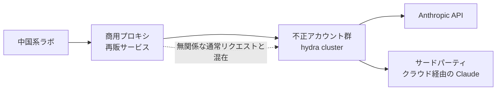
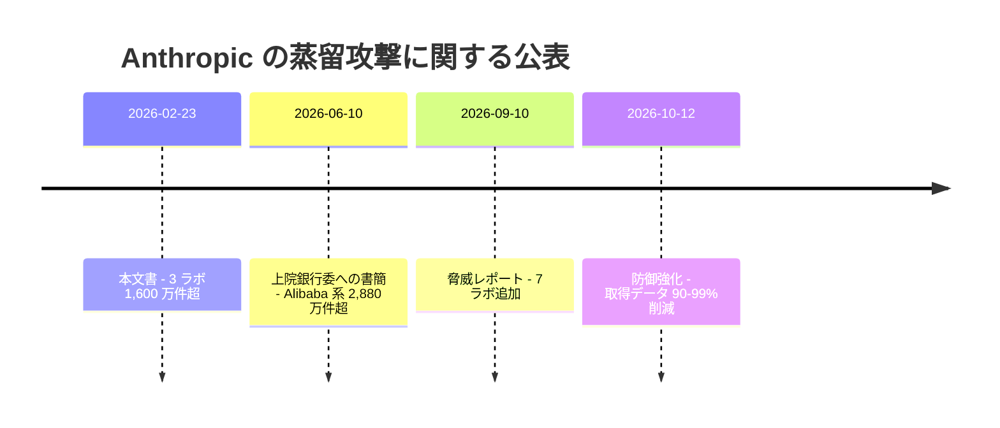

# Detecting and preventing distillation attacks

- **Source**: Anthropic（Security カテゴリ）
- **Date**: 2026-02-23
- **Link**: https://www.anthropic.com/news/detecting-and-preventing-distillation-attacks
- **Type**: Technical Article（一次ブログ。数値・帰属はすべて **ベンダー申告**）
- **取得状況**: WebFetch で本文を取得済み（2026-10-21）

> 本レポートはリサーチであり法的助言ではありません。件数・帰属は Anthropic の主張で、独立した検証や裁判所の認定はありません。

## Overview

Anthropic が、中国の AI ラボ 3 社（DeepSeek、Moonshot AI、MiniMax）による **「産業規模の蒸留キャンペーン」** を初めて社名付きで公表した文書です。約 **24,000 の不正アカウント** を使い、Claude との **1,600 万件超のやり取り（exchanges）** を生成したとしています。これは Anthropic の利用規約と地域制限（中国への商用提供なし）に違反する行為と位置づけられています。

本文書のビジネス上の意味は 2 点です。

1. **蒸留そのものは正当な手法と明言** している（"Distillation is a widely used and legitimate training method."）。問題とするのは「不正なアクセス手段で他社の能力を複製すること」。
2. 攻撃の検出シグナル（狭い領域への大量集中、反復的なプロンプト構造）は、**正規の企業ユーザが社内用に大量の教師データを生成する行為と外形上似ている**。企業側は、規約上の許可の有無を明確にしておかないと、検出対象になり得る。

## Key Technical Content

### 3 社のキャンペーン（Anthropic 申告）

| ラボ | やり取り件数 | 狙った能力 | 帰属の根拠 |
|------|-------------|-----------|-----------|
| DeepSeek | 150,000 超 | 多様なタスクの推論 / ルーブリック採点で Claude を **強化学習の報酬モデル** として使用 / 政治的に敏感な質問への「検閲を回避した代替回答」 | リクエストのメタデータが同社の特定研究者に遡及 |
| Moonshot AI（Kimi） | 3.4 百万超 | エージェント推論・ツール使用 / コーディング・データ分析 / コンピュータ操作エージェント / コンピュータビジョン | メタデータが上級スタッフの公開プロフィールと一致 |
| MiniMax | 13 百万超 | エージェント型コーディング / ツール使用とオーケストレーション | メタデータ・インフラ指標・公開ロードマップとの時期照合 |

```
やり取り件数（百万件、Anthropic 申告）
MiniMax   |██████████████████████████ 13.0
Moonshot  |███████ 3.4
DeepSeek  |▏ 0.15
合計 16 百万超 / 約 24,000 アカウント
```

### 攻撃の手口

- **DeepSeek**: Claude に内部推論を段階的に書き出させ、**chain-of-thought の学習データを大量生成**。
- **Moonshot**: 後期には Claude の推論トレースの抽出・再構成を試行。
- **MiniMax**: キャンペーン進行中（学習中のモデルの公開前）に検出。Anthropic が新モデルを出すと **24 時間以内にトラフィックの約半分を新モデルへ切替**。

### アクセス経路 — 「hydra cluster」



- Anthropic は **国家安全保障上の理由で中国本土および国外の中国企業子会社に商用アクセスを提供していない**。
- そのため、ラボは再販プロキシを使う。1 つのプロキシ網が **2 万超の不正アカウントを同時管理** し、蒸留トラフィックを無関係なリクエストと混ぜていた。

### 検出シグナル

| シグナル | 説明 |
|---------|------|
| 量の集中 | 狭い能力領域に非常に大量のリクエストが集中 |
| 構造の反復 | 反復的なプロンプト構造（数万の変種） |
| 内容 | 学習データとして価値の高い出力を狙う |
| 協調 | 数百の協調アカウントにまたがる |

単体では無害に見えるプロンプトも、**数万の変種が数百のアカウントから届くと疑わしい**、という判断です。

### 対策（4 本柱）

1. **検出**: 蒸留パターン（chain-of-thought の誘出を含む）の分類器と行動フィンガープリント、多数アカウントの協調検出ツール
2. **情報共有**: 他の AI ラボ・クラウド事業者・関係当局と技術指標を共有
3. **アクセス管理**: 教育アカウント、セキュリティ研究プログラム、スタートアップ組織の検証を強化（最も悪用される経路）
4. **対抗措置**: 正規顧客の体験を損なわずに出力の蒸留価値を下げる製品・API・モデル層の safeguards

### 懸念の理由

- **安全性**: 不正に蒸留されたモデルは、生物兵器や悪意あるサイバー活動を防ぐ safeguards を引き継がない可能性が高い。オープンソース化されればリスクが拡散。
- **輸出規制**: 蒸留は輸出規制が守ろうとする差を埋める。蒸留で得た性能向上が「export controls are ineffective」の証拠と **誤って解釈される** と指摘。抽出には先端チップが必要なので、チップ規制は蒸留の規模も制限すると主張。

## Figures & Tables

### 表 1: キャンペーン比較（再掲・整形）

| 項目 | DeepSeek | Moonshot | MiniMax |
|------|----------|----------|---------|
| 件数 | >150K | >3.4M | >13M |
| 主目的 | 推論・報酬モデル化・検閲回避 | エージェント・ツール・CV | エージェント型コーディング |
| 特徴的手口 | CoT の書き出し要求 | 推論トレース再構成 | 新モデルへ 24h で移行 |
| 検出時期 | — | — | 対象モデル公開前 |

### 表 2: 「正当な蒸留」と「不正な蒸留」の区別（本文の論理を整理）

| 観点 | 正当な蒸留（本文が認めるもの） | 不正な蒸留（本文が問題とするもの） |
|------|------------------------------|-------------------------------|
| 主体 | フロンティアラボが自社モデルを小型化 | 他社が他社モデルの能力を複製 |
| アクセス | 正規契約 | 不正アカウント・再販プロキシ・地域制限回避 |
| 規約 | 許可の範囲内 | 規約・地域制限違反 |
| 帰結 | 安価・小型モデルの提供 | safeguards なしのモデル拡散 |

### 図: 本文書の位置づけ（時系列）



## Practical Takeaways

1. **社内用の蒸留でも「事前承認」を取る**: 本文書の検出シグナルは正規の大量データ生成と外形が似る。Anthropic を教師にする場合、後述の AUP（2026-11-12 施行）では出力での AI モデル学習自体に **事前承認** が必要。
2. **再販・プロキシ経由のアクセスを避ける**: 正規の直接契約またはクラウド（Bedrock / Vertex 等）経由に限る。再販経由は規約違反と識別リスクの両方がある。
3. **蒸留は「正当」という公式見解を社内説明に使える**: Anthropic 自身が蒸留を正当な手法と認めており、問題は手段と規約違反であることを、法務・経営層への説明に活用できる。
4. **安全性の引継ぎ**: 蒸留モデルは教師の safeguards を失いやすい。社内蒸留でも安全性評価（拒否挙動・有害出力）を学習後に再実施する。

## Notes

- 証拠の質: 件数・帰属・手口はすべて **ベンダー申告**。GIGAZINE（日本語）も「と主張」「と非難」の形で報じ、3 社の反論は掲載されていない。
- 本文書には具体的な政策提言（法案名など）はなく、「rapid, coordinated action」と「no company can solve this alone」を呼びかけるにとどまる。具体策は 6 月の議会書簡と 9 月レポートで示された（02 参照）。
- 関連: [02 Anthropic 脅威レポート 2026-09 と防御強化 2026-10](02-anthropic-threat-report-and-defenses-2026.md)
