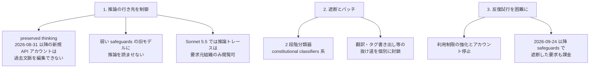
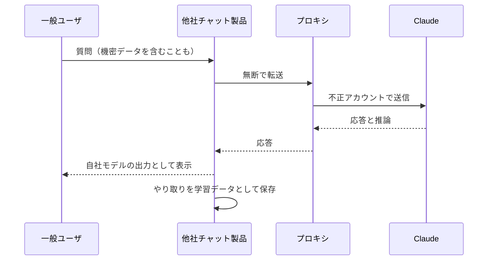

# Detecting and countering misuse of AI: September 2026（§07 Illicit distillation）／ Strengthening our defenses against distillation attacks

- **Source**: Anthropic
- **Date**: 2026-09-10（脅威レポート）／ 2026-10-12（防御強化の投稿）／ 参考: 2026-06-10（上院銀行委員会への書簡、報道経由）
- **Link**:
  - https://www.anthropic.com/threat-intelligence-report-september-2026
  - https://www.anthropic.com/news/distillation-defenses
  - 書簡の報道: https://letsdatascience.com/news/anthropic-accuses-alibaba-of-distilling-claude-d0593c90（Reuters ベース。原報道の malaymail は 403 で取得不可）
- **Type**: Technical Article（脅威インテリジェンス・一次。数値と帰属は **ベンダー申告**）
- **取得状況**: 脅威レポートは全文 279,397 文字のうち §07 を offset 200000 から取得。防御強化投稿は全文取得。

> 本レポートはリサーチであり法的助言ではありません。各社名・件数は Anthropic の帰属判断で、当事者の反論や公的認定は確認できていません。

## Overview

2 月の公表（01）以降、Anthropic は **さらに 7 つの中国系ラボ** の蒸留攻撃を阻止したと報告し、事例ごとに ID（GTG-xxxxx）、件数、手口を公開しました。最大は **Alibaba（Qwen / Tongyi Lab）の 1.51 億件超（2026 年 5〜7 月）** です。10 月の投稿では、推論トレースへのアクセス制御と分類器により **蒸留者が取得できるデータ量を約 90〜99% 削減** したとし、蒸留の経済性そのものを下げる方向に舵を切りました。

本文書群が企業に示す実務上の含意は、(1) 蒸留攻撃の主手段が **再販プロキシと「中継（relay）」** であり、それに巻き込まれた一般ユーザのデータ（製薬会社の設備投資モデル、開発者の認証情報など）が漏えいしていたこと、(2) Anthropic が **推論トレースの可視性を組織単位に限定** し、新規 API アカウントの過去文脈編集を禁じたことで、正規ユーザの統合にも影響が出ていること、の 2 点です。

## Key Technical Content

### §07 の定義

- 蒸留は正当な学習手法。**illicit distillation** は「an industrial-scale, covert campaign to extract a model's capabilities」で、通常は偽アカウント・盗難カード・盗難認証情報などの詐欺に支えられる。
- 一般提供モデルのみが標的で、非公開の Mythos 系への試行は観測されていない。

### アクセス手段

| 手段 | 内容 |
|------|------|
| プロキシ（「中転站 / transfer stations」） | 偽の身元・偽造/盗難カード・盗難 API キー（正規企業のものを含む）で数千アカウントを作成 |
| 再販業者 | Claude とのやり取りの **トランスクリプトを販売**。利用者に無断で保存している業者もある |
| 再ルーティング | 自社ユーザのリクエストを **無断で Claude に転送** し、その応答を学習用に収集 |

### 推論抽出の戦術

1. 反蒸留チェックを無視させる・推論を逐語出力させるプロンプト
2. システム指示を装い `<thinking>` タグ内に推論を出させる
3. あるラボは **12,000 件超のテスト** を個別手法で実施し、成功した少数を拡大
4. 過去の推論を別言語（例: **カタカナのみの日本語**）へ「翻訳」させる

### 事例一覧（Anthropic 申告）

| ID | ラボ | 期間 | 件数 | アカウント | 主な手口・特徴 |
|----|------|------|------|-----------|---------------|
| GTG-16005 | Alibaba（Qwen / Tongyi Lab） | 2026-05〜07 | 1.51 億件超 | 3,500 超（ピーク時）、2 プール計約 5,000 | 固定プロンプトでインラインタグに推論を書かせ、Qwen 3.5 / 3.6 / 3.7 の SFT データ化。ピーク **1 日約 300 万件**。RL 環境・アーキテクチャ研究にも利用 |
| GTG-16002 | Moonshot（Kimi） | 2026-05〜07 | 2,300 万件超 | 5,380（主にシンガポール・日本） | 顧客リクエストを無断で Claude に転送し Kimi の出力として表示。10 日で約 30 万件を主に Opus へ中継。thinking signature を使う **cross-session replay attack** |
| GTG-16001 | DeepSeek | 2026-07（14 日間） | 1,210 万件超 | — | 顧客に無断で中継。Claude Code / Agent SDK / OpenCode 利用者を識別して Opus に振り分け |
| GTG-16006 | Zhipu（Z.ai） | 2026-06〜07 | 340 万件超（17 日間） | 273 | Opus 4.8 に対する CoT 抽出パイプライン、Claude を採点・データ整形に利用。GLM 5.3 公開前に他社モデルのサイバー能力も蒸留 |
| GTG-16008 | Xiaomi | 2026-03〜04 | 40 万件超 | 1,500 超 | MiMo の利用者会話を Claude で再生。無料トライアル終了と同時に攻撃開始 |
| GTG-16012 | SenseTime | — | — | — | 第三者データ業者から購入したトランスクリプトを利用 |
| GTG-16003 | MiniMax | — | — | — | Anthropic と OpenAI のモデルだけを提供するプロキシをシェル会社で運営 |

```
件数（百万件、Anthropic 申告、9 月レポート）
Alibaba  |██████████████████████████████████████████████████ 151
Moonshot |████████ 23
DeepSeek |████ 12.1
Zhipu    |█ 3.4
Xiaomi   |▏ 0.4
```

### 6 月の議会書簡（報道ベース・二次）

| 項目 | 内容 |
|------|------|
| 日付・宛先 | 2026-06-10、上院銀行委員会 Tim Scott 委員長・Elizabeth Warren 筆頭理事 |
| 主張 | Alibaba / Qwen 系の運用者が 2026-04-22〜06-05 に **約 25,000 アカウントで 2,880 万件超** |
| 要望 | 米 AI ラボ間の脅威情報共有の改善 / 中国 AI 企業の先端チップ入手経路の封鎖 / 不正蒸留への罰則の検討 |
| Alibaba の反応 | Reuters の照会に即答せず |

### 10 月の防御強化（2026-10-12）



| 指標（Anthropic 申告） | 値 |
|------|----|
| 蒸留者が取得したデータ量の削減 | 約 90〜99% |
| 分類器導入後に抽出された推論トークン | 10〜100 倍以上減少 |
| 停止した蒸留関連アカウント | 数万（多くはキャンペーン開始から 2 時間以内） |
| 分類器の偽陽性率 | 0.1% 未満 |
| 完全トランスクリプトで学習した蒸留モデルの SWE-bench Verified | 80.4% |
| 要約トランスクリプトのみで学習した場合 | 71.8% |

$$
\Delta_{\text{SWE-bench}} = 80.4\% - 71.8\% = 8.6\ \text{pt}
$$

この実験は、**推論の「全文」が蒸留価値の大半を担う** ことを示し、推論を要約して返す（reasoning summaries）方針の根拠になっています。

## Figures & Tables

### 表: 9 月レポートが示した「巻き込まれたデータ」

| 事例 | 漏えいしたとされるデータ |
|------|------------------------|
| 中継一般 | 製薬会社の設備投資（capex）モデル、開発者のライブ認証情報 |
| Moonshot | PLA 関連とみられる成都の CCTV 監視分析、国有企業技術者の内部コードと認証情報 |
| DeepSeek | 中国テック企業の戦略文書、ロシア国防関連の政府 DB の認証情報、中国警察の監視ツール |
| Xiaomi | 十数言語・数百ユーザのデータ（米国人のデータは確認されず） |

### 表: Anthropic の措置（9 月レポート）

| 措置 | 内容 |
|------|------|
| 帰属 | プロキシのアカウント単位ではなく組織単位で帰属し、広範な執行を可能に |
| 分類器 | 敵対的抽出分類器で要求遮断とアカウント停止（Fable 5 と同時に強化） |
| 推論要約 | 「Claude now summarizes its internal reasoning before responding」 |
| preserved thinking | Fable 5.1 から。新規 API アカウントは推論より前の文脈を編集不可 |
| 本人確認 | 無許可再販や非対応国（中国・ロシア・イラン）からのアクセス等の兆候があるアカウントに本人確認を要求、または停止 |

### 図: 中継型（relay）蒸留の構造



## Practical Takeaways

1. **API 統合の互換性を確認する**: 2026-08-31 以降に作った API アカウントでは、推論を含む過去文脈の編集ができない。会話履歴を加工するエージェント実装は影響を受ける。
2. **遮断された要求も課金される**（2026-09-24 以降）。大量データ生成のジョブは、分類器に誤検知されないよう、事前承認と用途説明を用意する。
3. **サードパーティの AI 製品が裏で別モデルに中継していないか確認する**: 9 月レポートの事例は、利用者企業の機密データが第三者に流れていたことを示す。調達時の契約で「サブプロセッサとしてのモデル提供者」の開示を求める。
4. **「推論トレース」は蒸留価値の中核**: 社内蒸留で自社用の推論データを作る場合も、ベンダーが推論全文を返さない方向に進んでいるため、**最終回答のみ** を使う設計（Distilling Step-by-Step 型の根拠付き回答を明示的に出力させる等）を前提にする。

## Notes

- 証拠の質: 件数・帰属は **ベンダー申告**。NIST CAISI（2026-09-17）は GLM-5.3 を「the most cyber-capable open-weight model released to date」と評価したが、**CAISI の発表自体は蒸留に言及していない**（一次資料で確認）。
- 10 月投稿は Anthropic AUP の改定には触れていないが、同時期の AUP（2026-11-12 施行）には蒸留の明示的禁止がある（04 参照）。
- （2026-10-22 追記）10-12 投稿を再取得し、次の文言を逐語で再確認した: "Early evidence suggests that these methods have reduced the amount of data harvested by distillers by around 90 to 99%."、"they have a false positive rate of less than 0.1%."、preserved thinking は "a measure that prevents new API accounts (those created on or after August 31, 2026) from editing Claude's prior context"、"Users who continually try to extract reasoning from Claude face stricter usage limits."、9 月 24 日から安全装置でブロックされたリクエストへの課金を再開、名指しは Zhipu（GLM-5.3）と Moonshot（Kimi へのリクエストを Claude に転送）。AUP 本文の "Effective Nov 12, 2026" と "Do Not Abuse Our Platform" 節の「Use outputs to train an AI model（model scraping / model distillation を例示）without prior authorization」も再確認。
- （2026-10-22 追記）政府側の対応として NSA / CISA / FBI 共同勧告 AA26-251A（2026-09-08）が 6 社を名指しした（[09](09-us-policy-ostp-daamta.md) 追記）。Anthropic の 9 月脅威レポートと同週の公表であり、ベンダー申告と政府勧告が同じ事業者を挙げている。
- 投稿が引用する学術論文: Panfilov et al., "Stealing Reasoning Traces from Proprietary LLM APIs"（arXiv 2608.09867）。暗号化推論ブロックがセッション・ユーザ・同一ベンダーのモデル間で互換であることを突く攻撃で、本レポートの cross-session replay と同型。
- 関連: [01 2 月公表](01-anthropic-distillation-attacks-feb-2026.md) / [09 米国の政策対応](09-us-policy-ostp-daamta.md) / [10 Antidistillation Sampling](10-antidistillation-sampling.md)
