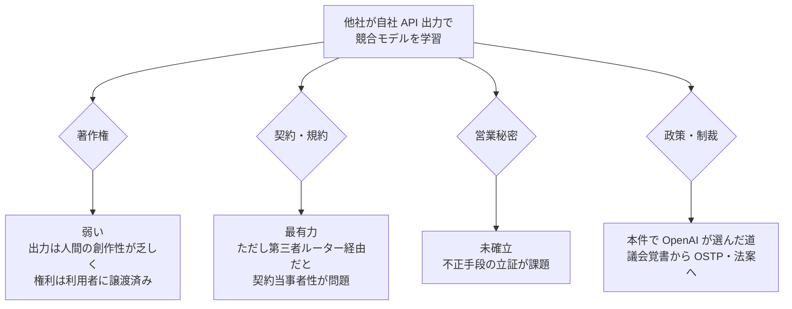

# OpenAI の DeepSeek 告発（下院中国特別委員会への覚書, 2026-02-12）と 2025 年以来の経緯

- **Company/Organization**: OpenAI（告発側）/ DeepSeek（杭州、親会社 High-Flyer）
- **Industry**: 生成 AI（フロンティアモデル）
- **Date**: 覚書 2026-02-12 送付（報道 2026-02-12〜13）。前段の疑義は 2025-01（R1 公開後）
- **Link**:
  - Reuters（Yahoo Finance 転載）: https://finance.yahoo.com/news/openai-accuses-deepseek-distilling-us-221629899.html
  - Rest of World: https://restofworld.org/2026/openai-deepseek-distillation-dispute-us-china/
  - GIGAZINE（日本語）: https://gigazine.net/news/20260213-openai-accuses-china-deepseek
  - 補足（2026-04 の Musk 証言）: https://techcrunch.com/2026/04/30/elon-musk-testifies-that-xai-trained-grok-on-openai-models
- **Type**: Business Case（事件・紛争）
- **取得状況**: 上記 4 件は WebFetch で取得済み。**覚書の原文、および openai.com の規約・発表ページは 403 で取得できず**、覚書の内容は報道経由（**二次報道**）。

> 本レポートはリサーチであり法的助言ではありません。DeepSeek 側は報道時点でコメントしておらず、主張は OpenAI の一方的なものです。

## Overview

OpenAI は 2026 年 2 月 12 日、米下院「米国と中国共産党の戦略的競争に関する特別委員会」に覚書を送り、DeepSeek が **OpenAI など米国フロンティアラボの能力に「ただ乗り（free-ride）」** していると主張しました。DeepSeek 社員に関連するアカウントが **「obfuscated third-party routers」** を経由してアクセス元を隠し、**米国モデルの出力をプログラムで取得するコード** を書いていたとしています。

2025 年 1 月の R1 公開直後にも OpenAI は蒸留の疑いを調査しており（Microsoft による調査の Bloomberg 報道が引用されている）、今回はその **エスカレーション** です。ただし **訴訟や正式な法的措置は報じられておらず**、議会への提出という政治的な手段にとどまっています。

## Problem & Context

| 時期 | 出来事 | 証拠の質 |
|------|-------|---------|
| 2025-01 | DeepSeek-R1 公開。少ないチップで米国トップモデルに匹敵し、輸出規制の議論が再燃。OpenAI が蒸留の有無を調査 | 二次報道 |
| 2025-03 | Winston & Strawn 系の分析が「著作権・特許・営業秘密より契約法が有利」と論評（07 参照） | 法律論評 |
| 2026-02-12 | OpenAI が下院特別委に覚書 | 二次報道（覚書原文は未取得） |
| 2026-02-23 | Anthropic が DeepSeek を含む 3 社を公表（01） | ベンダー申告 |
| 2026-04-23 | OSTP が「Adversarial Distillation of American AI Models」覚書（09） | 二次報道・政策メモ |
| 2026-04-30 | Musk 氏が xAI の OpenAI モデル蒸留を「Partly」と証言 | 二次報道 |
| 2026-07 | Anthropic によれば DeepSeek が 14 日間で 1,210 万件超を中継（02） | ベンダー申告 |

## Solution（OpenAI の主張と対応）

### 覚書の主張（報道からの引用）

| 論点 | 引用（英語原文の報道引用） |
|------|--------------------------|
| ただ乗り | "ongoing efforts to free-ride on the capabilities developed by OpenAI and other U.S. frontier labs" |
| 制限回避 | "developing methods to circumvent OpenAI's access restrictions" / "through obfuscated third-party routers" |
| プログラム取得 | DeepSeek employees "developed code to access U.S. AI models" |
| 他ラボへの波及 | "We believe that DeepSeek also uses third-party routers to access frontier models from other U.S. labs." |
| 安全性 | Chinese LLMs are "actively cutting corners" on safe training and deployment |
| 規約上の根拠 | OpenAI の方針は出力で「imitation frontier AI models」を作ることを禁止（Rest of World） |

- OpenAI は、蒸留して競合モデルを作ろうとしているとみられる利用者を **積極的に排除（アカウント停止・アクセス取消）** していると説明。
- IAM 誌（07 参照）は、覚書が「敵対的蒸留の大半は中国、時にロシアに由来」と述べたと報じている。

### 規約上の根拠（OpenAI Terms of Use、2024-12-11 版の写し）

| 条項（What you cannot do） | 原文 |
|---------------------------|------|
| 競合モデル | "Use Output to develop models that compete with OpenAI." |
| 自動抽出 | "Automatically or programmatically extract data or Output (defined below)." |
| リバースエンジニアリング | "Attempt to or assist anyone to reverse engineer, decompile or discover the source code or underlying components of our Services, including our models, algorithms, or systems (except to the extent this restriction is prohibited by applicable law)." |
| 制限回避 | "Interfere with or disrupt our Services, including circumvent any rate limits or restrictions or bypass any protective measures or safety mitigations we put on our Services." |
| 出力の帰属 | "you (a) retain your ownership rights in Input and (b) own the Output. We hereby assign to you all our right, title, and interest, if any, in and to Output." |

**矛盾点**: OpenAI は出力の権利を利用者に譲渡しているため、**著作権では争いにくく、契約（規約）違反が唯一の直接的な根拠** になります。しかも DeepSeek が第三者ルーター経由で利用していた場合、**DeepSeek 自身は OpenAI と契約関係にない可能性** があり、契約責任の追及も難しくなります（この点は法律論評の一般論で、本件の事実認定ではない）。

## Results & Impact

| 項目 | 結果 |
|------|------|
| 訴訟 | 報じられていない |
| 行政措置 | 覚書は議会への提出。OSTP 覚書（4 月）と H.R.8283（4 月委員会可決）へつながる政策的な流れの一部 |
| DeepSeek の反論 | Reuters の照会に即答なし |
| 業界の反応 | Counterpoint の Neil Shah:「none of the models is an island and the entire industry has mostly evolved based on recursive learning」 |
| 安全保障論 | RAND の Austin Horng-En Wang:「to prevent DeepSeek and China companies from acquiring more chips to distill the U.S. model」 |

## Figures & Tables

### 図: 法的手段の選択肢と本件の位置

### 表: 米国ラボ同士の蒸留（対照事例）

| 事例 | 内容 | 含意 |
|------|------|------|
| xAI と OpenAI | Musk 氏が 2026-04-30 の証言で、xAI が OpenAI モデルの蒸留を「Partly」行ったと答え、業界一般の慣行だと述べた | 「中国ラボの問題」だけでなく、**米国企業間でも規約違反になり得る行為が広く行われていた** ことを示唆 |
| 業界の情報共有 | TechCrunch は OpenAI・Anthropic・Google が Frontier Model Forum を通じて蒸留対策の情報共有を始めたと報道 | 情報共有は 02・09 の政策提言とも一致 |

## Lessons Learned

1. **出力を「所有」していても、使い道は契約で縛られる**: OpenAI 規約では出力はユーザ所有だが、競合モデル開発への利用は禁止。企業が出力を社内データ資産として扱う場合も、学習用途は別途確認が必要。
2. **「競合」の範囲は曖昧**: 規約は「models that compete with OpenAI」とするが、社内の狭いタスク用生徒モデル（例: 問い合わせ分類器）が競合に当たるかは明記されていない。2026 年時点では、OpenAI はセルフサーブ fine-tuning を縮小中（06 参照）で、**公式の蒸留経路自体が細っている**。
3. **ルーター・アグリゲータ経由の利用は二重のリスク**: 規約違反の疑いを招くだけでなく、2026 年の各社の検出強化で停止対象になり得る。
4. **紛争は法廷ではなく政策の場で進んだ**: 企業はこの領域で判例による明確化を待てない。規約原文と最新の政策動向を定期的に確認する体制が要る。

## Notes

- 覚書原文・openai.com の規約ページは本調査では 403 で取得できなかった。規約は 2024-12-11 版の第三者アーカイブで確認した（現行版の文言も同じだと検索結果は示すが、一次では未確認）。
- 関連: [04 クローズドモデルの規約比較](04-closed-vendor-terms-anthropic-google-openai-mistral.md) / [07 米国法の分析](07-us-legal-analysis-contract-trade-secret-copyright.md) / [09 米国の政策](09-us-policy-ostp-daamta.md)
