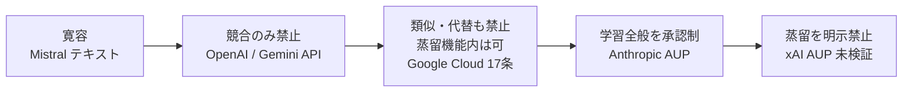
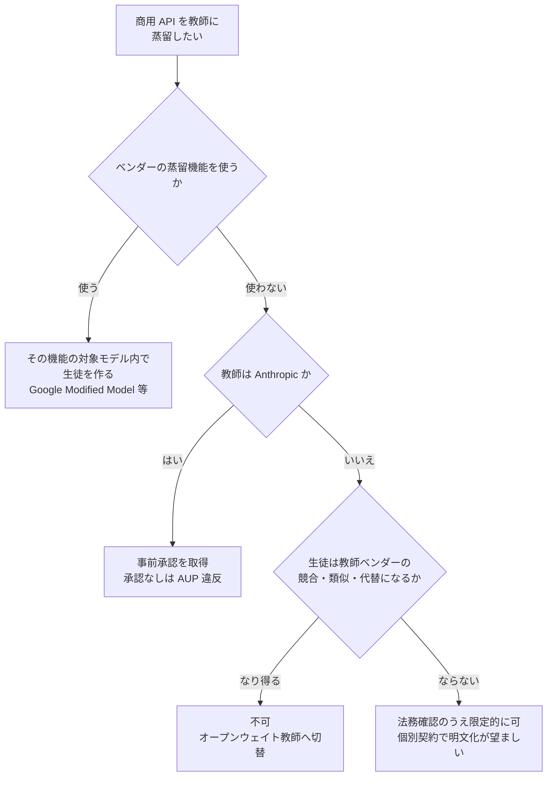

# クローズドモデル各社の利用規約における蒸留関連条項（Anthropic / OpenAI / Google / Mistral / xAI）

- **Source**: 各社の規約原文（一次資料）
- **Date**: 2026-10-21 時点の閲覧（各条項の発効日は表中に記載）
- **Link**:
  - Anthropic Usage Policy: https://www.anthropic.com/legal/aup
  - Anthropic Commercial Terms: https://www.anthropic.com/legal/commercial-terms
  - OpenAI Terms of Use（2024-12-11 版の写し）: https://open.windriver.com/info/uni-license-list/licenses/openai-tou-20241211.html
  - Gemini API Additional Terms: https://ai.google.dev/gemini-api/terms
  - Google Cloud Service Specific Terms（§17）: https://cloud.google.com/terms/service-terms
  - Mistral AI Commercial Terms: https://legal.mistral.ai/terms/commercial-terms-of-service
  - Mistral AI Usage Policy: https://legal.mistral.ai/terms/usage-policy
- **Type**: Technical Article（規約原文の比較分析）
- **取得状況**: 上記はすべて WebFetch で取得。**openai.com の原文と x.ai の規約は 403 で取得不可**（OpenAI は第三者アーカイブ、xAI は検索スニペットのみ）
  - （2026-10-22 訂正）openai.com（Terms of Use / Services Agreement / Usage Policies）と x.ai（Consumer ToS / AUP / Enterprise ToS）を **headed ブラウザ（agent-browser）で原文取得し検証済み**。本文末尾の「2026-10-22 追記」を参照。Anthropic AUP・Commercial Terms も再取得し、AUP "Effective Nov 12, 2026"、Commercial Terms 発効 2025-06-17 を確認

> 本レポートはリサーチであり法的助言ではありません。引用は 2026-10-21 時点の閲覧結果で、各社は頻繁に改定します。契約（Order Form / Enterprise Agreement）で個別に定めた条件は公開規約に優先し得ます。

## Overview

「商用 API を教師にして、自社タスク用の小型生徒モデルを作ってよいか」という問いに対する各社の答えは、2026 年 10 月時点で次のように **3 類型** に分かれます。

| 類型 | ベンダー | 要旨 |
|------|---------|------|
| **A. 出力での学習を原則禁止（事前承認制）** | Anthropic（AUP 2026-11-12 施行） | 競合かどうかを問わず「Use outputs to train an AI model」を事前承認なしに禁止 |
| **B. 競合・類似モデルの開発を禁止、自社機能内の蒸留は許可** | Google Cloud（§17）、Gemini API、OpenAI | 「compete」「similar」モデルの開発を禁止。Google は蒸留機能経由の Modified Google Model を明示的に許可 |
| **C. テキストには競合禁止なし（画像のみ）** | Mistral（Commercial Terms 2026-09-25 発効） | 競合禁止は画像出力のみ。ただし「extract any content」禁止の解釈に注意 |

## Key Technical Content

### 1. Anthropic

**Usage Policy（AUP）— 「Do Not Abuse Our Platform」**（発効 2026-11-12、一次資料）

> "Use outputs to train an AI model (e.g., "model scraping" or "model distillation") without prior authorization from Anthropic"

- 適用範囲: Claude.ai / Claude Code の個人利用者、API・開発者プラットフォームの企業、**クラウド事業者・正規再販経由の顧客**、Claude を組み込んだ製品のエンドユーザ。
- 同じ節の関連禁止: 複数アカウントでの検出回避、自動化によるアカウント作成、地域制限違反のアクセス、事前承認なしのガードレール回避、**消費者サブスクリプション経由のリクエスト中継を含む無許可の再販・プロキシ**。

**Commercial Terms D.4**（一次資料）

> "Customer may not and must not attempt to (a) access the Services to build a competing product or service, including to train competing AI models or resell the Services except as expressly approved by Anthropic; (b) reverse engineer or duplicate the Services; or (c) support any third party's attempt at any of the conduct restricted in this sentence."

- 出力: "Customer ... (b) owns its Outputs."、Anthropic は出力に関する権利（if any）を顧客に譲渡。

**解釈のポイント**: Commercial Terms は「競合」モデルを対象にするが、AUP は **競合要件のない「AI モデルの学習」全般** を対象にしている。AUP は商用顧客にも適用されるため、2026-11-12 以降は **社内専用の小型分類器であっても、Claude 出力で学習するなら事前承認が必要** と読むのが保守的です。

### 2. OpenAI

**Terms of Use（2024-12-11 版の写し）— What you cannot do**

> "Use Output to develop models that compete with OpenAI."
> "Automatically or programmatically extract data or Output (defined below)."

- 出力: "you (a) retain your ownership rights in Input and (b) own the Output."
- 公式の蒸留経路: 開発者ドキュメントは「Distilling from a larger model」として、gpt-4.1 の出力を保存して gpt-4.1-mini を fine-tune する手順を案内（一次）。**同一ベンダー内蒸留は公式に想定された使い方**。
- ただし 2026-05-07 以降、セルフサーブ fine-tuning は縮小（新規組織は不可、既存顧客も 2027-01-06 まで）。詳細は 06。

**未確定事項**: 「自動的・プログラム的な出力の抽出」の禁止は、通常の API 利用（プログラムから呼ぶこと）と文言上重なる。実務上は「スクレイピング等で UI から抜く行為」を想定した条項と解されることが多いが、本調査では OpenAI の公式解釈は確認できていない。

### 3. Google

**Gemini API Additional Terms**（2026-03-23 発効、2026-04-28 更新、一次）

> "You may not use the Services to develop models that compete with the Services (e.g., Gemini API or Google AI Studio)."
> "You also may not attempt to reverse engineer, extract or replicate any component of the Services"

- 生成コンテンツ: "Google won't claim ownership over that content."
- 非競合モデルの学習を許すかは **明示なし**。

**Google Cloud Service Specific Terms §17（AI/ML Services の利用制限）**（一次）

> 17(a) "Customer will not, and will not allow End Users to use an AI/ML Service or Generated Output to develop a similar or competing product or service. ... This restriction does not apply to Gemini Enterprise Agent Platform (formerly Vertex AI Platform) so long as Customer does not use a Google Pre-Trained Model."
>
> 17(b) "Customer will not, and will not allow End Users to, use output from an AI/ML Service (including Generated Output) to: (i) substitute, replace, or circumvent the use of a Google Model, directly or indirectly, or (ii) create or improve models similar to a Google Model. However, if an AI/ML Service offers the feature of fine-tuning or model distillation, Customer may use output from that AI/ML Service (including Generated Output) to modify and use Modified Google Models instead of Google Pre-Trained Models."
>
> 17(c) "Customer will not, and will not allow End Users to, reverse engineer or extract any components of an AI/ML Service, Software, or its models (such as using prompts to discover training data)."

- 定義（§15(b)）: **Modified Google Model** = Customer Data と AI/ML Service を使って（training, distilling, fine-tuning 等で）顧客が改変した Google Pre-Trained Model。**Google Pre-Trained Model** = Google が学習し、オープンモデルとして公開していないもの。

**解釈のポイント**: Google は 5 社の中で最も明確に **「蒸留してよい範囲」を規約で定義** している。すなわち、(i) Gemini の出力で **Gemini 以外のモデル**（例: 自社のオープンウェイト生徒）を作ると「Google Model の代替」や「類似モデル」に当たり得るが、(ii) **Vertex の蒸留機能で Gemini 系の生徒（Modified Google Model）を作るのは許可**。

### 4. Mistral AI

**Commercial Terms of Service**（2026-09-25 発効、一次）

- 3.3: "Customer may not use image Outputs to develop or train any image generation product" — **競合禁止は画像出力のみ**。テキスト出力に同様の制限はない。
- 2.2(d): リバースエンジニアリング禁止。
- 2.2(g): "use any method to extract any content from the Mistral AI Products" — 文言は広いが、蒸留を名指しはしていない。
- 3.1: 出力は顧客所有、Mistral は出力に関する権利を顧客に譲渡。
- Usage Policy（2026-06-11 発効）: 蒸留・出力学習への言及なし。

### 5. xAI（未検証）

- 検索スニペットでは、Consumer ToS に "Using the Service or any Output, to develop models or services that compete with xAI"、AUP（2026-06-26 版）に競合モデル開発と **"distilling model data or Outputs"** の禁止があると表示。
- **x.ai の規約ページはすべて 403 で取得できず、一次では未確認**。Enterprise ToS が AUP を参照するかも未確認。

## Figures & Tables

### 表 1: ベンダー × 条項 × 可否（クローズドモデル）

| ベンダー | 条項 | 自社タスク用の生徒を **他社/オープンウェイト** で作る | 同一ベンダーの蒸留機能で生徒を作る | 競合汎用モデルを作る | 根拠の質 |
|---------|------|------------------------------------------|--------------------------------|------------------|---------|
| Anthropic | AUP「Use outputs to train an AI model ... without prior authorization」/ Commercial D.4 | **事前承認なしは不可**（2026-11-12 以降） | 承認済みサービスなら可。ただし Bedrock 上の Claude 蒸留は 2026-10 時点で停止中 | 不可 | 一次 |
| OpenAI | ToU「Use Output to develop models that compete with OpenAI」 | 文言上は「競合」でなければ禁止されない。ただし自動抽出禁止との関係は未確定 | 公式手順あり（gpt-4.1 → gpt-4.1-mini）。fine-tuning は縮小中 | 不可 | 一次（写し） |
| Google（Gemini API） | 「develop models that compete with the Services」 | 明示なし（グレー） | — | 不可 | 一次 |
| Google Cloud | §17(a)(b)(c) | Gemini 出力で **Google Model を代替・類似するモデル** は不可 | **明示的に可**（Modified Google Model） | 不可 | 一次 |
| Mistral | Commercial 3.3 / 2.2(g) | テキストは競合禁止の明文なし（2.2(g) の解釈に留意） | — | 画像生成のみ明文で不可 | 一次 |
| xAI | ToS・AUP（未検証） | 不可の可能性（"distilling ... Outputs" 禁止） | — | 不可 | 検索スニペットのみ |

### 図 2: 規約の厳しさのスペクトラム

### 表 3: 出力の帰属（各社とも利用者帰属）

| ベンダー | 出力の帰属 | 学習への使用の制限 |
|---------|-----------|------------------|
| Anthropic | 顧客所有（権利を譲渡） | AUP で承認制 |
| OpenAI | ユーザ所有（権利を譲渡） | 競合モデル開発を禁止 |
| Google | 所有権を主張しない | 競合・類似・代替を禁止 |
| Mistral | 顧客所有（権利を譲渡） | 画像のみ競合禁止 |

**含意**: 出力の「所有権」と「学習用途の制限」は別物。どの社も出力を利用者に帰属させつつ、**契約で用途を制限** している。著作権ではなく契約が主戦場とされる理由がここにある（07 参照）。

### 図 4: 企業の判断フロー（商用 API を教師にする場合）

## Practical Takeaways

1. **2026-11-12 の Anthropic AUP 施行に備える**: Claude 出力で学習している社内パイプライン（評価データの合成、分類器の教師ラベル生成など）を棚卸しし、事前承認を取るか、教師を切り替える。
2. **Google を教師にするなら Vertex の蒸留・チューニング機能内で完結させる**: §17(b) の但書が許可するのは Modified Google Model のみ。Gemini 出力で自社オープンウェイトモデルを学習するのは「代替」に当たり得る。
3. **OpenAI は「競合」の解釈と fine-tuning 縮小の両方に注意**: 規約上の余地はあっても、公式蒸留経路（fine-tuning）が 2027-01-06 で閉じる。長期の運用設計には向かない。
4. **個別契約で明文化する**: 公開規約はグレーな部分が多い。エンタープライズ契約で「社内タスク用の非公開モデルの学習に出力を使えること」を明記させるのが最も確実。
5. **再販・ルーター経由を避ける**: Anthropic AUP は無許可の再販・プロキシ・消費者サブスク経由の中継を明示的に禁止している。

## Notes

- Anthropic AUP の版履歴ページは 404 で取得できず、「Use outputs to train an AI model」の文言がいつ導入されたかは本調査では確認できていない。
- 関連: [05 オープンウェイトのライセンス](05-open-weight-licenses-llama-qwen-deepseek-gemma.md) / [06 同一ベンダー内蒸留サービスの状況](06-same-vendor-distillation-services-status.md)

## 2026-10-22 追記: OpenAI・xAI の原文検証と訂正

### OpenAI（原文、2026-10-22 ブラウザ取得）

**Terms of Use**（"Effective: January 1, 2026"）— "What you cannot do" の該当項目（逐語）:

> "Attempt to or assist anyone to reverse engineer, decompile or discover the source code or underlying components of our Services, including our models, algorithms, or systems (except to the extent this restriction is prohibited by applicable law)."
> "Automatically or programmatically extract data or Output (defined below)."
> "Use Output to develop models that compete with OpenAI."
> "Ownership of content. As between you and OpenAI, and to the extent permitted by applicable law, you (a) retain your ownership rights in Input and (b) own the Output."

→ 前回参照した 2024-12-11 版の写しと **文言は同一**。訂正は不要だが、根拠を「一次（写し）」から「一次（原文）」に改める。

**OpenAI Services Agreement**（旧 Business Terms。"Updated: December 1, 2025" / "Effective: January 1, 2026"。API・ChatGPT Enterprise / Business 等の法人向け）:

> 3.3. Restrictions. Customer will not, and will not permit End Users to: ... (d) Reverse Engineer any aspect of the Services or the systems used to provide the Services; (e) except for a Permitted Exception, use Output to develop artificial intelligence models that compete with OpenAI's products and services; (f) extract data from the Services other than as permitted through the Services; (g) buy, sell, or transfer API keys from, to, or with a third party; ...
>
> "Permitted Exception" means Customer using Output to: (a) develop artificial intelligence models primarily intended to categorize, classify, or organize data (e.g., embeddings or classifiers), if these models are not distributed or made commercially available to third parties; and (b) fine tune or customize models provided as part of OpenAI's fine-tuning or other Services set forth on the Pricing Page.
>
> "Reverse Engineer" means reverse assemble, reverse compile, decompile, translate, engage in model extraction or stealing attacks, or otherwise attempt to discover the source code or underlying components of the Services, algorithms, and systems of the Services (except to the extent these restrictions are contrary to applicable law).
>
> 4.1. ... Customer: (a) retains all ownership rights in Input; and (b) owns all Output.

**解釈のポイント（訂正）**: 前回「非競合の社内生徒はグレー」としたが、法人契約では **「社内でのみ使う分類器・埋め込み」は Permitted Exception として明示的に許容**されている。一方、(i) 生成系の生徒モデル、(ii) 分類器でも第三者に配布・商用提供するもの、は例外から外れ、「競合」判断に戻る。また「model extraction or stealing attacks」が Reverse Engineer の定義に明記され、抽出攻撃は契約違反として構成される。

**Usage Policies**（"Effective: November 20, 2026"。更新履歴 "2026-10-21: We've updated our Usage Policies to clarify restrictions on using OpenAI models and outputs to train other models. ... as well as for model-access intermediaries."）:

> Training and developing models. Capable models must have safeguards proportionate to the risks they pose before they are deployed. Training another model on OpenAI outputs can transfer capabilities without carrying those safeguards over.
>
> You must not use OpenAI models or their outputs to generate, prepare, select, or supply training material or signals for models that are intended as alternatives to or substitutes for OpenAI models or services. This includes:
> - Creating or preparing training data, training tasks, rubrics, or reinforcement-learning environments.
> - Providing feedback used in training, including labels, scores, rankings, preferences, rewards, or corrections.
> - Selecting, filtering, or validating training data, tasks, or trajectories.
>
> You must not attempt to extract protected reasoning through unauthorized access, reverse engineering, or circumvention of safeguards.
>
> These restrictions apply whether you perform the work yourself, for another party, or through someone acting on your behalf, even if you do not train the resulting model. They also apply when outputs from product use or evaluation are later used or supplied for those training purposes.
>
> Providing access to our models. If you operate a model-access intermediary platform or other service that enables third parties to directly access OpenAI models, you must obtain our prior review and approval.

**含意**: 禁止の軸は「競合（compete）」から **「代替・置換（alternatives to or substitutes for）」** に広がり、学習データ生成だけでなく **ラベル付け・報酬付与・データ選別・RL 環境構築** も対象になった。社内タスク専用で OpenAI サービスの代替を意図しない生徒は文言上は対象外と読めるが、「代替」の範囲は解釈に依存する。Anthropic（11-12 施行）と 8 日違いで同方向の改定であり、2026 年 11 月以降は **主要 2 社とも出力の学習利用を狭く限定** する。

### xAI（原文、2026-10-22 ブラウザ取得。原文の事業者名は "SpaceXAI LLC"（"SpaceXSI"）で、x.ai ドメインで公開）

- **Terms of Service - Consumer**（"Last Updated: October 12, 2026"）: 競合・蒸留の条項は本文になく、"Acceptable Use Policy" を参照。出力はユーザ所有（"you retain your ownership rights to the User Content"）。
- **Acceptable Use Policy**（"Effective: August 14, 2026"）— 禁止事項（逐語）:

> "Modifying, copying, translating, leasing, selling, reselling, distributing, distilling, manipulating, using bots to access, reverse engineer, decompile, disassemble or otherwise seek to obtain the source code of our Service, including our systems, models, or algorithms (except to the extent this restriction is prohibited by applicable law)"
> "Using the Service or any Output to develop (or assist anyone in developing) machine learning models or any products or services that compete with SpaceXSI, whether directly or indirectly"
> "Scraping, harvesting or reselling any Input or Output, or distilling model data or Outputs"

- **Terms of Service - Enterprise**（"Last Updated: August 14, 2026"）: "Customer will comply with SpaceXSI's Acceptable Use Policy ... which is incorporated herein by this reference." 出力は "Customer ... owns all right, title, and interest in the Output in perpetuity"。

**訂正**: 前回「スニペットのみ・未検証」としていた xAI の条項は **一次で確認**。「distilling model data or Outputs」は競合要件のない禁止であり、**Anthropic AUP と並んで最も厳しい類型（A）に分類** を改める。検索スニペットにあった Consumer ToS 内の競合条項（2025-01-02 版）は現行版には見当たらず、AUP に移っている。

### 訂正後の類型

| 類型 | ベンダー（2026-10-22 訂正後） |
|------|------------------------------|
| **A. 出力での学習・蒸留を原則禁止** | Anthropic（AUP 2026-11-12）、**xAI（AUP 2026-08-14）** |
| **B. 代替・類似モデルの開発を禁止、例外を明示** | Google Cloud（§17、蒸留機能内は可）、**OpenAI（Services Agreement の Permitted Exception、Usage Policies 2026-11-20 の「代替」禁止）** |
| **B'. 競合モデルのみ禁止** | Gemini API、OpenAI 消費者 ToU |
| **C. テキストには競合禁止なし** | Mistral |
