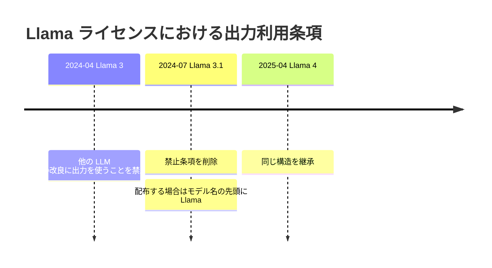
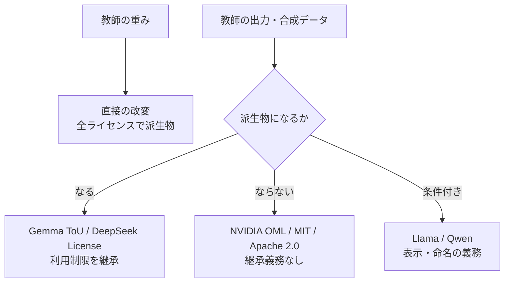

# オープンウェイトモデルのライセンスにおける蒸留・出力利用条項（Llama / Qwen / DeepSeek / Gemma / NVIDIA）

- **Source**: 各社のライセンス原文・モデルカード（一次資料）＋ 補助的な論評
- **Date**: 2026-10-21 時点の閲覧
- **Link**:
  - Llama 3.1 Community License: https://huggingface.co/meta-llama/Llama-3.1-8B-Instruct/blob/main/LICENSE
  - Llama 4 Community License: https://huggingface.co/meta-llama/Llama-4-Scout-17B-16E-Instruct/blob/main/LICENSE
  - Llama 3 vs 3.1 の redline（K. E. Mitchell）: https://writing.kemitchell.com/2024/07/24/Llama-3-versus-Llama-3-1-License
  - Qwen LICENSE AGREEMENT（Qwen2.5-72B）: https://huggingface.co/Qwen/Qwen2.5-72B-Instruct/blob/main/LICENSE
  - Qwen3（Apache 2.0）: https://huggingface.co/Qwen/Qwen3-235B-A22B
  - DeepSeek-R1（MIT）: https://huggingface.co/deepseek-ai/DeepSeek-R1
  - DEEPSEEK LICENSE AGREEMENT v1.0: https://github.com/deepseek-ai/DeepSeek-V3/blob/main/LICENSE-MODEL
  - Gemma Terms of Use: https://ai.google.dev/gemma/terms
  - Gemma 4 の Apache 2.0 移行（報道）: https://www.implicator.ai/google-releases-gemma-4-under-apache-2-0-dropping-its-custom-ai-license/
  - NVIDIA Open Model License: https://www.nvidia.com/en-us/agreements/enterprise-software/nvidia-open-model-license/
- **Type**: Technical Article（ライセンス比較）
- **取得状況**: すべて WebFetch で取得（Gemma 4 の移行は二次報道で、Google 公式発表は本調査では未取得）

> 本レポートはリサーチであり法的助言ではありません。ライセンスはモデル世代ごとに異なります。利用するチェックポイントごとに LICENSE ファイルを確認してください。

## Overview

クローズドモデルの規約が 2026 年に厳しくなる一方（04）、主要なオープンウェイトモデルは **出力を使った他モデルの学習（＝蒸留）を許容する方向** に進みました。ただし許容の仕方は「完全に自由（Apache 2.0 / MIT）」と「表示・命名・利用制限の継承を条件とする（Llama / Qwen 旧版 / Gemma 旧版 / DeepSeek License）」に分かれます。企業が蒸留で作った生徒モデルを **社外に配布・提供するかどうか** で、義務の発生が大きく変わります。

## Key Technical Content

### 1. Meta Llama

**Llama 3（旧）** — 1.b.v（redline による）

> "You will not use the Llama Materials or any output or results of the Llama Materials to improve any other large language model (excluding Meta Llama 3 or derivative works thereof)."

**Llama 3.1 で削除**（Mitchell の redline の要旨: "They've dropped the subsection explicitly prohibiting use to improve other large language models."）。

**Llama 3.1 / Llama 4** — 1.b.i（一次）

> "If you distribute or make available the Llama Materials (or any derivative works thereof), or a product or service (including another AI model) that contains any of them, you shall (A) provide a copy of this Agreement with any such Llama Materials; and (B) prominently display "Built with Llama" on a related website, user interface, blogpost, about page, or product documentation. If you use the Llama Materials or any outputs or results of the Llama Materials to create, train, fine tune, or otherwise improve an AI model, which is distributed or made available, you shall also include "Llama" at the beginning of any such AI model name."

**2. Additional Commercial Terms**（一次）

> "If, on the Llama 3.1 version release date, the monthly active users of the products or services made available by or for Licensee, or Licensee's affiliates, is greater than 700 million monthly active users in the preceding calendar month, you must request a license from Meta, ..."

- Llama 4 は 2025-04-05 発効で同じ構造を継承。

### 2. Alibaba Qwen

**Qwen LICENSE AGREEMENT（Release Date: September 19, 2024）**（一次）

- 4 条: 商用利用で製品・サービスの MAU が **1 億** を超える場合は Alibaba Cloud に許諾を申請。
- 5(b): "If you use the Materials or any outputs or results therefrom to create, train, fine-tune, or improve an AI model" → 関連ドキュメントに **「Built with Qwen」または「Improved using Qwen」** を目立つように表示。
- **Qwen3 は Apache 2.0**（モデルカードのメタデータで確認）。

### 3. DeepSeek

**DeepSeek-R1（MIT）**（一次）

> "This code repository and the model weights are licensed under the MIT License. DeepSeek-R1 series support commercial use, allow for any modifications and derivative works, including, but not limited to, distillation for training other LLMs."

- R1-Distill のうち Qwen 系（1.5B / 7B / 14B / 32B）は Qwen-2.5（Apache 2.0）由来、Llama 系は 8B が Llama 3.1 8B Base、70B が Llama 3.3 70B Instruct 由来で、**それぞれ元のライセンスを継承**。

**DEEPSEEK LICENSE AGREEMENT v1.0（2023-10-23）**（V3 等、一次）

- "Derivatives of the Model" に「distillation methods entailing the use of intermediate data representations」と「the generation of synthetic data by the Model for training the other model」を含める。
- 派生物は Attachment A の利用制限（軍事利用、未成年の搾取、有害な虚偽情報、法的効果を持つ完全自動の意思決定、差別など）を **少なくとも同等に継承** しなければならない。
- 6 条: "DeepSeek claims no rights in the Output You generate using the Model."

### 4. Google Gemma

**Gemma Terms of Use（Last modified: April 1, 2026）**（一次、Gemma 1〜3n 等に適用）

> 1.1(e) "Model Derivatives" means all (i) modifications to Gemma, (ii) works based on Gemma, or (iii) any other machine learning model created by transfer of patterns of the weights, parameters, operations, or Output of Gemma, to that model in order to cause that model to perform similarly to Gemma, including distillation methods that use intermediate data representations or methods based on the generation of synthetic data Outputs by Gemma for training that model.

- 3.1: 再配布時に 3.2 の利用制限を **強制可能な条項として契約に含める**、ToU のコピーを提供、改変ファイルに表示。
- 3.3: "Google claims no rights in Outputs you generate using Gemma."

**Gemma 4（2026-04-02）は Apache 2.0**（二次報道）: 独自 ToU と、Google が一方的に更新できた Prohibited Use Policy の継承義務がなくなった。報道は「旧条項は Gemma 生成の合成データで学習したモデルにも義務が及ぶと読める」と指摘。

### 5. NVIDIA Open Model License（2025-10-24）

- "An output is not a Derivative Model."
- "NVIDIA does not claim ownership to any outputs generated using the Models or Derivative Models."
- 商用利用可、派生モデルの作成・配布可。
- 例: Llama-3.1-Nemotron-70B-Instruct は NVIDIA Open Model License に加えて Llama 3.1 License が適用され「Built with Llama」を表示（モデルカードで確認）。

## Figures & Tables

### 表 1: ベンダー × 条項 × 可否（オープンウェイト）

| モデル / ライセンス | 出力での他モデル学習 | 生徒モデルを社内のみで使う場合の義務 | 生徒モデルを配布・提供する場合の義務 | 規模条件 | 根拠の質 |
|-------------------|------------------|--------------------------------|--------------------------------|---------|---------|
| Llama 3（旧） | **不可**（Llama 3 派生を除く） | — | — | 7 億 MAU | 論評（redline） |
| Llama 3.1 / 3.3 / 4 | 可 | 実質なし（命名義務は「distributed or made available」の場合） | モデル名の先頭に「Llama」、「Built with Llama」表示、ライセンス添付 | 7 億 MAU 超は別許諾 | 一次 |
| Qwen LICENSE（Qwen2.5 等） | 可 | 文言上は表示義務の発生条件に配布要件がない点に注意 | 「Built with Qwen」/「Improved using Qwen」表示 | 1 億 MAU 超は別許諾 | 一次 |
| Qwen3（Apache 2.0） | 可 | なし | Apache 2.0 の通知義務 | なし | 一次 |
| DeepSeek-R1（MIT） | **明示的に可**（"distillation for training other LLMs"） | なし | MIT の著作権表示 | なし | 一次 |
| DeepSeek License v1.0（V3 等） | 可（ただし派生物扱い） | 利用制限（Attachment A）を遵守 | 利用制限の継承を契約で課す | なし | 一次 |
| Gemma ToU（Gemma 1〜3n） | 可（ただし派生物扱い） | Prohibited Use Policy を遵守 | 利用制限の強制条項・ToU 添付・改変表示 | なし | 一次 |
| Gemma 4（Apache 2.0） | 可 | なし | Apache 2.0 の通知義務 | なし | 二次報道 |
| NVIDIA Open Model License | 可（出力は派生モデルでない） | なし | ライセンス条件に従う | なし | 一次 |

### 図 2: Llama ライセンスの変遷

### 図 3: 「派生物」概念の広さ

### 表 4: R1-Distill 系の「ライセンスの重ね合わせ」

| 蒸留モデル | 基盤 | 基盤のライセンス | 教師（R1）のライセンス |
|-----------|------|----------------|---------------------|
| R1-Distill-Qwen-1.5B / 7B / 14B / 32B | Qwen-2.5 | Apache 2.0 | MIT |
| R1-Distill-Llama-8B | Llama 3.1 8B Base | Llama 3.1 License | MIT |
| R1-Distill-Llama-70B | Llama 3.3 70B Instruct | Llama 3.3 License | MIT |

**含意**: 蒸留で作った生徒には、**教師のライセンスと生徒の基盤モデルのライセンスの両方** がかかり得る。

## Practical Takeaways

1. **「合法な蒸留」の第一候補はオープンウェイト教師**: DeepSeek-R1（MIT）、Qwen3（Apache 2.0）、Gemma 4（Apache 2.0）は出力利用に条件がほぼない。
2. **Llama を教師にする場合は「配布するか」で義務が変わる**: 社内専用なら命名義務は生じないと読めるが、顧客提供（SaaS で「made available」）なら「Llama」で始まる名前と表示が必要。
3. **Gemma（4 以前）・DeepSeek License の教師は利用制限が生徒に移る**: 生徒モデルの利用目的（例: 法的効果を持つ自動判断）が制限に当たらないか確認する。
4. **生徒の基盤モデルのライセンスも別途確認**: 教師が MIT でも、生徒の基盤が Llama なら Llama License がかかる。
5. **バージョン管理**: Qwen2.5（独自）→ Qwen3（Apache）、Gemma 3（独自）→ Gemma 4（Apache）のように世代でライセンスが変わる。社内のモデル台帳にチェックポイント単位のライセンスを記録する。

## Notes

- Qwen 5(b) の表示義務の発生条件（配布の有無）は、取得した抜粋の範囲では配布要件が明記されていなかった。全文の確認を推奨。
- Gemma 4 の Apache 2.0 移行は二次報道（Implicator、複数の解説サイトも同旨）で、Google の一次発表は本調査で取得できていない。
  - （2026-10-22 訂正）**一次で確認済み**。Google 公式ブログ「Gemma 4: Byte for byte, the most capable open models」（2026-04-02）に "That's why Gemma 4 is released under a commercially permissive Apache 2.0 license." と明記（E2B / E4B / 26B MoE / 31B dense）。また ai.google.dev/gemma/terms（Last modified: April 1, 2026）は "For Gemma 4 terms, see the Gemma 4 license" として `/gemma/apache_2`（Apache License 2.0 全文）へ誘導し、Gemma 4 は Gemma Terms of Use の Appendix（対象モデル一覧）に含まれていない。従って Gemma 4 の生徒モデルには Model Derivatives 定義や Prohibited Use Policy の継承義務は及ばない。なお Gemma Terms of Use の Model Derivatives 定義は "including distillation methods that use intermediate data representations or methods based on the generation of synthetic data Outputs by Gemma for training that model" と、"For clarity, Outputs are not deemed Model Derivatives." を再確認した（Gemma 1〜3n に適用）。
- 関連論文: Contractor et al., "Behavioral Use Licensing for Responsible AI"（arXiv 2011.03116）は Gemma・DeepSeek License に見られる利用制限条項（RAIL 系）の理論的基盤。White et al., "The Model Openness Framework"（arXiv 2403.13784）は「オープン」を名乗るモデルの多くが制限的ライセンスだと指摘。
