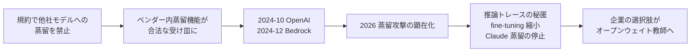

# 同一ベンダー内の「合法な蒸留サービス」の提供状況（Amazon Bedrock / OpenAI / Azure OpenAI / Anthropic）

- **Company/Organization**: AWS、OpenAI、Microsoft、Anthropic
- **Industry**: クラウド AI プラットフォーム
- **Date**: 2024-12（Anthropic × Bedrock 蒸留の発表）〜 2026-10（閲覧時点）
- **Link**:
  - AWS 製品ページ: https://aws.amazon.com/bedrock/model-distillation/
  - Bedrock ユーザガイド: https://docs.aws.amazon.com/bedrock/latest/userguide/model-distillation.html
  - Bedrock 前提条件（対応モデル表）: https://docs.aws.amazon.com/bedrock/latest/userguide/prequisites-model-distillation.html
  - Anthropic 2024-12-03 発表: https://claude.com/blog/trainium2-and-distillation
  - OpenAI SFT ガイド: https://developers.openai.com/api/docs/guides/supervised-fine-tuning
  - OpenAI Deprecations: https://developers.openai.com/api/docs/deprecations
  - Azure OpenAI stored completions & distillation: https://learn.microsoft.com/en-us/azure/ai-foundry/openai/how-to/stored-completions
- **Type**: Business Case（サービス提供状況の一次ドキュメント調査）
- **取得状況**: すべて WebFetch で取得。Vertex AI の蒸留ドキュメント（docs.cloud.google.com/.../distill-from-ai-studio）は 404 で取得できず

> 本レポートはリサーチであり法的助言ではありません。サービス提供状況は 2026-10-21 時点の公式ドキュメントに基づきます。

## Overview

規約が「競合モデル開発」を禁じる一方で、各社は **自社プラットフォーム内で完結する蒸留機能** を「合法な蒸留の受け皿」として提供してきました（Google Cloud §17(b) が明文で認める Modified Google Model もこの型）。しかし 2026 年 10 月時点の一次ドキュメントを確認すると、この受け皿は **縮小・停止の局面** にあります。

| サービス | 2026-10 時点の状態 | 根拠（一次） |
|---------|------------------|-------------|
| Bedrock の **Anthropic（Claude）蒸留** | **停止中**。「There is no confirmed timeline for when Anthropic distillation will be restored.」 | Bedrock 前提条件ページ |
| Bedrock の Amazon Nova / Meta Llama 蒸留 | 提供中 | 同上 |
| OpenAI のセルフサーブ fine-tuning（＝公式蒸留手順の土台） | 縮小中。新規組織は不可、**既存顧客も 2027-01-06 以降は新規ジョブ不可** | Deprecations |
| Azure OpenAI の stored completions（蒸留データの取り込み口） | **2026-10-15 退役**（Responses API と Agent Traces へ移行） | Microsoft Learn |

## Problem & Context



## Solution（各サービスの仕組み）

### Amazon Bedrock Model Distillation

1. **教師と生徒を選ぶ**（生徒は教師ごとに対応表で指定されたものに限る）
2. **学習データを用意**: `.jsonl` のプロンプト集。ラベル付き例（golden examples）や **CloudWatch の invocation logs（本番の教師応答）** も利用可
3. **蒸留ジョブ作成**: 「Only you can access the final distilled model. Amazon Bedrock doesn't use your data to train any other teacher or student model for public use.」
4. 独自のデータ合成で教師応答を増やす場合、**教師の推論料金が別途発生**、データは最大 15k の prompt-response ペア

**対応モデル表（2026-10 時点）**

| 提供者 | 教師 | 生徒 | リージョン |
|-------|------|------|-----------|
| Amazon | Nova Pro | Nova Lite / Nova Micro | US East（N. Virginia） |
| Amazon | Nova Premier | Nova Lite / Nova Micro / Nova Pro | US East（N. Virginia） |
| Meta | Llama 3.1 405B | Llama 3.1 8B / 3.1 70B / 3.2 1B / 3.3 70B | US West（Oregon） |
| Meta | Llama 3.1 70B | Llama 3.1 8B / 3.2 1B / 3.2 3B | US West（Oregon） |
| Meta | Llama 3.3 70B | Llama 3.1 8B / 3.2 1B / 3.2 3B | US West（Oregon） |
| Anthropic | — | — | **「Distillation is not currently available for Anthropic models on Amazon Bedrock.」** |

**構造的な特徴**: 対応表はすべて **同一提供者内（Nova→Nova、Llama→Llama）** の組合せで、他社教師→他社生徒の組合せはない。

**ベンダー申告の効果**（製品ページ）: 最大 500% 高速、最大 75% 安価、RAG などで精度低下 2% 未満。顧客名はページ上に記載なし。

### Anthropic × Bedrock（2024-12-03 発表、現在停止）

- 教師 Claude 3.5 Sonnet → 生徒 Claude 3 Haiku。「Claude 3 Haiku can now achieve significant performance gains, reaching Claude 3.5 Sonnet-like accuracy for specific tasks」、価格と速度は Haiku のまま（ベンダー申告、ベンチマーク数値なし）。
- 当時はプレビュー。2026-10 時点では上表のとおり停止。

### OpenAI — 「Distilling from a larger model」

1. 大モデル（例: gpt-4.1）でプロンプトを調整し評価基準を満たす
2. 応答を保存（Responses API は既定で 30 日保存）
3. 基準を満たす応答を学習データ化
4. 小モデル（例: gpt-4.1-mini）を fine-tune

**縮小のタイムライン**（Deprecations、一次）

| 日付 | 内容 |
|------|------|
| 2026-05-07 | 開発者へ通知。fine-tuning 未経験の組織は新規ジョブ不可 |
| 2026-07-02 | 直近 60 日に fine-tuned モデルで推論していない組織は新規ジョブ不可 |
| 2027-01-06 | 既存のアクティブ顧客も新規 fine-tuning ジョブ不可 |
| 以後 | fine-tuned モデルの推論は基盤モデルの廃止まで継続 |

### Azure OpenAI — stored completions と蒸留

- `store=True` で Chat Completions の履歴を保存し、ポータルの **Distill** ボタンから fine-tuning データにする（最低 10 件、推奨は数百〜数千件）。
- 「Stored completion distillation training files cannot be accessed directly and cannot be exported externally/downloaded.」→ **データをプラットフォーム外に持ち出せない設計** で、他社モデルへの蒸留を技術的に防いでいる。
- 保存上限 10 GB。**stored completions は 2026-10-15 に退役**。

## Results & Impact

```
同一ベンダー内蒸留の選択肢（クローズド教師、2026-10 時点）
Anthropic Claude (Bedrock) |  停止中
OpenAI (fine-tuning)       |████ 縮小中（2027-01-06 まで）
Azure OpenAI (stored)      |  退役（2026-10-15）
Google Vertex (Gemini)     |██████ 規約上は可（§17(b)）／ドキュメント未取得
Amazon Nova (Bedrock)      |██████████ 提供中
Meta Llama (Bedrock)       |██████████ 提供中（オープンウェイト）
```

| 指標 | 値 | 証拠の質 |
|------|----|---------|
| Bedrock 蒸留モデルの速度 | 最大 500% 高速 | ベンダー申告 |
| Bedrock 蒸留モデルのコスト | 最大 75% 安価 | ベンダー申告 |
| Bedrock 蒸留の精度低下 | RAG 等で 2% 未満 | ベンダー申告 |
| Claude 3 Haiku の蒸留効果 | 「Claude 3.5 Sonnet-like accuracy for specific tasks」（数値なし） | ベンダー申告 |

## Figures & Tables

### 表: 「合法な蒸留経路」としての評価

| 経路 | 規約上の位置づけ | データの持ち出し | 生徒の所有 | 継続性リスク |
|------|----------------|----------------|-----------|-------------|
| Bedrock（Nova / Llama） | 提供者の公式機能 | Bedrock 内 | 顧客のみアクセス | 低〜中 |
| Bedrock（Claude） | 公式機能だったが停止 | — | — | **高（停止中）** |
| OpenAI fine-tuning | 公式手順 | OpenAI 内 | OpenAI 上の fine-tuned モデル | **高（2027-01 で新規不可）** |
| Azure stored completions | 公式機能 | エクスポート不可 | Azure 上 | **退役** |
| Vertex（Gemini） | §17(b) で明示的に許可 | Google Cloud 内 | Modified Google Model | 不明（ドキュメント未取得） |
| オープンウェイト教師（自社環境） | ライセンスで許可（05） | 自社内 | 自社 | 低 |

## Lessons Learned

1. **「ベンダー内蒸留」は規約面では最も安全だが、提供継続性が弱い**: 2026 年は Claude 蒸留の停止、OpenAI fine-tuning の縮小、Azure stored completions の退役が重なった。蒸留モデルを長期運用するなら、ベンダーの機能廃止で再学習できなくなるリスクを織り込む。
2. **生徒モデルはベンダーのプラットフォームに閉じ込められる**: Azure はデータのエクスポートを禁止し、Bedrock の蒸留モデルはその環境でのみ利用可能。可搬性が必要ならオープンウェイト教師で自社環境に蒸留する。
3. **背景には蒸留攻撃への対抗がある（推測）**: 停止・縮小の理由は各ドキュメントに書かれていない。ただし同時期に Anthropic は推論トレースの秘匿を進めており（02）、関連は示唆されるが **一次資料での因果の確認はない**。
4. **ビジネス価値の式への影響**: 蒸留のビジネス価値 $\approx (C_{\text{teacher}} - C_{\text{student}})\cdot Q - (C_{\text{data}} + C_{\text{train}}) - \Delta\text{Acc}\cdot V_{\text{err}}$ に、**「再学習不能リスク」$P_{\text{discontinue}} \cdot C_{\text{migration}}$** を追加すべき局面にある。

$$
\text{Value}_{\text{vendor-internal}} \approx (C_{\text{teacher}} - C_{\text{student}}) \cdot Q - (C_{\text{data}} + C_{\text{train}}) - \Delta\text{Acc} \cdot V_{\text{err}} - P_{\text{discontinue}} \cdot C_{\text{migration}}
$$

## Notes

- AWS 製品ページのスクリーンショットには「Claude 3.5 Sonnet v2 を教師」とする記載が残る一方、ユーザガイドの対応表は Anthropic を停止中としている。**一次ドキュメント（ユーザガイド）を優先** した。
- （2026-10-22 追記）ユーザガイド「Prerequisites for model distillation」を再取得し、文言を逐語で確認した: "**Distillation is not currently available for Anthropic models on Amazon Bedrock. There is no confirmed timeline for when Anthropic distillation will be restored.** For currently supported teacher–student combinations, see the table below." 対応表は Amazon（Nova Pro / Nova Premier → Nova Lite / Micro / Pro、米国東部）と Meta（Llama 3.1 405B / 70B、Llama 3.3 70B → Llama 3.1 8B / 70B、3.2 1B / 3B、3.3 70B、米国西部）のみ。同ページの注記には "For Claude and Llama models, the distillation job is run in US West (Oregon)." という Claude 時代の記述が残っている。
- （2026-10-22 追記）OpenAI 側は Usage Policies（2026-11-20 施行）で代替モデル向けの学習データ生成を禁止する一方、Services Agreement の Permitted Exception (b) で **OpenAI の fine-tuning サービス内での調整を明示的に許容** しており、「ベンダー機能内の蒸留は可」という本レポートの整理と整合する（[04](04-closed-vendor-terms-anthropic-google-openai-mistral.md) 追記）。
- 関連: [04 クローズドモデルの規約](04-closed-vendor-terms-anthropic-google-openai-mistral.md) / [05 オープンウェイトのライセンス](05-open-weight-licenses-llama-qwen-deepseek-gemma.md)
