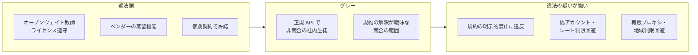

# 米国法から見た蒸留: 著作権 vs 契約 vs 営業秘密（法律論評 5 件と米著作権局 Part 2 の横断分析）

- **Source**:
  - Winston & Strawn 系（Law360 転載, 2025-03-12）: https://www.winstontaylor.com/insights/is-ai-distillation-by-deepseek-ip-theft
  - Sarah Tishler（Beck Reed Riden）, Mondaq, 2026-05-12: https://webiis08.mondaq.com/unitedstates/trade-secrets/1788790/understanding-ai-distillation-in-the-trade-secret-context
  - Kobre & Kim（Michael Ng）, 2026-04-27: https://kobrekim.com/insights/publications/michael-ng-featured-iam-magazine-ai-distillation-trade-secret-law
  - IAM（Maia Biermann）, 2026-04-24（Saul Ewing 掲載 PDF）: https://www.saul.com/sites/default/files/documents/2026-04/ArtiIs%20AI%20distillation%20a%20chink%20in%20the%20armour%20of%20American%20innovation%C2%A0%20-%20IAM%20Trade%20Secrets.pdf
  - U.S. Copyright Office, Copyright and Artificial Intelligence Part 2: Copyrightability（2025-01）: https://www.copyright.gov/ai/Copyright-and-Artificial-Intelligence-Part-2-Copyrightability-Report.pdf
- **Type**: Technical Article（法律論評と公的報告書）
- **取得状況**: いずれも取得済み（PDF 2 件は pdftotext でテキスト化）。law-ai.org の論評は 403 で取得できず、検索スニペットのみ参照

> 本レポートはリサーチであり法的助言ではありません。米国でも蒸留を直接扱った判例は確認されていません（Mondaq の論者も「no published decision directly addresses distillation」と述べる）。

## Overview

5 つの資料はほぼ同じ結論に収束します。

1. **著作権は弱い**: AI 出力は人間の創作的寄与がない限り保護されず（米著作権局）、さらに各社は出力の権利を利用者に譲渡している。
2. **契約（利用規約）が最も現実的**: 規約違反は著作権の有無と無関係に成立し得る。
3. **営業秘密（DTSA）は未確立だが可能性あり**: 「合理的な秘密管理措置」と「不正な手段」の立証が鍵。偽アカウントによる大量取得は不正手段に近づく。
4. **立法・行政による補完が必要**: 論者は輸出規制、制裁、情報共有の法整備を提言（09）。

## Key Technical Content

### 1. 著作権 — 米著作権局 Part 2（一次資料）

結論の箇条（原文）:

- "Questions of copyrightability and AI can be resolved pursuant to existing law, without the need for legislative change."
- "Copyright does not extend to purely AI-generated material, or material where there is insufficient human control over the expressive elements."
- "Based on the functioning of current generally available technology, prompts do not alone provide sufficient control."
- "The case has not been made for additional copyright or sui generis protection for AI-generated content."

分析部分: "given current generally available technology, prompts alone do not provide sufficient human control to make users of an AI system the authors of the output."

**蒸留への含意**: 教師モデルの出力（推論トレースや回答）は、多くの場合 **著作権で保護されない**。したがってモデル提供者は、出力を学習に使われても著作権侵害を主張しにくい。

### 2. Winston & Strawn 系論評（2025-03）

| 理論 | 評価 | 要旨 |
|------|------|------|
| 著作権 | 弱い | 米著作権局報告に照らし人間の寄与次第。OpenAI は規約で出力をユーザに帰属させており、さらに NYT 訴訟で自らフェアユースを主張しているため「it might be hard for OpenAI to argue copyright infringement by DeepSeek」 |
| 特許 | 弱い | 「unlikely that OpenAI would have patents that cover model outputs alone」 |
| 営業秘密 | 要調査 | 「OpenAI has not provided specific evidence that DeepSeek illegally accessed its secret data」 |
| 契約 | **最有力** | 「using contract law to address AI concerns would provide many companies with better standings than other approaches」 |
| 非 IP 手段 | 有望 | NASA・ニューヨーク州の DeepSeek 利用禁止、No DeepSeek on Government Devices Act |

### 3. 営業秘密（DTSA）— Tishler（Mondaq, 2026-05）

DTSA の要件と蒸留への当てはめ:

| 要件（18 U.S.C. §1839） | 蒸留での論点 | 論者の評価 |
|----------------------|-------------|-----------|
| 秘密性から経済的価値（§1839(3)） | 重み・学習手法は該当し得る。公開 API の出力そのものは難しい。秘密は「the aggregate of learned representations that required billions of dollars in compute」と構成する見解を引用 | 争点 |
| 合理的な秘密管理措置 | 「imitation frontier AI models」を禁じる規約、異常なクエリパターンの検出 | 規約が措置の一部になる |
| 不正な手段 | *Compulife Software, Inc. v. Newman*（11th Cir. 2020）:「using a bot to collect an otherwise infeasible amount of data may well be」improper | 大量の自動収集は不正手段になり得る |
| リバースエンジニアリング例外（§1839(6)(B)） | 蒸留は完成品の分析ではなく推論・能力分布を狙う。規約違反は「arm's-length な reverse engineer」から「合意に反する契約当事者」へ立場を変える可能性 | 「is, to my knowledge, an open question」 |

論者が検討した仮想事例:

1. **退職者**: プロンプト戦略や照会手法そのものが営業秘密になり得る
2. **検証の抗弁**: 取得した出力が学習に使われたのか、ベンチマークに使われただけなのかの立証が難しい
3. **下流ユーザ**: 蒸留されたオープンソースモデルの上に構築したスタートアップに、DTSA の「knew or had reason to know」基準が及ぶかは不明

提言: API 提供者は規約見直し・異常検出・開発投資の記録。**第三者モデルの上に構築する企業はモデル来歴（provenance）のデューデリジェンス**。

### 4. Kobre & Kim（Ng）と Saul Ewing（Kohel）— IAM 誌（2026-04）

| 論者 | 立場 | 主張 |
|------|------|------|
| Michael Ng（Kobre & Kim） | 積極 | 提供者は「not powerless」。蒸留は (1) 合理的措置、(2) 容易に確認可能か、(3) 取得手段の適正、の 3 点に関わる。*Appian v. Pegasystems*（バージニア州最高裁）を引き、秘密は 100 万人に開示されても守秘の枠組みがあれば保護され得る。**規約で蒸留を明示的に禁止して合理的措置を補強せよ**。「technical feasibility alone does not make distillation lawful」 |
| Matthew Kohel（Saul Ewing） | 慎重 | 標準 API の正規アクセスでは不正手段の立証が難しく「significant structural gap」がある。「If the access is authorised and the method resembles a high-volume version of legitimate research practices, plaintiffs may struggle to demonstrate it as improper」。ただし **数千の偽アカウントでレート制限を回避する行為は不正手段に近い** |

IAM 記事の背景事実（二次）:

- 2026-04-22 上院司法委員会公聴会「Stealth Stealing: China's Ongoing Theft of U.S. Innovation」で、Helen Toner（CSET）は蒸留を「not inherently nefarious」としつつ、中国企業による API 経由の抽出の強い証拠があると証言。
- Google も 2025 年中にモデル抽出の試みの増加を確認したと報告。
- 2026-04-23 の OSTP 覚書（09）。

## Figures & Tables

### 表 1: 法理論ごとの比較

| 法理論 | 保護対象 | 蒸留への適用可能性 | 主な障壁 | 典拠 |
|-------|---------|------------------|---------|------|
| 著作権 | 人間の創作的表現 | 低 | AI 出力は原則保護外、出力の権利はユーザに譲渡 | 米著作権局、Winston |
| 特許 | 技術的思想 | 低（出力に対して） | 出力そのものは対象外。蒸留「手法」の特許は別問題（11） | Winston |
| 契約 | 規約上の合意 | **高** | 第三者ルーター経由だと当事者性が問題。損害の立証 | Winston、law-ai（スニペット） |
| 営業秘密 | 秘密性のある情報 | 中（未確立） | 合理的措置・不正手段・リバースエンジニアリング例外 | Tishler、Ng、Kohel |
| CFAA | 無権限アクセス | 低〜中 | 単なる規約違反は通常 CFAA 違反にならない。偽の身元・認証情報の詐称なら可能性 | law-ai（スニペット、未取得） |
| 政策（制裁・輸出規制） | 国家安全保障 | 高（対外国） | 国内企業間には適用されない | IAM、IAPS（09） |

### 図 2: 「適法な蒸留」と「違法の疑いが強い蒸留」の境界

### 表 3: 論者の提言（企業の立場別）

| 立場 | 提言 | 典拠 |
|------|------|------|
| モデル提供者 | 規約で蒸留を明示禁止、異常検出、開発投資の記録 | Tishler、Ng |
| モデル提供者 | 政府による輸出規制・規制枠組みの活用 | Ng |
| 利用企業（第三者モデルの上に構築） | モデル来歴のデューデリジェンス | Tishler |
| 立法 | 独禁法リスクなく脅威情報を共有できる規定、内部告発者保護 | Kohel |

## Practical Takeaways

1. **「著作権が弱いから自由」ではない**: 出力に著作権がなくても、規約違反（契約責任）と、偽アカウント等を使えば営業秘密侵害・制裁のリスクがある。
2. **蒸留済みオープンモデルを使う側もリスクを負い得る**: DTSA の「had reason to know」基準。来歴が怪しい蒸留モデル（クローズドモデルの出力で学習したと公表されているもの等）を業務に採用する前に、学習データの出所を確認する。
3. **自社がモデル提供者なら規約に「蒸留禁止」を明記**: 営業秘密の「合理的措置」として機能し得る（Ng）。
4. **証拠を残す**: 社内蒸留を行う場合、教師・ライセンス・承認・データの出所を記録しておくと、紛争時の抗弁（検証目的か学習目的か等）に使える。

## Notes

- 本レポートの論者はいずれも「判例がない」ことを前提にしている。結論は今後の裁判例や立法（H.R.8283 等）で変わり得る。
- Winston の記事は著者名を明記していない（「the authors' opinions only」との注記のみ）。
- 関連: [08 日本法](08-japan-law-copyright-30-4-unfair-competition.md) / [09 米国の政策](09-us-policy-ostp-daamta.md)
