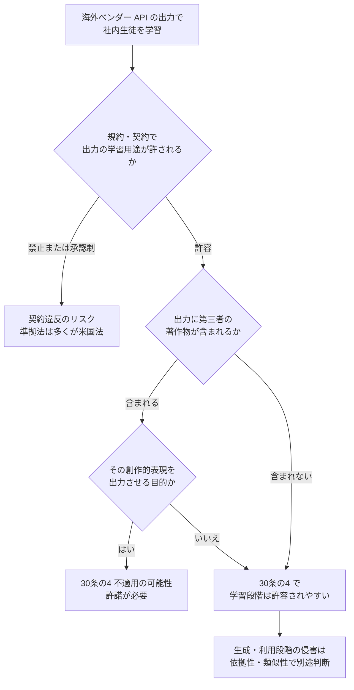

# 日本法から見た蒸留: 著作権法 30 条の 4・AI 生成物の著作物性・オーバーライド問題・不正競争防止法

- **Source**:
  - 文化審議会著作権分科会法制度小委員会「AIと著作権に関する考え方について」（令和 6 年 3 月 15 日）: https://www.bunka.go.jp/seisaku/bunkashingikai/chosakuken/pdf/94037901_01.pdf
  - 文化庁「AI と著作権について」ページ（関連文書一覧）: https://www.bunka.go.jp/seisaku/chosakuken/aiandcopyright.html
  - 松下外 弁護士（西村あさひ）「生成AIの開発時に注意すべき法的リスクとは？」BUSINESS LAWYERS（2024-09-18 更新）: https://www.businesslawyers.jp/articles/1315
- **Date**: 2024-03-15（考え方）／ 2024-09-18（論評）
- **Type**: Technical Article（公的文書と法律論評）
- **取得状況**: 「考え方」PDF は WebFetch で取得し、pdftotext でテキスト化して該当箇所を確認。論評は WebFetch の要約で取得（本文全文の逐語確認はしていない）

> 本レポートはリサーチであり法的助言ではありません。「考え方」自体も「法的な拘束力を有するものではなく」「確定的な法的評価を行うものではない」と明記しています。蒸留（他社 AI の出力を使った学習）を直接扱った公的見解や裁判例は、本調査では見つかっていません。

## Overview

日本法で蒸留を考えるときの論点は、米国と同じく **(1) 学習段階の著作権、(2) 出力の著作物性、(3) 契約（利用規約）、(4) 不正競争防止法** の 4 つです。日本の特徴は、著作権法 30 条の 4 が **非享受目的の情報解析（AI 学習）を広く許容** している点で、教師モデルの出力に仮に著作物が含まれていても、学習段階の複製は原則として許されやすい構造です。その反面、**利用規約で学習を禁止した場合に、その規約が 30 条の 4 に優先するか（オーバーライド問題）** が未解決で、個別判断とされています。

## Key Technical Content

### 1. 30 条の 4 — 非享受目的と「享受目的の併存」（一次資料）

> 「この複数の目的の内にひとつでも『享受』の目的が含まれていれば、同条の要件を欠くこととなる」

享受目的が併存するとされる例（考え方の列挙）:

- 既存の学習済みモデルに対する追加的な学習のうち、**意図的に、学習データに含まれる著作物の創作的表現の全部又は一部を出力させることを目的とした** 追加的な学習（例: 意図的な過学習）
- 既存データベース等の著作物の創作的表現を生成 AI で出力させる目的で、ベクトル DB を作る等の複製（RAG 型）

脚注 21 の重要な整理: 享受目的の有無が問題になるのは **権利制限の対象となる当該著作物（学習用データ）について** であり、「生成 AI による生成物を観賞して楽しむ等の目的を有していたとしても」学習段階の 30 条の 4 の適用は否定されない。

**蒸留への当てはめ（本レポートの整理であり、公的見解ではない）**:

| 蒸留の態様 | 30 条の 4 上の評価の方向 |
|-----------|----------------------|
| 教師の出力から「タスクの解き方」を学ぶ（分類・抽出・要約のスタイル） | 非享受目的と評価されやすい |
| 教師の出力に含まれる第三者の著作物（例: 引用された文章）をそのまま再現させる学習 | 享受目的の併存が問題になり得る |
| 教師の出力自体が著作物でない場合 | そもそも著作権の問題が生じにくい（次項） |

### 2. 但書 —「著作権者の利益を不当に害することとなる場合」

- 判断は「著作権者の著作物の利用市場と衝突するか、あるいは将来における著作物の潜在的販路を阻害するか」という観点から総合考慮。
- **単に反対の意思表示があることのみをもって但書に該当するとは考えられない**。
- 一方、robots.txt や ID・パスワード認証などの **機械可読な技術的措置** が講じられ、情報解析用データベースの将来販売が推認される場合、**措置を回避して** 収集・複製する行為は但書に該当し得る。

**蒸留への含意（推論）**: API 提供者のレート制限・アカウント認証・地域制限を **偽アカウント等で回避** して大量の出力を収集する行為は、「技術的措置の回避」という点で、この議論と構造が似ている。ただし考え方はウェブ上の著作物とデータベースを想定しており、AI 出力の蒸留に直接言及していない。

### 3. AI 生成物の著作物性（一次資料）

- 「AI は法的な人格を有しないことから、この『創作する者』には該当し得ない」。
- 「生成 AI に対する指示が表現に至らないアイデアにとどまるような場合には、当該 AI 生成物に著作物性は認められないと考えられる」。
- 著作物性は個別判断で、「単なる労力にとどまらず、創作的寄与があるといえるものがどの程度積み重なっているか等を総合的に考慮」。

**蒸留への含意**: 教師モデルの出力の多くは人間の創作的寄与を欠き、**著作物に当たらない可能性が高い**。この点は米著作権局の結論（07）と同じ方向で、モデル提供者が著作権で蒸留を止めるのは日本でも難しい。

### 4. 契約・利用規約（オーバーライド問題）— BUSINESS LAWYERS 論評

- 論点: 権利制限規定（30 条の 4 等）で認められた利用を、**利用規約などの契約で禁止できるか**。
- 論評の整理: 条項が **公序良俗に反して無効** となる可能性が指摘されるが、結論は個別事情による。

**蒸留への当てはめ**: 各社規約の「出力で競合モデルを学習してはならない」「出力で AI を学習してはならない（Anthropic AUP）」は、著作権の権利制限とは別の **債権的な合意** であり、日本でも契約違反として問題になり得る。30 条の 4 があるから規約違反にならない、とは言えない。

### 5. 不正競争防止法 — BUSINESS LAWYERS 論評

- **営業秘密・限定提供データ** を、データ提供契約の条件に反して利用すると、不正競争行為に当たる場合がある。
- 営業秘密を不正に利用して作られた学習済みモデルの利用も、一定範囲で制限され得る。

**蒸留への当てはめ（推論）**: 公開 API の出力は一般に秘密管理性を欠きやすいが、**限定提供データ**（ID・パスワード等で管理され、業として特定の者に提供されるデータ）の枠組みは、契約で提供される API 出力に近い。ただし、蒸留に適用した裁判例・公的見解は本調査では見つかっていない。

### 6. 準拠法の注意

「考え方」は、AI サービス提供事業者と利用者の契約上の準拠法の定めは **当事者間においてのみ効力** を持ち、権利者と契約外の第三者との関係（著作権侵害）は本文の考え方による、と注記している。米国ベンダーの規約は多くが米国法準拠であり、**契約違反の判断は日本法ではなく契約の準拠法で行われる** 可能性が高い。

## Figures & Tables

### 表 1: 日本法の論点マップ

| 論点 | 条文・枠組み | 蒸留への適用の方向 | 確度 |
|------|------------|------------------|------|
| 学習段階の複製 | 著作権法 30 条の 4（非享受目的） | 原則許容されやすい | 公的見解あり（一般論） |
| 享受目的の併存 | 30 条の 4 本文 | 出力に含まれる著作物の再現を狙うと不可 | 公的見解あり（一般論） |
| 権利者の利益を不当に害する場合 | 30 条の 4 但書 | 技術的措置の回避が論点 | 公的見解あり（ウェブ収集の文脈） |
| 出力の著作物性 | 2 条 1 項 1 号 | 多くの出力は著作物でない | 公的見解あり（一般論） |
| 規約による制限 | 民法（契約）・公序良俗 | 規約違反は別途成立し得る | 論評（未確定） |
| 営業秘密・限定提供データ | 不正競争防止法 | 適用の可能性は限定的 | 論評（未確定） |

### 図 2: 日本企業が海外ベンダーの API を教師にする場合の検討順

### 表 3: 日米の比較

| 観点 | 日本 | 米国 |
|------|------|------|
| 学習段階の著作物利用 | 30 条の 4 で広く許容（非享受目的） | フェアユースで個別判断（訴訟多数） |
| AI 出力の著作物性 | 創作的寄与の積み重ねで個別判断 | 「prompts alone」では不十分（著作権局） |
| 蒸留の主な争点 | 規約（契約）・不競法（未確定） | 規約（契約）・営業秘密・制裁（09） |
| 政策対応 | 蒸留に特化した公的方針は確認できず | OSTP 覚書・H.R.8283（09） |

## Practical Takeaways

1. **30 条の 4 は規約違反を免責しない**: 学習段階の著作権がクリアでも、教師ベンダーの規約違反は別問題。日本企業でも米国ベンダーの規約（米国法準拠が多い）に従う必要がある。
2. **教師の出力に第三者の著作物が混ざるケースに注意**: 社内文書の要約や引用を含む出力を学習に使う場合、出力の再現を目的としない設計（タスクの手順を学ばせる）にする。
3. **ベンダーの技術的制限を回避しない**: 但書の議論が示すように、技術的措置の回避は評価を悪化させる方向に働く。
4. **オープンウェイト教師なら日本法上の論点はほぼ 30 条の 4 とライセンスに集約される**: 05 のライセンス条件を満たせば、日本法上も整理しやすい。

## Notes

- 文化庁サイトには「AIと著作権に関するチェックリスト＆ガイダンス」（令和 6 年 7 月 31 日）もあるが、本調査では本文を取得していない。
  - （2026-10-22 訂正）取得済み（下記追記）。
- 蒸留（他社 AI 出力による学習）を正面から扱った日本の弁護士解説は、検索予算の制約もあり見つけられなかった（**カバレッジの空白**）。
  - （2026-10-22 追記）日本語で 5 回再検索（「蒸留 利用規約 弁護士」「モデル蒸留 DeepSeek 法的問題」「STORIA 蒸留」等）したが、**蒸留と利用規約を正面から論じる日本の法律事務所・弁護士の解説は発見できなかった**。ヒットは一般解説・報道・米国法の論評（Ropes & Gray、law.asia）に限られる。空白は継続。
- 関連: [07 米国法の分析](07-us-legal-analysis-contract-trade-secret-copyright.md)

## 2026-10-22 追記: 一次資料の補強（条文・文化庁チェックリスト・AI 事業者ガイドライン）

### 1. 著作権法 第 30 条の 4（e-Gov 法令 API、現行条文、逐語）

> （著作物に表現された思想又は感情の享受を目的としない利用）
> 第三十条の四　著作物は、次に掲げる場合その他の当該著作物に表現された思想又は感情を自ら享受し又は他人に享受させることを目的としない場合には、その必要と認められる限度において、いずれの方法によるかを問わず、利用することができる。ただし、当該著作物の種類及び用途並びに当該利用の態様に照らし著作権者の利益を不当に害することとなる場合は、この限りでない。
> 一　著作物の録音、録画その他の利用に係る技術の開発又は実用化のための試験の用に供する場合
> 二　情報解析（多数の著作物その他の大量の情報から、当該情報を構成する言語、音、影像その他の要素に係る情報を抽出し、比較、分類その他の解析を行うことをいう。第四十七条の五第一項第二号において同じ。）の用に供する場合
> 三　前二号に掲げる場合のほか、著作物の表現についての人の知覚による認識を伴うことなく当該著作物を電子計算機による情報処理の過程における利用その他の利用（プログラムの著作物にあつては、当該著作物の電子計算機における実行を除く。）に供する場合

**蒸留への当てはめ（本レポートの整理）**: 教師モデルの出力に第三者の著作物が含まれる場合でも、生徒の学習は第 2 号の「情報解析」に当たり得る。但書の「著作権者の利益を不当に害する」は、出力の著作権者（通常は存在しないか、利用者に帰属）との関係で問題になるものであり、**モデル提供者の契約上の利益は但書の射程ではない**。この点が、規約違反が著作権法ではなく契約で処理される理由である。

### 2. 不正競争防止法 第 2 条（e-Gov 法令 API、現行条文、逐語）

> 6　この法律において「営業秘密」とは、秘密として管理されている生産方法、販売方法その他の事業活動に有用な技術上又は営業上の情報であって、公然と知られていないものをいう。
> 7　この法律において「限定提供データ」とは、業として特定の者に提供する情報として電磁的方法（電子的方法、磁気的方法その他人の知覚によっては認識することができない方法をいう。次項において同じ。）により相当量蓄積され、及び管理されている技術上又は営業上の情報（営業秘密を除く。）をいう。
> 第 1 項第 4 号　窃取、詐欺、強迫その他の不正の手段により営業秘密を取得する行為（以下「営業秘密不正取得行為」という。）又は営業秘密不正取得行為により取得した営業秘密を使用し、若しくは開示する行為 ...
> 第 1 項第 11 号　窃取、詐欺、強迫その他の不正の手段により限定提供データを取得する行為（以下「限定提供データ不正取得行為」という。）又は限定提供データ不正取得行為により取得した限定提供データを使用し、若しくは開示する行為

**蒸留への当てはめ（推論）**:

| 要件 | 公開 API の出力（蒸留データ） | 評価 |
|------|---------------------------|------|
| 営業秘密: 秘密管理性 | 誰でも契約すれば取得できる出力は「秘密として管理」とは言いにくい。モデルの重み・推論トレース（非公開）は該当し得る | 出力そのものは弱い。**推論トレースの秘匿**（[02](02-anthropic-threat-report-and-defenses-2026.md)）は秘密管理性を補強する方向 |
| 限定提供データ: 業として特定の者に提供・電磁的に相当量蓄積・管理 | ID / API キーで管理され、契約者に提供される出力ログは、文言上は近い。ただし「相当量蓄積され、及び管理されている」情報としての構成が必要 | 適用の可能性はあるが裁判例・公的見解なし |
| 不正の手段（第 4 号・第 11 号） | **偽アカウント・プロキシ・地域制限回避**による取得は「詐欺 ... その他の不正の手段」に当たり得る | H.R.8283 の "fraudulent account network" や Anthropic の告発事実と構造が一致 |

### 3. 文化庁「AI と著作権に関するチェックリスト＆ガイダンス」（2024-07-31、PDF を pdftotext で確認）

- 位置づけ: 「考え方」「中間とりまとめ」「AI 事業者ガイドライン（第 1.0 版）」を踏まえ、ステークホルダー別に望ましい取組を整理した資料。「本資料では、生成AIに関するポイントのうち、著作権に関するものに限って取り扱います」。
- **1-1-3（AI 開発者）「AI 学習データの収集を制限する技術的措置を尊重」**: 「ID/パスワードによるアクセス制限や、ウェブサイト内のファイル『robots.txt』等により、クローラによるAI学習データの収集を制限する技術的措置がとられていることがあります。... このような場合に、上記のような技術的措置を回避してAI学習データを収集して行う当該データベース著作物の複製等には、... 著作権法第30条の4ただし書に該当し、著作権法第30条の4が適用されない場合があります。」
- **AI 利用者向け「③ AI システム・サービスの利用規約等」**: 「AIシステム・サービスにおいては、利用規約等の当該システム・サービスの利用上のルールにおいて、著作権侵害のおそれがある利用方法を禁止又は制限している場合があります（他人の著作物を入力することの禁止等）。あらかじめ、利用しようとするAIシステム・サービスの利用規約等を確認し、これに従って利用することが必要です。」
- **1-1-1**: 享受目的が併存する例として「AI学習データに含まれる著作物の創作的表現（その全部or一部）を出力させることを目的とした追加的な学習」（意図的な過学習等）、RAG 用データベース作成（創作的表現の出力を目的とする場合）、特定クリエイターの少量作品での追加学習（LoRA 等）を列挙。
- **蒸留への含意**: チェックリストは「他社 AI の出力での学習」を直接扱っていないが、(i) 技術的措置の回避は 30 条の 4 の適用を失わせ得る、(ii) 利用規約の遵守が利用者の責務として明記されている、の 2 点は蒸留にそのまま当てはまる。本レポート第 2 節・第 4 節の整理を公的文書で裏付ける。

### 4. 総務省・経済産業省「AI 事業者ガイドライン（第 1.1 版）」（2025-03-28、本編 PDF を取得）

- 「C. 共通の指針」冒頭: 「憲法、知的財産関連法令及び個人情報保護法をはじめとする関連法令、AI に係る個別分野の既存法令等を遵守すべき」。
- **脚注 13（逐語）**: 「事業の地理的な展開状況、開発された AI モデルを用いる AI 提供者・AI 利用者の所在地、学習を行うサーバの所在地等に応じ、各準拠法に従う必要がある。我が国の国内法に準拠する場合は、データの類型に応じ、個人情報、知的財産権等にそれぞれ適用される法令に適合した取扱を行う。**また、データの取扱においては、法令で定められていなくともステークホルダー間の契約関係において、利用が禁止される場合が存在することにも留意すべきである。**」
- 「2) 安全性 ③ 適正学習」: 「学習等に用いるデータの透明性の確保、法的枠組みの遵守」、脚注 23「AI 提供者・AI 利用者においてもファインチューニング、再学習を行う場合は AI 開発者と同様に安全性の担保に努めることが重要となる」。
- 「蒸留」の語は本編に **出現しない**（grep で 0 件）。
- 第 1.2 版（2026-03-31 公表、AI エージェント・フィジカル AI を追記）は経産省の PDF が 403 で未取得。第 1.1 版からの知財・契約に関する記述の変更有無は未確認。
- **蒸留への含意**: ガイドラインは法的拘束力のないソフトローだが、脚注 13 が「法令で禁止されていなくても契約で禁止される場合」に明示的に注意を促しており、**30 条の 4 で学習が許されても規約違反は別問題** という本レポートの結論と一致する。また準拠法は「各準拠法に従う」とされ、米国ベンダー規約の準拠法条項が効く構造も同じ。

### 5. 日本法の論点マップ（2026-10-22 更新）

| 論点 | 条文・枠組み | 一次資料の取得状況 | 蒸留への適用の方向 |
|------|------------|------------------|------------------|
| 学習段階の複製 | 著作権法 30 条の 4 本文・第 2 号 | **条文取得済み** | 情報解析として原則許容 |
| 技術的措置の回避 | 30 条の 4 但書、文化庁チェックリスト 1-1-3 | **取得済み** | 回避は但書該当の方向 |
| 利用規約の遵守 | 文化庁チェックリスト（利用者③）、AI 事業者ガイドライン脚注 13 | **取得済み** | 規約違反は法令と別に成立 |
| 営業秘密・限定提供データ | 不競法 2 条 6 項・7 項、1 項 4 号・11 号 | **条文取得済み** | 不正手段（偽アカウント等）による取得が論点。裁判例なし |
| 弁護士解説（蒸留固有） | — | **見つからず** | 空白 |
