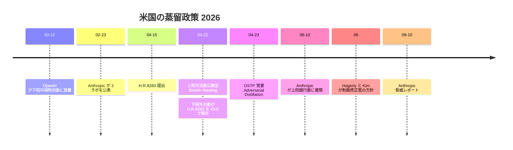
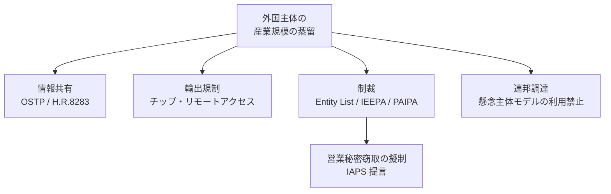

# 米国の政策対応: OSTP「Adversarial Distillation of American AI Models」覚書と H.R.8283（DAAMTA）・BLADE Act

- **Source**:
  - IAPS（Theo Bearman）「AI Distillation Attacks: Executive and Congressional Action Can Go Further」: https://www.iaps.ai/research/ai-distillation-attacks-executive-and-congressional-action-can-go-further
  - The Next Web（2026-04-23）: https://thenextweb.com/news/us-white-house-ai-model-distillation-china-theft
  - IAM（2026-04-24, 07 と同じ）: https://www.saul.com/sites/default/files/documents/2026-04/ArtiIs%20AI%20distillation%20a%20chink%20in%20the%20armour%20of%20American%20innovation%C2%A0%20-%20IAM%20Trade%20Secrets.pdf
  - Anthropic 書簡（2026-06-10）の報道: https://letsdatascience.com/news/anthropic-accuses-alibaba-of-distilling-claude-d0593c90
- **Date**: 2026-04-15（H.R.8283 提出）〜 2026-06（上院の動き）
- **Type**: Technical Article（政策メモ・報道）
- **取得状況**: IAPS・TNW・IAM は取得済み。**congress.gov（H.R.8283）と hagerty.senate.gov は 403 で取得できず**、法案の条文は IAPS の要約に依拠。BLADE Act は検索スニペットのみ（**未検証**）
  - （2026-10-22 訂正）H.R.8283 は **api.congress.gov（DEMO_KEY）と条文 HTML（BILLS-119hr8283ih.htm）で取得・検証済み**。末尾の追記を参照。NSA / CISA / FBI 共同勧告 AA26-251A（cisa.gov）も取得

> 本レポートはリサーチであり法的助言ではありません。法案の内容は政策メモ（IAPS）の要約に基づき、条文の一次確認はできていません。2026-10-21 時点の成立状況も未確認です。

## Overview

2026 年 4 月、米国の蒸留問題は「企業の規約違反」から **国家安全保障の政策課題** に格上げされました。4 月 22 日の上院司法委員会公聴会、4 月 23 日の OSTP（科学技術政策局）覚書、4 月 22 日の下院外交委員会での H.R.8283 の 43-0 可決、6 月の Anthropic の議会書簡と上院議員による制裁修正案、という流れです。いずれも **外国（主に中国）の主体による「産業規模の」蒸留** を対象とし、国内企業の正規の蒸留を規制するものではありません。

## Key Technical Content

### 1. OSTP 覚書（2026-04-23）

| 項目 | 内容 | 典拠 |
|------|------|------|
| 正式名 | National Security and Technology Memorandum「Adversarial Distillation of American AI Models」 | IAPS |
| 発出者 | Michael Kratsios（大統領補佐官・OSTP 長官） | TNW / IAM |
| 認識 | 外国主体（「principally based in China」）が、数万のプロキシアカウント、ジェイルブレイク手法、協調的な回避手法で米国フロンティア AI を産業規模で蒸留 | IAM |
| コミットメント | (1) 業界との情報共有、(2) ベストプラクティスの策定と防御支援、(3) 「explore a range of measures to hold foreign actors accountable for industrial-scale distillation campaigns」 | IAPS / TNW |
| 性質 | 政策声明。**制裁・Entity List 追加・執行措置は発表されていない** | TNW |
| Kratsios の発言 | 「running industrial-scale distillation campaigns to steal American AI」「We will be taking action to protect American innovation.」 | TNW |

### 2. H.R.8283 Deterring American AI Model Theft Act of 2026（DAAMTA）

| 項目 | 内容（IAPS の要約） |
|------|------------------|
| 提出 | 2026-04-15、Rep. Huizenga（R-MI-4） |
| 委員会 | 2026-04-22 のマークアップ後、下院外交委員会で **43-0** で報告 |
| 対象 | 「Model Extraction Attacks」 |
| 枠組み | 商務省による懸念主体の評価 / End-User Review Committee による BIS Entity List 追加の投票 / **IEEPA に基づく大統領の裁量的な資産凍結制裁** / 攻撃者の公開リスト / 任意の情報共有メカニズムとベストプラクティス指針 |

### 3. 上院の動き（2026-06、二次・一部未検証）

- Anthropic の 2026-06-10 書簡（Alibaba 系 2,880 万件超）を受け、Hagerty 議員と Andy Kim 議員が、**米国 AI モデルの出力に不正アクセスして競合モデルを学習する中国企業をブラックリスト化・制裁する修正案** を国防関連法案に付す方針と報道（CNBC 経由の二次報道）。
- 検索スニペットでは上院案は「Blocking Large-Scale Adversarial Distillation Efforts（BLADE）Act」とされるが、**一次未確認**。NDAA への最終的な採否も未確認。

### 4. IAPS の追加提言

**A. 行政（NSTM の補完）**

1. 半導体輸出規制: 懸念国へのチップ・製造装置の輸出が蒸留攻撃を支えていないか商務省が検討
2. チップへのリモートアクセス: 懸念国外にある米国製クラスタへの外国攻撃者のリモートアクセスのリスクを検討
3. 具体的な責任追及手段の明示: BIS Entity List、Protecting American Intellectual Property Act of 2022（PAIPA）に基づく指定など

**B. H.R.8283 の修正**

1. 業界協力: モデル悪用の情報共有に関する法的障壁（独禁法・プライバシー）の調査
2. 政府内の情報共有: 新設 s.4(f)
3. 連邦機関のアクセス禁止: 懸念主体が開発したモデルへの行政機関のアクセスを禁止（国家安全保障・研究の例外付き）
4. **営業秘密の擬制**: 特定された主体を「activity connected to the significant theft of trade secrets」に従事したものとみなす（18 U.S.C. 1839 の定義を参照）→ PAIPA の制裁を使えるようにする
5. 頻度と範囲: 「annually for 3 years」を「at least annually for 5 years」へ
6. 軽微な修正

## Figures & Tables

### 図 1: 2026 年の政策タイムライン

### 図 2: 政策手段の構造

### 表 3: 企業への影響（本レポートの整理）

| 主体 | 影響 |
|------|------|
| 米国の正規利用企業（社内蒸留） | 直接の規制対象ではない。ただし各社の検出強化（02）と規約厳格化（04）の背景になる |
| 外国（特に中国）の AI ラボ | Entity List・IEEPA 制裁のリスク |
| 中国系モデルを採用する企業 | H.R.8283 の修正案（IAPS）が通れば **連邦機関では利用禁止** の可能性。DTSA の「had reason to know」論（07）と合わせ、来歴の確認が必要 |
| プロキシ・再販事業者 | 情報共有と制裁の対象になり得る |

## Practical Takeaways

1. **政策は「外国の不正蒸留」が対象で、正規の社内蒸留は対象外**: 規約を守った蒸留を萎縮させる必要はない。
2. **ただし採用するモデルの来歴は政策リスクになる**: 告発対象ラボのモデル（またはそれを蒸留したモデル）を業務で使う場合、将来の調達制限・制裁の影響を評価する。
3. **日本企業も影響を受け得る**: 9 月レポートでは Moonshot の不正アカウントが主にシンガポールと日本にあったとされる（02）。国内のプロキシ・再販経由の利用は避ける。

## Notes

- H.R.8283 の条文、成立状況、上院案（BLADE Act）の条文は一次未確認。追跡には congress.gov の確認が必要。
  - （2026-10-22 訂正）H.R.8283 は一次で確認済み（下記）。BLADE Act は引き続き未検証。
- IAPS は 2026 年 3 月の先行メモ「AI Distillation Attacks: The Case for Targeted Government Intervention」に言及しているが、本調査では未取得。
- 関連: [02 Anthropic 脅威レポート](02-anthropic-threat-report-and-defenses-2026.md) / [07 米国法の分析](07-us-legal-analysis-contract-trade-secret-copyright.md)

## 2026-10-22 追記: H.R.8283 の一次確認と NSA / CISA / FBI 共同勧告

### H.R.8283「Deterring American AI Model Theft Act of 2026」（congress.gov API・条文、2026-10-22 取得）

| 項目 | 内容（一次） |
|------|------------|
| 提出 | 2026-04-15、Rep. Bill Huizenga（R-MI-4）、共同提案 Moolenaar ほか（共同提案者 21 名） |
| 付託 | 下院外交委員会（House Foreign Affairs） |
| 最新の動き | 2026-04-22 "Ordered to be Reported (Amended) by the Yeas and Nays: 43 - 0."（委員会で修正付き報告決定）。API の updateDate 2026-09-19 時点で本会議採決・上院送付の記録なし |
| CBO 費用見積 | 2026-05-28 公表（CBO 62480。本文は 403 で未取得） |
| 条文版 | Introduced in House（IH）のみ公開。委員会修正後の条文（RH）は未公開 |

条文の要点（IH 版、逐語引用は原文）:

- 目的: "To prevent foreign adversaries from threatening the national security of the United States by extracting key technical features of closed-source, American-owned artificial intelligence models"
- **議会の認識（Sec. 2(6)）**: "authorized model training practices that adhere to the terms of service or are otherwise consistent with contractual terms set by the owners of closed-source AI models are a legitimate research method ... and are fundamentally distinct from model extraction attacks defined in this Act."
- **"model extraction attack" の定義（Sec. 3(11)(A)）**: "the unauthorized extracting of a closed-source AI model's capabilities to replicate, develop, train, or improve another AI model, where such querying— (i) circumvents technical, contractual, or other access controls, identity verification requirements, or geographic access restrictions ...; (ii) is conducted through fraudulent, misrepresented, or unauthorized credentials; or (iii) violates the terms, conditions, or restrictions governing access to or use of the model ... that specifically prohibit the use of model outputs or interactions to replicate, develop, train, or improve another AI model."
- **目的の推認（Sec. 3(11)(B)）**: クエリの量・構造・パターン・協調・タイミング、特定能力への集中、複数アカウントの協調利用、他モデルの開発時期との相関から推認できる。
- **除外（Sec. 3(11)(C)）**: "Model training activities conducted in compliance with the terms, conditions, and restrictions governing access to and use of the closed-source AI model ... are not model extraction attacks."
- **"fraudulent account network provider"（Sec. 3(7)）**: 地域制限を回避するアカウントを提供する外国事業者。
- **Sec. 4**: 国務長官が 180 日以内に攻撃主体と不正アカウント網提供者を評価、商務長官が 210 日以内に報告、情報共有メカニズムの設置、「AI Model Extraction Attackers List」を国務省サイトで最長 5 年公開、ベストプラクティスの公表。
- **Sec. 5**: BIS の Entity List 追加を審査（210 日以内）、IEEPA に基づく資産ブロック制裁（人道・諜報の例外）。

**本クラスタへの含意**: 法案は **「規約違反」を攻撃の定義要素に取り込んでいる**（3(11)(A)(iii)）。したがって各社規約の蒸留禁止条項（[04](04-closed-vendor-terms-anthropic-google-openai-mistral.md)）は、成立すれば制裁の前提事実にもなる。逆に、規約に従った蒸留は明文で除外されており、「合法な蒸留」の線引きは引き続き契約に委ねられる。

### NSA / CISA / FBI 共同サイバーセキュリティ勧告 AA26-251A（2026-09-08、cisa.gov で取得）

- 題名: "China-Based Artificial Intelligence Companies Conducting Industrial-Scale Distillation Campaigns Against U.S. AI Companies"
- 名指し: **DeepSeek、Moonshot AI、Alibaba、MiniMax、StepFun、Z.AI**。対象は Claude / GPT / Gemini / Grok の各系列。
- 規模（引用）: "extracted billions of tokens across millions of exchanges/requests"、"query volumes in the thousands to millions per domain"。
- 位置づけ（引用）: "'distillation' is recognized as a legitimate and useful technique in AI research" としたうえで、"aggressive, malicious, and targeted distillation activities at an industrial scale" を問題とし、不正アクセス・規約違反・制限された能力の抽出で区別。
- 提供者向け推奨: 本人確認の強化、異常な契約量対利用量比や新規アカウントの即時最大利用の監視、高確度の疑いには **応答の劣化（低性能モデルへの切替・ノイズ付加）を通知なしで実施**、事業者間での IoC（IP・ドメイン・第三者プロバイダ）と行動指標の共有、MITRE ATLAS の緩和策（レート制限 AML.M0004、アクセス制御 AML.M0019、テレメトリ AML.M0024、出力難読化 AML.M0002）と NIST AI 100-2e2025。
- 注記: 勧告ページの表 1 と本文で各社の対象モデル列挙に不一致がある（例: DeepSeek の Grok 3 Mini は表のみ）。引用時は表と本文の双方を確認すること。

**含意**: 2026 年 9 月時点で、告発（Anthropic / OpenAI）→ 政策メモ（OSTP）→ 法案（H.R.8283）→ **政府機関による名指しの勧告** まで進んだ。名指しされた 6 社のモデル（およびそれらから蒸留されたモデル）を採用する企業は、来歴リスク（DTSA の "had reason to know" 論、将来の Entity List / 制裁）を評価する必要がある。
