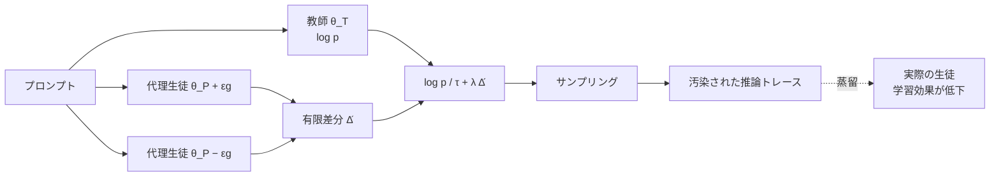

# Antidistillation Sampling

- **Link**: https://arxiv.org/abs/2504.13146（HTML: https://arxiv.org/html/2504.13146v5）
- **Authors**: Yash Savani, Asher Trockman, Zhili Feng, Yixuan Even Xu, Avi Schwarzschild, Alexander Robey, Marc Finzi, J. Zico Kolter
- **Year**: 2025（v1 2025-04-17、v5 2025-10-26）
- **Venue**: arXiv
- **Type**: Academic Paper
- **取得状況**: abs ページと HTML 版（v5）を WebFetch で取得。図の画像 URL は取得しておらず、図はキャプションの要約と Mermaid / 表で再構成

> 本レポートは研究紹介であり法的助言ではありません。規約・法律の論点との関係は「Notes」に整理しています。

## Abstract

WebFetch の引用長制限により、abstract は全文ではなく次の **逐語断片** のみ取得した（全文は abs ページを参照）。

- "rich token sequences that can facilitate model distillation"
- "strategically modif[ies] a model's next-token probability distribution"
- "significantly less effective for distillation"（実用上の有用性は保たれる、との趣旨）

## Abstract (Japanese Translation)

（上記断片と取得した要約に基づく要旨訳）長い推論トレースを生成するフロンティアモデルは、意図せずモデル蒸留を容易にする豊富なトークン列を生み出してしまう。この脆弱性を踏まえ、モデル所有者は性能を損なわずに蒸留の有効性を制限するサンプリング戦略を求め得る。Antidistillation sampling はまさにその機能を提供する。モデルの次トークン確率分布を戦略的に変更することで推論トレースを「汚染」し、実用上の有用性を保ったまま蒸留への有効性を大きく下げる。

## Overview

本論文は、**教師モデルの提供者側が「蒸留されにくい出力」を返す** ための最初期の手法です。推論トレースは教師にとってもっともらしい（教師の尤度が高い）まま、**代理の生徒モデル（proxy student）が学習すると下流損失が悪化する方向** にトークン選択を少しずらします。2026 年の Anthropic の防御（推論の要約・可視性制限、02）は「出力を隠す」方向ですが、本手法は「出力は返すが学習価値を下げる」方向で、後続研究（LADS, TARS）につながっています。

## Problem

- **推論トレースの漏えい**: 長い chain-of-thought は蒸留の格好の教材になる（02 の SWE-bench 実験でも、全文トランスクリプトの方が 8.6pt 高い）。
- **安全性の喪失**: 蒸留された生徒は教師の安全性を引き継がない可能性がある。
- **温度上昇では守れない**: 単にランダム性を上げても、教師の精度が落ちるだけで生徒の学習価値は下がらない。

## Proposed Method

**Antidistillation sampling**

- **Core idea**: 各トークンが「代理生徒の下流損失をどれだけ下げるか」を見積もり、**損失を下げる（蒸留に役立つ）トークンを避け、損失を上げるトークンを選びやすくする** ペナルティを教師の logits に加える。
- **既存手法との違い**: 温度サンプリングは分布を一様に平坦化するだけだが、本手法は蒸留価値に沿って分布を **方向付けて** 変える。

**Key Formulas**:

代理生徒 $\theta_P$ を、生成トークン $x_{t+1}$ で 1 ステップ更新したとする:

$$\theta_P^{+} = \theta_P + \eta \nabla_{\theta_P} \log p(x_{t+1} \mid x_{1:t}; \theta_P)$$

そのトークンが下流損失 $\ell$（通常は保留した推論トレース集合での負の対数尤度）に与える影響:

$$\Delta(x_{t+1} \mid x_{1:t}) = \ell(\theta_P^{+}) - \ell(\theta_P)$$

教師はペナルティ付き分布からサンプリングする:

$$x_{t+1} \sim \frac{1}{Z}\exp\left(\frac{1}{\tau}\log p(\cdot \mid x_{1:t}; \theta_T) + \lambda \Delta(\cdot \mid x_{1:t}; \theta_P)\right)$$

$\eta \to 0$ の極限では方向微分になる:

$$\lim_{\eta \to 0} \frac{1}{\eta}\Delta(x_{t+1} \mid x_{1:t}) = \left\langle \nabla \ell(\theta_P), \nabla_{\theta_P} \log p(x_{t+1} \mid x_{1:t}; \theta_P) \right\rangle$$

これを全語彙について一度に計算するため、有限差分で近似する:

$$\widehat{\Delta}(\cdot \mid x_{1:t}) = \frac{\log p(\cdot \mid x_{1:t}; \theta_P + \epsilon \nabla\ell(\theta_P)) - \log p(\cdot \mid x_{1:t}; \theta_P - \epsilon \nabla\ell(\theta_P))}{2\epsilon}$$

最終的なサンプリング則:

$$x_{t+1} \sim \frac{1}{Z}\exp\left(\frac{1}{\tau}\log p(\cdot \mid x_{1:t}; \theta_T) + \lambda \widehat{\Delta}(\cdot \mid x_{1:t})\right)$$

| 記号 | 意味 |
|------|------|
| $\theta_T$ | 教師モデルのパラメータ |
| $\theta_P$ | 代理生徒（proxy student）のパラメータ |
| $\ell$ | 下流損失（保留推論トレースでの NLL） |
| $\eta$ | 仮想的な 1 ステップ更新の学習率 |
| $\tau$ | 温度 |
| $\lambda$ | 教師の有用性と汚染の強さのトレードオフ（$\lambda > 0$） |
| $\epsilon$ | 有限差分の幅（BFloat16 で $10^{-2}$） |
| $Z$ | 正規化定数 |

**Features**:

- 代理生徒の勾配 $\nabla\ell(\theta_P)$ は **1 回だけ** 計算すればよい
- 各トークンで代理モデルの順伝播 2 回（$\theta_P \pm \epsilon g$）が追加
- 実際の生徒は未知でもよい（代理から実際の生徒への汎化に依存）

## Algorithm (Pseudocode)

```
Algorithm: Antidistillation Sampling
Input: 教師 θ_T, 代理生徒 θ_P, 下流損失 ℓ, プロンプト x_{1:t}, 温度 τ, 強さ λ, 幅 ε
Output: 汚染された推論トレース

1. g ← ∇ℓ(θ_P)                       // 一度だけ計算
2. θ_plus ← θ_P + ε g ; θ_minus ← θ_P − ε g
3. while 終了トークンでない:
4.     a ← log p(· | x_{1:t}; θ_T)       // 教師の対数確率
5.     b ← log p(· | x_{1:t}; θ_plus)    // 代理の順伝播 1
6.     c ← log p(· | x_{1:t}; θ_minus)   // 代理の順伝播 2
7.     Δ̂ ← (b − c) / (2ε)              // 全語彙の蒸留影響の近似
8.     x_{t+1} ~ softmax(a/τ + λ Δ̂)     // ペナルティ付きサンプリング
9.     t ← t + 1
10. return x
```

## Architecture / Process Flow



## Figures & Tables

### 表 1: 実験設定

| 項目 | 値 |
|------|----|
| 教師 | DeepSeek-R1-Distill-Qwen-7B |
| 代理生徒 | Qwen2.5-3B |
| 実際の生徒 | Llama-3.2-3B |
| ベンチマーク | GSM8K（GSM8K Platinum test set）、MATH、MMLU |
| 最大生成長 | 1024（GSM8K, MMLU）/ 2048（MATH） |
| 温度（antidistillation） | $\tau = 0.6$ |
| $\epsilon$ | $10^{-2}$（BFloat16） |
| 蒸留（LoRA） | rank 128、$\alpha$ 128、dropout 0、lr 0.0005、weight decay 0.1、勾配クリップ 1.0、cosine（warm-up 10%）、batch 32、4 epoch |
| ベースライン | 温度サンプリング / 蒸留なしの in-context 生徒 / permutation sampling（付録 A） |

### 表 2: 主要結果（本文記載の数値）

| 設定 | 教師精度 | 生徒精度 | 出典箇所 |
|------|---------|---------|---------|
| MMLU、greedy で蒸留 | 72% | 最大 52% | 序論の例 |
| MMLU、温度上昇（教師 -4%） | 約 68%（72%−4pt から算出） | 52%（低下せず） | 序論の例 |
| MMLU、antidistillation（教師 -4%） | 約 68%（同上） | 最低 40% | 序論の例 |
| 高精度域、antidistillation | 90% → 89% | 65% → 56% | §4.2 |
| 高精度域、温度サンプリング | 同程度の低下 | 低下しない | §4.2 |

```
同じ教師精度低下（約 -4pt, MMLU）での生徒精度
温度サンプリング   |██████████████████████████ 52%
Antidistillation  |████████████████████ 40%
```

### 図の一覧（キャプションの要約）

| 図 | 内容 |
|----|------|
| Fig. 1 | antidistillation は教師性能を保ちつつ蒸留を汚染（温度サンプリングとの比較） |
| Fig. 2 | 1 勾配ステップ違いの代理 2 コピーで $\Delta$ を近似する図解 |
| Fig. 3 | $\lambda$ を変えたときの教師精度と蒸留可能性のトレードオフ。温度サンプリングでは教師が約 20% まで落ちないと生徒は蒸留なし水準を下回らないが、antidistillation では教師約 70% で下回る |
| Fig. 4 | MMLU と MATH で、小さな教師コストで生徒精度が低下 |
| Fig. 5 | 蒸留の損失曲線: 学習損失は下がり、保留損失は上がる（学習はできるが汚染されている） |
| Fig. 6 | permutation sampling ベースライン（付録 A） |
| Fig. 7 | 有限差分と JVP の相対誤差（$\epsilon$ ごと、付録 B） |
| Fig. 8 | GSM8K での JVP と有限差分（Float32 を含む、付録 C） |
| Fig. 9 | 教師精度低下の最初の 5% の拡大（最も実用的な領域、付録 D） |
| Fig. 10 | 同一系列（全 Qwen / 全 Llama）の教師・代理・生徒（付録 D） |
| Fig. 11 | 代理サイズの違い（Qwen2.5-1.5B / 7B）と Llama-3.2-3B 生徒（付録 D） |

### 表 3: 関連する防御・帰属手法の比較（本調査で収集した論文から作成）

| 手法 | 方向 | 仕組み | 利点 | 弱点 |
|------|------|-------|------|------|
| Antidistillation Sampling（本論文） | 予防 | 代理生徒の勾配で教師分布を歪める | 実際の生徒が未知でも効く | 計算量が約 2 倍、超パラ依存 |
| LADS（arXiv 2605.18829） | 予防 | アカウント間の乱数結合 | 各ユーザの出力分布は不変 | 多アカウント収集が前提 |
| TARS（arXiv 2604.23238） | 予防 | thought anchor の検出されにくい除去 | 汚染が検出・除外されにくい | — |
| 推論の要約・非公開（Anthropic, 02） | 予防 | 推論全文を返さない | 単純で強力（取得量 90–99% 減と申告） | 正規ユーザの可視性も下がる |
| Radioactive watermark（arXiv 2402.14904） | 事後帰属 | 透かし出力で学習したモデルを検出 | 統計的保証 | 透かし除去攻撃（arXiv 2502.11598）に弱い |
| GINSEW（arXiv 2302.03162） | 事後帰属 | 出力確率に隠れ信号 | 蒸留されたモデルを検出 | — |

## Experiments & Evaluation

### Setup

上の表 1 のとおり。主ベースラインは温度サンプリングで、教師精度を同程度に落としたときの生徒精度で比較する。

### Main Results

- 同じ教師精度の低下で、antidistillation は生徒精度を大きく下げ、温度サンプリングは下げない（表 2）。
- §4.4: 生徒の学習損失は下がるが保留損失は上がる。「学習可能だが汚染された」トレース。

### Ablation Study

- 付録 A の permutation sampling（$\widehat{\Delta}$ の統計量は保つが並びをシャッフル）は、効果が $\widehat{\Delta}$ の **方向情報** に由来することの確認。
- 付録 D: 同一系列の構成、代理サイズの変更でも傾向を確認。

### Limitations（本文から抽出）

1. 計算コスト: 代理が教師の半分程度の大きさならサンプリング計算は約 2 倍
2. JVP 版は SDPA 等の非対応と flash attention 不可で約 8 倍遅い（有限差分で回避）
3. $\epsilon$ はモデルサイズと数値精度に依存
4. 代理から未知の生徒への汎化に依存
5. 評価は 3 ベンチマーク・単一教師・3B 級生徒。著者は「proof-of-concept」と位置づけ

## Notes

- **企業実務への含意**: 本手法や推論の要約が普及すると、**商用 API の出力（特に推論トレース）を教師データにする蒸留は、規約の問題とは別に技術的にも効きにくくなる**。正規に許可された蒸留でも、ベンダーが汚染・要約した出力しか返さない可能性があるため、蒸留経路はベンダーの公式機能（06）かオープンウェイト教師（05）に寄せるのが合理的。
- **法的論点との関係（推論）**: 透かし・指紋による事後帰属（表 3）は、営業秘密訴訟で「出力が学習に使われた」ことの立証に役立ち得る（07 の「検証の抗弁」への反証）。
- 後続: LADS（2026-05）、TARS（2026-04）、Antidistillation Fingerprinting（Xu et al., 2026、LADS の関連研究で言及、本調査では未取得）。
