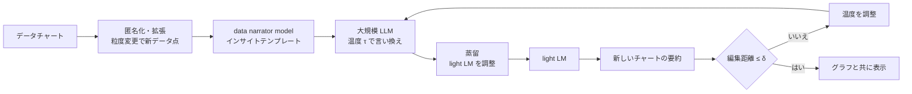
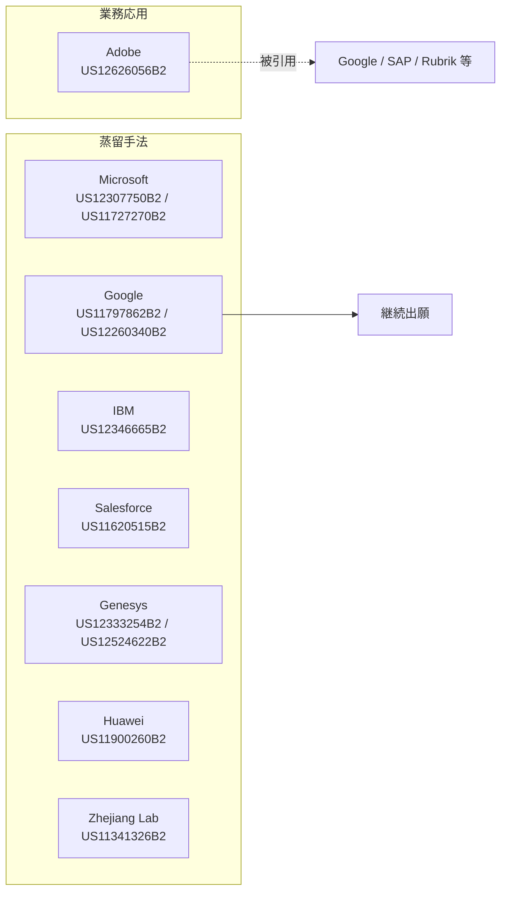

# Generating natural language model insights for data charts using light language models distilled from large language models（US12626056B2）と蒸留特許ランドスケープ

- **Patent Number**: US12626056B2（出願 US 18/338,033、公開 US20240320421A1）
- **Assignee**: Adobe Inc.
- **Inventors**: Victor Soares Bursztyn, Wei Zhang, Prithvi Bhutani ほか（Google Patents の表示が部分的）
- **Filing Date**: 2023-06-20（優先日 2023-03-21、仮出願 63/491,400）
- **Grant Date**: 2026-05-12
- **Classification**: G06F40/56, G06F40/186, G06F40/166, G06F40/40, G06F40/55, G06N3/02, G06N3/08, **G06N3/096**
- **Link**: https://patents.google.com/patent/US12626056B2/en
- **Type**: Patent
- **取得状況**: Google Patents ページを 2 回に分けて WebFetch（0–100,000 字と 100,000 字以降）。請求項 1 は前半の取得結果の要約、請求項 12–20 は後半の取得結果に基づく。図面画像は取得していない

> 本レポートはリサーチであり法的助言ではありません。権利範囲（クレーム解釈）や有効性の評価は行っていません。Google Patents の法的状態表示は Google 自身が「assumption」としています。

## Abstract

（Google Patents の abstract は引用長制限で逐語取得できなかったため要旨のみ）大規模言語モデルから蒸留した小型の言語モデル（light language model）を使い、データチャートの自然言語による要約（インサイト）を生成する。学習データは匿名化とデータ拡張を施して精度を高める。

## Abstract (Japanese Translation)

上記のとおり（原文の逐語取得なし）。

## Overview

本特許は、**生成 LLM を教師にして、業務用の小型モデルを作る「蒸留の業務応用」を権利化した** 代表例です。本クラスタで検証できた蒸留特許 11 件のうち、他の 10 件は BERT 世代の **蒸留手法そのもの**（多タスク蒸留、層削除、NAS、メモリ内並列蒸留など）であるのに対し、本件は 2023 年優先日で、**LLM の生成出力を小型 LM に学習させる用途**（データチャートの説明文生成）を請求しています。蒸留でプロダクト機能を作る企業にとっては、**「蒸留した」こと自体ではなく、その業務パイプラインの組合せが特許になり得る** ことを示す事例です。

## Technical Problem

- データチャートの要約を大規模 LLM で毎回生成すると、コストとレイテンシが大きい
- LLM の生成は表現が揺れ、テンプレートから外れたり事実と食い違ったりする
- 学習データに実データを使うとプライバシーの問題がある

## Technical Solution

### Process Steps

1. **Step 1**: data narrator model がデータチャートから **インサイトテンプレート** を作る → テンプレート
2. **Step 2**: 大規模言語モデルが、テンプレートに従ってチャートの自然言語要約を書く。**温度設定** で表現がテンプレートからどこまで離れてよいかを制御 → 言い換え（paraphrase）
3. **Step 3**: チャートデータを匿名化（ノイズ付加）・拡張（粒度変更で新しいデータ点を作る）し、分割（fold）する → 学習データ
4. **Step 4**: LLM の知識を light language model に蒸留（小型モデルのパラメータを調整して要約を再現させる） → 蒸留済み小型モデル
5. **Step 5**: 小型モデルで新しいチャートの要約を生成し、編集距離のしきい値で検証。外れたら温度を調整 → インサイト

### Key Innovation

- テンプレート（構造）と LLM の言い換え（表現）を分離し、温度で揺れ幅を制御したうえで小型モデルに蒸留する点
- 匿名化・拡張したチャートで蒸留し、プライバシーと汎化を両立する点
- 編集距離による出力検証と温度のフィードバック

### Mathematical Relationships

特許本文から数式は取得していない。請求項の構造を式で表すと次のように整理できる（本レポートによる定式化）:

$$
\hat{y} = f_{\text{light}}(c;\ \phi^{*}), \quad \phi^{*} = \arg\min_{\phi} \sum_{c \in \mathcal{C}_{\text{anon,aug}}} L\big(f_{\text{light}}(c;\phi),\ \text{LLM}_{\tau}(\text{Template}(c))\big)
$$

$$
\text{accept}(\hat{y}) \iff d_{\text{edit}}\big(\hat{y}, \text{Template}(c)\big) \le \delta
$$

| 記号 | 意味 |
|------|------|
| $c$ | データチャート |
| $\mathcal{C}_{\text{anon,aug}}$ | 匿名化・拡張したチャート集合 |
| $\text{Template}(c)$ | data narrator model が作るインサイトテンプレート |
| $\text{LLM}_{\tau}$ | 温度 $\tau$ の大規模言語モデルによる言い換え |
| $f_{\text{light}}(\cdot;\phi)$ | パラメータ $\phi$ の軽量言語モデル（生徒） |
| $d_{\text{edit}}$, $\delta$ | 編集距離としきい値 |

## Key Claims

### Claim 1（方法、前半取得結果の要約）

- **Element a)**: data narrator model がデータチャートのインサイトテンプレートを作成する
- **Element b)**: 大規模言語モデルが、テンプレートに従うチャートの自然言語要約を生成する。温度設定が、表現がテンプレートからどこまで乖離してよいかを制御する
- **Element c)**: 大規模言語モデルの知識を、その要約を再現するよう小型の light language model を調整することで蒸留する
- **Element d)**: light language model を使って新しいチャートを要約する

### Claim 15（コンピュータ可読媒体、後半取得結果の要約）

- **Element a)**: チャートデータにノイズを加えて匿名化
- **Element b)**: チャートを fold に分割
- **Element c)**: data narrator model でインサイトテンプレートを生成
- **Element d)**: LLM で温度制御された乖離しきい値内の言い換えを生成
- **Element e)**: 蒸留済み light model でインサイトを生成

### Claim 8（システム）

請求項 12–14 が「the system of claim 8」に従属することから独立請求項と推定されるが、本文は取得できていない。

## Process Flow Diagram



## Figures & Tables

### 表 1: 請求項の構造

| Claim # | Type | Depends On | Key Element |
|---------|------|-----------|-------------|
| 1 | Independent（方法） | — | テンプレート → LLM 言い換え（温度）→ light LM へ蒸留 → 要約 |
| 8 | Independent（システム、推定） | — | 本文未取得 |
| 12 | Dependent | 8 | 編集距離でしきい値検証し温度を調整 |
| 13 | Dependent | 8 | 匿名化・拡張チャートで蒸留したパラメータで生成 |
| 14 | Dependent | 8 | インサイトをグラフと共に自然言語で表示 |
| 15 | Independent（媒体） | — | 匿名化・fold 分割・テンプレート・言い換え・蒸留モデル |
| 16 | Dependent | 15 | チャートの粒度変更で新データ点 |
| 17 | Dependent | 15 | LLM を light model へ蒸留（パラメータ調整） |
| 18 | Dependent | 15 | インサイト種別ごとの例示言い換え |
| 19 | Dependent | 15 | 種別ごとに例を選んで生成時に従う |
| 20 | Dependent | 15 | 編集距離しきい値での検証 |

### 表 2: 被引用（Cited By）

| 引用特許 | 出願人 |
|---------|-------|
| US12547848B2 | Google LLC |
| US12596875B2 | Rubrik, Inc. |
| US12346314B1 | SAP SE |
| CN119474338B | Shanghai Bilibili Technology |
| US12506589B1 | Chain Reaction, Ltd. |

### 表 3: 本クラスタで検証した蒸留特許ランドスケープ（11 件）

| 番号 | 出願人 | 優先日 | 登録 | 類型 | 要旨 | CPC G06N3/096 |
|------|-------|-------|------|------|------|---------------|
| US12626056B2 | Adobe | 2023-03-21 | 2026-05-12 | **LLM→小型 LM の業務応用** | チャート要約 | あり |
| US12524622B2 | Genesys Cloud Services | 2021-12-21 | 2026-01-13 | 手法 | 層重みの変化が小さい層を削除して生徒化 | 未確認 |
| US12346665B2 | IBM | 2022-02-14 | 2025-07-01 | 手法 | 蒸留誘導の NAS | あり |
| US12333254B2 | Genesys Cloud Services | 2021-12-21 | 2025-06-17 | 手法 | 層のランダム削除で候補生徒を作り選択 | なし（G06N3/045 等） |
| US12307750B2 | Microsoft | 2022-06-10 | 2025-05-20 | 手法 | 教師・生徒を同時にメモリ保持し並列蒸留 | あり |
| US12260340B2 | Google | 2020-01-22 | 2025-03-25 | 手法 | 語彙縮小・共有射影の BERT 蒸留（継続出願） | あり |
| US11900260B2 | Huawei | 2020-03-05 | 2024-02-13 | 手法 | 教師一体型の生徒サブネットワーク | なし（G06N3/0495 等） |
| US11797862B2 | Google | 2020-01-22 | 2023-10-24 | 手法 | 上記の親出願 | 未確認 |
| US11727270B2 | Microsoft | 2020-02-24 | 2023-08-15 | 手法 | データセット横断の蒸留（推薦） | あり |
| US11620515B2 | Salesforce | 2019-11-07 | 2023-04-04 | 手法 | 多タスク蒸留 | あり |
| US11341326B2 | Zhejiang Lab | 2020-09-02 | 2022-05-24 | 手法 | BERT 圧縮プラットフォーム | あり |

```
優先日の分布（11 件）
2023 |█ 1   ← 生成 LLM 世代の業務応用は Adobe のみ
2022 |██ 2
2021 |██ 2
2020 |█████ 5
2019 |█ 1
```

### 図 4: 出願人と類型



### 表 5: 先行技術との比較（本レポートの整理）

| 観点 | US12626056B2（Adobe） | 手法特許群（BERT 世代） | 学術: Distilling Step-by-Step（arXiv 2305.02301） |
|------|---------------------|---------------------|----------------------------------------------|
| 教師 | 生成 LLM | BERT 等の判別型モデル | 540B PaLM |
| 移転するもの | 生成した文章（言い換え） | logits・中間表現・層 | 根拠（rationale）とラベル |
| 用途の限定 | データチャート要約 | 汎用（NLP タスク全般） | 汎用 |
| 付加要素 | テンプレート・温度・編集距離検証・匿名化 | メモリ管理・NAS・層選択 | マルチタスク学習 |

## Patent Family & Related Art

- 外国（WO / CN 等）のファミリーは Google Patents 上に表示なし。関連記録は仮出願 63/491,400、出願 18/338,033、公開 US20240320421A1、登録 US12626056B2。
- 他の特許のファミリー: US12307750B2 は WO2023239481A1・EP4537261A1、US11900260B2 は WO2021175064A1・CN115210720A、US12333254B2 は WO2023122146A1。
- **clustering の記載の訂正**: clustering では US12307750B2 と US12333254B2 を Google としていたが、Google Patents では **それぞれ Microsoft と Genesys Cloud Services**。また US12475175 は Google Patents で 404 となり、番号を確定できなかった。

## Notes

- **ビジネス上の含意**:
  1. 「LLM で作った出力を小型モデルに学習させる」こと自体は広く知られた手法だが、**特定の業務パイプラインとの組合せ** は権利化されている。自社で蒸留機能を製品化する場合、FTO（侵害予防調査）の対象になり得る。
  2. 逆に、自社の蒸留パイプライン（テンプレート化、検証ループ、データ匿名化など）に独自性があれば、権利化の候補になる。
  3. 特許は「どのように蒸留するか」を守るもので、「誰の出力を使ってよいか」（規約、04・05）とは独立した論点。
- **カバレッジの空白**: JPO（J-PlatPat）での LLM 蒸留特許は、検索予算の制約で確認できていない。CPC G06N3/096 と「large language model」の組合せでの網羅的検索も未実施。
- （2026-10-22 追記）**追補は [12 特許ランドスケープ](12-patent-landscape.md)** に記載。USPTO 公報で 8 件（うち 2023 年以降優先の業務応用 4 件: SAP US12475175B1 / Zscaler US12711255B2 / Citibank US12664433B1 / Cisco US12705265B2）を追加し、JP 11 件・CN 8 件・EP/WO 6 件を検索結果レベルで確認、EPO 審決 T 1425/21（Google、進歩性なし）を追加した。J-PlatPat は自動取得を 403 で拒否。
- （2026-10-22 訂正）表 2「被引用（Cited By）」の 5 件のうち、公報第 1 頁を確認できた **US12547848B2（Google、チャートのテキスト化と LLM 推論）と US12346314B1（SAP、ERP の GenAI 問合せ）はいずれも蒸留特許ではない**（本件を引用しているだけ）。US12596875B2（Rubrik）、US12506589B1（Chain Reaction）、CN119474338B（Bilibili）は未確認。「Adobe → Google / SAP」の系譜は蒸留技術の継承を意味しない。図 4 の "AD -.被引用.-> G2" はこの意味で読むこと。
- （2026-10-22 訂正）Patent Family & Related Art の「US12475175 は Google Patents で 404 となり、番号を確定できなかった」は、**USPTO 公報で US12475175B1（SAP SE、2024-12-16 出願、2025-11-18 登録、CPC G06F16/93 / G06N3/0475 / G06N3/096）と確定**。
