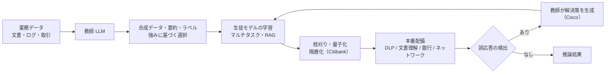
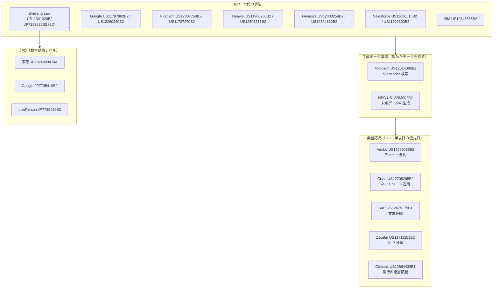

# LLM 蒸留の特許ランドスケープ（USPTO / EPO / CNIPA / JPO）— 手法特許と業務応用特許（2026-10-22 追記）

- **Patent Number**: 代表例 US12475175B1（ほか本レポートで公報を確認した 8 件と、検索結果レベルで番号・出願人・日付のみ確認した約 30 件を扱う）
- **Assignee**: SAP SE（代表例）。ランドスケープ全体では SAP / Zscaler / Citibank / Cisco / Microsoft / NEC / Salesforce / Huawei / Adobe / Google / IBM / Genesys / Zhejiang Lab（之江実験室）/ 東芝 ほか
- **Inventors**: Weishi Wang, Shaun Tieon, Yu Sheng Daniel Lee（US12475175B1）
- **Filing Date**: 2024-12-16（US12475175B1）
- **Grant Date**: 2025-11-18（US12475175B1）
- **Classification**: G06F16/93, G06N3/0475, **G06N3/096**（US12475175B1）
- **Link**: https://image-ppubs.uspto.gov/dirsearch-public/print/downloadPdf/12475175 （USPTO 公報 PDF。Google Patents は本調査日はアクセス遮断）
- **Type**: Patent（ランドスケープ）
- **取得状況**: USPTO の公報 PDF（image-ppubs.uspto.gov）を 12 件ダウンロードし、**第 1 頁（書誌・要約・代表図）を目視で確認**した。請求項全文は未読。Google Patents は 2026-10-22 14:50 JST 頃までは個別ページと検索 API（`/xhr/query`）が取得でき、JP 検索 1 回分（127 件中 50 件）と 4 件の被引用・類似文献リストを得たが、その後 WebFetch・ローカルともに 503 / 「Sorry...」で遮断された。J-PlatPat・Lens・PATENTSCOPE・Espacenet・FPO・Justia はいずれも自動取得を拒否（下表）

> 本レポートはリサーチであり法的助言ではありません。権利範囲（クレーム解釈）・有効性・侵害の評価は行っていません。「検索結果レベル」の特許は番号・名称・出願人・日付のみを検索結果画面から転記したもので、公報本文は未確認です。

## Abstract

（US12475175B1、原文）

> "Methods, systems, and computer-readable storage media directed to a machine learning (ML) model training system for training ML models by leveraging a large language model (LLM) for knowledge distillation to provide training data and using multi-task learning to train ML models using the training data."

## Abstract (Japanese Translation)

大規模言語モデル（LLM）を知識蒸留に利用して学習データを提供し、その学習データでマルチタスク学習により ML モデルを学習させる、ML モデル学習システムに関する方法・システム・記憶媒体。

## Overview

clustering（`cluster-08`）で「USPTO、番号未確定」とされていた **Robust documentation understanding using LLM KD（SAP）は US12475175B1（2025-11-18 登録）** と確定した。前回（[11](11-patent-adobe-us12626056-and-landscape.md)）で検証した 11 件が BERT 世代の「手法特許」中心だったのに対し、本追補では **2023 年以降に出願され、生成 LLM を教師として業務用モデルを作る「業務応用特許」が 2025–2026 年に相次いで登録されている** ことを一次資料（USPTO 公報）で確認した。

| 分類 | 件数 | 代表 |
|------|------|------|
| 公報第 1 頁を確認した蒸留特許（本追補） | 8 | SAP / Zscaler / Citibank / Cisco / Microsoft / NEC / Salesforce / Huawei |
| 前回検証済み（11 レポート） | 11 | Adobe / Microsoft / Google / IBM / Genesys / Huawei / Salesforce / Zhejiang Lab |
| 検索結果レベル（JP） | 11（＋関連不明 15 超） | 東芝 / Google / LivePerson / 之江実験室 / ソウル大 / IBM / NTT ほか |
| 検索結果レベル（CN） | 8 | 卓世智星 / 澜舟科技 / 東亜銀行（中国）/ 微衆銀行 / 360 / 華為 ほか |
| 検索結果レベル（EP / WO） | 6 ＋ 審決 1 | Microsoft / Huawei / Genesys / NEC のファミリー、EP4505353A1、EPO T 1425/21（Google） |
| 蒸留でないと判明し除外 | 4 | Optum / SAP（ERP）/ Google（チャート）/ 高麗大（画像） |

## Technical Problem

業務応用特許群に共通する課題は次の 3 点である。

- 生成 LLM を本番推論に毎回使うとコスト・レイテンシ・機密性（DLP、銀行）の問題がある
- ラベル付き学習データが少ない業務ドメイン（文書理解、ネットワーク運用）で小型モデルを作りたい
- 単一の小型モデルでは多様な複雑さの要求に応えられない（階層化・特化）

## Technical Solution

### Process Steps（US12475175B1、要約と代表図から）

1. **Step 1**: ML モデルの予測に基づき、文書の要約を **LLM で選択的に生成** → 蒸留用学習データ
2. **Step 2**: 生成 ML モデルを **マルチタスク学習** で学習 → 文書理解モデル
3. **Step 3**: **RAG 学習** で追加学習 → 頑健化したモデル
4. **Step 4**: 本番にデプロイ → 文書理解サービス

### Key Innovation（業務応用特許群に共通）

- LLM の出力を「学習データ生成」に限定して使い、推論は小型モデルで行う（コスト・機密性）
- 蒸留そのものではなく、**業務パイプラインとの組合せ**（要約の選択的生成、強みに基づく合成データ、階層化・量子化・配置先決定、誤応答の教師による修正）を請求している

### Mathematical Relationships

公報第 1 頁には数式がない。業務応用特許群の共通構造を本レポートで定式化すると次のとおり。

$$
\mathcal{D}_{\text{syn}} = \{(x_i,\ T(x_i))\}_{i=1}^{N},\qquad
\theta_S^{*} = \arg\min_{\theta}\ \sum_{(x,y)\in \mathcal{D}_{\text{syn}} \cup \mathcal{D}_{\text{real}}} \sum_{k} \lambda_k\, L_k\big(S(x;\theta),\ y\big)
$$

| 記号 | 意味 |
|------|------|
| $T$ | 教師（生成 LLM） |
| $S(\cdot;\theta)$ | 生徒（業務用小型モデル） |
| $\mathcal{D}_{\text{syn}}$ | LLM が生成・ラベル付けした合成データ |
| $L_k, \lambda_k$ | タスク $k$ の損失と重み（マルチタスク） |

## Key Claims

### Claim 1（US12475175B1、要約・代表図からの推定）

公報第 1 頁のみを確認したため請求項全文は未読。要約と図 5 から、独立請求項は少なくとも次の要素を含むと推定される。

- **Element a)**: LLM を用いて文書の要約（学習データ）を生成する
- **Element b)**: 生成した学習データでマルチタスク学習により ML モデルを学習する
- **Element c)**: 学習したモデルで文書理解を行う

### 他の業務応用特許の請求の骨子（要約から）

| 特許 | 骨子（要約の要点） |
|------|------------------|
| US12711255B2（Zscaler） | 教師の一般データ予測から **教師の強み** を判定 → 強みに基づく合成データセットを生成 → 教師の合成データ予測で生徒を蒸留 → 蒸留モデルで DLP の入力を分類 |
| US12664433B1（Citibank） | LLM から **カテゴリ × 複雑度** の階層で特化モデルを生成 → 複雑度に応じて枝刈り・量子化 → 配置先を決定して配備 |
| US12705265B2（Cisco） | 第 1 言語モデルの応答が誤りと判定 → **教師言語モデルが解決策を生成** → 解決策で第 1 モデルを更新 |
| US12614066B2（Microsoft） | 事前学習 seq2seq Transformer を微調整して教師化 → 教師で **拡張データ** を生成 → bi-encoder を学習してクロスドメイン検索 |

## Process Flow Diagram



## Figures & Tables

### 表 1: 公報第 1 頁を確認した蒸留特許（2026-10-22 追補、USPTO PDF）

| 番号 | 出願人 | 出願日（優先日） | 登録日 | CPC（公報 (52) 欄） | 類型 | 要旨 | 事業上の意味 |
|------|-------|----------------|--------|------------------|------|------|------------|
| US12475175B1 | SAP SE | 2024-12-16 | 2025-11-18 | G06F16/93, G06N3/0475, **G06N3/096** | **LLM 業務応用** | LLM の知識蒸留で学習データを作り、マルチタスク学習で文書理解モデルを学習 | ERP 文書処理の小型化。clustering の「番号未確定」を確定 |
| US12711255B2 | Zscaler, Inc. | 2024-06-17（IN 2024-01-10、CIP 系） | 2026-08-18 | G06F21/62 | **LLM 業務応用** | 教師 LLM の強みに基づく合成データで生徒 LLM を蒸留し、DLP の分類に使用 | セキュリティ製品での蒸留。教師・生徒とも LLM |
| US12664433B1 | Citibank, N.A. | 2025-10-29 | 2026-06-23 | G06N3/082, G06N3/0475 | **LLM 業務応用** | LLM からカテゴリ・複雑度別の特化モデルを階層的に蒸留し、枝刈り・量子化・配置 | 銀行業務（決済・投資助言・顧客対応）の 7B→20M 階層。出願から 8 か月で登録 |
| US12705265B2 | Cisco Technology | 2023-09-11 | 2026-08-11 | G06F16/3329, G06F40/253 | **LLM 業務応用** | 第 1 言語モデルの誤応答を教師言語モデルの解決策で修正・更新 | ネットワーク運用。継続的な教師→生徒の更新を権利化 |
| US12614066B2 | Microsoft Technology Licensing | 2021-07-22 | 2026-04-28 | G06N3/08, G06F8/40, G06F18/10, G06F40/42, G06N3/045 | 手法＋応用 | seq2seq Transformer を教師化して拡張データを生成し bi-encoder に蒸留（コード検索） | 教師が生成したデータで生徒を学習する「生成データ蒸留」の早期出願 |
| US12283092B2 | NEC Corporation | PCT 2019-11-13（WO2021/095160） | 2025-04-22 | G06V10/7747, G06N3/045 | 手法 | 教師が未学習の未知データに任意ラベルを付けて生成データを作り、生徒を蒸留学習 | **日本企業の蒸留特許（米国登録）**。画像分類寄り |
| US11922303B2 | Salesforce, Inc. | 2020-05-18（仮出願 2019-11-18） | 2024-03-05 | G06N3/08, G06F40/40, G06N3/045 | 手法＋応用 | BERT を教師に、同じ入力と教師出力で小型生徒を学習（テキスト分類・OOD 検出） | 顧客対応のインテント分類 |
| US12505351B2 | Huawei Technologies | 2021-04-16 | 2025-12-23 | G06N3/088, G06N3/045, G06N3/084 | 手法 | Dropout-KD: 教師中間層をエポックごとにランダム選択して蒸留、min-max データ拡張 | BERT 系中間層蒸留 |

### 表 2: 確認の結果「蒸留特許ではない」と判明した文献（被引用・検索ヒット）

| 番号 | 出願人 | 内容 | 除外理由 |
|------|-------|------|---------|
| US12530540B2 | Optum, Inc. | 第 2 の LLM でトピックモデルを評価（LLM-as-judge） | 蒸留の記載なし（Adobe 特許の被引用で表示） |
| US12346314B1 | SAP SE | ERP の自然言語問合せを LLM で処理 | 蒸留の記載なし（同上） |
| US12547848B2 | Google LLC | チャートをテキスト化して LLM で推論 | 蒸留の記載なし（同上） |
| US12530749B2 | 高麗大学校 | ぼけ画像の物体検出で教師・生徒ネットワーク | 蒸留だが言語モデルでない |

### 表 3: 検索結果レベルで確認した JPO 文献（Google Patents 検索 API、クエリ `"知識蒸留" "言語モデル"` country=JP、127 件中 1 頁目 50 件、2026-10-22 取得）

| 番号 | 出願人（表示のまま） | 優先日 | 公開/登録日 | 名称（検索結果の英訳からの再訳） | 蒸留との関係 |
|------|------------------|-------|-----------|------------------------------|------------|
| JP2024099474A | 株式会社東芝 | 2023-01-12 | 2024-07-25 | 言語モデル学習装置、方法、プログラム | **LLM 世代の日本企業出願**。US20240242039A1（同名・同優先日、Salesforce 特許の被引用）と同一ファミリーと推定（未確認） |
| JP7735419B2 | グーグル エルエルシー | 2021-03-26 | 2025-09-08 | 自己適応型蒸留 | 蒸留手法（登録） |
| JP7735420B2 | ライブパーソン | 2021-04-02 | 2025-09-08 | 知識蒸留による AI NLP エンコーダのドメイン適応 | 蒸留手法（登録）。コンタクトセンター事業者 |
| JP7283835B2 | 之江実験室 | 2020-12-17 | 2023-05-30 | 多段知識蒸留による事前学習言語モデルの自動圧縮 | 蒸留手法（登録）。US11341326B2 の関連 |
| JP7381813B2 | 之江実験室 | 2020-09-02 | 2023-11-16 | 知識蒸留による事前学習言語モデルの圧縮 | 蒸留手法（登録）。US11341326B2 の JP 対応と推定 |
| JP7381814B2 | 之江実験室 | 2020-12-15 | 2023-11-16 | マルチタスク向け事前学習言語モデルの自動圧縮 | 蒸留手法（登録） |
| JP7190146B2 | ソウル大学校産学協力団 | 2020-08-25 | 2022-12-15 | テキスト事前学習モデルを用いた音声言語理解知識の蒸留 | 蒸留手法（登録） |
| JP7633758B2 | IBM | 2020-04-03 | 2025-02-20 | 系列データ処理モデルの学習 | 検索ヒット。蒸留との関係は未確認 |
| JP2023033202A | Hyperconnect | 2021-08-25 | 2023-03-09 | 対話モデル学習方法・装置 | 検索ヒット。未確認 |
| JP2023026202A | 日本電信電話株式会社 | 2021-08-13 | 2023-02-24 | 同時機械翻訳方法・装置・プログラム | **NTT**。検索ヒットのみで蒸留との関係は未確認 |
| JP2025023822A | 三菱電機株式会社 | 2023-08-04 | 2025-02-17 | 学習ベース合成支援のアジャイルハードウェア実装システム | 検索ヒット。未確認 |
| JP7799133B1 ほか約 20 件 | 株式会社ビズリーチ / 株式会社アシュアード | 2024–2025 | 2024–2026 | 情報処理システム・方法・プログラム（求人・採用支援） | **ヒット理由不明**（明細書中で LLM と蒸留に言及している可能性）。未確認 |

JP の既知の空白: 日本企業（NTT / 富士通 / NEC / 日立 / 東芝 / ソニー / PFN / LINE / 楽天 / KDDI / トヨタ / デンソー）を出願人で絞った検索は Google Patents が 503 を返して実行できず、J-PlatPat は 403（`reject_sorry.html`）で自動取得を拒否した。確認できた日本企業の蒸留関連出願は **東芝（JP2024099474A）と NEC（US12283092B2、米国登録）** のみ。

### 表 4: 検索結果レベルで確認した CNIPA / EPO / WIPO 文献

| 番号 | 出願人 | 日付 | 名称 / 要旨 | 根拠 |
|------|-------|------|-----------|------|
| CN117573908A | 卓世智星（天津）科技 | 優先 CN202410058543.2（2024） | 対照学習に基づく大規模言語モデル蒸留方法 | WebSearch（Google Patents URL） |
| CN116611424A | 北京澜舟科技 | 2023-07-18 / 2023-08-18 | 文章作成支援モデルの構築方法（Genesys 特許の被引用） | Google Patents 被引用リスト |
| CN117787922B | 東亜銀行（中国） | 2024-02-27 / 2024-05-31 | 蒸留学習と自動学習に基づく返金業務処理（**銀行の業務応用**） | 同上 |
| CN119167982B | 深圳前海微衆銀行（WeBank） | 不明 | 遠隔の大モデルから小モデルを知識蒸留 | WebSearch（goveda.com 転載） |
| CN122021734A | 三六零数字安全科技集団 | 公開 2026-05-12 | （名称未取得）大モデル蒸留関連 | 同上 |
| CN118349673A | 華為技術 | 2019-09-12 / 2024-07-16 | テキスト処理モデルの学習方法（Microsoft 特許ファミリーの被引用） | Google Patents 被引用リスト |
| CN114818902A | 不明 | 不明 | 知識蒸留に基づくテキスト分類 | WebSearch |
| CN112699678A | 不明 | 出願 2021 | 動的語彙強化と組み合わせたモデル蒸留（ALBERT 教師） | WebSearch |
| EP4505353A1 | 未確認 | 公開 2025-02 頃（番号から推定） | Calibrated distillation（複数 logit ヘッドの教師・生徒） | WebSearch（Google Patents URL） |
| EP4537261A1 / WO2023239481A1 | Microsoft | 2025-04-16 / 2023-12-14 | US12307750B2 のファミリー | Google Patents ファミリー表示 |
| WO2021175064A1 / CN115210720A | Huawei | 2021-09-10 / 2022-10-18 | US11900260B2 のファミリー | 同上 |
| WO2023122146A1 | Genesys | 2023-06-29 | US12333254B2 のファミリー | 同上 |
| WO2021/095160 | NEC | 2021-05-20 | US12283092B2 の PCT 公開 | USPTO 公報第 1 頁 |
| **EPO 審決 T 1425/21** | Google LLC（EP19173347.6「Training distilled machine learning models」） | 2024-02-07 | 審判部 3.5.06。**進歩性なし**（効果がクレーム全範囲で信用できない）として審判棄却 | epo.org 審決ページ（理由の本文は未取得） |

Alibaba / Tencent / Baidu / ByteDance を出願人とする LLM 蒸留特許は、本調査の検索（英語・中国語、計 4 回）では **1 件も特定できなかった**。これは「存在しない」ことを意味せず、Google Patents の出願人フィルタが実行できなかったことによる。

### 表 5: 検索結果レベルの米国公開公報（未登録または未確認）

| 番号 | 出願人 | 優先日 / 公開日 | 要旨 |
|------|-------|---------------|------|
| US20240242039A1 | Kabushiki Kaisha Toshiba | 2023-01-12 / 2024-07-18 | Language model training apparatus（JP2024099474A と同一ファミリーと推定） |
| US20250005453A1 | Google LLC | 2021-12-17 / 2025-01-02 | 主成分係数の予測による知識蒸留 |
| US20240290332A1 | Qualcomm | 2023-02-28 / 2024-08-29 | 非ストリーミングからストリーミングエンコーダへの蒸留 |
| US20240338532A1 | Microsoft | 2023-04-05 / 2024-10-10 | 非構造化データへの記述ラベル付与（Genesys 特許の被引用） |
| US20240419923 | 不明（Justia） | 2024 公開 | Distilling Language Models（LLM の要約で第 2 モデルを学習） |

### 図 6: 出願年と類型の分布（公報確認済み 19 件）

```
優先年   手法            業務応用
2025     |                ■ Citibank
2024     |                ■■ SAP(文書) Zscaler
2023     | ■ IBM(NAS)     ■■ Adobe Cisco
2022     | ■■ Microsoft IBM
2021     | ■■■ Genesys×2 Huawei(Dropout-KD) Microsoft(bi-encoder)
2020     | ■■■■■ Google×2 Microsoft Huawei Zhejiang Salesforce(BERT分類)
2019     | ■■ Salesforce NEC
```

- **2023 年以降の優先日を持つ 6 件のうち 5 件が業務応用特許**（Adobe・Cisco・SAP・Zscaler・Citibank）。蒸留の「手法」の権利化は 2019–2022 年の BERT 世代に集中し、LLM 世代は **用途と組み合わせた権利化** に移っている。
- 登録までの期間が短い: Citibank は出願 2025-10-29 → 登録 2026-06-23（約 8 か月、Track One 等の利用は未確認）、SAP は 2024-12-16 → 2025-11-18。

### 図 7: ランドスケープ



### 表 8: 調査に用いたデータベースと到達性（2026-10-22）

| データベース | 手段 | 結果 | 得られたもの |
|------------|------|------|------------|
| Google Patents 個別ページ | WebFetch | 14:50 頃まで取得可、その後 503 | US12307750B2 / US11620515B2 / US12333254B2 / US11900260B2 の CPC・ファミリー・被引用・類似文献 |
| Google Patents 検索 API `/xhr/query` | WebFetch | **JP クエリ 1 回のみ成功**（127 件中 50 件）、以後 503 | 表 3 |
| Google Patents（ブラウザ） | agent-browser | 「Sorry... automated queries」で遮断 | なし |
| USPTO image-ppubs（公報 PDF） | curl | **成功**（12 件） | 表 1・表 2 |
| J-PlatPat | agent-browser | 403（`reject_sorry.html`） | なし |
| Lens.org | agent-browser | CAPTCHA | なし |
| WIPO PATENTSCOPE | agent-browser | 403 FORBIDDEN | なし |
| Espacenet（新 UI / 旧 UI） | agent-browser / WebFetch | 本文空 / 403 | なし |
| FreePatentsOnline / Justia | WebFetch | 403 | なし |
| EPO 審決 DB | WebFetch | 成功 | T 1425/21 の書誌 |
| WebSearch（`site:patents.google.com` 等） | 25 回中 12 回を特許に使用 | 米国は有効、JP / CN は雑音が多い | 表 4・表 5 の一部 |

## Patent Family & Related Art

- US12475175B1（SAP）は出願から 0 日の期間調整で登録され、引用文献は US20250181923A1（Valluru、G06N3/084）のみ。外国ファミリーは公報第 1 頁に記載なし。
- US12711255B2（Zscaler）は IN 202441001852（2024-01-10）を優先とし、米国出願 18/584,354（2024-02-22）→ 18/735,880（2024-06-06）→ 本件（2024-06-17）の一部継続。先行文献として Zhou & Chiam（2023）の「data-free KD のための合成データ生成」を引用。
- US12664433B1（Citibank）は arXiv の「Cache & Distil」（2023）、QLoRA（2023）、資源効率 LLM サーベイ（2024）を引用しており、**学術的に周知の蒸留・量子化を銀行業務の階層配置と組み合わせた** 構成。
- US12705265B2（Cisco）は「Knowledge distillation」の Wikipedia 記事（2023-09-11 閲覧）を引用。
- 前回レポートの Adobe US12626056B2 の被引用 5 件のうち、Google / SAP（ERP）/ Rubrik / Chain Reaction は蒸留特許ではなく（表 2）、蒸留の権利化の系譜としては繋がらない。

## Notes

- **ビジネス上の含意**
  1. **FTO の対象が「蒸留の方法」から「蒸留した小型モデルを組み込む業務パイプライン」へ広がった**。文書理解（SAP）、DLP 分類（Zscaler）、銀行の階層配置（Citibank）、ネットワーク運用の継続更新（Cisco）、チャート要約（Adobe）は、いずれも社内で素朴に実装し得る構成であり、同業他社が同種の機能を製品化する際は請求項の確認が要る。
  2. 逆に、**自社の業務での蒸留パイプラインは 1 年以内に登録され得る**（Citibank の例）。独自の工夫（合成データの選び方、検証ループ、階層化基準）は権利化候補になる。
  3. 特許は「どのように蒸留するか」を守り、「誰の出力を使ってよいか」（[04](04-closed-vendor-terms-anthropic-google-openai-mistral.md) / [05](05-open-weight-licenses-llama-qwen-deepseek-gemma.md)）とは独立。例えば Zscaler や Citibank の特許は教師 LLM の提供元を限定していないが、クローズド API を教師にする場合は規約の制約を別途受ける。
  4. EPO 審決 T 1425/21 は、蒸留手法の特許が **効果の立証（クレーム全範囲）** で争われ得ることを示す。手法特許の有効性評価の材料になる。
- **カバレッジの空白（残存）**
  - JPO: J-PlatPat が自動取得を拒否し、Google Patents の出願人フィルタも実行できなかった。表 3 は 1 クエリの 1 頁目のみ。東芝 JP2024099474A と NTT JP2023026202A の公報本文は未確認。
  - CN: Alibaba / Tencent / Baidu / Huawei / ByteDance の LLM 蒸留特許は特定できず。
  - EP: EP4505353A1 の出願人未確認。T 1425/21 の理由本文未取得。
  - 公報の請求項全文は未読（第 1 頁のみ）。クレーム範囲の記述は要約・代表図からの推定。
- **関連**: [11 Adobe US12626056B2 と前回ランドスケープ](11-patent-adobe-us12626056-and-landscape.md)
