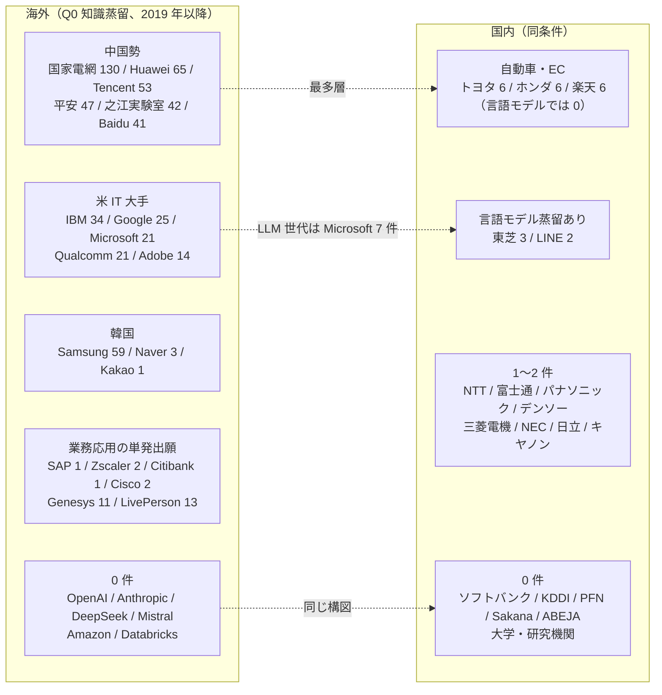

# 蒸留関連特許の出願人別件数（海外 vs 国内、DEPATISnet 集計、2026-10-23 追記）

- **Company/Organization**: 海外 50 社・国内 40 社（出願人名で照会）
- **Industry**: 全業種（IT / 通信 / 自動車 / 電力 / 金融 / 研究機関）
- **Date**: 集計日 2026-10-23（出願年 2019 以降、Q2 のみ 2022 以降）
- **Link**: DEPATISnet エキスパート検索 <https://depatisnet.dpma.de/DepatisNet/depatisnet?action=experte>（ドイツ特許商標庁。全世界の公報書誌・英文要約を収録）
- **Type**: Patent（件数集計）
- **証拠の質**: 一次資料（特許庁系データベースの検索結果件数）。ただし **件数は「名称・要約にキーワードを含む公報の数」であり、蒸留特許の数そのものではない**（下記「限界」参照）

## Overview

[12](12-patent-landscape.md) までは公報を 1 件ずつ確認する方式で、海外 11 社・国内 2 社の **19 件** を確定しました。本レポートは視点を変え、**出願人ごとに何件あるか**を同一条件で機械的に数えます。Google Patents がこの環境からの照会を 503 で拒否し続けたため、DEPATISnet（DPMA）のエキスパート検索を使いました。

結論を先に書きます。

1. **海外で件数が多いのは中国勢と米 IT 大手**です。「知識蒸留」を名称・要約に含む 2019 年以降の公報は、国家電網（State Grid）130 件、Huawei 65 件、Samsung 59 件、Tencent 53 件、平安（Ping An）47 件、之江実験室 42 件、Baidu 41 件、IBM 34 件、Google 25 件、Microsoft 21 件、Qualcomm 21 件の順でした。
2. **「言語モデル」まで絞ると桁が落ち、上位は之江実験室 19 件、Microsoft 9 件、国家電網 9 件、Tencent 4 件、Google 4 件、Adobe 4 件**です。LLM 世代（2022 年以降、「大規模言語モデル」×「蒸留」）では Microsoft 7 件、Baidu 5 件、Tencent 5 件、Alibaba 3 件、之江実験室 3 件が上位で、**Microsoft が欧米勢で唯一まとまった件数**を持ちます。
3. **国内は 1 桁**です。「知識蒸留」全体で楽天・トヨタ・ホンダ各 6 件、東芝・三菱電機各 3 件、NTT・富士通・パナソニック・デンソー・LINE 各 2 件、NEC・日立・キヤノン各 1 件。「言語モデル」に絞ると **東芝 3 件、LINE 2 件** だけが残り、LLM 世代（2022 年以降）の国内公報は本集計では **0 件** でした。ソフトバンク / KDDI / PFN / Sakana AI / ABEJA / サイバーエージェント / 大学・研究機関は全クエリで 0 件です。
4. **OpenAI / Anthropic / DeepSeek / Moonshot / Mistral / Cohere / Amazon / Databricks は 0 件**でした。蒸留を事業や防御の中心に置く企業ほど特許を取っていない、という構図です（Anthropic の防御は特許でなく運用で実装、[02](02-anthropic-threat-report-and-defenses-2026.md)）。
5. **国内件数は過小評価の可能性が高い**。DEPATISnet の日本公報（PC = JP）は「知識蒸留」全体で 14 件しかなく、[12](12-patent-landscape.md) の Google Patents 検索（JP 127 件ヒット）より 1 桁少ない。日本企業の国内出願は英文要約の収録が遅れるため、**日本企業の順位づけには使えるが絶対数は信用しない**でください。

## Problem & Context

- [12](12-patent-landscape.md) は公報の第 1 頁を確認する方式のため網羅性がなく、「どの事業者が何件持つか」に答えられませんでした。
- Google Patents は 2026-10-22 から 10-23 にかけて、この環境の IP と WebFetch の双方に 503（"Sorry..."）を返し続けました。Espacenet REST、FreePatentsOnline、USPTO PPUBS、Lens API、PATENTSCOPE も 403 / 401 / リダイレクトで自動照会できませんでした。
- DEPATISnet は POST フォームで応答し、件数（"N hits" / "keine Treffer"）を返すことを確認したので、これを使いました。

## Solution（集計方法）

| 項目 | 条件 |
|------|------|
| データベース | DEPATISnet（DPMA）。全世界の書誌・英文要約（JP は Patent Abstracts of Japan 由来） |
| 検索対象フィールド | TI（名称）と AB（要約）のみ。請求項・明細書本文は対象外 |
| Q0 | `knowledge distillation`（隣接語）を名称または要約に含む、**出願年 2019 以降** |
| Q1 | Q0 かつ `language model` を名称または要約に含む |
| Q1x | Q1 の条件に `LLM` / `LLMs` の略語も加えたもの |
| Q2 | `distillation` かつ `large language model` を名称または要約に含む、**出願年 2022 以降** |
| Q2x | Q2 の条件に `LLM` / `LLMs` の略語も加えたもの |
| 出願人 | PA フィールドを社名トークンで照会（例: `microsoft`、`nippon(W)telegraph`、`(ibm OR international(W)business(W)machines)`） |
| 単位 | **公報（publication）数**。同一発明の US / CN / WO / JP 公報は別々に数えられる |

### 全体の分母（公報国別）

| クエリ | 全体 | US | CN | JP | EP | WO | KR | DE |
|--------|-----:|---:|---:|---:|---:|---:|---:|---:|
| Q0 知識蒸留（2019〜） | 5,588 | 347 | 4,813 | 14 | 49 | 153 | 154 | 1 |
| Q1 知識蒸留 × 言語モデル（2019〜） | 280 | 36 | 227 | 2 | 0 | 6 | 5 | 0 |
| Q1x（Q1 + LLM 略語） | 291 | 39 | 234 | 3 | — | 6 | — | — |
| Q2 蒸留 × 大規模言語モデル（2022〜） | 288 | 16 | 264 | 0 | 0 | 6 | 2 | 0 |
| Q2x（Q2 + LLM 略語） | 307 | 22 | 276 | 1 | — | 6 | — | — |

中国公報が 86〜92% を占めます。日本公報は Q0 で 0.25%、Q2 では 0〜1 件です。

```
Q0「知識蒸留」公報の国別分布（2019 年以降、DEPATISnet）
CN  |████████████████████████████████████████████████ 4,813
US  |███ 347
KR  |█ 154
WO  |█ 153
EP  |▏ 49
JP  |▏ 14
```

## Results & Impact

### Table 1: 海外の出願人（Q0 の降順。0 件の社は末尾にまとめた）

| 出願人 | Q0 知識蒸留 | Q1 ×言語モデル | Q1x（+LLM） | Q2 蒸留×LLM 2022〜 | Q2x（+LLM） | 公報で確認済みの件数（[11](11-patent-adobe-us12626056-and-landscape.md) / [12](12-patent-landscape.md)） |
|--------|---:|---:|---:|---:|---:|---|
| 国家電網（State Grid、中国） | 130 | 9 | 9 | 8 | 8 | — |
| Huawei | 65 | 0 | 0 | 0 | 0 | 2（US11900260B2、US12505351B2。Q1 で 0 件のため要約に「language model」を含まないと推定） |
| Samsung | 59 | 0 | 0 | 0 | 0 | —（[C6](../edge_ondevice/index.md) に WO2025258795A1） |
| Tencent | 53 | 4 | 4 | 5 | 5 | — |
| 平安（Ping An） | 47 | 3 | 3 | 2 | 2 | — |
| 之江実験室（Zhejiang Lab） | 42 | 18 | 19 | 2 | 3 | 1（US11341326B2）+ JP 登録 3 件（検索結果レベル） |
| Baidu | 41 | 3 | 3 | 5 | 5 | — |
| IBM | 34 | 3 | 3 | 1 | 1 | 1（US12346665B2） |
| Google | 25 | 4 | 4 | 0 | 0 | 2（US12260340B2、US11797862B2）+ JP7735419B2 |
| Microsoft | 21 | 9 | 9 | 7 | 7 | 3（US12307750B2、US11727270B2、US12614066B2） |
| Qualcomm | 21 | 0 | 0 | 0 | 0 | —（[C6](../edge_ondevice/index.md) に US20250225374A1） |
| Alibaba | 15 | 3 | 3 | 3 | 3 | — |
| Adobe | 14 | 4 | 4 | 1 | 1 | 1（US12626056B2） |
| LivePerson | 13 | 0 | 0 | 0 | 0 | JP7735420B2（検索結果レベル） |
| Genesys | 11 | 0 | 0 | 0 | 0 | 2（US12524622B2、US12333254B2） |
| iFlytek | 10 | 2 | 2 | 0 | 0 | — |
| Bosch | 8 | 0 | 0 | 0 | 0 | — |
| Intel | 7 | 1 | 1 | 1 | 1 | — |
| SenseTime | 6 | 0 | 0 | 0 | 0 | — |
| NVIDIA | 4 | 0 | 0 | 0 | 0 | — |
| OPPO | 4 | 0 | 0 | 1 | 1 | — |
| ZTE | 4 | 0 | 0 | 0 | 0 | — |
| Salesforce | 3 | 2 | 3 | 0 | 1 | 2（US11620515B2、US11922303B2） |
| Apple | 3 | 2 | 2 | 0 | 0 | — |
| Naver | 3 | 2 | 2 | 0 | 0 | — |
| Meta | 3 | 1 | 1 | 1 | 1 | — |
| Zscaler | 2 | 0 | 2 | 0 | 2 | 1（US12711255B2。LLM 略語を加えた Q1x で 2 件になるため、要約は「LLM」表記と推定） |
| Zhipu（智譜） | 2 | 1 | 1 | 0 | 0 | — |
| ByteDance | 2 | 0 | 0 | 0 | 0 | — |
| Cisco | 2 | 0 | 0 | 0 | 0 | 1（US12705265B2。Q1 で 0 件のため要約は「language model」以外の表記と推定） |
| Xiaomi | 2 | 0 | 0 | 0 | 0 | —（[C6](../edge_ondevice/index.md) に CN120496494A） |
| Siemens | 2 | 0 | 0 | 1 | 1 | — |
| SAP | 1 | 1 | 1 | 1 | 1 | 1（US12475175B1） |
| Oracle | 1 | 0 | 0 | 0 | 0 | — |
| Kakao | 1 | 0 | 0 | 0 | 0 | — |
| Lenovo | 1 | 0 | 0 | 0 | 0 | — |
| Citibank | 0 | 0 | 0 | 1 | 1 | 1（US12664433B1。Q0 で 0 件・Q2 で 1 件のため、要約は「knowledge distillation」でなく「distillation」表記と推定） |
| JPMorgan | 0 | 0 | 0 | 1 | 2 | — |
| Intuit | 0 | 0 | 0 | 1 | 1 | — |
| Snowflake | 0 | 0 | 0 | 0 | 1 | — |
| Amazon / Capital One / Databricks / OpenAI / Anthropic / DeepSeek / Moonshot / Ant Group / Mistral AI / Cohere | 0 | 0 | 0 | 0 | 0 | — |

### Table 2: 国内の出願人（Q0 の降順）

| 出願人 | 照会した名義 | Q0 知識蒸留 | Q1 ×言語モデル | Q1x（+LLM） | Q2 蒸留×LLM 2022〜 | 公報で確認済み・検索結果レベル（[12](12-patent-landscape.md) / [C7-13](../japan_cases/13-japan-llm-distillation-patent-scan.md)） |
|--------|------------|---:|---:|---:|---:|---|
| 楽天 | rakuten | 6 | 0 | 0 | 0 | — |
| トヨタ自動車 | toyota | 6 | 0 | 0 | 0 | —（画像・自動運転系と推定、未確認） |
| 本田技研 | honda | 6 | 0 | 0 | 0 | — |
| 東芝 | toshiba | 3 | **3** | 3 | 0 | JP2024099474A「言語モデル学習装置」（検索結果レベル） |
| 三菱電機 | mitsubishi(W)electric | 3 | 0 | 0 | 0 | JP2025023822A（検索ヒットのみ、蒸留との関係未確認） |
| LINE | line(W)corp | 2 | **2** | 2 | 0 | — |
| NTT | nippon(W)telegraph | 2 | 0 | 0 | 0 | JP2023026202A（検索ヒットのみ、未確認） |
| 富士通 | fujitsu | 2 | 0 | 0 | 0 | — |
| パナソニック | panasonic | 2 | 0 | 0 | 0 | — |
| デンソー | denso | 2 | 0 | 0 | 0 | — |
| NEC | nec(W)corp | 1 | 0 | 0 | 0 | **1（US12283092B2、米国登録、[12](12-patent-landscape.md) で公報確認）** |
| 日立製作所 | hitachi | 1 | 0 | 0 | 0 | — |
| キヤノン | canon | 1 | 0 | 0 | 0 | — |
| ソニー / LINEヤフー（ヤフー）/ KDDI / ソフトバンク / Preferred Networks / サイバーエージェント / リコー / オムロン / 村田製作所 / 京セラ / NTT データ / 富士フイルム / オリンパス / シャープ / ニデック / Sakana AI / ABEJA / エクサウィザーズ / PKSHA / 東京大学 / 東京科学大 / 京都大学 / 理研 / 産総研 | 各社名 | 0 | 0 | 0 | 0 | ビズリーチ約 20 件（[C7-13](../japan_cases/13-japan-llm-distillation-patent-scan.md)、ヒット理由不明）は本集計の対象外 |

### 海外 vs 国内の比較



### 読み取れること

1. **蒸留の特許化は「モデルを売る側」より「モデルを使う側」に偏る**。国家電網・平安・Tencent・Baidu は自社業務（電力設備の画像・文書、保険・金融の対話）に蒸留を組み込む出願が多く、モデル提供者（OpenAI / Anthropic / Mistral / DeepSeek）は 0 件です。国内も同様で、言語モデル蒸留の出願があるのは東芝と LINE で、LLM 提供者の SB Intuitions / PFN / Sakana AI は 0 件です。
2. **LLM 世代（2022 年以降）の蒸留特許はまだ少ない**。全世界で 288〜307 件、米国公報は 16〜22 件しかなく、そのうち Microsoft が 7 件を占めます。[12](12-patent-landscape.md) で公報確認した SAP / Zscaler / Citibank / Cisco の業務応用特許は、この少数の米国公報の一部です。
3. **国内の「言語モデル × 蒸留」公報は東芝 3 件・LINE 2 件の計 5 件**で、Q1 全体 280 件の 2% 未満です。[C7](../japan_cases/index.md) の「国内は公開モデル型で、社内実装・権利化が少ない」という仮説 H4 を特許面でも支持します。
4. **要約に「言語モデル」と書かない蒸留特許が多い**。Huawei（65 → 0）、Samsung（59 → 0）、Qualcomm（21 → 0）は Q1 で全滅しますが、[C6](../edge_ondevice/index.md) で確認したとおり Samsung / Qualcomm は LLM のオンデバイス蒸留を出願しています。Q1 / Q2 の数字は **下限**として読んでください。

## 限界（数字を使う前に必ず読むこと）

| 限界 | 影響 | 補正の手段 |
|------|------|-----------|
| 名称・要約のみの検索 | 請求項や明細書だけで蒸留に触れる公報を取りこぼす。Zscaler / Cisco / Citibank の確認済み特許が Q1 で 0 件になったのはこのため | Google Patents の全文検索（復旧後）か Lens.org の API |
| 公報数であり特許ファミリー数ではない | US / CN / WO に出した同一発明が 2〜3 件に数えられる。中国企業は国内出願のみが多く、米 IT 大手は複数国に出すため **米 IT 大手が相対的に多めに出る** | ファミリー単位（DOCDB）で再集計 |
| 日本公報の収録が薄い | DEPATISnet の JP 公報は Q0 で 14 件。Google Patents の JP 検索（[12](12-patent-landscape.md)、127 件ヒット）の約 1/9。日本企業の国内出願が落ちている | J-PlatPat の手動検索（「知識蒸留」×「言語モデル」、出願人指定） |
| 出願人名のトークン照会 | 子会社・旧社名・英文表記の揺れ（例: 「LINE」は LINE Corp のみ、LY Corporation 名義は 0 件）を取りこぼす。逆に `apple(W)inc` のような絞り込みで漏れも出る | 出願人名の名寄せ辞書を使う |
| 登録 / 公開の区別なし | 登録済み特許だけの件数ではない。「特許を取得している」の厳密な答えには公報種別（B 公報）での再集計が必要 | DEPATISnet の公報種別フィールドで絞る |
| 「distillation」の多義性 | Q2 は「大規模言語モデル」と同時に現れる場合のみ数えるため、化学の蒸留は実質的に混入しない。Q0 は `knowledge distillation` の隣接語なので同様 | — |

## Notes

- Google Patents の遮断状況: 2026-10-22 14 時台から 10-23 10 時台まで継続して 503。WebFetch 経由でも 503。[C7-13](../japan_cases/13-japan-llm-distillation-patent-scan.md) が取得した JP の検索結果は遮断前のものです。
- 集計は 2026-10-23 10:23〜11:20 JST に約 400 クエリを実行。途中でセッション言語が独語に切り替わり「keine Treffer」（0 件）表示になった行は再照会して 0 件を確定しました。
- 0 件の判定は「did not match any documents」または「lieferte keine Treffer」の表示によります。1 件の場合は「1 hit」と表示されることを SAP（Q0 = 1）で確認しました。
- 本レポートの数字は 2026-10-23 時点のスナップショットです。DEPATISnet は週次で更新されるため、再集計すると増えます。
