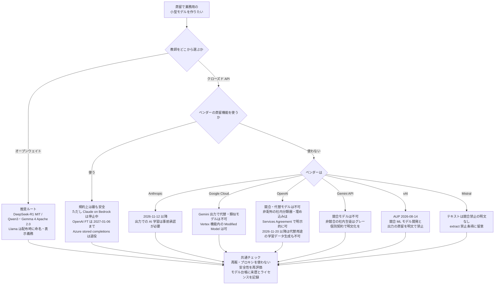
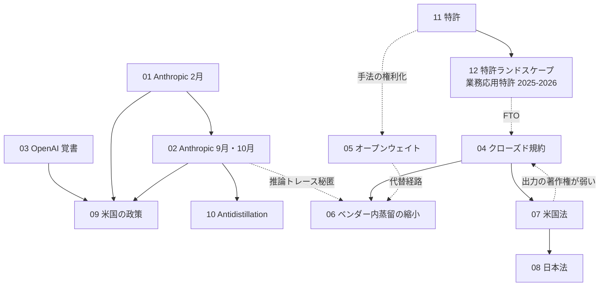

# C8 規約・知財・安全保障・特許（legal_ip_patents） — Detailed Reports

> **免責**: 本資料はリサーチ成果物であり、**法的助言ではありません**。規約・ライセンスの引用は 2026-10-21 時点の閲覧結果です。実際の判断には最新の原文確認と専門家への相談が必要です。

## Parameters

- **Resources analyzed**: 12 レポート（一次資料・論評・報道を計 50 件超参照。2026-10-22 追記: [12 特許ランドスケープ](12-patent-landscape.md) を追加し、04 / 05 / 06 / 08 / 09 / 11 に再検証の追記・訂正を加えた）
- **Resource types**: Paper / Patent / Technical（規約・ライセンス・一次ブログ・法律分析・政策） / Business
- **Generated on**: 2026-10-21（2026-10-22 追記・訂正）
- **Input source**: gather 出力（`research/runs/llm_distillation/gather/20261021/legal_ip_patents/resources-legal-ip-patents.md`）
- **証拠の質の表記**: 一次資料 / ベンダー申告 / 二次報道 / 法律論評

## 結論: 企業が「合法に」蒸留するための実務ガイド（2026-10 時点）

（2026-10-22 訂正）上図の OpenAI と xAI の枝は、openai.com・x.ai の原文をブラウザ経由で取得して書き直した（[04](04-closed-vendor-terms-anthropic-google-openai-mistral.md) の追記参照）。

### チェックリスト

1. **教師の第一候補はオープンウェイト**（[05](05-open-weight-licenses-llama-qwen-deepseek-gemma.md)）: ライセンスの条件（表示・命名・利用制限の継承・MAU 上限）を、教師と生徒の基盤モデルの両方で確認する。
2. **クローズド API を教師にするなら、ベンダーの公式蒸留機能か個別契約に限る**（[04](04-closed-vendor-terms-anthropic-google-openai-mistral.md), [06](06-same-vendor-distillation-services-status.md)）。公開規約の「競合」の範囲は曖昧なので、エンタープライズ契約で用途を明記させる。
3. **Anthropic AUP（2026-11-12 施行）への対応**: Claude 出力を学習に使う社内パイプラインを棚卸しし、事前承認か教師の切替を行う。（2026-10-22 追記）**OpenAI も 2026-11-20 施行の Usage Policies で、OpenAI モデルの「代替・置換」を意図したモデルのための学習データ生成・ラベル付け・選別を禁止** した（2026-10-21 改定告知）。棚卸しの対象に OpenAI 出力を含めること。
4. **アクセス経路は正規契約のみ**: 再販・ルーター・プロキシ経由は規約違反であり、2026 年の検出強化で停止・課金の対象にもなる（[01](01-anthropic-distillation-attacks-feb-2026.md), [02](02-anthropic-threat-report-and-defenses-2026.md)）。
5. **著作権が弱くても契約と営業秘密のリスクは残る**（[07](07-us-legal-analysis-contract-trade-secret-copyright.md), [08](08-japan-law-copyright-30-4-unfair-competition.md)）。日本の 30 条の 4 は規約違反を免責しない。
6. **来歴の確認**: 告発対象ラボのモデルやその蒸留モデルを採用する場合、米国の政策（[09](09-us-policy-ostp-daamta.md)）と DTSA の「had reason to know」論のリスクを評価する。
7. **蒸留パイプライン自体の特許**（[11](11-patent-adobe-us12626056-and-landscape.md), [12](12-patent-landscape.md)）: 製品化する場合は FTO を検討し、独自の工夫は権利化候補にする。（2026-10-22 追記）2023 年以降の優先日を持つ業務応用特許（SAP 文書理解 US12475175B1、Zscaler DLP US12711255B2、Citibank 銀行階層蒸留 US12664433B1、Cisco ネットワーク運用 US12705265B2）が 2025–2026 年に登録されており、FTO の対象は「蒸留の方法」から「蒸留モデルを組み込む業務パイプライン」に広がっている。
8. （2026-10-22 追記）**安全保障上の名指しに注意**: NSA / CISA / FBI の共同勧告 AA26-251A（2026-09-08）は DeepSeek・Moonshot AI・Alibaba・MiniMax・StepFun・Z.AI を名指しした（[09](09-us-policy-ostp-daamta.md) 追記）。これらのモデルやその蒸留モデルを採用する場合、来歴リスクの評価に加える。

## ベンダー × 条項 × 可否（主要表）

| ベンダー / モデル | 根拠条項（原文の要点） | 自社タスク用の非公開生徒（他社基盤） | 同一ベンダー機能での蒸留 | 生徒の外部配布 | 競合汎用モデル | 証拠 |
|------------------|--------------------|------------------------------|----------------------|-------------|-------------|------|
| **Anthropic** | AUP: "Use outputs to train an AI model (e.g., "model scraping" or "model distillation") without prior authorization from Anthropic"（2026-11-12 施行）/ Commercial D.4: 競合 AI モデルの学習禁止 | **事前承認が必要** | Bedrock 上は **停止中** | 承認次第 | 不可 | 一次 |
| **OpenAI（消費者 ToU、2026-01-01 発効）** | "Use Output to develop models that compete with OpenAI." / "Automatically or programmatically extract data or Output (defined below)."（2026-10-22 訂正: openai.com 原文で確認） | 競合でなければ明文の禁止なし（グレー） | 可（公式手順）。FT は縮小、2027-01-06 に新規不可 | 競合なら不可 | 不可 | **一次**（原文） |
| **OpenAI（Services Agreement、2026-01-01 発効）**（2026-10-22 追記） | 3.3(e): "except for a Permitted Exception, use Output to develop artificial intelligence models that compete with OpenAI's products and services" / 定義 "Permitted Exception" = (a) 分類・分類整理用モデル（embeddings / classifiers）で第三者に配布・商用提供しないもの、(b) OpenAI の fine-tuning 等のサービスでの調整 / "Reverse Engineer" の定義に "engage in model extraction or stealing attacks" を含む | **非配布の分類器・埋め込みは明示的に可**。生成系の社内生徒は競合でなければグレー | 可（Permitted Exception (b)） | 分類器・埋め込みでも **配布・商用提供すると例外を外れる** | 不可 | **一次**（原文） |
| **OpenAI（Usage Policies、2026-11-20 施行）**（2026-10-22 追記） | "You must not use OpenAI models or their outputs to generate, prepare, select, or supply training material or signals for models that are intended as alternatives to or substitutes for OpenAI models or services." 学習データ作成・ラベル付け・選別・RL 環境構築を含み、第三者のために行う場合や後から転用する場合にも適用。"model-access intermediary platform" は事前審査・承認が必要 | 「代替・置換」を意図しない社内タスク用生徒なら文言上は対象外（解釈はグレー） | 可 | 代替用途なら不可 | 不可 | **一次**（原文） |
| **Google（Gemini API）** | "You may not use the Services to develop models that compete with the Services" | 明示なし（グレー） | — | 競合なら不可 | 不可 | 一次 |
| **Google Cloud（Vertex）** | §17(b): 出力で Google Model の代替・類似モデルを作ることを禁止。蒸留/FT 機能経由の Modified Google Model は可 | Gemini の代替になれば不可 | **明示的に可** | 代替・類似なら不可 | 不可 | 一次 |
| **Mistral** | Commercial 3.3: 画像出力で競合画像生成製品を作ることを禁止 / 2.2(g): "use any method to extract any content" 禁止 | テキストは明文の禁止なし | — | テキストは明文の禁止なし | 画像のみ明文で不可 | 一次 |
| **xAI（SpaceXSI）**（2026-10-22 訂正: x.ai 原文をブラウザで取得し検証済み） | AUP（2026-08-14 発効）: "Using the Service or any Output to develop (or assist anyone in developing) machine learning models or any products or services that compete with SpaceXSI, whether directly or indirectly" / "Scraping, harvesting or reselling any Input or Output, or distilling model data or Outputs" / Enterprise ToS（2026-08-14）は AUP を参照により組み込み。Consumer ToS（2026-10-12）自体には競合条項なし（AUP を参照） | **不可**（「distilling ... Outputs」が競合要件なしで禁止） | — | 不可 | 不可 | **一次**（原文。事業者名は原文どおり "SpaceXAI LLC / SpaceXSI"） |
| **Meta Llama 3.1 / 3.3 / 4** | 1.b.i: 出力で AI モデルを作成・改良し **配布・提供する場合** は名前の先頭に「Llama」、「Built with Llama」表示 / 7 億 MAU 超は別許諾 | 可 | Bedrock で Llama→Llama 提供中 | 可（命名・表示義務） | 可（同上） | 一次 |
| **Meta Llama 3（旧）** | 1.b.v: 他の LLM の改良への利用禁止（3.1 で削除） | 不可 | — | 不可 | 不可 | 論評 |
| **Qwen（Qwen2.5 等）** | 5(b): 出力で AI モデルを作成・改良したら「Built with Qwen」等を表示 / 1 億 MAU 超は別許諾 | 可（表示義務の要否は要確認） | — | 可（表示義務） | 可（同上） | 一次 |
| **Qwen3** | Apache 2.0 | 可 | — | 可 | 可 | 一次 |
| **DeepSeek-R1** | MIT、"distillation for training other LLMs" を明示許諾 | 可 | — | 可 | 可 | 一次 |
| **DeepSeek License v1.0（V3 等）** | 蒸留・合成データで学習したモデルも派生物。Attachment A の利用制限を継承 | 可（利用制限の遵守） | — | 可（制限の継承） | 可（同上） | 一次 |
| **Gemma（1〜3n）** | Model Derivatives に蒸留・合成データ学習を含む。Prohibited Use Policy の継承 | 可（利用制限の遵守） | — | 可（制限の継承・ToU 添付） | 可（同上） | 一次 |
| **Gemma 4** | Apache 2.0（2026-04-02）。（2026-10-22 訂正）Google 公式ブログ "Gemma 4 is released under a commercially permissive Apache 2.0 license." と ai.google.dev/gemma/terms の "For Gemma 4 terms, see the Gemma 4 license"（リンク先は Apache License 2.0 全文）で確認 | 可 | — | 可 | 可 | **一次**（Google ブログ・ライセンスページ） |
| **NVIDIA Open Model License** | "An output is not a Derivative Model." | 可 | — | 可 | 可 | 一次 |

凡例: 「可」はライセンス・規約の文言上、明示的な禁止がないかまたは許諾されていることを示し、他の法令（輸出規制等）や個別契約の制約は含みません。

## Report List

### Academic Papers

| # | Title | Year | Venue | Summary | Report |
|---|-------|------|-------|---------|--------|
| 10 | Antidistillation Sampling | 2025 | arXiv | 代理生徒の勾配で教師の分布を歪め、教師精度 -1pt で生徒 65%→56% | [Details](10-antidistillation-sampling.md) |

### Patents

| # | Title | Patent No. | Assignee | Year | Report |
|---|-------|-----------|----------|------|--------|
| 11 | Generating natural language model insights for data charts using light language models distilled from large language models（＋ランドスケープ 11 件） | US12626056B2 | Adobe Inc. | 2026 | [Details](11-patent-adobe-us12626056-and-landscape.md) |
| 12 | （2026-10-22 追記）Robust documentation understanding using LLM knowledge distillation and joint training（＋ USPTO 公報確認 8 件、JP / CN / EP 検索結果レベル約 30 件、EPO 審決 T 1425/21） | US12475175B1 | SAP SE | 2025 | [Details](12-patent-landscape.md) |

### Technical Articles

| # | Title | Source | Date | Report |
|---|-------|--------|------|--------|
| 01 | Detecting and preventing distillation attacks | Anthropic | 2026-02-23 | [Details](01-anthropic-distillation-attacks-feb-2026.md) |
| 02 | Threat Intelligence Report Sep 2026 §07 / Strengthening our defenses against distillation attacks | Anthropic | 2026-09-10 / 2026-10-12 | [Details](02-anthropic-threat-report-and-defenses-2026.md) |
| 04 | クローズドモデル各社の規約比較 | Anthropic / OpenAI / Google / Mistral / xAI | 2026-10 閲覧 | [Details](04-closed-vendor-terms-anthropic-google-openai-mistral.md) |
| 05 | オープンウェイトのライセンス比較 | Meta / Alibaba / DeepSeek / Google / NVIDIA | 2026-10 閲覧 | [Details](05-open-weight-licenses-llama-qwen-deepseek-gemma.md) |
| 07 | 米国法の分析（著作権・契約・営業秘密） | Winston / Mondaq / Kobre & Kim / IAM / 米著作権局 | 2025-01〜2026-05 | [Details](07-us-legal-analysis-contract-trade-secret-copyright.md) |
| 08 | 日本法の分析（30 条の 4・著作物性・オーバーライド・不競法） | 文化審議会 / BUSINESS LAWYERS | 2024 | [Details](08-japan-law-copyright-30-4-unfair-competition.md) |
| 09 | 米国の政策（OSTP 覚書・H.R.8283・BLADE Act） | IAPS / TNW / IAM | 2026-04〜06 | [Details](09-us-policy-ostp-daamta.md) |

### Business Cases

| # | Title | Company | Date | Report |
|---|-------|---------|------|--------|
| 03 | OpenAI の DeepSeek 告発（下院中国特別委への覚書） | OpenAI / DeepSeek | 2026-02-12 | [Details](03-openai-deepseek-memo-2026.md) |
| 06 | 同一ベンダー内の蒸留サービスの提供状況 | AWS / OpenAI / Microsoft / Anthropic | 2024-12〜2026-10 | [Details](06-same-vendor-distillation-services-status.md) |

## Cross-Resource Insights

### 関係図

### 横断的な観察

1. **「著作権 → 契約 → 安全保障」へ論点が移った**: 2025 年は著作権・契約の議論（07）、2026 年は告発（01–03）と政策（09）が中心。
2. **規約の厳格化と蒸留機能の縮小が同時進行**: Anthropic AUP（04）、Claude 蒸留の停止・OpenAI FT 縮小・Azure stored completions 退役（06）、推論トレースの秘匿（02）が 2026 年に重なった。因果は一次資料で確認できないが、方向は一致している。（2026-10-22 追記）OpenAI も 2026-10-21 に Usage Policies を改定し（2026-11-20 施行）、「代替・置換」モデル向けの学習データ生成・ラベル付けを禁止、推論の抽出禁止、モデルアクセス仲介業者の事前承認制を導入した。Anthropic（11-12）と OpenAI（11-20）が **同じ月に出力の学習利用を絞る** 形になった。
3. **オープンウェイトは逆に寛容化**: Llama 3 → 3.1 の禁止条項削除、Gemma 4 と Qwen3 の Apache 2.0 化、R1 の蒸留明示許諾（05）。
4. **技術的防御が規約を補強**: 推論の要約・可視性制限・antidistillation（02, 10）により、規約違反の蒸留は技術的にも効きにくくなる。
5. **蒸留はクローズドラボ自身も使う**: Anthropic は自社モデルの小型化を「正当」と明言（01）、Musk 氏は xAI の OpenAI モデル蒸留を「Partly」と証言（03）。問題は手法でなく **許可の有無と手段**。

## Comparison Table

| 観点 | 01–02 Anthropic | 03 OpenAI | 04 規約 | 05 ライセンス | 06 ベンダー機能 | 07–08 法 | 09 政策 | 10 研究 | 11 特許 |
|------|----------------|-----------|---------|-------------|---------------|---------|--------|--------|--------|
| 主な問い | 誰が不正に蒸留したか | DeepSeek の行為 | 何が禁止か | 何が許されるか | 公式経路は使えるか | どの法理が効くか | 国家は何をするか | 技術的に防げるか | 何が権利化されているか |
| 証拠の質 | ベンダー申告 | 二次報道 | 一次 | 一次 | 一次 | 公的文書・論評 | 政策メモ・二次 | 一次（論文） | 一次（公報） |
| 企業への含意 | 正規経路のみ | 第三者ルーター回避 | 承認・契約 | 第一候補 | 継続性リスク | 契約が主戦場 | 来歴リスク | API 出力の価値低下 | FTO |
| 時期 | 2026 | 2025–2026 | 2026 | 2024–2026 | 2024–2026 | 2024–2026 | 2026 | 2025 | 2019–2026 |

## 2026-10-22 再検証の結果（追記・訂正の一覧）

| 項目 | 前回の状態 | 今回の結果 | 反映先 |
|------|----------|----------|--------|
| OpenAI 規約 | 第三者サイトの 2024-12-11 版写し | openai.com 原文（ToU 2026-01-01 発効、Services Agreement 2026-01-01 発効、Usage Policies 2026-11-20 施行）を取得。**Permitted Exception（非配布の分類器・埋め込みは可）と、2026-11-20 からの「代替モデル向け学習データ生成の禁止」を新たに確認** | 04, index 主要表 |
| xAI 規約 | 403・スニペットのみ | Consumer ToS（2026-10-12）、AUP（2026-08-14）、Enterprise ToS（2026-08-14）原文を取得。AUP が「distilling model data or Outputs」を禁止 | 04, index 主要表 |
| Gemma 4 ライセンス | 二次報道 | Google ブログ（2026-04-02）と ai.google.dev のライセンスページで Apache 2.0 を確認 | 05, index 主要表 |
| H.R.8283 | 403・IAPS 要約 | congress.gov API・条文で確認。「model extraction attack」の定義と ToS 準拠学習の除外条項を引用 | 09 |
| Anthropic AUP / 2026-10-12 防御強化 | 一次 | 再取得して "Effective Nov 12, 2026" と 90–99% 削減等の文言を再確認 | 02, 04 |
| Bedrock の Anthropic 蒸留停止 | 一次 | 再取得して "Distillation is not currently available for Anthropic models on Amazon Bedrock. There is no confirmed timeline for when Anthropic distillation will be restored." を確認 | 06 |
| 日本法 | 考え方＋論評 1 件 | 30 条の 4 条文（e-Gov API）、不競法 2 条 6・7 項、文化庁チェックリスト、AI 事業者ガイドライン 1.1 を一次で追加。弁護士解説は見つからず | 08 |
| 特許 | 11 件（JPO 0 件） | USPTO 公報 8 件追加（うち業務応用 4 件）、JP 11 件・CN 8 件・EP/WO 6 件を検索結果レベルで追加、EPO 審決 1 件。J-PlatPat は 403 | 12, 11 |
| 政策（新規） | — | NSA / CISA / FBI 共同勧告 AA26-251A（2026-09-08）を追加 | 09 |

## 仮説の検証（clustering index の H1–H6）

| 仮説 | 本クラスタの結果 | 判定 |
|------|---------------|------|
| H5 商用 API を教師にした蒸留は利用規約で大きく制約され、教師選択が事業上の論点 | Anthropic AUP が出力での AI 学習を承認制に、Google §17 が代替・類似を禁止、OpenAI が競合禁止。加えて公式蒸留機能が縮小 | **支持（強化）**: 規約に加えて「公式経路の縮小」と「技術的防御」でさらに制約が強まった |
| H2 クラウドの数値はベンダー集計で、顧客別成果は非公開 | Bedrock の 500% / 75% / 2% はベンダー申告で、製品ページに顧客名なし。Claude 3 Haiku 蒸留も数値なし | **部分的に支持**（C8 の範囲で確認できた分のみ） |
| H1, H3, H4, H6 | 本クラスタの対象外 | 判定なし |

## Further Investigation Candidates

| 候補 | 理由 | 取得状況 |
|------|------|---------|
| OpenAI の下院特別委への覚書の原文 | 本調査は報道経由 | 未取得 |
| H.R.8283 の条文と成立状況（congress.gov） | IAPS の要約に依拠 | （2026-10-22 訂正）**取得済み**: congress.gov API と条文 HTML で確認。2026-04-15 提出、04-22 下院外交委で 43-0 により報告決定、以後の本会議動向なし（09 追記） |
| BLADE Act（Hagerty / Kim）の条文 | 検索スニペットのみ | 未検証 |
| xAI Enterprise ToS / AUP 原文 | 蒸留の明示禁止の確認 | （2026-10-22 訂正）**取得済み**: ブラウザ経由で Consumer ToS / AUP / Enterprise ToS を取得（04 追記） |
| Anthropic AUP の版履歴 | 「model distillation」文言の導入時期 | 404（AUP 本文の "Effective Nov 12, 2026" は再確認済み） |
| Vertex AI の Gemini 蒸留ドキュメント | Google の公式蒸留経路の現状 | 404 |
| 文化庁「AIと著作権に関するチェックリスト＆ガイダンス」（2024-07-31） | 日本の実務指針 | （2026-10-22 訂正）**取得済み**（PDF を pdftotext で確認、08 追記） |
| law-ai.org「Responding to AI distillation without panic」 | CFAA と規約違反の関係 | 403 |
| IAPS 2026-03 メモ「The Case for Targeted Government Intervention」 | 政策の前提整理 | 未取得 |
| Antidistillation Fingerprinting（Xu et al., 2026） | 事後帰属の新手法 | 未取得 |
| J-PlatPat での LLM 蒸留特許（FI G06N3/096） | 日本の特許空白 | （2026-10-22 追記）**試行したが J-PlatPat は 403 で拒否**。Google Patents 検索 API で JP 127 件中 50 件を取得（12 の表 3）。日本企業の出願人絞り込みは未完 |
| Google Threat Intelligence のモデル抽出報告（2025） | Google 側の一次データ | 未取得（IAM 記事で言及のみ） |
| （2026-10-22 追記）NSA / CISA / FBI 共同勧告 AA26-251A（2026-09-08） | 6 社を名指しした政府一次資料 | **取得済み**（cisa.gov、09 追記） |
| （2026-10-22 追記）EPO 審決 T 1425/21 の理由本文 | 蒸留手法特許の進歩性判断 | 書誌のみ取得（12） |
| （2026-10-22 追記）AI 事業者ガイドライン 第 1.2 版（2026-03-31） | 最新版の知財・契約記述 | 経産省 PDF は 403。第 1.1 版（2025-03-28）本編を取得して引用（08 追記） |
| （2026-10-22 追記）蒸留と利用規約を正面から扱う日本の弁護士解説 | 日本法の空白 | 5 回の検索で **見つからず**（08 追記） |
| （2026-10-22 追記）東芝 JP2024099474A / NTT JP2023026202A の公報本文 | 日本企業の LLM 蒸留出願の内容確認 | 未取得（Google Patents 遮断） |
