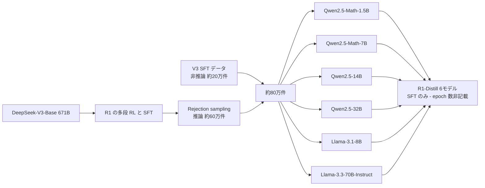

# DeepSeek-R1: Incentivizing Reasoning Capability in LLMs via Reinforcement Learning（蒸留モデル部分）

- **Link**: https://arxiv.org/abs/2501.12948 （HTML: https://arxiv.org/html/2501.12948v1）
- **補助資料**: [Hugging Face モデルカード DeepSeek-R1-Distill-Qwen-32B](https://huggingface.co/deepseek-ai/DeepSeek-R1-Distill-Qwen-32B) / [DeepSeek 公式ニュース](https://deepseek.com/en/news/deepseek-r1/) / [R1-Distill-Qwen-1.5B モデルカード](https://huggingface.co/deepseek-ai/DeepSeek-R1-Distill-Qwen-1.5B)
- **Authors**: DeepSeek-AI ほか（Daya Guo, Dejian Yang, Haowei Zhang, Junxiao Song, Peiyi Wang ほか、計 200 名）
- **Year**: 2025（v1: 2025-01-22、v2: 2026-01-04）
- **Venue**: Nature, vol. 645, pp. 633–638 (2025)
- **Type**: Academic Paper（+ モデルカード・公式発表）
- **証拠の質**: 一次資料（論文・公式モデルカード）。ベンチマーク値は DeepSeek 自身の測定（ベンダー申告に相当）

## Abstract

（WebFetch の引用制限により原文の全文転載はできませんでした。以下は abs ページから取得した要旨です。）The paper shows that the reasoning abilities of LLMs "can be incentivized through pure reinforcement learning (RL)", without human-labeled reasoning trajectories. It reports emergent behaviors such as self-reflection and verification, strong results on verifiable tasks (mathematics, coding, STEM), and a way to transfer these reasoning patterns to smaller models via distillation.

## Abstract (Japanese Translation)

本論文は、人手でラベル付けした推論過程を使わず **純粋な強化学習（RL）だけで LLM の推論能力を引き出せる** ことを示す。自己反省・検証といった振る舞いが創発し、数学・コーディング・STEM など検証可能なタスクで高い性能を得た。さらに、こうして得た推論パターンを **蒸留によって小型モデルへ移転** する方法も示す。

## Overview

本 C3 レポートは、R1 本体の RL ではなく **「R1-Distill」6 モデルの作り方・性能・ライセンス・ビジネス流通** に焦点を当てる。

- R1（671B MoE、37B active）が生成した **約 80 万サンプル**（推論 約 60 万 + 非推論 約 20 万）で、Qwen2.5 / Llama 3 の既存 dense モデルを **SFT のみ** で学習した。**RL は蒸留モデルには適用していない**。
  - （2026-10-22 訂正）初版では「2 epoch の SFT」と記したが、論文で「two epochs」と明記されているのは **Section 2.3.3 の DeepSeek-V3-Base に対する SFT** であり、Section 2.4 の蒸留モデル（Qwen / Llama）については「同じ約 80 万件で直接 fine-tune した」とあるのみで **epoch 数は明記されていない**（arXiv HTML v1 を再確認）。
- これは「教師の出力テキストを生徒が模倣する」**黒箱（sequence-level）蒸留** であり、logit を使う白箱蒸留ではない。
- 32B 蒸留版は、同じ Qwen2.5-32B に大規模 RL を直接かけたモデル（R1-Zero-Qwen-32B）を大きく上回った。論文の結論は「**小型モデルには RL より蒸留が経済的かつ効果的**」。
- 重みは **MIT ライセンス** で公開され、DeepSeek は「API 出力も fine-tuning・蒸留に使ってよい」と明言した。これが 2025 年の推論蒸留ブーム（Sky-T1, Bespoke-Stratos, Open-R1, OpenThoughts, 日本語版派生）の起点になった。

## Problem

- **小型モデルへの RL は高コスト**: 小型モデルで大規模 RL を回すには膨大な計算が必要で、しかも大モデルの蒸留に及ばない可能性がある。
- **推論能力の普及**: o1 系の推論能力は閉じたモデルにしかなく、オンプレ・エッジで使える小型推論モデルが存在しなかった。
- **ライセンス上の不透明さ**: 当時、商用 API の出力を使った蒸留は利用規約で禁止されることが多かった（C8 と接続）。

## Proposed Method

**R1-Distill（推論トレース SFT 蒸留）**

1. **データ生成（Section 2.3.3）**: RL 済みチェックポイントから **rejection sampling** で推論データ 約 60 万件を作成。正解検証・可読性フィルタ（言語混在・長文・コードブロックの除去）を通す。
2. **非推論データ**: 文章作成・事実 QA・自己認識・翻訳など 約 20 万件（DeepSeek-V3 の SFT データを再利用）。
3. **合計 約 80 万件** を用意。
4. **生徒モデル**: Qwen2.5-Math-1.5B、Qwen2.5-Math-7B、Qwen2.5-14B、Qwen2.5-32B、Llama-3.1-8B、Llama-3.3-70B-Instruct。
5. **学習**: 80 万件で **SFT のみ**（epoch 数は蒸留モデルについては非記載。（2026-10-22 訂正）「2 epoch」は V3-Base 側の記述）。RL 段は省略（「RL を足せばさらに伸びる」と言及のみ）。

**Key Formulas**:

黒箱蒸留（sequence-level KD）の目的関数は、教師が生成した系列 $y \sim \pi_T(\cdot \mid x)$ に対する生徒の負の対数尤度の最小化として書ける。

$$
\mathcal{L}_{\text{SFT}}(\theta) = - \mathbb{E}_{x \sim \mathcal{D},\; y \sim \pi_T(\cdot \mid x),\; \text{filter}(y)=1} \left[ \sum_{t=1}^{|y|} \log \pi_\theta(y_t \mid x, y_{<t}) \right]
$$

- $\pi_T$: 教師（DeepSeek-R1 の RL チェックポイント）
- $\pi_\theta$: 生徒（Qwen2.5 / Llama 3）
- $\text{filter}(y)$: rejection sampling（正解判定・可読性）を通過したら 1
- $\mathcal{D}$: 推論 60 万 + 非推論 20 万のプロンプト集合

**Features**:

- 教師の logit が不要 → 教師と生徒の **トークナイザが異なっても** 蒸留できる（Qwen 系・Llama 系の両方へ配布できた理由）。
- 推論過程（`<think>` 内の長い CoT）ごと模倣させるため、生徒は「長く考える」振る舞いを継承する。
- RL を一切使わないため、生徒側の計算コストは SFT のみ。

## Algorithm (Pseudocode)

```
Algorithm: R1-Distill
Input : 教師 R1 (RL 済み), プロンプト集合 P_reason, P_general, 生徒 base モデル群 S
Output: 蒸留済み生徒 S'

1. D_reason ← {}
2. for x in P_reason:
3.     Y ← sample k responses from R1(x)            // rejection sampling
4.     Y ← filter(Y; 正解一致, 言語混在なし, 冗長でない)
5.     D_reason ← D_reason ∪ {(x, y) | y ∈ Y}       // 約 60 万件
6. D_general ← DeepSeek-V3 SFT データ（CoT 付与/省略）   // 約 20 万件
7. D ← D_reason ∪ D_general                          // 約 80 万件
8. for s in S:                                       // Qwen2.5-Math-1.5B ... Llama-3.3-70B
9.     s' ← SFT(s, D)                                // RL なし。epoch 数は論文に明記なし（2026-10-22 訂正）
10. return S'
```

## Architecture / Process Flow



## Figures & Tables

### Table A: 蒸留モデルとベースモデル・ライセンス（モデルカードより）

| Model | Base Model | ベースのライセンス | 配布ライセンス |
|---|---|---|---|
| DeepSeek-R1-Distill-Qwen-1.5B | Qwen2.5-Math-1.5B | Apache 2.0 | MIT |
| DeepSeek-R1-Distill-Qwen-7B | Qwen2.5-Math-7B | Apache 2.0 | MIT |
| DeepSeek-R1-Distill-Llama-8B | Llama-3.1-8B | Llama 3.1 License | MIT（ただし Llama 3.1 条項の継承に注意） |
| DeepSeek-R1-Distill-Qwen-14B | Qwen2.5-14B | Apache 2.0 | MIT |
| DeepSeek-R1-Distill-Qwen-32B | Qwen2.5-32B | Apache 2.0 | MIT |
| DeepSeek-R1-Distill-Llama-70B | Llama-3.3-70B-Instruct | Llama 3.3 License | MIT（同上） |

### Table B: 蒸留モデルの評価（モデルカード / 論文 Table 5 相当）

| Model | AIME 2024 pass@1 | AIME 2024 cons@64 | MATH-500 pass@1 | GPQA Diamond pass@1 | LiveCodeBench pass@1 | CodeForces rating |
|---|---|---|---|---|---|---|
| GPT-4o-0513 | 9.3 | 13.4 | 74.6 | 49.9 | 32.9 | 759 |
| Claude-3.5-Sonnet-1022 | 16.0 | 26.7 | 78.3 | 65.0 | 38.9 | 717 |
| o1-mini | 63.6 | 80.0 | 90.0 | 60.0 | 53.8 | **1820** |
| QwQ-32B-Preview | 44.0 | 60.0 | 90.6 | 54.5 | 41.9 | 1316 |
| R1-Distill-Qwen-1.5B | 28.9 | 52.7 | 83.9 | 33.8 | 16.9 | 954 |
| R1-Distill-Qwen-7B | 55.5 | 83.3 | 92.8 | 49.1 | 37.6 | 1189 |
| R1-Distill-Qwen-14B | 69.7 | 80.0 | 93.9 | 59.1 | 53.1 | 1481 |
| R1-Distill-Qwen-32B | **72.6** | 83.3 | 94.3 | 62.1 | 57.2 | 1691 |
| R1-Distill-Llama-8B | 50.4 | 80.0 | 89.1 | 49.0 | 39.6 | 1205 |
| R1-Distill-Llama-70B | 70.0 | **86.7** | **94.5** | **65.2** | **57.5** | 1633 |

```
AIME 2024 pass@1（%）
R1-Distill-Qwen-32B  |████████████████████████████████████ 72.6
R1-Distill-Llama-70B |███████████████████████████████████ 70.0
R1-Distill-Qwen-14B  |██████████████████████████████████▉ 69.7
o1-mini              |███████████████████████████████▊ 63.6
R1-Distill-Qwen-7B   |███████████████████████████▊ 55.5
R1-Distill-Llama-8B  |█████████████████████████▏ 50.4
QwQ-32B-Preview      |██████████████████████ 44.0
R1-Distill-Qwen-1.5B |██████████████▍ 28.9
Claude-3.5-Sonnet    |████████ 16.0
GPT-4o-0513          |████▋ 9.3
```

### Table C: 蒸留 vs RL（論文 Table 6、Section 4.1）

| Model | AIME 2024 pass@1 | AIME 2024 cons@64 | MATH-500 pass@1 | GPQA Diamond pass@1 | LiveCodeBench pass@1 |
|---|---|---|---|---|---|
| QwQ-32B-Preview | 50.0 | 60.0 | 90.6 | 54.5 | 41.9 |
| DeepSeek-R1-Zero-Qwen-32B（Qwen2.5-32B に大規模 RL） | 47.0 | 60.0 | 91.6 | 55.0 | 40.2 |
| DeepSeek-R1-Distill-Qwen-32B（R1 から蒸留） | **72.6** | **83.3** | **94.3** | **62.1** | **57.2** |

> 同じ 32B ベースでも、**RL 直接適用（47.0）より蒸留（72.6）が AIME で +25.6pt**。
>
> （2026-10-22 追記・検証）Table 5 / Table 6 の数値（6 蒸留モデルの AIME 2024 pass@1 = 28.9 / 55.5 / 69.7 / 72.6 / 50.4 / 70.0、R1-Zero-Qwen-32B = 47.0、QwQ-32B-Preview = 50.0）を arXiv HTML v1 で再確認し、一致を確認。なお Table B の QwQ-32B-Preview AIME 44.0 はモデルカード（蒸留モデル評価表）の値、Table C の 50.0 は論文 Table 6 の値で、**出典により QwQ の値が異なる** 点に注意。

### Table D: 学習データ構成（Section 2.3.3）

| データ | 件数 | 生成方法 |
|---|---|---|
| 推論データ | 約 600k | RL チェックポイントからの rejection sampling + フィルタ |
| 非推論データ | 約 200k | 文章作成・事実 QA・自己認識・翻訳（V3 SFT データ再利用） |
| 合計 | 約 800k | SFT（V3-Base は 2 epoch。蒸留モデルの epoch 数は非記載 — 2026-10-22 訂正） |

### Table E: 利用上の推奨設定（モデルカード）

| 項目 | 推奨 |
|---|---|
| temperature | 0.5–0.7（0.6 推奨）。無限反復・支離滅裂を防ぐ |
| system prompt | 使わない（指示は user prompt に入れる） |
| 数学 | 「Please reason step by step, and put your final answer within \boxed{}.」を付ける |
| 評価 | 複数回試行して平均 |
| 思考スキップ対策 | 応答を `<think>\n` から始めるよう強制 |

### Table F: エコシステム指標（Hugging Face、2026-10 取得時点の月間値）

| モデル | 月間 DL | adapters | finetunes | merges | quantizations |
|---|---|---|---|---|---|
| R1-Distill-Qwen-1.5B | 1,319,824 | 336 | 699 | 27 | 277 |
| R1-Distill-Qwen-32B | 360,250 | — | — | — | — |

### 図（arXiv HTML 内の相対パス、R1-Zero 部分）

- `2501.12948v1/figures/plot_aime_with_maj.png`: R1-Zero の RL 学習中の AIME 精度（各問 16 サンプル平均）
- `2501.12948v1/figures/plot_length.png`: R1-Zero の RL 中の平均応答長


## Experiments & Evaluation

### Setup

- ベンチマーク: AIME 2024（pass@1 / cons@64）、MATH-500、GPQA Diamond、LiveCodeBench、CodeForces
- 比較: GPT-4o-0513、Claude-3.5-Sonnet-1022、o1-mini、QwQ-32B-Preview

### Main Results

- **7B 蒸留版（55.5）が QwQ-32B-Preview（44.0）を上回る**。14B 版は QwQ-32B-Preview を「大差で」上回る。
- **32B / 70B 蒸留版は o1-mini を大半の指標で上回る**（CodeForces を除く）。DeepSeek は公式ニュースで「32B と 70B は o1-mini と同等」と表現（ベンダー申告）。

### Ablation Study（蒸留 vs RL）

- Table C の通り、同一ベースへの RL（R1-Zero-Qwen-32B）は QwQ-32B-Preview 並みに留まり、蒸留版に大きく劣る。
- 論文の結論:
  1. 強いモデルを小さいモデルへ蒸留すると優れた結果が出る。小型モデルで大規模 RL に頼る方法は膨大な計算を要し、蒸留に届かない可能性がある。
  2. 蒸留は経済的で効果的だが、知能の限界を押し上げるには、より強いベースモデルと大規模 RL が必要かもしれない。

## ライセンスと蒸留条項

| 項目 | 内容 | 出典 |
|---|---|---|
| 重み・コード | MIT License | モデルカード（一次） |
| 派生・蒸留 | 商用利用・改変・**他 LLM の学習のための蒸留を含む派生物** を許可 | モデルカード（一次） |
| API 出力 | 「API outputs can now be used for fine-tuning & distillation」 | DeepSeek 公式ニュース（一次） |
| 上流ライセンス | Qwen 系は Apache 2.0、Llama 系は Llama 3.1 / 3.3 License 由来 | モデルカード（一次） |
| API 価格（R1 本体、100 万トークン） | 入力 cache hit $0.14 / miss $0.55、出力 $2.19 | DeepSeek 公式ニュース（一次・発表時点） |

> **実務上の注意**: Llama 系蒸留版は MIT と表記されていても、Llama Community License の **"Llama" 命名義務・700M MAU 条項・AUP** が上流から及ぶと解するのが保守的（[04-llama-3-2](04-llama-3-2-pruning-distillation.md) 参照）。

## ビジネス流通（本 run で確認できた範囲）

| 経路 | 内容 | 証拠の質 |
|---|---|---|
| Windows Copilot+ PC | 1.5B / 7B / 14B を NPU 向け int4 で配布（[10](10-windows-copilot-pc-r1-distill.md)） | ベンダー申告 |
| Amazon Bedrock Custom Model Import | Llama-8B / 70B 蒸留版を取込可能、8B は 2 CMU・$0.1570/分 | ベンダー申告 |
| Together AI | 70B / 14B / 1.5B をサーバレス提供、70B 蒸留は無料エンドポイントあり | ベンダー申告 |
| 国内派生 | サイバーエージェント 14B/32B 日本語版、Lightblue 7B 日本語版（[11](11-japan-derivatives.md)） | 一次（モデルカード） |
| 名前付き顧客の本番成果 | **確認できず** | — |

## Notes

- R1-Distill は **「蒸留＝教師の出力テキストで SFT」** の代表例で、白箱蒸留（Gemma / Llama 3.2 / Minitron）とは別系統。fine-tuning との違いは **学習データが教師モデルの生成物であること**（タスク固有の人手ラベルではない）にある。
- Fireworks は、蒸留版の tool calling は「パース問題が報告されている」としている（ベンダー記事）。Agent 用途（H6）へ直接使うには追加学習が必要な可能性。
- 後続: R1-0528 を Qwen3-8B に蒸留した版（Fireworks 記事で言及）、Alibaba DistillQwen-ThoughtY（R1-0528 教師）、OpenThoughts（QwQ 教師）。
- （2026-10-22 追記）後続の **DeepSeek-R1-0528-Qwen3-8B** を HF モデルカード（一次）で確認: 「R1-0528 の chain-of-thought を蒸留して Qwen3 8B Base を post-train」、MIT、AIME 2024 86.0 / AIME 2025 76.3（Qwen3-8B は 76.0 / 67.3）、月間 DL 405,169（2026-10-22 取得）。詳細は [12-newer-distilled-open-models-2025-2026.md](12-newer-distilled-open-models-2025-2026.md)。
- （2026-10-22 追記）エコシステム指標の追加取得（2026-10-22）: R1-Distill-Qwen-7B 月間 DL 386,503、adapters 162 / finetunes 314 / merges 64 / quantizations 202（MIT）。
