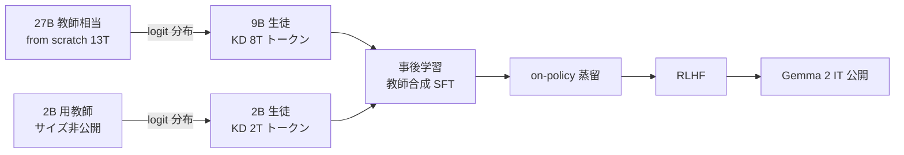

# Gemma 2: Improving Open Language Models at a Practical Size

- **Link**: https://arxiv.org/abs/2408.00118 （HTML: https://arxiv.org/html/2408.00118v2）
- **Authors**: Gemma Team, Google DeepMind
- **Year**: 2024（v1: 2024-07-31、v3: 2024-10-02）
- **Venue**: arXiv（technical report）
- **Type**: Academic Paper
- **証拠の質**: 一次資料（Google 自身の技術報告）。ベンチマークは自社測定

## Abstract

（WebFetch の引用制限により要旨）Gemma 2 is a new addition to the Gemma family of lightweight, state-of-the-art open models, ranging in scale from 2 billion to 27 billion parameters. It applies known Transformer modifications such as interleaving local-global attentions and group-query attention, and trains the 2B and 9B models with knowledge distillation instead of next token prediction. The resulting models deliver the best performance for their size and offer competitive alternatives to models that are 2-3× bigger. All models are released to the community.

## Abstract (Japanese Translation)

Gemma 2 は 2B〜27B の軽量オープンモデル群である。局所・大域アテンションの交互配置や GQA といった既知の改良を取り入れ、**2B と 9B は次トークン予測ではなく知識蒸留で学習** した。結果として、同サイズで最高水準、かつ 2〜3 倍大きいモデルに対抗できる性能を示し、全モデルを公開した。

## Overview

- **蒸留を「事前学習そのもの」に使った** 初期の大規模公開例。従来の KD は事後的な圧縮だったが、Gemma 2 は 2B/9B の **事前学習の損失関数を教師分布との交差エントロピーに置き換えた**。
- 狙いは「小型モデルは one-hot 次トークンという貧弱な信号で学習している」という問題の解消。教師の確率分布はより豊かな勾配信号を与え、**計算最適（Chinchilla）の 50 倍超のトークン** で学習しても伸び続ける。
- 27B は from scratch（蒸留なし）で、9B の教師に相当する（論文は 7B→2B のアブレーションを「27B→9B と同比率」と説明）。
- 白箱（logit）蒸留であり、**教師の重みと語彙を共有できる自社モデル群でしか成立しない**。外部企業が真似するなら「同族の大モデルを持つ」ことが前提。

## Problem

- **小型モデルの学習信号の貧弱さ**: one-hot ラベルの次トークン予測は、同じ計算量でも得られる情報が少ない。
- **トークン数増加の頭打ち**: 小型モデルに大量トークンを与えても改善が鈍る。
- **実用サイズでの性能**: 端末・単一 GPU で動く 2B〜9B で、2〜3 倍大きいモデル並みの性能が欲しい。

## Proposed Method

**事前学習時の知識蒸留（Section 3.2）**

1. 大型の教師モデルを用意する（9B 用は 27B 相当、2B 用の教師サイズは本文に明記なし）。
2. 各トークン位置で教師の次トークン確率分布 $P_T(x \mid x_c)$ を計算する。
3. 生徒は one-hot ではなくこの分布に合わせて学習する。
4. 2B は 2T、9B は 8T トークンで学習（27B は 13T、蒸留なし）。
5. 事後学習（SFT）でも、応答の多くを **大型教師が合成** し、さらに **生徒自身の出力分布上で教師から蒸留**（on-policy 蒸留、Agarwal et al. 2024 / Gu et al. 2024）。

**Key Formulas**:

$$
\min_{P_S} \sum_{x} -P_T(x \mid x_c) \log P_S(x \mid x_c)
$$

- $x_c$: 文脈（それまでのトークン列）
- $x$: 次トークン候補（語彙全体）
- $P_T$: 教師の次トークン確率
- $P_S$: 生徒のパラメタ化された次トークン確率

これは $\mathrm{KL}(P_T \,\|\, P_S)$ の最小化と等価（教師エントロピーは定数）:

$$
\mathrm{KL}(P_T \| P_S) = \sum_x P_T(x \mid x_c) \log \frac{P_T(x \mid x_c)}{P_S(x \mid x_c)} = \underbrace{-H(P_T)}_{\text{定数}} - \sum_x P_T \log P_S
$$

**Features**:

- 同一語彙の教師が必要（白箱）。
- 「計算最適の 50 倍超」の過学習領域でも効く → **推論コストを抑えたい小型モデルほど恩恵が大きい**。
- 事後学習でも合成応答 + on-policy 蒸留を併用。

## Algorithm (Pseudocode)

```
Algorithm: Gemma 2 distillation pre-training
Input : 教師 T（大型・同一語彙）, 生徒 S（2B or 9B）, コーパス C（2T / 8T トークン）
Output: 事前学習済み生徒 S

1. for batch in C:
2.     ctx ← batch のトークン列
3.     p_T ← softmax(T(ctx))           // 各位置の教師分布（語彙全体）
4.     p_S ← softmax(S(ctx))
5.     loss ← mean_over_positions( - Σ_x p_T(x) log p_S(x) )
6.     S ← S - η ∇ loss
7. // 事後学習
8. D_sft ← 教師が合成した応答を中心とする SFT データ
9. S ← SFT(S, D_sft)
10. S ← on-policy 蒸留（S 自身のサンプル上で T の分布に合わせる）
11. S ← RLHF
```

## Architecture / Process Flow



## Figures & Tables

### Table 1: 学習トークン数と蒸留の有無

| Model | 学習トークン | 学習方式 |
|---|---|---|
| Gemma 2 2B | 2T | 知識蒸留 |
| Gemma 2 9B | 8T | 知識蒸留 |
| Gemma 2 27B | 13T | 次トークン予測（from scratch） |

### Table 2: 学習ハードウェア（論文 Table 3）

| Model | チップ数 | ハードウェア |
|---|---|---|
| 2B | 512 | TPUv5e |
| 9B | 4096 | TPUv4 |
| 27B | 6144 | TPUv5p |

### Table 3: アブレーション — 蒸留 vs from scratch（2B、500B トークン）

| 設定 | 3 ベンチマーク平均 |
|---|---|
| 2B from scratch | 60.3 |
| 2B 7B 教師から蒸留 | **67.7**（+7.4） |

```
2B / 500B tokens
from scratch |████████████████████████████████████████████████████████████ 60.3
distilled    |███████████████████████████████████████████████████████████████████▋ 67.7
```

### Table 4: アブレーション — モデルサイズ別の perplexity（教師 7B、低いほど良い）

| 生徒サイズ | from scratch | 7B から蒸留 | 差 |
|---|---|---|---|
| 200M | 23 | 21 | -2 |
| 400M | 19 | 17 | -2 |
| 1B | 17 | 15 | -2 |

> 生徒サイズが大きくなっても蒸留の利得（約 -2 PPL）は維持される。

### Table 5: 事前学習モデルの主要ベンチマーク（論文 Table 13 抜粋）

| Benchmark | 2B | 9B | 27B |
|---|---|---|---|
| MMLU (5-shot) | 52.2 | 71.3 | 75.2 |
| GSM8K (5-shot) | 24.3 | 68.6 | 74.0 |
| ARC-C (25-shot) | 55.7 | 68.4 | 71.4 |
| HellaSwag (10-shot) | 72.9 | 81.9 | 86.4 |
| Winogrande (5-shot) | 71.3 | 80.6 | 83.7 |
| HumanEval (pass@1) | 20.1 | 40.2 | 51.8 |
| MBPP (3-shot) | 30.2 | 52.4 | 62.6 |
| 平均（8 ベンチマーク） | 50.0 | 70.2 | 74.4 |

> 蒸留で学習した 9B（70.2）は、蒸留なし 27B（74.4）の **約 94% の平均性能を 1/3 のパラメータ** で達成。

### Figure 1（キャプションのみ取得）

- 「Comparing memorization rates. We find significantly lower memorization rates across-the-board.」— Gemma 2 は記憶（訓練データの逐語再生）率が全般に低い。HTML 内に画像 URL は取得できず。

### 比較表（関連手法との位置付け）

| 観点 | Gemma 2 | Llama 3.2 1B/3B | Minitron | R1-Distill |
|---|---|---|---|---|
| 蒸留の段階 | 事前学習全体 | 剪定後の事前学習 | 剪定後の再学習 | 事後（SFT） |
| 信号 | 教師の全語彙分布 | 8B/70B の logit | logit KL（+中間層） | 教師生成テキスト |
| 白箱/黒箱 | 白箱 | 白箱 | 白箱 | 黒箱 |
| 剪定 | なし | あり | あり | なし |
| 生徒トークン | 2T / 8T | 最大 9T | 94B〜380B | 約 80 万サンプル |

## Experiments & Evaluation

### Setup

- 事前学習モデルを MMLU・GSM8K・ARC-C・HellaSwag・Winogrande・HumanEval・MBPP 等で評価。
- 蒸留の効果は 2B（500B トークン）と 200M/400M/1B（7B 教師）で検証。

### Main Results

- 2B は同規模最強クラス、9B は 2〜3 倍大きいモデルの代替になると主張（自社測定）。

### Ablation Study

- 蒸留は from scratch に対し 3 ベンチ平均 +7.4pt（2B）。
- 生徒サイズ 200M〜1B で一貫して PPL を約 2 改善。

## ライセンスとビジネス上の位置付け

- 配布ライセンスは **Gemma Terms of Use**。その「Model Derivatives」定義には **蒸留や Gemma 出力の合成データで学習したモデル** が含まれ、派生物を配布する際は利用制限（Prohibited Use Policy）を契約で継承させる必要がある（詳細は [03-gemma-3](03-gemma-3-distillation-license.md)）。
- つまり **Gemma 2 を教師にして自社モデルを蒸留すると、そのモデルも Gemma Terms の制約を受ける**。逆に Outputs そのものは派生物ではなく、Google は Outputs に権利を主張しない。
- 名前付き企業の本番採用成果は本資料には無い（C3 gather で確認できたのは Gemma 3 4B の SK Telecom 事例のみ）。
- （2026-10-22 追記）**Gemma 2 9B を生徒にした本番事例を確認**: Trustpilot は Gemini 2.0/2.5 Pro/Flash 系の「教師モデル」のコンセンサス注釈で学習データを作り、gemma-2-9b を基にタスク特化モデル群（トピック分類・NER・感情抽出）を fine-tune、vLLM で配信して 1 日数百万件のレビューを準リアルタイム処理。精度は「教師コンセンサスより数ポイント低い」、コストは「Gemini 同等性能を fraction of the cost」（Google Cloud 顧客ブログ 2026-06-02、数値は定性）。黒箱蒸留（教師出力による SFT）の構成に当たる。詳細は [13](13-business-adoption-evidence.md)。
- （2026-10-22 追記・検証）本レポートの数値（2B 2T / 9B 8T / 27B 13T、Table 6 の 60.3 vs 67.7（7B 教師、500B トークン）、Table 7 の PPL 23/19/17 vs 21/17/15、「50× the compute-optimal quantity」）を arXiv HTML v3 で再確認し一致。2B 用教師のサイズは論文に明記なし（本文のとおり）。

## Notes

- Gemma 2 の「蒸留で事前学習」は、のちの Gemma 3（全サイズ KD）、Llama 3.2（logit 目標）、Qwen3（on-policy 蒸留）に引き継がれた。
- 外部企業が同じ効果を得るには、同一語彙の強い教師（自社の大モデル、または語彙を共有する公開モデル群）が必要。この制約を緩める手法として top-K logit（DistilQwen2.5）やトークン整列（Universal Logit Distillation）がある。
