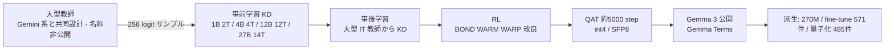
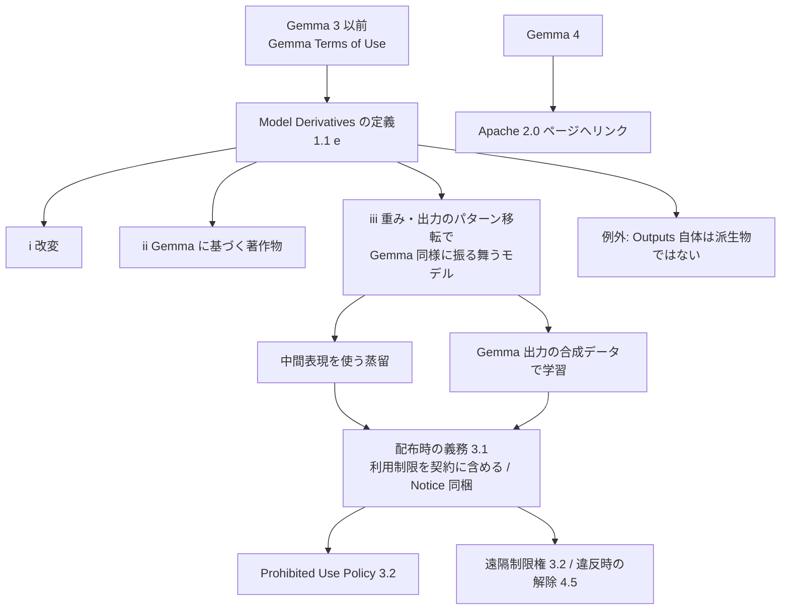

# Gemma 3 Technical Report（+ Gemma Terms of Use の蒸留条項）

- **Link**: https://arxiv.org/abs/2503.19786 （HTML: https://arxiv.org/html/2503.19786v1）
- **補助資料**: [Gemma Terms of Use（現行、2026-04-01 改定）](https://ai.google.dev/gemma/terms) / [2024-04-01 版アーカイブ](https://ai.google.dev/gemma/terms-archive/terms_04_01_24) / [Gemma 4 license（Apache 2.0）](https://ai.google.dev/gemma/apache_2) / [Introducing Gemma 3 270M](https://developers.googleblog.com/en/introducing-gemma-3-270m/) / [gemma-3-1b-it モデルカード](https://huggingface.co/google/gemma-3-1b-it)
- **Authors**: Gemma Team, Google DeepMind
- **Year**: 2025（2025-03-25 投稿）
- **Venue**: arXiv（technical report）
- **Type**: Academic Paper + ライセンス文書 + ビジネス事例
- **証拠の質**: 論文・規約は一次資料。SK Telecom 事例は Google ブログの記述（ベンダー申告・定性）

## Abstract

（要旨）Gemma 3 is a multimodal addition to the Gemma family, ranging from 1 to 27 billion parameters. It adds vision understanding, wider language coverage and a context of at least 128K tokens. The architecture increases the ratio of local to global attention layers and keeps local attention span short to reduce KV-cache memory. "The Gemma 3 models are trained with distillation and achieve superior performance to Gemma 2 for both pre-trained and instruction finetuned versions." A novel post-training recipe, including knowledge distillation from a large teacher and RL finetuning, improves math, chat, instruction following and multilingual abilities.

## Abstract (Japanese Translation)

Gemma 3 は 1B〜27B のマルチモーダル版 Gemma で、画像理解・多言語・128K 以上の文脈を追加した。局所アテンション層の比率を上げ局所窓を短くして KV キャッシュを削減。**全モデルを蒸留で学習** し、事前学習版・指示学習版ともに Gemma 2 を上回る。事後学習でも **大型教師からの知識蒸留 + RL** を用い、数学・対話・指示追従・多言語を強化した。

## Overview

- Gemma 2 では 2B/9B のみだった蒸留事前学習を **全サイズ（1B / 4B / 12B / 27B）** に拡大。
- 蒸留の実装は「教師分布から **256 個の logit をサンプル** し、その上で交差エントロピー」という **sparse logit 蒸留**。全語彙の logit を保存・転送しないことで、大規模蒸留のストレージと I/O を抑える工夫。
- 教師の大きさに関するアブレーションで「**短い学習では小さい教師、長い学習では大きい教師が有利**」という逆転を示した。
- 規約面では、Gemma 3 までは **Gemma Terms of Use** が適用され、「Gemma の出力（合成データ）で学習したモデル」も Model Derivatives として利用制限を継承する。**Gemma 4 からは Apache 2.0 のページへリンクが変わった**（2026 年時点）。
  - （2026-10-22 追記・一次資料で検証）Gemma 4 の Apache 2.0 化を次の一次資料で確認した。(a) Google 公式ブログ「Gemma 4: Byte for byte, the most capable open models」（2026-04-02）: 「Gemma 4 is released under a commercially permissive Apache 2.0 license」、(b) Gemma 4 Technical Report（arXiv 2607.02770、2026-07-02 v1）: 「We release the Gemma 4 models under an Apache 2.0 license」、(c) HF モデルカード google/gemma-4-31B-it / gemma-4-E4B-it の license タグ「apache-2.0」、(d) Gemma Terms of Use（2026-04-01 改定）の Appendix は Gemma 1 / 1.1 / 2 / 3 / 3n と派生（FunctionGemma 等）を列挙し **Gemma 4 を含まない**。初版の「リンク先が Apache 2.0 ページ」という間接的根拠から **一次資料確認済み** に格上げする。
  - （2026-10-22 追記）ただし **Gemma 4 技術報告書・モデルカード・公式ブログのいずれにも「distillation」の記述がなく**、Gemma 4 が蒸留で作られたかは確認できない。Gemma 2 / 3 と異なり、Gemma 4 は本クラスタでは「蒸留モデル」ではなく「蒸留の教師・生徒として使える Apache 2.0 公開モデル」として扱う。

## Problem

- 全語彙 logit の蒸留は、大規模コーパスではストレージ・転送が重い。
- 教師サイズの選び方に定説がない（先行研究では「強すぎる教師は逆効果」とされた）。
- 端末向けにメモリを抑えつつ長文脈・画像を扱いたい。

## Proposed Method

**Sparse logit 蒸留（Section 2.2）**

1. 各トークンで教師の分布から **256 logit を教師確率に比例してサンプル**。
2. 生徒はサンプルされた 256 候補上で教師分布を交差エントロピーで学習。
3. サンプルされなかった logit の目標確率は 0、分布を再正規化。

**Key Formulas**:

サンプル集合を $\mathcal{K}_t$（$|\mathcal{K}_t| = 256$）とすると:

$$
\tilde{P}_T(x \mid x_{<t}) = \frac{P_T(x \mid x_{<t}) \cdot \mathbb{1}[x \in \mathcal{K}_t]}{\sum_{x' \in \mathcal{K}_t} P_T(x' \mid x_{<t})}
$$

$$
\mathcal{L}_{\text{KD}} = - \sum_t \sum_{x \in \mathcal{K}_t} \tilde{P}_T(x \mid x_{<t}) \log P_S(x \mid x_{<t})
$$

- $P_T, P_S$: 教師・生徒の次トークン分布
- $\mathcal{K}_t$: 位置 $t$ で教師確率に重み付けてサンプルした 256 トークン
- （論文本文の数式表記そのものではなく、記述から再構成した式）

**事後学習**: 大型 IT 教師からの改良版 KD + RL（BOND / WARM / WARP の改良版）。報酬は人手フィードバックの重み平均報酬モデル、コード実行、数学の正解。

**量子化認識学習（QAT）**: 非量子化チェックポイントの確率を目標に約 5,000 ステップ fine-tune（= 自己蒸留の一種）。int4（per-channel / per-block）と switched fp8 を提供。

## Algorithm (Pseudocode)

```
Algorithm: Gemma 3 sparse-logit distillation
Input : 教師 T, 生徒 S, コーパス C, K=256
1. for batch in C:
2.   for each position t:
3.     K_t ← sample K tokens ~ P_T(· | x_<t)        // 教師確率で重み付け
4.     q_t ← renormalize(P_T restricted to K_t)      // 非サンプルは 0
5.   loss ← - Σ_t Σ_{x∈K_t} q_t(x) log P_S(x | x_<t)
6.   S ← S - η ∇ loss
7. S ← 改良 KD（大型 IT 教師）→ RL（BOND/WARM/WARP 改良）
8. S_q ← QAT(S, target = P_S 非量子化, steps ≈ 5000)  // int4 / SFP8
```

## Architecture / Process Flow



## Figures & Tables

### Table 1: パラメータ構成（論文 Table 1）

| Model | Vision Encoder | Embedding | Non-embedding |
|---|---|---|---|
| 1B | 0 | 302M | 698M |
| 4B | 417M | 675M | 3,209M |
| 12B | 417M | 1,012M | 10,759M |
| 27B | 417M | 1,416M | 25,600M |

### Table 2: 学習計算基盤（論文 Table 2）

| Model | Hardware | #Chips | Data | Seq. | Replica |
|---|---|---|---|---|---|
| 1B | TPUv5e | 512 | 16 | 16 | 2 |
| 4B | TPUv5e | 2048 | 16 | 16 | 8 |
| 12B | TPUv4 | 6144 | 16 | 16 | 24 |
| 27B | TPUv5p | 6144 | 24 | 8 | 32 |

### Table 3: 事前学習トークン数

| Model | Tokens |
|---|---|
| 1B | 2T |
| 4B | 4T |
| 12B | 12T |
| 27B | 14T |

### Table 4: QAT 版のメモリ（GB、32K 文脈、論文 Table 3）

| Model | bf16 | Int4 | Int4 (block=32) | SFP8 | bf16 +KV | Int4 +KV | Int4 blk +KV | SFP8 +KV |
|---|---|---|---|---|---|---|---|---|
| 1B | 2.0 | 0.5 | 0.7 | 1.0 | 2.9 | 1.4 | 1.6 | 1.9 |
| 4B | 8.0 | 2.6 | 2.9 | 4.4 | 12.7 | 7.3 | 7.6 | 9.1 |
| 12B | 24.0 | 6.6 | 7.1 | 12.4 | 38.9 | 21.5 | 22.0 | 27.3 |
| 27B | 54.0 | 14.1 | 15.3 | 27.4 | 72.7 | 32.8 | 34.0 | 46.1 |

### Table 5: Chatbot Arena（論文 Table 5、2025-03-08 時点の暫定値）

| Model | Elo | 順位 |
|---|---|---|
| Gemma-3-27B-IT | 1338 (+8/-9) | 9 位 |
| Gemma-2-27B-it | 1220 | — |

### Table 6: 指示学習モデルの比較（論文 Table 6 / 18 抜粋）

| Benchmark | Gemma 2 2B | Gemma 2 9B | Gemma 2 27B | Gemma 3 1B | Gemma 3 4B | Gemma 3 12B | Gemma 3 27B |
|---|---|---|---|---|---|---|---|
| MMLU-Pro | 15.6 | 46.8 | 56.9 | 14.7 | 43.6 | 60.6 | 67.5 |
| MMLU | 56.1 | 71.3 | 76.2 | 38.8 | 58.1 | 71.9 | 76.9 |
| GSM8K | 62.6 | 88.1 | 91.1 | 62.8 | 89.2 | 94.4 | 95.9 |
| MATH | 27.2 | 49.4 | 55.6 | 48.0 | 75.6 | 83.8 | 89.0 |

```
MATH（IT）
Gemma 3 27B |████████████████████████████████████████████▌ 89.0
Gemma 3 12B |█████████████████████████████████████████▉ 83.8
Gemma 3 4B  |█████████████████████████████████████▊ 75.6
Gemma 2 27B |███████████████████████████▊ 55.6
Gemma 2 9B  |████████████████████████▋ 49.4
Gemma 3 1B  |████████████████████████ 48.0
Gemma 2 2B  |█████████████▌ 27.2
```

> **Gemma 3 4B（MATH 75.6）が Gemma 2 27B（55.6）を上回る**。蒸留 + 改良事後学習の効果。

### Figure 8: Small versus large teacher（キャプションのみ）

- 「Relative difference of perplexity when using a small and large teacher as a function of the token size of training. Smaller numbers means distilling from a larger teacher is better.」
- 所見: **短い学習 → 小さい教師が有利、長い学習 → 大きい教師が有利** に逆転。著者は、先行研究で弱い教師が良く見えたのは正則化効果だったと推測。

```
蒸留トークン数 →   少ない ........................ 多い
有利な教師        小さい教師  ─────交差─────  大きい教師
```

### Gemma 3 270M（2025-08-14、Google Developers Blog）

| 項目 | 値 |
|---|---|
| 総パラメータ | 270M（埋め込み 約 170M + Transformer 約 100M） |
| 語彙 | 256k トークン |
| 提供形態 | 事前学習版 + 指示学習版、INT4 QAT チェックポイント |
| 電力 | Pixel 9 Pro で INT4 版が 25 会話に電池 0.75%（社内試験） |
| 位置付け | タスク特化 fine-tune の土台（「right tool for the job」） |

## Gemma Terms of Use の蒸留条項（一次資料）



| 条項 | 内容（要約・短い引用） | 2024-04 版 | 2026-04 現行 |
|---|---|---|---|
| 1.1(e) Model Derivatives | 改変・Gemma に基づく著作物・「distillation methods that use intermediate data representations or methods based on the generation of synthetic data Outputs by Gemma for training that model」 | あり | あり（同文） |
| 1.1(e) 但し書き | 「Outputs are not deemed Model Derivatives」 | あり | あり |
| 1.1(f) Output | Gemma または派生物の出力情報 | あり | あり |
| 3.1 配布 | 派生物の配布契約に利用制限を「enforceable provision」として含め、規約写しと Notice を渡す | — | あり |
| 3.2 利用制限 | Prohibited Use Policy の禁止用途に使わない。Google は違反と合理的に信じる利用を「remotely or otherwise」制限できる | — | あり |
| 3.3 Outputs | 「Google claims no rights in Outputs you generate using Gemma」 | — | あり |
| 4.5 解除 | 違反時に解除、Gemma と派生物の削除・配布停止 | — | あり |
| Gemma 4 | 「Gemma 4 license」リンクが Apache 2.0 ページ | — | あり |

> **実務的含意**: Gemma（〜3）を教師にした蒸留・合成データ学習で作った自社モデルは、**Gemma Terms の利用制限を下流へ継承する派生物** となる。出力テキストそのものは自由だが、「その出力で学習したモデル」は派生物扱い、という二段構え。Sakana AI の TinySwallow は Gemma 生成データ（Gemma-2-LMSYS-Chat-1M-Synth 等）を学習に含むため、モデルカードで「Qwen（Apache 2.0）と Gemma の両規約に従えば商用可」と明記している（[11](11-japan-derivatives.md)）。

## ビジネス事例: Adaptive ML × SK Telecom（ベンダー申告・定性）

| 項目 | 内容 |
|---|---|
| 課題 | 多言語でニュアンスのあるコンテンツモデレーション |
| 解決 | Adaptive ML が **Gemma 3 4B を fine-tune**（270M ではない） |
| 結果 | 特定タスクで「much larger proprietary models」に並ぶか上回った（数値なし） |
| 蒸留か | **公開蒸留モデル（Gemma 3 4B）を土台にした fine-tuning**。顧客側で蒸留を行ったかは不明 |

### エコシステム指標（Hugging Face、取得時点）

| モデル | 月間 DL | adapters | finetunes | merges | quantizations | ライセンス |
|---|---|---|---|---|---|---|
| google/gemma-3-1b-it | 1,396,612 | 214 | 571 | 10 | 485 | gemma |

## Experiments & Evaluation

### Setup
- IT モデルを MMLU-Pro・MMLU・GSM8K・MATH 等、および Chatbot Arena で評価。

### Main Results
- Gemma 3 27B IT は Arena Elo 1338（9 位、暫定）で Gemma 2 27B（1220）から +118。
- Gemma 3 4B IT は MATH で Gemma 2 27B IT を上回る。

### Ablation Study
- 教師サイズ × 学習トークン長のアブレーション（Figure 8）。

## Notes

- 1B の MMLU（38.8）は Gemma 2 2B（56.1）より低い。サイズ縮小の代償は知識系で大きく、数学（MATH 48.0 vs 27.2）では逆。用途で選ぶ必要がある。
- Gemma 4（E2B/E4B、31B dense、26B A4B MoE、12B unified）は 2026 年のドキュメントで確認できたが、蒸留の有無は記載なし。
- （2026-10-22 追記・検証）本レポートの主要数値（256 logit サンプル、事前学習トークン 1B 2T / 4B 4T / 12B 12T / 27B 14T、Figure 8「短い学習では小さい教師、長い学習では大きい教師」、IT の MATH 48.0 / 75.6 / 83.8 / 89.0 vs Gemma 2 27.2 / 49.4 / 55.6、Arena Elo 1338 の 2025-03-08 暫定値）を arXiv HTML v1 で再確認し一致。
- （2026-10-22 追記）Gemma 4 の構成をモデルカードで確認: E2B 2.3B 実効（埋め込み込み 5.1B）、E4B 4.5B 実効（8B）、12B Unified 11.95B、26B A4B MoE 25.2B 総 / 3.8B active、31B Dense 30.7B。技術報告書 Table 5（thinking）: AIME 2026 no-tools 31B 89.2 / 26B-A4B 88.3 / 12B 77.5 / E4B 42.5 / E2B 37.5（Gemma 3 27B 非 thinking 20.8）。HF 月間 DL（2026-10-22）: gemma-4-31B-it 8,827,508、gemma-4-E4B-it 4,076,573。詳細は [12](12-newer-distilled-open-models-2025-2026.md)。
- （2026-10-22 追記）エコシステム指標の追加取得（2026-10-22）: google/gemma-3-4b-it 月間 DL 1,059,693、adapters 503 / finetunes 842 / merges 3 / quantizations 492（gemma ライセンス）。
- （2026-10-22 追記）Gemma を生徒にした **名前付き本番事例** を追加確認: Trustpilot が Gemini 2.0/2.5 Pro/Flash を教師に Gemma 2 9B を fine-tune し、1 日数百万件のレビュー処理に本番投入（Google Cloud 顧客ブログ 2026-06-02、[13](13-business-adoption-evidence.md)）。これは「Gemini 出力で学習した Gemma 派生」であり、Gemma Terms の Model Derivatives 条項（合成データ学習）に該当する構成だが、Google 自身のプラットフォーム上の事例であるため規約上の問題は生じない。
