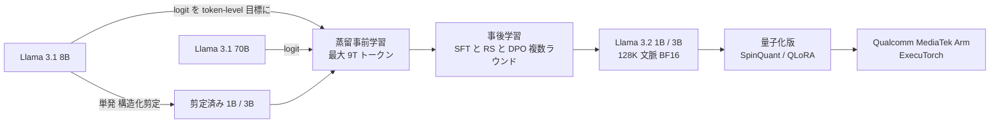

# Llama 3.2: Revolutionizing edge AI and vision with open, customizable models（1B/3B の剪定 + 蒸留）

- **Source**: Meta
- **Date**: 2024-09-25（Connect 2024）
- **Link**: https://ai.meta.com/blog/llama-3-2-connect-2024-vision-edge-mobile-devices/
- **補助資料**: [Llama-3.2-1B モデルカード](https://huggingface.co/meta-llama/Llama-3.2-1B) / [Llama-3.2-1B-Instruct モデルカード](https://huggingface.co/meta-llama/Llama-3.2-1B-Instruct) / [PyTorch: Distilling Llama3.1 8B into 1B in torchtune](https://pytorch.org/blog/llama-into-torchtune/) / [Llama 3 vs 3.1 ライセンス比較（K. Mitchell）](https://writing.kemitchell.com/2024/07/24/Llama-3-versus-Llama-3-1-License) / [Meta: Llama 10x growth](https://ai.meta.com/blog/llama-usage-doubled-may-through-july-2024/)
- **Type**: Technical Article（公式ブログ + モデルカード）
- **証拠の質**: 作り方・計算量・ベンチマークは一次資料（Meta）。企業利用は Meta ブログの紹介（ベンダー申告）

## Overview

- Llama 3.2 1B / 3B は、**Llama 3.1 8B を単発（single shot）の構造化剪定** で縮め、**Llama 3.1 8B と 70B の logit を token-level の目標** として事前学習（= 白箱蒸留）して性能を回復させた。
- 事前学習トークンは **最大 9T**、1B の学習は **370k H100 時間**、全モデル合計で **logit 生成に 86k GPU 時間** を要した。
- 事後学習は SFT・rejection sampling・DPO を複数ラウンド。合成データ（要約・書き換え・指示追従・推論・tool use）を混合。
- 128K 文脈、Qualcomm / MediaTek で初日から有効化、Arm 最適化。量子化版（SpinQuant / QLoRA）では OnePlus 12 上で decode 2.4〜2.6 倍。
  - （2026-10-22 訂正）剪定・蒸留の記述（「structured pruning in a single shot manner from the Llama 3.1 8B」「logits from the Llama 3.1 8B and 70B models ... used as token-level targets」「Knowledge distillation was used after pruning to recover performance」）は Meta ブログ本文で再確認。一方、**BFCL V2 の値（3B 67.0 vs 8B 67.1）と端末上の decode 2.4〜2.6 倍は Meta ブログには無く、HF モデルカード（Llama-3.2-1B / 1B-Instruct）の表の値** である（出典の帰属を訂正）。
- ライセンスは **Llama 3.2 Community License**。Llama 3.1 以降、**出力を他モデル改善に使うことは解禁** されたが、配布するモデル名の先頭に **"Llama"** を付ける義務がある。

## Key Technical Content

### Architecture / Design



### Implementation Steps

1. **剪定**: Llama 3.1 8B から単発で構造化剪定。ネットワークの一部を除去し、重みと勾配の大きさを調整して性能を保持。
2. **蒸留事前学習**: 8B と 70B の logit を各トークン位置の目標分布として学習（剪定で失った性能を回復）。
3. **事後学習**: 複数ラウンドの SFT → rejection sampling → DPO。合成データをフィルタ・混合。
4. **長文脈**: 128K まで拡張し、事前学習モデル並みの品質を維持。
5. **量子化**: SpinQuant（PTQ 系）と QLoRA（QAT + LoRA）で端末向け版を作成。

### Key Formulas / Metrics

白箱蒸留の損失（2 教師の場合の一般形。Meta は重み付けを公開していない）:

$$
\mathcal{L} = \sum_t \Big[ \alpha \cdot \mathrm{KL}\big(P_{8B}(\cdot \mid x_{<t}) \,\|\, P_S(\cdot \mid x_{<t})\big) + \beta \cdot \mathrm{KL}\big(P_{70B}(\cdot \mid x_{<t}) \,\|\, P_S(\cdot \mid x_{<t})\big) \Big] + \gamma \cdot \mathcal{L}_{\text{CE}}
$$

- $P_{8B}, P_{70B}$: 教師の logit から得た分布、$P_S$: 剪定済み生徒
- $\alpha, \beta, \gamma$: 非公開（式は記述からの再構成）

| Metric | Value | Context |
|---|---|---|
| 事前学習トークン | 最大 9T | モデルカード |
| 知識カットオフ | 2023-12 | モデルカード |
| 1B 学習 GPU 時間 | 370k H100-80GB 時間 | モデルカード |
| logit 生成 | 86k GPU 時間（全モデル計） | 蒸留の「教師推論コスト」の実測値 |
| 全モデル合計 | 833k GPU 時間、location-based 240 tCO2eq | モデルカード |

## Figures & Tables

### Table 1: 学習計算量と排出（モデルカード、1B 行）

| Model | Training GPU hours (H100-80GB) | Location-based CO2eq (t) | Market-based CO2eq (t) |
|---|---|---|---|
| Llama 3.2 1B | 370k | 107 | 0 |
| Llama 3.2 1B SpinQuant | 1.7 | <0.001 | 0 |
| Llama 3.2 1B QLoRA | 1.3k | 0.381 | 0 |
| 全モデル合計 | 833k | 240 | 0 |

> **蒸留の経済性**: 教師 logit 生成（86k 時間）は全学習（833k 時間）の約 10%。

### Table 2: 事前学習モデルのベンチマーク

| Benchmark | Shots | Metric | 1B | 3B |
|---|---|---|---|---|
| MMLU | 5 | macro_avg/acc_char | 32.2 | 58 |
| AGIEval English | 3-5 | average/acc_char | 23.3 | 39.2 |
| ARC-Challenge | 25 | acc_char | 32.8 | 69.1 |
| SQuAD | 1 | em | 49.2 | 67.7 |
| QuAC (F1) | 1 | f1 | 37.9 | 42.9 |
| DROP (F1) | 3 | f1 | 28.0 | 45.2 |
| Needle in Haystack | 0 | em | 96.8 | 1（モデルカード表記のまま） |

### Table 3: 指示学習モデルのベンチマーク（量子化版含む）

| Benchmark | 1B bf16 | 1B PTQ | 1B SpinQuant | 1B QLoRA | 3B bf16 | 3B PTQ | 3B SpinQuant | 3B QLoRA | 8B |
|---|---|---|---|---|---|---|---|---|---|
| MMLU | 49.3 | 43.3 | 47.3 | 49.0 | 63.4 | 60.5 | 62 | 62.4 | 69.4 |
| Open-rewrite eval | 41.6 | 39.2 | 40.9 | 41.2 | 40.1 | 40.3 | 40.8 | 40.7 | 40.9 |
| TLDR9+ (test) | 16.8 | 14.9 | 16.7 | 16.8 | 19.0 | 19.1 | 19.2 | 19.1 | 17.2 |
| IFEval | 59.5 | 51.5 | 58.4 | 55.6 | 77.4 | 73.9 | 73.5 | 75.9 | 80.4 |
| GSM8K (CoT) | 44.4 | 33.1 | 40.6 | 46.5 | 77.7 | 72.9 | 75.7 | 77.9 | 84.5 |
| MATH (CoT) | 30.6 | 20.5 | 25.3 | 31.0 | 48.0 | 44.2 | 45.3 | 49.2 | 51.9 |
| ARC-C | 59.4 | 54.3 | 57 | 60.7 | 78.6 | 75.6 | 77.6 | 77.6 | 83.4 |
| GPQA | 27.2 | 25.9 | 26.3 | 25.9 | 32.8 | 32.8 | 31.7 | 33.9 | 32.8 |
| Hellaswag | 41.2 | 38.1 | 41.3 | 41.5 | 69.8 | 66.3 | 68 | 66.3 | 78.7 |
| BFCL V2 | 25.7 | 14.3 | 15.9 | 23.7 | 67.0 | 53.4 | 60.1 | 63.5 | 67.1 |
| Nexus | 13.5 | 5.2 | 9.6 | 12.5 | 34.3 | 32.4 | 31.5 | 30.1 | 38.5 |
| InfiniteBench/En.QA | 20.3 | N/A | N/A | N/A | 19.8 | N/A | N/A | N/A | 27.3 |
| InfiniteBench/En.MC | 38.0 | N/A | N/A | N/A | 63.3 | N/A | N/A | N/A | 72.2 |
| NIH/Multi-needle | 75.0 | N/A | N/A | N/A | 84.7 | N/A | N/A | N/A | 98.8 |
| MGSM (CoT) | 24.5 | 13.7 | 18.2 | 24.4 | 58.2 | 48.9 | 54.3 | 56.8 | 68.9 |

> **tool calling（BFCL V2）で 3B=67.0 は 8B=67.1 とほぼ同等**。H6（Agent 用途の蒸留）の裏付けの一つ。

```
BFCL V2（tool calling）
8B        |███████████████████████████████████████████████████████████████████ 67.1
3B bf16   |███████████████████████████████████████████████████████████████████ 67.0
3B QLoRA  |███████████████████████████████████████████████████████████████▌ 63.5
1B bf16   |█████████████████████████▋ 25.7
```

### Table 4: 端末上の量子化性能（ExecuTorch、Arm CPU、OnePlus 12）

| Config | Decode (tok/s) | TTFT (s) | Prefill (tok/s) | Model size (MB) | Memory RSS (MB) |
|---|---|---|---|---|---|
| 1B BF16 | 19.2 | 1.0 | 60.3 | 2358 | 3,185 |
| 1B SpinQuant | 50.2 (2.6x) | 0.3 (-76.9%) | 260.5 (4.3x) | 1083 (-54.1%) | 1,921 (-39.7%) |
| 1B QLoRA | 45.8 (2.4x) | 0.3 (-76.0%) | 252.0 (4.2x) | 1127 (-52.2%) | 2,255 (-29.2%) |
| 3B BF16 | 7.6 | 3.0 | 21.2 | 6129 | 7,419 |
| 3B SpinQuant | 19.7 | 0.7 | 89.7 | 2435 | 3,726 |
| 3B QLoRA | 18.5 | 0.7 | 88.8 | 2529 | 4,060 |

> 量子化は **蒸留とは別の圧縮** である点に注意（SpinQuant は PTQ、QLoRA は量子化認識の LoRA 学習）。

### Table 5: torchtune による 8B→1B 事後蒸留の再現実験（PyTorch ブログ、単一 A100 80GB、Alpaca）

| Model | TruthfulQA mc2 | hellaswag acc | hellaswag acc_norm | commonsense acc |
|---|---|---|---|---|
| Baseline Llama 3.1 8B | 0.5401 | 0.5911 | 0.7915 | 0.7707 |
| Fine-tuned Llama 3.1 8B (LoRA) | 0.5475 | 0.6031 | 0.7951 | 0.7789 |
| Baseline Llama 3.2 1B | 0.4384 | 0.4517 | 0.6064 | 0.5536 |
| Fine-tuned Llama 3.2 1B (LoRA) | 0.4492 | 0.4595 | 0.6132 | 0.5528 |
| KD（baseline 8B 教師） | 0.444 | 0.4576 | 0.6123 | 0.5561 |
| KD（fine-tuned 8B 教師） | 0.4481 | 0.4603 | 0.6157 | 0.5569 |
| KD（baseline 8B + fine-tuned 1B） | 0.4508 | 0.448 | 0.6004 | 0.5274 |
| KD（fine-tuned 8B + fine-tuned 1B） | 0.4713 | 0.4512 | 0.599 | 0.5233 |

KD 比率（学習率 3e-4、fine-tuned 8B 教師 + baseline 1B）:

| kd_ratio | TruthfulQA mc2 | hellaswag acc | hellaswag acc_norm | commonsense acc |
|---|---|---|---|---|
| 0.25 | 0.4485 | 0.4595 | 0.6155 | 0.5602 |
| 0.5 | 0.4481 | 0.4603 | 0.6157 | 0.5569 |
| 0.75 | 0.4543 | 0.463 | 0.6189 | 0.5643 |
| 1.0 | 0.4537 | 0.4641 | 0.6177 | 0.5717 |

学習率（同条件）:

| learning rate | TruthfulQA mc2 | hellaswag acc | hellaswag acc_norm | commonsense acc |
|---|---|---|---|---|
| 3e-4 | 0.4481 | 0.4603 | 0.6157 | 0.5569 |
| 1e-3 | 0.4453 | 0.4535 | 0.6071 | 0.5258 |
| 1e-4 | 0.4489 | 0.4606 | 0.6156 | 0.5586 |
| 1e-5 | 0.4547 | 0.4548 | 0.6114 | 0.5487 |

先行研究の比較（同ブログ Table 1、SFT vs KD 系）:

| Model | Method | DollyEval | Self-Inst | S-NI |
|---|---|---|---|---|
| Llama 7B | SFT | 73.0 | 69.2 | 32.4 |
| Llama 7B | KD | 73.7 | 70.5 | 33.7 |
| Llama 7B | MiniLLM | 76.4 | 73.1 | 35.5 |
| Llama 1.1B | SFT | 22.1 | – | 27.8 |
| Llama 1.1B | KD | 22.2 | – | 28.1 |
| Llama 1.1B | AKL | 24.4 | – | 31.4 |
| OpenLlama 3B | SFT | 47.3 | 41.7 | 29.3 |
| OpenLlama 3B | KD | 44.9 | 42.1 | 27.9 |
| OpenLlama 3B | SeqKD | 48.1 | 46.0 | 29.1 |
| OpenLlama 3B | DistiLLM | 59.9 | 53.3 | 37.6 |

> 実務的示唆: **教師を先にターゲットデータで LoRA 適応してから蒸留すると良い**（Minitron の teacher correction と同じ発想）。ただし改善幅は小さく（hellaswag acc_norm 0.6064→0.6157）、事後蒸留だけで大きな差を出すのは難しい。

PyTorch ブログの図:


### Table 6: Llama Stack 配布形態（Meta ブログ）

| 形態 | 内容 |
|---|---|
| CLI / クライアント | Llama CLI、Python・Node・Kotlin・Swift |
| コンテナ | Distribution Server / Agents API Provider |
| 単一ノード | Meta 内部実装、Ollama |
| クラウド | AWS、Databricks、Fireworks、Together |
| 端末 | iOS（PyTorch ExecuTorch） |
| オンプレ | Dell |

### Table 7: ライセンス条項（Llama 3 → 3.1 → 3.2）

| 条項 | Llama 3 | Llama 3.1 / 3.2 |
|---|---|---|
| 出力で他 LLM を改善 | **禁止**（1.b.v、Llama 3 派生を除く） | **削除（解禁）** |
| 命名 | "Llama 3" を名前の先頭に | "Llama" を名前の先頭に（出力で学習したモデルを配布する場合も） |
| 表示 | "Built with Meta Llama 3" | "Built with Llama" |
| 700M MAU | 超える場合は Meta に別途ライセンス申請 | 同（基準日が 3.1 リリース日 2024-07-23） |
| AUP | Llama 3 AUP | 3.1 / 3.2 AUP |

### Table 8: エコシステム指標（Hugging Face、取得時点）

| モデル | 月間 DL | adapters | finetunes | merges | quantizations |
|---|---|---|---|---|---|
| meta-llama/Llama-3.2-1B-Instruct | 4,633,884 | 683 | 1,840 | 15 | 432 |

## Practical Takeaways

1. **公式小型モデルの蒸留コストの目安**: 1B で 370k H100 時間 + 教師 logit 生成（全体で 86k 時間）。事業会社がゼロから同等を作るのは現実的でなく、**公開蒸留モデルを出発点に事後蒸留・fine-tune する** のが合理的。
2. **tool calling 用途では 3B が 8B に匹敵**（BFCL V2 67.0 vs 67.1）。エッジ Agent の土台として有力。
3. **蒸留と量子化は別物**: 端末速度（decode 2.6 倍）は量子化の効果で、蒸留の効果ではない。事例を読む際に区別する。
4. **ライセンス**: Llama 出力で学習したモデルを配布するなら名前に "Llama" を付ける必要がある（R1-Distill-Llama も同様の解釈が保守的）。

## Notes

- **企業利用の証拠**: Meta の 2024-08 ブログは AT&T（fine-tune した Llama で顧客対応の検索系応答が約 33% 改善）、DoorDash、Goldman Sachs、Niantic、Nomura、Shopify（LLaVA で 1 日 4,000〜6,000 万推論）、Zoom、Accenture（ESG 報告で生産性 70% 向上見込み）を挙げるが、**いずれも Llama の fine-tuning / 利用であり、Llama 3.2 1B/3B の蒸留モデルを使った成果ではない**（H3 の典型例）。
- Llama 3.2 1B/3B を名指しで本番採用した企業の定量事例は、本 run では確認できなかった。
- （2026-10-22 追記）Meta の事例ページ「Aitomatic built with Llama」（2024-12-04）は、半導体向け Domain-Expert Agent で **Llama 3.2 1B/3B を IoT データ・技術文書への軽量アクセス用に使用** し、中核の SemiKong は Llama 3.1 70B を fine-tune したものと記述。数値は「期待効果」（time-to-market 20〜30% 短縮等）で測定値ではなく、蒸留の記述もない。詳細は [13-business-adoption-evidence.md](13-business-adoption-evidence.md)。
- （2026-10-22 追記）エコシステム指標の追加取得（2026-10-22）: meta-llama/Llama-3.2-3B-Instruct 月間 DL 1,110,545、adapters 871 / finetunes 2,030 / merges 29 / quantizations 542（license: llama3.2）。
- （2026-10-22 追記）Llama 4（2025-04-05）では **Llama 4 Maverick が Llama 4 Behemoth から「codistillation」で学習** されたと Meta ブログに明記（「novel distillation loss function that dynamically weights the soft and hard targets」）。小型ではない（Maverick 400B 総 / 17B active）が、Meta の公開蒸留モデルの系譜として [12](12-newer-distilled-open-models-2025-2026.md) に記録。
