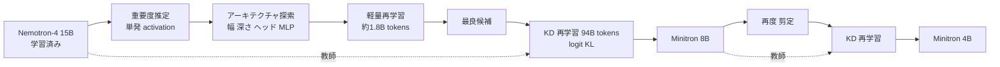

# Compact Language Models via Pruning and Knowledge Distillation（Minitron）

- **Link**: https://arxiv.org/abs/2407.14679 （HTML: https://arxiv.org/html/2407.14679v1）
- **Authors**: Saurav Muralidharan, Sharath Turuvekere Sreenivas, Raviraj Joshi, Marcin Chochowski, Mostofa Patwary, Mohammad Shoeybi, Bryan Catanzaro, Jan Kautz, Pavlo Molchanov（NVIDIA）
- **Year**: 2024
- **Venue**: NeurIPS 2024
- **Type**: Academic Paper
- **証拠の質**: 一次資料（査読付き）。比較モデルの値は各論文からの引用を含む

## Abstract

（要旨）The paper investigates whether pruning an existing LLM and then re-training it with a fraction (<3%) of the original training data can be a suitable alternative to repeated, full retraining. It develops practical compression best practices combining depth, width, attention and MLP pruning with knowledge distillation-based retraining. The Nemotron-4 family is compressed by 2-4×; deriving 8B and 4B models from an already pretrained 15B model requires up to 40× fewer training tokens per model compared to training from scratch, resulting in compute cost savings of 1.8× for training the full model family (15B, 8B, and 4B). Minitron models exhibit up to a 16% improvement in MMLU scores compared to training from scratch and perform comparably to other community models. Weights are open-sourced on Hugging Face.

## Abstract (Japanese Translation)

既存 LLM を剪定し、元の学習データの **3% 未満** で再学習することで、サイズごとのフル再学習を置き換えられるかを検証した。深さ・幅・アテンション・MLP の剪定と **蒸留ベースの再学習** を組み合わせた実践的ベストプラクティスを整理。Nemotron-4 15B を 2〜4 倍圧縮し、8B / 4B を **from scratch 比で最大 40 倍少ないトークン** で得た。ファミリー（15B / 8B / 4B）全体で **計算コスト 1.8 倍削減**。MMLU は from scratch 比 最大 16% 向上。重みは Hugging Face で公開。

## Overview

- 「大きいモデルを 1 回だけ学習し、**剪定 + 蒸留で小さいサイズを安く派生** させる」というモデル系列の作り方を確立した論文。
- 蒸留は **教師（剪定前の 15B）の logit との KL** を主損失とし、深さを大きく削った場合は中間層の状態も合わせる白箱蒸留。
- 10 項目のベストプラクティスを提示（後述）。特に「**再学習は CE ではなく KL 蒸留のみで**」「**15B 程度までは深さより幅の剪定**」が実務的。
- 以後の Llama-3.1-Minitron（[06](06-minitron-approach-llama31.md)）、Mistral-NeMo-Minitron、Nemotron Nano 2（12B→9B）、Llama-Nemotron の基盤技術。

## Problem

- モデルサイズごとに from scratch で学習すると、計算コストがサイズ数に比例して増える。
- 剪定後の精度回復に必要なデータ量・損失関数・剪定軸の選び方に体系的な指針がない。

## Proposed Method

**剪定（重要度推定）→ アーキテクチャ探索 → 蒸留再学習**

1. **重要度推定（activation-based、単発）**: 1024 サンプル程度の較正データで、ヘッド・ニューロン・埋め込みチャネルの活性を集計。
2. **深さの重要度**: perplexity 変化、または block importance（入出力のコサイン類似度）で層をランク付け。
3. **剪定**: 目標サイズに近い候補アーキテクチャを列挙。
4. **軽量再学習（約 1.8B トークン / 400 step）** で候補の順位を安定化させ、最良を選択。
5. **本再学習（94B トークン）**: 教師 15B からの logit KL 蒸留（+ 必要に応じて中間状態損失）。

**Key Formulas**:

ヘッド・ニューロン・埋め込みチャネルの活性ベース重要度（バッチ $B$、系列長 $S$ で集計）:

$$
F_{\text{head}}^{(i)} = \sum_{B,S} \left\| \mathrm{Attn}(X W^{Q,i}, X W^{K,i}, X W^{V,i}) \right\|_2, \quad
F_{\text{neuron}}^{(i)} = \sum_{B,S} X \left(W_1^{i}\right)^{\top}, \quad
F_{\text{emb}}^{(i)} = \sum_{B,S} \mathrm{LN}(X)_i
$$

block importance（深さ）:

$$
\mathrm{BI}_i = 1 - \mathbb{E}_{X,t} \frac{X_{i,t}^{\top} X_{i+1,t}}{\|X_{i,t}\|_2 \, \|X_{i+1,t}\|_2}
$$

蒸留損失:

$$
\mathcal{L} = \mathcal{L}_{\text{CLM}} + \mathcal{L}_{\text{logits}} + \alpha \sum_{k} \mathcal{L}_{\text{is}}^{(k)}, \quad
\mathcal{L}_{\text{logits}} = \frac{1}{l} \sum_{k=1}^{l} \mathrm{KL}\left(p_t^k(x, \tau) \,\|\, p_s^k(x, \tau)\right)
$$

- $p_t^k, p_s^k$: 位置 $k$ の教師・生徒の温度 $\tau$ 付き分布
- $\mathcal{L}_{\text{is}}$: 中間状態（隠れ状態）の損失（教師と生徒の対応層間）
- $\alpha$: $\mathcal{L}_{\text{logits}} / \mathcal{L}_{\text{is}}$ の比で動的に設定
- 実験的には **$\mathcal{L}_{\text{CLM}}$ を外し logit KL のみ** が最良（Table 3）

（式の表記は論文本文の記述に沿って再構成したもの）

## Algorithm (Pseudocode)

```
Algorithm: Minitron (iterative prune + distill)
Input : 最大モデル M_L（例: Nemotron-4 15B）, 目標サイズ列 [8B, 4B], 較正データ D_cal, 再学習データ D_rt
Output: 小型モデル群

1. teacher ← M_L
2. for target in [8B, 4B]:
3.     scores ← activation_importance(teacher, D_cal)       // heads, neurons, emb, depth
4.     C ← enumerate_architectures(teacher, scores, target)  // 幅優先
5.     for c in C: c ← distill(teacher → c, tokens≈1.8B)     // 軽量再学習で順位安定
6.     best ← argmax_val(C)
7.     best ← distill(teacher → best, tokens=94B, loss=logit KL [+ intermediate if depth cut])
8.     teacher ← best                                        // 次は最も近いサイズから剪定
9. return models
```

## Architecture / Process Flow



## Figures & Tables

### Best Practices（論文が列挙する 10 項目）

1. 最大モデルを学習し、そこから反復的に剪定・蒸留して小型を得る。
2. 幅の重要度は batch 方向 L2 ノルム + 系列方向平均で集計。深さは perplexity か block importance。
3. 重要度推定は単発でよい（反復推定に利得なし）。
4. 約 15B までのモデルでは **深さより幅の剪定** を優先。
5. 再学習は **KL 蒸留損失のみ**（通常の CE 学習ではなく）。
6. 深さを大きく削る場合は中間状態・埋め込みの損失を追加。
7. 深さをあまり削らない場合は logit のみの蒸留。
8. 目標サイズに最も近いモデルから剪定する。
9. 探索した候補の順位は軽量再学習で安定させる。
10. 最大モデルが多段学習なら、最終段から剪定・再学習する。

### Table 1: Minitron 8B と同規模モデルの比較

| Model | MMLU (5-shot) | HellaSwag | HumanEval | 学習トークン |
|---|---|---|---|---|
| **Minitron 8B** | 63.8 | 80.7 | 31.6 | **94B** |
| Llama-3 8B | 65 | 82 | 28 | >15T |
| Mistral 7B | 64.1 | 83.2 | 28.7 | 8T |
| Gemma 7B | 64 | 82 | 32 | 6T |
| Nemotron-3 8B | 54.7 | 78.5 | 20.7 | 3.8T |
| Llama-2 7B | 46 | 79 | 12 | 2T |

```
学習トークン（対数的イメージ）
Llama-3 8B    |████████████████████████████████ >15T
Mistral 7B    |████████████████▉ 8T
Gemma 7B      |████████████▊ 6T
Nemotron-3 8B |████████ 3.8T
Llama-2 7B    |████▎ 2T
Minitron 8B   |▏ 0.094T   ← 1/40 以下で同等の MMLU
```

### Table 2: Minitron 4B と小型モデルの比較

| Model | MMLU | HellaSwag | 学習トークン |
|---|---|---|---|
| **Minitron 4B** | 58.6 | 75 | 94B |
| Phi-2 | 57.5 | 75.2 | — |
| Gemma2*（2B） | 51.3 | 73 | — |
| Gemma（2B） | 42 | 72 | — |

### Table 3: 蒸留損失のアブレーション（Nemotron-3 8B、zero-shot）

| 損失設定 | LM Loss | WikiText PPL |
|---|---|---|
| **Logit KLD のみ** | **2.107** | **8.720** |
| CLM + logit KLD | 2.117 | 8.791 |
| CLM + logit cosine | 2.134 | 8.965 |
| CLM + logit reverse-KLD | 2.140 | 9.008 |
| CLM + logit MSE | 2.144 | 9.007 |

### Table 4: 再学習トークン数と方式

| 項目 | 値 |
|---|---|
| 軽量探索再学習 | 約 1.8B トークン（400 step） |
| 最終再学習 | 94B トークン（Phase 2 データのみ。2 段 113B より良好） |
| 4B を iso-compute で比較 | 15B 教師から蒸留で MMLU 37.81、Minitron 8B から剪定で 42.45（従来学習はランダム水準） |

### 経済性の式

$$
\text{token savings} = \frac{T_{\text{scratch}}}{T_{\text{distill}}} \approx \frac{3.8\text{T}}{94\text{B}} \approx 40\times
$$

$$
\text{family cost ratio} = \frac{C(15B) + C_{\text{scratch}}(8B) + C_{\text{scratch}}(4B)}{C(15B) + C_{\text{prune+KD}}(8B) + C_{\text{prune+KD}}(4B)} \approx 1.8\times
$$

### 図（arXiv HTML の相対パス）


- `minitron_overview2.png`: 反復的な剪定と蒸留でモデルファミリーを得る全体像
- `search.png`: 候補の再学習（RT）を含むアーキテクチャ探索
- `distill.png`: N 層の生徒が M 層の教師から、埋め込み・logit・Transformer ブロックの損失で学ぶ構成

### 比較表（関連手法）

| 観点 | Minitron | Sheared-LLaMA 等の剪定 | from scratch 小型 | Gemma 2 型 KD |
|---|---|---|---|---|
| 初期化 | 大モデルの剪定 | 剪定 | ランダム | ランダム |
| 再学習損失 | logit KL（+中間層） | CE 中心 | CE | 教師分布の CE |
| 必要トークン | 94B | 数十 B〜 | 数 T | 数 T |
| 強み | 系列を安く派生 | 単発圧縮 | 制約なし | 最終性能 |
| 弱み | 大モデルが前提 | 精度回復が弱い | 高コスト | 教師推論が高コスト |

## Experiments & Evaluation

### Setup
- 親: Nemotron-4 15B（8T トークン学習）。子: 8B / 4B。再学習 94B トークン。
- 評価: MMLU、HellaSwag、HumanEval ほか LM Evaluation Harness。

### Main Results
- Minitron 8B は Nemotron-3 8B（3.8T）比で 40 倍少ないトークンで MMLU +9.1pt、Llama-3 8B（>15T）に迫る。
- Minitron 4B は Phi-2 と同等以上の MMLU。

### Ablation Study
- 損失: logit KLD のみが最良。CE を足すと僅かに悪化。
- 剪定軸: 15B 程度では幅剪定 > 深さ剪定。

## ビジネス上の含意

| 観点 | 内容 |
|---|---|
| 誰が恩恵を受けるか | **自社で大きい基盤モデルを持つ組織**（NVIDIA、大手クラウド、国家プロジェクト）。系列展開のコストを 1/1.8 に |
| 一般企業の使い方 | 公開された Minitron / Nemotron 系をそのまま使うか、NVIDIA NeMo の剪定・蒸留機能で自社 fine-tune 済みモデルを縮める |
| 商用ライセンス | 後継の Llama-Nemotron は「NVIDIA Open Model License Agreement（commercially permissive）」 |
| 採用事例 | ServiceNow が Llama Nemotron 推論モデルを Platform に統合（2025-03、数値なし・プレスリリース）。Minitron 自体の名前付き本番採用は未確認 |

## Notes

- 本論文の「蒸留」は **白箱 logit 蒸留**。量子化とは独立で、後継論文では FP8 量子化と組み合わせてスループットをさらに 1.3〜1.4 倍。
- 後続: Nemotron Nano 2（arXiv 2508.14444）は 12B（20T トークン）を Minitron 戦略で 9B に圧縮・蒸留し、A10G で Qwen3-8B 比 **最大 6 倍スループット**（8k 入力 / 16k 出力の推論設定、ベンダー申告）。
- （2026-10-22 追記・検証）abstract の「up to 40x fewer training tokens per model compared to training from scratch」「compute cost savings of 1.8x for training the full model family (15B, 8B, and 4B)」「up to a 16% improvement in MMLU scores compared to training from scratch」「a fraction (<3%) of the original training data」を arXiv abs（v2）で再確認し一致。**40 倍は「from scratch 学習のトークン数 ÷ 剪定後の再学習トークン数（94B）」の比** で、計算コストの比（1.8 倍）とは別の指標である。
- （2026-10-22 追記）さらに後続の **Nemotron 3 Nano 4B**（2026-03-16 公開）は Nemotron Nano 9B v2 を Nemotron Elastic で剪定・蒸留（8K 文脈 63B トークン + 49K 文脈 150B トークン）して得たと NVIDIA の HF ブログに記載（モデルカードは「trained from scratch」と「compressed from Nano 9B v2」の両記述があり不整合）。NVIDIA Nemotron Open Model License、月間 DL 2,250,433（2026-10-22）。詳細は [12](12-newer-distilled-open-models-2025-2026.md)。
