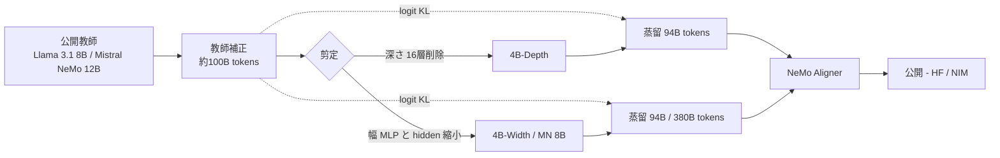

# LLM Pruning and Distillation in Practice: The Minitron Approach（Llama-3.1-Minitron 4B / MN-Minitron 8B）

- **Link**: https://arxiv.org/abs/2408.11796 （HTML: https://arxiv.org/html/2408.11796v3）
- **補助資料**: [NVIDIA Technical Blog: How to Prune and Distill Llama-3.1 8B to an NVIDIA Llama-3.1-Minitron 4B Model](https://developer.nvidia.com/blog/how-to-prune-and-distill-llama-3-1-8b-to-an-nvidia-llama-3-1-minitron-4b-model/) / [NVIDIA Blog: Mistral-NeMo-Minitron 8B](https://blogs.nvidia.com/blog/mistral-nemo-minitron-8b-small-language-model/)
- **Authors**: Sharath Turuvekere Sreenivas, Saurav Muralidharan, Raviraj Joshi, Marcin Chochowski, Mostofa Patwary, Pavlo Molchanov, Mohammad Shoeybi, Jan Kautz, Ameya Sunil Mahabaleshwarkar, Gerald Shen, Jiaqi Zeng, Oleksii Kuchaiev, Zijia Chen, Yoshi Suhara, Shizhe Diao, Chenhan Yu, Wei-Chun Chen, Hayley Ross, Daniel Korzekwa, Oluwatobi Olabiyi, Ashwath Aithal, Bryan Catanzaro（NVIDIA）
- **Year**: 2024（2024-08）
- **Venue**: arXiv
- **Type**: Academic Paper（+ 技術ブログ）
- **証拠の質**: 一次資料。スループットは NVIDIA の自社測定（ベンダー申告）

## Abstract

（要旨）The paper compresses Llama 3.1 8B and Mistral NeMo 12B to 4B and 8B parameters using pruning and distillation. It explores depth pruning and joint hidden/attention/MLP (width) pruning, and evaluates on LM Evaluation Harness. Models are aligned with NeMo Aligner and tested in instruct-tuned versions. It introduces a "teacher correction" phase — slightly fine-tuning the teacher on the distillation dataset — so that the approach works without access to the original pretraining data. MN-Minitron-8B is a state-of-the-art model in its class; Llama-3.1-Minitron-4B-Depth yields an average 2.7× throughput speedup over Llama 3.1 8B, and the width variant 1.8×. Base weights are released on Hugging Face with a permissive license.

## Abstract (Japanese Translation)

Llama 3.1 8B と Mistral NeMo 12B を、剪定と蒸留でそれぞれ 4B / 8B に圧縮した。深さ剪定と幅（隠れ次元・アテンション・MLP）剪定を比較し、NeMo Aligner で整列した指示学習版も評価。**元の事前学習データが手元にない状況** でも使えるよう、蒸留データで教師を軽く fine-tune する **「教師補正（teacher correction）」** を導入した。MN-Minitron-8B は同クラス最高水準、Llama-3.1-Minitron-4B は深さ版で 2.7 倍、幅版で 1.8 倍のスループット向上。重みを寛容なライセンスで公開。

## Overview

- [05](05-minitron-pruning-kd.md) の手法を **他社の公開モデル（Meta / Mistral）に適用** した点が重要。「事前学習データを持たない第三者でも、公開モデルを剪定 + 蒸留で縮められる」ことを示した = **事業会社が自社向け小型モデルを作る現実的レシピ**。
- 鍵は **教師補正（約 100B トークン）**: 蒸留データの分布と教師の学習分布のズレを先に解消すると、蒸留後の性能が上がる。
- MN-Minitron-8B は、教師 Mistral NeMo 12B を GSM8K・HumanEval で上回る（蒸留で教師を超える例）。

## Problem

- 第三者は元の事前学習データにアクセスできない → 教師と蒸留データの分布ズレで KD が劣化。
- 深さ剪定と幅剪定のどちらが良いか、速度と精度のトレードオフが不明。

## Proposed Method

1. **教師補正**: 教師（Llama 3.1 8B / Mistral NeMo 12B）を蒸留データ（約 100B トークン）で軽く fine-tune。
2. **剪定**:
   - 深さ: Winogrande 精度などで層重要度を評価し、Llama 3.1 8B から **16 層（50%、層 16〜31）を削除**。
   - 幅: MLP 中間次元 14336→9216、隠れ次元 4096→3072。
   - 重要度は単発 activation ベース、較正 1024 サンプル。
3. **蒸留**: logit KL のみ（古典的 KD）。Llama-3.1-Minitron-4B は **94B トークン**、MN-Minitron-8B は **380B トークン**。ハイパラ: peak LR 1e-4、min 1e-5、warmup 40 step、cosine、global batch 1152。
4. **整列**: NeMo Aligner で SFT / 整列。

**Key Formulas**:

$$
\mathcal{L}_{\text{KD}} = \sum_{t} \mathrm{KL}\left( p_{\hat{T}}(\cdot \mid x_{<t}) \,\|\, p_S(\cdot \mid x_{<t}) \right), \quad \hat{T} = \mathrm{FT}(T, \mathcal{D}_{\text{distill}}, \approx 100\text{B tokens})
$$

- $T$: 元の教師、$\hat{T}$: 教師補正後の教師、$S$: 剪定済み生徒

## Algorithm (Pseudocode)

```
Algorithm: Minitron approach (third-party model compression)
Input : 公開教師 T（Llama 3.1 8B / Mistral NeMo 12B）, 蒸留データ D（元の事前学習データではない）
1. T_hat ← finetune(T, D, ~100B tokens)                   // teacher correction
2. imp ← activation_importance(T_hat, calib=1024 samples)
3. S_depth ← drop_layers(T_hat, layers 16..31)            // 深さ版
4. S_width ← shrink(T_hat, mlp 14336→9216, hidden 4096→3072) // 幅版
5. for S in {S_depth, S_width}:
6.     S ← distill(T_hat → S, D, 94B tokens (4B) / 380B (8B), loss = logit KL)
7.     S ← align(S, NeMo-Aligner)
8. return S
```

## Architecture / Process Flow



## Figures & Tables

### Table 1: 剪定構成（論文 Table 3）

| | Llama-3.1-Minitron-4B-Width | Llama-3.1-Minitron-4B-Depth | MN-Minitron-8B |
|---|---|---|---|
| 総 / 非埋め込みパラメータ | 4.5B / 3.7B | 4.5B / 3.5B | 8.4B / 7.3B |
| Hidden size | 3072 | 4096 | 4096 |
| MLP hidden dim | 9216 | 14336 | 11520 |
| 層数 | 32 | 16 | 40 |
| Query heads / KV groups | 32 / 8 | 32 / 8 | 32 / 8 |

### Table 2: トークン数

| 工程 | トークン |
|---|---|
| 教師補正 | 約 100B |
| Llama-3.1-Minitron-4B 蒸留 | 94B |
| MN-Minitron-8B 蒸留 | 380B |
| 参考: Llama 3.1 8B 事前学習 | 15T |

### Table 3: Base モデル結果（論文 Table 1 抜粋）

| Benchmark | Llama 3.1 8B | MN-Minitron-8B | Mistral NeMo 12B-Base | Llama-3.1-Minitron-4B-Depth | Llama-3.1-Minitron-4B-Width |
|---|---|---|---|---|---|
| Winogrande (5) | 77.3 | 80.4 | 82.2 | 72.1 | 73.5 |
| ARC-Challenge (25) | 57.9 | 64.4 | 65.1 | 52.6 | 55.6 |
| MMLU (5) | 65.3 | 69.5 | 69.0 | 58.7 | 60.5 |
| HellaSwag (10) | 81.8 | 83.0 | 85.2 | 73.2 | 76.1 |
| GSM8K (5) | 48.6 | 58.5 | 56.4 | 16.8 | 41.2 |
| MBPP (0) | 42.3 | 43.8 | 42.6 | 30.7 | 32.4 |
| HumanEval (0) | 24.8 | 36.2 | 23.8 | – | – |

> **MN-Minitron-8B は教師 Mistral NeMo 12B を MMLU（69.5 vs 69.0）・GSM8K（58.5 vs 56.4）・HumanEval（36.2 vs 23.8）で上回る**。

### Table 4: Instruct モデル結果（論文 Table 2 抜粋）

| Benchmark | Llama 3.1 8B | MN-Minitron-8B |
|---|---|---|
| MT-Bench (GPT-4 Turbo) | 7.78 | 7.86 |
| MMLU (5) | 69.4* | 70.4 |
| GSM8K (0) | 83.8 | 87.1 |
| GPQA (0) | 30.4* | 31.5 |
| HumanEval (0) | 71.3 | 72.6 |
| MBPP (0) | 72.5 | 72.8* |
| IFEval | 84.4 | 80.4* |
| BFCLv2 (Live) | 44.3 | **67.6** |

（* は原論文値の引用）

### Table 5: NVIDIA ブログ版 Base 結果（Llama-3.1-Minitron 4B と小型モデル）

| Benchmark | Shots | Metric | Llama-3.1 8B | Minitron 4B (Width) | Llama-3.1-Minitron 4B (Depth) | Llama-3.1-Minitron 4B (Width) | Phi-2 2.7B | Gemma2 2.6B | Qwen2-1.5B |
|---|---|---|---|---|---|---|---|---|---|
| winogrande | 5 | acc | 0.7727 | 0.7403 | 0.7214 | 0.7348 | 0.7400 | 0.709 | 0.662 |
| arc_challenge | 25 | acc_norm | 0.5794 | 0.5085 | 0.5256 | 0.5555 | 0.6100 | 0.554 | 0.439 |
| MMLU | 5 | acc | 0.6528 | 0.5860 | 0.5871 | 0.6053 | 0.5749 | 0.513 | 0.565 |
| hellaswag | 10 | acc_norm | 0.8180 | 0.7496 | 0.7321 | 0.7606 | 0.7524 | 0.73 | 0.666 |
| gsm8k | 5 | acc | 0.4860 | 0.2411 | 0.1676 | 0.4124 | 0.5500 | 0.239 | 0.585 |
| truthfulqa | 0 | mc2 | 0.4506 | 0.4288 | 0.3817 | 0.4289 | 0.4400 | – | 0.459 |
| XLSum en (20%) | 3 | rougeL | 0.3005 | 0.2954 | 0.2722 | 0.2867 | 0.0100 | – | – |
| MBPP | 0 | pass@1 | 0.4227 | 0.2817 | 0.3067 | 0.324 | 0.4700 | 0.29 | 0.374 |

（ブログ本文は列見出しがフラット化されており、列順は取得時の推定。「Minitron 4B (Width)」は Nemotron 由来の旧 Minitron 4B）

Instruct（Llama-3.1-Minitron 4B 幅版）: IFEval 0.5239 / MT-Bench 6.34 / ChatRAG 0.4399 / BFCL 0.6493。

### Table 6: スループット（TensorRT-LLM、H100 80GB）

| モデル | 対 Llama 3.1 8B | 備考 |
|---|---|---|
| Llama-3.1-Minitron-4B-Depth | 約 2.7 倍 | 層数半減で逐次計算が減る |
| Llama-3.1-Minitron-4B-Width | 約 1.8 倍（Insights 節では 1.7 倍） | 精度は幅版が上 |
| FP8 vs BF16 | 約 1.4 倍（ブログは 1.3 倍） | 量子化の効果（蒸留とは別） |
| バッチ | 8B=32、4B=64 | — |

```
相対スループット
4B-Depth |███████████████████████████ 2.7x
4B-Width |██████████████████ 1.8x
8B       |██████████ 1.0x
```

### 図（NVIDIA ブログ）


（Figure 7 BF16 スループットは画像 URL を取得できず）

### 深さ vs 幅のトレードオフ

| 観点 | 深さ剪定 | 幅剪定 |
|---|---|---|
| 速度 | ◎ 2.7 倍 | ○ 1.8 倍 |
| 精度（MMLU） | 58.7 | 60.5 |
| GSM8K | 16.8（大きく劣化） | 41.2 |
| 向く用途 | レイテンシ最優先・分類/抽出 | 推論・数学を含む汎用 |

## Experiments & Evaluation

### Setup
- 教師: Llama 3.1 8B、Mistral NeMo 12B。蒸留データ: 94B / 380B トークン（元データではない）。
- 評価: LM Evaluation Harness（Winogrande、ARC、MMLU、HellaSwag、GSM8K、MBPP、HumanEval）と instruct 評価（MT-Bench、IFEval、BFCLv2 等）。

### Main Results
- MN-Minitron-8B: 教師を複数指標で上回り、Llama 3.1 8B（15T）を 380B トークンで凌駕。
- Instruct 版 MN-Minitron-8B は BFCLv2（tool calling）で 67.6 と Llama 3.1 8B（44.3）を大きく上回る → **Agent 用途の小型化に有効**（H6）。

### Ablation Study
- 教師補正の有無で蒸留後の LM loss が改善（論文の主張）。
- 深さ版は速いが数学で劣化が大きい。

## ビジネス上の含意

- **公開モデル × 第三者蒸留** の実証。事業会社は「Llama / Mistral など商用可能な公開モデル」を教師に、**自社ドメインデータで教師補正 → 剪定 → 蒸留** すれば、元データなしで小型化できる。
- NVIDIA はこれを NeMo（蒸留・剪定）、NIM（配備）、AI Foundry（企業向けカスタム小型モデル作成）として製品化。Mistral-NeMo-Minitron 8B は NIM マイクロサービスとして提供され、RTX ワークステーションで動作（NVIDIA 公式ブログ、名前付き顧客なし）。
- ライセンス: 論文は「permissive license」とのみ記述。Llama 3.1 由来の 4B は Llama 3.1 License（命名・700M MAU 条項）の継承に注意。

## Notes

- ブログ記載の「from scratch 比 MMLU 最大 16% 向上」「トークン 最大 40 倍削減」「ファミリー計算 1.8 倍削減」は [05](05-minitron-pruning-kd.md) の結果の再掲。
- 後継の Nemotron Nano 2 は Mamba-Transformer ハイブリッド 12B を Minitron 戦略で 9B に圧縮・蒸留（arXiv 2508.14444）。
- （2026-10-22 追記）さらにその後継 Nemotron 3 Nano 4B（2026-03）は Nano 9B v2 から剪定・蒸留（NVIDIA HF ブログ）。「公開モデルを第三者が剪定 + 蒸留」という本論文のレシピが、NVIDIA 自身の系列展開（12B→9B→4B）として継続している。詳細は [12](12-newer-distilled-open-models-2025-2026.md)。
- （2026-10-22 追記）Minitron 方式の特許化については Google Patents が本 run 中に HTTP 503 で参照できず、NVIDIA 名義の該当特許は **未確認**（[14](14-patents-open-model-distillation.md) に試行記録）。
