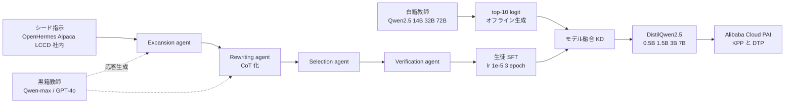

# DistilQwen2.5: Industrial Practices of Training Distilled Open Lightweight Language Models

- **Link**: https://arxiv.org/abs/2504.15027 （HTML: https://arxiv.org/html/2504.15027v1 / ACL Anthology: https://aclanthology.org/2025.acl-industry.4）
- **補助資料**: [DistillQwen-ThoughtY-32B モデルカード](https://huggingface.co/alibaba-pai/DistillQwen-ThoughtY-32B)
- **Authors**: Chengyu Wang（equal）, Junbing Yan（equal）, Yuanhao Yue, Jun Huang（Alibaba Cloud Computing）
- **Year**: 2025（2025-04-21）
- **Venue**: ACL 2025 Industry Track
- **Type**: Academic Paper（産業論文、本番 A/B テスト結果を含む）
- **証拠の質**: 一次資料（査読付き産業論文）。SQL 補完の A/B 結果は **Alibaba 自社サービスの本番値**

## Abstract

（要旨）The paper presents DistilQwen2.5, "a family of distilled, lightweight LLMs derived from the public Qwen2.5 models". The distilled models exhibit enhanced instruction-following capabilities compared to the original models. Leveraging a series of distillation techniques, proprietary LLMs of varying capacities act as multi-agent teachers to select, rewrite, and refine instruction-response pairs that are more suitable for student LLMs to learn. After standard fine-tuning, a computationally efficient model fusion approach enables the student models to progressively integrate fine-grained hidden knowledge from their teachers. Experiments show the distilled models' capabilities are significantly improved; practical use cases demonstrate effectiveness. The models are open-sourced on Hugging Face.

## Abstract (Japanese Translation)

DistilQwen2.5 は、公開 Qwen2.5 から派生させた **軽量蒸留 LLM ファミリー** で、元モデルより指示追従が向上している。容量の異なる独自 LLM が **マルチエージェントの教師** として、生徒が学びやすい指示・応答ペアを選別・書き換え・洗練する（黒箱 KD）。通常の fine-tuning の後、計算効率の良い **モデル融合（白箱 KD）** で教師の細粒度の隠れ知識を段階的に取り込む。実験で性能が大幅に向上し、実際のユースケースでも有効性を示した。モデルは Hugging Face で公開。

## Overview

- **「黒箱 → 白箱」の 2 段蒸留** を産業規模で回すための工夫（top-10 logit のオフライン生成）を示した論文。
- 教師には **Qwen-max（中国語）と GPT-4 / GPT-4o（その他言語）** を黒箱として使い、白箱教師には Qwen2.5-14B/32B/72B-Instruct を使う。→ **商用 API（OpenAI）出力を教師データにした公開モデル** という点で、C8 の利用規約論点に直結する。
- 本 C3 クラスタで唯一、**名前付きの本番サービスで A/B テストの定量結果** を示した一次資料: Alibaba Cloud のビッグデータ基盤の **SQL 補完** で、3B 生徒が 7B 教師に迫る採用率（25.5% vs 26.5%）をレイテンシ 384ms→148ms で達成。（2026-10-22 訂正）生徒は「社内 SQL コーパス上の KD で得た Qwen2.5-3B」と記述されており、DistilQwen2.5-3B からの初期化かは明記なし。教師は fine-tune + int4 量子化済みの Qwen2.5-7B（数値の定義は Table 3 の注記を参照）。
- Alibaba Cloud PAI のプラットフォーム機能（Knowledge Production Pipeline / Distillation Training Pipeline）として顧客にも提供。

## Problem

- **小型モデルの指示追従の弱さ**: 0.5B〜7B は大モデルに比べ指示追従が弱い。
- **白箱 KD の産業スケールでの非現実性**:
  - 32B / 72B 教師を生徒と同時に forward すると GPU メモリが足りない。
  - 教師と生徒の語彙が異なると logit テンソルが一致しない。
- **データ品質**: 生徒が学びやすいデータの選び方が未確立。

## Proposed Method

**Stage 1: マルチエージェント黒箱 KD（データ増強）**

| エージェント | 役割 |
|---|---|
| Expansion agent | 元タスクカテゴリを保ったまま指示のバリエーションを生成（幻覚・意味ドリフトを回避）、教師応答を生成 |
| Rewriting agent | 意図とカテゴリを保持して指示を書き換え。論理推論・数学・コードでは CoT 応答を促す |
| Selection agent | 情報量・有用性・汎化可能性・タスクバランスで高価値ペアを選択 |
| Verification agent | 新ペア生成のたびに事実の正しさを検証 |
| Controller | パイプライン全体を調整 |

**Stage 2: 白箱 KD（モデル融合）**

1. 必要に応じてトークン整列（Wan et al., 2024）。
2. 教師の **top-K logit（K=10 既定）をオフライン分散生成** して保存。
3. top-K 要素だけでダイバージェンスを計算。

**Key Formulas**:

系列長 $L$ で平均したトークンレベルのダイバージェンス:

$$
D_\theta(x, y) = \frac{1}{L} \sum_{n=1}^{L} D_\theta\Big( p_T(\cdot \mid y_{<n}, x) \,\big\|\, p_S^\theta(\cdot \mid y_{<n}, x) \Big)
$$

学習目的:

$$
\mathcal{L}(\theta) = \mathbb{E}_{(x, y) \sim (\mathcal{X}, \mathcal{Y})} \big[ D_\theta(x, y) \big]
$$

top-K 上の温度付き確率:

$$
p_T = \frac{\exp(z_T / \mathcal{T})}{\sum_{k=1}^{K} \exp(z_T^{(k)} / \mathcal{T})}, \qquad
p_S = \frac{\exp(z_S / \mathcal{T})}{\sum_{k=1}^{K} \exp(z_S^{(k)} / \mathcal{T})}
$$

- $z_T, z_S$: 教師・生徒の logit（教師 top-K の位置のみ）
- $\mathcal{T}$: 温度、$K = 10$
- $D$: KLD または reverse KLD など任意のダイバージェンス

**観察**: top-10 トークンの確率和はほぼ 1 → 教師の知識の大半は top-10 に集中。

**Features**:

- logit 生成が通常実装の **3〜5 倍高速**、保存・読込も軽くクラウドストレージ負荷を低減。
- logit 削減による指示追従の劣化は（探索的実験では）目立たない。
- 教師を 14B→72B と大きくしても **収穫逓減**。データが 1 万〜10 万件規模では大きい教師が効きやすい。

## Algorithm (Pseudocode)

```
Algorithm: DistilQwen2.5 two-stage distillation
Input : シード指示 D0（OpenHermes 2.5, Cleaned Alpaca, LCCD, 社内データ）,
        黒箱教師 {Qwen-max (zh), GPT-4/GPT-4o (others)},
        白箱教師 {Qwen2.5-14B/32B/72B-Instruct}, 生徒 Qwen2.5-{0.5,1.5,3,7}B-Instruct
1. D1 ← Expansion(D0); D1 ← Rewrite(D1)                // 黒箱教師で応答生成・CoT 化
2. D2 ← Select(D1; informativeness, helpfulness, balance)
3. D2 ← Verify(D2)                                      // 事実検証
4. S ← SFT(S, D2, lr=1e-5, epochs=3)                    // 8×A800 80GB
5. for (x, y) in D2:                                    // オフライン
6.     store topK_logits(T_white(x, y), K=10)
7. S ← minimize E[ D_topK( p_T || p_S ) ]                // 白箱 KD（モデル融合）
8. return DistilQwen2.5
```

## Architecture / Process Flow



## Figures & Tables

### Table 1: 主要結果（論文 Table 1、* は黒箱 KD のみ）

| Model | AlpacaEval 2.0 (LC) | MT-Bench | MT-Bench (Single) | IFEval (instruct-loose) | IFEval (strict-prompt) |
|---|---|---|---|---|---|
| Qwen2.5-0.5B-Instruct | 2.46 | 5.49 | 6.26 | 42.81 | 30.31 |
| DistilQwen2.5-0.5B-Instruct* | 4.72 | 5.71 | 6.74 | 51.44 | 37.15 |
| DistilQwen2.5-0.5B-Instruct | **4.89** | **5.78** | **6.83** | **52.61** | **37.82** |
| Qwen2.5-1.5B-Instruct | 6.69 | 7.09 | 7.66 | 55.40 | 40.11 |
| DistilQwen2.5-1.5B-Instruct* | 13.30 | 7.27 | 7.90 | 60.63 | 73.02 |
| DistilQwen2.5-1.5B-Instruct | **13.69** | **7.35** | **7.99** | **61.10** | **74.49** |
| Qwen2.5-3B-Instruct | 17.98 | 7.92 | 8.40 | 61.18 | 74.58 |
| DistilQwen2.5-3B-Instruct* | 20.81 | 8.33 | 8.94 | 65.80 | 77.10 |
| DistilQwen2.5-3B-Instruct | **20.91** | **8.37** | **8.97** | **67.03** | **77.36** |
| Qwen2.5-7B-Instruct | 31.43 | 8.52 | 8.83 | 81.53 | 72.10 |
| DistilQwen2.5-7B-Instruct* | 34.78 | 8.75 | 9.19 | 83.41 | 73.20 |
| DistilQwen2.5-7B-Instruct | **34.86** | **8.76** | **9.22** | **83.48** | **73.27** |

```
AlpacaEval 2.0 LC: 元モデル → DistilQwen2.5（倍率）
0.5B | 2.46 → 4.89   (x1.99)
1.5B | 6.69 → 13.69  (x2.05)
3B   | 17.98 → 20.91 (x1.16)
7B   | 31.43 → 34.86 (x1.11)
```

> 改善幅は **小さい生徒ほど大きい**。また黒箱 KD（*）だけで改善の大半が得られ、白箱 KD の上積みは小さい（例: 1.5B で 13.30→13.69）。

### Table 2: MT-Bench タスク別（論文 Table 2）

| Task Type | 0.5B | 0.5B (Ours) | 1.5B | 1.5B (Ours) |
|---|---|---|---|---|
| Writing | 6.08 | 6.68 | 8.38 | 8.38 |
| Roleplay | 7.07 | 7.43 | 7.26 | 8.13 |
| Reasoning | 4 | 4.2 | 3.9 | 4.8 |
| Mathematics | 4.65 | 4.65 | 6.85 | 6.98 |
| Coding | 4 | 4.08 | 4.6 | 5.04 |
| Extraction | 3.55 | 4.5 | 6.4 | 6.6 |
| STEM | 6.55 | 6.83 | 9.65 | 9.28 |
| Humanity | 8.1 | 7.95 | 9.73 | 9.83 |

### Table 3: 本番ユースケース — SQL 補完（論文 Table 3、オンライン A/B）

| Model | Size | Latency (ms) | Pass@1 (%) | Adoption Rate (%) |
|---|---|---|---|---|
| 教師（int4 量子化した fine-tuned Qwen2.5-7B） | 7B | 384 | 18.8 | 26.5 |
| 生徒（KD で得た Qwen2.5-3B） | 3B | **148** | 17.9 | 25.5 |

（2026-10-22 訂正）各数値の意味を arXiv HTML v1 で再確認した。

- **教師 7B**: 「we utilize the fine-tuned Qwen2.5-7B model for deployment, which is quantized to int4 precision」— 社内 SQL データで fine-tune し int4 量子化した **Qwen2.5-7B の本番モデル**（DistilQwen2.5-7B ではない）。
- **生徒 3B**: 「By applying KD on a fixed dataset (i.e., an in-house SQL corpus), we obtain a Qwen2.5-3B model」— 社内 SQL コーパス上で KD して得た **Qwen2.5-3B**。初版で「DistilQwen2.5 ベース」と書いたが、**DistilQwen2.5-3B から初期化したかは論文に明記がない**。
- **Latency 384 → 148 ms**: 論文 Table 3（オンライン A/B）の値。比は 384/148 ≈ **2.6 倍**。
- **Adoption Rate 26.5 → 25.5%**: ユーザーが補完候補を採用した率（-1.0pt）。**Pass@1 18.8 → 17.9%**（-0.9pt）。
- **「1.4×」**: 本文の「closely matching the performance of the 7B model, while increasing the inference speed by 1.4×」。測定条件は未記載で、Table 3 のレイテンシ比（2.6 倍）とは一致しない。**本レポートでは Table 3 の値を主、本文の 1.4× を併記** とする（初版の方針を維持）。

```
Latency (ms)        教師 7B |██████████████████████████████████████ 384
                    生徒 3B |██████████████▊ 148
Adoption Rate (%)   教師 7B |██████████████████████████▌ 26.5
                    生徒 3B |█████████████████████████▌ 25.5
```

- 論文本文は「推論速度 1.4 倍」と記述（表のレイテンシ比は 384/148 ≈ 2.6 倍で一致しない。測定条件の違いの可能性。**数値は表を優先して引用し、本文の 1.4 倍は併記**）。
- ビジネス価値式（[clustering index](../../../clustering/20261021/index.md)）に当てはめると:

$$
\Delta\text{Value} \approx (C_{7B} - C_{3B}) \cdot Q - (C_{\text{data}} + C_{\text{train}}) - \underbrace{(26.5\% - 25.5\%)}_{\Delta\text{採用率} = 1.0\text{pt}} \cdot V_{\text{adopt}}
$$

  - 報告されているのは **レイテンシ（コスト項の代理）と精度低下項（採用率 -1.0pt、Pass@1 -0.9pt）**。初期投資とリクエスト数 $Q$ は非公開。

### Table 4: 教師・データ規模に関する所見（Figure 5 / 6 の記述）

| 要因 | 所見 |
|---|---|
| 教師サイズ 14B→32B→72B | 改善は収穫逓減。過大な教師は不要 |
| データ規模 1 万〜10 万件 | 大きい教師の効果が出やすい |
| 黒箱 vs 白箱 | 白箱を足すと一貫して小幅改善（0.5B / 1.5B で検証） |

### 図（arXiv HTML の相対パス）


（Figure 4: 10B 未満小型モデルの AlpacaEval 比較は画像 URL 取得できず。Figure 6 は `0.5B_AlpacaEval_2.0.png` 等 4 枚）

### Table 5: 後継 — DistillQwen-ThoughtY（推論蒸留、モデルカード）

| Model | AIME2024 | MATH500 | GPQA Diamond | LiveCodeBench V2 | Avg. |
|---|---|---|---|---|---|
| ThoughtY-4B | 76.7 | 95.2 | 56.1 | 75.8 | 76.0 |
| ThoughtY-8B | 76.7 | 94.6 | 62.1 | 78.1 | 77.9 |
| ThoughtY-32B | **90.0** | **95.2** | 63.6 | 76.3 | **81.3** |
| ThoughtX-32B | 80.0 | 92.6 | 64.0 | 73.4 | 77.5 |
| OpenThinker2-32B | 76.7 | 90.8 | **64.1** | 72.5 | 76.0 |

- 教師: DeepSeek-R1 / R1-0528 / QwQ-32B。データ: OmniThought-0528（R1-0528 から蒸留した 36.5 万 CoT、認知難易度・推論冗長度の注釈付き）。Apache 2.0。

### 比較表

| 観点 | DistilQwen2.5 | R1-Distill | Gemma 2/3 | Minitron |
|---|---|---|---|---|
| 黒箱 | ◎（多エージェント） | ◎（R1 トレース） | △（SFT 合成） | × |
| 白箱 | ○（top-10 logit） | × | ◎（全語彙 / 256 サンプル） | ◎（logit KL） |
| 教師 | Qwen-max・GPT-4o・Qwen2.5 大 | R1 | 自社大型 | 自社 / 公開モデル |
| 本番 A/B | **あり（SQL 補完）** | なし | なし | なし |
| ライセンス | Apache 2.0（※教師に GPT-4o） | MIT | Gemma Terms | NVIDIA Open Model 等 |

## Experiments & Evaluation

### Setup
- 生徒: Qwen2.5-Instruct 0.5B / 1.5B / 3B / 7B。lr 1e-5、3 epoch、8×A800 80GB。
- 評価: AlpacaEval 2.0（LC）、MT-Bench、IFEval。

### Main Results
- 全サイズで元モデルを上回る。0.5B / 1.5B では AlpacaEval が約 2 倍。

### Ablation Study
- 黒箱のみ（*）でも大半の改善を得られ、白箱融合が上積み。

## ビジネス上の含意

1. **本番 A/B の一次証拠**: 「蒸留で小型化 → レイテンシ大幅減 → 採用率 -1pt 程度」という、事業判断に直結する形の数値は C3 で唯一。
2. **黒箱教師に GPT-4 / GPT-4o を使った公開モデル** である点は、OpenAI 利用規約（競合モデル開発への出力利用禁止）との関係で論点になり得る（本論文は規約に触れていない。C8 で要確認）。
3. 蒸留を **クラウド機能（PAI の KPP / DTP）として外販** しており、C2（プラットフォーム）と C3（公開モデル）の橋渡し事例。

## Notes

- 「DistilQwen2.5-R1」系はこの論文本文には記載なし。推論系は ThoughtX / ThoughtY として別途公開。
- 学習データの総件数は明記されていない。
