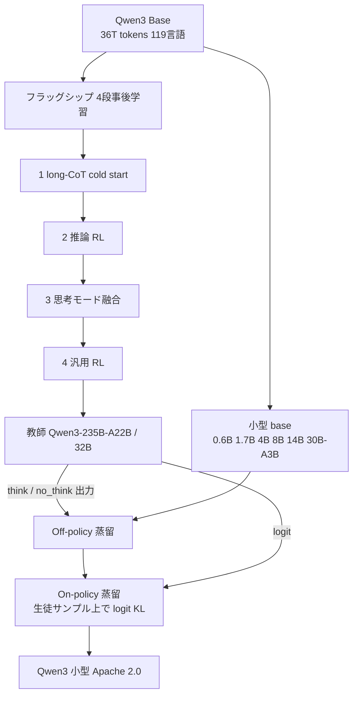

# Qwen3 Technical Report（Strong-to-Weak Distillation）

- **Link**: https://arxiv.org/abs/2505.09388 （HTML: https://arxiv.org/html/2505.09388v1）
- **補助資料**: [Qwen3 公式ブログ](https://qwenlm.github.io/blog/qwen3/) / [Qwen3-0.6B モデルカード](https://huggingface.co/Qwen/Qwen3-0.6B)
- **Authors**: Qwen Team（Alibaba）
- **Year**: 2025（2025-05-14 投稿、モデル公開 2025-04-29）
- **Venue**: arXiv（technical report）
- **Type**: Academic Paper
- **証拠の質**: 一次資料。ベンチマーク・GPU 時間は自社測定

## Abstract

（要旨）Qwen3 is the latest version of the Qwen model family, comprising dense and MoE models from 0.6B to 235B parameters. It integrates thinking mode and non-thinking mode into a unified framework with a thinking budget mechanism. By leveraging knowledge from flagship models, it significantly reduces the computational resources required to build smaller-scale models while ensuring highly competitive performance. Pre-training covers 36 trillion tokens in 119 languages and dialects. All models are publicly accessible under Apache 2.0.

## Abstract (Japanese Translation)

Qwen3 は 0.6B〜235B の dense / MoE からなる最新 Qwen 系列で、思考モードと非思考モードを統合し、思考予算を制御できる。**フラッグシップモデルの知識を活用（= 蒸留）して小型モデル構築の計算資源を大幅に削減** しつつ高い性能を保つ。事前学習は 119 言語・36T トークン。全モデル Apache 2.0 で公開。

## Overview

- **フラッグシップ（Qwen3-235B-A22B / Qwen3-32B）は 4 段の事後学習**（long-CoT cold start → 推論 RL → 思考モード融合 → 汎用 RL）を経るが、**小型 6 モデル（0.6B / 1.7B / 4B / 8B / 14B / 30B-A3B）はこの 4 段を回さず「Strong-to-Weak Distillation」で作る**。
- 蒸留は 2 段:
  1. **Off-policy 蒸留**: 教師が /think と /no_think の両モードで生成した応答で SFT（黒箱）。
  2. **On-policy 蒸留**: 生徒が自分で生成した系列上で、教師の logit に KL を最小化（白箱 + on-policy）。
- 結果: **RL より高性能で、GPU 時間は約 1/10（1,800 vs 17,920）**。しかも RL では伸びない pass@64（探索能力）まで改善。
- 2025 年以降の公開小型モデルで「**蒸留が RL を代替する**」ことを定量で示した代表的資料。

## Problem

- 小型モデルに 4 段の事後学習（特に RL）を個別に回すと高コスト。
- 小型モデルに思考 / 非思考のモード切替を身につけさせたい。
- RL は pass@1 を上げても pass@k（多様性）を上げにくい。

## Proposed Method

**Strong-to-Weak Distillation**

1. **Off-policy 段**: 教師（Qwen3-32B または 235B-A22B）の /think・/no_think 出力を混ぜ、応答蒸留（SFT）。生徒は基本的な推論力とモード切替を獲得。
2. **On-policy 段**: 生徒が /think または /no_think でプロンプトに応答をサンプル → その系列上で生徒 logit を教師 logit に合わせ KL を最小化。

**Key Formulas**:

On-policy 蒸留（生徒自身のサンプル上での逆向き系列分布に対する KL。論文は KL の向き・近似の詳細を明記していないため一般形で記す）:

$$
\mathcal{L}_{\text{on}}(\theta) = \mathbb{E}_{x \sim \mathcal{D},\; y \sim \pi_\theta(\cdot \mid x)} \left[ \sum_{t=1}^{|y|} \mathrm{KL}\Big( \pi_T(\cdot \mid x, y_{<t}) \,\big\|\, \pi_\theta(\cdot \mid x, y_{<t}) \Big) \right]
$$

Off-policy 段（黒箱 SFT）:

$$
\mathcal{L}_{\text{off}}(\theta) = - \mathbb{E}_{x,\; m \in \{\text{think}, \text{no\_think}\},\; y \sim \pi_T(\cdot \mid x, m)} \left[ \log \pi_\theta(y \mid x, m) \right]
$$

- $\pi_T$: 教師（Qwen3-32B / 235B-A22B）、$\pi_\theta$: 生徒、$m$: モードフラグ
- On-policy は **生徒の分布からサンプル** するため、生徒が実際に陥る状態で教師が訂正する（露出バイアスの緩和）

## Algorithm (Pseudocode)

```
Algorithm: Qwen3 Strong-to-Weak Distillation
Input : 教師 T ∈ {Qwen3-32B, Qwen3-235B-A22B}, 生徒 base S ∈ {0.6B,1.7B,4B,8B,14B,30B-A3B}, プロンプト P
1. // off-policy
2. D ← {}
3. for x in P: for m in {/think, /no_think}: D ← D ∪ {(x, m, T(x, m))}
4. S ← SFT(S, D)
5. // on-policy
6. repeat:
7.     x ~ P; m ~ {/think, /no_think}
8.     y ← sample S(x, m)                         // 生徒が生成
9.     loss ← Σ_t KL( T(·|x,m,y<t) || S(·|x,m,y<t) )
10.    S ← S - η ∇ loss
11. return S
```

## Architecture / Process Flow



## Figures & Tables

### Table 1: 蒸留 vs RL（Qwen3-8B、論文 Table 21。括弧内は pass@64）

| Method | AIME'24 | AIME'25 | MATH500 | LiveCodeBench v5 | MMLU-Redux | GPQA-Diamond | GPU Hours |
|---|---|---|---|---|---|---|---|
| Off-policy Distillation | 55.0 (90.0) | 42.8 (83.3) | 92.4 | 42.0 | 86.4 | 55.6 | – |
| + Reinforcement Learning | 67.6 (90.0) | 55.5 (83.3) | 94.8 | 52.9 | 86.9 | 61.3 | 17,920 |
| + On-policy Distillation | **74.4 (93.3)** | **65.5 (86.7)** | **97.0** | **60.3** | **88.3** | **63.3** | **1,800** |

```
GPU Hours（off-policy 蒸留の後段として）
+ RL                 |████████████████████████████████████████ 17,920
+ On-policy 蒸留     |████ 1,800        ← 約 1/10、かつ全指標で上
```

$$
\frac{\text{GPU}_{\text{on-policy}}}{\text{GPU}_{\text{RL}}} = \frac{1{,}800}{17{,}920} \approx 0.10
$$

> **pass@64**: RL は AIME'24 / '25 とも 90.0 / 83.3 のまま（探索能力を広げない）、on-policy 蒸留は 93.3 / 86.7 に改善。

### Table 2: 小型思考モデル vs R1-Distill（論文 Table 17 / 19 抜粋）

| Benchmark | DS-R1-Distill-Qwen-14B | DS-R1-Distill-Qwen-32B | Qwen3-4B | Qwen3-8B |
|---|---|---|---|---|
| MMLU-Redux | 84.1 | 88.2 | 83.7 | 87.5 |
| GPQA-Diamond | 59.1 | 62.1 | 55.9 | 62.0 |
| LiveBench 2024-11-25 | 52.3 | 45.6 | 63.6 | 67.1 |
| MATH-500 | 93.9 | 94.3 | 97.0 | 97.4 |
| AIME'24 | 69.7 | 72.6 | 73.8 | 76.0 |
| AIME'25 | 44.5 | 49.6 | 65.6 | 67.3 |
| LiveCodeBench v5 | 45.5 | 54.5 | 54.2 | 57.5 |
| BFCL v3 | 49.5 | 53.5 | 65.9 | 68.1 |

追加（Qwen3-4B / 8B）: IFEval 81.9 / 85.0、Arena-Hard 76.6 / 85.8、MMMLU 69.8 / 74.4。

> **Qwen3-4B（on-policy 蒸留）が R1-Distill-Qwen-32B（黒箱 SFT 蒸留）を AIME'25（65.6 vs 49.6）・BFCL v3（65.9 vs 53.5）で上回る**。8 倍小さいモデルで逆転 = **白箱 on-policy 蒸留 > 黒箱 SFT 蒸留** の実例。tool calling（BFCL）の差は H6 の観点で重要。

### Table 3: 系列とライセンス（公式ブログ / 論文）

| 区分 | モデル | 作り方 | ライセンス |
|---|---|---|---|
| フラッグシップ MoE | Qwen3-235B-A22B | 4 段事後学習 | Apache 2.0（論文: 全モデル） |
| フラッグシップ dense | Qwen3-32B | 4 段事後学習 | Apache 2.0 |
| 小型 MoE | Qwen3-30B-A3B | Strong-to-Weak 蒸留 | Apache 2.0 |
| 小型 dense | 0.6B / 1.7B / 4B / 8B / 14B | Strong-to-Weak 蒸留 | Apache 2.0 |

### Table 4: エコシステム指標（Hugging Face、取得時点）

| モデル | 月間 DL | adapters | finetunes | merges | quantizations | ライセンス |
|---|---|---|---|---|---|---|
| Qwen/Qwen3-0.6B | **28,228,809** | 684 | 1,367 | 14 | 493 | apache-2.0 |

> 本 run で確認した公開蒸留モデル中、**月間 DL が最大**（Llama-3.2-1B-Instruct の約 6 倍、gemma-3-1b-it の約 20 倍）。

### 図（公式ブログ）


- 論文 Figure 1「Post-training pipeline of the Qwen3 series models」、Figure 2「Performance of Qwen3-235B-A22B with respect to the thinking budget」（論文 HTML に画像 URL なし、ブログ画像で代替）

## Experiments & Evaluation

### Setup
- 生徒: Qwen3-8B（アブレーション）。教師: Qwen3-32B / 235B-A22B。
- 評価: AIME'24/'25、MATH500、LiveCodeBench v5、MMLU-Redux、GPQA-Diamond、BFCL v3 ほか。

### Main Results
- On-policy 蒸留は RL を全指標で上回り、GPU 時間は約 1/10。
- 公式ブログは「Qwen3-4B が Qwen2.5-72B-Instruct に匹敵」と主張（ベンダー申告）。

### Ablation Study
- off-policy のみ → +RL → +on-policy の比較（Table 1）。

## ビジネス上の含意

- **小型モデルの「作り方の標準」が RL から on-policy 蒸留へ** 移った。自社で大モデル（教師）を持つなら、小型版は蒸留で 1/10 の計算で作れる。
- Apache 2.0 で **出力・派生の制約が最も緩い** 公開蒸留モデル系列。DistilQwen-ThoughtY（Alibaba PAI）、OpenThinker 等、多くの二次蒸留の生徒ベースになっている。
- 名前付き企業の本番採用成果は本 run では未確認（DL 数はエコシステム規模の代理指標に留まる）。

## Notes

- 2026 年の on-policy 蒸留サーベイ（arXiv 2606.22793、検索結果のみで未検証）は「Qwen3 は on-policy 段の support 近似の詳細を明記していない」と指摘しており、再現には不明点が残る。
- （2026-10-22 追記・検証）Table 21（Section 4.5）の数値（off-policy 55.0 / 42.8、+RL 67.6 / 55.5・17,920 GPU 時間、+on-policy 74.4 / 65.5・1,800 GPU 時間、pass@64 は括弧内）、教師（Qwen3-32B / 235B-A22B）、生徒 6 モデル、Table 17 の Qwen3-4B vs R1-Distill-Qwen-32B（AIME'25 65.6 vs 49.6、BFCL v3 65.9 vs 53.5）を arXiv HTML v1 で再確認し一致。**GPU 時間の 1,800 / 17,920 はいずれも「off-policy 蒸留済み Qwen3-8B に追加する後段（on-policy 蒸留 / RL）のみ」の計算量** であり、off-policy 段や事前学習は含まない。
- （2026-10-22 追記）エコシステム指標の追加取得（2026-10-22）: Qwen/Qwen3-4B 月間 DL 11,600,540、finetunes 1,226 / adapters 1,206 / quantizations 360 / merges 20（Apache 2.0）。
- （2026-10-22 追記）Qwen3-8B Base を生徒にした外部蒸留例として **DeepSeek-R1-0528-Qwen3-8B**（R1-0528 の CoT を蒸留、MIT、AIME 2024 86.0 / 2025 76.3 vs Qwen3-8B 76.0 / 67.3、HF モデルカード）を [12](12-newer-distilled-open-models-2025-2026.md) に記録。Apache 2.0 の Qwen3 Base が「第三者の蒸留の生徒土台」として機能している実例。
