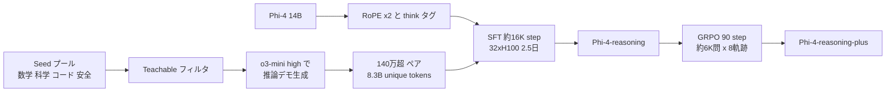

# Phi-4-reasoning Technical Report

- **Link**: https://arxiv.org/abs/2504.21318 （HTML: https://arxiv.org/html/2504.21318v1）
- **補助資料**: [Microsoft Research ページ](https://www.microsoft.com/en-us/research/blog/phi-4-reasoning/) / [Hugging Face microsoft/Phi-4-reasoning](https://huggingface.co/microsoft/Phi-4-reasoning) / 系譜: [Phi-4](https://arxiv.org/abs/2412.08905)・[Phi-3](https://arxiv.org/abs/2404.14219)・[phi-1](https://arxiv.org/abs/2306.11644)・[Phi-4-Mini-Reasoning](https://arxiv.org/abs/2504.21233)
- **Authors**: Marah Abdin, Sahaj Agarwal, Ahmed Awadallah ほか（Microsoft、計 23 名、アルファベット順）
- **Year**: 2025（モデル公開 2025-04-30）
- **Venue**: arXiv（technical report）
- **Type**: Academic Paper
- **証拠の質**: 一次資料。比較モデル値の一部は他論文・API の測定

## Abstract

（要旨）Phi-4-reasoning is a 14-billion parameter reasoning model trained via supervised fine-tuning of Phi-4 on a carefully curated set of "teachable" prompts — selected for the right level of complexity and diversity — and reasoning demonstrations generated using o3-mini. Phi-4-reasoning-plus is further enhanced through a short phase of outcome-based reinforcement learning, producing longer reasoning traces. Both models outperform significantly larger open-weight models such as DeepSeek-R1-Distill-Llama-70B and approach the performance levels of full DeepSeek-R1 across math, scientific reasoning, coding, algorithmic problem solving, planning and spatial understanding.

## Abstract (Japanese Translation)

Phi-4-reasoning は 14B の推論モデルで、Phi-4 を、複雑さと多様性が適切な「教えやすい（teachable）」プロンプトと **o3-mini が生成した推論デモ** で SFT して作った。Phi-4-reasoning-plus は短い結果ベース RL を追加し、より長い推論過程を出す。両者とも DeepSeek-R1-Distill-Llama-70B など遥かに大きいオープンモデルを上回り、数学・科学・コード・アルゴリズム・計画・空間理解で DeepSeek-R1 本体に迫る。

## Overview

- **商用クローズドモデル（OpenAI o3-mini）を教師にした黒箱推論蒸留** で作られ、MIT で公開されたモデル。Microsoft と OpenAI の提携関係下で行われたと考えられるが、論文の取得範囲では利用規約への言及は確認できなかった。
- データの鍵は「**teachable prompts**」: Phi-4 の能力の境界にあり、事実想起ではなく多段推論を要する問題に絞る。量より選別。
- 140 万超のプロンプト・応答ペア、**8.3B ユニークトークン（総 16B トークン）**、**32×H100 で 2.5 日**。
  - （2026-10-22 訂正）「32×H100-80G、2.5 日、16B tokens（約 8.3B unique）、学習期間 2025-01〜04」は **HF モデルカード（microsoft/Phi-4-reasoning）の記載** であり、論文本文には SFT の GPU 数・日数は記載がない（論文に出る「32 H100」は RL のバッチ構成）。また教師の reasoning effort について、論文は「high の方が medium より強い教師」と述べるが、**最終データセットをどちらで生成したかは明記していない**（Figure 5 の実験 7・8 は high）。本レポートの「o3-mini（high）」はこの推定を含む。
- 70B の R1-Distill を 14B で上回る → 「**教師の強さ × データ選別** が生徒サイズより効く」。
- Phi 系列全体は phi-1（GPT-3.5 合成教科書）から一貫して「強いモデルの合成データで小型を育てる」黒箱蒸留路線。

## Problem

- 14B クラスで o1 級の推論力を得たい（端末・単一 GPU で動かすため）。
- 推論データは量が多いほど良いとは限らず、生徒にとって「学べる」難易度の選別が必要。

## Proposed Method

1. **Seed プロンプト収集**: 数学・科学・コード・安全性等の大規模プール。
2. **Teachable フィルタ**: Phi-4 にとって難しすぎず易しすぎない、多段推論を要する問題を選ぶ。
3. **教師応答の生成**: o3-mini（high reasoning effort）で長い CoT を生成。medium より high の方が良い教師。
4. **SFT**: Phi-4 を約 16K step、global batch 32、文脈 32K、AdamW、lr 1e-5、warmup 450、weight decay 1e-4。RoPE base 周波数を 2 倍、プレースホルダ 2 トークンを `<think>` タグに転用。
5. **Phi-4-reasoning-plus**: 数学問題で GRPO（シードプール 72,401 問、90 step 時点を採用、約 6K 問 × 8 軌跡、lr 5e-8、batch 64、32×H100）。

**Key Formulas**:

黒箱蒸留 SFT:

$$
\mathcal{L}_{\text{SFT}} = - \mathbb{E}_{x \in \mathcal{P}_{\text{teachable}},\; y \sim \text{o3-mini}_{\text{high}}(x)} \sum_t \log \pi_\theta(y_t \mid x, y_{<t})
$$

GRPO（グループ相対アドバンテージ、一般形）:

$$
A_i = \frac{r_i - \mathrm{mean}(\{r_j\}_{j=1}^{G})}{\mathrm{std}(\{r_j\}_{j=1}^{G})}, \quad G = 8
$$

- $\mathcal{P}_{\text{teachable}}$: teachable フィルタ後のプロンプト集合
- $r_i$: 結果ベース報酬（正答か否か等）、$G$: 1 問あたり軌跡数

## Algorithm (Pseudocode)

```
Algorithm: Phi-4-reasoning(-plus)
Input : Phi-4 (14B), seed pool P, teacher o3-mini (high)
1. P_t ← { x ∈ P | Phi-4 の能力境界にある & 多段推論を要する }     // teachable
2. D ← { (x, o3-mini_high(x)) | x ∈ P_t }                          // 140万超, 8.3B unique tokens
3. M ← modify(Phi-4; RoPE base ×2, <think> tokens)
4. M ← SFT(M, D; ~16K steps, bs 32, ctx 32K, lr 1e-5)              // 32×H100, 2.5 days
5. // plus
6. for step in 1..90:
7.     batch ← sample math problems (seed 72,401)
8.     for x in batch: y_1..y_8 ← sample M(x); r ← verify(y)
9.     M ← GRPO_update(M, r; lr 5e-8, bs 64)
10. return Phi-4-reasoning, Phi-4-reasoning-plus
```

## Architecture / Process Flow



## Figures & Tables

### Table 1: 主要ベンチマーク（平均 pass@1 %、括弧は標準偏差）

| Model | AIME 24 | AIME 25 | HMMT | OmniMath | GPQA-D | LCB | Codeforces |
|---|---|---|---|---|---|---|---|
| **Phi-4-reasoning** (14B) | 74.6 (5.1) | 63.1 (6.3) | 43.8 (6.2) | 76.6 (0.5) | 67.1 (2.7) | 53.8 | 1736 |
| **Phi-4-reasoning-plus** (14B) | 81.3 (1.8) | 78.0 (4.6) | 53.6 (6.3) | 81.9 (0.1) | 69.3 (2.1) | 53.1 | 1723 |
| DeepSeek-R1-Distill-Llama-70B | 69.3 (2.7) | 51.5 (5.8) | 33.3 | 63.4 (0.4) | 66.2 (2.4) | 57.5 | 1633 |
| DeepSeek-R1 | 78.7 (3.8) | 70.4 (4.3) | 41.7 | 85.0 (0.6) | 73.0 (1.7) | 65.9 | 2029 |
| o1 | 74.6 (6.5) | 71.4 (5.7) | 48.3 | 67.5 (0.9) | 76.7 (1.8) | 63.4 | 1891 |
| o1-mini | 63.6 | 54.8 | 38.0 (6.2) | 60.5 | 60.0 | 53.8 | 1650 |
| o3-mini-high（教師） | 88.0 (5.5) | 82.5 (4.9) | 67.5 | 74.6 (5.1) | 77.7 (0.6) | 68.8 | 2130 |
| Claude 3.7 Sonnet | 55.3 (3.0) | 53 (5.8) | 31.7 | 54.6 (0.9) | 76.8 (1.3) | 52.6 | — |

```
AIME 25（%）
o3-mini-high (teacher) |█████████████████████████████████████████▎ 82.5
Phi-4-reasoning-plus   |███████████████████████████████████████ 78.0
o1                     |███████████████████████████████████▋ 71.4
DeepSeek-R1            |███████████████████████████████████▏ 70.4
Phi-4-reasoning        |███████████████████████████████▌ 63.1
o1-mini                |███████████████████████████▍ 54.8
Claude 3.7 Sonnet      |██████████████████████████▌ 53
R1-Distill-Llama-70B   |█████████████████████████▊ 51.5
```

> OmniMath では Phi-4-reasoning-plus（81.9）が **教師 o3-mini-high（74.6）を上回る**。
>
> （2026-10-22 追記・検証）AIME 24 / 25 の値（74.6 / 63.1、81.3 / 78.0、R1-Distill-Llama-70B 69.3 / 51.5、R1 78.7 / 70.4、o3-mini-high 88.0 / 82.5）と GRPO 設定（72,401 問プール、90 step 採用、8 軌跡）を arXiv HTML v1 で再確認し一致。RL データ量は論文内で「~6K examples」と「6,400 problems」の両表記がある。

### Table 2: 学習構成

| 項目 | Phi-4-reasoning (SFT) | Phi-4-reasoning-plus (RL) |
|---|---|---|
| データ | 140 万超ペア、8.3B unique / 16B 総トークン | 72,401 問プールから約 6K 問 × 8 軌跡 |
| ステップ | 約 16K | 90 |
| バッチ | 32 | 64 |
| 学習率 | 1e-5 | 5e-8 |
| 文脈 | 32K | — |
| 計算 | 32×H100-80G、2.5 日（HF モデルカード値 — 2026-10-22 訂正） | 32×H100（論文） |

### Table 3: Phi 系列の「蒸留」の変遷

| モデル | 年 | サイズ | 教師 / データ源 | 方式 | 主結果 |
|---|---|---|---|---|---|
| phi-1 | 2023 | 1.3B | GPT-3.5 合成教科書 1B + Web 6B トークン | 合成データ（黒箱） | HumanEval 50.6%（8×A100 で 4 日） |
| phi-1.5 | 2023 | 1.3B | 教科書風合成データ | 合成データ | Llama2-7B 並み（常識推論） |
| Phi-3-mini | 2024 | 3.8B | フィルタ Web + 合成、3.3T トークン | 合成データ | MMLU 69%、MT-bench 8.38 |
| Phi-4 | 2024 | 14B | 合成データ中心の事前学習 | 「単純な蒸留を超える」 | STEM QA で教師 GPT-4 を超える |
| Phi-4-mini-instruct | 2025 | 3.8B | 約 5T トークン（教科書風合成含む） | 合成データ | MIT |
| Phi-4-Mini-Reasoning | 2025 | 3.8B | 蒸留 long-CoT で mid-training → SFT → Rollout DPO → RLVR | 推論蒸留 + RL | Math-500 で R1-Distill-Qwen-7B を +3.2pt |
| **Phi-4-reasoning** | 2025 | 14B | **o3-mini 生成の推論デモ** | 推論トレース SFT | R1-Distill-Llama-70B 超え |

### 比較表（推論蒸留モデル）

| 観点 | Phi-4-reasoning | R1-Distill-Qwen-32B | Qwen3-8B | Sky-T1-32B |
|---|---|---|---|---|
| 教師 | o3-mini（商用 API） | DeepSeek-R1（MIT） | Qwen3-32B/235B | QwQ-32B-Preview |
| データ量 | 140 万超 | 約 80 万 | 非公開 | 17K |
| 方式 | SFT + 短い RL | SFT | off + on-policy 蒸留 | SFT |
| AIME 24 | 74.6 / 81.3 (plus) | 72.6 | 76.0 | 43.3 |
| 計算 | 32×H100 2.5 日 | 非公開 | 1,800 GPU 時間（on-policy 段、8B） | 8×H100 19 時間・$450 未満 |
| ライセンス | MIT | MIT | Apache 2.0 | オープン |

## Experiments & Evaluation

### Setup
- 数学（AIME 24/25、HMMT、OmniMath）、科学（GPQA-D）、コード（LCB、Codeforces）ほか計画・空間理解。
- 複数回試行の平均と標準偏差を報告。

### Main Results
- 14B で R1-Distill-Llama-70B を AIME 25 で +11.6pt（63.1 vs 51.5）、plus で +26.5pt。
- plus は AIME 25 で R1（70.4）を上回る。

### Ablation Study
- 教師の推論努力: high > medium。
- RL は短期（90 step）でも AIME を大きく押し上げるが、応答は長くなる（推論コスト増）。

## ビジネス上の含意

- **商用 API を教師にできるのは提携関係のある企業に限られる** 点が重要。一般企業が OpenAI の出力で競合モデルを作ることは OpenAI の利用規約上の制約を受け得る（C8）。Microsoft は自社ブランド（MIT）で公開しているため、利用者は **教師の規約問題を気にせず生徒を使える**。
- HF モデルカードは「数学推論専用に設計・テスト」と明記しており、汎用業務への転用には評価が必要。
- 配布: Azure AI Foundry、Hugging Face（月間 DL 26,476）、GGUF。モデルカードの想定用途はメモリ・計算制約環境やレイテンシ制約下。
- 名前付き企業の本番採用成果は本 run では未確認。Phi 系列の顧客事例として確認できたのは Phi-3 の ITC（Krishi Mitra、100 万人超の農家、成果数値なし、fine-tune 利用）のみ。

## Notes

- HF モデルカードは学習データを「合成プロンプトと公開 Web の高品質フィルタデータ」と記述し、o3-mini には触れていない（論文本文とは記述粒度が異なる）。
