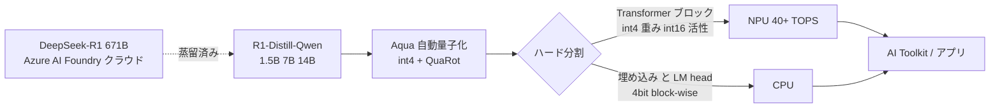
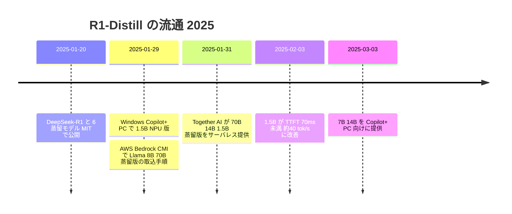

# DeepSeek-R1-Distill の Copilot+ PC（NPU）配備と、クラウド各社の蒸留モデル提供

- **Company/Organization**: Microsoft（主）、AWS、Together AI（比較）
- **Industry**: PC / OS プラットフォーム、クラウド推論
- **Date**: 2025-01-29（1.5B）、2025-03-03（7B / 14B）
- **Link**:
  - https://blogs.windows.com/windowsdeveloper/2025/01/29/running-distilled-deepseek-r1-models-locally-on-copilot-pcs-powered-by-windows-copilot-runtime/
  - https://blogs.windows.com/windowsdeveloper/2025/03/03/available-today-deepseek-r1-7b-14b-distilled-models-for-copilot-pcs-via-azure-ai-foundry-further-expanding-ai-on-the-edge/
  - https://aws.amazon.com/blogs/machine-learning/deploy-deepseek-r1-distilled-llama-models-in-amazon-bedrock/
  - https://together.ai/blog/deploy-deepseek-r1-and-distilled-models-securely-on-together-ai
- **Type**: Business Case（プラットフォーム配備）
- **証拠の質**: すべて **ベンダー申告**（自社ブログ）。名前付きエンドユーザー企業の成果は無し

## Overview

- 公開蒸留モデル（DeepSeek-R1-Distill-Qwen 1.5B / 7B / 14B）が、発表から 1〜6 週間で **PC の NPU・クラウドのマネージド推論** に載った経緯を示す事例。
- Microsoft は **R1 本体（671B）を Azure AI Foundry で、蒸留版を Copilot+ PC のローカル NPU で** という「cloud to client」構成を打ち出した。
- PC 側の工夫は **量子化（int4 + QuaRot）とハード分割**（NPU / CPU）であり、**蒸留は DeepSeek が済ませたものを再利用**。Microsoft 自身は追加蒸留をしていない（= 蒸留 + 量子化の二段圧縮）。
- AWS・Together は蒸留版を「安く、データを外に出さずに使える推論モデル」として提供。

## Problem & Context

- 2025-01 の R1 公開で推論モデルへの需要が急増。ただし R1 本体は 671B で、ローカル実行は不可能。
- 企業にはデータ主権・プライバシー（中国企業の API にデータを送りたくない）という懸念。
- Copilot+ PC は 40 TOPS 超の NPU を持つが、動かせる推論モデルが少なかった。

## Solution

### Microsoft（Copilot+ PC）

| 項目 | 内容 |
|---|---|
| モデル | DeepSeek-R1-Distill-Qwen-1.5B（1/29）→ 7B / 14B（3/3） |
| 配布 | AI Toolkit VS Code 拡張のモデルカタログ（Azure AI Foundry 経由）、ONNX QDQ 形式 |
| ハード | Qualcomm Snapdragon X から開始 → Intel Core Ultra 200V → AMD Ryzen |
| 量子化 | 社内ツール「Aqua」で全変種を int4 重みに自動量子化。**QuaRot**（Hadamard 回転で外れ値除去、GPTQ より高精度と主張） |
| 分割 | Transformer ブロックは int4 per-channel 重み + int16 活性で NPU、埋め込みと LM head は 4bit block-wise で CPU |
| 長文脈 | sliding window で TTFT 短縮と長文脈を両立（動的テンソル非対応ハードのため） |
| 系譜 | **Phi Silica**（Windows 内蔵 SLM）のツールチェーンを再利用 |



### AWS（Bedrock Custom Model Import）

| 項目 | 内容 |
|---|---|
| 対象 | R1-Distill-Llama-8B / 70B（Qwen 系は記事の対象外） |
| 手順 | HF から重み取得 → S3 → Bedrock「Import model」→ Playground / API（8B は取込 5〜20 分） |
| 課金 | 取込無料。稼働コピー数 × 時間、5 分単位。Custom Model Units（8B=2 CMU、70B=8 CMU） |
| 例 | 8B・128K 文脈・us-east-1: **$0.1570/分**、ストレージ $3.90/月 |
| スケール | 既定 0〜3 コピー、5 分無呼出しで 0 へ。コールドスタート数十秒 |
| 性能主張 | DeepSeek ベンチを引用し「70B は R1 の推論力の約 80〜90%、8B は約 59〜92%」 |

### Together AI

| 項目 | 内容 |
|---|---|
| 対象 | R1 本体（$7 / 100 万トークン）、R1-Distill-Llama-70B / Qwen-14B / Qwen-1.5B |
| 無料枠 | 70B 蒸留版の無料エンドポイント（レート制限あり） |
| 訴求 | オプトアウト型プライバシー制御、DeepSeek にデータを共有しない、自社データセンターでホスト |

## Results & Impact

| Metric | Before | After | 出典 |
|---|---|---|---|
| 1.5B TTFT（短いプロンプト） | 130 ms（1/29 初版） | **70 ms 未満**（2/3 更新） | Windows blog（ベンダー） |
| 1.5B スループット | 16 tok/s | **約 40 tok/s** | 同上 |
| 14B スループット（NPU） | — | **約 8 tok/s** | Windows blog（3/3） |
| 必要 PC | — | 40 TOPS 超 NPU、16GB RAM、256GB ストレージ | 二次報道（Windows Central 等） |
| Bedrock 8B 稼働単価 | — | $0.1570/分（2 CMU） | AWS blog |
| エンドユーザー企業の成果 | — | **公開なし** | — |

```
NPU 上の生成速度（tok/s、ベンダー申告）
1.5B (2/3 更新) |████████████████████████████████████████ ~40
1.5B (1/29 初版)|████████████████ 16
14B             |████████ ~8
```

## Figures & Tables

### 時系列



### 圧縮の内訳（何が蒸留で、何が量子化か）

| 段 | 実施者 | 手法 | 区分 |
|---|---|---|---|
| R1 → Qwen 1.5B/7B/14B | DeepSeek | 推論トレース SFT（約 80 万件） | **蒸留** |
| BF16 → int4 | Microsoft（Aqua） | QuaRot + per-channel / block-wise | **量子化** |
| NPU / CPU 分割・sliding window | Microsoft | 実行時最適化 | 推論最適化 |

### 提供チャネル比較

| チャネル | 実行場所 | 課金 | データ主権 | 対象蒸留モデル |
|---|---|---|---|---|
| Copilot+ PC | ローカル NPU | 端末購入のみ | ◎（端末内） | Qwen 1.5B / 7B / 14B |
| Bedrock CMI | AWS | 稼働時間（5 分単位） | ○（自社 AWS アカウント） | Llama 8B / 70B |
| Together AI | Together DC | トークン従量 | △（第三者 DC、共有なしを訴求） | Llama 70B / Qwen 14B / 1.5B |

## Lessons Learned

1. **公開蒸留モデルの価値は「流通の速さ」**: MIT ライセンスゆえに、発表から 9 日で OS ベンダーとクラウド大手が取り込めた。教師の規約問題を利用者が負わない形で推論能力が普及した。
2. **端末配備は「蒸留 + 量子化」の二段**: 蒸留だけでは NPU に載らない。事例を読む際は両者を分けて評価する必要がある（H3 の注意点と同型）。
3. **成果の公開はベンダー性能値で止まる**: TTFT・tok/s・単価は出るが、どの企業がどの業務でどれだけ改善したかは出ない（H2 と整合）。
4. **ライセンスの継承**: Bedrock が扱う Llama 系蒸留版は Llama License の条項（命名・700M MAU）も意識する必要がある。

## Notes

- Fireworks（2026-02 記事）は、R1-0528 を Qwen3-8B に蒸留した版が「Qwen3-235B-thinking に推論ベンチで並ぶ」と紹介しつつ、蒸留版の tool calling は「Varies; parsing issues reported」と注意（ベンダー申告）。
- Couchbase Capella AI Services の R1-Distill（Llama-8B）プレビュー記事は HTTP 403 で取得できず、本レポートでは扱っていない。
- （2026-10-22 追記）配備チャネルを 1 件追加確認: **Cerebras**（2025-01-29 ブログ）は「DeepSeek R1 Llama-70B」（= R1-Distill-Llama-70B）を **1,500 tok/s 超、GPU 比 57 倍**、米国内インフラ 100% で提供と主張（ベンダー申告、顧客名なし）。本レポートの「成果はベンダー性能値で止まる」という所見（Lesson 3）を補強する。詳細は [13](13-business-adoption-evidence.md)。
- （2026-10-22 追記）2026-10-22 時点でも WebSearch（AWS ドメイン限定を含む）で R1-Distill の **名前付きエンドユーザー企業の本番成果** は見つからず、AWS の結果はすべて配備手順・ベンチマーク手順・Marketplace 出品（dotjson の R1-Distill-Qwen-32B 構造化出力など）に留まった。
