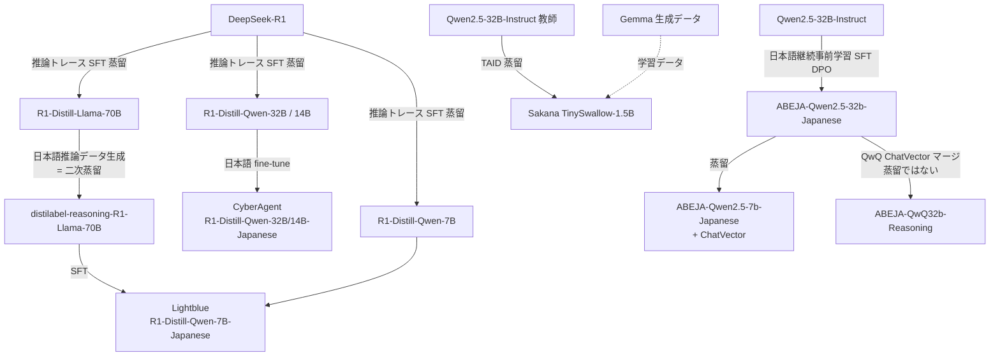
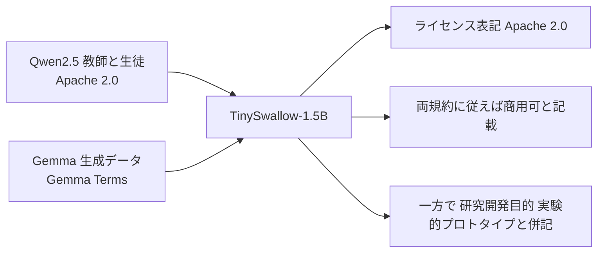

# 国内の公開蒸留モデル派生事例 — サイバーエージェント / Lightblue / ABEJA / Sakana AI

- **Company/Organization**: サイバーエージェント、Lightblue、ABEJA、Sakana AI（+ 東京科学大学 Swallow チーム）
- **Industry**: 広告・メディア / AI スタートアップ / AI プラットフォーム / AI 研究開発
- **Date**: 2025-01〜2025-04
- **Link**:
  - https://huggingface.co/cyberagent/DeepSeek-R1-Distill-Qwen-32B-Japanese
  - https://gigazine.net/news/20250128-cyberagent-deepseek-r1-japanese
  - https://huggingface.co/lightblue/DeepSeek-R1-Distill-Qwen-7B-Japanese
  - https://it.impress.co.jp/articles/-/27417
  - https://huggingface.co/abeja/ABEJA-Qwen2.5-7b-Japanese-v0.1
  - https://huggingface.co/abeja/ABEJA-QwQ32b-Reasoning-Japanese-v1.0
  - https://sakana.ai/taid-jp/
  - https://huggingface.co/SakanaAI/TinySwallow-1.5B-Instruct
  - https://arxiv.org/abs/2501.16937
- **Type**: Business Case（公開モデル型）
- **証拠の質**: モデルカード・公式発表は一次資料。GIGAZINE / IT Leaders は二次報道。評価値は各社の自己申告

## Overview

国内では、公開蒸留モデルを土台に **日本語化（追加 SFT）・再蒸留・独自蒸留手法** を施した派生モデルが 2025 年前半に相次いで Hugging Face で公開された。4 社の取り組みは「蒸留」の中身が大きく異なり、**本当の蒸留 / 蒸留モデルの fine-tune / モデルマージ** を区別して読む必要がある。



## Problem & Context

- R1-Distill は日本語プロンプトに対して **英語・中国語が混じる**、思考過程が日本語にならないという課題があった（Lightblue モデルカード、IT Leaders）。
- 国内企業は自社で数百 B 級の教師を持たず、**公開モデルを教師・生徒にする** 以外に現実的な選択肢が少ない。
- ローカル PC・端末・オフラインで動く日本語モデルの需要（データを外に出せない業務）。

## Solution

### Table 1: 4 社の取り組み比較

| 項目 | サイバーエージェント | Lightblue | ABEJA（7B） | ABEJA（QwQ 32B） | Sakana AI（TinySwallow） |
|---|---|---|---|---|---|
| 公開日 | 2025-01-27 | 2025-01（報道 02-03） | 2025 | 2025-04（プレス 04-17） | 2025-01-30 |
| ベース（生徒） | R1-Distill-Qwen-32B / 14B | R1-Distill-Qwen-7B | Qwen2.5-7B-Instruct | ABEJA-Qwen2.5-32b-Japanese | Qwen2.5-1.5B-Instruct |
| 教師 | （R1 由来の蒸留済みモデル） | **R1-Distill-Llama-70B**（日本語推論データを生成） | **自社 ABEJA-Qwen2.5-32b-Japanese** | —（QwQ-32B の ChatVector をマージ） | **Qwen2.5-32B-Instruct** |
| 手法 | 日本語データで fine-tune（詳細非公開） | 二次蒸留（教師生成データで SFT） | 蒸留 + ChatVector（事後学習なし） | **モデルマージ + 追加学習** | **TAID**（ICLR 2025 Spotlight） |
| 区分 | 蒸留モデルの fine-tune | **真の蒸留（黒箱）** | **真の蒸留** | **蒸留ではない** | **真の蒸留（独自手法）** |
| ライセンス | MIT | Apache 2.0 | Apache 2.0 | Apache 2.0 | Apache 2.0（Gemma 規約も遵守と記載、「研究開発目的」とも併記） |
| 公開された評価 | なし | GSM8K-ja 等（下表） | なし | なし（プレスで「同規模最高水準」と主張） | 3B 未満で日本語平均最高と主張（数値はページになし） |
| 月間 DL（取得時点） | 336 | 127 | — | — | 4,394（Instruct） |

### Lightblue のデータ作成手順（モデルカード）

1. argilla/distilabel-reasoning-prompts から英語の推論系プロンプトをサンプル。
2. BAAI/bge-m3 埋め込みで類似プロンプトを除去。
3. **gpt-4o-mini-2024-07-18 で日本語に翻訳**。
4. **DeepSeek-R1-Distill-Llama-70B で回答を生成**（= 教師）。
5. 2048 トークン以内に終わらない / `<think>` が無い / `<think>` が日本語でない応答を除外。
6. LLaMA-Factory で full SFT（DeepSpeed ZeRO-2、1 epoch、lr 1e-5、cosine、batch 8）。
7. **8×L20 GPU（Alibaba Cloud ecs.gn8is-8x.32xlarge）で 10 分未満**。

```
Algorithm: Lightblue 日本語推論の二次蒸留
1. P ← sample(distilabel-reasoning-prompts); P ← dedup(P, bge-m3)
2. P_ja ← translate(P, gpt-4o-mini)
3. Y ← R1-Distill-Llama-70B(P_ja)
4. D ← { (p, y) | len(y) ≤ 2048, has_think(y), lang(think(y)) = ja }
5. M ← SFT(R1-Distill-Qwen-7B, D, epochs=1, lr=1e-5)     // 8×L20, <10 min
```

> **注意**: 翻訳に gpt-4o-mini（OpenAI）を使っている。翻訳は教師応答ではないが、OpenAI 出力がデータ作成工程に入っている点は C8 の規約論点と接続する。

### Sakana AI TAID / TinySwallow

| 項目 | 内容 |
|---|---|
| 手法 | **TAID**（Temporally Adaptive Interpolated Distillation）: 生徒の学習進度に応じて「中間教師」分布を段階的に教師へ近づけ、能力差による転移失敗（capacity gap、mode averaging / collapse）を抑える |
| 論文 | Shing, Misaki, Bao, Yokoi, Akiba. ICLR 2025 Spotlight（arXiv 2501.16937） |
| 教師 → 生徒 | Qwen2.5-32B-Instruct → Qwen2.5-1.5B-Instruct（約 1/20） |
| 学習データ | Gemma-2-LMSYS-Chat-1M-Synth、swallow-magpie-ultra-v0.1、swallow-gemma-magpie-v0.1（日本語継続事前学習 + 指示学習） |
| 実行環境 | TinySwallow ChatUI（ブラウザ、初回 DL 後は完全オフライン）、ChatUI Local（Python 自己完結）、iPhone 14（GGUF + LLMFarm） |
| 想定ビジネス用途 | 社内文書・個人メモに基づくプライベート AI アシスタント、データを外に出さない業務支援、オフラインゲームの AI キャラ、小型 AI エージェント |
| 共同開発 | 東京科学大学 Swallow チーム |

TAID の考え方（概念式。論文の記述に基づく再構成）:

$$
p_t(y \mid x) = (1 - \alpha_t) \cdot p_S'(y \mid x) + \alpha_t \cdot p_T(y \mid x), \qquad \alpha_t: 0 \to 1 \text{（生徒の学習進度に応じて適応的に増加）}
$$

$$
\mathcal{L}_{\text{TAID}}(\theta) = \mathrm{KL}\big( p_t \,\|\, p_S^\theta \big)
$$

- $p_S'$: 勾配を止めた生徒分布、$p_T$: 教師分布、$\alpha_t$: 補間係数

## Results & Impact

### Table 2: Lightblue 7B 日本語版の評価（モデルカード、自己申告）

GSM8K-ja（SakanaAI/gsm8k-ja-test_250-1319 の先頭 50 行）:

| Model | Repetition Penalty | 正答率 (%) | 有効な日本語 `<think>` (%) |
|---|---|---|---|
| DeepSeek-R1-Distill-Qwen-7B | 1.0 | 60 | 94 |
| DeepSeek-R1-Distill-Qwen-7B | 1.1 | 62 | 96 |
| Lightblue 日本語版 | 1.0 | 66 | 92 |
| Lightblue 日本語版 | 1.1 | **70** | **98** |

Tengentoppa-sft-reasoning-ja（先頭 50 プロンプト）:

| Model | Repetition Penalty | 有効な日本語 `<think>` (%) |
|---|---|---|
| DeepSeek-R1-Distill-Qwen-7B | 1.0 | 48 |
| DeepSeek-R1-Distill-Qwen-7B | 1.1 | 48 |
| Lightblue 日本語版 | 1.0 | 84 |
| Lightblue 日本語版 | 1.1 | **94** |

```
日本語 think 率（Tengentoppa, rp=1.1）
元の R1-Distill-Qwen-7B |████████████████████████ 48
Lightblue 日本語版      |███████████████████████████████████████████████ 94
```

> **わずか 10 分未満の学習** で日本語思考率を 48%→94%、GSM8K-ja を 62%→70%（50 問の小標本）。公開蒸留モデルを土台にすれば **言語適応の追加コストは極小** であることを示す。

### Table 3: 事業インパクトの観点（何が分かり、何が分からないか）

| 観点 | 判明していること | 不明なこと |
|---|---|---|
| 開発コスト | Lightblue: 8×L20 で 10 分未満 | 他 3 社の計算量 |
| 品質 | Lightblue の小標本評価のみ | CyberAgent / ABEJA / Sakana の公開数値 |
| 事業利用 | Sakana が用途例を提示 | **4 社とも自社サービス・顧客での本番利用と成果は非公開** |
| ライセンス | 全モデル MIT / Apache 2.0 | 上流（Qwen・Llama・Gemma・R1・OpenAI 翻訳）の条項の重なり |

## Figures & Tables

### 「蒸留」の区別（H3 の検証）

| 区分 | 定義 | 該当 |
|---|---|---|
| 真の蒸留（白箱） | 教師の logit / 分布に生徒を合わせる | TinySwallow（TAID） |
| 真の蒸留（黒箱） | 教師の生成テキストで生徒を SFT | Lightblue（R1-Distill-Llama-70B 生成）、ABEJA 7B（32B から） |
| 蒸留モデルの fine-tune | 蒸留済みモデルを別データで追加学習 | サイバーエージェント（詳細非公開） |
| モデルマージ | 重み差分（ChatVector）を合成 | ABEJA-QwQ32b-Reasoning |

### ライセンスの積み重なり（TinySwallow の例）



> Gemma Terms は「Gemma 出力の合成データで学習したモデル」を Model Derivatives と定義しているため（[03](03-gemma-3-distillation-license.md)）、Gemma 生成データを使った TinySwallow は Gemma の利用制限を継承し得る。Sakana AI がモデルカードで両規約の遵守を求めているのはこのためと読める。

## Lessons Learned

1. **国内は「公開蒸留モデル → 日本語化」の公開モデル型** が中心で、事業会社が自社業務で蒸留して成果を公表した例は本 run では見つからなかった（H4 支持）。
2. **言語適応のコストは極小**（Lightblue 10 分未満）。差別化は教師選び・データ品質・評価にある。
3. **「蒸留」表記を鵜呑みにしない**: ABEJA の推論モデルはマージ、CyberAgent は手法非公開。事例収集では手法区分を必ず記録する。
4. **ライセンスの多重継承**: Qwen（Apache）+ Gemma 生成データ + R1（MIT）+ Llama（命名義務）+ OpenAI（翻訳）など、派生の派生で条項が積み重なる。

## Notes

- GIGAZINE は、ベース R1 が天安門・台湾などの話題で中国政府の制限に従う傾向があると報じている（日本語版の性質は未検証）。安全性・偏りの検証は利用企業側の責任。
- ABEJA は 2025-01-27 に「GENIAC の NEDO プロジェクトで開発した小型化モデルが複数指標で GPT-4 を上回った」と発表（検索結果からの情報で、本 run では原文未取得）。
- CodeZine の関連記事は HTTP 403 で取得できず。
- （2026-10-22 追記）日本語での追加検索（「小型モデル 本番導入 事例 蒸留モデル」）は蒸留酒・蒸留装置の結果に汚染され、国内事業会社による公開蒸留モデルの本番成果は本 run でも **新たに確認できなかった**（H4 の判定は変更なし）。海外の名前付き事例（Trustpilot の Gemma 2 9B 等）は [13](13-business-adoption-evidence.md) を参照。
