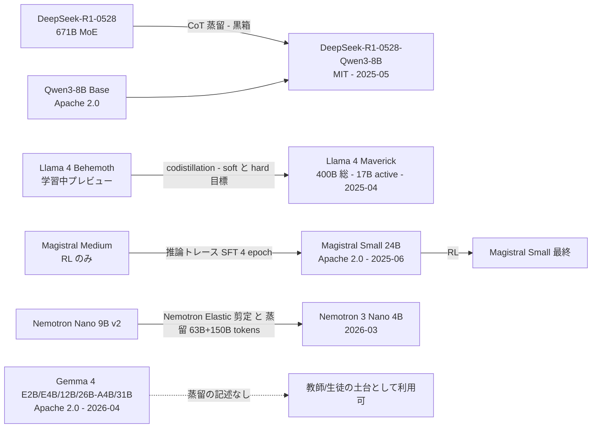
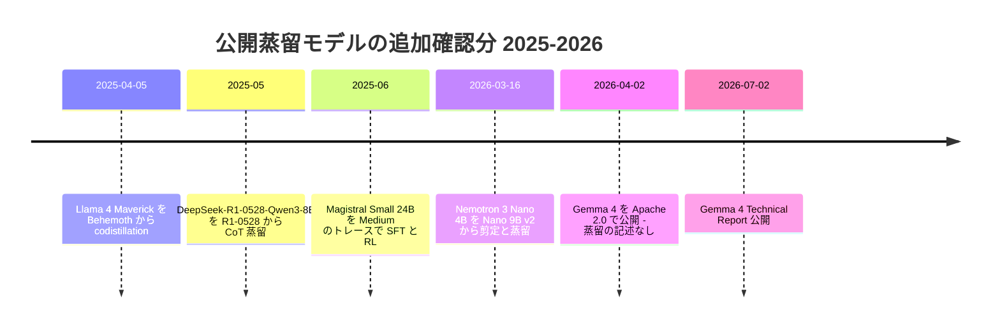

# 2025〜2026 年の新しい公開蒸留モデル — R1-0528-Qwen3-8B / Llama 4 codistillation / Magistral Small / Nemotron 3 Nano 4B / Gemma 4

- **Source**: DeepSeek（HF モデルカード）/ Meta（公式ブログ・HF モデルカード）/ Mistral AI（arXiv 2506.10910）/ NVIDIA（HF ブログ・モデルカード）/ Google（公式ブログ・arXiv 2607.02770・HF モデルカード）
- **Date**: 2025-04 〜 2026-07（取得日 2026-10-22）
- **Link**:
  - https://huggingface.co/deepseek-ai/DeepSeek-R1-0528-Qwen3-8B
  - https://ai.meta.com/blog/llama-4-multimodal-intelligence/ / https://huggingface.co/meta-llama/Llama-4-Maverick-17B-128E-Instruct
  - https://arxiv.org/abs/2506.10910 （HTML: https://arxiv.org/html/2506.10910v1）
  - https://huggingface.co/blog/nvidia/nemotron-3-nano-4b / https://huggingface.co/nvidia/NVIDIA-Nemotron-3-Nano-4B-BF16
  - https://blog.google/innovation-and-ai/technology/developers-tools/gemma-4/ / https://arxiv.org/abs/2607.02770 / https://ai.google.dev/gemma/docs/core/model_card_4 / https://huggingface.co/google/gemma-4-31b-it / https://huggingface.co/google/gemma-4-E4B-it
- **Type**: Technical Article（複数一次資料の横断整理、2026-10-22 追記レポート）
- **証拠の質**: すべて提供元の一次資料（モデルカード・技術報告書・公式ブログ）。ベンチマークは各社の自己測定

## Overview

初版 run（2026-10-21）以降に確認した **2025 年後半〜2026 年の公開モデルのうち、一次資料で「蒸留で作られた」と明記されたもの** を整理する。併せて、本クラスタの主要な未検証事項だった **Gemma 4 の Apache 2.0 化を一次資料で確認** し、Gemma 4 自体には蒸留の記述が無いことを記録する。



## Key Technical Content

### Table 1: 追加確認した公開蒸留モデル（一次資料）

| モデル | 提供元 | 公開 | 教師 | 方式 | 生徒ベース | ライセンス | 代表結果（自己申告） | 月間 DL（2026-10-22） |
|---|---|---|---|---|---|---|---|---|
| DeepSeek-R1-0528-Qwen3-8B | DeepSeek | 2025-05 | DeepSeek-R1-0528 | CoT 蒸留（黒箱 SFT） | Qwen3-8B Base | MIT（「商用利用と蒸留を許可」と明記） | AIME 2024 86.0 / AIME 2025 76.3 / HMMT Feb 25 61.5 / GPQA 61.1 / LCB 60.5 | 405,169 |
| Llama 4 Maverick | Meta | 2025-04-05 | Llama 4 Behemoth（学習中のプレビュー） | **codistillation**（事前学習中に Behemoth の forward で蒸留目標を生成、soft/hard 目標を動的重み付けする新損失） | — | Llama 4 Community License | （本クラスタ対象外の大型モデル。小型変種なし） | 9,487 |
| Magistral Small 24B | Mistral AI | 2025-06 | Magistral Medium（Mistral Medium 3 に RL のみ） | Medium の RL 学習中の正解トレースで SFT（4 epoch、一般指示 10% 混合）→ RL | Mistral Small 3 Instruct 24B | Apache 2.0 | AIME'24 pass@1: SFT 65.4 / RL のみ 65.8 / **SFT+RL 70.7**、AIME'25: 55.6 / 51.9 / **62.8** | — |
| Nemotron 3 Nano 4B | NVIDIA | 2026-03-16 | Nemotron Nano 9B v2 | **剪定 + 蒸留**（Nemotron Elastic。8K 文脈 63B トークン → 49K 文脈 150B トークン） | — | NVIDIA Nemotron Open Model License | AIME25 78.5 / MATH500 95.4 / GPQA 53.2 / LCB 51.8 / BFCL v3 61.1（reasoning on）。Jetson Orin Nano 8GB で 18 tok/s（9B v2 比 最大 2 倍） | 2,250,433 |
| Gemma 4（E2B / E4B / 12B / 26B A4B / 31B） | Google | 2026-04-02 | （記述なし） | **蒸留の記述なし**（技術報告書・モデルカード・ブログ） | — | **Apache 2.0**（一次資料 3 点で確認） | AIME 2026 no-tools（thinking）: 31B 89.2 / 26B-A4B 88.3 / 12B 77.5 / E4B 42.5 / E2B 37.5 | 31B-it 8,827,508 / E4B-it 4,076,573 |

### DeepSeek-R1-0528-Qwen3-8B（モデルカード）

| 項目 | 内容 |
|---|---|
| 作り方 | 「we distilled the chain-of-thought from DeepSeek-R1-0528 to post-train Qwen3 8B Base」 |
| アーキテクチャ | Qwen3-8B と同一。トークナイザ設定は R1-0528 のものを共有 |
| 主張 | 「AIME 2024 でオープンソース最高（SOTA）」、Qwen3-235B-thinking と同等の性能 |
| ライセンス | MIT。「supports commercial use and distillation」 |

| Model | AIME 24 | AIME 25 | HMMT Feb 25 | GPQA Diamond | LiveCodeBench (2408-2505) |
|---|---|---|---|---|---|
| Qwen3-235B-A22B | 85.7 | 81.5 | 62.5 | 71.1 | 66.5 |
| Qwen3-8B | 76.0 | 67.3 | — | 62.0 | — |
| DeepSeek-R1-0528-Qwen3-8B | **86.0** | **76.3** | 61.5 | 61.1 | 60.5 |

```
AIME 2024 pass@1
R1-0528-Qwen3-8B |███████████████████████████████████████████ 86.0
Qwen3-235B-A22B  |██████████████████████████████████████████▊ 85.7
Qwen3-8B         |██████████████████████████████████████ 76.0
R1-Distill-Qwen-7B (2025-01, 参考) |███████████████████████████▊ 55.5
```

> 2025-01 の R1-Distill-Qwen-7B（AIME24 55.5）から 4 か月で、**同クラスの黒箱蒸留が +30pt** 伸びた。差分は教師（R1 → R1-0528）と生徒ベース（Qwen2.5-Math-7B → Qwen3-8B Base、Apache 2.0）の両方。**「Apache 2.0 の強い Base を第三者が蒸留の生徒にする」** という C3 の中心的パターンの実例。

### Llama 4 の codistillation（Meta ブログ、2025-04-05）

- 「We codistilled the Llama 4 Maverick model from Llama 4 Behemoth as a teacher model」
- 「We developed a novel distillation loss function that dynamically weights the soft and hard targets through training.」
- 「Codistillation from Llama 4 Behemoth during pre-training amortizes the computational cost」— 教師の forward を事前学習中に回し、蒸留目標を生成
- モデルカード: Scout 5.0M / Maverick 2.38M H100 時間（計 7.38M）。ライセンス「LLAMA 4 COMMUNITY LICENSE AGREEMENT」（HF タグ llama4）。モデルカードは Behemoth に触れず、「出力で他モデルを改善する蒸留を許容」とのみ記述
- **本クラスタとの関係**: Llama 3.2 1B/3B（剪定 + logit 蒸留）の後継となる **小型 Llama 4 は 2026-10 時点で未確認**。Llama 4 は Scout（109B 総）/ Maverick（400B 総）のみで、「小型蒸留モデル」の系譜は Llama 3.2 で止まっている

### Magistral Small（arXiv 2506.10910）

| 段 | 内容（論文） |
|---|---|
| 教師 | Magistral Medium（Mistral Medium 3 に **RL のみ** で推論学習） |
| SFT データ | Medium の RL 学習中から **正解トレースを抽出**（初期ステップの短い CoT は除外、pass rate の低い問題を upsample）、一般指示データ 10% 混合。件数は非記載 |
| 生徒 | Mistral Small 3 Instruct（24B）を **4 epoch** SFT、AIME'24 で最良 checkpoint を RL の初期値に |
| RL | バッチ 2048 系列、最大 32k 完了長、温度 1.0 |
| ライセンス | Apache 2.0（Small のみ公開。Medium は非公開） |

| 指標 | SFT のみ | RL のみ（from scratch） | SFT + RL（Magistral Small） |
|---|---|---|---|
| AIME'24 pass@1 | 65.4 | 65.8 | **70.7** |
| AIME'24 maj@64 | 90.0 | 86.7 | 83.3 |
| AIME'25 pass@1 | 55.6 | 51.9 | **62.8** |
| AIME'25 maj@64 | 76.7 | 66.7 | 76.7 |

> **R1-Distill（SFT のみ）/ Qwen3（SFT→on-policy 蒸留）/ Phi-4-reasoning-plus（SFT→短 RL）と同じ「蒸留 SFT の上に RL」の構図**。Magistral は pass@1 で SFT+RL が最良だが、**maj@64 は SFT のみが最高**（90.0）であり、Qwen3 の「RL は pass@k を伸ばしにくい」という観察（[08](08-qwen3-strong-to-weak.md)）と整合する。

### Nemotron 3 Nano 4B（NVIDIA HF ブログ 2026-03-17 / モデルカード）

| 項目 | 内容 |
|---|---|
| 親 | Nemotron Nano 9B v2（Nano 2 は 12B→9B の Minitron 圧縮 [05](05-minitron-pruning-kd.md)） |
| 圧縮 | 「pruned and distilled from Nemotron Nano 9B v2」using the **Nemotron Elastic** framework |
| 蒸留トークン | Stage 1: 8K 文脈 **63B**、Stage 2: 49K 文脈 **150B**（計 約 213B） |
| 事後学習 | Nemotron 3 Post-training データ由来の新レシピ |
| 構造 | Mamba-2 + MLP ハイブリッド、Attention 4 層 |
| 速度（ベンダー） | FP8 は BF16 比 最大 1.8 倍（DGX Spark / Jetson Thor）、Jetson Orin Nano 8GB で Q4_K_M GGUF 18 tok/s（9B v2 比 最大 2 倍） |
| ライセンス | NVIDIA Nemotron Open Model License（商用可） |
| 不整合 | モデルカードは「trained from scratch by NVIDIA」と「compressed from NVIDIA-Nemotron-Nano-9B-v2」の **両方** を記載。ブログの記述（剪定 + 蒸留）を採る |

```
Minitron 系の蒸留トークン数（B）
MN-Minitron-8B (12B→8B)       |██████████████████████████████████████ 380
Nemotron 3 Nano 4B (9B→4B)    |█████████████████████ 213
Llama-3.1-Minitron-4B (8B→4B) |█████████▍ 94
Minitron 8B/4B (15B→)         |█████████▍ 94
```

### Gemma 4 の Apache 2.0 化（一次資料 3 点）

| 出典 | 種別 | 記述 |
|---|---|---|
| Google 公式ブログ（2026-04-02）「Gemma 4: Byte for byte, the most capable open models」 | 一次 | 「Gemma 4 is released under a commercially permissive Apache 2.0 license」 |
| Gemma 4 Technical Report（arXiv 2607.02770、v1 2026-07-02、v2 07-24） | 一次 | 「We release the Gemma 4 models under an Apache 2.0 license」 |
| HF モデルカード google/gemma-4-31B-it、gemma-4-E4B-it | 一次 | license タグ「apache-2.0」 |
| Gemma Terms of Use（2026-04-01 改定）Appendix | 一次 | 適用対象に Gemma 1 / 1.1 / 2 / 3 / 3n と派生を列挙。**Gemma 4 は含まれず**、「Gemma 4 terms は Gemma 4 license を参照」 |

- 技術報告書（HTML v2）・モデルカード・ブログのいずれにも **「distillation」「teacher」の記述は無い**。Gemma 2 / 3 のような「蒸留で作った」公開モデルとは **確認できない**。
- 構成: E2B 2.3B 実効（5.1B）、E4B 4.5B 実効（8B）、12B Unified 11.95B、26B A4B（25.2B 総 / 3.8B active）、31B Dense 30.7B。学習データカットオフ 2025-01。事前学習トークン数は非公開。

## Figures & Tables

### 2025〜2026 の公開蒸留モデル年表（追記分）



### 方式分類の更新

| 方式 | 2024〜2025-04（初版） | 2025-05〜2026（追記） |
|---|---|---|
| 白箱 logit 蒸留（事前学習） | Gemma 2/3、Llama 3.2、Minitron、Qwen3 on-policy | Llama 4 Maverick（codistillation、大型） |
| 剪定 + 蒸留 | Minitron、Llama-3.1-Minitron、Nemotron Nano 2 | **Nemotron 3 Nano 4B** |
| 黒箱 推論トレース SFT | R1-Distill、Phi-4-reasoning、Sky-T1、OpenThoughts | **R1-0528-Qwen3-8B**、**Magistral Small**（+RL） |
| 蒸留の記述なし（比較対照） | Mistral 3 / Ministral 3 | **Gemma 4** |

## Practical Takeaways

1. **「強い Apache 2.0 Base × 第三者の黒箱蒸留」が標準化**: R1-0528-Qwen3-8B は DeepSeek が Alibaba の Qwen3-8B Base に蒸留した例。生徒ベースのライセンス（Apache 2.0）が蒸留の自由度を決める。
2. **剪定 + 蒸留の系列展開は継続**: NVIDIA は 12B→9B→4B と同一レシピで小型化。蒸留トークン（63B + 150B）は from scratch の事前学習（数十 T）より 2 桁小さい。
3. **蒸留 SFT の上に短い RL** が推論モデルの定番（Magistral、Phi-4-reasoning-plus、Qwen3）。ただし pass@k（maj@64）は SFT 単独が高いこともある。
4. **Gemma 4 は「蒸留モデル」ではなく「蒸留に使える Apache 2.0 モデル」**: C8 のライセンス表（Gemma 4 = Apache 2.0、二次報道）は一次資料で裏付けられた。一方、Gemma ≤3n は引き続き Gemma Terms（合成データ学習も派生物）。
5. **小型 Llama 4 / 小型 DeepSeek V3.x 蒸留 / Qwen3.5 小型** は本 run の検索（WebSearch 1 回）では一次資料を確認できず、未収録。

## Notes

- 取得できなかった・未検証: Qwen3.5 系の小型蒸留（検索結果なし）、DeepSeek-V3.2 系の蒸留版（検索結果なし）、Gemma 3n（蒸留の記述の有無を未確認）、Nemotron 3 Nano 30B-A3B（技術報告書は 25T トークン事前学習 + SFT + RL で、蒸留主体ではない）。
- Nemotron 3 Nano 4B の HF ブログの精度表は画像で、数値はモデルカードから転記した。
