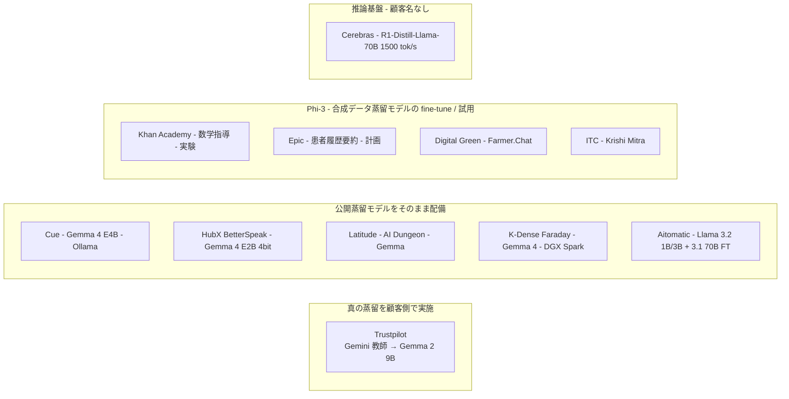

# 公開蒸留モデルの事業採用の証拠（追加収集）— Trustpilot / Google スタートアップ事例 / Microsoft Phi-3 顧客 / Aitomatic / Cerebras / HF 配布統計

- **Company/Organization**: Trustpilot、Cue、HubX（BetterSpeak）、Latitude、K-Dense、Khan Academy、Epic、Digital Green、ITC、Aitomatic、Cerebras
- **Industry**: レビュー基盤 / デスクトップアシスタント / 語学学習アプリ / ゲーム / 創薬 / 教育 / 医療 IT / 農業 / 半導体 / AI 推論基盤
- **Date**: 2024-05 〜 2026-09（取得日 2026-10-22）
- **Link**:
  - https://cloud.google.com/blog/topics/customers/how-trustpilot-built-a-real-time-architecture-for-data-enrichment-using-gemma
  - https://cloud.google.com/blog/topics/startups/why-your-startup-needs-open-models-alongside-frontier-apis
  - https://blog.google/innovation-and-ai/technology/developers-tools/gemma-4-builders/
  - https://azure.microsoft.com/en-us/blog/new-models-added-to-the-phi-3-family-available-on-microsoft-azure/
  - https://ai.meta.com/blog/aitomatic-built-with-llama/
  - https://www.cerebras.ai/blog/cerebras-launches-worlds-fastest-deepseek-r1-llama-70b-inference
- **Type**: Business Case（複数事例の横断整理、2026-10-22 追記レポート）
- **証拠の質**: すべて **ベンダー（Google / Microsoft / Meta / Cerebras）公開ページの顧客紹介** であり、顧客自身の一次発表ではない。数値は顧客またはベンダーの自己申告

## Overview

初版 run で「名前付き顧客の定量成果は DistilQwen2.5 の SQL 補完（Alibaba 自社）のみ」と結論した点を、WebSearch 12 回・WebFetch による追加収集で再検証した。結果:

- **真の蒸留（教師出力で生徒を学習）を本番投入した名前付き事例** を 1 件確認: **Trustpilot**（Gemini 教師 → Gemma 2 9B 生徒、1 日数百万件）。ただし成果は定性（「教師コンセンサスより数ポイント低い精度」「fraction of the cost」）。
- **公開蒸留モデルをそのまま / 量子化して配備** した名前付き事例を複数確認（Cue: Gemma 4 E4B、HubX: Gemma 4 E2B 4bit、Latitude、K-Dense、Khan Academy / Epic / Digital Green / ITC: Phi-3、Aitomatic: Llama 3.2 1B/3B）。**定量値があるのは Cue（レイテンシ 876→488 ms、-44%）と HubX（サーバ費 $0）のみ**。
- R1-Distill については、AWS ドメイン限定検索を含めても **エンドユーザー企業の本番成果は依然として未発見**。追加で確認できたのは Cerebras の配備性能（1,500 tok/s 超）のみ。



## Problem & Context

- C3 の仮説 H2「ベンダー数値のみで顧客別成果は非公開」と H3「SLM 事例の多くは蒸留ではなく fine-tuning」を、公開蒸留モデルの文脈で検証したい。
- 初版は WebSearch 予算枯渇により事例が 16 件に留まり、**「公開蒸留モデルを使った真の蒸留事例」が国内外とも空白** だった。

## Solution

### Table 1: 追加事例の一覧（蒸留 / fine-tuning / 量子化の区分と証拠の質）

| # | 企業 | モデル | 用途 | 区分 | 成果 | 出典（日付） | 証拠の質 |
|---|---|---|---|---|---|---|---|
| 1 | **Trustpilot** | Gemma 2 9B（base） | レビューのトピック分類・NER・感情抽出、1 日数百万件 | **黒箱蒸留**（Gemini 2.0/2.5 Pro/Flash の「教師モデル」コンセンサス注釈で学習データ生成 → fine-tune） | 精度は「教師コンセンサスより数ポイント低い」、旧システムを大幅に上回る。「Gemini 同等性能を fraction of the cost」。vLLM / A100（A2 VM）、Dataflow 連携 | Google Cloud 顧客ブログ（2026-06-02） | ベンダー掲載・顧客談話、**定性** |
| 2 | **Cue** | Gemma 4 E4B（Ollama、ローカル） | 音声アシスタントの文字起こし整形 | **そのまま配備**（fine-tune・蒸留の記述なし） | **レイテンシ 876 → 488 ms（-44%）**。オフライン fallback の予定から既定エンジンに昇格 | Google Cloud スタートアップブログ（2026-09-29） | ベンダー掲載、定量 1 点 |
| 3 | **HubX（BetterSpeak）** | Gemma 4 E2B 4bit 量子化（約 2.9 GB） | オフラインの音声英会話チューター（モバイル） | **量子化版をそのまま配備** | **サーバ費 $0**（完全オンデバイス） | 同上 + Gemma 4 builders ブログ（2026-06-09） | ベンダー掲載、定量 1 点 |
| 4 | **Latitude** | Gemma（サイズ非記載） | AI Dungeon / Voyage のゲーム AI | そのまま配備 | 「プレイヤー継続率が大幅改善」（数値なし） | Google Cloud スタートアップブログ（2026-09-29） | ベンダー掲載、定性 |
| 5 | **K-Dense（Faraday）** | Gemma 4 + 自社 Scientific Agent Skills、DGX Spark | 製薬・バイオ向けのエアギャップ科学アシスタント | そのまま配備（ローカル fine-tune は「可能」とのみ） | 数値なし | 同上 | ベンダー掲載、定性 |
| 6 | **Khan Academy** | Phi-3 | 数学指導の改善 | **試用（experimenting）** | 数値なし | Azure ブログ（2024-05-21） | ベンダー掲載、計画段階 |
| 7 | **Epic** | Phi-3 | 複雑な患者履歴の要約 | **計画（looking to use）** | 数値なし | 同上 | ベンダー掲載、計画段階 |
| 8 | **Digital Green** | Phi-3 | Farmer.Chat に動画を導入 | 導入（詳細なし） | 数値なし | 同上 | ベンダー掲載、定性 |
| 9 | **ITC** | Phi-3 | 農家向け copilot（Krishi Mitra、初版 gather #15 と同一事例） | fine-tune | 数値なし | 同上 | ベンダー掲載、定性 |
| 10 | **Aitomatic** | Llama 3.2 1B/3B（IoT データ・技術文書への軽量アクセス）+ Llama 3.1 70B を fine-tune した SemiKong | 半導体 Domain-Expert Agent | **fine-tune（70B）+ 1B/3B はそのまま** | 「期待効果」として time-to-market 20〜30% 短縮、first-time-right 15〜25% 改善等（測定値ではない）。顧客名なし | Meta 事例ページ（2024-12-04） | ベンダー掲載、**見込み値** |
| 11 | **Cerebras** | DeepSeek-R1-Distill-Llama-70B（「DeepSeek R1 Llama-70B」表記） | 推論 API | 配備（蒸留は DeepSeek 実施分） | **1,500 tok/s 超、GPU 比 57 倍**、o1-mini 比 15 倍（1.5 秒 vs 22 秒）。米国内インフラ 100%。顧客名なし | Cerebras ブログ（2025-01-29） | ベンダー申告 |

### Table 2: Hugging Face 配布統計（代理指標、2026-10-22 取得、月間値）

| モデル | 月間 DL | finetunes | adapters | quantizations | merges | ライセンス | 初版 run（2026-10-21）との比較 |
|---|---|---|---|---|---|---|---|
| Qwen/Qwen3-4B | 11,600,540 | 1,226 | 1,206 | 360 | 20 | apache-2.0 | 新規 |
| google/gemma-4-31B-it | 8,827,508 | — | — | — | — | apache-2.0 | 新規 |
| google/gemma-4-E4B-it | 4,076,573 | — | — | — | — | apache-2.0 | 新規 |
| nvidia/NVIDIA-Nemotron-3-Nano-4B-BF16 | 2,250,433 | — | — | — | — | nvidia-nemotron-open-model-license | 新規 |
| meta-llama/Llama-3.2-3B-Instruct | 1,110,545 | 2,030 | 871 | 542 | 29 | llama3.2 | 新規 |
| google/gemma-3-4b-it | 1,059,693 | 842 | 503 | 492 | 3 | gemma | 新規 |
| deepseek-ai/DeepSeek-R1-0528-Qwen3-8B | 405,169 | — | — | — | — | MIT | 新規 |
| deepseek-ai/DeepSeek-R1-Distill-Qwen-7B | 386,503 | 314 | 162 | 202 | 64 | MIT | 新規 |
| meta-llama/Llama-4-Maverick-17B-128E-Instruct | 9,487 | — | — | — | — | llama4 | 新規（参考） |
| （参考・初版）Qwen/Qwen3-0.6B | 28,228,809 | 1,367 | 684 | 493 | 14 | apache-2.0 | 初版値 |
| （参考・初版）meta-llama/Llama-3.2-1B-Instruct | 4,633,884 | 1,840 | 683 | 432 | 15 | llama3.2 | 初版値 |
| （参考・初版）google/gemma-3-1b-it | 1,396,612 | 571 | 214 | 485 | 10 | gemma | 初版値 |

```
月間 DL（百万、2026-10-22）
Qwen3-0.6B (初版値)      |████████████████████████████████████████ 28.2
Qwen3-4B                 |████████████████ 11.6
gemma-4-31B-it           |████████████▌ 8.8
Llama-3.2-1B-Instruct (初版値) |██████▌ 4.6
gemma-4-E4B-it           |█████▊ 4.1
Nemotron-3-Nano-4B       |███▏ 2.3
gemma-3-1b-it (初版値)   |██ 1.4
Llama-3.2-3B-Instruct    |█▌ 1.1
gemma-3-4b-it            |█▌ 1.1
R1-0528-Qwen3-8B         |▌ 0.41
R1-Distill-Qwen-7B       |▌ 0.39
```

> **派生数（finetunes）は Llama-3.2-3B-Instruct 2,030 > Llama-3.2-1B-Instruct 1,840 > Qwen3-0.6B 1,367 > Qwen3-4B 1,226**。DL 数は Qwen3 が圧倒するが、「土台として fine-tune される回数」では Llama 3.2 が依然最多。R1-Distill-Qwen-7B は公開から 21 か月で月間 DL 39 万に落ち、後継 R1-0528-Qwen3-8B（41 万）と並ぶ。

## Results & Impact

| Metric | Before | After | 事例 | 区分 |
|---|---|---|---|---|
| レビュー処理の精度 | 旧システム（数値なし） | 教師コンセンサス比 「数ポイント低い」、旧システムを大幅に上回る | Trustpilot | 蒸留 |
| 推論コスト | Gemini 従量課金 | 固定インフラで「fraction of the cost」 | Trustpilot | 蒸留 |
| 文字起こし整形レイテンシ | 876 ms | **488 ms（-44%）** | Cue | そのまま配備 |
| サーバ費 | クラウド推論 | **$0**（オンデバイス） | HubX | 量子化配備 |
| 推論速度（70B 蒸留版） | GPU | 1,500 tok/s 超（57 倍、ベンダー） | Cerebras | 配備 |
| 半導体設計の time-to-market | — | 20〜30% 短縮（**見込み**） | Aitomatic | fine-tune |

## Figures & Tables

### 仮説への含意

| 仮説 | 初版判定 | 追記後 | 根拠 |
|---|---|---|---|
| H1 定量成果は検索・推薦に集中 | 部分支持 | **部分支持（維持）** | 追加の定量値は Cue（レイテンシ）と HubX（コスト）で、いずれも推論コスト項。精度の定量値は Trustpilot も定性 |
| H2 ベンダー数値のみ | 支持 | **支持（維持）** | 11 件すべてがベンダー掲載。顧客自身の技術ブログは未発見 |
| H3 多くは fine-tuning / 量子化 | 支持 | **支持（ただし反例 1 件）** | Trustpilot は顧客側で教師出力を使う **真の黒箱蒸留**。他 10 件は配備・fine-tune・量子化・計画 |
| H4 国内は公開モデル型 | 支持 | 支持（維持） | 国内の追加事例なし（[11](11-japan-derivatives.md)） |

### 証拠の質の分布（追加 11 件）

```
顧客側で蒸留 + 定性成果     |█ 1   (Trustpilot)
そのまま配備 + 定量成果     |██ 2  (Cue, HubX)
そのまま配備 + 定性/なし    |███ 3 (Latitude, K-Dense, Digital Green)
fine-tune / 見込み値        |██ 2  (Aitomatic, ITC)
試用・計画段階              |██ 2  (Khan Academy, Epic)
推論基盤のベンダー性能値    |█ 1   (Cerebras)
```

## Lessons Learned

1. **「公開蒸留モデルを土台に自社で蒸留」の名前付き本番事例は、Google 自身のプラットフォーム上の Trustpilot が初確認**。教師（Gemini）と生徒（Gemma）の両方を Google が提供しているため、ライセンス（Gemma Terms の派生物条項、Gemini 利用規約）の問題が生じない「垂直統合」構成である点に注意。
2. **Gemma 4（Apache 2.0、2026-04）以降、オンデバイス配備事例が急増**（Cue / HubX / K-Dense）。ただし追加学習なしの配備が中心で、蒸留は提供元が済ませたものを使う。
3. **Phi-3 の顧客名（Khan Academy / Epic）は 2024-05 時点で「試用・計画」**。2026-10 時点でも本番成果の続報は検索で見つからず、H2 の典型。
4. **HF 配布統計は「土台としての普及」の代理指標として有用** だが、本番採用とは別。Qwen3 小型の DL 数は他を圧倒するが、Qwen 小型の名前付き本番事例は本 run で 0 件。

## Notes

- 検索の限界: WebSearch 12 回（うち事例向け 6 回）。日本語クエリは「蒸留」が蒸留酒と混同され無効。Microsoft Customer Stories・Google Cloud 顧客ページの網羅検索は未実施。
- 取得不能: Couchbase（403、初版から継続）。
- 本レポートの事例はすべてベンダー掲載であるため、顧客自身の発表（技術ブログ・IR）での裏取りは C5（業務別）・C7（国内）で継続すべき。
