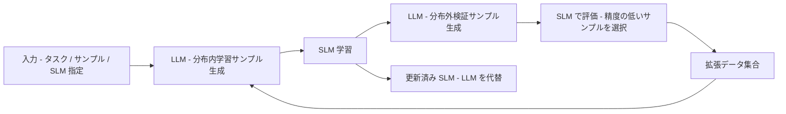

# 公開モデル蒸留に関連する特許（最小限の補完）— Huawei WO2025123815A1 ほか

- **Patent Number**: WO2025123815A1（主）。参考: CN111767711A、WO2025221495A1（番号・題名のみ確認）
- **Assignee**: Huawei Cloud Computing Technologies Co., Ltd.
- **Inventors**: Mohsen Gholami, Mohammad Akbari, Vaden Wybert Masrani, Yong Zhang
- **Filing Date**: 2024-09-09（PCT/CN2024/117740）。優先日 2023-12-12（US 18/536,435）
- **Grant Date**: 未付与（公開 2025-06-19、Pending）
- **Classification**: G06F40/40、G06F16/3329（Google Patents 表示）
- **Link**: https://patents.google.com/patent/WO2025123815A1/en
- **Type**: Patent（2026-10-22 追記レポート）
- **証拠の質**: Google Patents の書誌・要約・Summary を WebFetch で確認（一次）。請求項本文は取得範囲外（ページ後半未読）

> **範囲の注記**: ドメイン全体の特許ランドスケープは C8（`legal_ip_patents`）が担当する。本レポートは「公開蒸留モデルの作り方（剪定 + 蒸留、logit 蒸留、LLM → SLM の知識移転）」に直接関係する特許を **最小限** 補完するもので、網羅性は無い。Google Patents は本 run 中（2026-10-22）に **HTTP 503** を返し続け、WIPO PatentScope・FreePatentsOnline・Justia も 403 で参照できなかったため、**本文を確認できた特許は 1 件** に留まる（下記「調査の試行記録」）。

## Abstract

A method and an apparatus for transferring knowledge from a Large Language Model (LLM) to a Small Language Model (SLM). （以下は Google Patents 要約の要旨）The method iteratively acquires a client input (an NLP task, data samples, and an indication of the SLM), uses the LLM to generate training samples and validation samples, trains the SLM, and adds the validation samples on which the SLM performs poorly to the data used in the next iteration.

## Abstract (Japanese Translation)

大規模言語モデル（LLM）から小規模言語モデル（SLM）へ知識を移転する方法と装置。クライアント入力（NLP タスク、データサンプル、SLM の指定）を取得し、LLM で学習サンプルと検証サンプルを生成して SLM を学習させ、**SLM の成績が悪かった検証サンプル（分布外フィードバック）を次の反復の生成データに追加** する処理を繰り返す。

## Overview

- 教師 LLM が **合成データを生成して生徒 SLM を学習させる「黒箱蒸留」のループ** を、生徒の弱点（分布外サンプルでの失敗）で駆動する構成。R1-Distill や DistilQwen2.5 の黒箱蒸留（[01](01-deepseek-r1-distill.md)、[07](07-distilqwen2-5-industrial.md)）と同系統で、DistilQwen2.5 の「Selection / Verification agent」に近い発想を特許化したもの。
- 出願人は Huawei Cloud。公開蒸留モデルの提供元（Google / Meta / NVIDIA / Alibaba / DeepSeek / Microsoft）名義の該当特許は本 run では確認できなかった。

## Technical Problem

- LLM を直接本番で使うとコスト・レイテンシが大きい。
- SLM へ知識を移す際、LLM が生成した **分布内データだけでは生徒の汎化が弱い**。
- どのデータを追加で生成すべきかを自動で決めたい。

## Technical Solution

### Process Steps（Summary 記載の第一態様に基づく）

1. **入力取得**: NLP タスク、データサンプル集合、SLM の指定（サイズまたはモデル本体）をユーザーから取得 → 学習条件
2. **分布内生成 + 学習**: LLM でタスクとサンプルから分布内学習サンプルを生成し、SLM を学習 → 第 1 学習済み SLM
3. **分布外検証サンプル生成**: LLM で第 1 学習済み SLM 向けの分布外（OOD）検証サンプルを生成 → 検証集合
4. **ターゲット選択**: 各検証サンプルに対する SLM の現在の予測精度に基づき、少なくとも 1 件のターゲット検証サンプルを選択 → 弱点サンプル
5. **データ拡張**: 元データサンプル + ターゲット検証サンプルで拡張データ集合を作成
6. **反復**: 拡張データから LLM が新しい学習サンプルを生成し、第 1 学習済み SLM を再学習。条件を満たすまで反復 → 更新済み SLM
7. **置換**: 更新済み SLM を LLM の代わりにタスク実行に使用

### Key Innovation

- 生徒の **分布外での失敗を教師のデータ生成にフィードバック** する点（通常の黒箱蒸留は固定データ）。
- 「SLM のサイズ指定だけ」を入力にできる（クラウドサービスとしての提供形態を想定）。

### Mathematical Relationships

取得範囲（Summary）には数式の記載なし。概念的には、反復 $k$ のデータ集合を

$$
\mathcal{D}_{k+1} = \mathcal{D}_k \cup \{ v \in \mathcal{V}_k \mid \mathrm{acc}_{S_k}(v) < \tau \}, \qquad \mathcal{V}_k \sim \mathrm{LLM}(\text{OOD} \mid S_k)
$$

と書ける（本レポートでの再構成であり、特許の記載ではない）。

## Key Claims

### Claim 1 (Main)（Summary の第一態様に基づく要約。請求項本文は未取得）

- **Element a)**: NLP タスク、データサンプル、SLM 指定の取得
- **Element b)**: LLM による分布内学習サンプル生成と SLM 学習
- **Element c)**: LLM による分布外検証サンプル生成
- **Element d)**: SLM の予測精度に基づくターゲット検証サンプル選択
- **Element e)**: 拡張データ集合の作成と次反復の学習
- **Element f)**: 更新済み SLM による LLM の代替実行

## Process Flow Diagram

## Figures & Tables

### Claims structure table（Summary 記載の態様に基づく推定）

| Claim # | Type | Depends On | Key Element |
|---|---|---|---|
| 1 | Independent（方法） | — | OOD フィードバック付きの反復 LLM→SLM 知識移転 |
| （装置） | Independent | — | 同処理を行う装置（Summary に「apparatus」） |

### Prior art comparison table（本クラスタの公開モデルとの対比）

| Feature | WO2025123815A1 | R1-Distill | DistilQwen2.5 | Minitron |
|---|---|---|---|---|
| 教師 | 任意 LLM（黒箱） | DeepSeek-R1 | Qwen-max / GPT-4o（黒箱）+ Qwen2.5 大（白箱） | 剪定前モデル（白箱） |
| データ | 反復生成（OOD フィードバック） | 固定 80 万件 | エージェントで選別・書換・検証 | 事前学習コーパス 94B〜380B |
| 生徒の弱点の利用 | **あり**（検証サンプルの失敗） | なし | Selection agent（間接） | なし |
| 蒸留信号 | テキスト | テキスト | テキスト + top-10 logit | logit KL |

### 調査の試行記録（2026-10-22）

| 候補 | 状態 | 備考 |
|---|---|---|
| WO2025123815A1（Huawei、LLM→SLM の OOD フィードバック蒸留） | **本文確認**（Google Patents、ページ前半） | 本レポート |
| CN111767711A「基于知识蒸馏的预训练语言模型的压缩方法及平台」（Granted、先行技術日 2020-09-02） | **題名・番号のみ**（検索結果の表示）。Google Patents 本文は 503 | 事前学習言語モデルの知識蒸留圧縮。出願人は未確認 |
| WO2025221495A1「Distillation de processus d'échantillonnage de préférences multi-échantillons pour modèles de traitement de séquence」（先行技術日 2024-04-15） | **題名・番号のみ**。Google Patents / PatentScope とも取得不可 | Best-of-N 等のサンプリング過程を系列モデルに蒸留する内容（検索結果要約）。Gemma 3 事後学習の BOND と関係する可能性があるが **出願人未確認** |
| US20210265018A1（Illumina 系、KD + 勾配剪定による base caller 圧縮） | 検索結果で確認 | ゲノム base caller 向けで **言語モデルではない** ため収録せず |
| US20150356461A1「Training distilled machine learning models」（Google、Hinton らの KD 基本特許と推定） | **未検証**（Google Patents 503、Justia 403） | 番号・内容の確認ができなかったため収録せず |
| NVIDIA の剪定 + 蒸留（Minitron）、Google の logit 蒸留事前学習、Alibaba の top-K logit、Meta の剪定 + logit 蒸留 | **未発見**（WebSearch 2 回、patents.google.com 限定を含む） | 検索結果は論文のみ。出願の有無は不明 |

## Patent Family & Related Art

- 優先権: US 18/536,435（2023-12-12）。PCT 出願 PCT/CN2024/117740。
- 関連: 本クラスタの DistilQwen2.5（多エージェント黒箱 KD）、OpenThoughts（データレシピ）、Phi-4-reasoning（teachable プロンプト選別）は、いずれも「生徒に合わせて教師データを選ぶ」点で近接する学術先行技術。

## Notes

- 公開蒸留モデル提供元の特許は本 run で **未確認**。C8 では「Minitron（剪定 + KD）」「sparse logit 蒸留（Gemma 3）」「on-policy 蒸留（Qwen3）」の出願有無を Google Patents の assignee 検索（NVIDIA Corporation / Google LLC / Alibaba）で確認することを推奨する。
- 商業的意義: Huawei Cloud の出願は「SLM サイズを指定すると LLM から自動で蒸留する」クラウド機能を示唆し、Alibaba PAI の Distillation Training Pipeline（[07](07-distilqwen2-5-industrial.md)）と同じ「蒸留のサービス化」（C2）に接続する。
