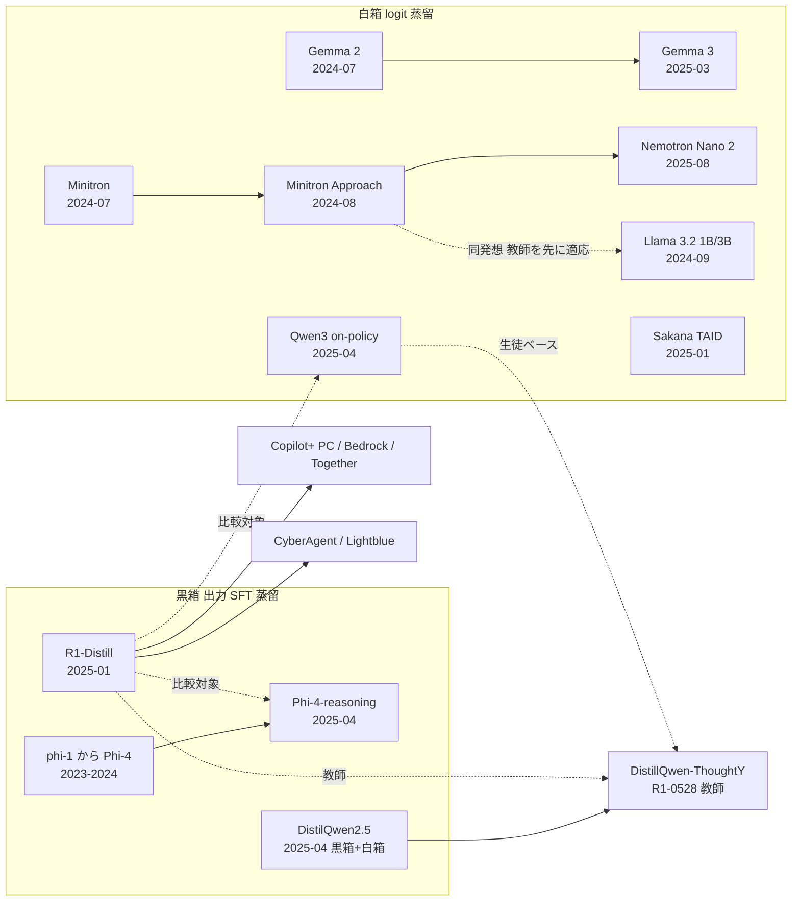

# C3 公開蒸留モデルとエコシステム — Detailed Reports

## Parameters

- **Resources analyzed**: 14 レポート（主資料 11 件 + 補助資料 約 30 件を WebFetch で取得。2026-10-22 に 12〜14 を追記）
- **Resource types**: 学術論文 7 / 技術記事 2 / ビジネス事例 3 / 論文 + ライセンス文書 1 / 特許 1
- **Generated on**: 2026-10-21（2026-10-22 レビュー・追記）
- **Input source**: gather 出力 [resources-open-distilled-models.md](../../../gather/20261021/open_distilled_models/resources-open-distilled-models.md)
- **制約**: セッションの WebSearch 予算枯渇のため、補足検索は行わず既知 URL の WebFetch のみで作成。特許レポートは無し（gather で 0 件）
- **（2026-10-22 追記）レビューの範囲**: 01〜11 の主要数値を一次資料（arXiv HTML / モデルカード / 公式ブログ）で再検証し、誤りは各レポート内に「（2026-10-22 訂正）」で明示。WebSearch 12 回 + WebFetch で Gemma 4 の Apache 2.0 化（一次資料）、2025〜2026 の新規公開蒸留モデル（[12](12-newer-distilled-open-models-2025-2026.md)）、事業採用事例 11 件（[13](13-business-adoption-evidence.md)）、特許 1 件 + 試行記録（[14](14-patents-open-model-distillation.md)）を追加。Google Patents は HTTP 503 で本文参照不可。
- **（2026-10-22 訂正）主な訂正**: (1) R1-Distill の「2 epoch SFT」は V3-Base の SFT の記述で、蒸留モデルの epoch 数は論文に非記載。(2) DistilQwen2.5 の SQL 補完の生徒は「社内 SQL コーパス上の KD で得た Qwen2.5-3B」で、DistilQwen2.5-3B 初期化かは非記載。教師は fine-tune + int4 の Qwen2.5-7B。(3) Phi-4-reasoning の「32×H100 2.5 日」は HF モデルカード値（論文には SFT 計算量の記載なし）。(4) Llama 3.2 の BFCL V2 と decode 倍率の出典は Meta ブログではなく HF モデルカード。

## Report List

### Academic Papers

| # | Title | Year | Venue | Summary | Report |
|---|-------|------|-------|---------|--------|
| 1 | DeepSeek-R1（蒸留モデル部分） | 2025 | Nature 645 | R1 の約 80 万件で 6 モデルを SFT のみ（epoch 数は非記載 — 2026-10-22 訂正）。32B で AIME 72.6、同ベースへの RL（47.0）を圧倒。MIT・蒸留明示許可 | [Details](01-deepseek-r1-distill.md) |
| 2 | Gemma 2 | 2024 | arXiv | 2B/9B を KD で事前学習（計算最適の 50 倍超トークン）。2B で 60.3→67.7 | [Details](02-gemma-2-distillation.md) |
| 3 | Gemma 3 + Gemma Terms | 2025 | arXiv | 全サイズを 256 logit サンプル KD。4B が MATH で Gemma 2 27B 超え。規約は合成データ学習も派生物扱い | [Details](03-gemma-3-distillation-license.md) |
| 5 | Minitron（Compact LMs via Pruning and KD） | 2024 | NeurIPS 2024 | 15B→8B/4B を 94B トークン（最大 40 倍削減）、ファミリーで 1.8 倍計算削減 | [Details](05-minitron-pruning-kd.md) |
| 6 | The Minitron Approach | 2024 | arXiv | 公開モデル（Llama 3.1 8B / Mistral NeMo 12B）を教師補正 + 剪定 + KD。4B-Depth 2.7 倍速 | [Details](06-minitron-approach-llama31.md) |
| 7 | DistilQwen2.5 | 2025 | ACL 2025 Industry | 多エージェント黒箱 + top-10 logit 白箱。SQL 補完本番 A/B で KD で得た 3B が fine-tune + int4 の 7B 教師に迫る（採用率 25.5 vs 26.5%、Table 3 のレイテンシ 384→148ms、本文は「1.4×」） | [Details](07-distilqwen2-5-industrial.md) |
| 8 | Qwen3（Strong-to-Weak Distillation） | 2025 | arXiv | on-policy 蒸留が RL を全指標で上回り GPU 時間 1/10（1,800 vs 17,920） | [Details](08-qwen3-strong-to-weak.md) |
| 9 | Phi-4-reasoning | 2025 | arXiv | o3-mini 教師の 140 万超デモで SFT。14B で R1-Distill-Llama-70B 超え（AIME25 63.1 vs 51.5） | [Details](09-phi-4-reasoning.md) |

### Technical Articles

| # | Title | Source | Date | Report |
|---|-------|--------|------|--------|
| 4 | Llama 3.2 1B/3B（剪定 + logit 蒸留）+ モデルカード + torchtune KD | Meta / PyTorch | 2024-09 | [Details](04-llama-3-2-pruning-distillation.md) |
| 12 | （2026-10-22 追記）2025〜2026 の新しい公開蒸留モデル: R1-0528-Qwen3-8B / Llama 4 codistillation / Magistral Small / Nemotron 3 Nano 4B / Gemma 4（Apache 2.0 一次確認、蒸留の記述なし） | DeepSeek / Meta / Mistral / NVIDIA / Google | 2025-04〜2026-07 | [Details](12-newer-distilled-open-models-2025-2026.md) |

### Business Cases

| # | Title | Company | Date | Report |
|---|-------|---------|------|--------|
| 10 | R1-Distill の Copilot+ PC NPU 配備とクラウド提供 | Microsoft / AWS / Together AI | 2025-01〜03 | [Details](10-windows-copilot-pc-r1-distill.md) |
| 11 | 国内の公開蒸留モデル派生事例 | サイバーエージェント / Lightblue / ABEJA / Sakana AI | 2025-01〜04 | [Details](11-japan-derivatives.md) |
| 13 | （2026-10-22 追記）公開蒸留モデルの事業採用の証拠: Trustpilot（Gemini 教師 → Gemma 2 9B、本番）/ Cue・HubX・Latitude・K-Dense（Gemma 4）/ Khan Academy・Epic・Digital Green・ITC（Phi-3）/ Aitomatic（Llama 3.2）/ Cerebras + HF 配布統計 | Google / Microsoft / Meta / Cerebras 掲載 | 2024-05〜2026-09 | [Details](13-business-adoption-evidence.md) |

### Patents

| # | Title | Patent No. | Assignee | Year | Report |
|---|-------|-----------|----------|------|--------|
| 14 | （2026-10-22 追記）Methods and systems for transferring knowledge from LLMs to SLMs using out-of-distribution feedbacks（+ 題名のみ確認 2 件と調査の試行記録） | WO2025123815A1 | Huawei Cloud Computing Technologies | 2025（優先 2023-12） | [Details](14-patents-open-model-distillation.md) |

## Cross-Resource Insights

### 系譜と関係



### 主要な横断的発見

1. **「蒸留は RL より安く強い」が 3 系統で独立に確認された**
   - R1: 同ベースで RL 47.0 vs 蒸留 72.6（AIME24）
   - Qwen3: RL 17,920 GPU 時間 vs on-policy 蒸留 1,800 時間で全指標上回る
   - Minitron: from scratch 比 40 倍少ないトークンで同等以上
2. **白箱 on-policy 蒸留 > 黒箱 SFT 蒸留**: Qwen3-4B（on-policy）が R1-Distill-Qwen-32B（黒箱）を AIME'25 で 65.6 vs 49.6、BFCL v3 で 65.9 vs 53.5。
3. **教師に関する知見の収束**:
   - 大きすぎる教師は収穫逓減（DistilQwen2.5: 14B→72B）
   - 短い学習なら小さい教師、長い学習なら大きい教師（Gemma 3）
   - 教師を先にターゲット分布へ適応させると良い（Minitron の teacher correction、torchtune の LoRA 教師）
4. **tool calling（Agent 用途）でも小型蒸留モデルが大型に並ぶ**: Llama 3.2 3B が BFCL V2 で 8B と同等（67.0 vs 67.1）、MN-Minitron-8B が BFCLv2 で Llama 3.1 8B を大差（67.6 vs 44.3）。ただし R1-Distill の tool calling はパース問題の報告あり（Fireworks）。
5. **ビジネス成果の一次資料は極めて少ない**: 定量 A/B 結果は DistilQwen2.5 の SQL 補完（Alibaba 自社）のみ。他はプラットフォーム配備のベンダー性能値（Windows NPU 40 tok/s、Bedrock $0.157/分）か定性（SK Telecom）。
6. **ライセンスは蒸留可へ収束、ただし多重継承が残る**: MIT（R1、Phi）、Apache 2.0（Qwen3、Gemma 4）へ。Gemma ≤3 は合成データ学習を派生物扱い、Llama は命名義務、商用 API 教師（o3-mini、GPT-4o）の規約は利用者からは見えにくい。
7. **（2026-10-22 追記）Gemma 4 の Apache 2.0 は一次資料で確認、ただし「蒸留モデル」ではない**: Google 公式ブログ（2026-04-02）・技術報告書（arXiv 2607.02770）・HF モデルカードの 3 点で Apache 2.0 を確認。Gemma Terms（2026-04-01 改定）の Appendix は Gemma 1〜3n を列挙し Gemma 4 を含まない。一方、Gemma 4 の資料に「distillation」の記述は無く、Gemma 2/3 のような蒸留事前学習の有無は不明（[12](12-newer-distilled-open-models-2025-2026.md)）。
8. **（2026-10-22 追記）「公開モデルを生徒に、商用 API を教師に」する本番事例が 1 件確認**: Trustpilot は Gemini 2.0/2.5 を教師に Gemma 2 9B を fine-tune し、1 日数百万件のレビュー処理に投入（Google Cloud 顧客ブログ 2026-06-02、定性）。ただし教師・生徒・基盤がすべて Google の垂直統合であり、第三者間のライセンス問題を伴わない特殊例（[13](13-business-adoption-evidence.md)）。
9. **（2026-10-22 追記）黒箱推論蒸留の水準が 4 か月で +30pt**: R1-Distill-Qwen-7B（2025-01、AIME24 55.5）→ R1-0528-Qwen3-8B（2025-05、86.0）。生徒ベースを Qwen2.5-Math-7B から Apache 2.0 の Qwen3-8B Base に替えた効果と教師更新（R1-0528）の複合。「強い Apache 2.0 Base を第三者が蒸留の生徒にする」パターンの代表例。
10. **（2026-10-22 追記）剪定 + 蒸留の系列展開は 2026 年も継続**: Nemotron 3 Nano 4B は Nano 9B v2 から 63B + 150B トークンで剪定・蒸留（NVIDIA、2026-03）。Minitron（2024）→ Nano 2（2025）→ Nano 3 4B（2026）で同一レシピが 3 世代続く。

### 仮説の検証（clustering の H1–H6）

| # | 仮説 | C3 での判定 | 根拠 |
|---|------|------------|------|
| H1 | 定量成果の本番事例は検索・推薦に集中 | **部分支持** | C3 の本番定量事例は DistilQwen2.5 の SQL 補完 1 件のみ。公開蒸留モデル領域には本番成果がほぼ無く、相対的に C4 に集中することと整合 |
| H2 | ベンダー数値のみで顧客別成果は非公開 | **支持** | Windows / Bedrock / Together / NVIDIA / Gemma の発表はいずれも性能・単価のみで、名前付き顧客の成果なし。ServiceNow も数値なし |
| H3 | 「SLM 事例」の多くは蒸留ではなく fine-tuning | **支持** | AT&T（Llama fine-tune で約 33% 改善）、ITC（Phi-3 fine-tune）、SK Telecom（Gemma 3 4B fine-tune）、CyberAgent（蒸留モデルの fine-tune）、ABEJA 推論モデル（マージ）。端末速度向上は量子化の効果 |
| H4 | 国内は公開モデル型中心 | **支持** | 4 社とも HF 公開モデル。事業会社の社内蒸留・本番成果は未発見 |
| H5 | 商用 API 教師は規約で制約、教師選択が論点 | **支持（ただし逆方向の動きも）** | DeepSeek が API 出力の蒸留利用を明示許可、Llama 3.1 が出力利用を解禁と「許可側」へ動く一方、Gemma ≤3 は派生物条項、DistilQwen2.5 は GPT-4o を教師に使用、Phi-4-reasoning は o3-mini 教師（提携企業のみ可能） |
| H6 | 推論蒸留で Agent・tool calling 用途の蒸留が増加 | **部分支持** | 小型蒸留モデルの BFCL スコアは高い（Llama 3.2 3B、MN-Minitron、Qwen3）。ただし Agent 用途を目的に蒸留した事業事例は C3 では未確認 |

（2026-10-22 追記）追加収集後の再判定: H1 **部分支持（維持）**（追加の定量値は Cue のレイテンシ -44%、HubX のサーバ費 $0 でいずれもコスト項）、H2 **支持（維持）**（追加 11 件すべてベンダー掲載）、H3 **支持（反例 1 件）**（Trustpilot は顧客側で教師出力を使う真の黒箱蒸留。他は配備・fine-tune・量子化・計画）、H4 **支持（維持）**（国内追加なし）、H5 **支持**（Gemma 4 の Apache 2.0 化を一次確認、許可側への移行が進む）、H6 **部分支持（維持）**（Nemotron 3 Nano 4B は BFCL v3 61.1 を掲げるが事業事例なし）。詳細は [13](13-business-adoption-evidence.md)。

### ライセンス整合表（C8 `legal_ip_patents` との照合、2026-10-22 追記）

| 系列 | C3 の記述 | C8 index の記述 | 整合 | 一次資料（C3 で確認） |
|---|---|---|---|---|
| DeepSeek-R1 / R1-Distill / R1-0528-Qwen3-8B | MIT、**蒸留による派生を明示許可**、API 出力の蒸留利用可 | MIT、蒸留明示許諾 | ○ | HF モデルカード、DeepSeek 公式ニュース |
| Qwen3（Base / 小型蒸留版） | Apache 2.0 | Apache 2.0 | ○ | 論文・HF モデルカード |
| Gemma 1〜3 / 3n | Gemma Terms: Model Derivatives に **蒸留・Gemma 出力の合成データ学習** を含む。Outputs 自体は派生物でない。Prohibited Use Policy を下流へ継承 | 同旨（一次） | ○ | ai.google.dev/gemma/terms（2026-04-01 改定）、2024-04-01 版アーカイブ |
| Gemma 4 | Apache 2.0（**一次資料 3 点で確認**: 公式ブログ 2026-04-02、arXiv 2607.02770、HF license タグ）。Gemma Terms の Appendix は Gemma 4 を含まない | Apache 2.0（2026-04-02）、**二次報道** | ○（C3 側で一次に格上げ。C8 の証拠タグは二次のまま） | [12](12-newer-distilled-open-models-2025-2026.md) |
| Llama 3.1 / 3.2 / 3.3 / 4 | 出力による他モデル改善は 3.1 で解禁。配布時は名前の先頭に「Llama」+「Built with Llama」表示、700M MAU 超は別許諾。R1-Distill-Llama にも上流条項が及ぶと解するのが保守的 | 1.b.i: 出力で作成・改良したモデルを配布・提供する場合は命名・表示義務、7 億 MAU 超は別許諾 | ○ | Llama 3.2 モデルカード、K. Mitchell の比較、Llama 4 モデルカード（llama4） |
| Phi | MIT | — | （C8 に記載なし） | HF モデルカード |
| NVIDIA Minitron / Nemotron | NVIDIA Open Model License 系（Nemotron 3 Nano 4B は NVIDIA Nemotron Open Model License） | — | （C8 に記載なし） | HF モデルカード |
| Mistral Magistral Small | Apache 2.0 | — | （C8 に記載なし） | arXiv 2506.10910 |

## Comparison Table

| モデル | 提供元 | 年 | 教師 | 方式 | 生徒学習量 / コスト | 代表結果 | ライセンス（蒸留関連） | 本番採用の証拠 |
|---|---|---|---|---|---|---|---|---|
| R1-Distill 1.5B–70B | DeepSeek | 2025 | DeepSeek-R1 | 黒箱 SFT（約 80 万件、epoch 数非記載 — 2026-10-22 訂正） | 非公開 | 32B: AIME24 72.6 | MIT、蒸留明示許可（Llama 系は上流条項） | 配備のみ（Windows / Bedrock / Together / Cerebras）、ベンダー申告 |
| （追記）R1-0528-Qwen3-8B | DeepSeek | 2025-05 | DeepSeek-R1-0528 | 黒箱 CoT 蒸留 | 非公開 | AIME24 86.0 / AIME25 76.3 | MIT（生徒ベース Qwen3-8B は Apache 2.0） | 未確認（月間 DL 40.5 万） |
| （追記）Magistral Small 24B | Mistral AI | 2025-06 | Magistral Medium（RL のみ） | 黒箱 SFT（4 epoch）+ RL | 非公開 | AIME24 70.7 / AIME25 62.8 | Apache 2.0 | 未確認 |
| （追記）Nemotron 3 Nano 4B | NVIDIA | 2026-03 | Nemotron Nano 9B v2 | 剪定 + 蒸留（Nemotron Elastic） | 63B + 150B トークン | AIME25 78.5 / BFCL v3 61.1 | NVIDIA Nemotron Open Model License | 未確認（月間 DL 225 万） |
| （追記）Gemma 4 E2B–31B | Google | 2026-04 | （記述なし） | （蒸留の記述なし） | 非公開 | 31B: AIME 2026 89.2 | **Apache 2.0（一次確認）** | Cue（E4B、-44% レイテンシ）、HubX（E2B 4bit、$0）、K-Dense — そのまま配備、ベンダー掲載 |
| Gemma 2 2B/9B | Google | 2024 | 大型 Gemma（27B 相当） | 白箱（全語彙分布）事前学習 | 2T / 8T トークン | 9B 平均 70.2 | Gemma Terms（合成データ学習も派生物） | 未確認 |
| Gemma 3 1B–27B | Google | 2025 | 非公開大型教師 | 白箱（256 logit サンプル）+ 事後 KD + RL | 2T–14T トークン | 4B: MATH 75.6 | Gemma Terms（Gemma 4 は Apache 2.0） | SK Telecom（4B fine-tune、定性・ベンダー申告） |
| Llama 3.2 1B/3B | Meta | 2024 | Llama 3.1 8B / 70B | 剪定 + logit 目標 | 最大 9T、1B で 370k H100 時間 | 3B: BFCL V2 67.0 | Llama 3.2 License（"Llama" 命名義務） | 未確認（Meta 事例は fine-tune） |
| Minitron 8B/4B | NVIDIA | 2024 | Nemotron-4 15B | 剪定 + logit KL | 94B トークン（40 倍削減） | 8B: MMLU 63.8 | NVIDIA Open Model 系 | 未確認 |
| Llama-3.1-Minitron 4B / MN-Minitron 8B | NVIDIA | 2024 | Llama 3.1 8B / Mistral NeMo 12B（教師補正） | 剪定 + logit KL | 94B / 380B トークン | 4B-Depth 2.7 倍速 | permissive（Llama 由来は上流条項） | NIM 提供、顧客名なし |
| DistilQwen2.5 0.5B–7B | Alibaba | 2025 | Qwen-max / GPT-4o + Qwen2.5 14–72B | 黒箱多エージェント + top-10 logit 白箱 | 8×A800、3 epoch | 0.5B AlpacaEval 2.46→4.89 | Apache 2.0（黒箱教師に GPT-4o） | **SQL 補完 本番 A/B（一次）** |
| Qwen3 0.6B–14B, 30B-A3B | Alibaba Qwen | 2025 | Qwen3-32B / 235B-A22B | off-policy SFT → on-policy logit KL | on-policy 段 1,800 GPU 時間（8B） | 4B: AIME'25 65.6 | Apache 2.0 | 未確認（月間 2,823 万 DL） |
| Phi-4-reasoning 14B | Microsoft | 2025 | o3-mini（high） | 黒箱 SFT + 短 GRPO | 8.3B unique トークン、32×H100 2.5 日 | plus: AIME25 78.0 | MIT | 未確認 |
| TinySwallow 1.5B | Sakana AI | 2025 | Qwen2.5-32B-Instruct | TAID（白箱・適応補間） | 非公開 | 3B 未満で日本語最高と主張 | Apache 2.0 + Gemma 規約継承 | 用途例のみ |
| Lightblue R1-Distill-Qwen-7B-Japanese | Lightblue | 2025 | R1-Distill-Llama-70B | 黒箱（二次蒸留） | 8×L20 で 10 分未満 | GSM8K-ja 62→70% | Apache 2.0 | 未確認 |

### 方式 × コストの位置付け

```
                 生徒の学習コスト（大）
                        ▲
   Gemma 2/3 ●          │          ● Llama 3.2（剪定+logit, 9T）
   (KD 事前学習 2-14T)   │
                        │
   ─────────────────────┼─────────────────────▶ 教師の知識の細かさ（logit）
   R1-Distill ●         │   ● Minitron（94B）
   Phi-4-R ●            │   ● Qwen3 on-policy（1,800h）
   Sky-T1 ● ($450)      │   ● DistilQwen top-10
   Lightblue ● (10分)   │
                 生徒の学習コスト（小）
     黒箱（テキスト）                 白箱（logit）
```

## Further Investigation Candidates

| 候補 | 理由 | 想定クラスタ |
|---|---|---|
| [OpenThoughts: Data Recipes for Reasoning Models](https://arxiv.org/abs/2506.04178) | QwQ-32B 教師・120 万例で OpenThoughts3-7B が R1-Distill-Qwen-7B を AIME25 で +15.3pt。推論蒸留データ設計の決定版 | C1 / C3 |
| [s1: Simple test-time scaling](https://arxiv.org/abs/2501.19393) / [LIMO](https://arxiv.org/abs/2502.03387) | 1,000 例規模の少量推論蒸留。事業会社の低コスト蒸留の根拠 | C1 |
| [Sky-T1](https://novasky-ai.github.io/posts/sky-t1/) / [Bespoke-Stratos](https://www.bespokelabs.ai/blog/bespoke-stratos-the-unreasonable-effectiveness-of-reasoning-distillation) | $450 未満・17K 例の推論蒸留。コスト項の実例 | C1 / C3 |
| [NVIDIA Nemotron Nano 2](https://arxiv.org/abs/2508.14444) | 12B→9B の Minitron 圧縮で Qwen3-8B 比 6 倍スループット | C3 / C6 |
| [Llama-Nemotron](https://arxiv.org/abs/2505.00949) | NAS + KD で作った推論モデル。ServiceNow が統合 | C3 / C5 |
| [Phi-4-Mini-Reasoning](https://arxiv.org/abs/2504.21233) | 3.8B の推論蒸留 + RL レシピ | C3 / C6 |
| [DistillQwen-ThoughtY](https://huggingface.co/alibaba-pai/DistillQwen-ThoughtY-32B) | R1-0528 教師の推論蒸留（AIME24 90.0） | C3 |
| Couchbase Capella AI Services の R1-Distill 採用 | 403 で未取得。企業検索チャットボットのデモ | C5 |
| 公開蒸留モデル関連の特許（NVIDIA 剪定 + 蒸留、Alibaba top-K logit、Google 蒸留事前学習） | 本 run では検索不能。（2026-10-22 追記）Huawei WO2025123815A1 を本文確認、CN111767711A / WO2025221495A1 は題名のみ。Google Patents が 503 のため提供元名義の特許は未確認（[14](14-patents-open-model-distillation.md)） | C8 |
| OpenAI / Anthropic 利用規約と DistilQwen2.5（GPT-4o 教師）・Lightblue（gpt-4o-mini 翻訳）の関係 | 公開モデルの教師出所問題 | C8 |
| 公開蒸留モデルの事業会社本番採用（Llama 3.2 / Gemma 3 / Qwen3 小型の名指し事例） | C3 で最大の空白。（2026-10-22 追記）Trustpilot（Gemma 2 9B）、Cue / HubX（Gemma 4）、Aitomatic（Llama 3.2）等 11 件を追加したが、**Qwen 小型と R1-Distill の名前付き本番成果は依然 0 件**、顧客自身の発表も未発見（[13](13-business-adoption-evidence.md)） | C5 / C6 / C7 |
| （2026-10-22 追記）Qwen3.5 系小型 / DeepSeek-V3.2 系蒸留版 / 小型 Llama 4 / Gemma 3n の蒸留有無 | WebSearch 1 回では一次資料を確認できず未収録 | C3（次回 run） |
| （2026-10-22 追記）US20150356461A1「Training distilled machine learning models」（Google、KD 基本特許と推定） | Google Patents 503 / Justia 403 で未検証 | C8 |
