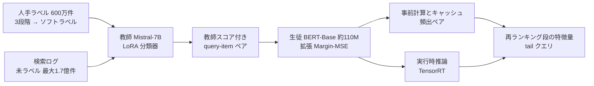

# Knowledge Distillation for Enhancing Walmart E-commerce Search Relevance Using Large Language Models

- **Link**: <https://arxiv.org/abs/2505.07105>（HTML: <https://arxiv.org/html/2505.07105v1>）
- **Authors**: Hongwei Shang（責任著者）, Nguyen Vo（同等貢献。所属表記は Amazon）, Nitin Yadav, Tian Zhang, Ajit Puthenputhussery, Xunfan Cai, Shuyi Chen, Prijith Chandran, Changsung Kang（Walmart Global Tech, Sunnyvale）
- **Year**: 2025（arXiv 投稿 2025-05-11）
- **Venue**: Companion Proceedings of the ACM Web Conference 2025（WWW Companion '25）, DOI 10.1145/3701716.3715242
- **Type**: Academic Paper（企業の本番導入報告）
- **証拠の質**: **一次資料**（企業著者による査読付き論文。オフライン指標・人手評価・インターリービング・A/B テストを全て記載）
- **蒸留の種別**: **真の蒸留**（LLM 教師のソフトスコアを生徒が回帰する応答ベース蒸留。データ拡張型）

## Abstract

> 原文の逐語転載は引用上限を超えるため要約で示します（取得元: arXiv HTML 版）。

The authors distill a high-performing LLM into a low-latency student model for e-commerce search relevance. The teacher is trained as a classifier with soft targets. The student learns the relevance margin between product pairs for a query using MSE loss, on a much larger set of unlabeled data labeled by the teacher. The student keeps improving as augmented data grows and can outperform the teacher given enough data. It is deployed at Walmart.com.

## Abstract (Japanese Translation)

EC 検索の関連度判定のために、高性能な LLM を低レイテンシの生徒モデルへ蒸留する枠組みを提案します。教師はソフトターゲットを用いた分類器として学習し、生徒は「同じクエリに対する 2 商品間の関連度の差（margin）」を MSE 損失で学習します。生徒の学習データは人手ラベルではなく、教師がラベル付けした大量の未ラベルデータです。拡張データが増えるほど生徒の性能は上がり、十分なデータ量があれば教師を上回ることもあります。生徒モデルは Walmart.com で本番稼働しています。

## Overview

Walmart は、本番の BERT-Base 交差エンコーダ（XEv1）を置き換えるために、**7B LLM（Mistral-7B）を教師、BERT-Base（約 110M）を生徒** とする蒸留を行いました。要点は次の 3 つです。

1. **教師は人手ラベル 600 万件で学習**し、ソフトラベル（0 / 0.5 / 1）で 3 段階の関連度を表現する。
2. **生徒は教師が採点した最大 1.7 億件の query-item ペア** で学習する。人手ラベルの約 28 倍のデータ量。
3. 損失は **拡張 Margin-MSE**（同一クエリ内の全商品ペアの教師スコア差を回帰）で、点ごとの CE より大幅に良い。

結果として、生徒は **教師と同等の R@P=95%（+13.27%）、NDCG@5 では教師を上回り（+1.5% 対 +1.33%）**、2024 年 10 月からロングテール（tail）クエリの再ランキング段の特徴量として本番稼働しています。A/B テストでは **visitor あたりのカート追加（ATC）率 +1.2%** を得ました。

## Problem

- **レイテンシ制約**: 7B の交差エンコーダは精度は高いが、検索の再ランキング段でリアルタイムに使えない。
- **人手ラベルの不足**: ロングテールクエリはエンゲージメントが少なく、人手評価データも限られる。
- **ラベル雑音**: 3 段階（2 / 1 / 0）の人手ラベルをそのまま多クラス分類すると、境界のあいまいさが学習を妨げる。
- **既存の BERT 交差エンコーダの頭打ち**: 人手ラベルを増やしても（600 万 → 1,000 万件）改善が小さい。

## Proposed Method

**LLM 教師 + 拡張 Margin-MSE による蒸留**

- 核となる考え: 「教師の **絶対スコア** ではなく、同一クエリ内での **商品間のスコア差** を生徒に模倣させる」。ランキングでは相対順序が重要なため。
- 手順:
  1. 教師 LLM（Llama2-7B / Mistral-7B-v0.1、LoRA）を人手ラベル（human-judged_v1, 600 万件）でソフトターゲット BCE 学習する。
  2. 検索ログから未ラベルの query-item ペア（最大 1.7 億件）を集め、教師でスコア付けする。
  3. 生徒（BERT-Base 交差エンコーダ、商品説明文は入力しない）を、同一クエリ内の全ペアについて教師スコア差を MSE で回帰させて学習する。
  4. 生徒を本番の再ランキング段に特徴量として組み込み、頻出ペアのスコアは事前計算・キャッシュする。
- 既存手法との違い: 元の Margin-MSE（Hofstätter ら）は「正例 1 つと負例 1 つ」のペアだが、本手法は **クエリ内の全組合せ** に拡張している。

**Key Formulas**:

教師の損失（ソフトラベル付き BCE）:

$$
\mathcal{L}_{teacher}(q)=\sum_{d\in\mathbf{D}_q}\left[-y_{q,d}\log t(q,d)-(1-y_{q,d})\log(1-t(q,d))\right],\quad y_{q,d}\in\{0,0.5,1\}
$$

生徒の損失（拡張 Margin-MSE）:

$$
\mathcal{L}_{student}(q)=\frac{2}{|\mathbf{D}_q|(|\mathbf{D}_q|-1)}\sum_{\substack{d_i,d_j\in\mathbf{D}_q\\ i<j}}\left(\Delta^t_{q,d_i,d_j}-\Delta^s_{q,d_i,d_j}\right)^2
$$

$$
\Delta^t_{q,d_i,d_j}=t(q,d_i)-t(q,d_j),\qquad \Delta^s_{q,d_i,d_j}=s(q,d_i)-s(q,d_j)
$$

比較用の点ごと CE 蒸留（アブレーション）:

$$
\mathcal{L}_{student'}(q)=\sum_{d\in\mathbf{D}_q}\left[-t_{q,d}\log s(q,d)-(1-t_{q,d})\log(1-s(q,d))\right]
$$

- $q$: クエリ、$\mathbf{D}_q$: クエリ $q$ の商品集合、$t(q,d)$: 教師スコア、$s(q,d)$: 生徒スコア、$y_{q,d}$: 人手ラベル由来のソフトラベル（2→1, 1→0.5, 0→0）。

**Features**:

- 教師は最終トークンの隠れ状態 → MLP で 1 スコアを出す「分類器型 LLM」（生成はしない）。
- 教師は LoRA（rank 256, α=128, dropout 0.05）、AdamW、lr 1e-5、A100 40GB × 8。
- 生徒は商品説明文を入力から外し、レイテンシを抑える。

## Algorithm (Pseudocode)

```
Algorithm: Walmart LLM-to-BERT Relevance Distillation
Input : 人手ラベル H = {(q, d, y)}, 未ラベルログ U = {(q, d)}
Output: 本番用生徒 s(q, d)

1. t ← LoRA-finetune(Mistral-7B, H, loss = soft-BCE)      // 教師を分類器として学習
2. for each (q, d) in U:                                  // 最大 1.7 億件
       score[q, d] ← t(q, d)                              // 教師で疑似スコア付け
3. for each query q in U:
       D_q ← 商品集合
       for all pairs (d_i, d_j) in D_q, i < j:
           Δt ← score[q,d_i] - score[q,d_j]
           Δs ← s(q,d_i) - s(q,d_j)
           L += (Δt - Δs)^2                               // 拡張 Margin-MSE
4. s ← minimize L (BERT-Base, lr 1e-5, 商品説明なし)
5. deploy: 頻出ペア → 事前計算 + キャッシュ / それ以外 → TensorRT で実行時推論
```

## Architecture / Process Flow



## Figures & Tables

### Figure 1: 旧本番版の交差エンコーダの構成


### Figure 2: 提案する知識蒸留の枠組み


### Table 3: 学習データ

| データセット | QIP 総数 | ユニーククエリ | ユニーク商品 | クラス 2 / 1 / 0 |
|---|---|---|---|---|
| human-judged_v1 | 6.0M | 709K | 2.3M | 64.2% / 19.7% / 16.1% |
| human-judged_v2 | 10M | 1M | 3.7M | 63.6% / 19.8% / 16.6% |
| llm-judged_v1 | 50M | 5.2M | 15M | NA |
| llm-judged_v2 | 110M | 5.2M | 22.6M | NA |
| llm-judged_v3 | 170M | 5.2M | 29.4M | NA |

テストセット: ロングテールクエリ 2,354 件、QIP 32,586 件（各クエリの上位 10 商品 + ランダム 10 商品）。

### Table 4: 教師モデル（XEv1 ベースライン比の改善率）

| モデル | 学習データ | R@P=95% | R@P=90% | NDCG@5 | NDCG@10 |
|---|---|---|---|---|---|
| Llama2-7B | human-judged_1 | +11.84% | +5.57% | +1.02% | +0.8% |
| Mistral-7B | human-judged_1 | +13.27% | +6.52% | +1.33% | +1.03% |

### Table 5: 生徒のアブレーション（XEv1 比）

| モデル | 学習データ | 損失 | R@P=95% | R@P=90% | NDCG@5 | NDCG@10 |
|---|---|---|---|---|---|---|
| XEv1（ベースライン） | human-judged_1 | 多クラス CE | 0% | 0% | 0% | 0% |
| XEv1.1 | human-judged_2 | ソフト CE | +9.99% | +4.38% | +0.77% | +0.66% |
| XEv1.2 | llm-judged_1 | CE | −2.28% | +2.01% | +1.16% | +0.89% |
| XEv1.3 | llm-judged_1 | Margin MSE | +12.55% | +5.92% | +1.24% | +0.92% |
| XEv1.4 | llm-judged_2 | Margin MSE | +13.27% | +5.92% | +1.36% | +1.04% |
| **XEv2** | llm-judged_3 | Margin MSE | +12.84% | +6.04% | **+1.5%** | +1.04% |

### Table 7: オンライン A/B テスト（2024-08-26〜09-09、tail トラフィック）

| 指標 | 変化 |
|---|---|
| セッションあたり ATC 率 | +0.8% |
| visitor あたり ATC 率 | +1.2% |
| 検索セッション離脱率 | −0.6% |
| ATC までに必要なクリック数 | −1.1% |

### 補足: その他のオンライン評価

| 評価 | 結果 |
|---|---|
| 人手評価 NDCG@5（tail, top-10） | +1.07%（p=0.00） |
| 人手評価 NDCG@10 | +0.87%（p=0.01） |
| インターリービング 14 日間 ATC@40 | +0.06%（p=0.00） |

### 生徒データ量と性能（Table 5 から作成）

```
NDCG@5 改善率（XEv1 比）
人手 1,000万件 ソフトCE   |████████ +0.77%
LLM 5,000万件  CE        |████████████ +1.16%
LLM 5,000万件  MarginMSE |████████████ +1.24%
LLM 1.1億件    MarginMSE |██████████████ +1.36%
LLM 1.7億件    MarginMSE |███████████████ +1.50%   ← 教師(+1.33%)を上回る
```

### 手法比較

| 観点 | 本論文（XEv2） | 旧本番 XEv1 | Margin-MSE 原典 | Walmart eCom'24 |
|---|---|---|---|---|
| 教師 | Mistral-7B | なし | BERT アンサンブル | BERT-base 交差エンコーダ |
| 生徒 | BERT-Base 交差エンコーダ | BERT-Base | 双塔 / ColBERT 等 | DistilBERT 双塔 |
| 学習データ | LLM ラベル 1.7 億 | 人手 600 万 | MS MARCO | 人手 + 属性 |
| ペア構成 | クエリ内の全組合せ | — | 正例 1 対 負例 1 | 正例 1 対 負例 1 |
| 本番 | 2024/10 tail で稼働 | 稼働 | — | 本番比較のみ |

## Experiments & Evaluation

### Setup

- データ: 人手ラベル 600 万 / 1,000 万件、LLM ラベル 5,000 万 / 1.1 億 / 1.7 億件。
- 指標: R@P=95%、R@P=90%（関連商品の再現率を精度固定で測る）、NDCG@5、NDCG@10。
- ベースライン: 旧本番 XEv1（Walmart 社内事前学習 BERT から微調整した 3 クラス softmax）。

### Main Results

- Mistral-7B 教師は XEv1 比 R@P=95% +13.27%、NDCG@5 +1.33%。
- 生徒 XEv1.4 は教師と同じ R@P=95%（+13.27%）、NDCG@5 は +1.36% で教師を僅かに上回る。
- データを 1.7 億件まで増やした XEv2 は NDCG@5 +1.5%。ただし R@P はやや低下し、**一定量以上でデータを増やす効果は頭打ち** になる。

### Ablation Study

- 同じ LLM ラベル 5,000 万件で、**CE → Margin-MSE で R@P=95% が −2.28% → +12.55%**（差 +14.83pt）。損失設計の効果が最も大きい。
- 人手ラベルを 1.6 倍（600 万 → 1,000 万）にするより、LLM ラベル 5,000 万件の方が NDCG で効果が大きい。

## 蒸留のビジネス価値式への当てはめ

clustering の式 $\text{価値} \approx (C_{teacher}-C_{student})Q - (C_{data}+C_{train}) - \Delta\text{Acc}\cdot V_{err}$ に対し、本論文が報告しているのは次の項です。

| 項 | 報告内容 |
|----|---------|
| $(C_{teacher}-C_{student})Q$ | 教師は生徒の 60 倍以上のサイズ（論文の記述）。金額・レイテンシの数値は **非公開** |
| $C_{data}$ | 人手ラベル 600 万件 + LLM による 1.7 億件のラベル付け（コストは非公開） |
| $\Delta\text{Acc}$ | **負（生徒が教師を上回る）**。NDCG@5 +1.5% 対 +1.33% |
| ビジネス成果 | ATC/visitor +1.2%、離脱率 −0.6% |

## Practical Takeaways

1. **損失は「差」を学ばせる**: 教師の絶対スコアを CE で真似るより、商品間の差を回帰する方が大幅に良い。
2. **人手ラベルを増やすより LLM ラベルを増やす**: 600 万→1,000 万件の人手追加より、LLM ラベル 5,000 万件の方が効果的。
3. **まずロングテールに限定して導入**: エンゲージメント信号が弱い tail クエリは LLM 蒸留の効果が出やすく、リスクも小さい。
4. **配信は事前計算 + キャッシュ + TensorRT** の組合せで現実的なレイテンシに収める。

## Limitations（著者の記述）

- 教師の学習に使った人手データは 1 版のみ。
- クエリ属性（商品タイプ等）を教師の入力に使っていない。
- 生徒はレイテンシのため商品説明文を使わない。
- 拡張データは一定量で頭打ち。
- 関連度のみを最適化しており、エンゲージメントとの多目的化は今後の課題。
- 本番適用は tail クエリのみ（head / torso は今後）。
- 評価セット 32K QIP は小さめ（ただしオンライン人手評価と整合）。

## Notes

- 前身は SIGIR eCom'24 の Walmart 論文（BERT-base 交差エンコーダ → DistilBERT 双塔。論文中で BERT-base を「LLM」と呼んでいる）。本論文で教師が真の LLM（7B）に置き換わった。
- Taobao（WWW'25, 04 番レポート）は「Walmart-LLM」を比較対象にしている。
- **レイテンシ・コストの具体値は非公開** であり、「推論コスト削減」の定量はこの論文からは得られない。
- **（2026-10-22 追記・検証）** arXiv HTML 版で、教師 Mistral-7B、生徒 BERT-Base 交差エンコーダ、人手 600 万 QIP、LLM ラベル 1.7 億件、A/B（2024-08-26〜09-09、tail トラフィック）の ATC/session +0.8%、ATC/visitor +1.2%、離脱率 −0.6%、ATC までのクリック −1.1%、2024 年 10 月の tail 導入、「教師は生徒の 60 倍超」を再確認した。
