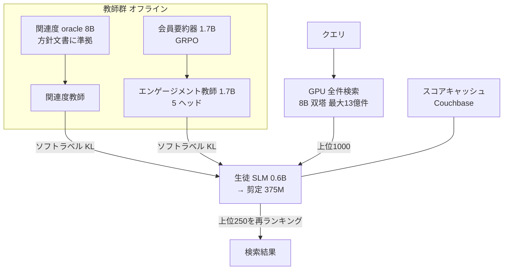

# Semantic Search At LinkedIn（多教師蒸留による AI Job Search / People Search）

- **Link**: <https://arxiv.org/abs/2602.07309v1>（HTML: <https://arxiv.org/html/2602.07309v1>）
- **補助資料（一次）**:
  - LinkedIn Engineering「Reimagining LinkedIn's search tech stack」(2026-01-21) <https://www.linkedin.com/blog/engineering/search/reimagining-linkedins-search-stack>
  - LinkedIn Engineering「The Training Infrastructure Behind AI-Powered Job Search: 8X Faster Multi-Teacher Distillation」(2026-08-06) <https://www.linkedin.com/blog/engineering/infrastructure/the-training-infrastructure-behind-ai-powered-job-search-eight-x-faster-multi-teacher-distillation>
- **補助資料（二次）**: InfoQ (2026-09-11) <https://infoq.com/news/2026/09/linkedin-ai-multi-teacher>、VentureBeat (2026-01-21) <https://venturebeat.com/infrastructure/why-linkedin-says-prompting-was-a-non-starter-and-small-models-was-the>
- **Authors**: Fedor Borisyuk, Sriram Vasudevan, Muchen Wu, Guoyao Li, Benjamin Le ほか 70 名超（LinkedIn, Mountain View）
- **Year**: 2026（arXiv 2026-02-07）
- **Venue**: arXiv preprint（ページ上の表記は "Preprint; 2025"）
- **Type**: Academic Paper + Technical Article
- **証拠の質**: **一次資料**（企業著者の論文と公式エンジニアリングブログ）。ただし一部の数値は論文とブログで集計条件が異なる（後述）
- **蒸留の種別**: **真の蒸留**（教師のソフトラベル・logits を KL で学習する多教師蒸留。加えて剪定・要約による圧縮）

## Abstract

> 原文の逐語転載は引用上限を超えるため要約で示します。

The paper presents LinkedIn's LLM-based semantic search framework for AI Job Search and AI People Search. It combines an LLM relevance judge, embedding-based retrieval, and a compact Small Language Model (SLM) trained by multi-teacher distillation to jointly optimize relevance and engagement. A prefill-oriented inference stack, co-designed with pruning, context compression, and text-embedding hybrid interactions, raises ranking throughput by over 75x at fixed latency while staying near teacher-level NDCG.

## Abstract (Japanese Translation)

LinkedIn の AI Job Search と AI People Search を支える、LLM ベースのセマンティック検索の枠組みを示します。LLM による関連度判定（judge）、埋め込みベースの検索（retrieval）、そして **関連度とエンゲージメントを同時に最適化するよう多教師蒸留で学習した小型言語モデル（SLM）** を組み合わせています。剪定・文脈圧縮・テキストと埋め込みのハイブリッド相互作用と一体で設計した prefill 中心の推論基盤により、**固定レイテンシ下でランキングのスループットを 75 倍以上** に高めつつ、教師に近い NDCG を維持しています。

## Overview

LinkedIn は、**検索（求人・人物）の最終ランキングを 0.6B の SLM（剪定後 375M）で行う** ために、複数の教師から蒸留しました。

- **教師（役割別）**: 関連度 oracle（8B、方針文書に沿った採点）、関連度教師、エンゲージメント教師（1.7B、クリック・応募等の多タスク）、さらに評価用に 8B の judge。
- **生徒**: 0.6B SLM（ベースモデル名は論文に明記なし）→ OSSCAR で 375M に剪定。
- **成果（オフライン）**: 関連度のみの生徒で NDCG@10 **0.7583 → 0.9432（+24.48%）**。多教師蒸留の生徒は関連度教師比 −3.5%、クリック AUROC は −1.0% に収まる。
- **成果（オンライン）**: Job Search で **NDCG@10 +7.73%、PMR@10 −46.88%**、People Search で NDCG@10 +10% 超、**DAU +1.2% 超**。
- **効率**: 500ms 予算・H100 1 枚で 290 → 2,200 → 22,000 items/s（要約+剪定、さらに埋め込み圧縮 MixLM）。
- **学習基盤**: 蒸留パイプライン **約 45 時間 → 5 時間未満（8 倍超）**（ブログ）。

> clustering 段階で「多教師蒸留で NDCG@10 0.758→0.943」と記載していましたが、**0.9432 は「関連度のみの生徒 + 40 倍データ」の値** で、多教師蒸留後の生徒は 0.9150（論文 Table 5）/ 0.9239（ブログ, 埋め込み圧縮版）です。数値の帰属に注意が必要です。

## Problem

- **プロンプトでは不可能**: 方針文書は 20〜30 ページあり、プロンプトで LLM に従わせるのは現実的でない（VentureBeat の引用「there was just no way we were gonna be able to do that through prompting」）。
- **関連度とエンゲージメントの両立**: 関連度だけを最適化するとクリック・応募が落ち、逆も起こる。
- **長い入力**: 求人記述の中央値は約 900 トークン、最大 2,300 超。プロンプトの 94% 超が記述文。
- **スループット**: 上位 250 件を毎リクエスト再ランキングするため、全文 SLM（290 items/s/GPU）では足りない。

## Proposed Method

**多段階 SLM 学習 + 多教師蒸留 + 推論基盤の共同設計**

主な構成要素:

1. **方針準拠の関連度 oracle（8B）**: PM のラベル（重み付き Cohen's κ ≥ 0.8 を正解と見なす）で学習し、0〜4 の段階評価と根拠を出す。日次で数千万件の query-document を採点。
2. **関連度の生徒学習（Table 1）**: 順序ラベル SFT → ソフトラベル SFT → ドメイン推論 → スケジュールフリー最適化 → chat template → ランキング損失 → 0.5B→0.6B → 関連度教師からの蒸留 → 40 倍データ。
3. **エンゲージメント教師（1.7B）**: 会員要約（1.7B の要約器を GRPO で学習）を入力に含め、クリック・応募・不適合など 5 ヘッドを予測。
4. **多教師蒸留**: 関連度教師とエンゲージメント教師の分布を、**KL 損失の重み付き和** で 0.6B 生徒に学習させる。関連度 SLM からのウォームスタートが有効。
5. **圧縮**: OSSCAR で MLP ニューロン 50% と最後の 8 層を削除（600M → 375M）、オフライン要約で入力を短縮、埋め込み圧縮（MixLM）。
6. **推論基盤**: SGLang ベースの scoring-only prefill、バッチ内 prefix キャッシュ、CUDA graph、Couchbase のスコアキャッシュ、PID 制御の動的スコアリング深さ。

**Key Formulas**:

検索（retrieval）の InfoNCE:

$$
\mathcal{L}_{\text{InfoNCE}}=-\log\frac{\exp(\langle e_q,e_{d^+}\rangle/\tau)}{\exp(\langle e_q,e_{d^+}\rangle/\tau)+\sum_{d^-\in\mathcal{B}^-}\exp(\langle e_q,e_{d^-}\rangle/\tau)}
$$

ペアワイズのマージン損失:

$$
\mathcal{L}_{\text{pair}}=\sum_{d^-\in\mathcal{D}^-}\max\left(0,\; m-\langle e_q,e_{d^+}\rangle+\langle e_q,e_{d^-}\rangle\right)
$$

検索の総合目的: $\lambda\mathcal{L}_{\text{InfoNCE}}+(1-\lambda)\mathcal{L}_{\text{pair}}$

GPU 上の retrieval-as-ranking のスコアと学習:

$$
S(q,d)=w_0\langle e_q,e_d\rangle+\sum_{i=1}^{n}w_i f_i(q,d),\qquad
\mathcal{L}_{\text{RAR}}=\lambda\,\mathcal{L}_{\text{BCE}}(S,L_R)+(1-\lambda)\,\mathcal{L}_{\text{BCE}}(S,L_E)
$$

要約器の報酬（GRPO）:

$$
R(s)=\mathbb{I}[\hat{a}_n=a_n]\left(1-\lambda_{\text{len}}\ell(s)+\lambda_{\text{qual}}q(s)\right)
$$

学習データの再重み付け:

$$
G_i=\frac{\text{P@10}_{\text{baseline},i}}{\text{P@10}_{\text{treatment},i}},\qquad B_i=P_i\cdot G_i
$$

多教師蒸留（論文は明示式を示さないため、記述から再構成）:

$$
\mathcal{L}_{\text{student}}=\alpha\,\mathcal{L}_{\text{CE}}(y,\hat{y})+\sum_{k\in\{\text{rel},\text{eng}\}}\beta_k\,\mathrm{KL}\left(p_k^{\text{teacher}}\,\|\,p^{\text{student}}\right)
$$

- 関連度教師のソフトラベルは yes/no の logits から $p=\frac{\text{yes}}{\text{yes}+\text{no}}$ で作る（ブログ）。$\alpha,\beta_k$ の値は非公開。

## Algorithm (Pseudocode)

```
Algorithm: LinkedIn multi-teacher SLM ranker
Input : 方針文書, PM ラベル, 検索ログ, 会員プロフィール
Output: 375M SLM ランカー

1. oracle ← SFT(8B, PM ラベル)                 // 方針準拠の関連度採点器
2. labels_rel ← oracle(検索ログ)                // 日次数千万件の段階評価 + 根拠
3. T_rel ← SFT(関連度教師, labels_rel)
4. summary ← GRPO(1.7B 要約器, 報酬 R(s))        // 会員履歴の要約
5. T_eng ← multitask-SFT(1.7B, クリック/応募/不適合..., 入力に summary)
6. S ← warm-start(関連度 SLM 0.6B)
7. for step:                                     // online or offline (cache) KD
       p_rel ← T_rel(x); p_eng ← T_eng(x)        // offline の場合は HDFS キャッシュから読む
       L ← CE(y) + β_rel KL(p_rel||S) + β_eng KL(p_eng||S)
8. S ← OSSCAR-prune(S, MLP 50%, 最後の 8 層) → 375M → 再学習
9. serve: SGLang scoring-only prefill + prefix cache + CUDA graph + score cache
```

## Architecture / Process Flow



## Figures & Tables

### 論文の図（arXiv HTML から参照）


### モデル一覧

| モデル | サイズ | 役割 |
|---|---|---|
| 関連度 oracle | 8B | 方針準拠の採点器 |
| 関連度教師 | 生徒より大（論文に明記なし。ブログでは 1.7B） | ソフトラベル |
| エンゲージメント教師 | 1.7B | 多タスク SFT |
| 会員要約器 | 1.7B | GRPO で学習 |
| 要約器の報酬モデル | 32B + エンゲージメント教師 | 事実性・重要度 |
| 生徒ランカー | 0.6B → 剪定 375M | 本番 SLM |
| 検索用双塔 | 8B（Job）/ 4B（People） | 埋め込み検索 |

### Table 1: 関連度のみの生徒（Job Search, NDCG@10）

| 手法 | NDCG@10 | ベースライン比 |
|---|---|---|
| 順序ラベル SFT（ベースライン） | 0.7583 | — |
| ソフトラベル SFT（線形） | 0.8420 | +11.04% |
| + ドメイン推論 | 0.8500 | +12.09% |
| + スケジュールフリー・層別 LR | 0.8608 | +13.52% |
| + ソフトラベル SFT（シグモイド） | 0.8632 | +13.83% |
| + chat template | 0.8718 | +14.97% |
| + ランキング損失 | 0.8772 | +15.68% |
| + ベースモデル 0.5B→0.6B | 0.8910 | +17.50% |
| + 関連度教師からの蒸留 | 0.8950 | +18.03% |
| + データ量 40 倍 | **0.9432** | **+24.48%** |
| + 要約記述 + 剪定 | 0.9218 | +21.56% |

```
NDCG@10 の積み上げ（Job Search）
baseline          |███████████████ 0.7583
soft-label        |█████████████████ 0.8420
+ranking loss     |█████████████████ 0.8772
+teacher distill  |██████████████████ 0.8950
+40x data         |███████████████████ 0.9432
+summary+prune    |██████████████████ 0.9218
```

### Table 2: People Search（関連度のみ, NDCG@5）

| 手法 | NDCG@5 |
|---|---|
| ベースライン | 0.8123 |
| 関連度教師からの蒸留後 | 0.8933（+9.97%） |

### Table 3: エンゲージメント教師（Job Click AUROC）

| モデル | AUROC |
|---|---|
| LiRank（従来の推薦モデル） | 0.6487 |
| LLM（query-job のみ） | 0.6069 |
| LLM + 会員要約（最終） | 0.6772（LiRank 比 +4.40%） |

### Table 4: 多タスク損失の重み（Job Search, LiRank 比）

重み: click 0.4, apply 0.4, badfit 0.05, shortlist 0.05, dismiss 0.1

| タスク | 改善 |
|---|---|
| Badfit | +17.48% |
| Apply | +1.56% |
| Click | +4.40% |
| Dismiss | −1.32% |
| Shortlist | +12.11% |

### Table 5: 多教師蒸留

| 初期化 | NDCG@10（関連度教師 0.9484 比） | Click AUROC（エンゲージメント教師 0.6772 比） |
|---|---|---|
| オープンソース初期値 | 0.9088（−4.18%） | 0.6574（−2.92%） |
| 関連度 SLM からウォームスタート | 0.9150（−3.52%） | 0.6704（−1.00%） |

位置条件付きキャリブレーションで Click AUROC は 0.6704 → 0.7095。

### ブログ版の蒸留表（Reimagining LinkedIn's search tech stack）

| モデル | NDCG@10 | Apply AUC | Click AUC |
|---|---|---|---|
| 関連度教師 1.7B | 0.9484 | – | – |
| エンゲージメント教師 1.7B | – | 0.8049 | 0.6772 |
| SLM 0.6B（蒸留後） | 0.9239 | 0.8007 | 0.6704 |

### Table 6: People Search の多タスク AUROC

| 行動 | ベースライン | 最終（ネットワーク特徴あり） | 相対改善 |
|---|---|---|---|
| Long-dwell | 0.676 | 0.797 | 約 +16.9% |
| Connect | 0.727 | 0.908 | 約 +23.1% |
| Follow | 0.815 | 0.923 | 約 +12.6% |
| Message | 0.833 | 0.933 | 約 +11.5% |

### Table 7: 数値特徴のプロンプト化（AUC 改善）

| 工夫 | AUC 改善 |
|---|---|
| 説明的な識別子 | +5.8% |
| True/False 符号化 | +1.7% |
| CTR 特徴 | +5.1% |
| 小数 2 桁への切り詰め | 0.0% |

### Table 8: 検索（Job Search, @50）

| 変種 | P@50 | R@50 | NDCG@50 |
|---|---|---|---|
| Baseline-8B | 0.414 | 0.774 | 0.735 |
| + chat template | 0.446 | 0.830 | 0.788 |
| + InfoNCE（LoRA） | 0.471 | 0.874 | 0.829 |
| + InfoNCE + HardNeg（LoRA） | 0.497 | 0.887 | 0.833 |
| + InfoNCE + HardNeg（全パラメータ） | 0.505 | 0.899 | 0.842 |
| 4B + InfoNCE + HardNeg（全パラメータ） | 0.501 | 0.889 | 0.834 |

### Table 9: 検索（People Search, @10）

| 変種 | NDCG@10 | P@10 | R@10 |
|---|---|---|---|
| Baseline-4B | 0.71 | — | — |
| 最終 GPU RAR | 0.79 | 0.47 | 0.79 |

RAR で Click AUC 0.595 → 0.603（+1.7%）。

### Table 10: 500ms 予算・H100 1 枚での効率

| モデル | NDCG@10 | スループット（items/s/GPU） |
|---|---|---|
| 全文 | 0.9432 | 290 |
| 要約 + 剪定 | 0.9218 | 2,200 |
| MixLM（埋め込み圧縮） | 0.9239 | 22,000 |

```
スループット（items/s/GPU, 対数的に見ると 75 倍超）
全文        |▏ 290
要約+剪定   |██ 2,200
MixLM       |████████████████████ 22,000
```

### Table 11: 剪定（People Search）

| モデル | NDCG@10 |
|---|---|
| 600M ベースライン | 0.8629 |
| 375M 剪定 | 0.8652 |

### Table 12: 推論基盤のアブレーション（375M, 50 + 150 トークン, batch 50）

| 段階 | items/s |
|---|---|
| 初期 | 750 |
| バッチトークナイズ | 900 |
| scoring-only prefill | 1,300 |
| ランタイム | 1,600 |
| バッチ内 prefix キャッシュ | 2,000 |
| piecewise CUDA graph | 2,200（計 2.93 倍） |

### Table 13: 埋め込み型配信（0.6B ランカー）

| 構成 | items/s |
|---|---|
| gRPC 1 + SGLang worker 1 | 約 10,000 |
| マルチプロセス（6+6） | 約 19,500 |
| マルチプロセス + CUDA graph | 約 22,000 |

### 学習基盤（論文 + ブログ）

| 項目 | 効果 |
|---|---|
| マルチノード学習 | 最大 3.5 倍 |
| FSDP2 | 約 +20% |
| H200 マルチノード | 最大 30% 短縮 |
| オンライン多教師蒸留 | 3 倍高速 |
| オフライン（キャッシュ）蒸留 | 学習時間 約 −35%、GPU 時間 約 −25%（論文） |
| 教師微調整 | 約 25 時間 → 12 時間未満（2,000 万件, ブログ） |
| 蒸留パイプライン全体 | 約 45 時間 → 5 時間未満（8 倍超, ブログ） |
| FP8 | 8B 未満では効果なし |

### 配信の中間層

| 施策 | 効果 |
|---|---|
| スコアキャッシュ | リクエストの 50% 超をキャッシュで処理、中央値・平均レイテンシ 約 −8〜10% |
| リトライ方針 | スループット 約 +10% |
| 動的スコアリング深さ | ピーク時 250 → 130 件（GPU 計算 −48%） |
| トラフィック整形 | 実効 GPU スループット 約 +25% |

### オンライン成果

| 指標 | 結果 |
|---|---|
| Job Search NDCG@10 | +7.73%（DLRM 型ベースライン比） |
| Job Search PMR@10 | −46.88% |
| People Search NDCG@10 | +10% 超 |
| DAU | +1.2% 超 |

## Experiments & Evaluation

### Setup

- 評価は oracle / SAGE（8B judge, 人手先例との線形 κ 0.77、教師は 0.81）による段階評価と、エンゲージメントの AUROC。
- 本番: 米国ユーザーの自然言語求人検索で稼働（InfoQ）。

### Main Results

- 関連度のみの生徒は、ソフトラベル化だけで +11%、データ 40 倍で +24.5%。
- 多教師蒸留は「関連度 −3.5%・クリック −1.0%」という小さな犠牲で、両方を 1 モデルで予測できる。
- 推論は 290 → 22,000 items/s/GPU（約 76 倍）。

### Ablation Study

- 関連度 SLM からのウォームスタートは、オープンソース初期値より NDCG@10 +0.66pt、Click AUROC +1.3pt。
- 剪定 600M → 375M で People Search の NDCG@10 はむしろ微増（0.8629 → 0.8652）。

## 蒸留のビジネス価値式への当てはめ

| 項 | 報告内容 |
|----|---------|
| $(C_{teacher}-C_{student})Q$ | 生徒は「教師の 1/3 のサイズ」（ブログ）。推論コストは「従来の推薦モデルと同程度」に収まった（ブログ）。金額は非公開 |
| $C_{train}$ | 蒸留パイプラインを 45 時間 → 5 時間未満に短縮 |
| $\Delta\text{Acc}$ | 関連度 −3.5%、クリック AUROC −1.0%（教師比） |
| ビジネス成果 | DAU +1.2% 超 |

## Practical Takeaways

1. **教師は役割ごとに分ける**: 関連度（方針準拠）とエンゲージメント（行動予測）を別教師にし、生徒で統合する。
2. **データ量が最大のレバー**: Table 1 で最大の伸びは「40 倍データ」（+6.4pt）。LLM 採点でデータを増やす価値が大きい。
3. **配信側の工夫が蒸留と同じくらい重要**: 剪定・要約・prefix キャッシュ・埋め込み圧縮で 75 倍超。
4. **教師出力はキャッシュする**: オフライン蒸留は品質を落とさず学習時間を大幅に短縮。

## Notes

- 「8 倍高速」は学習（蒸留パイプライン）の話で、推論の話ではない（InfoQ の見出しに注意）。
- InfoQ は SGLang ベースの多教師蒸留フレームワークに言及しているが、LinkedIn のブログ本文は「高スループット推論エンジン」とだけ書いている。
- VentureBeat は「7B 方針教師 → 1.7B 生徒 → 数億パラメータ」と段階蒸留を説明しており、論文の 8B oracle とはサイズ表記が異なる（版の違いと推測）。
- **（2026-10-22 追記・検証）** arXiv HTML 版で、Job Search NDCG@10 +7.73%、PMR@10 −46.88%、People Search NDCG@10 10% 超、DAU +1.2% 超、スループット 75 倍超（290 → 22,000 items/s/GPU、500ms 予算）、生徒 600M → 375M、8B oracle、1.7B エンゲージメント教師、40 倍データ（Job Search 20 万 → 800 万対。People Search は 10 倍）、多教師生徒の関連度教師比 −3.52% を再確認した。「+24.48%」は論文 Table 1 の表記をそのまま転記したもので、表の値（0.7583 → 0.9432）から再計算すると約 +24.4% になる。
