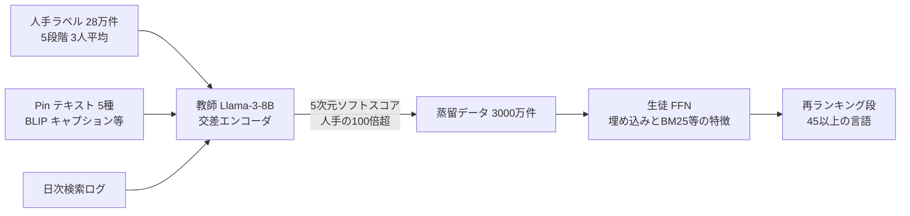

# Improving Pinterest Search Relevance Using Large Language Models

- **Link**: <https://arxiv.org/abs/2410.17152>（HTML: <https://arxiv.org/html/2410.17152v1>）
- **補助資料**: AI Engineer World's Fair 2025 講演「What We Learned from Using LLMs in Pinterest」<https://ai.engineer/talks/what-we-learned-from-using-llms-in-pinterest>（一次・講演要約ページ）、ZenML 要約 <https://www.zenml.io/llmops-database/large-language-models-for-search-relevance-via-knowledge-distillation>（二次。Pinterest Engineering の Medium 記事を要約。Medium 本体は 403 で取得不可）
- **Authors**: Han Wang, Mukuntha Narayanan S（同等貢献）, Onur Gungor, Yu Xu, Krishna Kamath, Rakesh Chalasani, Kurchi Subhra Hazra, Jinfeng Rao（Pinterest, San Francisco）
- **Year**: 2024（arXiv 2024-10-22）
- **Venue**: 3rd International Workshop on Industrial Recommendation Systems @ CIKM 2024
- **Type**: Academic Paper
- **証拠の質**: **一次資料**（論文）。国別の詳細値の一部は **二次（ZenML 要約）**
- **蒸留の種別**: **真の蒸留**（LLM 教師の 5 段階ソフトラベルで、特徴量ベースの生徒を学習）

## Abstract

> 原文の逐語転載は引用上限を超えるため要約で示します。

The paper integrates LLMs into Pinterest Search's relevance model. Inputs pair the query with Pin text features, including captions from a visual language model, link text, high-engagement queries, and board titles. A semi-supervised approach scales training data beyond human labels. Multilingual LLMs extend coverage to unseen languages and domains, and the LLM is distilled into a real-time servable model. The authors report offline validation and gains from the deployed system.

## Abstract (Japanese Translation)

Pinterest 検索の関連度モデルに LLM を組み込んだ報告です。クエリと Pin のテキスト特徴（視覚言語モデルによる画像キャプション、リンク先テキスト、高エンゲージメントのクエリ、ボードタイトル）を組にして入力します。半教師あり学習で人手ラベル以上に学習データを拡大し、多言語 LLM によって未知の言語・領域へも適用範囲を広げます。LLM はリアルタイム配信可能なモデルへ蒸留しています。オフライン検証と、本番導入後の改善を報告しています。

## Overview

- **教師**: Llama-3-8B（qLoRA で微調整）の交差エンコーダ。5 段階（L1〜L5）分類。
- **生徒**: 埋め込み・BM25・エンゲージメント率などを入力とする **フィードフォワードネットワーク（FFN）**。リアルタイム配信。
- **蒸留データ**: 人手ラベル 28 万件の **100 倍超**、生徒の学習には 3,000 万件を層化抽出。
- **成果**: 人手評価で **nDCG@20 +2.18%**、fulfillment 率は **US +0.7% / 非 US +2.0%**。教師は米国中心の英語ラベルで学習したが、**45 以上の言語** で効果が出た。

## Problem

- **LLM 交差エンコーダは配信できない**: 推論レイテンシと計算コストが大きい（論文は定量値を示さない）。
- **人手ラベルの雑音と量**: 1 人の評価者の正解率は約 70%。3 人の平均でソフトラベル化している。
- **Pin のテキスト不足**: 画像中心で、タイトル・説明が空の Pin が多い。
- **多言語**: 人手ラベルは米国中心だが、トラフィックは世界中。

## Proposed Method

**LLM 教師（Llama-3-8B）→ 特徴量ベース FFN 生徒の半教師あり蒸留**

1. 人手ラベル（5 段階、3 人平均のソフトラベル）で教師を学習。入力はクエリと Pin テキストを区切り記号で連結。デコーダ系は最後の非パディングトークン、エンコーダ系は [CLS] を全結合層 → softmax（5 クラス）へ。
2. Pin テキストを 5 種類に拡充（下表）。
3. 検索ログを日次サンプリングし、教師で 5 段階のソフトスコアを付与（人手の 100 倍超）。
4. 生徒（FFN）を蒸留ラベルで学習。生徒の入力は数値特徴（線形変換）とカテゴリ特徴（埋め込み）。
5. 生徒を再ランキング段（ブレンディング直前）に配置。

**Key Formulas**:

教師の損失（点ごとの多クラス CE）:

$$
\mathcal{L}_{\text{teacher}}=-\sum_{c=1}^{5}y_c\log p_\theta(c\mid q,\text{pin})
$$

生徒の損失（5 次元のソフトスコアを模倣。講演では「勝者クラスではなく 5 次元のソフトスコアから学ぶ」と説明）:

$$
\mathcal{L}_{\text{student}}=-\sum_{c=1}^{5}p_{T}(c\mid q,\text{pin})\log p_{S}(c\mid \mathbf{f}(q,\text{pin}))
$$

評価指標 nDCG@20 の利得: L1〜L5 を $\{0, 0.25, 0.5, 0.75, 1.0\}$ に写像し、理想 DCG は L5 の在庫が無限にあると仮定。

- $y_c$: 人手ソフトラベル、$p_T$: 教師の確率、$p_S$: 生徒の確率、$\mathbf{f}$: 生徒の入力特徴ベクトル。
- 生徒の損失式は論文に明示がなく、講演の説明から再構成したもの。

**Features**:

- 教師の学習: A100 40GB × 8、FusedAdam、DDP、勾配チェックポイント、混合精度。
- 画像キャプションは BLIP で生成。1 万枚の抜き取りで **88%** が高品質と判定。

## Algorithm (Pseudocode)

```
Algorithm: Pinterest LLM relevance distillation
Input : 人手ラベル 28万件 (3人平均ソフトラベル), 日次検索ログ
Output: 配信用 FFN 生徒

1. text(pin) ← concat(title, desc, BLIP caption, link title/desc, board titles, top queries)
2. T ← qLoRA-finetune(Llama-3-8B, [q ; SEP ; text(pin)], 5-class CE)
3. D ← sample(search logs, daily)            // 人手の 100 倍超
4. for (q, pin) in D: soft[q,pin] ← T(q, pin) // 5 次元ソフトスコア
5. D_s ← stratified-sample(D, 30M)
6. S ← train FFN(features: SearchSAGE/PinSAGE/visual emb, BM25, engagement rate, token overlap) on soft
7. deploy S in re-ranking (before blending)
```

## Architecture / Process Flow



## Figures & Tables

論文の図は HTML 版で画像として取得できなかったため、キャプションと再現図で示します。

- **Figure 1**: 関連度教師モデルの交差エンコーダ構成（BERT 系を例示）
- **Figure 2**: オンライン配信される生徒モデルは、LLM ベースの関連度教師から蒸留して学習する
- **Figure 3**: Pinterest の検索関連度システムの全体像

```
Figure 1 の再現（教師）
[query] [SEP] [pin text features] → LLM/Encoder → [CLS] or last token → FC → softmax(5)
Figure 2 の再現（蒸留）
search logs → Teacher(LLM) → soft labels(5) → Student(FFN on features) → online serving
```

### Table 1: 5 段階の Pin 関連度ガイドライン

| ラベル | 説明 |
|---|---|
| L5 Excellent / Highly Relevant | クエリと完全一致、または直接関連 |
| L4 Good / Relevant | 近い一致・代替品で、わずかな不一致あり |
| L3 Complementary / Marginally Relevant | 関連はするが部分一致で、意図には応えていない |
| L2 Poor / Irrelevant | 大まかなカテゴリは合うが、目的・意図に合わない |
| L1 Highly Irrelevant | 完全に無関係で不満を招く |

### Table 2: 人手ラベルの分布

| 分割 | 件数 | L1 | L2 | L3 | L4 | L5 |
|---|---|---|---|---|---|---|
| Train | 280,934 | 16.0% | 19.7% | 28.9% | 13.1% | 22.3% |
| Test | 31,551 | 15.9% | 20.0% | 28.9% | 13.1% | 22.1% |

### Table 3: 教師候補の比較

| モデル | 正解率 | AUROC 3+/4+/5+ |
|---|---|---|
| SearchSAGE | 0.503 | 0.878 / 0.845 / 0.826 |
| mBERT-base | 0.535 | 0.887 / 0.864 / 0.861 |
| T5-base | 0.569 | 0.909 / 0.884 / 0.886 |
| mDeBERTaV3-base | 0.580 | 0.917 / 0.892 / 0.895 |
| XLM-RoBERTa-large | 0.588 | 0.919 / 0.897 / 0.900 |
| **Llama-3-8B** | **0.602** | **0.930 / 0.904 / 0.908** |

Llama-3-8B は mBERT 比 +12.5%、SearchSAGE 比 +19.7%（5 段階正解率）。

```
5段階正解率
SearchSAGE   |█████████████████████████ 0.503
mBERT-base   |██████████████████████████ 0.535
T5-base      |████████████████████████████ 0.569
mDeBERTaV3   |█████████████████████████████ 0.580
XLM-R-large  |█████████████████████████████ 0.588
Llama-3-8B   |██████████████████████████████ 0.602
```

### Table 4: テキスト特徴の逐次追加（mDeBERTaV3-base）

| 特徴 | 正解率 | AUROC 3+/4+/5+ |
|---|---|---|
| 合成画像キャプション | 0.457 | 0.838 / 0.781 / 0.760 |
| + Pin タイトル・説明 | 0.561 | 0.906 / 0.875 / 0.876 |
| + リンクタイトル・説明 | 0.565 | 0.910 / 0.880 / 0.880 |
| + ボードタイトル | 0.577 | 0.916 / 0.888 / 0.890 |
| + 高エンゲージメントクエリ | 0.580 | 0.917 / 0.892 / 0.895 |

### Table 5: 生徒の学習データ量

| 学習データ | 正解率 | AUROC 3+/4+/5+ |
|---|---|---|
| 人手ラベル 0.3M | 0.484 | 0.850 / 0.817 / 0.794 |
| 蒸留ラベル 6M | 0.535 | 0.897 / 0.850 / 0.841 |
| 蒸留ラベル 12M | 0.539 | 0.903 / 0.856 / 0.847 |
| 蒸留ラベル 30M | 0.548 | 0.908 / 0.860 / 0.850 |

> 生徒（0.548）は教師（0.602）より明確に低い。蒸留で生徒が教師に並んだ Walmart（01）とは対照的で、**生徒が LLM ではなく特徴量 FFN である** ことが一因と考えられます。

### Table 6: 国別の人手関連度評価（precision@8）

| セグメント | precision@8 |
|---|---|
| US | +1.5% |
| DE | +0.64% |
| FR | +0.84% |
| UK | +1.3% |
| US 買い物系クエリ | +1.39% |

### Table 7: 検索 fulfillment 率（A/B）

| セグメント | fulfillment 率 |
|---|---|
| US トラフィック | +0.7% |
| 非 US トラフィック | +2.0% |

### ブログ版（ZenML 要約, 二次）の国別 fulfillment

| 国 | fulfillment 率 |
|---|---|
| US | +1.7% |
| FR | +2.4% |
| MX | +2.5% |
| JP | +2.4% |

> ブログ版は教師の正解率を Llama-3-8B 49.0%、mBERT 40.9%、SearchSAGE 36.6% としており、論文の Table 3 と値が異なります（評価セットが異なると推測）。**論文値を優先** します。

### Pin テキスト特徴の一覧

1. Pin タイトル・説明（作成者が設定）
2. BLIP による合成画像キャプション
3. 過去 2 年の高エンゲージメントクエリのトークン（リピン、10 秒超の長クリック）
4. ユーザーがキュレーションしたボードタイトル
5. リンク先のタイトル・説明（Pin テキストの欠損を補う）

### 手法比較

| 観点 | Pinterest | Walmart（01） | LinkedIn（02） |
|---|---|---|---|
| 教師 | Llama-3-8B | Mistral-7B | 8B oracle + 1.7B 教師 |
| 生徒 | 特徴量 FFN | BERT-Base | 0.6B SLM |
| 蒸留データ | 3,000 万件 | 1.7 億件 | 数千万件/日 |
| 生徒 vs 教師 | 生徒が下回る | 生徒が上回る | 生徒が −3.5% |
| 多言語 | 45 以上の言語 | 英語 | 英語中心 |

## Experiments & Evaluation

### Setup

- 人手ラベル 28 万件（train）/ 3.2 万件（test）。指標は 5 段階正解率、AUROC（3+/4+/5+ を正例とする二値化）、本番は nDCG@20・precision@8・fulfillment 率。

### Main Results

- Llama-3-8B が全候補で最良。テキスト特徴の拡充でも正解率 0.457 → 0.580。
- 生徒は蒸留データ 30M で人手 0.3M より +6.4pt。
- 本番: nDCG@20 +2.18%（300 クエリ）、非 US の fulfillment +2.0%。

### Ablation Study

- テキスト特徴: Pin タイトル・説明の追加が最大（+10.4pt）。キャプションだけでもある程度機能する。

## 蒸留のビジネス価値式への当てはめ

| 項 | 報告内容 |
|----|---------|
| $(C_{teacher}-C_{student})Q$ | 定性的のみ（LLM は配信不可能）。数値なし |
| $C_{data}$ | 人手 28 万件で、蒸留により 100 倍超のラベルを得た |
| $\Delta\text{Acc}$ | 生徒は教師より 5.4pt 低い（0.548 対 0.602） |
| ビジネス成果 | fulfillment +0.7%（US）/ +2.0%（非 US） |

## Practical Takeaways

1. **英語の人手ラベルだけで多言語に効く**: 多言語 LLM を教師にすると、ラベルのない言語にも蒸留で効果が届く。
2. **生徒は LLM でなくてもよい**: 既存の特徴量 FFN を、LLM ラベルで学習し直すだけでも本番効果が出る。
3. **画像中心のサービスは合成キャプションで教師の入力を補う**。

## Notes

- 講演では、クエリ埋め込みのレイテンシは数 ms、キャッシュヒット率約 85% と述べています（クエリ埋め込み経路のみの値）。
- 講演版では生徒を「双塔（bi-encoder）」と説明しており、論文の FFN 生徒から構成が進化している可能性があります。
- 今後の課題として、配信可能な LLM、視覚言語モデル、能動学習を挙げています。
